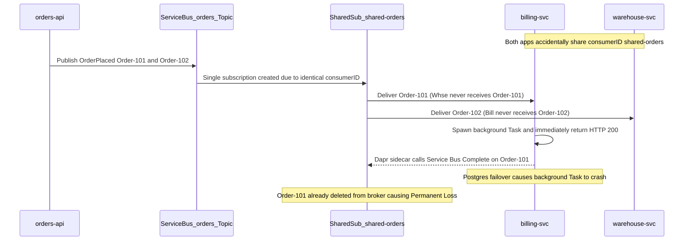

# Dapr Pub/Sub in Depth

> **Prerequisites:** Completion of [03-azure-event-grid](../03-azure-event-grid/README.md), Azure CLI with `containerapp` extension, Dapr fundamentals from Track 6 Module 05, and Secrets management from Track 6 Module 06.  
> **Estimated Reading Time:** 35 minutes  
> **Target Audience:** Backend Engineers, Microservices Developers, Container Apps / Kubernetes Engineers.

> [!TIP]
> **The Golden Rule of Dapr Pub/Sub:** Swap brokers exclusively in the component YAML (`componentType`) without touching application code, never hard-code broker credentials (`secretRef` only), lock down `publishingScopes`/`subscriptionScopes` per topic, and return HTTP `200` / `SUCCESS` *only after* your idempotent handler commits its side effect.

---

## Why This Matters

In track 6 module 05 you enabled Dapr, published to a topic, and it worked — backed by a default local component you never really looked at. That was enough to see the pattern; it is nowhere near enough to run it. This module opens the box: the **component model** that swaps the local broker for a real Service Bus topic (module 02) with a one-file change and *zero* app-code change, the **at-least-once** guarantee Dapr inherits and enforces, **topic-level access control**, and the honest trade-off of Dapr's abstraction versus the direct Service Bus SDK you'd otherwise write. The capstone requires a Dapr-pub/sub Container App consumer, so this is the module that makes that real.

> **Cost warning:** the exercises run Container Apps with Dapr sidecars against a real Service Bus **Standard** namespace. Container Apps scale to zero when idle (cheap) and Standard Service Bus is per-operation, so this is inexpensive — but delete the environment and namespace when done. Don't use Premium Service Bus.

---

## 1. Architectural Mental Model: Sidecar Abstraction, Broker Swappability & HTTP Ack Contract

Dapr places a sidecar process next to your application so your code speaks stable HTTP/gRPC endpoints (`localhost:3500`) while Dapr handles broker SDKs, `secretRef` auth, topic access control, and Service Bus PeekLock settlement translation:

```mermaid
flowchart LR
    PubApp["Publisher App (orders-api)"] -->|POST localhost:3500/v1.0/publish/orderpubsub/orders| PubSidecar["Dapr Sidecar (Enforces publishingScopes)"]
    PubSidecar -->|AMQP via pubsub.azure.servicebus.topics + secretRef| SBTopic["Azure Service Bus Topic: orders"]
    SBTopic -->|Sub per consumerID / app-id| SubSidecar["Worker Dapr Sidecar (PeekLock Receiver)"]
    SubSidecar -->|HTTP POST /orders (CloudEvent)| WorkerApp["Worker App (orders-worker)"]
    WorkerApp -->|200 SUCCESS| CompleteMsg["Dapr Calls SB Complete"]
    WorkerApp -->|5xx or RETRY| AbandonMsg["Dapr Calls SB Abandon"]
    WorkerApp -->|200 DROP| DeadLetterMsg["Dapr Calls SB DeadLetter / deadLetterTopic"]
```

### Core Concepts

#### The pub/sub building block and its component model

Dapr exposes **building blocks** — stable HTTP/gRPC APIs your app calls — and backs each with a swappable **component**. For pub/sub, your app always does the same two things regardless of broker: **publish** with `POST http://localhost:3500/v1.0/publish/<pubsub-name>/<topic>` and **subscribe** by declaring topics (via a subscription config or a `/dapr/subscribe` route) so Dapr **delivers** matching messages to an endpoint on your app. What broker sits behind `<pubsub-name>` is decided entirely by a **component** definition — a YAML resource of `type: pubsub.<something>`. In track 6 that was the default `pubsub.redis`/in-memory local component. Here you point the same `<pubsub-name>` at `pubsub.azure.servicebus.topics` and your app code **does not change** — this is the whole value of the building-block abstraction: swap infrastructure by editing a component, not the application.

```yaml
# a Dapr pub/sub component backed by Azure Service Bus topics
componentType: pubsub.azure.servicebus.topics
version: v1
metadata:
  - name: connectionString
    secretRef: sb-connection      # from a secret, never inline
scopes:
  - orders-api                    # only this app-id may use this component
  - orders-worker
```

This is the **exact** pub/sub component slot you configured in track 6 module 05 — same `<pubsub-name>` your app publishes to — now backed by a real Service Bus topic instead of the default local component. (In Azure Container Apps the component is defined at the *Environment* level and scoped to app-ids, exactly as you saw for Dapr components in track 6.)

#### At-least-once delivery, through Dapr

Dapr's pub/sub building block guarantees **at-least-once** delivery — the same guarantee as the underlying Service Bus (module 02), surfaced consistently across every broker Dapr supports. Mechanically: Dapr's sidecar pulls the message from Service Bus (PeekLock under the hood), **delivers it to your app's subscribe endpoint over HTTP**, and your app signals the outcome by its HTTP response — a `2xx` (or an explicit `SUCCESS` status) tells Dapr to **complete** the message; a non-2xx or `RETRY` status tells Dapr to let it be redelivered; `DROP` tells Dapr to dead-letter/discard it. So the "receive-but-never-complete" bug from module 02 becomes, in Dapr terms, "your subscribe handler returned a non-success (or timed out) so Dapr keeps redelivering." The consequence is the same and so is the cure: **idempotent consumers** (module 00), because at-least-once means your handler *will* see duplicates. Dapr also adds its own **resiliency** policies (retries/backoff/circuit breakers) on top, which you'll meet properly in module 05.

#### Topic access control and component scoping

Two layers of "who can do what" matter. First, **component scopes** (`scopes:` in the YAML above) restrict *which app-ids* can use the component at all — an app-id not listed simply can't publish or subscribe through it, the same app-id scoping you saw for Dapr components in track 6. Second, **topic-level access control**: a pub/sub component can declare, per topic, which app-ids are allowed to **publish** and which to **subscribe** (`publishingScopes`/`subscriptionScopes`, and `allowedTopics` to restrict the set of topics usable at all). This lets you enforce, in configuration, that only `orders-api` may publish to `orders` and only `orders-worker` may subscribe — without touching Service Bus's own SAS/RBAC. It's defense in depth: Service Bus controls access at the namespace/entity level (module 02's auth rules), and Dapr adds a topic-level policy layer your app team owns.

#### Dapr's abstraction vs. talking to Service Bus directly

The honest comparison. **Direct Service Bus SDK**: your code imports the client library, manages connections, receives with explicit PeekLock, and calls `CompleteAsync`/`AbandonAsync`/`DeadLetterAsync` — you get *full* control of every Service Bus feature (sessions, deferral, scheduled messages, transaction batching) but you're coupled to Service Bus and reimplement plumbing per service. **Dapr pub/sub**: your code does an HTTP POST to publish and receives an HTTP POST to consume — broker-agnostic, no SDK, trivially swappable (Service Bus in prod, Redis locally), consistent across languages, with retries/mTLS/tracing provided. The cost: Dapr exposes a **common denominator**, so broker-specific features (Service Bus sessions/ordering, deferral, scheduled enqueue) are either unavailable or need component metadata rather than rich API calls, and you add a sidecar (a small latency and operational component). Rule of thumb: reach for Dapr when portability, polyglot teams, and consistent cross-cutting concerns matter more than deep broker-specific features; reach for the direct SDK when you need Service Bus's advanced capabilities (e.g. strict session ordering) that the abstraction flattens away.

---

## 2. Taxonomic Comparison: Dapr vs. Direct SDK, Ack Contract & Command Reference

### Dapr Pub/Sub vs. Direct Azure Service Bus SDK

| Dimension | Dapr Pub/Sub Sidecar | Direct Azure Service Bus SDK |
| :--- | :--- | :--- |
| **App Portability** | High (swap Redis, Kafka, RabbitMQ, SB via YAML) | Coupled to Azure Service Bus AMQP/SDK APIs |
| **Polyglot Boilerplate** | Minimal (`POST /publish` + HTTP handler) | Must maintain SDK connection, lock renewal, DLQ per language |
| **Service Bus Sessions / Deferral** | Flattened / unavailable via standard pubsub API | Full control (`AcceptSession`, `DeferMessage`, `ScheduleMessage`) |
| **Access Control Layer** | App-level `scopes`, `allowedTopics`, `publishingScopes` | Namespace/Entity RBAC & SAS Policies |
| **Runtime Footprint** | Adds sidecar container per replica | Single process; zero sidecar hop |

### Dapr Subscriber Response Contract

| App HTTP Response | Dapr Sidecar Action | Underlying Service Bus PeekLock Action |
| :--- | :--- | :--- |
| `200 OK` (or `{"status":"SUCCESS"}`) | Marks delivery successful | Calls `Complete` (deletes message from subscription) |
| `200 OK` + `{"status":"RETRY"}` or HTTP `5xx` | Triggers retry / redelivery | Calls `Abandon` (increments `DeliveryCount`) |
| `200 OK` + `{"status":"DROP"}` or HTTP `404` | Discards or routes to `deadLetterTopic` | Calls `DeadLetter` (quarantines message) |

### Command Reference

| Command | What it does | Example |
| :--- | :--- | :--- |
| `az containerapp env dapr-component set` | Registers/updates a Dapr component in a Container Apps Environment from YAML | `az containerapp env dapr-component set -g rg-dapr -n env-dapr --dapr-component-name orderpubsub --yaml pubsub.yaml` |
| `az containerapp env dapr-component list` | Lists Dapr components in an Environment | `az containerapp env dapr-component list -g rg-dapr -n env-dapr -o table` |
| `az containerapp create ... --enable-dapr` | Creates an app with the Dapr sidecar (track 6) | `az containerapp create ... --enable-dapr --dapr-app-id orders-worker --dapr-app-port 80` |
| `curl .../v1.0/publish/...` | Publishes an event through the sidecar | `curl -X POST http://localhost:3500/v1.0/publish/orderpubsub/orders -H "Content-Type: application/json" -d '{"id":1}'` |
| `az servicebus topic subscription show` | Confirms Dapr created the underlying Service Bus subscription | `az servicebus topic subscription show -g rg-dapr --namespace-name <ns> --topic-name orders -n orders-worker` |

Field-by-field — the Service Bus pub/sub component YAML:
- `componentType: pubsub.azure.servicebus.topics` — selects the Service Bus *topics* pub/sub component (there's a separate `.queues` variant); this is the line that swaps the broker.
- `metadata: connectionString (secretRef)` — how Dapr reaches the namespace; **`secretRef`** pulls it from a configured secret store rather than hard-coding the connection string (the track 6 module 06 secrets lesson).
- `scopes:` — the app-ids allowed to use this component at all; an app-id absent here can't publish or subscribe through it.
- (optional) `metadata: consumerID` — sets the Service Bus **subscription name** Dapr uses; multiple app instances sharing one `consumerID` **compete** (scale-out), while different `consumerID`s each get their **own copy** (fan-out) — the module 01/02 competing-vs-fan-out distinction, expressed in Dapr metadata.

Field-by-field — a declarative subscription (tells Dapr to route a topic to a route):
- `topic: orders` — the Service Bus topic to subscribe to.
- `route: /orders` — the HTTP path on your app Dapr POSTs each message to.
- `pubsubname: orderpubsub` — which component (and thus which broker) this subscription uses.
- (optional) `deadLetterTopic:` — the topic Dapr routes messages to after retries are exhausted (module 05).

---

## 3. Production War Story Post-Mortem: The Premature `200 OK` & Shared `consumerID` Split-Brain

**Severity:** SEV-2  
**Detection Time:** 45 minutes (missing fulfillment records during a database failover drill)  
**Resolution Time:** 1 hour 10 minutes (removed shared `consumerID` override + switched subscriber to synchronous DB commit before returning `SUCCESS`)  
**Impact:** `billing-svc` and `warehouse-svc` shared an explicit `consumerID: shared-orders`, silently splitting traffic 50/50 instead of fanning out; additionally, an async fire-and-forget handler returned `200 OK` immediately before persisting, dropping 180 paid orders during a Postgres failover.

### What Happened



### Root Cause Analysis

1. **`consumerID` Override Collapsed Fan-Out:** Copy-pasting component YAML gave two distinct logical services the same `consumerID`, forcing Dapr to share one underlying Service Bus subscription (`shared-orders`) and turn pub/sub into competing consumers.
2. **Returning `200 OK` Before Durable Commit:** Spawning background work and immediately responding `200 OK` told the Dapr sidecar to complete/delete the message from Service Bus before the DB write succeeded.

### The Fix & Architectural Hardening

- Removed the explicit shared `consumerID` so each logical `dapr-app-id` receives its own dedicated Service Bus subscription (`billing-svc` and `warehouse-svc`), while replicas of each service share their app-id to compete horizontally.
- Refactored subscriber endpoints to commit the idempotent DB transaction synchronously *before* returning `{"status":"SUCCESS"}`, returning `{"status":"RETRY"}` on transient DB exceptions and `{"status":"DROP"}` on unparseable payloads.
- Configured `publishingScopes` and `subscriptionScopes` on the component YAML so unauthorized services cannot touch `orders`.

---

## 4. Multi-Language Production Implementation

Below is the **Dapr Pub/Sub Programmatic Subscription + CloudEvent Idempotent Consumer (`SUCCESS` / `RETRY` / `DROP`) + Sidecar Publisher** across Go, TypeScript, Python, and C#:

````carousel
```go
package daprpubsub

import (
	"bytes"
	"encoding/json"
	"net/http"
	"sync"
)

type CloudEventEnvelope struct {
	ID   string          `json:"id"`
	Data json.RawMessage `json:"data"`
}

var (
	seenMu sync.Mutex
	seen   = map[string]bool{}
)

func RegisterDaprRoutes(mux *http.ServeMux) {
	// 1. Programmatic Dapr subscription discovery
	mux.HandleFunc("/dapr/subscribe", func(w http.ResponseWriter, r *http.Request) {
		subs := []map[string]string{{
			"pubsubname":      "orderpubsub",
			"topic":           "orders",
			"route":           "/orders",
			"deadLetterTopic": "orders-dlq",
		}}
		w.Header().Set("Content-Type", "application/json")
		_ = json.NewEncoder(w).Encode(subs)
	})

	// 2. Idempotent subscribe handler returning Dapr ack statuses
	mux.HandleFunc("/orders", func(w http.ResponseWriter, r *http.Request) {
		var evt CloudEventEnvelope
		if err := json.NewDecoder(r.Body).Decode(&evt); err != nil || evt.ID == "" {
			w.Header().Set("Content-Type", "application/json")
			_, _ = w.Write([]byte(`{"status":"DROP"}`)) // Poison -> deadLetterTopic
			return
		}

		seenMu.Lock()
		alreadyProcessed := seen[evt.ID]
		if !alreadyProcessed {
			// Execute durable DB write before marking seen; return {"status":"RETRY"} on transient failure
			seen[evt.ID] = true
		}
		seenMu.Unlock()

		w.Header().Set("Content-Type", "application/json")
		_, _ = w.Write([]byte(`{"status":"SUCCESS"}`))
	})
}

func PublishOrder(orderJSON []byte) error {
	resp, err := http.Post("http://localhost:3500/v1.0/publish/orderpubsub/orders", "application/json", bytes.NewReader(orderJSON))
	if err != nil {
		return err
	}
	return resp.Body.Close()
}
```
<!-- slide -->
```typescript
import express, { Request, Response } from "express";

const app = express();
app.use(express.json({ type: ["application/json", "application/cloudevents+json"] }));

const processedEventIds = new Set<string>(); // Use durable DB table in prod

// Programmatic subscription declaration for Dapr sidecar
app.get("/dapr/subscribe", (_req: Request, res: Response) => {
  res.json([
    { pubsubname: "orderpubsub", topic: "orders", route: "/orders", deadLetterTopic: "orders-dlq" },
  ]);
});

app.post("/orders", async (req: Request, res: Response) => {
  const eventId: string | undefined = req.body?.id;
  const data = req.body?.data;

  if (!eventId || typeof data?.amount !== "number") {
    return res.status(200).json({ status: "DROP" }); // Permanent invalid message
  }

  if (processedEventIds.has(eventId)) {
    return res.status(200).json({ status: "SUCCESS" }); // Idempotent no-op
  }

  try {
    // Persist side effect synchronously before acking!
    processedEventIds.add(eventId);
    return res.status(200).json({ status: "SUCCESS" });
  } catch {
    return res.status(200).json({ status: "RETRY" }); // Transient DB outage -> redeliver
  }
});

export async function publishOrderPlaced(payload: unknown): Promise<void> {
  const resp = await fetch("http://localhost:3500/v1.0/publish/orderpubsub/orders", {
    method: "POST",
    headers: { "Content-Type": "application/json" },
    body: JSON.stringify(payload),
  });
  if (!resp.ok) throw new Error(`Dapr publish failed: ${resp.status}`);
}
```
<!-- slide -->
```python
from fastapi import FastAPI, Request
from fastapi.responses import JSONResponse
import httpx

app = FastAPI()
PROCESSED_IDS: set[str] = set()  # Replace with transactional SQL table in production


@app.get("/dapr/subscribe")
async def subscribe() -> list[dict]:
    return [
        {
            "pubsubname": "orderpubsub",
            "topic": "orders",
            "route": "/orders",
            "deadLetterTopic": "orders-dlq",
        }
    ]


@app.post("/orders")
async def handle_order(request: Request) -> JSONResponse:
    envelope = await request.json()
    event_id = envelope.get("id")
    data = envelope.get("data", {})

    if not event_id or "amount" not in data:
        return JSONResponse({"status": "DROP"})  # Poison payload -> DLQ

    if event_id in PROCESSED_IDS:
        return JSONResponse({"status": "SUCCESS"})  # Idempotent no-op

    try:
        # Execute durable business transaction synchronously here
        PROCESSED_IDS.add(event_id)
        return JSONResponse({"status": "SUCCESS"})
    except ConnectionError:
        return JSONResponse({"status": "RETRY"})  # Transient error -> redeliver


async def publish_order(order: dict) -> None:
    async with httpx.AsyncClient() as client:
        resp = await client.post(
            "http://localhost:3500/v1.0/publish/orderpubsub/orders",
            json=order,
        )
        resp.raise_for_status()
```
<!-- slide -->
```csharp
using System.Collections.Concurrent;
using System.Net.Http.Json;
using System.Text.Json;
using Microsoft.AspNetCore.Mvc;

[ApiController]
public sealed class OrdersDaprController : ControllerBase
{
    private static readonly ConcurrentDictionary<string, byte> ProcessedIds = new();

    [HttpGet("/dapr/subscribe")]
    public IActionResult Subscribe() => Ok(new[]
    {
        new { pubsubname = "orderpubsub", topic = "orders", route = "/orders", deadLetterTopic = "orders-dlq" }
    });

    [HttpPost("/orders")]
    public IActionResult HandleOrder([FromBody] JsonElement cloudEvent)
    {
        if (!cloudEvent.TryGetProperty("id", out var idProp) || idProp.GetString() is not string eventId)
            return Ok(new { status = "DROP" }); // Permanent validation failure

        if (!ProcessedIds.TryAdd(eventId, 1))
            return Ok(new { status = "SUCCESS" }); // Duplicate redelivery -> safe no-op

        try
        {
            // Commit durable DB work synchronously before returning SUCCESS
            return Ok(new { status = "SUCCESS" });
        }
        catch (TimeoutException)
        {
            ProcessedIds.TryRemove(eventId, out _);
            return Ok(new { status = "RETRY" }); // Transient fault -> redeliver
        }
    }

    public static async Task PublishOrderAsync(HttpClient http, object order)
    {
        var resp = await http.PostAsJsonAsync("http://localhost:3500/v1.0/publish/orderpubsub/orders", order);
        resp.EnsureSuccessStatusCode();
    }
}
```
````

---

## 5. Practical Hands-On Verification CLI Workflows

These reuse the Container Apps + Dapr skills from track 6 module 05 and the Service Bus namespace from module 02. Container Apps scale to zero, so cost is minimal; still, clean up at the end.

1. **Provision the broker and environment.**
   ```powershell
   az group create -n rg-dapr -l eastus
   az servicebus namespace create -g rg-dapr -n sb-dapr-$RANDOM --sku Standard
   az containerapp env create -g rg-dapr -n env-dapr -l eastus
   ```
   Get the namespace connection string:
   ```powershell
   az servicebus namespace authorization-rule keys list -g rg-dapr --namespace-name <ns> -n RootManageSharedAccessKey --query primaryConnectionString -o tsv
   ```

   **Expected Output:**
   ```text
   Endpoint=sb://<ns>.servicebus.windows.net/;SharedAccessKeyName=RootManageSharedAccessKey;SharedAccessKey=...
   ```

2. **Write and register the Service Bus pub/sub component.** Create `pubsub.yaml` for a Container Apps Dapr component (the ACA schema wraps the metadata; store the connection string as a **secret**, not inline):
   ```yaml
   # pubsub.yaml (Azure Container Apps Dapr component schema)
   componentType: pubsub.azure.servicebus.topics
   version: v1
   secrets:
     - name: sb-connection
       value: "<paste-connection-string>"   # for the lab; use Key Vault in prod (track 6 m06)
   metadata:
     - name: connectionString
       secretRef: sb-connection
   scopes:
     - publisher
     - orders-worker
   ```
   ```powershell
   az containerapp env dapr-component set -g rg-dapr -n env-dapr --dapr-component-name orderpubsub --yaml pubsub.yaml
   az containerapp env dapr-component list -g rg-dapr -n env-dapr -o table
   ```

   **Expected Output:**
   ```text
   Name         ComponentType                      Version
   -----------  ---------------------------------  ---------
   orderpubsub  pubsub.azure.servicebus.topics     v1
   ```

   > Verify: `orderpubsub` appears. This is the same pub/sub component slot from track 6 module 05, now `pubsub.azure.servicebus.topics` instead of the default local component — **and you changed no application code to do it.**

3. **Deploy a subscriber app with a declarative subscription.** Deploy any small HTTP app as `orders-worker` with Dapr enabled and a subscription routing topic `orders` → `/orders`. (A minimal echo/logging container that returns 200 on `/orders` is enough to observe delivery.)
   ```powershell
   az containerapp create -g rg-dapr -n orders-worker --environment env-dapr `
     --image <your-subscriber-image> --target-port 80 --ingress internal `
     --enable-dapr --dapr-app-id orders-worker --dapr-app-port 80
   az servicebus topic subscription list -g rg-dapr --namespace-name <ns> --topic-name orders -o table
   ```

   **Expected Output:**
   ```text
   Name           Status    MaxDeliveryCount
   -------------  --------  ------------------
   orders-worker  Active    10
   ```

   > Verify: the app shows Dapr enabled (`--query properties.configuration.dapr`), and once it subscribes, Dapr **creates a Service Bus subscription** named after it — confirm with `az servicebus topic subscription list ... --topic-name orders -o table`. Dapr provisioned the topic/subscription for you.

4. **Publish an event through the sidecar and watch it flow.** Exec into a Dapr-enabled `publisher` app (or the worker) and publish:
   ```powershell
   az containerapp exec -g rg-dapr -n publisher --command "/bin/sh"
   # inside:
   # curl -X POST http://localhost:3500/v1.0/publish/orderpubsub/orders -H "Content-Type: application/json" -d '{"id":1,"amount":500}'
   ```

   **Expected Output:**
   ```text
   HTTP/1.1 204 No Content
   ```

   > Verify: the `orders-worker` logs show it received the message on `/orders` (`az containerapp logs show -n orders-worker -g rg-dapr`). The message went app → sidecar → **Service Bus topic** → sidecar → app, all via HTTP with no Service Bus SDK in your code.

5. **Prove the broker really is Service Bus.** While a message is unprocessed (make the worker return non-2xx briefly, or check between publishes), inspect the Service Bus subscription counters:
   ```powershell
   az servicebus topic subscription show -g rg-dapr --namespace-name <ns> --topic-name orders -n orders-worker --query countDetails
   ```

   **Expected Output:**
   ```json
   {
     "activeMessageCount": 1,
     "deadLetterMessageCount": 0
   }
   ```

   > Verify: you can see the same `activeMessageCount`/`deadLetterMessageCount` you learned in module 02 — Dapr is genuinely driving a Service Bus topic, not an abstraction hiding a different mechanism.

6. **Competing vs. fan-out via `consumerID`.** Note that scaling `orders-worker` to multiple replicas keeps **one** Service Bus subscription (they *compete* — each message handled once). Add a second app with a **different** `dapr-app-id` subscribing to the same topic and observe it gets its **own** subscription (fan-out — its own copy). Write down which module 01/02 concept each corresponds to.
   > Verify: replicas of one app-id share a subscription (competing consumers); distinct app-ids each get an independent subscription (pub/sub fan-out).

7. **Add topic access control.** Update the component to restrict publishing to the `publisher` app-id and subscribing to `orders-worker` (per-topic scopes), re-set the component, and attempt to publish from an app-id that isn't allowed.
   > Verify: the disallowed publish is rejected by Dapr *before* it reaches Service Bus — access control enforced at the Dapr layer, on top of Service Bus's own auth.

8. **Diagnose and fix: a duplicate side effect from a non-idempotent consumer.** Make `orders-worker` perform a side effect that isn't idempotent — e.g. increment a counter (or append a row) on each `/orders` call — and make it occasionally return a non-2xx *after* doing the side effect but *before* acking. Publish one message.
   > Observe: Dapr redelivers (at-least-once) because the handler didn't return success, and the counter increments **twice** for one logical event — a duplicate side effect. **Diagnose**: the consumer isn't idempotent and the delivery guarantee is at-least-once, so a redelivery double-applied the effect. **Fix**: make the handler idempotent — record the event's id (Dapr/CloudEvents `id`) and skip if already processed, *then* return 2xx — so a redelivery is a safe no-op. This is module 00's idempotency lesson made painfully concrete, and exactly what the capstone asks you to design.

9. **Clean up.**
   ```powershell
   az group delete -n rg-dapr --yes --no-wait
   ```

   **Expected Output:**
   ```text
   (Deletion initiated asynchronously; verify with 'az containerapp env list' and 'az servicebus namespace list')
   ```

   > Verify: the environment and namespace are gone (`az containerapp env list`, `az servicebus namespace list`).

### Independent Challenge

Take a two-service scenario — a `publisher` that emits `OrderPlaced` and an `orders-worker` that reacts — and build it on Container Apps with a **Service Bus-backed Dapr pub/sub component**, reusing your track 6 module 05 muscle memory for enabling Dapr and the Service Bus knowledge from module 02 for the broker. Requirements: the component must load its connection string from a **secret** (not inline — track 6 module 06), enforce **topic-level access control** so only the publisher can publish and only the worker can subscribe, and the worker must be **idempotent** (prove it by publishing the same logical event twice and showing the side effect happens once). Then write a short paragraph: name one Service Bus feature you'd *lose* by staying on the Dapr abstraction and when that would push you to the direct SDK instead. Delete the resource group when done — the Standard Service Bus namespace bills per operation while it exists.

<details><summary>Stuck? One hint</summary>

To prove idempotency without a database, have the worker keep a small in-memory or state-store set of processed event ids keyed on the CloudEvents `id` Dapr attaches to every message (Dapr wraps published payloads in a CloudEvents envelope by default). On each delivery, check the set: if the id is present, return 200 immediately (a no-op ack); otherwise do the side effect, add the id, then return 200. Publishing the "same" event twice means sending the same `id` — the second delivery hits the dedup check and the side effect stays at one. The Service Bus feature you most obviously give up is **session-based strict ordering**, which the pub/sub abstraction doesn't surface.

</details>

---

## 6. Common Mistakes & Troubleshooting

- **Editing app code to change brokers.** The point of the building block is you *don't* — you change the **component** YAML (`componentType` + metadata). If you're rewriting app code to switch from Redis to Service Bus, you've missed the abstraction.
- **Inlining the connection string.** Put it in a secret/`secretRef` (track 6 module 06). A plaintext connection string in a component definition is the same leak you learned to avoid for Container Apps secrets.
- **Assuming Dapr gives exactly-once.** It's **at-least-once**, like the broker beneath it. Non-idempotent handlers double-apply on redelivery — the exact bug in exercise 8.
- **Returning 2xx before the work is durably done.** If your handler acks (200) before the side effect is committed and then crashes, you've effectively dropped the message. Ack only after the effect is safely persisted.
- **Confusing `consumerID` semantics.** Same `consumerID` = competing consumers (one copy shared); different `consumerID`/app-id = fan-out (a copy each). Getting this backwards means either duplicate processing or missed messages.
- **Cost pitfall — the sidecar and the broker.** Every Dapr-enabled replica runs a sidecar; keeping min-replicas > 0 on many apps for a lab bills continuously (the track 6 module 05 canary-warm-replica lesson). And it's still a real Service Bus namespace underneath — Standard is cheap, Premium is not; scale to zero and delete when done.

---

## 7. Operational Validation Checkpoints

### Production Scenario Drills

<details><summary><strong>Scenario 1: Returning HTTP 500 vs. `{"status":"DROP"}` on Malformed Payloads</strong></summary>

**Situation:** Your Dapr subscriber `/orders` receives a message whose `amount` field is `"invalid-number"`. The handler throws an unhandled `JsonException` and returns HTTP `500 Internal Server Error`. Thirty seconds later, the exact same payload fails again, repeating until Service Bus `MaxDeliveryCount` expires.

**What went wrong & fix:** Returning `500` signals Dapr `RETRY`—appropriate for transient DB timeouts, wasteful for permanent validation bugs. Catch schema/validation errors explicitly and return HTTP `200 OK` with `{"status": "DROP"}` (ideally paired with `deadLetterTopic` on the subscription) so Dapr immediately dead-letters the poison message on attempt 1.

</details>

<details><summary><strong>Scenario 2: Unauthorized Microservice Publishing to Protected Topic</strong></summary>

**Situation:** A shared Container Apps environment hosts `orders-api`, `orders-worker`, and `reporting-cron`. Both `orders-api` and `reporting-cron` are listed under component `scopes:` because `reporting-cron` needs to subscribe to `orders`. You must guarantee `reporting-cron` can **never** publish fake events to `orders`.

**What went wrong & fix:** Component-level `scopes:` grants full publish+subscribe access to the component. Add **topic-level access control** metadata inside the pub/sub component: `publishingScopes: orders-api=orders` and `subscriptionScopes: orders-worker=orders;reporting-cron=orders` (plus `allowedTopics: orders`). Dapr's sidecar enforces the ACL before any message reaches Service Bus.

</details>

<details><summary><strong>Scenario 3: Scaling `orders-worker` vs. Adding `fraud-worker`</strong></summary>

**Situation:** `orders-worker` scales from 1 to 4 replicas via KEDA on Service Bus backlog, while a brand-new `fraud-worker` Container App is deployed to also score every `OrderPlaced` event.

**What went wrong & fix:** Ensure neither app hard-codes a shared `consumerID` in component metadata. The 4 replicas of `orders-worker` share `dapr-app-id: orders-worker` (mapping to one Service Bus subscription `orders-worker`, **competing consumers**), while `fraud-worker` uses `dapr-app-id: fraud-worker` (getting its own independent Service Bus subscription `fraud-worker`, **pub/sub fan-out**).

</details>

### Checkpoint Quiz

Write down your answer to each question before expanding it — checking without attempting first is the single easiest way to fool yourself into thinking you've learned this.

1. What is the one thing you change to back a Dapr pub/sub topic with Service Bus instead of the default local broker, and what do you *not* change?
2. Dapr pub/sub gives which delivery guarantee, and how does your subscribe handler tell Dapr to complete vs. retry a message?
3. Explain the two layers of access control: component `scopes` vs. topic-level publish/subscribe scopes.
4. How does `consumerID` decide whether two subscribers compete or fan out, and which module 01/02 concepts are those?
5. Name one Service Bus feature you give up by using the Dapr abstraction, and when that loss would justify using the SDK directly.
6. A message keeps getting redelivered to your Dapr consumer. In Dapr terms, what did the handler most likely do?
7. Your consumer double-applied a side effect after a redelivery. What's the root cause and the fix?

<details><summary>Show answers</summary>

1. You change the **component** definition (`componentType: pubsub.azure.servicebus.topics` plus its metadata/connection). You do **not** change application code — the publish/subscribe API stays identical.
2. **At-least-once.** The handler returns a `2xx` / `SUCCESS` to have Dapr **complete** the message, a non-2xx / `RETRY` to have it **redelivered**, or `DROP` to dead-letter/discard it.
3. Component **`scopes`** restrict which *app-ids* may use the component at all. **Topic-level scopes** (`publishingScopes`/`subscriptionScopes`, `allowedTopics`) restrict, per topic, which app-ids may publish and which may subscribe — a finer, per-topic policy layer on top.
4. Subscribers sharing a `consumerID` map to **one** Service Bus subscription and **compete** (each message once — competing consumers, module 01/02); different `consumerID`s/app-ids get **separate** subscriptions and each receives its own copy (**fan-out** pub/sub).
5. E.g. **session-based strict ordering** (also deferral, scheduled enqueue) — the abstraction flattens these away. If your workflow needs guaranteed per-key FIFO, that justifies dropping to the Service Bus SDK directly.
6. The handler **returned a non-success (or timed out)** on the subscribe route, so Dapr treated it as a failure and, under at-least-once, redelivered.
7. Root cause: the consumer isn't **idempotent** and delivery is at-least-once, so a redelivery re-ran the side effect. Fix: dedup on the event id (record processed ids, skip if seen) and only then return success, making redelivery a safe no-op.

</details>

---

## Further Reading & Sources

- Dapr Pub/Sub building block, Azure Service Bus Topics component spec, and Topic Access Control (`publishingScopes` / `subscriptionScopes`).

## Next

[05-reliability-patterns](../05-reliability-patterns/README.md) — the patterns that make at-least-once delivery survivable in production: retry with backoff, dead-lettering done deliberately, the **outbox pattern** for consistency between a database write and an event publish, and poison-message handling — pulling together everything from modules 02-04.
