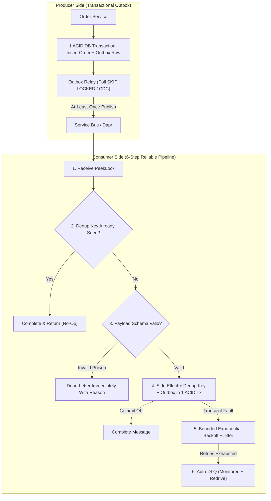
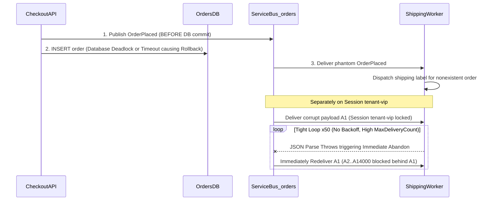

# Reliability Patterns

> **Prerequisites:** Completion of Modules 00–04 ([04-dapr-pubsub-in-depth](../04-dapr-pubsub-in-depth/README.md)), Azure Service Bus Standard namespace access, and relational SQL ACID transaction knowledge.  
> **Estimated Reading Time:** 40 minutes  
> **Target Audience:** Senior Backend Engineers, Distributed Systems Developers, Site Reliability Engineers (SREs).

> [!TIP]
> **The Golden Rule of Reliable Eventing:** Eliminate dual-write gaps with a **Transactional Outbox** (business write + outbox row in one local DB transaction), distinguish **transient** faults (bounded exponential backoff + jitter + circuit breaker) from **permanent** poison payloads (immediate dead-letter with reason), and pair every outbox relay with **idempotent consumers** and a **monitored, tested Dead-Letter Queue** with a documented redrive path.

---

## Why This Matters

At-least-once delivery (modules 00, 02, 04) is a promise with sharp edges: messages retry, duplicate, get stuck, and fail in ways your happy path never sees. This module is the toolbox that turns that promise into a system you can run: **retry with backoff** so transient failures self-heal instead of hammering a struggling dependency, **dead-lettering** so unprocessable messages are quarantined not lost, the **outbox pattern** so a database write and the event announcing it can't disagree, and **poison-message handling** so one bad message doesn't wedge a whole consumer. These are the patterns behind every "proven dead-letter handling" and "idempotent consumer" line in the capstone.

> **Cost warning:** exercises use a Service Bus **Standard** namespace and, optionally, a Container Apps Dapr consumer (module 04). Both are cheap at lab volume, but a **retry storm** (a consumer failing fast in a tight loop, or Dapr retrying aggressively) generates real per-operation charges and log volume — fix failing consumers promptly and clean up at the end.

---

## 1. Architectural Mental Model: Transactional Outbox & 6-Step Reliable Consumer

Reliability spans both sides of the broker: the **Transactional Outbox** prevents lost or phantom events across DB + broker, while the **6-Step Reliable Consumer** handles duplicates, poison payloads, and transient faults without wedging queues:



### Core Concepts

#### Retry with backoff (and jitter)

When a consumer fails to process a message because a dependency is *temporarily* unavailable (a database blip, a rate limit, a downstream 503), the right move is to **retry** — but *how* you retry matters. Immediate, unbounded retries turn a struggling dependency into a downed one (a self-inflicted DDoS) and burn per-operation cost. The pattern is **exponential backoff**: wait 1s, then 2s, 4s, 8s… up to a cap, so pressure on the dependency eases as it struggles, plus **jitter** (a random spread) so a thousand consumers that failed at the same instant don't retry in a synchronized thundering herd. Crucially, distinguish **transient** failures (retry — the dependency will likely recover) from **permanent** ones (a malformed message will *never* succeed no matter how many retries — that's a poison message, below). In Service Bus, retry is driven by not-completing so the message is redelivered; in Dapr, by **resiliency policies** (retry/backoff/circuit-breaker config) applied to the component. The skill is bounding retries so a permanent failure eventually stops retrying and gets dead-lettered instead of looping forever.

#### Dead-lettering as a deliberate design, not an accident

You met the DLQ in module 02 (Service Bus) and Event Grid's dead-letter storage in module 03. The pattern-level point: **dead-lettering is where messages go to be *seen*, not to disappear.** A message should be dead-lettered when retries are exhausted (transient failure that never cleared) or immediately when it's recognized as unprocessable (a poison message). A well-designed system treats the DLQ as an operational surface: its **depth is monitored and alerted** (module 07), each dead-lettered message carries a **reason** (`DeadLetterReason`, `DeadLetterErrorDescription`) explaining *why*, and there's a defined **redrive** path — inspect, fix the root cause, and either resubmit the message to the main entity or discard it deliberately. "Set MaxDeliveryCount and never look at the DLQ" is the anti-pattern that quietly loses business events (module 02's diagnose-and-fix). Dead-lettering is only reliable if someone (or an alert) is watching the letterbox.

#### The outbox pattern: consistency between a DB write and an event publish

Here's the trap at the heart of event-driven systems. Your service needs to do two things atomically: **write to its database** (`order saved`) and **publish an event** (`OrderPlaced`). But the database and the message broker are two different systems — there's no shared transaction. If you write the DB then publish and crash in between, the order exists but no one is notified (a **lost event**). If you publish then write and crash between, consumers react to an order that doesn't exist (a **phantom event**). This is the **dual-write problem**, and it has no solution as long as you try to write both directly.

The **outbox pattern** solves it: within the **same database transaction** that saves the order, also insert the event into an **outbox table** in that same database. That single local transaction is atomic — either both the order and the outbox row commit, or neither does. A **separate relay process** (a poller, or a change-data-capture stream off the DB log) then reads unpublished outbox rows and publishes them to the broker, marking each published. Because the relay publishes **at-least-once** (it may crash after publishing but before marking, and re-publish), consumers must be **idempotent** (module 00) — the outbox guarantees the event is *never lost*, and idempotency handles the *duplicate*. Outbox + idempotent consumer is the workhorse recipe for reliable event-driven services.

#### Poison messages and how to stop one wedging a consumer

A **poison message** is one that *can never* be processed successfully — malformed JSON, a reference to a deleted entity, a schema the consumer doesn't understand (module 06). The danger: a naive consumer receives it, fails, doesn't complete it, receives it *again* (at-least-once), fails again… and if it's at the head of an ordered/session queue, it **blocks every message behind it** — a single bad message wedges the whole consumer. The defenses stack:

- **Bound the retries** (`MaxDeliveryCount`): after N attempts the broker auto-dead-letters it, so it stops blocking (module 02).
- **Detect and dead-letter immediately**: if the consumer can *tell* a message is permanently bad (parse error, validation failure), explicitly dead-letter it on the first attempt with a clear reason — don't waste N retries on something that will never succeed.
- **Catch-and-quarantine in code**: wrap processing so an unexpected exception dead-letters (or routes to an error topic) with context, rather than throwing in a way that just abandons and re-loops.

The capstone requires you to *force* a poison message and prove your dead-lettering actually catches it — because a dead-letter path you've never tested is a dead-letter path that doesn't work.

#### Putting it together: the reliable consumer shape

A production consumer composes all of the above with the idempotency from module 00 into one shape: **(1)** receive; **(2)** check the dedup key — already processed? complete and return (idempotent no-op); **(3)** validate — malformed? dead-letter immediately with a reason (poison); **(4)** do the side effect and record the dedup key **in one transaction** (and if this service also emits events, write them to the **outbox** in that same transaction); **(5)** on transient failure, let it retry with backoff up to a bound; **(6)** on exhausted retries, it dead-letters automatically. Every element of this shape is one of the patterns above, and this is essentially the consumer the capstone asks you to design and defend.

---

## 2. Taxonomic Comparison: Failure Classification, Outbox Strategies & Command Reference

### Failure Taxonomy & Automated Response

| Failure Type | Root Example | Correct Reliability Action | Anti-Pattern to Avoid |
| :--- | :--- | :--- | :--- |
| **Transient Dependency Fault** | Downstream HTTP 503, SQL deadlock, network timeout | Exponential backoff + jitter + circuit breaker up to bounded `MaxDeliveryCount` | Immediate unbounded tight-loop retries (retry storm) |
| **Permanent Poison Payload** | Invalid JSON, missing required ID, deleted foreign entity | Call `DeadLetter` immediately on attempt 1 with `DeadLetterReason` | Abandoning repeatedly and wasting N broker attempts |
| **Ordered Head-of-Line Blocker** | Corrupt message at head of a `SessionId` queue | Immediate `DeadLetter` or strict low `MaxDeliveryCount` (e.g. 3) | High/infinite retry count wedging all subsequent messages in session |
| **Stale / Expired Work** | Flash-sale notification delayed past relevance window | Set `--default-message-time-to-live` + `--dead-lettering-on-message-expiration true` | Letting expired messages vanish silently without DLQ audit |
| **Dual-Write Crash** | App commits DB order then crashes before broker publish | Transactional Outbox table + relay + idempotent downstream consumers | Separate DB commit + HTTP/AMQP publish calls |

### Outbox Relay Implementation Trade-Offs

| Approach | How It Reads Outbox | Latency & DB Overhead | Operational Complexity |
| :--- | :--- | :--- | :--- |
| **Polling Relay (`SKIP LOCKED`)** | Background worker queries `WHERE published_at IS NULL ORDER BY id LIMIT 100 FOR UPDATE SKIP LOCKED` | Sub-second to few seconds; low load with partial index | Low — simple code in existing service/worker |
| **Log-Based CDC (Debezium / Change Feed)** | Tails database WAL / transaction log directly | Milliseconds; zero polling SQL overhead | Higher — requires Kafka Connect / CDC connector cluster |

### Command Reference

| Command | What it does | Example |
| :--- | :--- | :--- |
| `az servicebus queue create --max-delivery-count` | Bounds retries before auto-dead-letter (poison defense) | `az servicebus queue create -g rg-rel --namespace-name <ns> -n work --max-delivery-count 3` |
| `az servicebus queue show --query countDetails` | Reads active + dead-letter depth | `az servicebus queue show -g rg-rel --namespace-name <ns> -n work --query countDetails` |
| `az servicebus queue create --default-message-time-to-live` | Sets TTL; expired messages dead-letter (with DLQ-on-expiry enabled) | `az servicebus queue create ... --default-message-time-to-live PT1H --dead-lettering-on-message-expiration true` |
| `az monitor metrics list` | Reads Service Bus metrics like DeadletteredMessages for alerting | `az monitor metrics list --resource <ns-id> --metric DeadletteredMessages` |
| Dapr resiliency YAML | Declares retry/backoff/circuit-breaker policies for a component | see breakdown below |

Field-by-field — a Dapr **resiliency** policy applied to the pub/sub component:

```yaml
# resiliency.yaml (Dapr)
spec:
  policies:
    retries:
      pubsubRetry:
        policy: exponential          # exponential backoff, not constant
        maxInterval: 30s             # cap the backoff growth
        maxRetries: 5                # bound it — then it stops (→ dead-letter)
    circuitBreakers:
      pubsubCB:
        maxRequests: 1
        trip: consecutiveFailures >= 5   # stop hammering a dead dependency
  targets:
    components:
      orderpubsub:
        inbound:
          retry: pubsubRetry
          circuitBreaker: pubsubCB
```

- `policy: exponential` — exponential backoff (vs. `constant`), the pattern from Concepts; add spacing that grows with each failure.
- `maxInterval: 30s` — caps how large the backoff delay can grow.
- `maxRetries: 5` — **bounds** retries so a permanent failure eventually stops retrying (and the message can be dead-lettered) instead of looping forever.
- `circuitBreaker: trip: consecutiveFailures >= 5` — after repeated failures, *stop sending* to the dependency for a cooldown, so you don't hammer something that's down (the retry-storm defense).

Flag breakdown — `az servicebus queue create ... --default-message-time-to-live PT1H --dead-lettering-on-message-expiration true`:
- `--default-message-time-to-live PT1H` — messages live 1 hour (ISO-8601 duration); after that they're expired.
- `--dead-lettering-on-message-expiration true` — expired messages go to the **DLQ** (with reason `TTLExpiredException`) instead of vanishing — so "too old to be relevant" is still *observable*, not silently lost.

---

## 3. Production War Story Post-Mortem: The Phantom Shipment & Session Poison Wedge

**Severity:** SEV-1  
**Detection Time:** 38 minutes (warehouse shipping labels generated for unpaid/rolled-back checkout orders + VIP tenant freeze)  
**Resolution Time:** 2 hours 10 minutes (manual shipment cancellation + poison message purged from session + outbox & backoff deployed)  
**Impact:** 640 phantom orders shipped after DB rollbacks following premature broker publishes, while 1 corrupt UTF-8 message at the head of session `tenant-vip` wedged 14,000 tenant events in a zero-backoff retry loop costing \$420 in Service Bus operations.

### What Happened



### Root Cause Analysis

1. **Dual-Write Anti-Pattern:** `CheckoutAPI` published `OrderPlaced` *before* committing Postgres. When DB lock contention rolled back the transaction, the phantom event was already queued.
2. **Unbounded Immediate Poison Retries on Ordered Session:** `ShippingWorker` caught parse errors lazily and called `Abandon` immediately without exponential backoff or immediate dead-lettering, blocking `tenant-vip` head-of-line and driving millions of billable operations.

### The Fix & Architectural Hardening

- Replaced dual-write publishing with an atomic **Transactional Outbox** (`orders` + `outbox_events` in one local transaction) drained by a relay worker.
- Updated `ShippingWorker` to dead-letter malformed payloads immediately on attempt 1 (`DeadLetterReason = "MalformedPayload"`), set `--max-delivery-count 5`, and added exponential backoff + full jitter plus Dapr circuit breakers (`consecutiveFailures >= 5`).
- Enabled Azure Monitor alerts on `DeadletteredMessages > 0` and documented the DLQ redrive runbook.

---

## 4. Multi-Language Production Implementation

Below is the complete **Transactional Outbox Atomic Write + 6-Step Reliable Consumer with Full-Jitter Exponential Backoff** across Go, TypeScript, Python, and C#:

````carousel
```go
package reliability

import (
	"context"
	"database/sql"
	"encoding/json"
	"math"
	"math/rand"
	"time"
)

// CreateOrderWithOutbox writes business state + outbox event in ONE atomic ACID transaction.
func CreateOrderWithOutbox(ctx context.Context, db *sql.DB, orderID string, amountCents int64) error {
	tx, err := db.BeginTx(ctx, nil)
	if err != nil {
		return err
	}
	defer tx.Rollback()

	if _, err := tx.ExecContext(ctx, `INSERT INTO orders (id, amount_cents) VALUES ($1, $2)`, orderID, amountCents); err != nil {
		return err
	}
	payload, _ := json.Marshal(map[string]any{"orderId": orderID, "amountCents": amountCents})
	if _, err := tx.ExecContext(ctx,
		`INSERT INTO outbox_events (event_id, event_type, payload) VALUES (gen_random_uuid(), 'OrderPlaced', $1)`, payload,
	); err != nil {
		return err
	}
	return tx.Commit()
}

// FullJitterBackoff computes bounded exponential backoff with random jitter before retry.
func FullJitterBackoff(attempt int, base, maxDelay time.Duration) time.Duration {
	exp := float64(base) * math.Pow(2, float64(attempt))
	if exp > float64(maxDelay) {
		exp = float64(maxDelay)
	}
	return time.Duration(rand.Float64() * exp)
}
```
<!-- slide -->
```typescript
import { Pool } from "pg";

export async function createOrderWithOutbox(pool: Pool, orderId: string, amountCents: number): Promise<void> {
  const client = await pool.connect();
  try {
    await client.query("BEGIN");
    await client.query(`INSERT INTO orders (id, amount_cents) VALUES ($1, $2)`, [orderId, amountCents]);
    await client.query(
      `INSERT INTO outbox_events (event_id, event_type, payload) VALUES (gen_random_uuid(), 'OrderPlaced', $1)`,
      [JSON.stringify({ orderId, amountCents })]
    );
    await client.query("COMMIT"); // Both commit atomically or neither commits
  } catch (err) {
    await client.query("ROLLBACK");
    throw err;
  } finally {
    client.release();
  }
}

export function fullJitterBackoffMs(attempt: number, baseMs = 500, maxMs = 30_000): number {
  const ceiling = Math.min(maxMs, baseMs * Math.pow(2, attempt));
  return Math.floor(Math.random() * ceiling);
}
```
<!-- slide -->
```python
import json
import random
import uuid
import psycopg


def create_order_with_outbox(conn: psycopg.Connection, order_id: str, amount_cents: int) -> None:
    """Writes order + outbox row atomically in a single local transaction."""
    with conn.transaction():
        conn.execute("INSERT INTO orders (id, amount_cents) VALUES (%s, %s)", (order_id, amount_cents))
        conn.execute(
            "INSERT INTO outbox_events (event_id, event_type, payload) VALUES (%s, %s, %s)",
            (str(uuid.uuid4()), "OrderPlaced", json.dumps({"orderId": order_id, "amountCents": amount_cents})),
        )


def full_jitter_backoff_seconds(attempt: int, base_sec: float = 0.5, max_sec: float = 30.0) -> float:
    """Computes bounded exponential backoff with full jitter to avoid thundering herds."""
    ceiling = min(max_sec, base_sec * (2 ** attempt))
    return random.uniform(0.0, ceiling)
```
<!-- slide -->
```csharp
using System.Text.Json;
using Npgsql;

public static class OutboxOrderRepository
{
    public static async Task CreateOrderWithOutboxAsync(
        NpgsqlDataSource db, string orderId, long amountCents, CancellationToken ct)
    {
        await using var conn = await db.OpenConnectionAsync(ct);
        await using var tx = await conn.BeginTransactionAsync(ct);

        await using var orderCmd = new NpgsqlCommand(
            "INSERT INTO orders (id, amount_cents) VALUES (@id, @amt)", conn, tx);
        orderCmd.Parameters.AddWithValue("id", orderId);
        orderCmd.Parameters.AddWithValue("amt", amountCents);
        await orderCmd.ExecuteNonQueryAsync(ct);

        await using var outboxCmd = new NpgsqlCommand(
            "INSERT INTO outbox_events (event_id, event_type, payload) VALUES (@eid, 'OrderPlaced', @payload::jsonb)",
            conn, tx);
        outboxCmd.Parameters.AddWithValue("eid", Guid.NewGuid());
        outboxCmd.Parameters.AddWithValue("payload", JsonSerializer.Serialize(new { orderId, amountCents }));
        await outboxCmd.ExecuteNonQueryAsync(ct);

        await tx.CommitAsync(ct);
    }

    public static TimeSpan FullJitterBackoff(int attempt, TimeSpan baseDelay, TimeSpan maxDelay)
    {
        double ceilingMs = Math.Min(maxDelay.TotalMilliseconds, baseDelay.TotalMilliseconds * Math.Pow(2, attempt));
        return TimeSpan.FromMilliseconds(Random.Shared.NextDouble() * ceilingMs);
    }
}
```
````

---

## 5. Practical Hands-On Verification CLI Workflows

These build on the Service Bus namespace (module 02) and, optionally, the Dapr consumer (module 04). Use the portal Explorer to send/receive where no code is implied. Cleanup is last.

1. **Set up.**
   ```powershell
   az group create -n rg-rel -l eastus
   az servicebus namespace create -g rg-rel -n sb-rel-$RANDOM --sku Standard
   az servicebus queue create -g rg-rel --namespace-name <ns> -n work --max-delivery-count 3
   ```

   **Expected Output:**
   ```json
   {
     "name": "work",
     "maxDeliveryCount": 3,
     "status": "Active"
   }
   ```

2. **Watch bounded retry → auto-dead-letter.** Send a message to `work`. In the Explorer, Receive-in-PeekLock and **Abandon** it repeatedly (simulating transient failure).
   ```powershell
   az servicebus queue show -g rg-rel --namespace-name <ns> -n work --query countDetails
   ```

   **Expected Output:**
   ```json
   {
     "activeMessageCount": 0,
     "deadLetterMessageCount": 1
   }
   ```

   > Verify: after 3 delivery attempts the message leaves `activeMessageCount` and appears in `deadLetterMessageCount` — **bounded retry prevented an infinite loop.** Peek the DLQ and read `DeadLetterReason` = `MaxDeliveryCountExceeded`.

3. **Dead-letter on TTL expiry.** Create a queue with a short TTL and DLQ-on-expiry:
   ```powershell
   az servicebus queue create -g rg-rel --namespace-name <ns> -n perishable --default-message-time-to-live PT1M --dead-lettering-on-message-expiration true
   ```
   Send a message and *don't* consume it for over a minute.
   > Verify: it moves to the DLQ with reason `TTLExpiredException` — "stale" is now observable, not silently gone.

4. **Immediate dead-letter of a poison message.** In the Explorer, Receive a message from `work` in PeekLock and use **Dead-letter** directly (with a reason like `MalformedPayload`), rather than abandoning it repeatedly.
   > Verify: it lands in the DLQ on the **first** attempt with your reason — the "detect and dead-letter immediately" defense, sparing 3 wasted retries on something that would never succeed.

5. **Prove a poison message wedges an ordered consumer (then unwedge it).** Create a **session-enabled** queue (module 02), send session `A`: a poison message `A1` followed by good `A2`, `A3`. Accept the session and try to process in order.
   > Observe: `A1` fails repeatedly and, because a session locks the ordered stream to one consumer, `A2`/`A3` are **blocked behind it**. **Fix**: bound delivery (`--max-delivery-count`) so `A1` auto-dead-letters after N attempts and the session proceeds to `A2` — or detect and dead-letter `A1` immediately. The lesson: in ordered processing, a poison message is a head-of-line blocker; bounded retry / immediate dead-letter is the unwedging mechanism.

6. **Design the outbox on paper, then simulate it.** For a service that saves an order and publishes `OrderPlaced`: (a) write the failure timeline for the naive "save then publish" if it crashes in between, and for "publish then save"; (b) design the outbox — the single transaction that writes both the order and an outbox row, plus the relay that publishes unmarked rows. Then *simulate* the relay: insert two rows into a mock "outbox" (e.g. two messages staged in a table or file), publish them to `work` via the Explorer, and mark them published.
   > Verify: your timeline shows the naive approaches produce a lost or phantom event, while the outbox's single local transaction cannot — and the relay's re-publish-on-crash is why the consumer must be idempotent.

7. **Add Dapr resiliency (optional, if you did module 04).** Register the `resiliency.yaml` policy from the Command reference against your pub/sub component, make the consumer fail transiently, and observe the backoff spacing in the timing of redeliveries (and the circuit breaker tripping after repeated failures).
   > Verify: redelivery intervals grow (exponential) rather than hammering instantly, and after the trip threshold the consumer stops being called for a cooldown — retry-storm avoided.

8. **Diagnose and fix: a DLQ quietly filling up unnoticed.** Over exercises 2-5 you've accumulated dead-lettered messages nobody is draining. Read the metric the way an alert would:
   ```powershell
   $nsId = az servicebus namespace show -g rg-rel -n <ns> --query id -o tsv
   az monitor metrics list --resource $nsId --metric DeadletteredMessages --interval PT1M -o table
   ```

   **Expected Output:**
   ```text
   Timestamp                 DeadletteredMessages (Count)
   ------------------------  ------------------------------
   2026-01-15T12:05:00Z      2.0
   ```

   > Observe: a non-zero, growing dead-letter count no process is handling. **Diagnose**: dead-lettering worked, but there's **no monitoring/redrive** — the failure quarantine has no operator. **Fix**: define the redrive path (peek the DLQ, read reasons, fix root cause, resubmit or discard) and — the durable fix — an **alert** on `DeadletteredMessages > 0` (or a threshold). This is the exact metric you'll formalize in module 07.

9. **Diagnose and fix: a retry storm from unbounded, no-backoff retries.** Scenario: a consumer with `max-delivery-count` effectively unbounded (very high) and zero backoff hammers a downstream that's returning 503, driving Service Bus operation counts (and cost) through the roof while never making progress.
   > Diagnose: retries are **unbounded and instantaneous**, converting a transient downstream failure into a self-inflicted load + cost problem. **Fix**: bound `max-delivery-count` (so it dead-letters and stops) *and* add exponential backoff + a circuit breaker (Dapr resiliency, or backoff in consumer code) so pressure eases instead of compounding. Note the **cost** angle: every retry is a billable operation.

10. **Clean up.**
    ```powershell
    az group delete -n rg-rel --yes --no-wait
    ```

    **Expected Output:**
    ```text
    (Deletion initiated asynchronously; verify with 'az servicebus namespace list -o table')
    ```

    > Verify: `az servicebus namespace list -o table` no longer lists the namespace once deletion completes.

### Independent Challenge

Design and implement (as far as the portal/CLI allow without full app code) a **reliable consumer** for an `orders` topic that composes every pattern in this module: bounded retry with backoff, immediate dead-lettering of a deliberately malformed poison message, a monitored DLQ with a written redrive plan, and — on paper with a simulated relay — an outbox that keeps a database write and the `OrderPlaced` publish consistent. Force at least one poison message and *prove* it ends up in the DLQ with a meaningful reason, and force a transient failure and show it recovers via retry rather than dead-lettering. Write up the final consumer shape (the six-step sequence from Concepts) and mark exactly where idempotency (module 00) and the outbox each fit. This draws on modules 00, 02, and 04. Tear down the namespace when finished — retries and dead-letter accumulation are billable operations, and a forgotten Standard namespace keeps counting them.

<details><summary>Stuck? One hint</summary>

The hardest part to get right on paper is *why the outbox needs idempotent consumers at all* if it "guarantees the event isn't lost." The reason is the relay: it publishes an outbox row and then marks it published as two steps, and if it crashes between them it will publish that row **again** on restart — so the outbox gives you at-least-once, not exactly-once. That's the same at-least-once you've had all track, so the same fix applies: the consumer dedups on the event id. Outbox solves *loss*; idempotency solves the *duplicate* the outbox introduces. State both halves explicitly.

</details>

---

## 6. Common Mistakes & Troubleshooting

- **Unbounded or no-backoff retries.** Immediate infinite retries turn a transient failure into an outage and a cost spike. Always bound retries (`max-delivery-count`) and space them (exponential backoff + jitter).
- **Retrying a permanent failure.** A malformed message will never succeed; retrying it N times just delays the inevitable dead-letter and wastes operations. Detect permanent failures and dead-letter immediately.
- **Treating the DLQ as a black hole.** Dead-lettering only helps if the DLQ is monitored and has a redrive path. An unwatched DLQ is silent data loss.
- **The dual-write trap.** Writing to the DB and publishing to the broker as two independent operations *will* eventually lose or phantom an event on a crash. Use the outbox (single local transaction + relay).
- **Assuming the outbox gives exactly-once.** The relay re-publishes on crash; it's at-least-once. Consumers still need idempotency.
- **Untested dead-letter paths.** A dead-letter route you've never exercised often doesn't work (wrong reason capture, no destination, silent drop — Event Grid module 03). Force a poison message and verify, as the capstone requires.
- **Cost pitfall — retry storms and log volume.** Every retry is a billable Service Bus operation and a log line; a tight failing loop multiplies both. Bounded backoff and circuit breakers cap the blast radius. Also delete idle Standard namespaces — they keep metering per-operation traffic (including your own diagnostic polling).

---

## 7. Operational Validation Checkpoints

### Production Scenario Drills

<details><summary><strong>Scenario 1: Why Exponential Backoff Still Needs Jitter Under 500 Pods</strong></summary>

**Situation:** A downstream inventory API experiences a 10-second restart, causing 500 worker pods to fail simultaneously. You configured pure deterministic exponential backoff (1s, 2s, 4s, 8s) with no jitter. Every 2s, 4s, and 8s, the inventory API gets crushed by 500 synchronized requests and crashes again.

**What went wrong & fix:** Deterministic backoff synchronizes retries into periodic **thundering herds**. Add **full jitter** (`random(0, min(maxDelay, base * 2^attempt))`) so the 500 pods spread their retries uniformly across each backoff window, allowing the downstream service to recover cleanly.

</details>

<details><summary><strong>Scenario 2: Outbox Relay Duplicating Events After Rolling Restart</strong></summary>

**Situation:** You implemented the Transactional Outbox in `OrderService`. During a Kubernetes rolling deploy, the relay pod publishes `OrderPlaced` (`evt-552`) to Service Bus and receives SIGKILL right before executing `UPDATE outbox_events SET published_at = NOW()`. The new relay pod reads `evt-552` again and publishes a duplicate.

**What went wrong & fix:** This is expected behavior—an outbox relay guarantees **at-least-once** emission, never exactly-once. Ensure every consumer checks `processed_events` keyed by `evt-552` (or enables Service Bus duplicate detection `RequiresDuplicateDetection` with `MessageId = evt-552` on the queue/topic) so the duplicate is safely ignored.

</details>

<details><summary><strong>Scenario 3: Poison Message Wedging a Session Queue in Production</strong></summary>

**Situation:** A session-enabled queue `payments-ordered` has `--max-delivery-count 100`. A bug introduced one malformed message at the front of `SessionId = merchant-9`. All 900 legitimate payments for `merchant-9` have been stalled for 45 minutes.

**What went wrong & fix:** Because a session guarantees strict FIFO delivery for all messages sharing a `SessionId`, the consumer cannot advance past the poison head message until it is completed or dead-lettered. Fix permanently in consumer code by catching deserialization/validation errors and calling `DeadLetterMessageAsync` on **attempt 1**; operationally, lower `--max-delivery-count` to 3–5 so unexpected crashes never stall a session for 100 rounds.

</details>

### Cumulative Review

Closed-book. Cover the answers and write each one out before checking — this mixes everything from modules 00-05.

1. Distinguish transient from permanent processing failures, and give the correct reliability response to each.
2. Explain the dual-write problem in one or two sentences, and how the outbox pattern eliminates it. Why does it still require idempotent consumers?
3. A poison message sits at the head of a session-ordered queue. What happens to the messages behind it, and what two mechanisms unwedge the consumer?
4. In Service Bus PeekLock, what actually triggers a redelivery, and what bounds the redeliveries so a message can't loop forever?
5. You're choosing between backing a Dapr pub/sub topic with Service Bus vs. calling the Service Bus SDK directly. Give one reason for each choice, tying to the abstraction trade-off from module 04.
6. Contrast point-to-point and publish/subscribe, then name the Azure entity for each and how Dapr's `consumerID` selects between the two behaviors.
7. Why does an event-driven system prefer eventual consistency, and what two reliability patterns are what actually make that eventual consistency *converge* rather than silently drop events?
8. An Event Grid subscription's handler is down. What does Event Grid do, and what must be configured so events aren't lost — and how does that compare to a Service Bus DLQ?
9. Write the six-step shape of a reliable consumer and label which step handles duplicates, which handles poison messages, and which handles a downstream dependency being temporarily down.
10. Your Service Bus bill jumped and a queue's operation count is enormous though nothing is getting processed. What's the most likely cause and the fix?

<details><summary>Show answers</summary>

1. **Transient**: dependency temporarily unavailable → **retry with bounded exponential backoff + jitter** (it will likely recover). **Permanent**: message can never succeed (malformed) → **dead-letter immediately** with a reason; retrying wastes attempts.
2. The DB write and the broker publish are two systems with no shared transaction, so a crash between them loses an event or creates a phantom one. The **outbox** writes the event into an outbox table **in the same DB transaction** as the business data (atomic), and a relay publishes those rows later. It still needs idempotent consumers because the relay re-publishes on crash (at-least-once → duplicates).
3. The messages behind it are **blocked** (head-of-line blocking) because the session is locked in order to one consumer. Unwedge by **bounding delivery count** (auto-dead-letters the poison after N attempts) or **detecting and dead-lettering it immediately**.
4. A redelivery is triggered when the **lock expires without a Complete** (the consumer crashed, timed out, or abandoned). **MaxDeliveryCount** bounds it — after that many attempts the message is auto-dead-lettered.
5. **Dapr/Service Bus component**: portability, polyglot, no SDK, consistent retries/mTLS/tracing — swap brokers by editing a component. **Direct SDK**: access to Service Bus-specific features the abstraction flattens (sessions/strict ordering, deferral, scheduled enqueue). Choose per whether portability or deep features dominate.
6. **Point-to-point**: one message → one consumer (competing consumers) → **Service Bus queue**. **Pub/sub**: one message → every subscriber's own copy → **Service Bus topic + subscriptions**. Dapr subscribers sharing a `consumerID` compete (one copy); different `consumerID`s fan out (a copy each).
7. It prefers eventual consistency to gain resilience, independent scaling, and load leveling (temporal decoupling). Convergence is guaranteed only because **retry (with backoff)** re-drives transient failures and **dead-lettering (monitored, with redrive)** captures the rest for handling — without them, "eventually consistent" would silently become "sometimes lost."
8. Event Grid **retries with exponential backoff** then **dead-letters to a configured blob container** (`--deadletter-endpoint`); without that, events are **dropped**. Compared to Service Bus's DLQ, the DLQ is automatic per entity, whereas Event Grid's dead-letter destination is **opt-in** and must be set explicitly.
9. (1) receive; (2) dedup check — seen? complete & return (**handles duplicates**); (3) validate — malformed? dead-letter now (**handles poison messages**); (4) side effect + record dedup key (+ outbox) in one transaction; (5) transient failure → retry with backoff (**handles a temporarily-down dependency**); (6) exhausted retries → auto-dead-letter.
10. A **retry storm**: unbounded / no-backoff retries against a failing downstream, each retry a billable operation, making no progress. Fix: bound `max-delivery-count` (dead-letter and stop) plus exponential backoff and a circuit breaker so pressure eases instead of compounding.

</details>

### Checkpoint Quiz

Write down your answer to each question before expanding it — checking without attempting first is the single easiest way to fool yourself into thinking you've learned this.

1. Why is exponential backoff with jitter better than immediate constant retries, in terms of both the dependency and cost?
2. Give the two ways a message ends up dead-lettered and the two-part definition of a "well-designed" dead-letter setup.
3. State the dual-write problem and how the outbox pattern removes it.
4. Why does the outbox pattern still require idempotent consumers?
5. What is a poison message, why is it especially dangerous in an ordered/session queue, and name two defenses.
6. In Dapr, which construct configures retry/backoff/circuit-breaker behavior, and what does `maxRetries` protect you from?
7. Walk the six-step shape of a reliable consumer.
8. A consumer is stuck in a tight retry loop hammering a 503-ing downstream and your bill is climbing. Name the two fixes.

<details><summary>Show answers</summary>

1. Immediate constant retries pile load onto a dependency that's already struggling (a self-DDoS) and, since every retry is a billable operation, spike cost. Exponential backoff eases pressure as failures continue; **jitter** desynchronizes many consumers so they don't retry in a thundering herd.
2. **Automatically** (MaxDeliveryCount exceeded or TTL expiry) and **explicitly** (consumer dead-letters a recognized poison message). Well-designed = the DLQ depth is **monitored/alerted** and there is a defined **redrive** path (inspect reason, fix, resubmit or discard).
3. The DB write and the event publish are separate systems with no shared transaction, so a crash between them loses or phantoms an event. The outbox writes the event into an **outbox table in the same DB transaction** as the business write (atomic), and a relay publishes it afterward.
4. Because the relay publishes then marks the row as two steps; a crash between them makes it re-publish on restart — at-least-once — so consumers dedup to absorb the duplicate.
5. A message that can never be processed (malformed, references a deleted entity, unknown schema). In an ordered/session queue it **blocks everything behind it** (head-of-line blocking). Defenses: bound `MaxDeliveryCount` (auto-dead-letter) and detect-and-dead-letter immediately.
6. A Dapr **resiliency policy** (retries/backoff/circuit breakers targeted at the component). `maxRetries` **bounds** retries so a permanent failure eventually stops retrying and can be dead-lettered instead of looping forever.
7. (1) receive; (2) dedup check (idempotent no-op if seen); (3) validate, dead-letter poison immediately; (4) side effect + dedup key (+ outbox) in one transaction; (5) transient failure → bounded retry with backoff; (6) exhausted retries → auto-dead-letter.
8. **Bound the retries** (lower `max-delivery-count` so it dead-letters and stops) and **add backoff + a circuit breaker** so it stops hammering the downstream during a cooldown.

</details>

---

## Further Reading & Sources

- Transactional Outbox Pattern, Dapr Resiliency Specs, and Azure Service Bus Dead-Letter Queue Settlement Patterns.

## Next

[06-event-schemas-and-versioning](../06-event-schemas-and-versioning/README.md) — the poison-message-by-schema problem from this module, addressed at the source: why event schema matters more in async systems than in synchronous APIs, how to evolve a schema without breaking every consumer at once, and a lightweight schema-registry concept.
