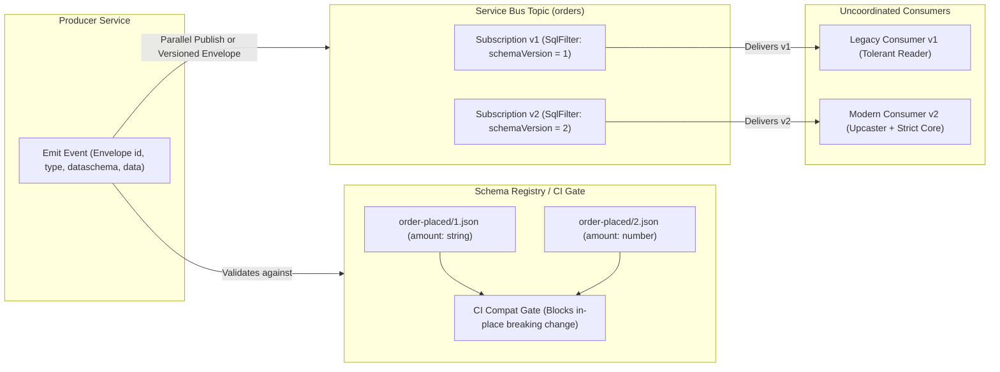
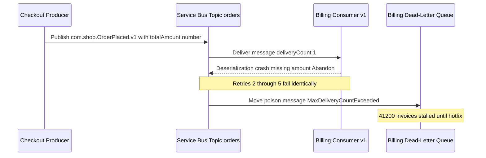

# Event Schemas and Versioning

> **Prerequisites:** Azure CLI installed, foundational understanding of CloudEvents, Service Bus topics/filters, dead-letter queues, and idempotent consumers (Modules 00–05).  
> **Estimated Reading Time:** 30 minutes  
> **Target Audience:** Backend Engineers, Platform Engineers, Distributed Systems Architects.

> [!TIP]
> **The Golden Rule of Event Schema Evolution:** Treat every published event schema as an immutable public contract across uncoordinated readers—only add optional fields with `additionalProperties: true` (tolerant readers), never mutate or rename fields in place, keep the envelope `id` identical across retries, and enforce automated backward-compatibility checks in CI before any schema change merges.

---

## Why This Matters

In a synchronous API you and your caller are online together and you can deploy a coordinated change; if it breaks, you find out in seconds. In an event-driven system the publisher and consumers are **decoupled in time and ownership** — an event you emit today might be read by a consumer you've never met, hours later, running code from last quarter. That's exactly why an "unknown schema" is the poison message of module 05, and why the *shape* of your events is a contract you can't casually change. This module is about treating event schema as a first-class, versioned interface: how to evolve it without a coordinated big-bang deploy, and a lightweight registry so producers and consumers agree on what a message *means*.

> **Cost warning:** this module is mostly design work plus small Service Bus / Event Grid message sends you already know how to do (modules 02-03). Costs are negligible, but if you provision a namespace to experiment, delete it at the end.

---

## 1. Architectural Mental Model: Envelope vs. Payload & Coexistence

Because publishers cannot upgrade every downstream consumer atomically, schema evolution relies on separating a **stable routing envelope** (CloudEvents) from a **versioned payload** (`data`), backed by a **schema registry compatibility gate** in CI/CD:



### Why schema matters more in async than in sync APIs

With a synchronous REST call, the request/response schema is validated *now*, by *this* caller, against *this* running version — a mismatch is an immediate, visible error you fix and redeploy together. Events break that tight loop three ways:

1. **Temporal decoupling** (module 00): an event may be consumed long after it was published — even *replayed* from a stream (module 01) months later — so old and new schema versions coexist on the wire simultaneously.
2. **Consumer multiplicity**: one event feeds many independent consumers (module 01's pub/sub), each owned by a different team on a different release cadence, so you *cannot* deploy them all at once.
3. **No back-channel**: the publisher gets no response from consumers, so a schema mismatch surfaces not as a `400` to the caller but as a silent parse failure or a poison message dead-lettered in some downstream team's DLQ (module 05).

The consequence: an event schema is a **published contract with many uncoordinated readers**, which is a much stronger constraint than a synchronous API's schema, and it's why breaking changes are so much more expensive here.

### Compatible vs. breaking changes

The core discriminator for every schema change: can existing consumers keep working *without being changed*?

- **Backward-compatible (safe) changes**: a new consumer can read old events. In practice the changes that keep *old consumers* working on *new events* are the ones you want — **adding an optional field** (old consumers ignore it), **adding a new event type** (old consumers don't subscribe to it), widening a value set carefully. Old consumers tolerate the new shape because they only read the fields they know.
- **Breaking changes**: **removing a field**, **renaming a field**, **changing a field's type** (`string` to `number`), **making an optional field required**, or **changing the meaning** of an existing field. Any of these makes existing consumers misread or fail on the new events — a poison message in their DLQ.

The governing rules of thumb: **only add, never remove or rename; never change a field's type or meaning; treat every field as if some consumer depends on it** (because in pub/sub you often can't even enumerate your consumers). If you truly must make a breaking change, you don't mutate the existing schema — you version it (next section).

### Versioning strategies: how to make a breaking change safely

When a change *is* breaking, the goal is to let old and new coexist so consumers migrate on their own schedule — no big-bang. The main strategies:

- **Version field in the envelope**: every event carries a version (`dataVersion` in Event Grid, `dataschema`/`type` suffix in CloudEvents, module 03). Consumers switch on it. `OrderPlaced` v1 and v2 flow through the same topic; a consumer handles the versions it understands and ignores/defers the rest.
- **New event type / new topic (parallel publish)**: publish `OrderPlacedV2` alongside `OrderPlacedV1` for a deprecation window. Old consumers keep reading v1; new consumers read v2; you retire v1 once every consumer has migrated. Costs double publishing temporarily but needs zero coordination.
- **Upcasting / tolerant reader**: consumers are written to be **tolerant** — ignore unknown fields, supply defaults for missing ones — so many additive changes never break them in the first place. An "upcaster" transforms an old event shape into the current internal model on read. This is the cheapest long-term posture: strict producers, tolerant consumers ("be conservative in what you send, liberal in what you accept").

The through-line: **coexistence, not cutover.** Because you can't deploy all consumers atomically, every viable strategy keeps multiple versions valid on the wire during a migration window.

### A lightweight schema registry

How do a producer and a dozen consumers *agree* on what `OrderPlaced` looks like and which version is current? A **schema registry** is the shared source of truth: a place where each event type's schema (and its versions) is stored, so producers validate what they publish against it and consumers know exactly what to expect. Heavyweight registries (Azure **Schema Registry**, which lives in an Event Hubs namespace, or Confluent's for Kafka) can *enforce* compatibility — rejecting a producer that tries to register a breaking change. But the concept scales down: a **lightweight registry** can be as simple as a **versioned schema repository in Git** — JSON Schema or Avro files per event type, reviewed via pull request (track 8), published as a package consumers depend on, with a CI check (track 10) that fails the build if a change to a schema file is backward-incompatible. The value isn't the tooling; it's (1) a single agreed definition, (2) versioning, and (3) an automated compatibility gate so a breaking change is caught in review, not in a consumer's DLQ at 3am. This connects directly to module 03's `dataVersion`/CloudEvents fields — the registry is what gives those version numbers meaning.

### Envelope vs. payload, and stable identifiers

A practical schema design that makes versioning tractable: separate the **envelope** (metadata every event shares — `id`, `type`, `source`, `time`, `version`, and crucially the **dedup id** your idempotent consumers key on from module 00) from the **payload** (`data`, the event-type-specific body). The envelope is stable and standardized (CloudEvents gives you exactly this, module 03), so cross-cutting machinery — routing, tracing (module 07), dedup, version dispatch — works uniformly regardless of payload version. Only the payload evolves per event type. Two rules keep the envelope trustworthy: the **`id` must be stable and unique per logical event** (so a republish carries the *same* id and dedup works across retries and outbox re-publishes, module 05), and the **`type` + `version` together identify the payload schema** so a consumer knows how to parse `data` before it tries. Getting the envelope right once makes every later schema change a localized payload problem instead of a system-wide one.

---

## 2. Taxonomic Comparison & Command Reference

### Schema Evolution & Versioning Trade-offs

| Change Type | Classification | Impact on Existing v1 Consumer | Safe Action |
| :--- | :--- | :--- | :--- |
| **Add optional property** | Backward-compatible (Safe) | Ignored when `additionalProperties: true` | Publish under current version |
| **Add new event type** | Backward-compatible (Safe) | Unsubscribed; untouched | Emit new CloudEvents `type` |
| **Widen enum values** | Conditionally safe | Exhaustive switches may throw | Require default/fallback arm in consumers |
| **Rename or remove field** | Breaking | Missing field causes parse failure / DLQ | Version (`v2`) + parallel publish or upcaster |
| **Change field type** (`string` to `number`) | Breaking | Deserializer type mismatch crash | Version (`v2`) + parallel publish |
| **Make optional field required** | Breaking | Old producers/replays fail strict validation | Version (`v2`) or default in tolerant consumer |
| **Change semantic meaning** (cents to dollars) | Breaking (Silent corruption) | Consumer miscalculates silently | Never repurpose a field; introduce a new field/version |

| Versioning Strategy | Cross-Team Coordination | Wire Cost | Operational Complexity | Best Use Case |
| :--- | :--- | :--- | :--- | :--- |
| **Tolerant Reader + Upcaster** | Minimal (additive only) | 1x message volume | Low (consumer handles defaults/upcasts) | Routine non-breaking evolution and internal replay |
| **Version Field in Envelope** (`schemaVersion`) | Moderate (consumers must filter/branch) | 1x message volume | Medium (multi-version code paths in one consumer) | Single team or tightly coupled consumers sharing a topic |
| **Parallel Publish** (`OrderPlaced.v1` + `.v2`) | Lowest (old consumers untouched) | 2x message volume during window | High if deprecation window is left open indefinitely | Breaking changes across many independent consumer teams |

### Command & Contract Reference

This module is design-led; the "commands" are the schema-carrying fields you set on events you already know how to publish (modules 02-03) plus the shape of a registry entry.

| Item | What it does | Example |
|---|---|---|
| CloudEvents `type` + `dataschema` | Identifies the payload schema/version a consumer must use to parse `data` | `"type": "com.shop.OrderPlaced.v2"`, `"dataschema": "https://schemas.shop.com/order-placed/2.json"` |
| Event Grid `dataVersion` | Native Event Grid field carrying the payload version | `--data-version 2` when publishing / on the event object |
| Service Bus message `ApplicationProperties` | Carry `schemaVersion` as a property so subscriptions can filter by version | `schemaVersion = 2` (filterable with a SqlFilter, module 02) |
| JSON Schema file (registry entry) | The versioned contract for an event type, stored in Git | `order-placed/2.json` with `required`, `properties`, `additionalProperties` |
| CI compatibility check | Fails a PR that makes a schema change backward-incompatible | a `check-schema-compat` step in the pipeline (track 10) |
| `az eventhubs namespace schema-registry create` | Creates a managed schema group enforcing Avro/JSON backward compatibility | `az eventhubs namespace schema-registry create -g rg-schema --namespace-name <eh-ns> -n orders-group --schema-type Json --schema-compatibility Backward` |

#### Field-by-field — a versioned JSON Schema registry entry (`order-placed/2.json`)
- `"$id": ".../order-placed/2.json"` — the stable, versioned URL this schema is known by; consumers and the `dataschema` field point here.
- `"required": ["orderId", "amount", "currency"]` — the fields a consumer may rely on; **adding** to this from v1 is a **breaking** change (an old producer's events would now be "invalid"), so grow it only across a version bump.
- `"properties": { ... }` — the typed fields; **changing a type** here vs. v1 is breaking, **adding a new optional property** is safe.
- `"additionalProperties": true` — makes consumers **tolerant readers**: unknown future fields don't invalidate the event, so additive changes stay non-breaking.

#### Field-by-field — the version-carrying envelope (CloudEvents)
- `id` — **stable unique** per logical event; the dedup key for idempotent consumers (module 00) and outbox re-publishes (module 05). Never regenerate on retry.
- `type` — e.g. `com.shop.OrderPlaced.v2`; the event type **and** version consumers switch on.
- `source` — who emitted it (provenance/routing).
- `dataschema` — a link to the exact schema in the registry, so a consumer can fetch/validate the payload shape.
- `data` — the payload, the only part that varies by version.

---

## 3. Production War Story Post-Mortem: The Unversioned Field Rename That Poisoned Billing

| Field | Incident Details |
| :--- | :--- |
| **Severity** | **SEV-1** (Revenue-Critical Billing Pipeline Halted) |
| **Detection / Resolution Time** | Detected in 38 minutes via customer support tickets / Resolved in 2 hours 15 minutes |
| **Impact** | 41,200 `OrderPlaced` events dead-lettered in `billing-sub/$DeadLetterQueue`; delayed invoice generation and ERP reconciliation |

### What Happened

The Checkout team refactored their domain DTO and renamed `amount` (string `"149.99"`) to `totalAmount` (number `149.99`) inside the `OrderPlaced` payload without changing the CloudEvents `type` (`com.shop.OrderPlaced.v1`) or bumping `schemaVersion`. Because no CI schema compatibility gate existed, the PR merged and deployed straight to production. Billing, Fulfillment, and Analytics all subscribed to the same `orders` Service Bus topic, and Billing's strict deserializer crashed on every incoming message (`KeyNotFoundException: 'amount'`), exhausting `MaxDeliveryCount = 5` and flooding the DLQ.



### Root Cause Analysis

1. **In-place breaking mutation**: Renaming a property and changing its type (`string` to `number`) broke backward compatibility without bumping the schema version.
2. **Missing CI compatibility gate**: Schema files were treated as ad-hoc documentation rather than validated contracts tested against prior versions on pull requests.
3. **Strict consumer deserialization + missing DLQ alerting**: Billing rejected unknown shapes without a fallback upcaster, and no alert fired when `DeadletteredMessages > 0`.

### The Fix & Architectural Hardening

- **Immediate Mitigation**: Checkout deployed an emergency patch emitting *both* `amount` (string) and `totalAmount` (number) under `v1`, then redrove all 41,200 dead-lettered events back into Billing (safe because Billing deduplicated on the stable CloudEvents `id`).
- **Durable Fix**: Checkout introduced `com.shop.OrderPlaced.v2` with `schemaVersion = 2`, parallel-published `v1` and `v2` during a 14-day deprecation window while monitoring `v1` subscription drain, registered schemas in a Git-backed registry with an automated CI compatibility check blocking field renames/removals/type changes, and converted Billing into a tolerant upcaster.

---

## 4. Multi-Language Production Implementation: Schema Compatibility Checker & Tolerant Upcaster

The following four production-ready implementations validate backward compatibility between schema versions (catching renames, removals, type changes, and newly required fields before merge) and upcast `OrderPlaced.v1` or `.v2` CloudEvents into a unified internal domain model while preserving the stable envelope `id`.

````carousel
```go
package schema

import (
	"encoding/json"
	"fmt"
	"strconv"
)

type JsonSchema struct {
	ID                   string              `json:"$id"`
	Required             []string            `json:"required"`
	Properties           map[string]Property `json:"properties"`
	AdditionalProperties bool                `json:"additionalProperties"`
}

type Property struct {
	Type string `json:"type"`
}

type CloudEvent struct {
	ID         string          `json:"id"`
	Type       string          `json:"type"`
	Source     string          `json:"source"`
	DataSchema string          `json:"dataschema"`
	Data       json.RawMessage `json:"data"`
}

type CanonicalOrderPlaced struct {
	EventID  string
	OrderID  string
	Amount   float64
	Currency string
}

// CheckBackwardCompatible rejects removals, type changes, or new required fields.
func CheckBackwardCompatible(prev, next JsonSchema) []string {
	var violations []string
	if !next.AdditionalProperties {
		violations = append(violations, "additionalProperties must remain true for tolerant readers")
	}
	for name, oldProp := range prev.Properties {
		newProp, exists := next.Properties[name]
		if !exists {
			violations = append(violations, fmt.Sprintf("removed or renamed property %q", name))
			continue
		}
		if oldProp.Type != newProp.Type {
			violations = append(violations, fmt.Sprintf("property %q changed type from %s to %s", name, oldProp.Type, newProp.Type))
		}
	}
	prevReq := make(map[string]bool, len(prev.Required))
	for _, r := range prev.Required {
		prevReq[r] = true
	}
	for _, r := range next.Required {
		if !prevReq[r] {
			violations = append(violations, fmt.Sprintf("newly required property %q breaks old producers", r))
		}
	}
	return violations
}

// UpcastOrderPlaced accepts both v1 (string amount) and v2 (numeric amount).
func UpcastOrderPlaced(evt CloudEvent) (CanonicalOrderPlaced, error) {
	if evt.ID == "" {
		return CanonicalOrderPlaced{}, fmt.Errorf("missing stable envelope id for deduplication")
	}
	var raw map[string]any
	if err := json.Unmarshal(evt.Data, &raw); err != nil {
		return CanonicalOrderPlaced{}, fmt.Errorf("invalid payload JSON: %w", err)
	}
	orderID, _ := raw["orderId"].(string)
	currency, ok := raw["currency"].(string)
	if !ok || currency == "" {
		currency = "USD" // Tolerant reader default for legacy producers
	}
	var amount float64
	switch v := raw["amount"].(type) {
	case float64:
		amount = v
	case string:
		parsed, err := strconv.ParseFloat(v, 64)
		if err != nil {
			return CanonicalOrderPlaced{}, fmt.Errorf("unparseable v1 string amount %q: %w", v, err)
		}
		amount = parsed
	default:
		return CanonicalOrderPlaced{}, fmt.Errorf("unsupported amount field type in event %s", evt.ID)
	}
	return CanonicalOrderPlaced{EventID: evt.ID, OrderID: orderID, Amount: amount, Currency: currency}, nil
}
```
<!-- slide -->
```typescript
export interface JsonSchemaDoc {
  $id: string;
  required: string[];
  properties: Record<string, { type: string }>;
  additionalProperties: boolean;
}

export interface CloudEventEnvelope {
  id: string;
  type: string;
  source: string;
  dataschema: string;
  data: Record<string, unknown>;
}

export interface CanonicalOrderPlaced {
  eventId: string;
  orderId: string;
  amount: number;
  currency: string;
}

export function checkBackwardCompatible(prev: JsonSchemaDoc, next: JsonSchemaDoc): string[] {
  const violations: string[] = [];
  if (!next.additionalProperties) {
    violations.push("additionalProperties must be true for tolerant readers");
  }
  for (const [field, oldDef] of Object.entries(prev.properties)) {
    const newDef = next.properties[field];
    if (!newDef) {
      violations.push(`Breaking: field '${field}' was removed or renamed`);
    } else if (oldDef.type !== newDef.type) {
      violations.push(`Breaking: field '${field}' changed type from ${oldDef.type} to ${newDef.type}`);
    }
  }
  const prevReq = new Set(prev.required);
  for (const req of next.required) {
    if (!prevReq.has(req)) {
      violations.push(`Breaking: field '${req}' became required`);
    }
  }
  return violations;
}

export function upcastOrderPlaced(evt: CloudEventEnvelope): CanonicalOrderPlaced {
  if (!evt.id) {
    throw new Error("Envelope id is required for idempotent deduplication");
  }
  const rawAmount = evt.data.amount;
  let amount: number;
  if (typeof rawAmount === "number" && Number.isFinite(rawAmount)) {
    amount = rawAmount;
  } else if (typeof rawAmount === "string") {
    amount = Number.parseFloat(rawAmount);
    if (!Number.isFinite(amount)) {
      throw new Error(`Invalid v1 string amount: ${rawAmount}`);
    }
  } else {
    throw new Error(`Unsupported amount representation in ${evt.type}`);
  }

  return {
    eventId: evt.id,
    orderId: String(evt.data.orderId ?? ""),
    amount,
    currency: typeof evt.data.currency === "string" && evt.data.currency ? evt.data.currency : "USD",
  };
}
```
<!-- slide -->
```python
from dataclasses import dataclass
from typing import Any


@dataclass(frozen=True)
class CanonicalOrderPlaced:
    event_id: str
    order_id: str
    amount: float
    currency: str


def check_backward_compatible(prev_schema: dict[str, Any], next_schema: dict[str, Any]) -> list[str]:
    """Verify next_schema does not break existing v1 consumers."""
    violations: list[str] = []
    if not next_schema.get("additionalProperties", False):
        violations.append("additionalProperties must be true to preserve tolerant reading")

    prev_props = prev_schema.get("properties", {})
    next_props = next_schema.get("properties", {})
    for name, old_def in prev_props.items():
        if name not in next_props:
            violations.append(f"Removed or renamed field '{name}'")
        elif old_def.get("type") != next_props[name].get("type"):
            violations.append(
                f"Type changed for '{name}': {old_def.get('type')} -> {next_props[name].get('type')}"
            )

    prev_req = set(prev_schema.get("required", []))
    for req in next_schema.get("required", []):
        if req not in prev_req:
            violations.append(f"Existing or new field '{req}' made required")
    return violations


def upcast_order_placed(envelope: dict[str, Any]) -> CanonicalOrderPlaced:
    """Tolerant upcaster normalizing com.shop.OrderPlaced.v1 and .v2."""
    event_id = envelope.get("id")
    if not event_id:
        raise ValueError("Missing stable envelope id")

    payload = envelope.get("data") or {}
    raw_amount = payload.get("amount")
    if isinstance(raw_amount, (int, float)):
        amount = float(raw_amount)
    elif isinstance(raw_amount, str):
        amount = float(raw_amount)
    else:
        raise ValueError(f"Unsupported amount value for event {event_id}")

    return CanonicalOrderPlaced(
        event_id=str(event_id),
        order_id=str(payload["orderId"]),
        amount=amount,
        currency=str(payload.get("currency") or "USD"),
    )
```
<!-- slide -->
```csharp
using System.Globalization;
using System.Text.Json;

public sealed record JsonSchemaContract(
    string Id,
    IReadOnlyList<string> Required,
    IReadOnlyDictionary<string, string> Properties,
    bool AdditionalProperties);

public sealed record CanonicalOrderPlaced(string EventId, string OrderId, decimal Amount, string Currency);

public static class SchemaEvolutionGuard
{
    public static IReadOnlyList<string> CheckBackwardCompatible(
        JsonSchemaContract previous,
        JsonSchemaContract next)
    {
        var violations = new List<string>();
        if (!next.AdditionalProperties)
            violations.Add("additionalProperties must be true for tolerant readers.");

        foreach (var (field, oldType) in previous.Properties)
        {
            if (!next.Properties.TryGetValue(field, out var newType))
                violations.Add($"Breaking change: field '{field}' removed or renamed.");
            else if (!string.Equals(oldType, newType, StringComparison.Ordinal))
                violations.Add($"Breaking change: field '{field}' type changed {oldType} -> {newType}.");
        }

        var prevReq = previous.Required.ToHashSet(StringComparer.Ordinal);
        foreach (var req in next.Required.Where(r => !prevReq.Contains(r)))
            violations.Add($"Breaking change: field '{req}' added to required list.");

        return violations;
    }

    public static CanonicalOrderPlaced UpcastOrderPlaced(string cloudEventJson)
    {
        using var doc = JsonDocument.Parse(cloudEventJson);
        var root = doc.RootElement;
        var eventId = root.GetProperty("id").GetString()
            ?? throw new InvalidDataException("Envelope id must be non-null for deduplication.");
        var data = root.GetProperty("data");

        var amountElement = data.GetProperty("amount");
        decimal amount = amountElement.ValueKind switch
        {
            JsonValueKind.Number => amountElement.GetDecimal(),
            JsonValueKind.String => decimal.Parse(
                amountElement.GetString() ?? throw new InvalidDataException("Empty amount"),
                CultureInfo.InvariantCulture),
            _ => throw new InvalidDataException("Unsupported amount type in OrderPlaced payload.")
        };

        var currency = data.TryGetProperty("currency", out var currProp) && currProp.ValueKind == JsonValueKind.String
            ? currProp.GetString() ?? "USD"
            : "USD";

        return new CanonicalOrderPlaced(eventId, data.GetProperty("orderId").GetString() ?? "", amount, currency);
    }
}
```
````

---

## 5. Practical Hands-On Verification CLI Workflows

Mostly design and small publishes against resources you know how to create. Cleanup is the last exercise if you provisioned anything.

### 1. Classify ten changes
For each proposed change to `OrderPlaced`, write **safe** or **breaking** and why: (a) add optional `couponCode`; (b) rename `amount` → `totalAmount`; (c) change `amount` from string `"50.00"` to number `50.0`; (d) add a new event type `OrderRefunded`; (e) make the previously optional `currency` required; (f) remove unused `legacyRegion`; (g) add optional `items[]`; (h) change `orderId` from int to UUID string; (i) widen an enum with a new allowed status; (j) drop a field two consumers still read.
> Verify: b, c, e, f, h, j are breaking (rename/type/required/remove); a, d, g are safe (additive). (i) is subtle — safe for producers, but a consumer that exhaustively switches on the enum may not handle the new value, so treat new enum values as needing tolerant consumers.

### 2. Design the envelope
Write a CloudEvents envelope for `OrderPlaced` v1 with `id`, `type` (including version), `source`, `dataschema`, `time`, and a `data` payload. Mark which field your idempotent consumer (module 00) keys on and which two fields together tell a consumer how to parse `data`.

```json
{
  "specversion": "1.0",
  "id": "evt-9f2a1d44-7c0b-4a3e-9a10-2e3f81c11b01",
  "type": "com.shop.OrderPlaced.v1",
  "source": "/services/checkout",
  "dataschema": "https://schemas.shop.com/order-placed/1.json",
  "time": "2026-11-11T09:00:00Z",
  "datacontenttype": "application/json",
  "data": {
    "orderId": "ORD-1001",
    "amount": "50.00",
    "currency": "USD"
  }
}
```
> Verify: dedup keys on `id`; parsing is driven by `type` + `dataschema` (version).

### 3. Make a breaking change three ways
You must change `amount` from string to number (breaking, from exercise 1c). Write out how you'd ship it using (a) a version field in the envelope with dual-version consumers, (b) parallel publish of `OrderPlaced.v2` alongside v1 for a deprecation window, and (c) a tolerant/upcasting reader. Note which requires the least cross-team coordination.
> Verify: (b) parallel publish needs the least coordination — old consumers are untouched; you retire v1 only after all have migrated.

### 4. Route by version with a Service Bus filter
Reusing module 02, create a topic and a subscription whose SqlFilter is `schemaVersion = 2`. Publish two messages with application property `schemaVersion` = 1 and = 2 respectively.

```powershell
$ns = "sb-schema-$((Get-Random -Maximum 9999))"
az group create -n rg-schema -l eastus
az servicebus namespace create -g rg-schema -n $ns --sku Standard
az servicebus topic create -g rg-schema --namespace-name $ns -n orders
az servicebus topic subscription create -g rg-schema --namespace-name $ns --topic-name orders -n sub-v2
az servicebus topic subscription rule delete -g rg-schema --namespace-name $ns --topic-name orders --subscription-name sub-v2 -n '$Default'
az servicebus topic subscription rule create -g rg-schema --namespace-name $ns --topic-name orders --subscription-name sub-v2 -n v2-only --filter-sql-expression "schemaVersion = 2"
az servicebus topic subscription rule list -g rg-schema --namespace-name $ns --topic-name orders --subscription-name sub-v2 -o table
```

**Expected Output:**
```text
FilterType    Name     RequiresPreprocessing
------------  -------  ---------------------
SqlFilter     v2-only  False
```
> Verify: only the v2 message reaches the v2-only subscription — you can route versions to version-specific consumers entirely via the envelope, no payload parsing needed.

### 5. Sketch the registry
Create two JSON Schema files, `order-placed/1.json` and `order-placed/2.json`, that differ by exactly the breaking change from exercise 3, and set `additionalProperties: true` in both. Write one sentence on how a PR review (track 8) plus a CI check (track 10) would have *caught* the breaking change before it shipped.

```json
{
  "$schema": "https://json-schema.org/draft/2020-12/schema",
  "$id": "https://schemas.shop.com/order-placed/2.json",
  "type": "object",
  "additionalProperties": true,
  "required": ["orderId", "amount", "currency"],
  "properties": {
    "orderId": { "type": "string" },
    "amount": { "type": "number" },
    "currency": { "type": "string" }
  }
}
```
> Verify: v2's `amount` type differs from v1's; the compatibility check should flag the type change of an existing field as breaking and fail the PR.

### 6. Diagnose and fix: a poison message caused by a silent schema change
Scenario: a producer team renamed `amount` → `totalAmount` in place (no version bump) and redeployed. A downstream consumer that reads `amount` now parses `null`/fails and the messages pile into its DLQ (module 05).
> Diagnose: an **in-place breaking change** (rename) with **no versioning** — the consumer can't find `amount`, so every new event is a poison message.
> **Fix (immediate)**: producer reverts / republishes with both fields, or adds `amount` back as a duplicate of `totalAmount`. **Fix (durable)**: never rename in place — version the event (`.v2`), publish v1 and v2 in parallel, migrate the consumer, retire v1; and add the CI compatibility gate so a rename can't merge silently.

### 7. Diagnose and fix: a required field added under a consumer's feet
Scenario: the producer made `currency` required and started validating it, but an older internal producer path still emits events without `currency`; a strict consumer now rejects those.
> Diagnose: **making an optional field required is breaking** for anyone still emitting the old shape. **Fix**: either bump the version and keep the old schema valid during the window, or make the consumer a **tolerant reader** that defaults `currency` when absent — and stop the strict validation that turned a missing optional into a hard failure.

### 8. Clean up
If you created a namespace for exercise 4:

```powershell
az group delete -n rg-schema --yes --no-wait
az servicebus namespace list -o table
```

**Expected Output:**
```text
(Empty list or no rg-schema namespace remaining)
```
> Verify: no lingering namespace in `az servicebus namespace list -o table`.

### Independent challenge

Take the `OrderPlaced` event from your module 00 workflow and treat its schema as a real, versioned contract. Author v1 as a JSON Schema (with a stable CloudEvents envelope and `additionalProperties: true`), then introduce a genuine **breaking** change and ship it via **parallel publish** (v1 and v2 on the same topic, distinguished by envelope `type`/version and routable by a Service Bus version filter from module 02). Prove that a v1-only consumer keeps working untouched while a v2 consumer reads the new shape, and write a short deprecation plan for retiring v1 (how you'd know every consumer has migrated). Finally, describe the lightweight registry you'd put this under — where the schema files live, how a change is reviewed (track 8), and the CI gate (track 10) that blocks a backward-incompatible change. This builds on modules 00, 02, and 03. Delete any namespace you provisioned when you're done.

<details><summary>Stuck? One hint</summary>

The part people underestimate is "how do you know every consumer has migrated so you can retire v1?" In pub/sub you often can't enumerate consumers directly — so instrument it: keep publishing v1 but **track consumption of the v1 subscription** (its `activeMessageCount` draining to zero and staying there, or per-consumer metrics from module 07), and/or require consumers to *register* against the schema registry so you have a list. Only retire v1 when the v1 subscription has had zero active consumers for a full deprecation window. The registry isn't just schema storage — it's also your consumer inventory.

</details>

---

## 6. Common Mistakes & Troubleshooting

- **Renaming or retyping a field in place.** The single most common self-inflicted outage: a rename/type change with no version bump turns every new event into a poison message for existing consumers. Only add; version for anything else.
- **Making an optional field required.** Breaking for anyone still emitting the old shape. Bump the version or keep the consumer tolerant.
- **Strict consumers that reject unknown fields.** Set `additionalProperties: true` / be a tolerant reader, or additive (safe) changes will break you needlessly.
- **No version in the envelope.** Without a `type`/`dataVersion`, consumers can't even *dispatch* on version, so coexistence becomes impossible and every change is a cutover.
- **Regenerating the event `id` on republish.** Breaks idempotency (module 00) and the outbox's dedup (module 05) — the same logical event must carry the same `id` across retries.
- **Cost/operational pitfall — long parallel-publish windows.** Publishing v1 and v2 in parallel *doubles* the per-operation cost (and Event Grid event volume, module 03) for the duration. It's the right tool, but keep the deprecation window bounded and actually retire v1 — an indefinitely dual-published event is a standing cost and complexity tax.

---

## 7. Operational Validation Checkpoints & Quiz

### Operational Validation Checkpoints

<details><summary><strong>Checkpoint 1: Adding a new field vs. renaming an existing field under live replay</strong></summary>

You need to introduce `discountCents` to `OrderPlaced`, and at the same time your Analytics team plans to replay 90 days of archived `OrderPlaced` events next week. Adding `discountCents` as an optional property with `additionalProperties: true` is backward-compatible: existing consumers ignore it, and Analytics's tolerant reader defaults `discountCents = 0` when replaying historical events from 90 days ago. Renaming `amount` to `grossAmount` in place, however, would fail both live v1 consumers and historical replays unless shipped as `.v2` alongside an upcaster.

</details>

<details><summary><strong>Checkpoint 2: Safely retiring OrderPlaced.v1 after parallel publish</strong></summary>

Two months after launching parallel publishing of `OrderPlaced.v1` and `OrderPlaced.v2`, how do you verify it is safe to stop publishing `v1`? Check the Service Bus `v1` subscription metrics (`OutgoingMessages` and `ActiveMessages`) plus registered consumer inventory in the schema registry, announce a sunset date, disable or inspect remaining active receivers, and confirm zero `v1` consumption across a full deprecation window before deleting the `v1` publish path.

</details>

<details><summary><strong>Checkpoint 3: Preventing duplicate side effects during an outbox retry after schema bump</strong></summary>

If the outbox relay retries publishing an `OrderPlaced.v2` event due to a transient broker timeout, regenerating `id` on retry would bypass consumer idempotency and charge the customer twice. The envelope `id` must be persisted once in the transactional outbox row alongside the serialized payload so every retry and every parallel-published replay retains a deterministic, stable deduplication key.

</details>

### Checkpoint quiz

Write down your answer to each question before expanding it — checking without attempting first is the single easiest way to fool yourself into thinking you've learned this.

1. Give three reasons event schema is a harder constraint than a synchronous API's schema.
2. Sort these into safe vs. breaking: add optional field; rename field; add new event type; change a field's type; make an optional field required.
3. Name three strategies for shipping a breaking change without a coordinated big-bang deploy, and which needs the least cross-team coordination.
4. What is a "tolerant reader" and which JSON Schema setting supports it?
5. What is a schema registry, what three things does even a lightweight one provide, and how can it be as simple as a Git repo?
6. Why must the envelope `id` be stable across a republish, and which two earlier patterns depend on that?
7. A consumer's DLQ suddenly fills with parse failures right after a producer deploy. What's the most likely cause and the durable fix?

<details><summary>Show answers</summary>

1. **Temporal decoupling** (old and new versions coexist on the wire, even via replay), **consumer multiplicity** (many independent teams can't be deployed atomically), and **no back-channel** (a mismatch surfaces as a silent poison message downstream, not a 400 to the caller).
2. **Safe**: add optional field, add new event type. **Breaking**: rename field, change a field's type, make an optional field required.
3. A **version field in the envelope** (dual-version consumers), **parallel publish** of a new event type/version alongside the old for a deprecation window, and **tolerant reader / upcasting**. Parallel publish needs the least coordination — old consumers are untouched.
4. A consumer written to **ignore unknown fields and default missing ones**, so additive changes don't break it. `additionalProperties: true` (JSON Schema) supports it.
5. A shared source of truth for event schemas and their versions. It provides **one agreed definition, versioning, and a compatibility gate**. Lightweight version: versioned JSON Schema/Avro files in **Git**, reviewed by PR (track 8), with a CI check (track 10) failing incompatible changes.
6. So the **same logical event carries the same `id` across retries/republishes**, letting consumers dedup correctly. **Idempotent consumers** (module 00) and the **outbox relay's at-least-once republish** (module 05) both depend on it.
7. A **breaking in-place schema change** (rename/type/required) shipped without a version bump, so existing consumers can't parse the new events. Durable fix: version the event and parallel-publish during migration, keep consumers tolerant, and add a CI compatibility gate so the change can't merge silently.

</details>

---

## 8. Next

[07-observability-for-event-driven-systems](../07-observability-for-event-driven-systems/README.md) — you can't fix what you can't see: tracing a single message across queue hops (tying into track 12's distributed tracing) and treating queue depth and consumer lag as first-class metrics you alert on — the monitoring that would have caught every diagnose-and-fix in this track early.
