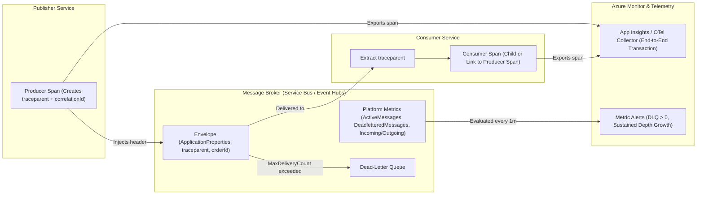
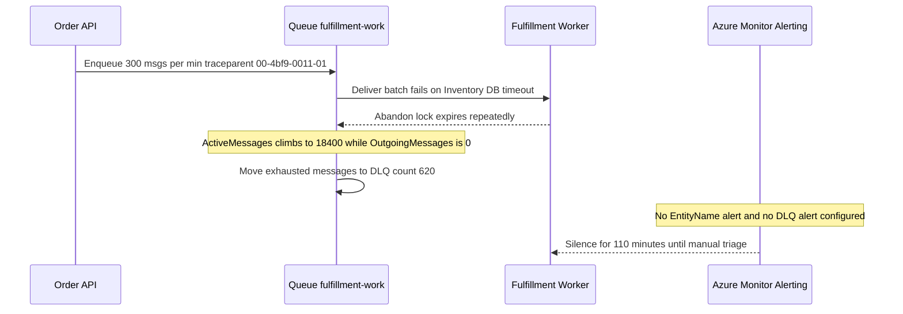

# Observability for Event-Driven Systems

> **Prerequisites:** Azure CLI installed, Azure Service Bus / Event Hubs and Dapr pub/sub fundamentals (Modules 00–06), and distributed tracing basics (Track 12).  
> **Estimated Reading Time:** 35 minutes  
> **Target Audience:** Backend Engineers, SREs, Platform Engineers, Distributed Systems Architects.

> [!TIP]
> **The Golden Rule of Async Observability:** Because publishers return before consumers run, embed W3C `traceparent` and a stable correlation `id` directly inside every message envelope, pair end-to-end spans with `DeadletteredMessages > 0` and sustained-growth depth/lag alerts, and never leave 100% diagnostic trace ingestion unsampled in production.

---

## Why This Matters

Every diagnose-and-fix in this track — the stuck message, the silently filling DLQ, the filter that never matches, the duplicate side effect — had the same root problem: nobody could *see* it until it hurt. Synchronous systems are easy to observe because a failure is a response you get back; event-driven systems hide failure inside brokers and across hops where no single request ties it all together. This module is the fix: **tracing one message end-to-end across queue hops** (building directly on the distributed tracing you set up in track 12) and treating **queue depth and consumer lag** as first-class metrics you alert on, so the failures earlier modules made you hunt for announce themselves instead.

> **Cost warning:** exercises use a Service Bus **Standard** namespace and Azure Monitor metrics (metrics on the resource are free to read; Log Analytics ingestion for diagnostic logs and Application Insights traces bills per GB ingested). Lab volumes are negligible, but a chatty trace/log firehose left running is a real ingestion bill — keep sampling sane and clean up at the end.

---

## 1. Architectural Mental Model: Cross-Hop Trace Propagation & Broker Telemetry

Asynchronous messaging splits observability into two planes: **per-message distributed tracing** (propagated inside message headers/properties) and **broker-level telemetry** (depth, throughput rates, dead-letter counts, and stream offset lag):



### Why async observability is different: no single request to follow

In a synchronous call chain (track 12) a trace follows one thread of execution: A calls B calls C, and the whole span tree lives inside one request's lifetime. Event-driven systems shatter that. A publish **returns immediately** — the publisher is done and gone before the consumer even receives the message; the consumer might run seconds or minutes later, in a different process, possibly after a redelivery or a DLQ round-trip. There is **no ambient request** linking publish to consume. So the three questions you actually ask in production — *where is this message now? why is this one slow? why did this one fail?* — can't be answered by request logs alone. You need two things async-specific: **trace context propagated *through the message itself*** (so the consumer's work is stitched to the publisher's), and **broker-level metrics** (depth, lag, DLQ count) that describe the *queue*, not any one request. The rest of this module is those two things.

### Propagating trace context across a queue hop

Distributed tracing works by every span carrying a **trace context** (a trace id plus the parent span id) — in track 12 that was the W3C **`traceparent`** header flowing over HTTP. Across a queue hop there's no HTTP call to carry it, so the pattern is: the publisher **writes the trace context into the message** (as an application property / message header, e.g. `Diagnostic-Id` or a `traceparent` property), and the consumer **reads it back out** and starts its processing span as a **child** (or a *link*) of the publisher's span. Now a single trace shows `publish → [time in queue] → receive → process`, spanning both services and the broker wait in between. The good news: you often get this for free. **Application Insights**/OpenTelemetry auto-instrumentation for Service Bus injects and extracts this context automatically, and **Dapr** propagates W3C trace context through its pub/sub building block (module 04) out of the box — so the Dapr consumer you built is already stitching publisher and consumer traces if tracing is enabled on the environment. The concept to hold: **the message is the transport for trace context** when there's no request to ride on.

### Queue depth as a first-class metric

The single most important operational number in a messaging system is **queue depth** — the count of *active, unprocessed* messages waiting (`activeMessageCount`, the counter you've watched all track). It's a direct, leading indicator of health: a depth that hovers near zero means consumers keep up; a **steadily rising** depth means consumers are falling behind (down, too few, too slow, or wedged on a poison message from module 05) *before* users notice a delay. Two companions matter as much: **dead-letter count** (`deadLetterMessageCount`) — anything above zero is failed business events needing attention (module 02/05's silently-filling-DLQ bug is exactly an unmonitored version of this), and **incoming vs. outgoing rate** — if the publish rate exceeds the completion rate, depth *will* grow, so comparing the two predicts a backlog before depth itself climbs. These are entity-level metrics Azure Monitor exposes for Service Bus (`ActiveMessages`, `DeadletteredMessages`, `IncomingMessages`, `OutgoingMessages`); depth and DLQ are the two you alert on first.

### Consumer lag: the stream analogue, and why it's not the same as depth

For **streams** (Event Hubs/Kafka, module 01) there's no "depth" in the queue sense — messages aren't removed on read, they're retained and each consumer holds an **offset**. The health metric there is **consumer lag**: how far a consumer's offset trails the latest event in the partition — i.e. how many events *behind* it is. Lag is the stream-native "am I keeping up?" number, and it behaves differently from queue depth: depth is shared (one backlog all consumers of a queue drain), while lag is **per consumer group** (a slow analytics consumer can lag badly while a fast alerting consumer stays current on the *same* stream). Growing lag means the same thing growing depth does — the consumer isn't keeping up — but you can also have lag on a healthy system that simply hasn't caught up after a deploy. The takeaway: **for queues, watch depth + DLQ; for streams, watch per-consumer-group lag**, and in both cases the alertable signal is *sustained growth*, not any instantaneous value.

### Correlation, dashboards, and closing the loop with earlier modules

Observability pays off when the pieces connect. A **correlation id** — a business key (order id) or the envelope `id` you already carry for idempotency (module 00) and versioning (module 06) — lets you pull *every* log line and span for one logical event across every hop, so "what happened to order-42?" is a single query, not a cross-team scavenger hunt. A useful event-driven dashboard layers: **depth + DLQ per entity** (are we keeping up / are things failing?), **end-to-end latency** from the propagated traces (publish-to-process time, including queue wait), and **throughput** (incoming vs. outgoing rate). And it closes the loop on the whole track: an alert on **DLQ depth > 0** would have caught module 02/05's quiet failures; a **depth-rising** alert catches the stuck/wedged consumer from module 02/05; a **trace** across the hop catches the "which service dropped it?" question the outbox and dead-letter paths (module 05) raise. Observability isn't a separate concern bolted on — it's how every reliability pattern in this track becomes *operable*.

---

## 2. Taxonomic Comparison & Command Reference

### Queue Depth vs. Stream Consumer Lag vs. DLQ Signals

| Signal | Broker Family | Scope | Alert Condition | Primary Root Causes |
| :--- | :--- | :--- | :--- | :--- |
| **`ActiveMessages` (Queue Depth)** | Queues / Topics (Service Bus) | Shared per queue or topic subscription | Sustained upward trend over 5–15m | Consumer down, slow downstream dependency, head-of-line poison block |
| **`DeadletteredMessages` (DLQ Depth)** | Queues / Topics (Service Bus) | Per entity subqueue | `Total > 0` (immediate actionable page) | Schema mismatch, validation failure, exhausted `MaxDeliveryCount` |
| **`IncomingMessages` vs. `OutgoingMessages`** | Queues / Topics / Streams | Per namespace or entity | `Incoming > Outgoing` across consecutive windows | Early predictive signal of incoming backlog before depth spikes |
| **Consumer Offset Lag** (`LatestSeq - CheckpointSeq`) | Event Streams (Event Hubs / Kafka) | **Per consumer group** + partition | Sustained lag growth or time-lag SLA breach | One consumer group slow/crashed while sibling groups stay current |

### Trace Context Modeling: Parent-Child vs. Span Links

| Aspect | Direct Child Span (`ParentId`) | OpenTelemetry Span Link |
| :--- | :--- | :--- |
| **Best suited for** | 1:1 point-to-point messaging or low-latency Dapr pub/sub | Batch consumers reading 100+ messages from many producers at once |
| **Duration semantics** | Single continuous flamegraph (`publish -> broker wait -> process`) | Keeps each trace independent without distorting producer duration |
| **Wire carrier** | `traceparent` / `Diagnostic-Id` in `ApplicationProperties` | `traceparent` per message added to batch consumer's `Links` array |

### Command Reference

| Command | What it does | Example |
|---|---|---|
| `az servicebus queue show --query countDetails` | Point-in-time depth + DLQ for a queue | `az servicebus queue show -g rg-obs --namespace-name <ns> -n work --query countDetails` |
| `az monitor metrics list` | Reads time-series metrics (depth, DLQ, in/out rate) for alerting | see breakdown below |
| `az monitor diagnostic-settings create` | Ships Service Bus metrics/logs to Log Analytics for querying | `az monitor diagnostic-settings create --name sb-diag --resource <ns-id> --workspace <law-id> --metrics '[{"category":"AllMetrics","enabled":true}]'` |
| `az monitor metrics alert create` | Fires an alert when a metric crosses a threshold (e.g. DLQ > 0) | see breakdown below |
| `az containerapp env dapr-component ...` (+ App Insights) | Enables Dapr tracing so pub/sub hops propagate W3C trace context | (Dapr tracing is configured on the Container Apps Environment; see track 12) |

Flag-by-flag — `az monitor metrics list --resource <ns-id> --metric ActiveMessages --dimension EntityName --interval PT1M --aggregation Average`:
- `--resource <ns-id>` — the Service Bus namespace resource id whose metrics you want.
- `--metric ActiveMessages` — the metric = **queue depth** (also `DeadletteredMessages`, `IncomingMessages`, `OutgoingMessages`).
- `--dimension EntityName` — split the metric **per queue/topic** so you see which entity is backing up, not just a namespace total.
- `--interval PT1M` — one-minute buckets (ISO-8601), fine-grained enough to see a backlog forming.
- `--aggregation Average` — how to roll up within a bucket (`Average`/`Maximum`/`Total`); use `Maximum` for depth to catch spikes.

Flag-by-flag — `az monitor metrics alert create -g rg-obs -n dlq-not-empty --scopes <ns-id> --condition "total DeadletteredMessages > 0" --window-size 5m --evaluation-frequency 1m --description "Dead-letter queue is not empty"`:
- `--scopes <ns-id>` — the resource the alert watches (the namespace).
- `--condition "total DeadletteredMessages > 0"` — the rule: **any** dead-lettered message trips it — the durable fix for the silently-filling-DLQ bug from modules 02/05.
- `--window-size 5m` / `--evaluation-frequency 1m` — evaluate every minute over a 5-minute window, so a transient blip doesn't page but a persistent problem does.
- `--description` — what the on-call human sees; make it actionable ("check the DLQ reason and redrive").

---

## 3. Production War Story Post-Mortem: The Wedged Session Consumer Masked by Namespace Totals

| Field | Incident Details |
| :--- | :--- |
| **Severity** | **SEV-2** (Regional Fulfillment Delayed 3 Hours) |
| **Detection / Resolution Time** | Detected after 110 minutes via customer delivery ETA complaints / Resolved in 45 minutes |
| **Impact** | 18,400 orders backed up in `fulfillment-work`; 620 poisoned messages trapped in `$DeadLetterQueue` |

### What Happened

The Fulfillment service used a Service Bus queue (`fulfillment-work`) without per-entity metric splitting (`--dimension EntityName`) and without any `DeadletteredMessages > 0` alert. A downstream inventory microservice began throwing timeouts on a specific SKU, causing `fulfillment-work` consumers to repeatedly lock, fail, and abandon messages while a separate `notifications` queue drained smoothly—keeping namespace-level `OutgoingMessages` healthy on the team's dashboard.



### Root Cause Analysis

1. **Aggregate metric blindness**: Alerting only on namespace-wide `OutgoingMessages` allowed healthy high-volume queues to mask `fulfillment-work` dropping to zero completions.
2. **Missing DLQ alert**: 620 messages hit `MaxDeliveryCount` and entered the DLQ silently with zero paging.
3. **Missing `traceparent` & correlation property**: Support engineers could not answer "where is Order `ORD-8821`?" because producer HTTP logs and worker logs shared no trace ID or business correlation ID.

### The Fix & Architectural Hardening

- Added `DeadletteredMessages > 0` alert and a sustained depth-growth alert split by `--dimension EntityName`.
- Added incoming-vs-outgoing rate panels per entity (`ActiveMessages` max + `IncomingMessages - OutgoingMessages`).
- Standardized W3C `traceparent` and `correlationId` (`orderId`) injection via OpenTelemetry / Dapr middleware across all publishers and consumers, with 10% head-based sampling plus 100% error/DLQ tail capture to keep Log Analytics ingestion predictable.

---

## 4. Multi-Language Production Implementation: W3C `traceparent` Propagation & Queue Health Evaluator

These four implementations inject/extract W3C `traceparent` (`00-<32hex-traceId>-<16hex-spanId>-<2hex-flags>`) across Service Bus `ApplicationProperties`, attach a business correlation ID (`orderId`), and evaluate queue depth + DLQ + incoming/outgoing signals into actionable health states.

````carousel
```go
package observability

import (
	"crypto/rand"
	"encoding/hex"
	"fmt"
	"regexp"
	"strings"
)

var traceparentRe = regexp.MustCompile(`^00-[0-9a-f]{32}-[0-9a-f]{16}-[0-9a-f]{2}$`)

type MessageEnvelope struct {
	CorrelationID         string
	ApplicationProperties map[string]any
	Body                  []byte
}

type QueueTelemetry struct {
	EntityName        string
	ActiveMessages    int64
	DeadLetterCount   int64
	IncomingPerMinute int64
	OutgoingPerMinute int64
}

func InjectTraceContext(env *MessageEnvelope, traceID, spanID string, sampled bool) error {
	if len(traceID) != 32 || len(spanID) != 16 {
		return fmt.Errorf("invalid W3C trace/span id length")
	}
	flags := "00"
	if sampled {
		flags = "01"
	}
	if env.ApplicationProperties == nil {
		env.ApplicationProperties = make(map[string]any)
	}
	env.ApplicationProperties["traceparent"] = fmt.Sprintf("00-%s-%s-%s", traceID, spanID, flags)
	env.ApplicationProperties["correlationId"] = env.CorrelationID
	return nil
}

func ExtractOrNewTraceparent(env MessageEnvelope) (traceID, parentSpanID string, linked bool) {
	if raw, ok := env.ApplicationProperties["traceparent"].(string); ok && traceparentRe.MatchString(raw) {
		parts := strings.Split(raw, "-")
		return parts[1], parts[2], true
	}
	buf := make([]byte, 16)
	_, _ = rand.Read(buf)
	return hex.EncodeToString(buf), "", false
}

func EvaluateQueueHealth(m QueueTelemetry) string {
	if m.DeadLetterCount > 0 {
		return fmt.Sprintf("PAGE_SEV1: %s has %d dead-lettered messages", m.EntityName, m.DeadLetterCount)
	}
	if m.ActiveMessages > 100 && m.OutgoingPerMinute == 0 {
		return fmt.Sprintf("WARN_WEDGED: %s depth=%d with zero completions", m.EntityName, m.ActiveMessages)
	}
	if m.IncomingPerMinute > m.OutgoingPerMinute {
		return fmt.Sprintf("WARN_LAGGING: %s backlog growing (%d in vs %d out)", m.EntityName, m.IncomingPerMinute, m.OutgoingPerMinute)
	}
	return "HEALTHY"
}
```
<!-- slide -->
```typescript
import { randomBytes } from "node:crypto";

const TRACEPARENT_REGEX = /^00-([0-9a-f]{32})-([0-9a-f]{16})-([0-9a-f]{2})$/;

export interface BrokerMessage {
  correlationId: string;
  applicationProperties: Record<string, string | number | boolean>;
  body: unknown;
}

export interface QueueMetricsSnapshot {
  entityName: string;
  activeMessages: number;
  deadLetterMessages: number;
  incomingPerMin: number;
  outgoingPerMin: number;
}

export function injectTraceContext(
  msg: BrokerMessage,
  traceId: string,
  spanId: string,
  sampled = true
): BrokerMessage {
  const flags = sampled ? "01" : "00";
  const traceparent = `00-${traceId}-${spanId}-${flags}`;
  if (!TRACEPARENT_REGEX.test(traceparent)) {
    throw new Error(`Invalid W3C traceparent format: ${traceparent}`);
  }
  return {
    ...msg,
    applicationProperties: {
      ...msg.applicationProperties,
      traceparent,
      correlationId: msg.correlationId,
    },
  };
}

export function extractTraceContext(msg: BrokerMessage): {
  traceId: string;
  parentSpanId: string | null;
  propagated: boolean;
} {
  const raw = msg.applicationProperties["traceparent"];
  if (typeof raw === "string") {
    const match = TRACEPARENT_REGEX.exec(raw);
    if (match) {
      return { traceId: match[1], parentSpanId: match[2], propagated: true };
    }
  }
  return { traceId: randomBytes(16).toString("hex"), parentSpanId: null, propagated: false };
}

export function classifyQueueHealth(m: QueueMetricsSnapshot): string {
  if (m.deadLetterMessages > 0) {
    return `ALERT_DLQ: ${m.entityName} has ${m.deadLetterMessages} dead-lettered messages`;
  }
  if (m.activeMessages > 0 && m.outgoingPerMin === 0) {
    return `ALERT_WEDGED: ${m.entityName} active=${m.activeMessages}, outgoing=0`;
  }
  if (m.incomingPerMin > m.outgoingPerMin) {
    return `WARN_BACKLOG: ${m.entityName} incoming(${m.incomingPerMin}) > outgoing(${m.outgoingPerMin})`;
  }
  return "HEALTHY";
}
```
<!-- slide -->
```python
from dataclasses import dataclass
import re
import secrets

TRACEPARENT_RE = re.compile(r"^00-([0-9a-f]{32})-([0-9a-f]{16})-([0-9a-f]{2})$")


@dataclass(frozen=True)
class TraceContext:
    trace_id: str
    parent_span_id: str | None
    sampled: bool
    from_upstream: bool


def inject_traceparent(
    application_properties: dict[str, object],
    correlation_id: str,
    trace_id: str,
    span_id: str,
    sampled: bool = True,
) -> dict[str, object]:
    flags = "01" if sampled else "00"
    traceparent = f"00-{trace_id}-{span_id}-{flags}"
    if not TRACEPARENT_RE.match(traceparent):
        raise ValueError(f"Malformed W3C traceparent: {traceparent}")
    updated = dict(application_properties)
    updated["traceparent"] = traceparent
    updated["correlationId"] = correlation_id
    return updated


def extract_traceparent(application_properties: dict[str, object]) -> TraceContext:
    raw = application_properties.get("traceparent")
    if isinstance(raw, str):
        match = TRACEPARENT_RE.match(raw)
        if match:
            return TraceContext(
                trace_id=match.group(1),
                parent_span_id=match.group(2),
                sampled=match.group(3) == "01",
                from_upstream=True,
            )
    return TraceContext(trace_id=secrets.token_hex(16), parent_span_id=None, sampled=True, from_upstream=False)


def triage_queue(entity: str, active: int, dlq: int, incoming: int, outgoing: int) -> str:
    if dlq > 0:
        return f"CRITICAL: {entity} dead-letter count is {dlq}"
    if active > 0 and outgoing == 0:
        return f"CRITICAL: {entity} consumer wedged (active={active}, outgoing=0)"
    if incoming > outgoing:
        return f"WARNING: {entity} depth rising ({incoming} in/min > {outgoing} out/min)"
    return "OK"
```
<!-- slide -->
```csharp
using System.Diagnostics;
using System.Text.RegularExpressions;

public sealed record QueueHealthReport(
    string EntityName,
    long ActiveMessages,
    long DeadLetterMessages,
    long IncomingPerMin,
    long OutgoingPerMin);

public static partial class AsyncTelemetryPropagator
{
    [GeneratedRegex("^00-([0-9a-f]{32})-([0-9a-f]{16})-([0-9a-f]{2})$")]
    private static partial Regex TraceparentPattern();

    public static void InjectTraceContext(
        IDictionary<string, object> applicationProperties,
        string correlationId,
        Activity? currentActivity)
    {
        var traceId = currentActivity?.TraceId.ToHexString() ?? ActivityTraceId.CreateRandom().ToHexString();
        var spanId = currentActivity?.SpanId.ToHexString() ?? ActivitySpanId.CreateRandom().ToHexString();
        var flags = (currentActivity?.Recorded ?? true) ? "01" : "00";

        applicationProperties["traceparent"] = $"00-{traceId}-{spanId}-{flags}";
        applicationProperties["correlationId"] = correlationId;
    }

    public static Activity StartLinkedConsumerActivity(
        string operationName,
        IReadOnlyDictionary<string, object> applicationProperties)
    {
        var activity = new Activity(operationName);
        if (applicationProperties.TryGetValue("traceparent", out var raw) &&
            raw is string traceparent &&
            TraceparentPattern().IsMatch(traceparent))
        {
            activity.SetParentId(traceparent);
        }
        if (applicationProperties.TryGetValue("correlationId", out var corr))
        {
            activity.SetTag("messaging.correlation_id", corr?.ToString());
        }
        return activity.Start();
    }

    public static string EvaluateHealth(QueueHealthReport report) =>
        report.DeadLetterMessages > 0
            ? $"SEV1_DLQ: {report.EntityName} dlq={report.DeadLetterMessages}"
            : report.ActiveMessages > 0 && report.OutgoingPerMin == 0
                ? $"SEV2_WEDGED: {report.EntityName} depth={report.ActiveMessages} outgoing=0"
                : report.IncomingPerMin > report.OutgoingPerMin
                    ? $"WARN_LAG: {report.EntityName} in={report.IncomingPerMin} out={report.OutgoingPerMin}"
                    : "HEALTHY";
}
```
````

---

## 5. Practical Hands-On Verification CLI Workflows

These use a Service Bus Standard namespace and Azure Monitor. Metrics reads are free; if you wire Log Analytics/App Insights, keep volumes tiny. Cleanup is last.

### 1. Set up
```powershell
$ns = "sb-obs-$((Get-Random -Maximum 9999))"
az group create -n rg-obs -l eastus
az servicebus namespace create -g rg-obs -n $ns --sku Standard
az servicebus queue create -g rg-obs --namespace-name $ns -n work --max-delivery-count 3
```

**Expected Output:**
```text
Queue "work" created with maxDeliveryCount = 3 in Standard namespace.
```

### 2. Read depth as a point-in-time value
Send a few messages to `work` in the Explorer without consuming them, then:
```powershell
az servicebus queue show -g rg-obs --namespace-name $ns -n work --query countDetails
```

**Expected Output:**
```json
{
  "activeMessageCount": 5,
  "deadLetterMessageCount": 0,
  "scheduledMessageCount": 0,
  "transferDeadLetterMessageCount": 0,
  "transferMessageCount": 0
}
```
> Verify: `activeMessageCount` equals the number you sent — this is queue depth, your primary health number. Consume them and confirm it drops to 0.

### 3. Read depth as a time series
Send messages, then pull the metric:
```powershell
$nsId = az servicebus namespace show -g rg-obs -n $ns --query id -o tsv
az monitor metrics list --resource $nsId --metric ActiveMessages --dimension EntityName --interval PT1M --aggregation Maximum -o table
```

**Expected Output:**
```text
TimeStamp             EntityName    Maximum
--------------------  ------------  ---------
2026-11-11T09:10:00Z  work          5.0
2026-11-11T09:11:00Z  work          0.0
```
> Verify: the `work` entity shows a non-zero max active-message count in the buckets where messages were waiting. This time series — not the instant value — is what an alert watches.

### 4. Watch depth *rise* under a slow consumer
Send 20 messages quickly, then consume them one at a time slowly (or not at all). Re-read the metric over a few minutes.
> Verify: depth climbs while publishing outpaces consumption and falls as you drain it. A *sustained* rise (publish rate > completion rate) is the leading indicator that consumers can't keep up — before any user sees a delay.

### 5. Compare incoming vs. outgoing rate
```powershell
az monitor metrics list --resource $nsId --metric IncomingMessages,OutgoingMessages --interval PT1M --aggregation Total -o table
```

**Expected Output:**
```text
TimeStamp             IncomingMessages(Total)    OutgoingMessages(Total)
--------------------  -------------------------  -------------------------
2026-11-11T09:14:00Z  20.0                       2.0
```
> Verify: in the window where you published faster than you consumed, `IncomingMessages` exceeds `OutgoingMessages` — the arithmetic reason depth grew. This comparison predicts a backlog before depth itself is alarming.

### 6. Alert on a non-empty dead-letter queue
Force a message to the DLQ (abandon past `max-delivery-count`, as in module 05), then create the alert:
```powershell
az monitor metrics alert create -g rg-obs -n dlq-not-empty --scopes $nsId `
  --condition "total DeadletteredMessages > 0" --window-size 5m --evaluation-frequency 1m `
  --description "Service Bus DLQ is not empty - inspect reason and redrive"
az monitor metrics alert list -g rg-obs -o table
```

**Expected Output:**
```text
Name           Enabled    Severity    WindowSize    EvaluationFrequency
-------------  ---------  ----------  ------------  ---------------------
dlq-not-empty  True       3           0:05:00       0:01:00
```
> Verify: the alert rule exists (`az monitor metrics alert list -g rg-obs -o table`) and, with a message in the DLQ, evaluates to fired. This single alert is what turns modules 02/05's "silently filling DLQ" from an incident into a page.

### 7. Propagate and read trace context across a hop (Dapr path)
If you have the module 04 Dapr consumer and tracing enabled on the Container Apps Environment (track 12), publish an event and open the end-to-end transaction in Application Insights.
> Verify: a single trace spans `publish → queue wait → consumer /orders handler` because Dapr propagated W3C trace context **through the message**. Note the queue-wait time as its own segment — latency you can't see without cross-hop tracing.

### 8. Correlate everything about one event
Publish a message carrying a known business id (e.g. `orderId = ORD-42`) as an application property / in the payload, let it be processed (and optionally dead-lettered). Then query by that id across your logs/traces.
> Verify: you can retrieve every hop for `ORD-42` from one correlation key — the same `id` your idempotent consumer (module 00) and versioning (module 06) already rely on. "What happened to this order?" becomes one query.

### 9. Diagnose and fix: a wedged consumer visible only as rising depth
Reproduce module 05's head-of-line block — a session/ordered queue stuck on a poison message — but this time *find it through observability*, not by knowing where to look. Watch `ActiveMessages` climb while `OutgoingMessages` sits near zero.
> Diagnose: depth rising + outgoing flat = consumer is running but **not completing** anything → it's wedged (poison message / never-acking, the module 02/05 bugs). Confirm by checking delivery counts and the DLQ.
> **Fix**: the module 05 remedy (bound delivery so the poison dead-letters, or fix the consumer) — but the *observability* lesson is that a **depth-rising alert** (`ActiveMessages` growing for N minutes) would have surfaced this automatically. Add that alert.

### 10. Diagnose and fix: an under-observed stream consumer (lag)
Conceptually (or with an Event Hub from module 01): an analytics consumer group falls hours behind while an alerting consumer group on the *same* stream stays current, and nobody noticed because "the stream looks fine."
> Diagnose: **depth is the wrong metric for a stream** — messages aren't removed, so the queue "looks empty/healthy." The real signal is **per-consumer-group lag** (offset distance behind the latest event), which is per-group, so one group can lag badly while another is fine. **Fix**: monitor and alert on **consumer lag per group**, not stream depth; sustained lag growth is the keeping-up signal for streams.

### 11. Clean up
```powershell
az group delete -n rg-obs --yes --no-wait
az servicebus namespace list -o table
```

**Expected Output:**
```text
Resource group deletion initiated; no lingering namespace or alert rules remain.
```
> Verify: `az servicebus namespace list -o table` no longer lists the namespace, and the alert rule is gone with the resource group. Also disable any diagnostic settings shipping to a Log Analytics workspace you want to stop billing.

### Independent challenge

Instrument the reliable consumer you designed in module 05 so that every failure mode in this track would announce itself. Stand up a Service Bus topic with a consumer, and wire: (1) an **alert on DLQ depth > 0** and an **alert on rising active-message depth** (consumers falling behind); (2) **cross-hop trace propagation** so a single trace covers publish → queue wait → process (use the Dapr path from module 04 + track 12 tracing, or inject a `traceparent` property manually and describe how the consumer would read it); and (3) a **correlation key** (the envelope `id` from modules 00/06) that retrieves every log/span for one logical event. Then deliberately trigger two of this track's failures — a wedged consumer (rising depth) and a poison message (DLQ) — and show that your alerts fire and your trace/correlation lets you find the cause in one query, *without* knowing in advance where to look. Write a short paragraph mapping each alert back to the specific earlier-module bug it would have caught. This draws on modules 00, 02, 04, 05 and track 12. Delete the resource group and disable any diagnostic/App Insights ingestion when done — trace and log ingestion bill per GB.

<details><summary>Stuck? One hint</summary>

The trace-propagation half is the part that feels like magic until you see the mechanism: there is no HTTP request across the queue hop, so the trace id has to **travel inside the message**. With Dapr (module 04) and tracing enabled on the Container Apps Environment, this is automatic — Dapr writes W3C trace context into the published message and reads it back on delivery, so publisher and consumer spans share a trace id with zero code. If you're doing it by hand, set a `traceparent` (or `Diagnostic-Id`) application property at publish time and have the consumer start its span with that as the parent. Prove it worked by finding *one* trace id that appears in both the publisher's and the consumer's telemetry.

</details>

---

## 6. Common Mistakes & Troubleshooting

- **Relying on request logs alone.** A publish returns before the consumer runs, so there's no single request to follow. Without trace context in the message and broker metrics, cross-hop failures are invisible.
- **Not propagating trace context through the message.** If the publisher doesn't inject and the consumer doesn't extract, publisher and consumer traces are two unrelated islands. Use Dapr/auto-instrumentation, or inject `traceparent` manually.
- **Watching only instantaneous depth.** A single high reading is noise; the alertable signal is **sustained growth** (or incoming rate persistently above outgoing). Alert on a window, not a point.
- **Ignoring the DLQ metric.** `DeadletteredMessages > 0` is failed business events. The single highest-value alert in the whole track; without it, modules 02/05's silent DLQ recurs forever.
- **Using queue-depth thinking for a stream.** Streams retain messages, so depth "looks empty" while a consumer group lags for hours. Watch **per-consumer-group lag** for streams, not depth.
- **Cost pitfall — trace/log ingestion volume.** Metrics on the resource are free to read, but shipping diagnostic logs to Log Analytics and full traces to Application Insights **bills per GB ingested** — a high-throughput firehose with 100% trace sampling can dwarf your Service Bus cost. Sample sensibly, scope diagnostic categories, and disable ingestion you're not using. This is the same ingestion-cost discipline track 12 taught, applied to messaging telemetry.

---

## 7. Operational Validation Checkpoints & Quiz

### Operational Validation Checkpoints

<details><summary><strong>Checkpoint 1: Diagnosing rising queue depth with zero outgoing messages</strong></summary>

`ActiveMessages` rises steadily from 50 to 4,200 over 10 minutes while `OutgoingMessages` sits at `0` on that specific entity. Because `OutgoingMessages` counts completed/dead-lettered deliveries, `0` outgoing alongside active depth climbing indicates consumers are either dead, disconnected, or wedged on a head-of-line poison message / never-acking bug. Inspect consumer crash logs, lock durations, and `$DeadLetterQueue`.

</details>

<details><summary><strong>Checkpoint 2: Explaining why real-time alerting works while analytics consumer group lags 4 hours</strong></summary>

Both consumer groups read the same Event Hub stream. Streams retain events and track checkpoints independently per consumer group. The alerting group's checkpoint stays near `LatestSequenceNumber`, whereas the analytics group fell behind (e.g., slow BigQuery/SQL batch inserts). Monitoring consumer offset lag per consumer group isolates the slow group without raising false alarms on the broker itself.

</details>

<details><summary><strong>Checkpoint 3: Bounding telemetry cost on high-throughput event pipelines</strong></summary>

An event bus processing 50M messages/day with 100% Application Insights sampling and `AllLogs` diagnostic settings enabled creates massive per-GB ingestion bills. Keep free Azure Monitor platform metrics (`ActiveMessages`, `DeadletteredMessages`, `IncomingMessages`, `OutgoingMessages`) enabled for alerting, enable head-based trace sampling (e.g., 5%–10%), and preserve 100% trace/log capture only for failures and dead-lettered events.

</details>

### Checkpoint quiz

Write down your answer to each question before expanding it — checking without attempting first is the single easiest way to fool yourself into thinking you've learned this.

1. Why can't a normal request trace, on its own, follow a message through an event-driven system?
2. Across a queue hop there's no HTTP header to carry `traceparent`. How does trace context actually get from publisher to consumer, and what gives you this for free?
3. What is queue depth, why is it a *leading* indicator, and which companion metric is the highest-value one to alert on?
4. What's the difference between comparing incoming-vs-outgoing rate and just watching depth?
5. Why is "depth" the wrong health metric for a stream, and what do you watch instead — and why is that metric per-consumer-group?
6. You see active-message depth climbing while outgoing messages sit near zero. What does that combination tell you, and what earlier-module bug is it?
7. Name the single Service Bus alert that would have caught the "silently filling DLQ" bug from modules 02 and 05.

<details><summary>Show answers</summary>

1. Because a publish **returns immediately** and the consumer runs later in a different process — there's no ambient/live request spanning the two, so request logs capture each hop in isolation with nothing linking them.
2. The publisher **writes trace context into the message** (a `traceparent` / `Diagnostic-Id` property) and the consumer **reads it back** and continues the trace as a child/link. **Dapr** (module 04) and Application Insights/OTel auto-instrumentation do this injection/extraction automatically.
3. Queue depth = count of active, unprocessed messages (`activeMessageCount`). It's leading because it rises when consumers fall behind **before** users feel a delay. The highest-value companion alert is **dead-letter count** (`DeadletteredMessages > 0`).
4. Depth is the *result*; the incoming-vs-outgoing rate is the *cause*. When incoming persistently exceeds outgoing, depth **will** grow — so comparing rates predicts a backlog earlier than watching depth climb.
5. A stream **retains** messages (they aren't removed on read), so its "depth" looks empty/healthy regardless of whether consumers keep up. You watch **consumer lag** (offset distance behind the latest event). It's per-consumer-group because each group holds its own offset — one can lag while another is current on the same stream.
6. Consumers are **running but not completing** anything — a **wedged consumer** (poison message / head-of-line block / never-acking), the module 02/05 bug. The observability fix is a depth-rising alert that surfaces it automatically.
7. An alert on **`DeadletteredMessages > 0`** (dead-letter count) on the namespace/entity — it turns a silently accumulating DLQ into an immediate page.

</details>

---

## 8. Next

[08-capstone-project](../08-capstone-project/README.md) — put it all together: a Service Bus topic with filtered subscriptions, an Event Grid subscription reacting to a real Azure resource event, a Dapr pub/sub Container App consumer, proven dead-letter handling, an idempotent consumer design, and the depth/DLQ observability from this module — one working event-driven system, end to end.
