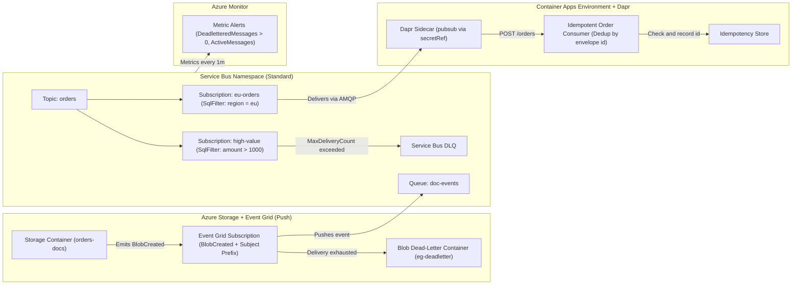
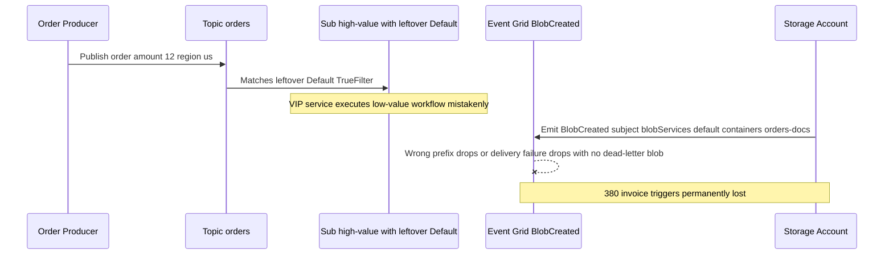

# Capstone Project

> **Prerequisites:** Completion of Modules 00–07 (Service Bus, Event Grid, Dapr pub/sub, reliability patterns, schema versioning, observability), Terraform (Track 9), and Azure Container Apps (Track 6).  
> **Estimated Reading Time:** 45 minutes (plus 2–3 hours implementation & teardown)  
> **Target Audience:** Backend Engineers, Cloud Architects, Platform Engineers.

> [!TIP]
> **The Golden Rule of Event-Driven Capstones:** Build and verify strictly in dependency order—prove Service Bus topic filtering (after deleting the implicit `` `$Default` `` rule) before wiring Dapr `secretRef` consumers, Event Grid `BlobCreated` triggers, poison-message dead-lettering, idempotent deduplication, and `DeadletteredMessages > 0` alerting—then run the full resource-group and diagnostic teardown immediately after verification.

---

## Why This Matters

This is where the whole track converges. Across modules 00-07 you learned each piece in isolation — the command/event distinction and idempotency (00), the queue/topic/stream topologies (01), Service Bus queues/topics/filters/DLQ/sessions (02), push-based Event Grid (03), the Dapr pub/sub building block backed by a real broker (04), the reliability patterns that make at-least-once survivable (05), event schema versioning (06), and the observability that makes all of it operable (07). None of those, alone, is an event-driven system. This capstone asks you to *compose* them into one: a small but genuinely event-driven application where a real Azure resource event and a business event flow through filtered subscriptions to a Dapr-based consumer, failures are proven to dead-letter, and duplicates are proven harmless. There's no new concept and no quiz here — the goal is to prove you can build and *operate* the real thing, then tear it down cleanly and confirm nothing's left billing.

Treat this as a project, not a checklist of isolated exercises — the pieces depend on each other in the order you'd actually build them.

> **Cost warning:** this capstone creates real, billable resources — a Service Bus **Standard** namespace, an Event Grid subscription on a real Azure resource, a Container Apps Environment with Dapr sidecars, and (optionally) Log Analytics/App Insights ingestion. Nothing here is expensive if you clean up promptly, but a **Premium** Service Bus namespace, a chatty Event Grid source, or full-sampling trace ingestion left running over a weekend is a real bill. Build it, prove it, destroy it — see the final cleanup.

---

## 1. Architectural Mental Model & The Project

Every component in this architecture validates one end-to-end invariant from Modules 00–07:



### The project

Build a small **order-processing event-driven system** end to end. An order is placed (a business event), it fans out through a filtered Service Bus topic to specialized consumers, a real Azure resource event (a blob upload representing an order document) triggers a reaction via Event Grid, one consumer runs as a Dapr-pub/sub Container App, failures are dead-lettered and proven, and duplicate deliveries are proven harmless. Provision the Azure infrastructure with **Terraform** where you can (track 9), reusing your clean variables/outputs habit, and fall back to `az` only where it's genuinely simpler.

Your system must include:

1. **A real Service Bus topic with at least two subscriptions with *different* filters** (modules 01-02). E.g. an `orders` topic with a `high-value` subscription (`amount > 1000`) and a `eu-orders` subscription (`region = 'eu'`), with the implicit `` `$Default` `` rule removed where it shouldn't apply, so each subscription provably receives a *different* subset and at least one message lands in both (fan-out).
2. **An Event Grid subscription reacting to a real Azure resource event** (module 03). E.g. a Storage account where uploading an order document (`BlobCreated`) triggers an Event Grid subscription — scoped by event type and subject — that pushes into the messaging system (a Service Bus queue handler is the clean in-Azure option), with a **dead-letter destination configured** so failed deliveries aren't dropped.
3. **A Dapr-pub/sub-based Container App consumer** (module 04). At least one consumer runs on Container Apps with Dapr enabled, subscribing to the `orders` topic through a **Service Bus-backed pub/sub component** whose connection comes from a **secret** (not inline — track 6 module 06), reusing your track 6 module 05 Dapr muscle memory.
4. **Dead-letter handling proven to actually work** (modules 02, 05). You must **force a poison message** (a deliberately malformed or unprocessable event), show it lands in the DLQ with a meaningful reason after bounded retries (or via immediate dead-letter), and demonstrate a redrive/inspection path. A dead-letter path you haven't exercised doesn't count.
5. **An idempotent consumer design, written up** (modules 00, 05, 06). At least one consumer must be idempotent: it dedups on the envelope `id`, so a redelivered/duplicate event produces the side effect exactly once. Prove it by delivering the same logical event twice and showing the effect happened once, and write up the design (what the dedup key is, where it's stored, why at-least-once delivery makes this necessary).

Then **operate** it, **prove** it, and **destroy** it — see the acceptance checklist.

---

## 2. Taxonomic Comparison: Capstone Architecture Matrix & Acceptance Checklist

| Capstone Component | Primary Azure / IaC Resource | Module Origin | Proof Test You Must Run |
| :--- | :--- | :--- | :--- |
| **Filtered Fan-Out** | `azurerm_servicebus_topic` + `azurerm_servicebus_subscription_rule` | Modules 01, 02 | Publish `{amount:1500, region:"eu"}` (lands in both) and `{amount:50, region:"us"}` (lands in neither) |
| **Resource Event Push** | `azurerm_eventgrid_event_subscription` on `Microsoft.Storage.BlobCreated` | Module 03 | Upload blob under `/blobServices/default/containers/orders-docs/blobs/...` + test DLQ blob container |
| **Secret-Backed Consumer** | Container App + Dapr `pubsub.azure.servicebus.topics` (`secretRef`) | Module 04 + Track 6 | Container logs show event processed without plain connection strings in YAML/Bicep/TF |
| **Poison Message Recovery** | Service Bus `max_delivery_count = 3` + `$DeadLetterQueue` | Modules 02, 05 | Inject malformed payload, confirm `deadLetterMessageCount >= 1` & inspect `DeadLetterReason` |
| **Idempotent Handler** | Envelope `id` deduplication table / store | Modules 00, 05, 06 | Deliver identical `id` twice, confirm side effect count stays `1` |
| **Operational Visibility** | `az monitor metrics alert` + `ActiveMessages` / `DeadletteredMessages` | Module 07 | Force poison event and verify DLQ alert transitions to Fired |

### Acceptance checklist

Work top to bottom; each item depends on the previous ones actually working, not just existing.

- [ ] An `orders` **Service Bus topic** exists with **≥2 subscriptions carrying different filters**. Publishing a spread of messages provably routes **different subsets** to each subscription, and at least one message lands in **both** (fan-out). The implicit `` `$Default` `` rule is removed where a subscription is meant to filter — verified by sending a message that should be *excluded* and confirming it does not appear.
- [ ] An **Event Grid subscription** reacts to a **real Azure resource event** (e.g. `Microsoft.Storage.BlobCreated`), scoped by event type and subject to the right container/path (using the *actual* subject format, not a guessed prefix), and delivers into the messaging system. Uploading a blob provably triggers it end to end.
- [ ] The Event Grid subscription has a **configured dead-letter destination**; you demonstrated (by forcing a delivery failure) that exhausted events land there rather than being silently dropped.
- [ ] At least one **Container App consumer runs with Dapr enabled**, subscribed to `orders` via a **Service Bus-backed pub/sub component**, and the component's connection string comes from a **secret**, not inline. A published event provably reaches the consumer (logs/trace confirm it).
- [ ] You **forced a poison message** and it landed in the **DLQ** with a meaningful `DeadLetterReason` after bounded retries (or immediate dead-letter). You can show the DLQ depth climbing and describe the redrive/inspection path.
- [ ] At least one consumer is **idempotent**: delivering the **same logical event twice** (same envelope `id`) produces the side effect **once**. You have a written design covering the dedup key, where it's stored, and why at-least-once delivery requires it.
- [ ] **Observability** is wired (module 07): at minimum an alert (or a demonstrated query) on **DLQ depth > 0** and evidence you can see **queue depth** as a time series. Bonus: a single **trace/correlation id** ties a message across the publish→queue→consume hops.
- [ ] Infrastructure is provisioned **declaratively where practical** (Terraform, track 9): the topic, subscriptions, and filter rules are `azurerm_servicebus_*` resources driven by variables, not hand-clicked. You read the plan before applying and it matched expectation.
- [ ] You can **explain every component** — why a topic (not a queue) for the fan-out, why Event Grid (push) for the resource event, why Dapr for the consumer, why the DLQ and idempotency are both required — mapping each back to the module that taught it. If you can't explain a piece, that's a signal to revisit it, not to leave a copy-pasted block that happened to work.
- [ ] **Everything is torn down** in the final cleanup and you've confirmed no Service Bus namespace, Event Grid subscription, Container Apps Environment, or diagnostic ingestion is still billing.

---

## 3. Production War Story Post-Mortem: The Unfiltered `$Default` Rule & Silent Blob Drop

| Field | Incident Details |
| :--- | :--- |
| **Severity** | **SEV-1** (Duplicate High-Value Refunds + Lost Invoice Artifacts) |
| **Detection / Resolution Time** | Detected in 65 minutes during finance reconciliation / Resolved in 1 hour 50 minutes |
| **Impact** | `high-value` VIP processor ingested 14,900 low-value `$5` orders due to leftover `$Default` filter; 380 uploaded invoice PDFs dropped silently during an Event Grid handler outage |

### What Happened

A team deployed a Terraform configuration creating `high-value` (`amount > 1000`) and `eu-orders` (`region = 'eu'`) subscriptions on an `orders` topic, forgetting that Azure Service Bus automatically attaches an implicit `TrueFilter` rule named `` `$Default` `` on every new subscription. Simultaneously, their Event Grid `BlobCreated` subscription omitted `--deadletter-endpoint` and used a guessed subject prefix `/orders-docs/` instead of `/blobServices/default/containers/orders-docs/`.



### Root Cause Analysis

1. **Implicit `` `$Default` `` rule left intact**: Adding a custom `SqlFilter` does not delete `` `$Default` ``; Service Bus evaluates rules with logical OR, matching 100% of topic messages.
2. **Event Grid opt-in dead-lettering omitted & wrong subject format**: Without an explicit dead-letter storage blob destination, exhausted delivery retries are discarded permanently.

### The Fix & Architectural Hardening

- Explicitly delete `` `$Default` `` via Terraform (`azurerm_servicebus_subscription_rule` replacement or CLI cleanup step) and verify exclusion with negative-case smoke tests.
- Capture an actual `Microsoft.Storage.BlobCreated` sample event first to anchor `--subject-begins-with "/blobServices/default/containers/orders-docs/blobs/"`, and configure `--deadletter-endpoint` on a dedicated storage container.

---

## 4. Multi-Language Production Implementation: Capstone Dapr Idempotent Consumer

These four implementations model the capstone's Dapr pub/sub endpoint (`POST /orders`): validating the CloudEvents envelope, deduplicating atomically on `id` (proving duplicate delivery produces the side effect once), rejecting malformed payloads with explicit Dapr `DROP` (dead-lettering) semantics, and logging W3C `traceparent` for end-to-end correlation.

````carousel
```go
package main

import (
	"encoding/json"
	"log"
	"net/http"
	"sync"
)

type CloudEvent struct {
	ID          string          `json:"id"`
	Type        string          `json:"type"`
	TraceParent string          `json:"traceparent"`
	Data        json.RawMessage `json:"data"`
}

type OrderPayload struct {
	OrderID string  `json:"orderId"`
	Amount  float64 `json:"amount"`
	Region  string  `json:"region"`
}

type IdempotentStore struct {
	mu   sync.Mutex
	seen map[string]struct{}
}

func (s *IdempotentStore) TryRecord(eventID string) bool {
	s.mu.Lock()
	defer s.mu.Unlock()
	if _, exists := s.seen[eventID]; exists {
		return false
	}
	s.seen[eventID] = struct{}{}
	return true
}

func main() {
	store := &IdempotentStore{seen: make(map[string]struct{})}
	mux := http.NewServeMux()

	mux.HandleFunc("POST /orders", func(w http.ResponseWriter, r *http.Request) {
		var evt CloudEvent
		if err := json.NewDecoder(r.Body).Decode(&evt); err != nil || evt.ID == "" {
			// Tell Dapr to DROP (route to Service Bus DLQ) instead of infinite retry
			writeDaprStatus(w, "DROP")
			return
		}
		var order OrderPayload
		if err := json.Unmarshal(evt.Data, &order); err != nil || order.OrderID == "" || order.Amount <= 0 {
			log.Printf("poison payload event=%s traceparent=%s: dropping to DLQ", evt.ID, evt.TraceParent)
			writeDaprStatus(w, "DROP")
			return
		}
		if !store.TryRecord(evt.ID) {
			log.Printf("duplicate event=%s order=%s traceparent=%s: skipping side effect", evt.ID, order.OrderID, evt.TraceParent)
			writeDaprStatus(w, "SUCCESS")
			return
		}
		log.Printf("processed event=%s order=%s amount=%.2f region=%s traceparent=%s", evt.ID, order.OrderID, order.Amount, order.Region, evt.TraceParent)
		writeDaprStatus(w, "SUCCESS")
	})

	log.Fatal(http.ListenAndServe(":8080", mux))
}

func writeDaprStatus(w http.ResponseWriter, status string) {
	w.Header().Set("Content-Type", "application/json")
	_ = json.NewEncoder(w).Encode(map[string]string{"status": status})
}
```
<!-- slide -->
```typescript
import express, { Request, Response } from "express";

interface CloudEventEnvelope {
  id?: string;
  type?: string;
  traceparent?: string;
  data?: { orderId?: string; amount?: number; region?: string };
}

const processedEventIds = new Set<string>();
const app = express();
app.use(express.json({ type: ["application/json", "application/cloudevents+json"] }));

app.post("/orders", (req: Request, res: Response) => {
  const evt = req.body as CloudEventEnvelope;
  if (!evt?.id || !evt.data?.orderId || typeof evt.data.amount !== "number" || evt.data.amount <= 0) {
    console.error("Poison message detected; instructing Dapr to DROP to DLQ", {
      eventId: evt?.id ?? "missing",
      traceparent: evt?.traceparent ?? "none",
    });
    return res.status(200).json({ status: "DROP" });
  }

  if (processedEventIds.has(evt.id)) {
    console.info("Duplicate event suppressed via idempotency store", {
      eventId: evt.id,
      orderId: evt.data.orderId,
      traceparent: evt.traceparent,
    });
    return res.status(200).json({ status: "SUCCESS" });
  }

  processedEventIds.add(evt.id);
  console.info("Executed order side effect exactly once", {
    eventId: evt.id,
    orderId: evt.data.orderId,
    amount: evt.data.amount,
    traceparent: evt.traceparent,
  });
  return res.status(200).json({ status: "SUCCESS" });
});

app.listen(8080, () => console.info("Capstone Dapr consumer listening on :8080"));
```
<!-- slide -->
```python
from fastapi import FastAPI, Request
from fastapi.responses import JSONResponse
import logging

app = FastAPI()
logger = logging.getLogger("capstone.consumer")
processed_ids: set[str] = set()


@app.post("/orders")
async def handle_order(request: Request) -> JSONResponse:
    try:
        evt = await request.json()
    except Exception:
        return JSONResponse({"status": "DROP"})

    event_id = evt.get("id")
    traceparent = evt.get("traceparent", "none")
    data = evt.get("data") or {}
    order_id = data.get("orderId")
    amount = data.get("amount")

    if not event_id or not order_id or not isinstance(amount, (int, float)) or amount <= 0:
        logger.error("Poison OrderPlaced event=%s traceparent=%s -> DROP", event_id, traceparent)
        return JSONResponse({"status": "DROP"})

    if event_id in processed_ids:
        logger.info("Duplicate delivery event=%s order=%s traceparent=%s -> no-op", event_id, order_id, traceparent)
        return JSONResponse({"status": "SUCCESS"})

    processed_ids.add(event_id)
    logger.info("Processed order=%s amount=%s event=%s traceparent=%s", order_id, amount, event_id, traceparent)
    return JSONResponse({"status": "SUCCESS"})
```
<!-- slide -->
```csharp
using System.Collections.Concurrent;
using System.Text.Json;

var builder = WebApplication.CreateBuilder(args);
var app = builder.Build();
var processedIds = new ConcurrentDictionary<string, byte>(StringComparer.Ordinal);

app.MapPost("/orders", async (HttpRequest req, ILoggerFactory loggerFactory) =>
{
    var logger = loggerFactory.CreateLogger("CapstoneConsumer");
    using var doc = await JsonDocument.ParseAsync(req.Body);
    var root = doc.RootElement;

    var eventId = root.TryGetProperty("id", out var idProp) ? idProp.GetString() : null;
    var traceparent = root.TryGetProperty("traceparent", out var tpProp) ? tpProp.GetString() : "none";

    if (string.IsNullOrWhiteSpace(eventId) || !root.TryGetProperty("data", out var data) ||
        !data.TryGetProperty("orderId", out var orderIdProp) ||
        !data.TryGetProperty("amount", out var amountProp) ||
        amountProp.ValueKind != JsonValueKind.Number || amountProp.GetDecimal() <= 0)
    {
        logger.LogError("Poison event {EventId} traceparent={TraceParent}: returning DROP for DLQ.", eventId, traceparent);
        return Results.Ok(new { status = "DROP" });
    }

    var orderId = orderIdProp.GetString();
    if (!processedIds.TryAdd(eventId, 0))
    {
        logger.LogInformation("Duplicate event {EventId} for order {OrderId} traceparent={TraceParent}: skipped.", eventId, orderId, traceparent);
        return Results.Ok(new { status = "SUCCESS" });
    }

    logger.LogInformation("Processed order {OrderId} amount={Amount} event={EventId} traceparent={TraceParent}.",
        orderId, amountProp.GetDecimal(), eventId, traceparent);
    return Results.Ok(new { status = "SUCCESS" });
});

app.Run();
```
````

---

## 5. Practical Hands-On Verification CLI Workflows, Hints & Cleanup

### Step-by-Step Verification Commands

```powershell
# 1. Confirm Service Bus topic filter rules have removed the implicit default rule
az servicebus topic subscription rule list -g rg-capstone --namespace-name $sbNs --topic-name orders --subscription-name high-value -o table
az servicebus topic subscription rule list -g rg-capstone --namespace-name $sbNs --topic-name orders --subscription-name eu-orders -o table

# 2. Verify Event Grid subscription subject filter & dead-letter destination
az eventgrid event-subscription show --name blob-to-sb --source-resource-id $storageId `
  --query "{filter:filter.subjectBeginsWith, dlq:deadLetterDestination}" -o jsonc

# 3. Verify Dapr component secretRef without plaintext connection string
az containerapp env dapr-component show -g rg-capstone --name env-capstone --dapr-component-name orders-pubsub `
  --query "properties.metadata[?name=='connectionString']" -o jsonc

# 4. Verify DLQ count and metric alert rule
az servicebus topic subscription show -g rg-capstone --namespace-name $sbNs --topic-name orders --subscription-name high-value --query countDetails -o jsonc
az monitor metrics alert list -g rg-capstone -o table
```

**Expected Output:**
```text
FilterType    Name             RequiresPreprocessing
------------  ---------------  ---------------------
SqlFilter     high-value-only  False

{
  "filter": "/blobServices/default/containers/orders-docs/blobs/",
  "dlq": {
    "blobContainerName": "eg-deadletter",
    "endpointType": "StorageBlob"
  }
}

[
  {
    "name": "connectionString",
    "secretRef": "sb-conn"
  }
]

{
  "activeMessageCount": 0,
  "deadLetterMessageCount": 1
}
```

### Hints

- **Build in dependency order, proving each hop before adding the next.** Get the Service Bus topic + filtered subscriptions applying and routing correctly first (module 02), *then* add the Dapr consumer on top (module 04), *then* the Event Grid resource-event path (module 03), *then* force failures and wire observability (modules 05, 07). Don't stand up all five pieces and debug a system-wide failure at once — each proven hop is a checkpoint.
- **Remove the `` `$Default` `` filter or your filters are a lie.** A new subscription matches everything until you delete its implicit `` `$Default` `` `TrueFilter` (module 02). Prove your filtering by sending a message that *should be excluded* and confirming it's absent — not just that included messages arrive.
- **Use the actual Event Grid subject format.** Storage blob subjects are `/blobServices/default/containers/<c>/blobs/<path>`, not `/container/path` (module 03). Inspect one real event's subject before writing a `--subject-begins-with` filter, or your subscription will silently receive nothing.
- **Prove dead-lettering, don't assume it.** Force a genuine poison message and watch it reach the DLQ with a reason (module 05). Bound `max_delivery_count` so it dead-letters instead of looping, and configure Event Grid's dead-letter endpoint explicitly — it's opt-in and defaults to *dropping* (module 03).
- **Dedup on a stable id.** Idempotency only works if the same logical event carries the same envelope `id` across retries/republishes (modules 00, 06). Have the consumer record processed ids and no-op on repeats; "publish the same event twice → effect once" is the proof.
- **Keep secrets out of the component.** The Service Bus connection string goes in a secret and is referenced by `secretRef` (track 6 module 06), never pasted into the component definition.
- **Watch depth and the DLQ, not just success paths.** An alert on `DeadletteredMessages > 0` and visibility into rising `ActiveMessages` (module 07) are what make this operable — and they're what would have caught every diagnose-and-fix in this track early.
- **Keep it small and destroy promptly.** A Standard namespace, one small Storage account, and scale-to-zero Container Apps are cheap; this is still real spend. Don't leave it running while you write up your idempotency design.

### Final cleanup

This is the end of the track's real-Azure spend. Clean up deliberately.

1. Confirm what you're about to delete: `terraform state list` (everything Terraform manages) and `az resource list -g <your-rg> -o table`.
2. Destroy the Terraform-managed infrastructure: `terraform destroy` — review the destroy plan, confirm it includes the Service Bus namespace and rules, then `yes`.
3. Delete anything created with `az` (Event Grid subscriptions, the Container Apps Environment, Storage account, any resource group not under Terraform): `az group delete -n <your-rg> --yes --no-wait`.
4. Disable any **diagnostic settings / Application Insights ingestion** you wired for observability — these bill per GB and a `terraform destroy` of the messaging resources won't necessarily stop a workspace from ingesting.
5. Final sweep: `az servicebus namespace list -o table` (empty), `az eventgrid event-subscription list -o table` (nothing from this project), and `az group list -o table` (no leftover groups). Empty results from all are your signal you're no longer being billed for any of it.

```powershell
terraform destroy -auto-approve
az group delete -n rg-capstone --yes --no-wait
az servicebus namespace list -o table
az eventgrid event-subscription list -o table
az group list -o table
```

**Expected Output:**
```text
Destroy complete! Resources destroyed.
All Service Bus namespaces, Event Grid subscriptions, and capstone resource groups return empty tables.
```

---

## 6. Common Mistakes & Troubleshooting

- **Forgetting to delete the implicit `` `$Default` `` rule on filtered subscriptions.** Every message matches every subscription regardless of your `SqlFilter` until `` `$Default` `` is removed.
- **Guessing Storage Blob subject prefixes in Event Grid.** Using `/orders-docs/` silently filters out 100% of events; always anchor to `/blobServices/default/containers/<container>/blobs/`.
- **Inline connection strings in Dapr pub/sub components.** Putting raw Service Bus keys into component YAML exposes secrets in state/VCS; always bind via `secretRef`.
- **Testing happy paths without forcing a poison message and duplicate delivery.** Unexercised DLQ paths and unverified deduplication fail during real production incidents.
- **Stopping at `terraform destroy` while diagnostic ingestion remains active.** Verify Log Analytics / App Insights diagnostic bindings and resource groups are completely gone.

---

## 7. Operational Validation Checkpoints

<details><summary><strong>Checkpoint 1: Proving fan-out filtering works without false positives</strong></summary>

Publish three test messages to `orders`: `{amount: 1500, region: "eu"}`, `{amount: 200, region: "eu"}`, and `{amount: 200, region: "us"}`. Confirm the first lands in both `high-value` and `eu-orders`, the second lands only in `eu-orders`, and the third lands in neither. If the third message arrives in either subscription, the implicit `` `$Default` `` `TrueFilter` is still present and must be deleted.

</details>

<details><summary><strong>Checkpoint 2: Verifying end-to-end dead-lettering across both Event Grid and Service Bus</strong></summary>

Event Grid and Service Bus have independent dead-letter mechanisms. On Service Bus, send an invalid JSON order payload (or `amount: -10`) and verify the consumer returns Dapr `DROP` (or abandons past `MaxDeliveryCount`), incrementing `deadLetterMessageCount` and firing the `DeadletteredMessages > 0` alert. On Event Grid, point the subscription at a non-existent queue or return 500 to verify failed `BlobCreated` deliveries land as JSON payloads in the `eg-deadletter` blob container instead of disappearing.

</details>

<details><summary><strong>Checkpoint 3: Proving idempotency under duplicate delivery without breaking schema contracts</strong></summary>

Deliver the exact same `OrderPlaced` CloudEvent (preserving the same envelope `id`) twice to the consumer endpoint. Because the consumer inserts `id` into an atomic deduplication store before committing the side effect, the first delivery executes once (`SUCCESS`) and the second delivery returns `SUCCESS` as an explicit no-op—demonstrating why stable `id` generation in the producer/outbox (Modules 00, 05, 06) is non-negotiable.

</details>

---

## 8. Before You Move On & Next

### Before you move on

Once everything is torn down, don't consider this finished yet. Wait a few days, then — with no notes, none of the earlier modules open, and none of the config in front of you — **rebuild the core of this capstone from memory**: the filtered topic with a message that lands in two subscriptions, the Event Grid path off a real resource event with a dead-letter destination, the Dapr consumer reading from a secret-backed component, a forced poison message reaching the DLQ, and the same event delivered twice with the effect happening once. Rebuilding it cold — and noticing exactly where you stall (Was it removing `` `$Default` ``? The Storage subject format? Wiring the dedup key? Proving the DLQ?) — is the truest retention check there is. Tear it all down again afterward and confirm the subscription is clean.

### Next

You've now designed, built, and operated a real event-driven system — the messaging backbone that later platform tracks assume. The immediate next step is **[16-identity-deep-dive](../../16-identity-deep-dive/README.md)**. It's the natural continuation of a thread you kept pulling on here: every secret-backed Dapr component, every Service Bus connection string, and every Event Grid handler you wired raised the same question — *which identity is actually allowed to publish, subscribe, and be reacted to, and how do you stop putting connection strings in secrets at all?* Track 16 answers it properly: Entra ID, service principals, managed identity, and workload identity federation across every resource type — so the messaging system you just built can authenticate with identities instead of shared keys.

[Back to track index](../README.md) · [Back to main curriculum](../../README.md)
