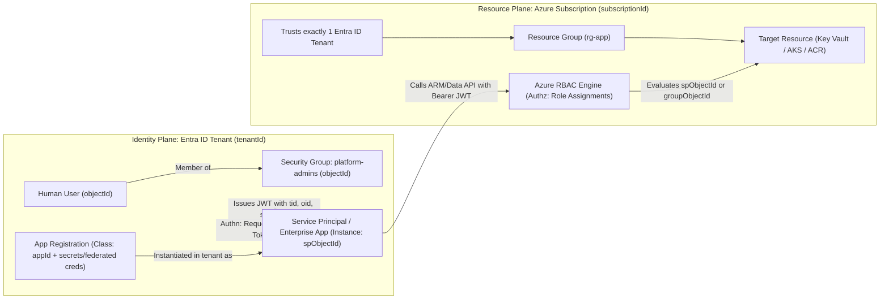
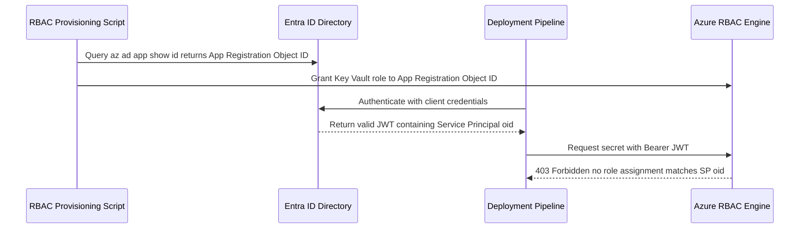

# Entra ID and Identity Fundamentals

> **Prerequisites:** Azure CLI installed (`az login`), familiarity with Azure resource groups, AKS RBAC (`07-aks/07`), Container Apps secrets (`06/06`), and security boundaries (Track 11).  
> **Estimated Reading Time:** 30 minutes  
> **Target Audience:** Backend Engineers, Platform Engineers, Cloud Security Practitioners.

> [!TIP]
> **The Golden Rule of Entra ID Architecture:** Always separate the **identity plane** (your Entra ID tenant) from the **resource plane** (your Azure subscriptions), assign RBAC roles to **security groups** (using GUID object IDs, never display names) rather than individual users, and distinguish **authentication failures** (no valid token) from **authorization failures** (`403 Forbidden` with a valid token) before changing anything.

---

## Why This Matters

Every `az login`, every managed identity you attached, every `az role assignment create` you ran in tracks 06, 07, and 10 was talking to one thing: your **Entra ID tenant** (the service formerly and still often called Azure Active Directory / Azure AD). Until now it was invisible plumbing. This module makes the plumbing explicit, because you cannot reason about service principals, managed identity, or workload identity federation without a solid mental model of tenants, the difference between *proving who you are* and *being allowed to do something*, and what an app registration actually is.

---

## 1. Architectural Mental Model: Identity Plane vs. Resource Plane

An Entra ID tenant is the global directory that authenticates principals and issues signed JWTs, whereas an Azure subscription is a billing and resource container that trusts one tenant and enforces Azure RBAC:



### The tenant is your directory

An **Entra ID tenant** is a dedicated instance of the directory service — the authoritative database of *who and what* exists in your organization: users, groups, and application identities. It has a globally unique **tenant ID** (a GUID) and one or more domains (e.g. `contoso.onmicrosoft.com`). Every Azure subscription **trusts exactly one tenant** for authentication; when you ran `az login` in the AKS track and picked a subscription, you were authenticating against that subscription's tenant. A crucial split to hold onto from the start: **the tenant is the identity plane, the subscription is the resource plane.** A tenant can trust many subscriptions; a subscription trusts one tenant. Deleting a resource group never touches the tenant; deleting a user never touches your VMs. This is the same conceptual boundary you saw when the 07-aks module 07 cleanup noted that a Key Vault (a resource) can outlive an `az group delete` — identities and resources have separate lifecycles.

### Users and groups

A **user** is a human (or a break-glass admin account) that signs in with credentials. A **group** is a named collection of users (and sometimes other groups or service principals). You met groups already: in [07-aks/07](../../07-aks/07-security-aks-aad-rbac-and-keyvault/README.md) you bound an Entra ID *group* object ID to a Kubernetes `ClusterRoleBinding` so that team membership — not a hand-edited kubeconfig — controlled cluster access. The reason groups matter for a platform engineer is **you assign permissions to groups, not individuals**: role assignments to a group flow to every member automatically, and revoking access is a matter of removing someone from the group. This is exactly the least-privilege, minimize-blast-radius thinking from [11-security-deep-dive](../../11-security-deep-dive/README.md), applied to who-can-do-what.

### App registrations vs. enterprise applications vs. service principals

This is the single most confusing corner of Entra ID, so pin it down now — it recurs in every later module. When you register an application you get **two linked objects**:

- An **app registration** (also called the *application object*) is the global *definition* of your app: its name, its client ID, what secrets/certificates it can authenticate with, what API permissions it requests, and — critically for module 03 — its **federated credentials**. There is exactly one app registration per application, and it lives in the tenant where the app was registered.
- A **service principal** (also called the *enterprise application* in the portal) is the *local representation* of that app **inside a specific tenant** — the thing that actually gets **role assignments** and can be granted access to resources. When an app is used in a tenant, a service principal for it is created there.

Analogy: the **app registration is the class, the service principal is the instance**. You define the app once (registration); each tenant that uses it gets its own service principal to hang permissions on. For single-tenant apps (everything you will build in this track) there is one registration and one service principal, one-to-one, in your tenant — but knowing they are separate objects explains why `az ad app` and `az ad sp` are different command families in module 01.

### Authentication vs. authorization

You saw this split named in [07-aks/07](../../07-aks/07-security-aks-aad-rbac-and-keyvault/README.md) (you could *authenticate* via Azure AD yet be *authorized* for nothing). Make it a reflex:

- **Authentication (authn) = proving who you are.** The tenant checks your credential (password, certificate, a federated OIDC token) and, if valid, issues you a **token**. Output: "yes, you are this identity." That is *all* it says.
- **Authorization (authz) = deciding what you may do.** A separate system — Azure **RBAC** (module 04) — checks whether your identity has a **role assignment** granting the action you attempted on the resource you attempted it on. Output: "allowed" or "Forbidden / 403."

Almost every identity failure you will diagnose in module 07 is one of these two failing, and the whole skill is knowing *which*. A wrong secret or an expired token or a subject-claim mismatch is an **authn** failure (you never get a valid token). A valid token but a missing role assignment is an **authz** failure — the `403`/`Forbidden` you saw crash-loop a Container App in [06/06](../../06-azure-container-apps/06-secrets-managed-identity-and-config/README.md) when the role was missing.

### OAuth2 and OIDC, just enough

You do not need to implement these, but you need the vocabulary because every later mechanism is built on them:

- **OAuth2** is the framework for *delegated authorization* — how a client gets an **access token** to call an API (like the Azure Resource Manager API, or Microsoft Graph) on behalf of some identity. The token is a signed, time-limited credential (a **JWT**) that the resource validates.
- **OIDC (OpenID Connect)** is a thin authentication layer on top of OAuth2 that adds an **ID token** — a JWT asserting *who* the identity is, with standard **claims** like `iss` (issuer — who minted the token), `sub` (subject — which identity), and `aud` (audience — who the token is for).
- The **`sub` (subject) claim** is the one to remember: in workload identity federation (module 03), Azure decides whether to trust an external token by matching *its* `sub` claim (e.g. GitHub's `repo:my-org/my-repo:ref:refs/heads/main`) against a **federated credential** you configured. When the OIDC login in module 03 fails, it is almost always a `sub` mismatch. You will hear "subject claim" again and again — this is where it comes from.

---

## 2. Taxonomic Comparison & Command Reference

### Directory Identifiers & Object Boundaries

| Identifier | Plane | Scope | Used Where |
| :--- | :--- | :--- | :--- |
| **`tenantId` (`tid`)** | Identity Plane | Dedicated Entra ID directory instance | `az login --tenant`, token `iss`/`tid` validation |
| **`subscriptionId`** | Resource Plane | Billing & resource container trusting 1 tenant | `--scope /subscriptions/<subId>/...` |
| **Object ID (`oid` / `id`)** | Identity Plane | Unique GUID of a user, group, or service principal | `--member-id`, `--assignee`, AKS `ClusterRoleBinding` |
| **Application / Client ID (`appId`)** | Identity Plane | Global identifier of an App Registration ("class") | `-u` in `az login`, `AZURE_CLIENT_ID`, `az ad app` |

### Authn vs. Authz Failure Signatures

| Symptom | Plane / Layer | Likely Cause | Immediate Diagnostic Check |
| :--- | :--- | :--- | :--- |
| **`AADSTS7000215` / Invalid secret / `401`** | **Authn** (Entra ID Token Endpoint) | Expired/wrong secret, wrong `tenantId`, `sub` mismatch | Test token acquisition (`az login` / `az account get-access-token`) |
| **`403 Forbidden` / `AuthorizationFailed`** | **Authz** (Azure RBAC / Data Plane) | Valid token issued, missing role assignment at scope | Inspect `az role assignment list --assignee <oid> --all` |
| **`ResourceNotFound` on known resource** | **Tenant / Subscription Context** | Authenticated to wrong tenant or subscription | Run `az account show --query "{sub:id, tenant:tenantId}"` |

### Command Reference

| Command | What it does | Example |
|---|---|---|
| `az account show` | Shows the current subscription **and** its tenant ID | `az account show --query "{sub:id, tenant:tenantId, user:user.name}" -o jsonc` |
| `az ad signed-in-user show` | Shows the Entra ID object for the currently logged-in user | `az ad signed-in-user show --query "{name:displayName, id:id, upn:userPrincipalName}" -o jsonc` |
| `az ad user list` | Lists users in the tenant | `az ad user list --query "[].{name:displayName, upn:userPrincipalName}" -o table` |
| `az ad group create` | Creates a security group | `az ad group create --display-name "platform-admins" --mail-nickname "platform-admins"` |
| `az ad group member add` | Adds a member to a group | `az ad group member add --group "platform-admins" --member-id <user-object-id>` |
| `az ad group member list` | Lists group members | `az ad group member list --group "platform-admins" -o table` |
| `az ad app list` | Lists app registrations (application objects) | `az ad app list --query "[].{name:displayName, appId:appId}" -o table` |
| `az ad sp list` | Lists service principals (enterprise apps) | `az ad sp list --show-mine -o table` |

Flag-by-flag breakdowns:

`az ad group create --display-name "platform-admins" --mail-nickname "platform-admins"`
- `--display-name` — the human-readable group name shown in the portal and used by `--group` in later commands.
- `--mail-nickname` — a mail alias Entra ID requires even for non-mail-enabled security groups; use the same slug as the display name. It must be unique-ish and mail-safe (no spaces).

`az ad group member add --group "platform-admins" --member-id <user-object-id>`
- `--group` — the group's display name **or** object ID.
- `--member-id` — the **object ID** (a GUID) of the user/SP/group being added, *not* the display name or UPN. Get a user's object ID with `az ad user show --id <upn> --query id -o tsv`.

`az account show --query "{sub:id, tenant:tenantId, user:user.name}" -o jsonc`
- `--query` — a JMESPath projection pulling out just the subscription ID, tenant ID, and signed-in user in one object; the whole point of this exercise is to *see* the sub-vs-tenant split on your own account.

---

## 3. Production War Story Post-Mortem: The App-Object vs. Service-Principal ID Mix-Up

| Field | Incident Details |
| :--- | :--- |
| **Severity** | **SEV-2** (Production Deployment Pipeline Blocked) |
| **Detection / Resolution Time** | Detected immediately on staging-to-prod promotion / Resolved in 52 minutes |
| **Impact** | Deploy pipeline received valid Entra tokens yet failed every Key Vault & AKS operation with `403 Forbidden` |

### What Happened

A platform engineer automated RBAC provisioning for a new deployment application using `az ad app show --id <appId> --query id -o tsv` instead of `az ad sp show --id <appId> --query id -o tsv`, and passed the **App Registration's object ID** (`appObjectId`) to `az role assignment create --assignee`. When the pipeline ran, Entra ID authenticated it cleanly and issued a JWT whose `oid` claim matched the **Service Principal's object ID** (`spObjectId`)—causing Azure RBAC to deny every request with `403 Forbidden`.



### Root Cause Analysis

1. **Class vs. Instance GUID confusion**: An app registration and its service principal are separate directory objects with distinct `id` GUIDs. Only the **service principal's** object ID (`spObjectId`) appears in runtime tokens (`oid`) and participates in Azure RBAC evaluation.
2. **Misdiagnosis as an authn bug**: Engineers initially rotated secrets twice before checking whether a token was actually being issued vs. denied by RBAC.

### The Fix & Architectural Hardening

- Switched lookup scripts to `az ad sp show --id <appId> --query id -o tsv` (or passed `appId` directly where CLI resolves the SP) and removed the orphaned assignment on the app registration GUID.
- Documented the Authn (`AADSTS*`) vs. Authz (`403`) triage playbook and enforced security-group-based RBAC rather than ad-hoc individual principal grants.

---

## 4. Multi-Language Production Implementation: Entra JWT Claims Inspector (Authn vs. Authz)

These four implementations decode an OAuth2/OIDC JWT payload (for diagnostic inspection after signature verification by your SDK/gateway), explicitly separating **Authentication (Authn)** failures (`iss`, `tid`, `aud`, `exp`) from **Authorization (Authz)** failures (`roles`, `groups`).

````carousel
```go
package identity

import (
	"encoding/base64"
	"encoding/json"
	"errors"
	"fmt"
	"strings"
	"time"
)

type EntraClaims struct {
	TenantID  string   `json:"tid"`
	ObjectID  string   `json:"oid"`
	Subject   string   `json:"sub"`
	Issuer    string   `json:"iss"`
	Audience  string   `json:"aud"`
	ExpiresAt int64    `json:"exp"`
	Roles     []string `json:"roles"`
	Groups    []string `json:"groups"`
}

func ParseClaimsUnverified(jwt string) (EntraClaims, error) {
	parts := strings.Split(jwt, ".")
	if len(parts) != 3 {
		return EntraClaims{}, errors.New("AUTHN_ERROR: malformed JWT structure")
	}
	payload, err := base64.RawURLEncoding.DecodeString(parts[1])
	if err != nil {
		return EntraClaims{}, fmt.Errorf("AUTHN_ERROR: base64url decode failed: %w", err)
	}
	var c EntraClaims
	if err := json.Unmarshal(payload, &c); err != nil {
		return EntraClaims{}, fmt.Errorf("AUTHN_ERROR: claims JSON invalid: %w", err)
	}
	return c, nil
}

func EvaluateAccess(c EntraClaims, expectedTenant, expectedAud, requiredRole string, now time.Time) error {
	if now.Unix() >= c.ExpiresAt {
		return errors.New("AUTHN_401: access token expired")
	}
	if c.TenantID != expectedTenant || !strings.Contains(c.Issuer, expectedTenant) {
		return fmt.Errorf("AUTHN_401: tenant mismatch (got tid=%s)", c.TenantID)
	}
	if c.Audience != expectedAud {
		return fmt.Errorf("AUTHN_401: audience mismatch (got aud=%s)", c.Audience)
	}
	for _, r := range c.Roles {
		if r == requiredRole {
			return nil
		}
	}
	return fmt.Errorf("AUTHZ_403: authenticated oid=%s sub=%s lacks role %q", c.ObjectID, c.Subject, requiredRole)
}
```
<!-- slide -->
```typescript
export interface EntraJwtClaims {
  tid: string;
  oid?: string;
  sub: string;
  iss: string;
  aud: string;
  exp: number;
  roles?: string[];
  groups?: string[];
}

export function decodeJwtPayload(token: string): EntraJwtClaims {
  const parts = token.split(".");
  if (parts.length !== 3) {
    throw new Error("AUTHN_401: Malformed JWT token");
  }
  const json = Buffer.from(parts[1], "base64url").toString("utf8");
  return JSON.parse(json) as EntraJwtClaims;
}

export function diagnoseAuthnVsAuthz(
  claims: EntraJwtClaims,
  expectedTenantId: string,
  expectedAudience: string,
  requiredGroupOrRole: string,
  nowEpochSec = Math.floor(Date.now() / 1000)
): { status: "ALLOW" | "AUTHN_401" | "AUTHZ_403"; reason: string } {
  if (claims.exp <= nowEpochSec) {
    return { status: "AUTHN_401", reason: "Token expired; refresh credential or OIDC exchange" };
  }
  if (claims.tid !== expectedTenantId || !claims.iss.includes(expectedTenantId)) {
    return { status: "AUTHN_401", reason: `Wrong tenant tid=${claims.tid}; expected ${expectedTenantId}` };
  }
  if (claims.aud !== expectedAudience) {
    return { status: "AUTHN_401", reason: `Audience mismatch aud=${claims.aud}` };
  }
  const entitlements = [...(claims.roles ?? []), ...(claims.groups ?? [])];
  if (!entitlements.includes(requiredGroupOrRole)) {
    return {
      status: "AUTHZ_403",
      reason: `Principal oid=${claims.oid ?? claims.sub} authenticated fine, missing role/group ${requiredGroupOrRole}`,
    };
  }
  return { status: "ALLOW", reason: `Authorized principal ${claims.oid ?? claims.sub}` };
}
```
<!-- slide -->
```python
import base64
import json
import time
from typing import Any


def decode_jwt_payload(jwt_token: str) -> dict[str, Any]:
    parts = jwt_token.split(".")
    if len(parts) != 3:
        raise ValueError("AUTHN_401: Invalid JWT format")
    padded = parts[1] + "=" * (-len(parts[1]) % 4)
    return json.loads(base64.urlsafe_b64decode(padded).decode("utf-8"))


def classify_access_result(
    claims: dict[str, Any],
    expected_tenant: str,
    expected_aud: str,
    required_role: str,
    now_epoch: int | None = None,
) -> tuple[str, str]:
    now = now_epoch if now_epoch is not None else int(time.time())
    if int(claims.get("exp", 0)) <= now:
        return ("AUTHN_401", "Token is expired")
    if claims.get("tid") != expected_tenant or expected_tenant not in str(claims.get("iss", "")):
        return ("AUTHN_401", f"Tenant/issuer mismatch: tid={claims.get('tid')}")
    if claims.get("aud") != expected_aud:
        return ("AUTHN_401", f"Audience mismatch: aud={claims.get('aud')}")

    roles = set(claims.get("roles") or [])
    groups = set(claims.get("groups") or [])
    if required_role not in roles and required_role not in groups:
        return (
            "AUTHZ_403",
            f"Valid token for oid={claims.get('oid')} sub={claims.get('sub')}, missing grant '{required_role}'",
        )
    return ("ALLOW", f"Granted access to {claims.get('oid') or claims.get('sub')}")
```
<!-- slide -->
```csharp
using System.Text;
using System.Text.Json;

public sealed record EntraClaims(
    string TenantId,
    string ObjectId,
    string Subject,
    string Issuer,
    string Audience,
    long ExpiresAtUnix,
    IReadOnlyList<string> Roles);

public static class EntraTokenDiagnostics
{
    public static EntraClaims ParseClaims(string jwt)
    {
        var parts = jwt.Split('.');
        if (parts.Length != 3)
            throw new InvalidOperationException("AUTHN_401: Malformed JWT.");

        var base64 = parts[1].Replace('-', '+').Replace('_', '/');
        base64 = base64.PadRight(base64.Length + (4 - base64.Length % 4) % 4, '=');
        using var doc = JsonDocument.Parse(Encoding.UTF8.GetString(Convert.FromBase64String(base64)));
        var root = doc.RootElement;

        var roles = root.TryGetProperty("roles", out var rProp) && rProp.ValueKind == JsonValueKind.Array
            ? rProp.EnumerateArray().Select(x => x.GetString() ?? "").ToArray()
            : Array.Empty<string>();

        return new EntraClaims(
            root.GetProperty("tid").GetString() ?? "",
            root.TryGetProperty("oid", out var oidProp) ? oidProp.GetString() ?? "" : "",
            root.GetProperty("sub").GetString() ?? "",
            root.GetProperty("iss").GetString() ?? "",
            root.GetProperty("aud").GetString() ?? "",
            root.GetProperty("exp").GetInt64(),
            roles);
    }

    public static string Evaluate(EntraClaims claims, string expectedTid, string expectedAud, string requiredRole)
    {
        if (DateTimeOffset.UtcNow.ToUnixTimeSeconds() >= claims.ExpiresAtUnix)
            return "AUTHN_401: Token expired.";
        if (!string.Equals(claims.TenantId, expectedTid, StringComparison.OrdinalIgnoreCase) ||
            !claims.Issuer.Contains(expectedTid, StringComparison.OrdinalIgnoreCase))
            return $"AUTHN_401: Wrong tenant tid={claims.TenantId}.";
        if (!string.Equals(claims.Audience, expectedAud, StringComparison.Ordinal))
            return $"AUTHN_401: Audience mismatch aud={claims.Audience}.";
        if (!claims.Roles.Contains(requiredRole, StringComparer.Ordinal))
            return $"AUTHZ_403: Authenticated oid={claims.ObjectId} lacks role '{requiredRole}'.";
        return $"ALLOW: oid={claims.ObjectId}";
    }
}
```
````

---

## 5. Practical Hands-On Verification CLI Workflows

### 1. See your tenant and subscription split
```powershell
az account show --query "{sub:id, tenant:tenantId, user:user.name}" -o jsonc
```

**Expected Output:**
```json
{
  "sub": "aaaaaaaa-bbbb-cccc-dddd-eeeeeeeeeeee",
  "tenant": "11111111-2222-3333-4444-555555555555",
  "user": "engineer@contoso.com"
}
```
> Verify: write down which GUID is the **subscription** and which is the **tenant**. The two GUIDs are different, and re-running after `az account set --subscription <other-sub>` (if you have a second subscription) changes the `sub` but very likely keeps the same `tenant`.

### 2. Look at yourself as a directory object
```powershell
az ad signed-in-user show --query "{name:displayName, id:id, upn:userPrincipalName}" -o jsonc
```

**Expected Output:**
```json
{
  "id": "99999999-8888-7777-6666-555555555555",
  "name": "Platform Engineer",
  "upn": "engineer@contoso.com"
}
```
> Verify: note your **object ID** — this is the GUID you would pass as `--assignee` to a role assignment or as a `subjects` object ID in a Kubernetes binding. The `id` here is a *different* GUID from both your subscription and tenant IDs. Identity objects have their own IDs.

### 3. List the app registrations and service principals already in your tenant
```powershell
az ad app list --query "[].{name:displayName, appId:appId}" -o table
az ad sp list --show-mine -o table
```
> Verify: you almost certainly already have service principals from earlier tracks (for example, ones created by `az ad sp create-for-rbac`, or the CLI's own first-party apps). Notice the SP list is longer — every managed identity and first-party Microsoft app also shows up as a service principal.

### 4. Create a security group
```powershell
az ad group create --display-name "platform-admins" --mail-nickname "platform-admins"
az ad group show --group "platform-admins" --query id -o tsv
az ad group list --query "[?displayName=='platform-admins']" -o table
```

**Expected Output:**
```text
DisplayName      Id                                    MailNickname
---------------  ------------------------------------  ---------------
platform-admins  44444444-3333-2222-1111-000000000000  platform-admins
```
> Verify: the group appears in `az ad group list --query "[?displayName=='platform-admins']" -o table`.

### 5. Add yourself to the group
```powershell
$myId = az ad signed-in-user show --query id -o tsv
az ad group member add --group "platform-admins" --member-id $myId
az ad group member list --group "platform-admins" -o table
```
> Verify: `az ad group member list --group "platform-admins" -o table` lists you. (Later modules assign roles to this group, not to you directly — that is the point of using a group.)

### 6. Inspect a token's claims (conceptual, no secret)
```powershell
az account get-access-token --query "{expires:expiresOn}" -o jsonc
```

**Expected Output:**
```json
{
  "expires": "2026-11-11 10:45:12.000000"
}
```
> Verify: this is an OAuth2 access token the CLI holds for the ARM API. It has an expiry a short time in the future — tokens are **time-limited**, which is exactly why a stored, long-lived *secret* (module 01) is a different and worse thing than a short-lived *token*. (Do not paste the raw token anywhere; treat it as a live credential.)

### 7. Distinguish authn from authz on purpose
Pick any resource group you own and run a harmless read, e.g. `az group show --name <some-rg>`. It works because you are both authenticated *and* authorized (Owner/Contributor). Now run something you are almost certainly not authorized for, like creating a role assignment at **subscription** scope (`az role assignment create --assignee <your-id> --role Owner --scope /subscriptions/<sub-id>` — expect this to be **denied** unless you are a subscription Owner/User Access Administrator).
> Verify: the failure is a `403`/authorization error, **not** a login prompt — you were authenticated fine; you just were not authorized. That distinction is the whole module.

### 8. Diagnose-and-fix: "member-id" rejected
Deliberately run `az ad group member add --group "platform-admins" --member-id "platform-admins"` (passing a *name* where an object ID is required). Observe the error.
> **Diagnose:** `--member-id` needs a GUID object ID, not a display name.
> **Fix:** resolve the name to an ID first (`az ad user show --id <your-upn> --query id -o tsv`) and pass that. Verify the member is added. This is the same class of mistake — name vs. object ID — that trips up `--assignee` in later role-assignment exercises.

*(Optional cleanup after completing the Independent challenge: remove any temporary test groups with `az ad group delete --group "platform-admins"`.)*

### Independent challenge

Without copying any command block above, model your own two-tier access story in the directory. Create two security groups representing two real teams — say `app-developers` and `platform-admins` — put your own user in both, then design (on paper, or in a scratch note) which of the Azure resource types you have already worked with in tracks 06, 07, and 09 each group *should* be able to touch and at what level, citing the least-privilege reasoning from [11-security-deep-dive](../../11-security-deep-dive/README.md). Do not assign any roles yet — that is module 04 — but produce a table mapping *group → resource → intended permission → why*. The point is to practice thinking in terms of **groups and intent** before you touch RBAC mechanics, so that when module 04 gives you `az role assignment create` you already know *what* you mean to grant and to *whom*.

<details><summary>Stuck? One hint</summary>

Start from the boundary this module opened with: the **tenant is the identity plane, the subscription is the resource plane**. Your groups live in the tenant; the things you want to gate (a Key Vault, an AKS cluster, an ACR) live in subscriptions/resource groups. So every row in your table is "this tenant group should get this role *scoped to* this resource-plane object" — which is exactly the shape of an `az role assignment create` you will write in module 04. You are just writing the intent now.

</details>

---

## 6. Common Mistakes & Troubleshooting

- **Confusing tenant ID, subscription ID, and object ID.** They are three different GUIDs for three different things (directory instance, billing/resource container, a specific identity object). Mixing them up is the root of most "wrong ID" errors in later modules. When a command wants `--assignee`, it wants an **object ID**; when it wants `--scope`, it wants a **resource ID** (which contains the subscription ID).
- **Treating app registration and service principal as one thing.** They are linked but distinct objects (`az ad app` vs. `az ad sp`). Deleting the app registration also removes its service principal, but editing one via the wrong command family silently does nothing useful.
- **Assigning permissions to individual users instead of groups.** It works, but it does not scale and it makes offboarding error-prone. Prefer groups from day one — it is the identity-plane version of the least-privilege discipline from track 11.
- **Passing display names where object IDs are required.** `--member-id`, `--assignee`, and Kubernetes `subjects` object IDs all want GUIDs. Resolve names to IDs explicitly (`... --query id -o tsv`) and pass the ID.
- **Assuming `az login` picked the tenant you meant.** If you belong to more than one tenant, `az login --tenant <tenant-id>` (and `az account set`) puts you where you intend. A "resource not found" that makes no sense is often "you are authenticated against the wrong tenant."

---

## 7. Operational Validation Checkpoints & Quiz

### Operational Validation Checkpoints

<details><summary><strong>Checkpoint 1: Tenant boundary behavior when deleting a resource group</strong></summary>

If you run `az group delete -n rg-app --yes`, your Key Vault, AKS cluster, and VMs inside `rg-app` are deleted in the resource plane, while your Entra ID users, security groups (`platform-admins`), and app registrations remain untouched in the identity plane because identities live in the tenant rather than inside resource groups.

</details>

<details><summary><strong>Checkpoint 2: Triaging 403 Forbidden vs. invalid token errors</strong></summary>

A CI job receives `403 AuthorizationFailed` when deploying to `rg-prod`. First verify whether a token was issued (authn succeeded). Because `403` means Azure RBAC evaluated an authenticated principal and denied the action, do not reset credentials or touch `az ad app`; instead inspect the service principal's or group's `az role assignment list --assignee <sp-object-id> --all` at the target `--scope`.

</details>

<details><summary><strong>Checkpoint 3: Offboarding an engineer safely under group-based RBAC</strong></summary>

When an engineer leaves the platform team, removing their user object from the `platform-admins` security group revokes all downstream Azure RBAC and AKS `ClusterRoleBinding` permissions inherited via that group once existing short-lived tokens expire, without leaving dozens of per-user role assignments scattered across subscriptions.

</details>

### Checkpoint quiz

Write down your answer to each question before expanding it — checking without attempting first is the single easiest way to fool yourself into thinking you've learned this.

1. What is the difference between a **tenant** and a **subscription**, and which one does authentication happen against?
2. An app registration and a service principal are two linked objects. In the "class vs. instance" analogy, which is which, and which one receives **role assignments**?
3. State the difference between **authentication** and **authorization** in one sentence each, and say which one a `403`/`Forbidden` is.
4. Why do you assign permissions to **groups** rather than to individual users?
5. In an OIDC token, what does the **`sub` (subject)** claim assert, and which later module makes matching it the whole game?
6. You run a read command and it succeeds; you run a role-assignment-create command and get a `403`. Were you authenticated in the second case? How do you know?
7. A command asks for `--member-id` and you pass a group's display name; it fails. What kind of value did it actually want, and how do you get it?

<details><summary>Show answers</summary>

1. A **tenant** is the directory/identity instance (users, groups, app identities) with its own tenant ID; a **subscription** is a resource/billing container. **Authentication happens against the tenant** — the subscription just trusts one tenant to vouch for identities.
2. The **app registration** is the class (the global definition of the app); the **service principal** is the instance (its local representation in a tenant). The **service principal** is what receives role assignments and access grants.
3. **Authentication** = proving who you are (you get a token or you do not). **Authorization** = deciding what you may do (you have a role assignment or you do not). A `403`/`Forbidden` is an **authorization** failure — you were authenticated fine.
4. Because permissions assigned to a group flow to all members automatically, and access is granted/revoked by group membership rather than by editing every individual's assignments — it scales and it makes offboarding safe.
5. The **`sub` claim** asserts *which identity* the token is for. **Module 03 (workload identity federation)** makes matching that subject claim against a configured federated credential the whole game.
6. **Yes**, you were authenticated in the second case — you got far enough to be *evaluated* for authorization and denied. An authentication failure would have blocked you with a login/credential error before any permission check.
7. It wanted an **object ID** (a GUID), not a display name. Resolve it first, e.g. `az ad group show --group <name> --query id -o tsv` (or `az ad user show --id <upn> --query id -o tsv` for a user), and pass that GUID.

</details>

---

## 8. Next

[01-service-principals-in-depth](../01-service-principals-in-depth/README.md) — the first concrete application identity: creating a service principal, the choice between a client secret and a certificate, and why long-lived secrets are the liability that motivates everything after it.
