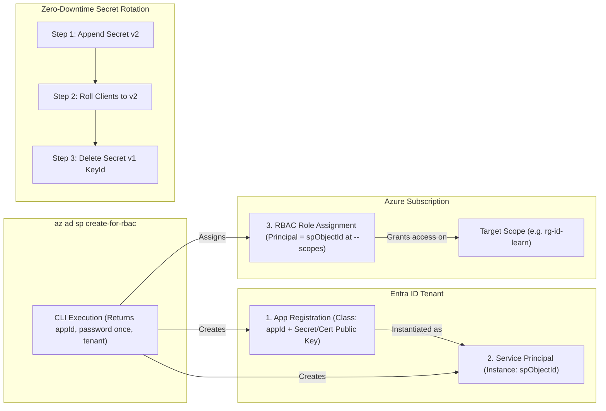
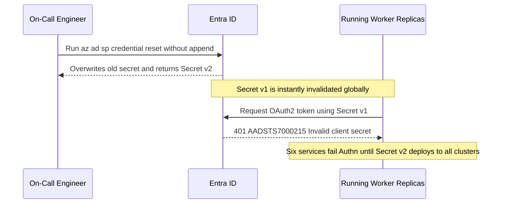

# Service Principals in Depth

> **Prerequisites:** Entra ID tenant/app registration vs. service principal mental model (Module 00), Azure CLI authenticated, and basic Azure RBAC familiarity.  
> **Estimated Reading Time:** 30 minutes  
> **Target Audience:** Backend Engineers, DevOps Engineers, Platform Engineers, Security Engineers.

> [!TIP]
> **The Golden Rule of Service Principals:** Never default `az ad sp create-for-rbac` to subscription-wide `Contributor`—always specify the narrowest `--role` and `--scopes` (resource group or single resource), prefer workload identity federation or managed identity whenever available, and rotate expiring credentials cleanly via `--append` + cutover instead of deleting and recreating the principal.

---

## Why This Matters

A **service principal** is how a non-human thing — a script, a Terraform run, a CI job, an app on a server outside Azure — proves it is allowed to call Azure. It is the oldest and most portable machine-identity mechanism, and it is the one you reach for when managed identity (module 02) and workload identity federation (module 03) are not available. It is also the one with a sharp edge: authenticating a service principal with a **client secret** means storing a long-lived credential somewhere, and that stored secret is the exact thing tracks 10 and 11 spent effort getting *out* of your pipelines. This module makes you fluent in service principals *and* clear-eyed about why you should avoid the secret-based version wherever you can.

---

## 1. Architectural Mental Model: `create-for-rbac` & Zero-Downtime Rotation

Running `az ad sp create-for-rbac` atomically provisions three objects across the identity and resource planes, while zero-downtime secret rotation relies on overlapping two credentials (`Secret v1` + `Secret v2`) before removing the old one:



### What `create-for-rbac` actually does

You may have run `az ad sp create-for-rbac` before without seeing the moving parts. It does **three** things in one command: it creates an **app registration**, creates the matching **service principal** (the two linked objects from module 00), and — because of the `for-rbac` part — creates a **role assignment** granting that principal a role at a scope. The output hands you an `appId` (the client ID), a `password` (the client secret), and the `tenant` — the three values a client needs to log in as that principal:

```json
{
  "appId": "00000000-0000-0000-0000-000000000000",
  "displayName": "sp-terraform-learn",
  "password": "the-only-time-you-ever-see-this",
  "tenant": "11111111-1111-1111-1111-111111111111"
}
```

That `password` is shown **exactly once** and is never retrievable again. Lose it and you must reset it. This one-time-view is your first hint that a secret is an awkward thing to manage.

### Client secret vs. certificate authentication

A service principal can authenticate two ways:

- **Client secret** — a shared string (effectively a password) the client presents. Simple, but it is a **bearer credential**: anyone who reads it *is* the principal, it is easy to accidentally commit to Git or log, and it is long-lived unless you actively rotate it. This is the `password` from `create-for-rbac`.
- **Certificate** — the client holds a **private key** and proves possession of it without ever sending it over the wire; Entra ID stores only the **public** key. This is strictly stronger: the secret material never transits, it is harder to exfiltrate from a keystore than a string is from an env var, and it maps naturally onto hardware-backed key storage. The trade-off is operational complexity (you manage a cert and its expiry).

Neither removes the fundamental problem: **the credential still lives somewhere you have to protect.** That is the motivation for module 02 and 03.

### Why long-lived secrets are a liability

This connects directly back to [10-cicd-and-gitops/07-pipeline-security-and-secrets](../../10-cicd-and-gitops/07-pipeline-security-and-secrets/README.md), which pushed you toward OIDC federation instead of a stored service principal secret. The reasons, stated plainly:

- **It can leak.** A string in a CI variable, an env file, a Terraform state, or a log line is a string that can be copied. A leaked secret is a valid credential until someone notices and rotates it.
- **It rarely rotates.** In theory secrets have an expiry; in practice they get set to a year or two and forgotten, so a leak in month one is exploitable for the whole window.
- **It is a standing target.** A long-lived secret is exactly the kind of credential the threat models in [11-security-deep-dive](../../11-security-deep-dive/README.md) flag: it grants access continuously, whether or not any legitimate workload is running right now.

The modern hierarchy, worst to best: **stored client secret → certificate → managed identity (no credential you hold at all) → workload identity federation (no stored credential, short-lived tokens minted per-run)**. This module owns the first two; modules 02 and 03 own the last two.

### Secret expiry, rotation, and reset

Because a secret is a liability, treat its **expiry** as a feature, not a nuisance. `create-for-rbac` lets you set `--years` (or you can add a credential with an explicit end date). When a secret expires, the principal's logins start failing with an **authentication** error (invalid client secret) — importantly *not* a `403` authorization error. Recognizing "auth suddenly broke on a schedule" as "the secret expired" is a real diagnosis skill (revisited in module 07). You **rotate** by adding a new credential, cutting clients over, then removing the old one — never by deleting the principal.

### Service principal vs. managed identity, previewed

Hold this comparison; module 02 develops it. A **service principal with a secret** is a credential *you* create, hold, and must protect. A **managed identity** is also a service principal under the hood — but Azure creates and rotates its credential for you and never exposes it, so there is nothing for you to store or leak. The rule of thumb you are building toward: **if the workload runs inside Azure, prefer a managed identity; if it runs outside Azure (like GitHub Actions), prefer workload identity federation; reach for a secret-based service principal only when neither is possible.**

---

## 2. Taxonomic Comparison & Command Reference

### Machine Identity Security Hierarchy

| Option | Credential Material Stored by You | Network Exposure | Rotation Burden | Ideal Workload Location |
| :--- | :--- | :--- | :--- | :--- |
| **1. SP + Client Secret** (Least secure) | Long-lived bearer string | Secret sent to Entra token endpoint | Manual / scripted dual-key rotation | Legacy external systems lacking OIDC or cert stores |
| **2. SP + Certificate** | X.509 private key | Signed assertion only (private key stays local) | Cert renewal + upload public key | On-prem / HSM / Windows/Linux VMs outside Azure |
| **3. Managed Identity** | None (Azure-managed cert) | IMDS localhost / MSI endpoint | Automatic (~45 days by Azure) | Workloads running inside Azure (AKS, ACA, VMs, Functions) |
| **4. Workload Identity Federation** (Most secure) | None (short-lived OIDC JWT) | External OIDC token exchange | Zero long-lived secrets | GitHub Actions, GitLab CI, AKS Workload Identity pods |

### Credential Rotation Strategies

| Action | Keeps `appId` & RBAC Intact? | Zero-Downtime Overlap? | Operational Verdict |
| :--- | :--- | :--- | :--- |
| `az ad sp credential reset --append` | Yes | Yes (old + new both valid until old removed) | **Correct** production rotation pattern |
| `az ad sp credential reset` (no `--append`) | Yes | No (replaces existing secret immediately) | Emergency revocation only; causes outage if clients hold old secret |
| `az ad sp delete` + recreate | **No** (new `appId`/`spId`) | No (all RBAC grants broken) | **Antipattern**—orphans/breaks every downstream binding |

### Command Reference

| Command | What it does | Example |
|---|---|---|
| `az ad sp create-for-rbac` | Creates an app registration + service principal + role assignment, returns credentials | `az ad sp create-for-rbac --name sp-learn --role Reader --scopes /subscriptions/<sub-id>/resourceGroups/rg-id-learn` |
| `az ad app create` | Creates only the app registration (no SP, no role) | `az ad app create --display-name sp-learn-app` |
| `az ad sp create` | Creates the service principal for an existing app registration | `az ad sp create --id <app-id>` |
| `az ad sp credential reset` | Resets/rotates a service principal's client secret | `az ad sp credential reset --id <app-id> --years 1` |
| `az ad app credential reset` | Adds/rotates credentials on the app registration | `az ad app credential reset --id <app-id> --years 1` |
| `az ad sp show` | Shows a service principal's details | `az ad sp show --id <app-id> --query "{name:displayName, spId:id}" -o jsonc` |
| `az login --service-principal` | Logs in *as* a service principal (secret or cert) | `az login --service-principal -u <app-id> -p <secret> --tenant <tenant-id>` |
| `az ad sp delete` | Deletes the service principal (and app, if using the app id) | `az ad sp delete --id <app-id>` |

Flag-by-flag breakdowns:

`az ad sp create-for-rbac --name sp-terraform-learn --role Contributor --scopes /subscriptions/<sub-id>/resourceGroups/rg-id-learn --years 1`
- `--name` — display name for the app registration/SP (a `http://`-prefixed name is auto-generated if omitted; prefer an explicit, greppable name).
- `--role` — the RBAC role to grant the new principal. **Do not default to `Contributor` at subscription scope** — that is the over-privileging module 04 and track 11 warn against.
- `--scopes` — one or more resource IDs the role is granted on. Scope to a **resource group or single resource**, not the whole subscription, unless you truly need it. Space-separated for multiple scopes.
- `--years` — secret lifetime. A shorter lifetime is safer but means more frequent rotation; this flag existing at all is the tell that the secret is a managed liability.

`az login --service-principal -u <app-id> -p <secret-or-cert-path> --tenant <tenant-id>`
- `--service-principal` — log in as an SP, not interactively as a human.
- `-u` — the **app (client) ID** of the principal.
- `-p` — the client **secret**, *or* a path to a `.pem` certificate file (with `--password` pointing at the cert for cert auth in some CLI versions). Passing a secret on the command line leaks it into shell history — prefer an env var.
- `--tenant` — the tenant the principal lives in.

`az ad sp credential reset --id <app-id> --years 1`
- `--id` — the app (client) ID (or the app registration's object ID).
- `--years` — validity of the **new** secret it generates and returns. This is your rotation command; using `--append` keeps the old secret working until it expires or you remove it, enabling a zero-downtime cutover.

---

## 3. Production War Story Post-Mortem: The Hard-Reset Rotation That Took Down Six Microservices

| Field | Incident Details |
| :--- | :--- |
| **Severity** | **SEV-1** (Six Production Workers Locked Out Simultaneously) |
| **Detection / Resolution Time** | Detected within 4 minutes via `AADSTS7000215` error spike / Resolved in 35 minutes |
| **Impact** | External ingestion workers lost Azure Blob & Service Bus authentication across all replicas until new secret propagated |

### What Happened

A shared service principal `sp-partner-ingest` was expiring in 3 days. An on-call engineer ran `az ad sp credential reset --id <appId>` **without `--append`**, overwriting the sole active client secret immediately. Within seconds, every running pod attempting token refresh failed authentication with `AADSTS7000215: Invalid client secret provided`.



### Root Cause Analysis

1. **Destructive single-credential overwrite**: Omitting `--append` invalidated the existing credential before consumers could load the replacement.
2. **Long-lived shared secret dependency**: Multiple external workloads shared a single static secret instead of workload identity federation or isolated per-workload identities.

### The Fix & Architectural Hardening

- Standardized rotation runbooks on `az ad app credential reset --id <appId> --append --end-date ...`, updating Key Vault / Kubernetes secrets, verifying zero errors on `v2`, and only then deleting the old `keyId` via `az ad app credential delete`.
- Migrated Azure-hosted workers to Managed Identity (Module 02) and CI pipelines to OIDC Workload Identity Federation (Module 03).

---

## 4. Multi-Language Production Implementation: Credential Expiry Auditor & SP SDK Auth

These four implementations monitor `passwordCredentials` / `keyCredentials` expiry dates from Entra ID (`az ad app credential list --output json`) to flag imminent expirations before `AADSTS7000215` outages occur, alongside standard SDK client-secret credential setup with environment variables.

````carousel
```go
package spaudit

import (
	"fmt"
	"os"
	"time"
)

type CredentialMetadata struct {
	KeyID       string    `json:"keyId"`
	DisplayName string    `json:"displayName"`
	EndDateTime time.Time `json:"endDateTime"`
	Kind        string    `json:"kind"` // "secret" or "certificate"
}

type AuditFinding struct {
	KeyID       string
	Kind        string
	DaysLeft    int
	Severity    string
	Remediation string
}

func AuditCredentials(creds []CredentialMetadata, now time.Time) []AuditFinding {
	findings := make([]AuditFinding, 0, len(creds))
	for _, c := range creds {
		days := int(c.EndDateTime.Sub(now).Hours() / 24)
		var severity, action string
		switch {
		case days <= 0:
			severity = "EXPIRED_AUTHN_OUTAGE"
			action = "Append replacement credential immediately and cut over workloads"
		case days <= 14:
			severity = "CRITICAL_ROTATE_NOW"
			action = "Run credential reset --append and stage zero-downtime rollout"
		case days <= 30:
			severity = "WARN_EXPIRING_SOON"
			action = "Schedule rotation or migrate workload to Managed Identity / OIDC"
		default:
			severity = "HEALTHY"
			action = "None"
		}
		findings = append(findings, AuditFinding{
			KeyID: c.KeyID, Kind: c.Kind, DaysLeft: days, Severity: severity, Remediation: action,
		})
	}
	return findings
}

func LoadServicePrincipalEnv() (tenantID, clientID, clientSecret string, err error) {
	tenantID, clientID, clientSecret = os.Getenv("AZURE_TENANT_ID"), os.Getenv("AZURE_CLIENT_ID"), os.Getenv("AZURE_CLIENT_SECRET")
	if tenantID == "" || clientID == "" || clientSecret == "" {
		return "", "", "", fmt.Errorf("missing AZURE_TENANT_ID, AZURE_CLIENT_ID, or AZURE_CLIENT_SECRET")
	}
	return tenantID, clientID, clientSecret, nil
}
```
<!-- slide -->
```typescript
export interface AppCredentialRecord {
  keyId: string;
  displayName?: string;
  endDateTime: string;
  kind: "secret" | "certificate";
}

export interface CredentialAuditResult {
  keyId: string;
  kind: "secret" | "certificate";
  daysRemaining: number;
  status: "EXPIRED" | "CRITICAL" | "WARNING" | "HEALTHY";
  recommendation: string;
}

export function auditServicePrincipalCredentials(
  credentials: AppCredentialRecord[],
  now = new Date()
): CredentialAuditResult[] {
  const msPerDay = 86_400_000;
  return credentials.map((cred) => {
    const expires = new Date(cred.endDateTime);
    const daysRemaining = Math.floor((expires.getTime() - now.getTime()) / msPerDay);

    if (daysRemaining <= 0) {
      return {
        keyId: cred.keyId,
        kind: cred.kind,
        daysRemaining,
        status: "EXPIRED",
        recommendation: "Authentication failing (AADSTS7000215 risk). Rotate with --append now.",
      };
    }
    if (daysRemaining <= 14) {
      return {
        keyId: cred.keyId,
        kind: cred.kind,
        daysRemaining,
        status: "CRITICAL",
        recommendation: "Append new credential, cut over clients, then remove old keyId.",
      };
    }
    if (daysRemaining <= 30) {
      return {
        keyId: cred.keyId,
        kind: cred.kind,
        daysRemaining,
        status: "WARNING",
        recommendation: "Plan rotation or replace secret SP with Managed Identity / OIDC.",
      };
    }
    return {
      keyId: cred.keyId,
      kind: cred.kind,
      daysRemaining,
      status: "HEALTHY",
      recommendation: cred.kind === "secret" ? "Consider migrating off static secret." : "Valid certificate.",
    };
  });
}
```
<!-- slide -->
```python
from dataclasses import dataclass
from datetime import datetime, timezone
import os


@dataclass(frozen=True)
class CredentialAudit:
    key_id: str
    kind: str
    days_remaining: int
    status: str
    action: str


def audit_credentials(
    credentials: list[dict[str, str]],
    now: datetime | None = None,
) -> list[CredentialAudit]:
    ref_time = now or datetime.now(timezone.utc)
    results: list[CredentialAudit] = []
    for cred in credentials:
        expiry = datetime.fromisoformat(cred["endDateTime"].replace("Z", "+00:00"))
        days = int((expiry - ref_time).total_seconds() // 86400)
        kind = cred.get("kind", "secret")
        if days <= 0:
            status, action = "EXPIRED", "Rotate immediately via --append; logins failing authn."
        elif days <= 14:
            status, action = "CRITICAL", "Append new credential, deploy cutover, revoke old keyId."
        elif days <= 30:
            status, action = "WARNING", "Schedule rotation or migrate to Managed Identity / OIDC."
        else:
            status, action = "HEALTHY", "Monitor expiry window."
        results.append(CredentialAudit(cred["keyId"], kind, days, status, action))
    return results


def require_sp_env() -> tuple[str, str, str]:
    """Read SP auth from environment instead of CLI args or source code."""
    tenant = os.environ["AZURE_TENANT_ID"]
    client_id = os.environ["AZURE_CLIENT_ID"]
    secret = os.environ["AZURE_CLIENT_SECRET"]
    return tenant, client_id, secret
```
<!-- slide -->
```csharp
public sealed record CredentialEntry(string KeyId, string Kind, DateTimeOffset EndDateTime);

public sealed record CredentialAuditFinding(
    string KeyId,
    string Kind,
    int DaysRemaining,
    string Severity,
    string Guidance);

public static class ServicePrincipalCredentialAuditor
{
    public static IReadOnlyList<CredentialAuditFinding> Evaluate(
        IEnumerable<CredentialEntry> entries,
        DateTimeOffset? utcNow = null)
    {
        var now = utcNow ?? DateTimeOffset.UtcNow;
        var results = new List<CredentialAuditFinding>();

        foreach (var entry in entries)
        {
            var days = (int)Math.Floor((entry.EndDateTime - now).TotalDays);
            var (severity, guidance) = days switch
            {
                <= 0 => ("EXPIRED", "Authn failing: append new credential immediately and roll out."),
                <= 14 => ("CRITICAL", "Use az ad app credential reset --append and cut over before expiry."),
                <= 30 => ("WARNING", "Plan rotation or replace secret with Managed Identity / OIDC."),
                _ => ("HEALTHY", "No immediate action; prefer certificate/OIDC over client secret.")
            };
            results.Add(new CredentialAuditFinding(entry.KeyId, entry.Kind, days, severity, guidance));
        }

        return results;
    }
}
```
````

---

## 5. Practical Hands-On Verification CLI Workflows

### 1. Create a resource group to scope against
```powershell
az group create --name rg-id-learn --location eastus
```
You will scope this module's service principal to *this group only*, practicing least privilege from the first command.

### 2. Create a scoped service principal
```powershell
$subId = az account show --query id -o tsv
az ad sp create-for-rbac --name sp-id-learn --role Reader `
  --scopes /subscriptions/$subId/resourceGroups/rg-id-learn --years 1
```

**Expected Output:**
```json
{
  "appId": "aaaaaaaa-1111-2222-3333-bbbbbbbbbbbb",
  "displayName": "sp-id-learn",
  "password": "generated-one-time-secret",
  "tenant": "11111111-2222-3333-4444-555555555555"
}
```
**Copy the `appId`, `password`, and `tenant` from the output now** — the password is shown only once. Verify: `az ad sp show --id <appId> --query displayName -o tsv` returns `sp-id-learn`.

### 3. Log in as the service principal
In a *separate* shell (so you do not disturb your main login):
```powershell
az login --service-principal -u <appId> -p <password> --tenant <tenant>
az account show --query user -o jsonc
```

**Expected Output:**
```json
{
  "name": "aaaaaaaa-1111-2222-3333-bbbbbbbbbbbb",
  "type": "servicePrincipal"
}
```
> Verify: `az account show --query user -o jsonc` shows a `type` of `servicePrincipal` and the `name` is the `appId` — you are now *acting as* the machine identity, not yourself.

### 4. Confirm its permissions are exactly what you granted
Still logged in as the SP:
```powershell
az group show --name rg-id-learn -o table
az group create --name rg-id-should-fail --location eastus
```

**Expected Output:**
```text
rg-id-learn succeeds (Reader role at rg-id-learn scope).
az group create fails with AuthorizationFailed (403 Forbidden).
```
> Verify: the second command returns a `403` authorization error. This is least privilege working. Log back in as yourself (`az login`) afterward.

### 5. Inspect and reset (rotate) the secret
As yourself:
```powershell
az ad sp credential reset --id <appId> --years 1 --append
az ad app credential list --id <appId> --query "[].{keyId:keyId, endDate:endDateTime}" -o table
```
> Verify: a **new** `password` is returned, different from the first. With `--append`, the old secret remains valid until expiry or explicit removal — this is how you rotate without downtime.

### 6. Prove the SP has no retrievable secret after the fact
Try to read the secret back — there is no `az ad sp` command that returns an existing secret's value, only `reset` which makes a new one.
> Verify: confirm for yourself that Entra ID stores secrets one-way; the only recovery from a lost secret is a reset. Write down why that makes a stored secret operationally fragile.

### 7. Diagnose-and-fix: expired/invalid secret (authn failure)
Simulate a bad secret:
```powershell
az login --service-principal -u <appId> -p "definitely-wrong-secret" --tenant <tenant>
```
Observe the error (`AADSTS7000215: Invalid client secret provided`).
> **Diagnose:** this is an **authentication** failure (invalid client secret / `AADSTS7000215`-style), *not* a `403` — the principal never got a token, so authorization never even ran. Contrast this with exercise 4's `403`, which happened *after* a successful login.
> **Fix:** log in with the correct current secret (from your exercise 5 reset). The lesson — *wrong/expired secret = authn error before any permission check; missing role = authz `403` after login* — is the core diagnostic split you will use in module 07.

### 8. Diagnose-and-fix: over-scoped by accident
Create a throwaway SP with a deliberately too-broad grant:
```powershell
az ad sp create-for-rbac --name sp-toobroad --role Contributor --scopes /subscriptions/$subId
az role assignment list --assignee <its-appId> --all -o table
```
> **Diagnose:** observe the role is `Contributor` at **subscription** scope — this SP can now modify *everything* in the subscription, exactly the over-privilege antipattern from track 11.
> **Fix:** delete the subscription-scoped assignment (`az role assignment delete --assignee <appId> --role Contributor --scope /subscriptions/$subId`) and, if the SP still needs access, re-create it at resource-group scope only. Then delete the throwaway SP entirely (`az ad sp delete --id <appId>`).

### 9. Clean up
```powershell
az ad sp delete --id <sp-id-learn-appId>
az group delete --name rg-id-learn --yes --no-wait
az ad sp list --show-mine -o table
```
> Verify: `az ad sp list --show-mine -o table` no longer lists `sp-id-learn`. (Deleting the SP also cleans up its role assignments; leftover assignments to a deleted principal show up as an orphaned GUID — module 04 covers cleaning those.)

### Independent challenge

Using only what you know, provision a service principal that a *hypothetical external build server* (something outside Azure that cannot use managed identity) would use to deploy into a single resource group — and then make the case, in writing, for why you would **not** actually ship this design to production. Grant it the *least* role that would let it deploy the kinds of resources you built in [09-terraform-on-azure](../../09-terraform-on-azure/README.md), scoped to exactly one resource group, with a short secret lifetime. Then write a short "why this is the wrong long-term answer" note that references the stored-secret risks from [10-cicd-and-gitops/07](../../10-cicd-and-gitops/07-pipeline-security-and-secrets/README.md) and names what you would replace it with once the workload could run either inside Azure (module 02's mechanism) or in GitHub Actions (module 03's mechanism). The deliverable is the SP *plus* the argument against it — proving you can both wield the tool and know when not to.

<details><summary>Stuck? One hint</summary>

The role that lets a pipeline "deploy resources" in a resource group is usually `Contributor` **scoped to that one resource group** — not at subscription scope. Build the `--scopes` value as `/subscriptions/<sub-id>/resourceGroups/<rg>` and confirm with `az role assignment list --assignee <appId> --all -o table` that nothing broader was granted. For the write-up, the single sentence that matters is: *the `password` this command prints is a long-lived bearer credential you now have to store and protect, which is the exact thing OIDC federation (module 03) removes.*

</details>

---

## 6. Common Mistakes & Troubleshooting

- **Not copying the password on creation.** `create-for-rbac` shows the secret once. If you miss it, you cannot retrieve it — you must `credential reset`, which invalidates plans that captured the old one.
- **Defaulting to `--role Contributor --scopes /subscriptions/<id>`.** The convenient default is dangerously broad. Scope to a resource group or single resource and pick the narrowest role that works.
- **Confusing an authn failure with an authz failure.** A wrong/expired secret fails at *login* (no token issued). A missing role fails *after* login with a `403`. The remedies are completely different (rotate the secret vs. add a role assignment) — never treat one as the other.
- **Leaking the secret into shell history or Git.** Passing `-p <secret>` on the command line records it in history; committing it to a repo publishes it. Use environment variables and never commit credentials — the same discipline track 10 built for pipeline secrets.
- **Deleting the SP to "rotate" it.** Deleting and recreating changes the `appId`, breaking every role assignment and every client that referenced it. Rotate with `credential reset`, which keeps the principal and its assignments intact.
- **Forgetting that a managed identity would avoid all of this.** If the workload runs in Azure, you probably should not be creating a secret-based SP at all — that is the whole pivot into module 02.

---

## 7. Operational Validation Checkpoints & Quiz

### Operational Validation Checkpoints

<details><summary><strong>Checkpoint 1: Zero-downtime secret rotation without breaking active replicas</strong></summary>

When rotating `sp-ingest-prod`'s expiring secret across 12 running Kubernetes pods, use `az ad app credential reset --id <appId> --append --years 1` so both the old and new secrets are valid simultaneously. Update the secret store, perform a rolling restart so all pods pick up the new secret, confirm no pods authenticate with the old `keyId`, and only then delete the expired/old `keyId` with `az ad app credential delete`.

</details>

<details><summary><strong>Checkpoint 2: Why deleting and recreating an SP breaks production RBAC</strong></summary>

Deleting `sp-deploy` and running `az ad sp create-for-rbac --name sp-deploy` with the exact same display name creates a brand-new `appId` and `spObjectId`. Every Key Vault access policy, AKS cluster role binding, ACR `AcrPush`, and Terraform `AZURE_CLIENT_ID` reference tied to the previous GUID immediately breaks until recreated across every target resource.

</details>

<details><summary><strong>Checkpoint 3: Distinguishing certificate auth vs. secret auth for external servers</strong></summary>

On an external Linux build runner outside Azure that cannot use OIDC federation or Managed Identity, a client certificate is stronger than a client secret because the private key never travels over the wire (Entra stores only the public key, and the client signs a short-lived JWT assertion locally). Still, if the runner moves to GitHub Actions or an Azure VM, replacing the certificate with OIDC federation or Managed Identity eliminates local credential management altogether.

</details>

### Checkpoint quiz

Write down your answer to each question before expanding it — checking without attempting first is the single easiest way to fool yourself into thinking you've learned this.

1. `az ad sp create-for-rbac` does three distinct things in one command. Name them.
2. Which three values from its output does a client need to authenticate as the service principal, and which of the three can you never retrieve again?
3. Give two concrete reasons a client **certificate** is stronger than a client **secret** for an SP.
4. A service principal that worked yesterday suddenly fails to log in today, with no changes to its role assignments. What is the most likely cause, and is it an authn or authz failure?
5. Rank these four machine-auth options from least to most secure: managed identity, stored client secret, workload identity federation, certificate.
6. Why is deleting-and-recreating a service principal the *wrong* way to rotate its secret?
7. You want an SP that can deploy into `rg-app` but nothing else. What `--role` and `--scopes` shape do you use, and why not subscription scope?

<details><summary>Show answers</summary>

1. It creates an **app registration**, creates the matching **service principal**, and creates a **role assignment** granting that principal a role at the scope you specify.
2. The **`appId`** (client ID), the **`password`** (client secret), and the **`tenant`** ID. The **`password`** can never be retrieved again — it is shown once at creation.
3. (any two) The private key never transits the network (only the public key is stored in Entra ID); it is harder to exfiltrate from a keystore than a string from an env var; it maps onto hardware-backed key storage; possession is proven cryptographically rather than by presenting a copyable bearer string.
4. The **secret expired** (or was reset elsewhere). It is an **authentication** failure — the SP cannot get a token at all, which is different from a `403` that would happen after a successful login.
5. Least to most secure: **stored client secret → certificate → managed identity → workload identity federation.**
6. Deleting recreates the principal with a **new `appId`**, which breaks every role assignment and every client that referenced the old one. `credential reset` rotates the secret while keeping the principal and its assignments.
7. `--role Contributor` (or narrower) with `--scopes /subscriptions/<sub-id>/resourceGroups/rg-app`. Not subscription scope because that would let the SP modify every resource in the subscription — a blast radius far larger than the job requires (least privilege).

</details>

---

## 8. Next

[02-managed-identity-in-depth](../02-managed-identity-in-depth/README.md) — the first real fix for the stored-secret problem: an identity Azure creates and rotates for you, with no credential you ever hold, generalized well beyond the basic usage you saw on Container Apps and AKS.
