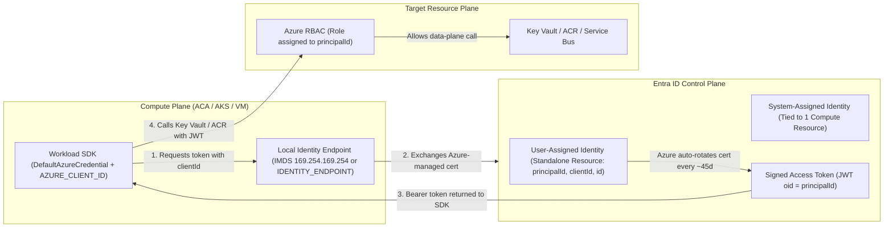
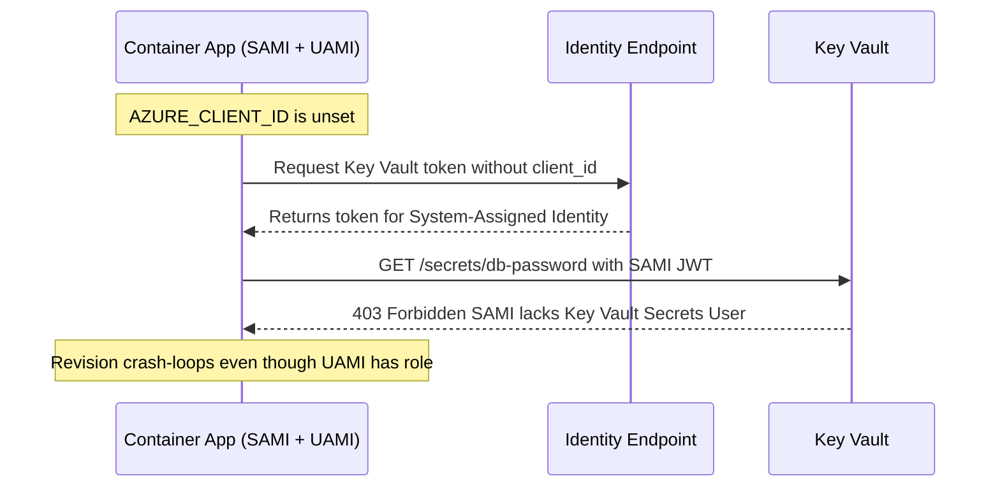

# Managed Identity in Depth

> **Prerequisites:** Service Principal and Entra ID object fundamentals (Modules 00–01), Azure Container Apps (`06/06`), and AKS ACR integration (`07-aks/03`).  
> **Estimated Reading Time:** 35 minutes  
> **Target Audience:** Backend Engineers, Platform Engineers, Cloud Architects.

> [!TIP]
> **The Golden Rule of Managed Identity:** Remember **grant with `principalId`, authenticate/select with `clientId`**, choose **user-assigned** whenever an identity must be shared across workloads or outlive its compute resource, and always pass `AZURE_CLIENT_ID` (or explicit `clientId`) to `DefaultAzureCredential` / `ManagedIdentityCredential` whenever multiple user-assigned identities are attached to the same host.

---

## Why This Matters

A **managed identity** is a service principal whose credential Azure creates, stores, and rotates for you — so there is *nothing for you to hold or leak*. It is the direct answer to the stored-secret liability from module 01. You already used one on Container Apps to read a Key Vault secret and on AKS to pull from ACR, but you used it as a means to an unrelated end. This module makes managed identity the subject: the real difference between system- and user-assigned, which resources can have one, how to attach a *single* user-assigned identity to *many* resources, and how its lifecycle behaves — because getting the lifecycle wrong is how you end up with orphaned identities and mysterious `403`s.

---

## 1. Architectural Mental Model: IMDS Token Acquisition & Lifecycle Split

Under the hood, every Managed Identity maps to an Entra ID Service Principal whose certificate-backed credential Azure rotates automatically (~45 days). At runtime, compute workloads call the local host metadata endpoint (IMDS `169.254.169.254` on VMs/AKS or `IDENTITY_ENDPOINT` on Container Apps/Functions), disambiguating with `clientId` when needed, while Azure RBAC evaluates access against `principalId`:



### It is a service principal you do not manage the credential for

Under the hood, a managed identity **is** an Entra ID service principal (module 00's second object) — it shows up in `az ad sp list`, it receives role assignments exactly like the SP from module 01, and it authenticates with a token exactly like one. The *only* difference is who manages the credential: with the module-01 service principal, **you** created and must protect the secret; with a managed identity, **Azure** generates a certificate-backed credential, rotates it automatically (roughly every ~45 days), and never exposes it to you. There is no `password` to copy, no `credential reset`, no expiry for you to track. Everything you learned about role assignments in module 01 applies unchanged — you just skip the entire "guard the secret" problem.

### System-assigned vs. user-assigned

You met this split in [06-azure-container-apps/06](../../06-azure-container-apps/06-secrets-managed-identity-and-config/README.md); here is the fuller picture:

- **System-assigned** — created *with* a specific resource, tied to that resource's lifecycle, and **unique to it**. Enable it with `--assign-identity` / `--system-assigned` on the resource. When the resource is deleted, the identity is deleted with it (and every role assignment to it becomes an orphan). Best when exactly one resource needs an identity and you want zero lifecycle management.
- **User-assigned** — a **standalone Azure resource** (`azurerm_user_assigned_identity` in Terraform, `az identity create` on the CLI) that you create *once* and then **attach to one or many** resources. It has its own lifecycle independent of anything it is attached to: deleting a Container App or AKS cluster does not delete the identity, and its role assignments survive. Best when several workloads need the *same* permissions, or when you want to grant roles *before* the consuming resource even exists (which is exactly what the capstone's Terraform-first flow needs).

The mental test: **"Does more than one resource need this identity, or should the identity outlive the resource?"** If yes to either, user-assigned. If no, system-assigned is simpler.

### Which resources support managed identity

Not every resource can have one, and it is worth knowing the shape rather than memorizing a list. Compute-like resources that *run your code or config* can have a managed identity: **AKS** (cluster identity + kubelet identity + per-pod via workload identity), **Container Apps**, VMs and VM Scale Sets, App Service/Functions, Logic Apps, Azure Container Instances, API Management, Data Factory, and more. Passive resources that are *targets* — a Key Vault, a Storage account, an ACR, a SQL database — generally do **not** have an identity of their own; they are the thing an identity is granted access *to*. The pattern from every earlier track holds: a **compute resource carries the identity**, and you grant that identity a role on the **target resource** (Key Vault, ACR, DB). This is the exact `--attach-acr` managed-identity grant from [07-aks/03](../../07-aks/03-acr-integration-with-aks/README.md), generalized: the cluster's identity gets `AcrPull` *on the registry*.

### The two moving parts: `principalId` vs. `clientId`

A managed identity exposes two IDs you will keep needing, and confusing them causes real errors:

- **`principalId`** (a.k.a. object ID) — the identity's object ID in the directory. This is what you pass to **`az role assignment create --assignee`**. When you grant the identity access to a Key Vault or ACR, you use the `principalId`.
- **`clientId`** — the application/client ID. This is what **code inside the workload** presents to say "I want a token as *this* user-assigned identity" (needed when a resource has several user-assigned identities and the SDK must disambiguate — e.g. the `AZURE_CLIENT_ID` a workload-identity pod uses in module 03).

Rule of thumb: **grant with `principalId`, authenticate/select with `clientId`.**

### Lifecycle and the orphaned-assignment trap

Because a **system-assigned** identity dies with its resource, any role assignment you made to it becomes an **orphaned assignment** — it still exists, pointing at a principal GUID that no longer resolves to anything (`az role assignment list` shows an "Identity not found" / bare GUID). These are harmless but messy, and they are a classic audit finding. A **user-assigned** identity avoids this by surviving independently — but then *you* are responsible for deleting it when it is truly unused, or it lingers (free, but clutter). The capstone's audit trail requirement exists precisely so that every identity and grant has a known owner and reason, so cleanup is a checklist rather than archaeology — the same discipline the AKS capstone asked for with resource names.

---

## 2. Taxonomic Comparison & Command Reference

### System-Assigned vs. User-Assigned Managed Identities

| Dimension | System-Assigned Identity | User-Assigned Identity |
| :--- | :--- | :--- |
| **Lifecycle** | Bound 1:1 to host compute resource | Independent standalone ARM resource |
| **Sharing Across Compute** | Impossible (unique to 1 resource) | Attachable to N Container Apps, VMs, or AKS pools |
| **Pre-Provisioning RBAC** | No (host must be created first) | Yes (create identity & assign RBAC before deploying compute) |
| **On Host Resource Deletion** | Deleted automatically; creates orphaned RBAC assignments | Survives untouched; role assignments remain intact |
| **SDK Disambiguation** | Automatic (only 1 system identity per host) | Requires explicit `clientId` (`AZURE_CLIENT_ID`) if >1 identity attached |

### Managed Identity Identifiers Matrix

| Property | Format | Where You Use It | Common Failure If Swapped |
| :--- | :--- | :--- | :--- |
| **`principalId`** | GUID (Entra SP Object ID) | `az role assignment create --assignee` | Using `clientId` here results in missing-grant `403` |
| **`clientId`** | GUID (App Client ID) | `AZURE_CLIENT_ID` / IMDS `?client_id=...` | Using `principalId` here causes IMDS `400` / token error |
| **`id`** | ARM Resource Path (`/subscriptions/.../userAssignedIdentities/...`) | `az containerapp identity assign --user-assigned` | Passing GUID fails resource attachment command |

### Command Reference

| Command | What it does | Example |
|---|---|---|
| `az identity create` | Creates a standalone **user-assigned** managed identity | `az identity create --name uami-id-learn --resource-group rg-id-learn` |
| `az identity show` | Shows a user-assigned identity's IDs | `az identity show --name uami-id-learn --resource-group rg-id-learn --query "{principalId:principalId, clientId:clientId, id:id}" -o jsonc` |
| `az identity list` | Lists user-assigned identities | `az identity list --resource-group rg-id-learn -o table` |
| `az containerapp identity assign --user-assigned` | Attaches a user-assigned identity to a Container App | `az containerapp identity assign --name web --resource-group rg-id-learn --user-assigned <identity-resource-id>` |
| `az aks update --enable-managed-identity` | Ensures an AKS cluster uses a managed identity | `az aks update --resource-group rg-aks --name aks-learn --enable-managed-identity` |
| `az vm identity assign` | Attaches a system- or user-assigned identity to a VM | `az vm identity assign --name vm-learn --resource-group rg-id-learn --identities <identity-resource-id>` |
| `az role assignment create --assignee` | Grants the identity a role on a target (uses `principalId`) | `az role assignment create --assignee <principalId> --role "Key Vault Secrets User" --scope <vaultId>` |
| `az identity delete` | Deletes a user-assigned identity | `az identity delete --name uami-id-learn --resource-group rg-id-learn` |

Flag-by-flag breakdowns:

`az identity create --name uami-id-learn --resource-group rg-id-learn --location eastus`
- `--name` — the identity's name; this becomes part of its resource ID, which you attach to consumers.
- `--resource-group` — where the identity resource lives. It can be attached to resources in *other* groups/subscriptions (subject to permissions), because it is a standalone resource.
- `--location` — region for the identity resource (it is a real resource with a location, unlike the abstract app registration in module 01).

`az identity show --name uami-id-learn --resource-group rg-id-learn --query "{principalId:principalId, clientId:clientId, id:id}" -o jsonc`
- `--query "{...}"` — pulls the three values you need repeatedly: `principalId` (for role assignments), `clientId` (for the workload to select this identity), and `id` (the full resource ID you pass to `--user-assigned`).

`az containerapp identity assign --name web --resource-group rg-id-learn --user-assigned <identity-resource-id>`
- `--user-assigned <identity-resource-id>` — attaches the standalone identity (by its full resource `id`) to the app. The *same* identity resource ID can be passed to many apps — this is the one-identity-many-resources pattern.

`az role assignment create --assignee <principalId> --role "AcrPull" --scope <acrId>`
- `--assignee <principalId>` — the identity's **principalId** (object ID), not its clientId and not its resource ID.
- `--role "AcrPull"` — the same role `--attach-acr` grants behind the scenes on AKS; here you grant it explicitly, showing the mechanism.
- `--scope <acrId>` — the target resource ID (the ACR). Scope to the specific registry, not the whole subscription.

---

## 3. Production War Story Post-Mortem: Multi-Identity Ambiguity & Immediate Propagation `403`s

| Field | Incident Details |
| :--- | :--- |
| **Severity** | **SEV-2** (Container App Crash-Looping During Release) |
| **Detection / Resolution Time** | Detected in 9 minutes during canary rollout / Resolved in 28 minutes |
| **Impact** | New Container App revision failed Key Vault startup secret fetch (`400 Bad Request` / `403 Forbidden`) |

### What Happened

A Container App already had a **system-assigned** identity enabled for ACR pull, and an engineer attached a new **user-assigned** identity (`uami-kv-reader`) granted `Key Vault Secrets User`. The application code initialized `DefaultAzureCredential()` without setting `AZURE_CLIENT_ID`, so the SDK defaulted to the system-assigned identity (which lacked Key Vault permissions) instead of `uami-kv-reader`—resulting in immediate `403 Forbidden` crash loops.



### Root Cause Analysis

1. **Missing `clientId` selection**: When multiple identities (or system-assigned + user-assigned) exist on a host, omitting `AZURE_CLIENT_ID` causes `DefaultAzureCredential` to either hit IMDS ambiguity errors or pick the system-assigned identity silently.
2. **RBAC propagation impatience during hotfix**: After adding `AZURE_CLIENT_ID`, the first retry within 15 seconds hit transient RBAC propagation delay before succeeding cleanly at 60 seconds.

### The Fix & Architectural Hardening

- Set `AZURE_CLIENT_ID=<uami-clientId>` explicitly in the Container App environment configuration (non-secret env var) and bound `ManagedIdentityCredential(clientId)`.
- Built exponential retry with jitter for transient `403` / `429` during initial deployment RBAC propagation windows.

---

## 4. Multi-Language Production Implementation: IMDS & `DefaultAzureCredential` with Explicit `clientId`

These four implementations acquire an Azure Entra access token via `DefaultAzureCredential` / `ManagedIdentityCredential` (supporting `AZURE_CLIENT_ID` disambiguation for user-assigned identities), or query IMDS directly (`169.254.169.254` with `Metadata: true`) with explicit timeouts and RBAC propagation retry handling.

````carousel
```go
package managedid

import (
	"context"
	"encoding/json"
	"fmt"
	"net/http"
	"net/url"
	"os"
	"time"
)

type IMDSTokenResponse struct {
	AccessToken string `json:"access_token"`
	ExpiresOn   string `json:"expires_on"`
	Resource    string `json:"resource"`
}

// FetchIMDSToken requests a token from Azure Instance Metadata Service (VMs/VMSS).
// When AZURE_CLIENT_ID is set, IMDS selects that specific user-assigned identity.
func FetchIMDSToken(ctx context.Context, resource string) (*IMDSTokenResponse, error) {
	q := url.Values{}
	q.Set("api-version", "2018-02-01")
	q.Set("resource", resource)
	if clientID := os.Getenv("AZURE_CLIENT_ID"); clientID != "" {
		q.Set("client_id", clientID)
	}

	endpoint := "http://169.254.169.254/metadata/identity/oauth2/token?" + q.Encode()
	req, err := http.NewRequestWithContext(ctx, http.MethodGet, endpoint, nil)
	if err != nil {
		return nil, err
	}
	req.Header.Set("Metadata", "true")

	client := &http.Client{Timeout: 5 * time.Second}
	resp, err := client.Do(req)
	if err != nil {
		return nil, fmt.Errorf("IMDS unreachable (not running on Azure VM/compute?): %w", err)
	}
	defer resp.Body.Close()

	if resp.StatusCode != http.StatusOK {
		return nil, fmt.Errorf("IMDS returned HTTP %d (verify identity attachment and client_id)", resp.StatusCode)
	}
	var tok IMDSTokenResponse
	if err := json.NewDecoder(resp.Body).Decode(&tok); err != nil {
		return nil, err
	}
	return &tok, nil
}
```
<!-- slide -->
```typescript
import { DefaultAzureCredential, ManagedIdentityCredential } from "@azure/identity";

export async function getAccessTokenForResource(
  scope = "https://vault.azure.net/.default"
): Promise<{ token: string; expiresOnTimestamp: number }> {
  // Disambiguate user-assigned managed identity via AZURE_CLIENT_ID when >1 identity is attached
  const userAssignedClientId = process.env.AZURE_CLIENT_ID;
  const credential = userAssignedClientId
    ? new ManagedIdentityCredential({ clientId: userAssignedClientId })
    : new DefaultAzureCredential();

  const maxAttempts = 4;
  for (let attempt = 1; attempt <= maxAttempts; attempt++) {
    try {
      const accessToken = await credential.getToken(scope);
      if (!accessToken?.token) {
        throw new Error("Empty access token returned by credential provider");
      }
      return { token: accessToken.token, expiresOnTimestamp: accessToken.expiresOnTimestamp };
    } catch (err) {
      if (attempt === maxAttempts) {
        throw new Error(`Managed identity token/auth failure after ${maxAttempts} tries: ${String(err)}`);
      }
      // Backoff accounts for transient IMDS throttling or fresh RBAC propagation
      await new Promise((resolve) => setTimeout(resolve, 1000 * Math.pow(2, attempt - 1)));
    }
  }
  throw new Error("Unreachable");
}
```
<!-- slide -->
```python
import os
import time
from azure.identity import DefaultAzureCredential, ManagedIdentityCredential
from azure.core.exceptions import ClientAuthenticationError


def acquire_managed_identity_token(scope: str = "https://vault.azure.net/.default") -> str:
    """Acquire token using explicit user-assigned client_id if present, else DefaultAzureCredential."""
    client_id = os.getenv("AZURE_CLIENT_ID")
    credential = (
        ManagedIdentityCredential(client_id=client_id)
        if client_id
        else DefaultAzureCredential()
    )

    for attempt in range(4):
        try:
            token = credential.get_token(scope)
            return token.token
        except ClientAuthenticationError as exc:
            if attempt == 3:
                raise RuntimeError(
                    f"Managed identity auth failed (check attachment and AZURE_CLIENT_ID={client_id}): {exc}"
                ) from exc
            time.sleep(2**attempt)

    raise RuntimeError("Token acquisition failed unexpectedly")
```
<!-- slide -->
```csharp
using Azure.Core;
using Azure.Identity;

public static class ManagedIdentityTokenProvider
{
    public static async Task<AccessToken> GetTokenAsync(
        string scope = "https://vault.azure.net/.default",
        CancellationToken cancellationToken = default)
    {
        var userAssignedClientId = Environment.GetEnvironmentVariable("AZURE_CLIENT_ID");
        TokenCredential credential = string.IsNullOrWhiteSpace(userAssignedClientId)
            ? new DefaultAzureCredential()
            : new ManagedIdentityCredential(userAssignedClientId);

        for (int attempt = 0; attempt < 4; attempt++)
        {
            try
            {
                return await credential.GetTokenAsync(new TokenRequestContext([scope]), cancellationToken);
            }
            catch (CredentialUnavailableException) when (attempt < 3)
            {
                await Task.Delay(TimeSpan.FromSeconds(Math.Pow(2, attempt)), cancellationToken);
            }
        }

        return await credential.GetTokenAsync(new TokenRequestContext([scope]), cancellationToken);
    }
}
```
````

---

## 5. Practical Hands-On Verification CLI Workflows

### 1. Create the resource group and a user-assigned identity
```powershell
az group create --name rg-id-learn --location eastus
az identity create --name uami-id-learn --resource-group rg-id-learn --location eastus
az identity show --name uami-id-learn --resource-group rg-id-learn --query "{principalId:principalId, clientId:clientId}" -o jsonc
```

**Expected Output:**
```json
{
  "clientId": "22222222-aaaa-bbbb-cccc-111111111111",
  "principalId": "99999999-dddd-eeee-ffff-222222222222"
}
```
> Verify: returns two **different** GUIDs. Write down which is which — you will use `principalId` for grants and `clientId` for workload selection.

### 2. Confirm the managed identity is a service principal
Take the `principalId` and run:
```powershell
$principalId = az identity show --name uami-id-learn --resource-group rg-id-learn --query principalId -o tsv
az ad sp show --id $principalId --query "{name:displayName, type:servicePrincipalType}" -o jsonc
```

**Expected Output:**
```json
{
  "name": "uami-id-learn",
  "type": "ManagedIdentity"
}
```
> Verify: it shows up as a service principal with type `ManagedIdentity` — concretely proving a managed identity *is* an SP whose credential Azure manages.

### 3. Attach the identity to a Container App
Reuse the Container Apps knowledge from track 06:
```powershell
az containerapp env create --name env-id-learn --resource-group rg-id-learn --location eastus
az containerapp create --name web-a --resource-group rg-id-learn --environment env-id-learn `
  --image mcr.microsoft.com/k8se/quickstart:latest --target-port 80 --ingress external
$uamiId = az identity show --name uami-id-learn --resource-group rg-id-learn --query id -o tsv
az containerapp identity assign --name web-a --resource-group rg-id-learn --user-assigned $uamiId
az containerapp identity show --name web-a --resource-group rg-id-learn -o jsonc
```
> Verify: `az containerapp identity show --name web-a --resource-group rg-id-learn -o jsonc` lists the user-assigned identity.

### 4. Attach the *same* identity to a *second* app
Create `web-b` the same way and attach the *same* `$uamiId` to it:
```powershell
az containerapp create --name web-b --resource-group rg-id-learn --environment env-id-learn `
  --image mcr.microsoft.com/k8se/quickstart:latest --target-port 80 --ingress external
az containerapp identity assign --name web-b --resource-group rg-id-learn --user-assigned $uamiId
```
> Verify: both `web-a` and `web-b` now show the identical identity. This is the core user-assigned advantage — one identity, one set of permissions, many workloads. A grant you make to this identity next will apply to *both* apps at once.

### 5. Grant the shared identity a role, once, on a Key Vault
```powershell
$kv = "kvidlearn$((Get-Random -Maximum 9999))"
az keyvault create --name $kv --resource-group rg-id-learn --location eastus --enable-rbac-authorization true
az keyvault secret set --vault-name $kv --name shared-secret --value "from-managed-identity"
$principalId = az identity show --name uami-id-learn --resource-group rg-id-learn --query principalId -o tsv
$vaultId = az keyvault show --name $kv --resource-group rg-id-learn --query id -o tsv
az role assignment create --assignee $principalId --role "Key Vault Secrets User" --scope $vaultId
az role assignment list --assignee $principalId --scope $vaultId -o table
```

**Expected Output:**
```text
Principal      Role                     Scope
-------------  -----------------------  -------------------------------------------------------------
<principalId>  Key Vault Secrets User   /subscriptions/.../resourceGroups/rg-id-learn/providers/...
```
> Verify: `az role assignment list --assignee $principalId --scope $vaultId -o table` shows the role. Both `web-a` and `web-b` can now read this secret via the identity — you granted access *once* for *both*. (RBAC propagation can take a minute or two.)

### 6. Contrast with a system-assigned identity
On `web-a`, additionally enable a system-assigned identity:
```powershell
az containerapp identity assign --name web-a --resource-group rg-id-learn --system-assigned
az containerapp identity show --name web-a --resource-group rg-id-learn -o jsonc
```
> Verify: `az containerapp identity show` now shows **both** a system-assigned identity (with its own `principalId`) and the user-assigned one. Note the system-assigned one is unique to `web-a` and would vanish if `web-a` were deleted — unlike the shared user-assigned identity.

### 7. Inspect the lifecycle difference directly
Record the system-assigned `principalId` from `web-a`. Then delete `web-a`:
```powershell
$sysPrincipal = az containerapp identity show --name web-a --resource-group rg-id-learn --query principalId -o tsv
az containerapp delete --name web-a --resource-group rg-id-learn --yes
az identity show --name uami-id-learn --resource-group rg-id-learn --query id -o tsv
az ad sp show --id $sysPrincipal
```
> Verify: `az identity show --name uami-id-learn --resource-group rg-id-learn` still works (the user-assigned identity survived), but the system-assigned `principalId` you recorded no longer resolves (`az ad sp show --id <that-principalId>` errors). The user-assigned identity outlived its consumer; the system-assigned one did not.

### 8. Diagnose-and-fix: 403 reading a secret because the wrong ID was granted
Deliberately create a bad grant using the identity's **clientId** where `principalId` was required:
```powershell
$clientId = az identity show --name uami-id-learn --resource-group rg-id-learn --query clientId -o tsv
az role assignment create --assignee $clientId --role "Key Vault Secrets Officer" --scope $vaultId
```
This may either fail outright or create an assignment that does not match the identity's object used at runtime.
> **Diagnose:** compare `az role assignment list --assignee $principalId --scope $vaultId` (the correct object) against what you just made — the runtime identity presents its **principalId/object**, so a grant keyed to the wrong identifier does not authorize it, surfacing as a `403`/Forbidden when the workload reads the vault.
> **Fix:** ensure the working grant is the one keyed to `principalId` (exercise 5), and delete the spurious one. Lesson: **grant with `principalId`.**

### 9. Diagnose-and-fix: orphaned assignment after deletion
From exercise 7 you deleted `web-a` and its system-assigned identity, so any role assignment made to that system-assigned principal now dangles.
```powershell
az role assignment list --scope $vaultId --all -o table
```
Look for any assignment whose principal shows as an unresolved GUID / "Identity not found."
> **Diagnose:** that is an **orphaned assignment** — the system-assigned identity it pointed to died with `web-a`.
> **Fix:** delete it by object ID (`az role assignment delete --assignee <orphaned-guid> --scope $vaultId`). This is the exact hygiene problem the capstone's audit trail is designed to prevent.

### 10. Clean up
```powershell
az group delete --name rg-id-learn --yes --no-wait
az keyvault purge --name $kv
```
This removes the identity, both apps' remnants, and the Key Vault. Note the Key Vault soft-deletes (as in track 07) — purge with `az keyvault purge --name $kv` if you want the name back immediately.

### Independent challenge

Design and build a single user-assigned managed identity that models a real "shared platform capability" — for example, one identity that two different Container Apps *and* a VM all use to read the *same* Key Vault secret — and prove, by testing, that a permission change made **once** on the identity takes effect for **every** attached resource simultaneously. Grant the identity read access to one secret, confirm all three consumers can read it, then **revoke** the role assignment once and confirm all three now fail with the same `403`/Forbidden — demonstrating the blast-radius property of a shared identity that you must weigh against its convenience (tie this back to the least-privilege reasoning from [11-security-deep-dive](../../11-security-deep-dive/README.md): a shared identity is efficient but concentrates risk). Then re-grant and confirm recovery. The deliverable is the working setup plus a one-paragraph note on when a shared user-assigned identity is the right call versus when per-workload system-assigned identities are safer.

<details><summary>Stuck? One hint</summary>

You do not need three *different* grants — that is the whole point. Make **one** `az role assignment create --assignee <principalId> --role "Key Vault Secrets User" --scope <vaultId>` against the user-assigned identity, attach that same identity's resource `id` to all three consumers, and then a single `az role assignment delete` against that one `principalId` is what breaks all three at once. If a consumer still works after the revoke, it is probably reading a cached token — wait for the token to expire (or restart the workload) before concluding.

</details>

---

## 6. Common Mistakes & Troubleshooting

- **Using `clientId` where `principalId` is required (or vice versa).** Grant role assignments with **`principalId`**; select the identity in code with **`clientId`**. Swapping them yields a `403` at runtime that looks like a missing grant.
- **Assuming a system-assigned identity is reusable.** It is unique to its resource and dies with it. If two resources need the same identity, that is a **user-assigned** identity, full stop.
- **Forgetting the role assignment entirely.** Attaching an identity does nothing by itself — it still needs a role on the target (`Key Vault Secrets User`, `AcrPull`, etc.). Identity present + role missing = `403`, the same lesson from [06/06](../../06-azure-container-apps/06-secrets-managed-identity-and-config/README.md).
- **RBAC propagation lag mistaken for a broken grant.** A freshly created role assignment can take a couple of minutes to take effect. A `403` immediately after granting is often just propagation — wait and retry before "fixing" anything (a trap module 07 drills).
- **Leaving orphaned assignments behind.** Deleting a resource with a system-assigned identity leaves dangling role assignments pointing at a dead GUID. Clean them up, or better, use user-assigned identities with a known lifecycle.
- **Deleting a user-assigned identity that is still attached.** The attached resources will start failing to get tokens. Detach consumers first, or confirm nothing uses it, before `az identity delete`.

---

## 7. Operational Validation Checkpoints & Cumulative Review

### Operational Validation Checkpoints

<details><summary><strong>Checkpoint 1: Selecting user-assigned vs. system-assigned in Terraform</strong></summary>

When provisioning an AKS cluster or Container App that must pull private images from ACR and read Key Vault secrets on its very first deployment, a user-assigned managed identity lets Terraform create the identity resource and attach its `principalId` role assignments *before* the Container App or deployment job starts—eliminating first-boot race `403` errors and preserving grants across compute replacements.

</details>

<details><summary><strong>Checkpoint 2: Why a revoked role still works for several minutes</strong></summary>

After deleting a `Key Vault Secrets User` assignment on a user-assigned identity, running workloads may continue reading secrets briefly because Azure SDKs and IMDS cache short-lived Entra access tokens locally (and RBAC caches also propagate asynchronously). Test revocation only after token cache expiry or container restart.

</details>

<details><summary><strong>Checkpoint 3: Auditing and removing orphaned RBAC bindings</strong></summary>

When `az role assignment list --scope <vaultId> --all` displays rows with `principalName: ""` or `Identity not found`, those entries correspond to deleted system-assigned identities or service principals. Removing them by `--assignee <bare-guid>` restores least-privilege hygiene without impacting any live workload.

</details>

### Checkpoint quiz

Write down your answer to each question before expanding it — checking without attempting first is the single easiest way to fool yourself into thinking you've learned this.

1. In what sense is a managed identity "just a service principal," and what is the one thing that is different from the module-01 SP?
2. Give the one-question test for choosing user-assigned over system-assigned.
3. What happens to a **system-assigned** identity — and to its role assignments — when its resource is deleted?
4. Which ID do you pass to `az role assignment create --assignee`, and which ID does workload code use to *select* a specific user-assigned identity?
5. Can a Key Vault have a managed identity of its own? Frame your answer in terms of "compute carries the identity, targets receive the grant."
6. You attach one user-assigned identity to three apps and later revoke its one role assignment. What happens to all three apps, and what property does that demonstrate?
7. A role assignment in `az role assignment list` shows an unresolved GUID principal. What is it, how did it get there, and how do you clean it up?

<details><summary>Show answers</summary>

1. A managed identity **is** an Entra ID service principal — it gets role assignments and tokens exactly like the module-01 SP. The one difference: **Azure creates, stores, and auto-rotates its credential**, so there is no secret for you to hold, protect, or rotate.
2. **"Does more than one resource need this identity, or should the identity outlive its resource?"** If yes to either → user-assigned. Otherwise system-assigned.
3. Both are **deleted with the resource**. The identity vanishes, and every role assignment to it becomes an **orphaned assignment** pointing at a no-longer-resolving GUID.
4. Grant with the **`principalId`** (object ID); code selects a specific user-assigned identity with its **`clientId`**.
5. **No.** A Key Vault is a *target* resource — compute resources carry the identity, and you grant that identity a role *on* the vault. (Grant with `principalId`, scope to the vault's resource ID.)
6. **All three fail with `403`/Forbidden** (once cached tokens expire). It demonstrates that a shared user-assigned identity concentrates blast radius — one change affects every attached workload at once.
7. It is an **orphaned role assignment** — the identity it referenced (usually a system-assigned one) was deleted with its resource. Clean it up with `az role assignment delete --assignee <guid> --scope <scope>`.

</details>

### Cumulative review

Closed-book. Don't reopen modules 00-02 while attempting these — the point is to find out what actually stuck.

1. Lay out the three GUIDs a beginner constantly confuses — **tenant ID**, **subscription ID**, and an identity's **object/principal ID** — and say which of the three a role assignment's `--assignee` wants and which a `--scope` value contains.
2. You have an app registration, its service principal, and a managed identity. Which of these is defined once globally as a "class," which is the per-tenant "instance" that holds role assignments, and which one is a service principal whose credential Azure manages for you?
3. A pipeline authenticates fine but every Azure call returns `403`. A second pipeline cannot authenticate at all. Classify each as authn or authz, and name the most likely single fix for each.
4. Rank stored client secret, certificate, and managed identity by security, and explain in one sentence what a managed identity removes that the other two still require you to manage.
5. You need one identity used by two Container Apps and a VM, all reading the same Key Vault secret, with a single grant. Which identity type, and how many role assignments do you create?
6. `az ad sp create-for-rbac --role Contributor --scopes /subscriptions/<id>` is convenient and wrong for a job that only deploys into `rg-app`. State the two things wrong with it and the corrected command shape.
7. A service principal that worked for a year suddenly cannot log in, and a managed identity attached to the same app keeps working fine. Explain, from credential-lifecycle first principles, why.
8. For a managed identity, you grant with `principalId` but a workload selects the identity with `clientId`. Give a concrete symptom of getting these two backwards.
9. Explain why deleting a Container App that had a **system-assigned** identity can leave a `403`-causing mess in an *unrelated* Key Vault's role assignments, and what you would run to find and fix it.
10. A `403` appears seconds after you created the correct role assignment, then disappears on its own a minute later with no change. What happened, and why is "fixing" it a mistake?

<details><summary>Show answers</summary>

1. **Tenant ID** = the directory instance; **subscription ID** = the resource/billing container; **object/principal ID** = a specific identity object. `--assignee` wants the **object/principal ID**; `--scope` wants a **resource ID**, which *contains* the subscription ID.
2. The **app registration** is the global "class" definition; the **service principal** is the per-tenant "instance" that holds role assignments; the **managed identity** is the service principal whose credential Azure manages.
3. First = **authz** (`403` after successful auth) → most likely fix: add the missing **role assignment** at the right scope. Second = **authn** (cannot get a token) → most likely fix: correct/rotate the **credential** (expired secret, wrong client ID/tenant, or — module 03 — a subject-claim mismatch).
4. **stored secret < certificate < managed identity.** A managed identity removes the **credential you have to store, protect, and rotate** — Azure does all of that and never exposes it.
5. A **user-assigned** managed identity, attached to all three resources, with **one** role assignment (`Key Vault Secrets User`) on the vault.
6. Wrong: (1) role is `Contributor` when a narrower role may do, and (2) scope is the **whole subscription** rather than just `rg-app`. Corrected: `--role Contributor --scopes /subscriptions/<id>/resourceGroups/rg-app` (narrowest role that works, scoped to the one group).
7. The service principal authenticates with a **secret/cert that expires**; after a year it lapsed, so it can no longer get a token (authn failure). The managed identity's credential is **auto-rotated by Azure**, so it never expires from your perspective — nothing to lapse.
8. Getting them backwards (e.g. granting a role to the `clientId`, or having code request the `principalId`) yields a runtime **`403`/Forbidden** even though an assignment "exists" — because the grant and the runtime identity object do not line up.
9. The system-assigned identity was deleted with the app, but its role assignment on the **Key Vault** (a different resource group) remains as an **orphaned assignment** pointing at a dead GUID — clutter and an audit finding. Find/fix with `az role assignment list --scope <vaultId> --all` and `az role assignment delete --assignee <guid> --scope <vaultId>`.
10. **RBAC propagation lag** — the assignment was correct but not yet effective everywhere. "Fixing" it (re-granting, changing scope, recreating the identity) risks creating a real, different misconfiguration while the original was fine all along; the right move is to wait and retry.

</details>

---

## 8. Next

[03-workload-identity-federation](../03-workload-identity-federation/README.md) — the modern approach that removes even the managed-identity attachment constraint: letting GitHub Actions and Kubernetes service accounts get Azure tokens with **no stored credential at all**, via OIDC trust and subject claims.
