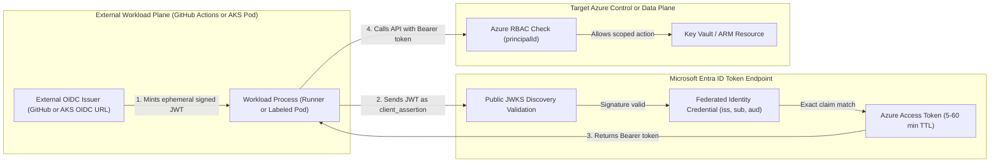
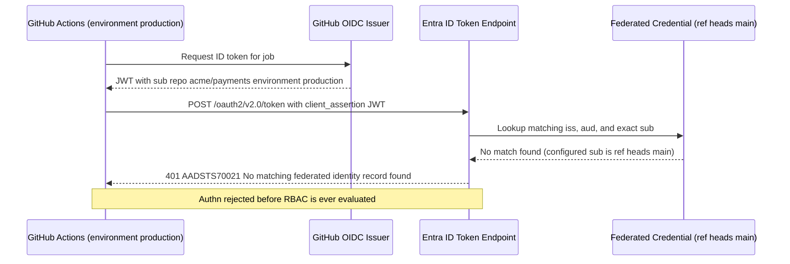

# Workload Identity Federation

> **Prerequisites:** Service Principal and Entra ID OIDC token fundamentals (Modules 00–01), Managed Identity `principalId` vs. `clientId` split (Module 02), CI/CD secretless login preview ([10-cicd-and-gitops/07](../../10-cicd-and-gitops/07-pipeline-security-and-secrets/README.md)), and AKS security ([07-aks/07](../../07-aks/07-security-aks-aad-rbac-and-keyvault/README.md)).  
> **Estimated Reading Time:** 35 minutes  
> **Target Audience:** Backend Engineers, Platform Engineers, DevSecOps Engineers, Cloud Architects.

> [!TIP]
> **The Golden Rule of Workload Identity Federation:** Never store a long-lived `client-secret` in CI/CD or Kubernetes when the host platform can mint an OIDC JWT. Federated authentication lives or dies on an exact match of `(issuer, subject, audience)` — and remember that a `subject` mismatch (`AADSTS70021`) is an **authentication** failure (no token issued), never an RBAC `403`.

---

## Why This Matters

Managed identity (Module 02) solved the stored-secret problem for workloads running *inside* Azure. But some workloads run *outside* Azure and still need to authenticate to it — a **GitHub Actions** job, a **Kubernetes pod** (including on AKS, where the pod is a first-class identity separate from the cluster). The old answer was a service principal with a stored secret (Module 01) — the exact liability you have been trying to eliminate. **Workload identity federation (WIF)** is the modern answer: it establishes a **trust relationship** so the external system's own OIDC token is accepted by Entra ID as proof of identity, and Azure mints a short-lived token in return — **with no secret stored anywhere.** You saw this previewed twice (the OIDC login in [10-cicd-and-gitops/07](../../10-cicd-and-gitops/07-pipeline-security-and-secrets/README.md) and the workload-identity mention in [07-aks/07](../../07-aks/07-security-aks-aad-rbac-and-keyvault/README.md)); this module is the deep dive.

---

## 1. Architectural Mental Model: Secretless OIDC Assertion Exchange

The whole mechanism rests on the OIDC pieces from Module 00. An external platform (GitHub Actions, an AKS cluster running `--enable-oidc-issuer`, or Terraform Cloud) runs an **OIDC issuer** with a public JWKS discovery document (`/.well-known/openid-configuration`). When your workload runs, that issuer signs a short-lived **ID token** carrying exact `iss`, `sub`, and `aud` claims. Instead of presenting a static password, the workload presents that signed JWT as a `client_assertion` (`urn:ietf:params:oauth:client-assertion-type:jwt-bearer`) to Entra ID:



### The trust handshake: no secret, just a matched claim

WIF works in three deterministic steps:

1. You configure a **federated identity credential** on an Entra ID identity — an app registration (Module 00) or a **user-assigned managed identity** (Module 02). This says: *"trust tokens from **this issuer** whose **subject** equals **this exact string** for **this audience**."*
2. At runtime, the external workload gets an OIDC token from its own issuer and presents it to Entra ID's token endpoint (`/oauth2/v2.0/token`).
3. Entra ID validates the token's signature against the issuer's public JWKS keys, then checks whether its `iss`/`sub`/`aud` **match a federated credential** you configured. If they match, Entra ID issues a normal Azure access token for the identity.

Nothing long-lived is stored on either side — Azure holds only the *description* of which tokens to trust, and the external OIDC token lives for minutes. This is why WIF sits at the top of the security hierarchy from Module 01.

### The subject claim is everything

The `sub` (subject) claim is the field WIF matches on, and getting it *exactly* right is the single most common point of failure (Module 07 drills the diagnosis). The subject is a structured string the issuer builds, and the format differs per platform:

- **GitHub Actions** subjects encode the repo and the *trigger context*:
  - `repo:my-org/my-repo:ref:refs/heads/main` — a push/run on the `main` branch.
  - `repo:my-org/my-repo:environment:production` — a job targeting the `production` GitHub Environment.
  - `repo:my-org/my-repo:pull_request` — a pull-request-triggered run.
  The subject you configure **must match the context the workflow actually runs in**. Configuring `:ref:refs/heads/main` but running the job from a `production` environment causes the subjects to differ, yielding **no token** (`AADSTS70021` — an *authn* failure, not a `403`).
- **Kubernetes / AKS workload identity** subjects encode the **service account**: `system:serviceaccount:<namespace>:<serviceaccount-name>`. The pod runs as a Kubernetes ServiceAccount, and *that* SA's identity is what the subject asserts. The federated credential must name the exact namespace and SA.

Get one character wrong (a branch name, a namespace, a trailing context, or case mismatch) and the handshake fails at authentication.

### The four fields of a federated credential

Every federated credential — whether on an app registration or a user-assigned identity — has the same four fields:

- **Issuer** — the URL of the external OIDC issuer. For GitHub it is `https://token.actions.githubusercontent.com`. For AKS it is the cluster's **OIDC issuer URL** (`az aks show --query oidcIssuerProfile.issuerUrl`), which you must enable on the cluster first.
- **Subject** — the exact `sub` string to match (the per-platform formats above; Entra ID enforces exact string equality — wildcards are **not** supported in `sub`).
- **Audience** — who the token is for; for Azure this is the standard `api://AzureADTokenExchange`.
- **Name** — a label for the credential (yours to choose). An identity can hold **several** federated credentials (up to 20 per User-Assigned Managed Identity) — e.g. one for `main`, one for `production`, one for a specific namespace/SA — so you scope trust precisely.

### GitHub Actions federation, concretely

This is the same OIDC flow that [10-cicd-and-gitops/07](../../10-cicd-and-gitops/07-pipeline-security-and-secrets/README.md) had you adopt in place of a stored SP secret, now understood in full. In the workflow you request `permissions: id-token: write`, and the `azure/login@v2` action exchanges GitHub's OIDC token for an Azure token using **three non-secret values** — `client-id`, `tenant-id`, `subscription-id`. There is **no `client-secret`**. Those three are identifiers, not credentials; the proof of identity is the freshly minted OIDC token, matched against the federated credential you configured on the app/identity. This is what the capstone requires end-to-end.

### AKS workload identity federation, concretely

On AKS this generalizes what [07-aks/07](../../07-aks/07-security-aks-aad-rbac-and-keyvault/README.md) previewed. Instead of the *whole cluster* sharing one identity, an individual **pod** authenticates as *itself*:

1. Enable the OIDC issuer and workload identity on the cluster (`--enable-oidc-issuer --enable-workload-identity`).
2. Create a **Kubernetes ServiceAccount**, annotated with a user-assigned identity's `clientId`.
3. Configure a **federated credential** on that user-assigned identity whose subject is `system:serviceaccount:<namespace>:<sa-name>` and whose issuer is the cluster's OIDC issuer URL.
4. A pod that uses that ServiceAccount (and is labeled `azure.workload.identity/use: "true"`) gets a projected OIDC token mounted at `/var/run/secrets/azure/tokens/azure-identity-token` plus injected environment variables (`AZURE_CLIENT_ID`, `AZURE_TENANT_ID`, `AZURE_FEDERATED_TOKEN_FILE`); the Azure SDK in the pod exchanges it for an Azure token as the user-assigned identity — which then reads Key Vault, etc., via the role assignments from Module 02.

This is the "AKS pod using workload identity to reach Key Vault" pattern the capstone builds, and it is strictly better than the cluster-wide identity: each workload gets exactly the permissions its ServiceAccount's identity has, nothing more.

---

## 2. Taxonomic Comparison & Command Reference

### External Identity & Subject Claim Taxonomy

| Platform / Trigger | OIDC Issuer (`iss`) | Exact Subject (`sub`) Format | Audience (`aud`) | Common Failure Trap |
|---|---|---|---|---|
| **GitHub Actions (Branch)** | `https://token.actions.githubusercontent.com` | `repo:<org>/<repo>:ref:refs/heads/main` | `api://AzureADTokenExchange` | Job uses a GitHub Environment, changing `sub` away from `:ref:` |
| **GitHub Actions (Environment)** | `https://token.actions.githubusercontent.com` | `repo:<org>/<repo>:environment:production` | `api://AzureADTokenExchange` | Environment name case mismatch or missing `id-token: write` |
| **GitHub Actions (Pull Request)** | `https://token.actions.githubusercontent.com` | `repo:<org>/<repo>:pull_request` | `api://AzureADTokenExchange` | Fork PRs blocked or over-broad trust if given write roles |
| **AKS Workload Identity Pod** | `az aks show --query oidcIssuerProfile.issuerUrl` | `system:serviceaccount:<ns>:<sa-name>` | `api://AzureADTokenExchange` | Missing pod label `azure.workload.identity/use: "true"` |
| **Terraform Cloud / HCP** | `https://app.terraform.io` | `organization:<org>:project:<proj>:workspace:<ws>:run_phase:apply` | `api://AzureADTokenExchange` | `plan` phase vs `apply` phase have distinct `sub` strings |

### WIF vs. Managed Identity vs. Stored Secret

| Dimension | Service Principal + Secret | Native Managed Identity | Workload Identity Federation (WIF) |
|---|---|---|---|
| **Where Workload Runs** | Anywhere (legacy/on-prem) | Inside Azure compute (VM, ACA, App Service) | Outside Azure (GitHub Actions) or per-pod on AKS |
| **Stored Credential** | Static password (`client_secret`) | Azure-managed internal cert (~45d rotation) | Zero secret; ephemeral OIDC JWT assertion |
| **Token Proof Mechanism** | `client_secret` form parameter | Local IMDS / `IDENTITY_ENDPOINT` | External OIDC `client_assertion` (`jwt-bearer`) |
| **Blast Radius on Config Leak** | Immediate full compromise | Bound to host compute plane | Identifiers only; attacker cannot forge issuer JWT |

### Command Reference

| Command | What it does | Example |
|---|---|---|
| `az identity federated-credential create` | Adds a federated credential to a **user-assigned identity** | see breakdown below |
| `az identity federated-credential list` | Lists federated credentials on a user-assigned identity | `az identity federated-credential list --identity-name uami-wif --resource-group rg-id-wif -o table` |
| `az ad app federated-credential create` | Adds a federated credential to an **app registration** | `az ad app federated-credential create --id <app-id> --parameters creds.json` |
| `az aks show --query oidcIssuerProfile.issuerUrl` | Gets an AKS cluster's OIDC issuer URL (the issuer for pod federation) | `az aks show --resource-group rg-aks --name aks-wif --query oidcIssuerProfile.issuerUrl -o tsv` |
| `az aks update --enable-oidc-issuer --enable-workload-identity` | Enables the OIDC issuer + workload identity add-on on AKS | `az aks update --resource-group rg-aks --name aks-wif --enable-oidc-issuer --enable-workload-identity` |
| `az identity show --query clientId` | Gets the `clientId` to annotate a ServiceAccount with | `az identity show --name uami-wif --resource-group rg-id-wif --query clientId -o tsv` |

**Flag-by-flag breakdowns:**

`az identity federated-credential create --name gh-main --identity-name uami-wif --resource-group rg-id-wif --issuer "https://token.actions.githubusercontent.com" --subject "repo:my-org/my-repo:ref:refs/heads/main" --audiences "api://AzureADTokenExchange"`
- `--name` — a label for this credential (an identity can hold many; name them by what they trust, e.g. `gh-main`, `gh-prod`, `aks-sa`).
- `--identity-name` / `--resource-group` — which user-assigned identity this credential is attached to.
- `--issuer` — the external OIDC issuer URL. GitHub's is fixed; AKS's is the cluster's `oidcIssuerProfile.issuerUrl`.
- `--subject` — the **exact** `sub` claim to trust. This is the field a typo breaks. For GitHub, match the trigger context; for AKS, `system:serviceaccount:<ns>:<sa>`.
- `--audiences` — the token audience; for Azure federation this is `api://AzureADTokenExchange`.

`az aks update --resource-group rg-aks --name aks-wif --enable-oidc-issuer --enable-workload-identity`
- `--enable-oidc-issuer` — turns on the cluster's OIDC issuer so its ServiceAccount tokens are externally verifiable (this is what makes the cluster an *issuer* WIF can trust).
- `--enable-workload-identity` — installs the mutating webhook that injects the projected token and env vars (`AZURE_CLIENT_ID`, `AZURE_TENANT_ID`, token file path) into labeled pods.

ServiceAccount annotation shape (Kubernetes YAML, applied with `kubectl apply`):
- `metadata.annotations."azure.workload.identity/client-id": <clientId>` — binds the SA to a specific user-assigned identity by its **clientId** (Module 02's "select with clientId").
- Pod/Deployment `metadata.labels."azure.workload.identity/use": "true"` — opts the pod into token injection.

---

## 3. Production War Story Post-Mortem: The Environment Promotion `AADSTS70021` Freeze

> **Severity:** SEV-1 (Production Deployment Freeze across 40+ Services)  
> **Detection / Resolution Time:** 14 minutes to detect, 11 minutes to remediate  
> **Impact:** Zero production releases could authenticate to Azure during a critical hotfix window.

### What Happened

A platform team migrated their release pipelines off stored Service Principal secrets onto GitHub Actions Workload Identity Federation using `repo:acme/payments:ref:refs/heads/main`. Deployments ran cleanly for three weeks. To add a manual approval gate before production rollouts, a DevOps engineer added `environment: production` to the deploy job in `.github/workflows/release.yml` — without updating the Entra ID federated identity credential. Immediately, every production deployment failed at `azure/login@v2` with `AADSTS70021`. Believing the pipeline had lost Azure permissions, an on-call engineer spent 10 minutes adding `Contributor` at subscription scope — which had zero effect because the runner never obtained a token.



### Root Cause Analysis

1. **GitHub OIDC `sub` Precedence:** When a job declares `environment: <name>`, GitHub's OIDC issuer replaces `:ref:refs/heads/main` with `:environment:<name>` in the `sub` claim (unless custom OIDC subject claim templates are explicitly configured at org/repo level).
2. **Exact-Match Enforcement:** Entra ID matched `iss` (`https://token.actions.githubusercontent.com`) and `aud` (`api://AzureADTokenExchange`), then rejected the exchange because `sub` differed.
3. **Misclassification (Authn vs. Authz):** The responder confused `AADSTS70021` (authentication failure at token issuance) with missing RBAC (authorization `403`), wasting critical minutes adding unnecessary permissions.

### The Fix & Architectural Hardening

1. Added a dedicated federated credential `gh-prod-env` on the deployment identity with `--subject "repo:acme/payments:environment:production"`, and removed the temporary over-privileged role assignment.
2. Enforced **GitHub Environment protection rules** (required reviewers + `main` branch deployment policy) alongside the `:environment:production` federated credential so approval gating and Azure OIDC trust are cryptographically coupled.
3. Added pre-flight OIDC claim logging (decoding non-secret `iss` and `sub` payload fields, never the raw JWT signature) in CI failure hooks to distinguish `AADSTS70021` from `AuthorizationFailed` within seconds.

---

## 4. Multi-Language Production Implementation

Below are production implementations across Go, TypeScript, Python, and C# showing how workloads inspect an external OIDC assertion's non-secret claims (`iss`, `sub`, `aud`, `exp`) and perform secretless token exchange against Entra ID using `ClientAssertionCredential` / `WorkloadIdentityCredential`.

````carousel
**Go — Secretless OIDC Assertion Exchange (`azidentity.NewWorkloadIdentityCredential`)**
```go
package main

import (
	"context"
	"encoding/base64"
	"encoding/json"
	"errors"
	"fmt"
	"os"
	"strings"
	"time"

	"github.com/Azure/azure-sdk-for-go/sdk/azcore/policy"
	"github.com/Azure/azure-sdk-for-go/sdk/azidentity"
)

type oidcClaims struct {
	Issuer   string `json:"iss"`
	Subject  string `json:"sub"`
	Audience any    `json:"aud"`
	Expiry   int64  `json:"exp"`
}

func validateProjectedClaims(tokenPath string) (*oidcClaims, error) {
	raw, err := os.ReadFile(tokenPath)
	if err != nil {
		return nil, fmt.Errorf("read projected token: %w", err)
	}
	parts := strings.Split(strings.TrimSpace(string(raw)), ".")
	if len(parts) != 3 {
		return nil, errors.New("projected OIDC token is not a valid 3-segment JWT")
	}
	payload, err := base64.RawURLEncoding.DecodeString(parts[1])
	if err != nil {
		return nil, fmt.Errorf("decode JWT payload: %w", err)
	}
	var claims oidcClaims
	if err := json.Unmarshal(payload, &claims); err != nil {
		return nil, fmt.Errorf("unmarshal OIDC claims: %w", err)
	}
	if time.Now().Unix() >= claims.Expiry {
		return nil, fmt.Errorf("projected OIDC token expired for sub=%s", claims.Subject)
	}
	return &claims, nil
}

func main() {
	tokenFile := os.Getenv("AZURE_FEDERATED_TOKEN_FILE")
	claims, err := validateProjectedClaims(tokenFile)
	if err != nil {
		panic(err)
	}
	fmt.Printf("OIDC pre-check passed: iss=%s sub=%s\n", claims.Issuer, claims.Subject)

	cred, err := azidentity.NewWorkloadIdentityCredential(&azidentity.WorkloadIdentityCredentialOptions{
		TenantID:      os.Getenv("AZURE_TENANT_ID"),
		ClientID:      os.Getenv("AZURE_CLIENT_ID"),
		TokenFilePath: tokenFile,
	})
	if err != nil {
		panic(err)
	}

	ctx, cancel := context.WithTimeout(context.Background(), 10*time.Second)
	defer cancel()
	tk, err := cred.GetToken(ctx, policy.TokenRequestOptions{
		Scopes: []string{"https://vault.azure.net/.default"},
	})
	if err != nil {
		panic(fmt.Errorf("federated token exchange failed (check AADSTS70021 sub match): %w", err))
	}
	fmt.Printf("Entra access token acquired; expires=%s\n", tk.ExpiresOn.Format(time.RFC3339))
}
```
<!-- slide -->
**TypeScript — GitHub / K8s OIDC Federated Assertion Exchange (`@azure/identity`)**
```typescript
import { readFileSync } from "node:fs";
import { ClientAssertionCredential } from "@azure/identity";

interface OidcClaims {
  iss: string;
  sub: string;
  aud: string | string[];
  exp: number;
}

function inspectOidcClaims(jwt: string): OidcClaims {
  const segments = jwt.trim().split(".");
  if (segments.length !== 3) {
    throw new Error("Invalid OIDC JWT format");
  }
  const payload = Buffer.from(segments[1], "base64url").toString("utf8");
  const claims = JSON.parse(payload) as OidcClaims;
  if (Date.now() / 1000 >= claims.exp) {
    throw new Error(`OIDC assertion expired for subject ${claims.sub}`);
  }
  return claims;
}

async function acquireFederatedToken(): Promise<void> {
  const tenantId = process.env.AZURE_TENANT_ID!;
  const clientId = process.env.AZURE_CLIENT_ID!;
  const tokenFile = process.env.AZURE_FEDERATED_TOKEN_FILE!;

  const credential = new ClientAssertionCredential(tenantId, clientId, async () => {
    const assertion = readFileSync(tokenFile, "utf8").trim();
    const claims = inspectOidcClaims(assertion);
    console.info(`Presenting OIDC assertion: iss=${claims.iss} sub=${claims.sub}`);
    return assertion;
  });

  const token = await credential.getToken("https://management.azure.com/.default");
  if (!token) {
    throw new Error("Entra ID returned empty access token");
  }
  console.info(`Federated access token valid until ${new Date(token.expiresOnTimestamp).toISOString()}`);
}

acquireFederatedToken().catch((err) => {
  console.error("WIF authentication failed (verify issuer/subject/audience):", err);
  process.exit(1);
});
```
<!-- slide -->
**Python — Secretless Workload Identity Credential (`azure-identity`)**
```python
import base64
import json
import os
import time
from azure.identity import ClientAssertionCredential
from azure.core.exceptions import ClientAuthenticationError


def read_and_validate_assertion(token_path: str) -> str:
    with open(token_path, "r", encoding="utf-8") as fh:
        jwt_token = fh.read().strip()

    parts = jwt_token.split(".")
    if len(parts) != 3:
        raise ValueError("Projected token is not a valid JWT")

    padded = parts[1] + "=" * (-len(parts[1]) % 4)
    claims = json.loads(base64.urlsafe_b64decode(padded))
    if time.time() >= claims.get("exp", 0):
        raise RuntimeError(f"Projected OIDC token expired for sub={claims.get('sub')}")

    print(f"OIDC assertion claims -> iss={claims.get('iss')} sub={claims.get('sub')}")
    return jwt_token


def get_vault_token() -> None:
    tenant_id = os.environ["AZURE_TENANT_ID"]
    client_id = os.environ["AZURE_CLIENT_ID"]
    token_file = os.environ["AZURE_FEDERATED_TOKEN_FILE"]

    credential = ClientAssertionCredential(
        tenant_id=tenant_id,
        client_id=client_id,
        func=lambda: read_and_validate_assertion(token_file),
    )
    try:
        token = credential.get_token("https://vault.azure.net/.default")
        print(f"Acquired Entra token expiring at epoch {token.expires_on}")
    except ClientAuthenticationError as exc:
        raise SystemExit(f"Federation failed (check AADSTS70021 sub mismatch): {exc}")


if __name__ == "__main__":
    get_vault_token()
```
<!-- slide -->
**C# — Federated Client Assertion Exchange (`Azure.Identity`)**
```csharp
using System.Text;
using System.Text.Json;
using Azure.Core;
using Azure.Identity;

var tenantId = Environment.GetEnvironmentVariable("AZURE_TENANT_ID")
    ?? throw new InvalidOperationException("AZURE_TENANT_ID missing");
var clientId = Environment.GetEnvironmentVariable("AZURE_CLIENT_ID")
    ?? throw new InvalidOperationException("AZURE_CLIENT_ID missing");
var tokenPath = Environment.GetEnvironmentVariable("AZURE_FEDERATED_TOKEN_FILE")
    ?? throw new InvalidOperationException("AZURE_FEDERATED_TOKEN_FILE missing");

var credential = new ClientAssertionCredential(
    tenantId,
    clientId,
    async ct =>
    {
        var jwt = (await File.ReadAllTextAsync(tokenPath, ct)).Trim();
        var segments = jwt.Split('.');
        if (segments.Length != 3)
            throw new InvalidOperationException("Projected OIDC assertion is malformed.");

        var padded = segments[1].Replace('-', '+').Replace('_', '/');
        padded = padded.PadRight(padded.Length + (4 - padded.Length % 4) % 4, '=');
        using var doc = JsonDocument.Parse(Encoding.UTF8.GetString(Convert.FromBase64String(padded)));
        var sub = doc.RootElement.GetProperty("sub").GetString();
        var iss = doc.RootElement.GetProperty("iss").GetString();
        Console.WriteLine($"Presenting OIDC assertion iss={iss} sub={sub}");
        return jwt;
    });

var token = await credential.GetTokenAsync(
    new TokenRequestContext(new[] { "https://vault.azure.net/.default" }),
    CancellationToken.None);

Console.WriteLine($"Entra token acquired. ExpiresOn={token.ExpiresOn:O}");
```
````

---

## 5. Practical Hands-On Verification CLI Workflows

> These exercises use GitHub Actions federation (free, no billable Azure resource) as the primary path. Exercise 8 outlines the AKS variant; do it fully if you have a cluster up from Track 07, or read it as the pattern you will build in the capstone.

1. **Create an identity to federate.**
   ```powershell
   az group create --name rg-id-wif --location eastus
   az identity create --name uami-wif --resource-group rg-id-wif --location eastus
   az identity show --name uami-wif --resource-group rg-id-wif --query "{clientId:clientId, principalId:principalId}" -o jsonc
   ```
   **Expected Output:**
   ```json
   {
     "clientId": "11111111-2222-3333-4444-555555555555",
     "principalId": "aaaaaaaa-bbbb-cccc-dddd-eeeeeeeeeeee"
   }
   ```
   Verify: `az identity show --name uami-wif --resource-group rg-id-wif --query "{clientId:clientId, principalId:principalId}" -o jsonc` returns both IDs.

2. **Add a GitHub Actions federated credential for `main`.** Replace `my-org/my-repo` with a repo you control:
   ```powershell
   az identity federated-credential create --name gh-main --identity-name uami-wif --resource-group rg-id-wif `
     --issuer "https://token.actions.githubusercontent.com" `
     --subject "repo:my-org/my-repo:ref:refs/heads/main" `
     --audiences "api://AzureADTokenExchange"
   az identity federated-credential list --identity-name uami-wif --resource-group rg-id-wif -o table
   ```
   **Expected Output:**
   ```text
   Name     Issuer                                         Subject
   -------  ---------------------------------------------  ----------------------------------------
   gh-main  https://token.actions.githubusercontent.com    repo:my-org/my-repo:ref:refs/heads/main
   ```
   Verify: `az identity federated-credential list --identity-name uami-wif --resource-group rg-id-wif -o table` shows the `gh-main` credential with the subject you set.

3. **Grant the federated identity something to do.** Give it Reader on the resource group so a pipeline can prove it authenticated:
   ```powershell
   $subId = az account show --query id -o tsv
   $principalId = az identity show --name uami-wif --resource-group rg-id-wif --query principalId -o tsv
   az role assignment create --assignee $principalId --role Reader --scope /subscriptions/$subId/resourceGroups/rg-id-wif
   ```
   Verify the assignment lists. Note: authentication (WIF) and authorization (this role) are still the two separate steps from Module 00.

4. **Wire up a GitHub Actions workflow that logs in with no secret.** In your repo, add `.github/workflows/wif-test.yml`:
   ```yaml
   name: wif-test
   on: { push: { branches: [ main ] }, workflow_dispatch: {} }
   permissions:
     id-token: write
     contents: read
   jobs:
     login:
       runs-on: ubuntu-latest
       steps:
         - uses: azure/login@v2
           with:
             client-id: ${{ secrets.AZURE_CLIENT_ID }}
             tenant-id: ${{ secrets.AZURE_TENANT_ID }}
             subscription-id: ${{ secrets.AZURE_SUBSCRIPTION_ID }}
         - run: az group show --name rg-id-wif -o table
   ```
   Set the three repo secrets to the identity's **clientId**, your **tenant ID**, and your **subscription ID** — note **none of these is a password**; they are identifiers. Push to `main`. Verify: the job's `az group show` step succeeds, proving the pipeline authenticated to Azure with **no stored client secret**.

5. **Prove there is no secret by inspecting the config.** Confirm the workflow has `id-token: write` and *no* `client-secret`, and that the repo secrets hold only identifiers. Verify: you could publish `wif-test.yml` publicly and leak the three "secrets" with limited harm — they are not credentials; the credential is the ephemeral OIDC token, which cannot be reused. Contrast this explicitly with the Module 01 SP `password` you had to guard.

6. **Add a second federated credential for a different context.** Add one for a GitHub Environment:
   ```powershell
   az identity federated-credential create --name gh-prod --identity-name uami-wif --resource-group rg-id-wif `
     --issuer "https://token.actions.githubusercontent.com" `
     --subject "repo:my-org/my-repo:environment:production" `
     --audiences "api://AzureADTokenExchange"
   az identity federated-credential list --identity-name uami-wif --resource-group rg-id-wif -o table
   ```
   Verify: the identity now lists **two** federated credentials. One identity can trust several exact contexts — you scope trust per branch/environment, not broadly.

7. **Diagnose-and-fix: subject claim mismatch (the classic WIF failure).** Break it on purpose: edit the workflow to run from a job that sets `environment: staging` (a context you did **not** federate), or temporarily change the `gh-main` credential's subject to `repo:my-org/my-repo:ref:refs/heads/nonexistent`. Re-run. Observe the `azure/login` step fail with an error like *"No matching federated identity record found for presented assertion subject"* / `AADSTS70021`.
   - **Diagnose:** this is an **authentication** failure — the token the workflow presented had a `sub` that did not match any configured federated credential, so Azure never issued a token. It is **not** a `403`; authorization never ran. Compare the `sub` the run actually used against your `az identity federated-credential list` output.
   - **Fix:** make the subject match — either federate the context the job actually runs in, or run the job in the context you federated. Restore `gh-main`'s correct subject. Lesson: **subject mismatch = authn failure at login; a wrong role would be a `403` after login.**

8. **(AKS variant — do if you have a cluster) Federate a pod's ServiceAccount.** On an AKS cluster from Track 07:
   ```powershell
   az aks update --resource-group rg-aks --name aks-wif --enable-oidc-issuer --enable-workload-identity
   $issuer = az aks show --resource-group rg-aks --name aks-wif --query oidcIssuerProfile.issuerUrl -o tsv
   $clientId = az identity show --name uami-wif --resource-group rg-id-wif --query clientId -o tsv
   az identity federated-credential create --name aks-sa --identity-name uami-wif --resource-group rg-id-wif `
     --issuer $issuer --subject "system:serviceaccount:default:wi-sa" --audiences "api://AzureADTokenExchange"
   ```
   Then create a ServiceAccount `wi-sa` annotated with `azure.workload.identity/client-id: <clientId>` and a Pod using it, labeled `azure.workload.identity/use: "true"`. Verify: `kubectl exec` into the pod and confirm the injected `AZURE_CLIENT_ID` and token file exist, and that an Azure SDK / `az login --federated-token` call authenticates as the user-assigned identity — the pod is now its *own* identity, not the cluster's.

9. **Clean up.** `az group delete --name rg-id-wif --yes --no-wait`, remove the test workflow and repo secrets, and (if you enabled it) leave the AKS cluster for the capstone or delete its group. Verify the identity and its federated credentials are gone.

### Independent Challenge

Set up a GitHub Actions pipeline that authenticates to Azure entirely without a stored secret **and** enforces that only your `main` branch — not pull requests, not other branches — can do so, then prove the enforcement works by watching a non-`main` context get rejected at login. Build on [10-cicd-and-gitops/07](../../10-cicd-and-gitops/07-pipeline-security-and-secrets/README.md) for the workflow shape and this module for the federation. The interesting part is the negative test: trigger the workflow from a branch or context you did *not* federate and capture the exact "no matching federated identity" error, then explain in writing why that is an **authentication** rejection (the subject claim did not match) and precisely how it differs from the `403` you would get if the identity authenticated but lacked a role — the same authn/authz split from Module 00, now at the federation layer. Clean up afterward.

<details>
<summary>Stuck? One hint</summary>

Enforcement lives entirely in the **subject** of the federated credential. If the only credential on the identity is `repo:my-org/my-repo:ref:refs/heads/main`, then a run triggered on any *other* branch presents a different `sub` (e.g. `...:ref:refs/heads/feature-x` or `...:pull_request`) and Azure finds no match — rejection at login, before any role is even consulted. Do **not** add a wildcard or a second credential for the other context; the whole point is that the missing match *is* the control.

</details>

### Common Mistakes & Troubleshooting

- **Subject claim off by a character.** The `sub` must match the run context exactly — branch (`ref:refs/heads/main`), environment (`environment:production`), or K8s SA (`system:serviceaccount:<ns>:<sa>`). A mismatch is an *authentication* failure ("no matching federated identity"), not a `403`.
- **Confusing the two failure classes.** No matching federated credential → authn (no token issued). Token issued but missing role → authz (`403`). Module 07 is built around telling these apart; start now.
- **Storing a `client-secret` anyway.** If your workflow still has a `client-secret`, you have not actually adopted WIF — the three federated values are `client-id`, `tenant-id`, `subscription-id` only.
- **Forgetting `id-token: write` permission.** Without it, GitHub will not mint the OIDC token and `azure/login` cannot federate. The error looks like a login failure but the root cause is the missing workflow permission.
- **AKS: OIDC issuer not enabled, or wrong issuer URL.** Pod federation needs `--enable-oidc-issuer` *and* the federated credential's `--issuer` set to the cluster's actual `oidcIssuerProfile.issuerUrl`, not GitHub's.
- **AKS: forgetting the pod label or SA annotation.** The pod needs `azure.workload.identity/use: "true"` and the SA needs the `client-id` annotation, or no token is injected and the SDK falls back and fails.
- **Assuming federation removes the need for a role.** WIF is authentication only. The identity still needs a role assignment (Module 04) to *do* anything — federation just gets it a token.

---

## 6. Operational Validation Checkpoints & Checkpoint Quiz

### Operational Validation Checkpoints

<details>
<summary><strong>Checkpoint 1: GitHub Pull Request vs. Protected Branch Trust Boundary</strong></summary>

**Scenario:** Your repository has a single federated credential `repo:acme/infra:ref:refs/heads/main` granting `Contributor` on a staging resource group. A contributor opens a pull request modifying `.github/workflows/deploy.yml` and pushes to `pull_request_target` / a feature branch. Why does Entra ID reject the login from `feature-branch`, and what catastrophic risk would occur if you blindly added a federated credential for `:pull_request` on the same `Contributor` identity?

**Validation:**
1. On a feature branch or `pull_request` event, GitHub sets `sub` to `repo:acme/infra:ref:refs/heads/feature-branch` or `repo:acme/infra:pull_request`. Neither matches `:ref:refs/heads/main`, so Entra ID returns `AADSTS70021` before issuing any token.
2. Adding `:pull_request` onto a write-privileged (`Contributor`) identity would allow untrusted PR code changes to mint Azure tokens and modify infrastructure before code review. PR validation jobs must either run read-only (`Reader`) on a separate identity or require manual approval via an Environment.

</details>

<details>
<summary><strong>Checkpoint 2: AKS Pod Falling Back to Kubelet Identity</strong></summary>

**Scenario:** You configured an AKS federated credential for `system:serviceaccount:payments:ledger-sa`, annotated `ledger-sa` with `azure.workload.identity/client-id`, and deployed a pod referencing `ledger-sa`. However, the pod still gets `403 AuthorizationFailed` from Key Vault — and Entra sign-in logs show the AKS **node kubelet identity** calling Key Vault instead of `uami-ledger`. What single Kubernetes manifest field is missing?

**Validation:**
The Pod template is missing the label `azure.workload.identity/use: "true"`. Without that label, the AKS Workload Identity mutating admission webhook skips injecting `AZURE_FEDERATED_TOKEN_FILE` and `AZURE_CLIENT_ID`, causing `DefaultAzureCredential` inside the container to skip `WorkloadIdentityCredential` and fall back to the node VM's IMDS kubelet managed identity.

</details>

<details>
<summary><strong>Checkpoint 3: Multi-Cluster OIDC Issuer Drift</strong></summary>

**Scenario:** Your platform team rebuilds an AKS cluster (`aks-prod-02`) to replace `aks-prod-01` using the same Kubernetes namespace `payments` and ServiceAccount `ledger-sa`, and expects the existing user-assigned identity `uami-ledger` to keep working immediately. All pods fail with `AADSTS70021`. Why did rebuilding the cluster break federation even though the namespace, SA name, and `clientId` are identical?

**Validation:**
Each AKS cluster provisions a unique `oidcIssuerProfile.issuerUrl` (with a cluster-specific GUID path). Even though `sub` (`system:serviceaccount:payments:ledger-sa`) and `aud` stayed identical, `iss` changed on the new cluster. You must create or update the federated credential on `uami-ledger` with the new cluster's `oidcIssuerProfile.issuerUrl`.

</details>

### Checkpoint Quiz

Write down your answer to each question before expanding it — checking without attempting first is the single easiest way to fool yourself into thinking you've learned this.

1. In one sentence, what does workload identity federation let an external workload do, and what does it store where a service principal would have stored a secret?
2. Name the four fields of a federated identity credential.
3. What is the subject (`sub`) claim format for a GitHub Actions run on the `main` branch, and for a Kubernetes pod's ServiceAccount?
4. A GitHub Actions `azure/login` step fails with "no matching federated identity record found." Is this authn or authz, and what is the most likely cause?
5. Your workflow references `client-id`, `tenant-id`, and `subscription-id` but no `client-secret`. Why is it safe that these three are stored as (weakly guarded) repo secrets?
6. For AKS pod federation, what must be true of the cluster, the ServiceAccount, and the pod for a pod to authenticate as a user-assigned identity?
7. After federation succeeds, the workflow still gets a `403` calling Azure. What did federation *not* do for you, and what fixes the `403`?

<details>
<summary>Show answers</summary>

1. It lets the external workload exchange **its own OIDC token** for an Azure access token, so Azure stores only a **description of which tokens to trust** (the federated credential) — **no secret** is stored anywhere.
2. **Issuer**, **subject**, **audience**, and **name**.
3. GitHub `main`: `repo:<org>/<repo>:ref:refs/heads/main`. Kubernetes pod: `system:serviceaccount:<namespace>:<serviceaccount-name>`.
4. **Authentication.** The presented token's `sub` (or issuer/audience) did not match any configured federated credential, so no token was issued — most likely a **subject-claim mismatch** (wrong branch/environment/SA, or a typo).
5. Because they are **identifiers, not credentials** — the actual proof of identity is the short-lived OIDC token minted per run, which cannot be reused; leaking the three IDs does not let anyone impersonate the identity.
6. The cluster has `--enable-oidc-issuer`/`--enable-workload-identity` and a federated credential using its issuer URL and the SA subject; the ServiceAccount is annotated with the identity's `client-id`; the pod uses that SA and is labeled `azure.workload.identity/use: "true"`.
7. Federation only **authenticated** the workload (got it a token). It did not **authorize** anything — the identity still needs a **role assignment** at the right scope (Module 04), which is what fixes the `403`.

</details>

---

## Next

[04-rbac-and-role-assignments](../04-rbac-and-role-assignments/README.md) — now that any workload can authenticate without a secret, the other half of the story: authorization. Built-in vs. custom roles, assignment scope, and designing least privilege deliberately.
