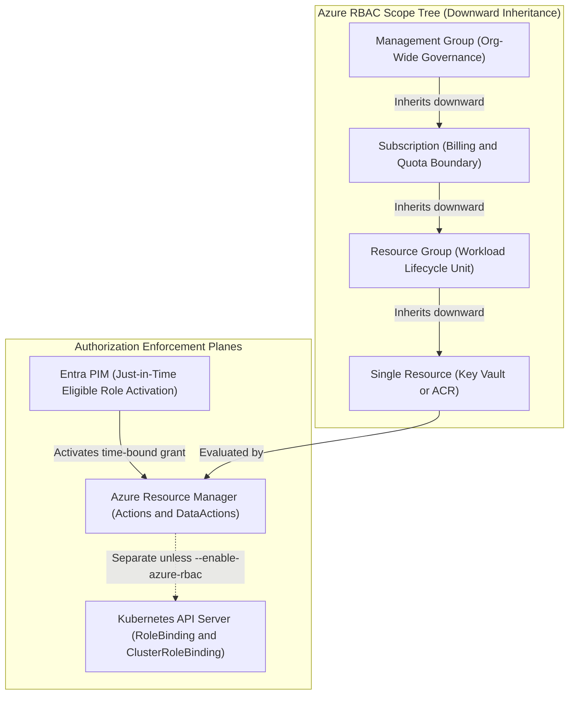
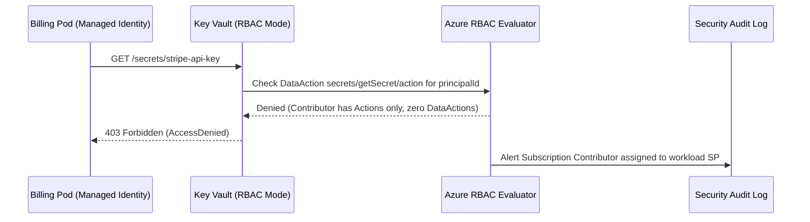

# RBAC and Role Assignments Across Azure

> **Prerequisites:** Entra ID Security Principals (Module 00), Managed Identity `principalId` vs. `clientId` (Module 02), Workload Identity Federation (Module 03), Container Apps Managed Identity ([06/06](../../06-azure-container-apps/06-secrets-managed-identity-and-config/README.md)), and Kubernetes RBAC ([03-kubernetes/11](../../03-kubernetes/11-security-rbac-and-network-policies/README.md)).  
> **Estimated Reading Time:** 35 minutes  
> **Target Audience:** Backend Engineers, Platform Engineers, Security Engineers, Cloud Architects.

> [!TIP]
> **The Golden Rule of Azure RBAC:** Design every grant from the **exact action** downward — pick the narrowest built-in role covering that action (distinguishing control-plane `Actions` from data-plane `DataActions`), bind it at the **narrowest resource scope**, and remember that `Contributor` never grants data-plane Key Vault/Storage reads while quietly exposing an entire scope's control plane.

---

## Why This Matters

Every module so far ended the same way: the identity authenticated, but it still needed a **role assignment** to actually *do* anything. That is authorization, and Azure's authorization system is **RBAC (role-based access control)**. You have been making one-off role assignments since Track 06 (`Key Vault Secrets User`, `AcrPull`) without stepping back to understand the model. This module is that step back: what a role actually is, the four scope levels an assignment can target, when to build a **custom** role, and how to design **least privilege** deliberately rather than reaching for `Contributor`. It also draws the line between Azure RBAC and the *separate* Kubernetes RBAC you learned in Track 03 — two systems that look alike and are not the same.

---

## 1. Architectural Mental Model: Scope Inheritance & Control vs. Data Plane

Azure evaluates authorization through an additive allow-only model (combined with explicit Azure Policy `Deny` or Deny Assignments). Role assignments attach at any tier in the four-level scope tree and **inherit downward** to every child resource beneath that node. Crucially, Azure RBAC is governed by Azure Resource Manager (ARM) and stays strictly separate from Kubernetes API Server RBAC unless bridged via `--enable-azure-rbac`:



### The three parts of every role assignment

An Azure **role assignment** is always the same triple — miss any one and it does not do what you think:

- **Security principal (the *who*)** — a user, group, service principal, or managed identity, identified by its **object/principal ID** (Module 00/02). This is `--assignee`.
- **Role definition (the *what*)** — a named set of allowed **actions** (and `notActions`, `dataActions`). This is `--role`, e.g. `Reader`, `Contributor`, `Key Vault Secrets User`.
- **Scope (the *where*)** — the resource(s) the grant applies to, as a resource ID. This is `--scope`.

Read it as a sentence: *"**this principal** has **this role** at **this scope**."* Everything in this module is a variation on getting each of the three right.

### Built-in roles vs. custom roles

Azure ships **built-in roles** — hundreds of them — covering the common cases. Three you should know cold because they anchor the spectrum:

- **Owner** — full access **including managing others' access** (can create role assignments). Rarely what a workload needs.
- **Contributor** — full access to manage resources but **cannot grant access** to others. The convenient over-grant to avoid for machine identities (and critically, it does **not** grant data-plane access to Key Vault secrets or Storage blobs when RBAC data-plane auth is active).
- **Reader** — view only.

Beyond these are **narrow, purpose-built** roles: `Key Vault Secrets User` (read secret *values* only), `AcrPull` (pull images only), `Azure Kubernetes Service Cluster User Role`, `Storage Blob Data Reader`, etc. **Prefer the narrowest built-in role that covers the need** — the narrow roles exist precisely so you do not have to use `Contributor` for a job that only reads secrets. When *no* built-in role fits — you need a grant that is a specific subset of actions no built-in role expresses — you author a **custom role**: a JSON definition listing exactly the `Actions`/`DataActions` allowed, its own name, and the scopes it can be assigned at (`AssignableScopes`). Custom roles are powerful but a maintenance cost; use them only when built-ins genuinely do not fit.

### Scope: management group → subscription → resource group → resource

Scope is a **hierarchy**, and an assignment **inherits downward**: a role granted at a higher scope applies to everything beneath it. From broadest to narrowest:

- **Management group** — a container for *multiple subscriptions* (the subject of Track 17). A grant here hits every subscription under it. Very broad — reserve for genuinely org-wide roles.
- **Subscription** — everything in one subscription. This is the level the convenient-but-dangerous `create-for-rbac --scopes /subscriptions/<id>` from Module 01 targeted.
- **Resource group** — everything in one RG. A good default for a workload that operates across a related set of resources (the pattern the AKS/Terraform capstones used).
- **Resource** — a single resource (this one Key Vault, this one ACR). The narrowest and usually the *right* scope for a workload identity: the AKS cluster identity gets `AcrPull` on **one registry**, not the subscription.

The rule: **grant at the narrowest scope that still lets the job work.** A grant at resource-group scope when the identity only touches one Key Vault is a quiet over-permission — exactly the "wrong scope" antipattern from [06/06](../../06-azure-container-apps/06-secrets-managed-identity-and-config/README.md) and Track 11.

### Designing least privilege deliberately (and PIM for humans)

Least privilege is a *design activity*, not a reflex to pick a smaller role at the moment of granting. The method, which the capstone requires you to document:

1. **Start from the action**, not the role. What exact operation must this identity perform? ("Read the value of one Key Vault secret.")
2. **Find the narrowest role** whose actions cover it (`Key Vault Secrets User`, not `Key Vault Administrator`).
3. **Choose the narrowest scope** that contains the target (that one vault, not its resource group).
4. **Prefer a group** as the principal where humans are involved (Module 00), so the grant follows membership — and use **Entra Privileged Identity Management (PIM)** to make high-privilege human assignments (`Owner`, `Contributor`, `Key Vault Administrator`) **Eligible (just-in-time)** with MFA and justification rather than permanently **Active**.
5. **Write down why** — principal, role, scope, and the justification. This audit trail is what makes an over-grant visible later and is a core capstone deliverable.

Every assignment you keep should survive the question *"what breaks if I remove this, and does anything legitimate actually need it?"*

### Azure RBAC vs. Kubernetes RBAC — parallel but separate

You learned **Kubernetes RBAC** (`Role`/`ClusterRole` + `RoleBinding`/`ClusterRoleBinding`) back in [03-kubernetes/11](../../03-kubernetes/11-security-rbac-and-network-policies/README.md), and you saw the two systems *touch* in [07-aks/07](../../07-aks/07-security-aks-aad-rbac-and-keyvault/README.md). They are structurally similar (a principal, a set of permissions, a binding) but are **two independent authorization systems**:

- **Azure RBAC** governs the **Azure control plane** — creating/reading/deleting Azure *resources* (VMs, Key Vaults, the AKS resource itself, role assignments). Enforced by Azure Resource Manager. `az role assignment create`.
- **Kubernetes RBAC** governs the **Kubernetes API** — who can `get`/`list`/`create` *Kubernetes objects* (pods, deployments, secrets) inside a cluster. Enforced by the Kubernetes API server. `kubectl apply -f rolebinding.yaml`.

They meet only in the special case of **Azure RBAC for Kubernetes Authorization** (`--enable-azure-rbac` from Track 07), where AKS lets you express *Kubernetes* permissions *as* Azure role assignments — one consistent model. But by default they are separate: an Azure `Owner` on the cluster resource is **not** automatically a Kubernetes cluster-admin, and a Kubernetes `RoleBinding` grants nothing on the Azure side. Knowing which system a permission problem lives in is half of diagnosing it (Module 07).

---

## 2. Taxonomic Comparison & Command Reference

### Role Type & Plane Matrix

| Role / Pattern | Plane (`Actions` vs `DataActions`) | Can Modify RBAC? | Typical Safe Assignment Scope | Primary Risk if Over-Granted |
|---|---|---|---|---|
| **Owner** | Full Control Plane + `Microsoft.Authorization/*/Write` | Yes | Subscription / RG (PIM Eligible only) | Full lateral escalation across all resources |
| **Contributor** | Full Control Plane (`*`, except Authorization) | No | Single Resource Group (CI/CD IaC only) | Can delete/reconfigure any resource in scope; still lacks KV/Blob data reads |
| **Reader** | Read-only Control Plane (`*/read`) | No | RG or Subscription (Observability) | Metadata exposure (no secret values) |
| **Key Vault Secrets User** | Data Plane only (`.../secrets/getSecret/action`) | No | Single Key Vault Resource | Reading all secrets in that vault |
| **AcrPull** | Control/Data pull (`.../pull/read`) | No | Single Container Registry | Image exfiltration only |
| **Custom Role** | Explicit allow-list of `Actions` / `DataActions` | Only if explicitly added | Narrowest `AssignableScopes` | Maintenance overhead and drift |

### Azure RBAC vs. Kubernetes RBAC

| Attribute | Azure RBAC | Native Kubernetes RBAC | AKS Azure RBAC (`--enable-azure-rbac`) |
|---|---|---|---|
| **Enforcer** | Azure Resource Manager (ARM) | Kubernetes `kube-apiserver` | `kube-apiserver` delegating to Azure RBAC |
| **Target Objects** | Azure resources (Vault, ACR, AKS) & Data Planes | K8s objects (Pods, Deployments, Secrets) | Both Azure & K8s via Azure Role Definitions |
| **Grant Primitive** | `az role assignment create` | `RoleBinding` / `ClusterRoleBinding` | `az role assignment create` at cluster/namespace scope |
| **Propagation Time** | Typically 15–120 seconds (cache/replication) | Immediate inside etcd/API server | Azure RBAC propagation latency applies |

### Command Reference

| Command | What it does | Example |
|---|---|---|
| `az role definition list` | Lists role definitions (built-in and custom) | `az role definition list --name Reader -o jsonc` |
| `az role assignment create` | Creates a role assignment (principal + role + scope) | see breakdown below |
| `az role assignment list` | Lists assignments, filterable by assignee/scope | `az role assignment list --assignee <principalId> --all -o table` |
| `az role assignment delete` | Removes a role assignment | `az role assignment delete --assignee <principalId> --role Reader --scope <scope>` |
| `az role definition create` | Creates a **custom** role from a JSON definition | `az role definition create --role-definition custom-role.json` |
| `az role definition update` | Updates a custom role | `az role definition update --role-definition custom-role.json` |
| `az provider operation show` | Lists the operations (actions) a resource provider exposes — for authoring custom roles | `az provider operation show --namespace Microsoft.KeyVault` |

**Flag-by-flag breakdowns:**

`az role assignment create --assignee <principalId> --role "Key Vault Secrets User" --scope /subscriptions/<sub>/resourceGroups/rg/providers/Microsoft.KeyVault/vaults/<vault>`
- `--assignee` — the principal's **object/principal ID** (user, group, SP, or managed identity). Use `--assignee-object-id <id> --assignee-principal-type ServicePrincipal` to skip a Graph lookup and avoid a race right after creating an identity.
- `--role` — the role definition name (or its ID). Pick the **narrowest** one that covers the action.
- `--scope` — the full **resource ID** the grant applies to. This example scopes to a single vault (narrowest); shortening it to `.../resourceGroups/rg` widens it to the whole group.

Custom role definition (`custom-role.json`), created with `az role definition create --role-definition custom-role.json`:
```json
{
  "Name": "Secret Reader (one vault)",
  "Description": "Read secret values, nothing else.",
  "Actions": [],
  "NotActions": [],
  "DataActions": [ "Microsoft.KeyVault/vaults/secrets/getSecret/action" ],
  "NotDataActions": [],
  "AssignableScopes": [ "/subscriptions/<sub-id>/resourceGroups/rg-id-rbac" ]
}
```
- `Actions` / `NotActions` — **control-plane** operations allowed / explicitly removed.
- `DataActions` / `NotDataActions` — **data-plane** operations (reading a secret's *value* is a data action, distinct from reading the secret resource's metadata).
- `AssignableScopes` — where this custom role is even allowed to be assigned; keep it as narrow as the role's intended use.

---

## 3. Production War Story Post-Mortem: The Subscription `Contributor` Data-Plane Dead End

> **Severity:** SEV-2 (Billing Service Startup Outage + Critical Over-Privilege Exposure)  
> **Detection / Resolution Time:** 19 minutes to detect, 22 minutes to remediate and purge excess grant  
> **Impact:** Billing microservice failed secret fetch on rollout; temporary subscription-wide `Contributor` grant exposed 18 production resource groups without fixing the `403`.

### What Happened

A backend engineer deployed a new RBAC-enabled Azure Key Vault (`--enable-rbac-authorization true`) for a billing service. On startup, the container returned `403 Forbidden (Caller is not authorized to perform action on resource: Microsoft.KeyVault/vaults/secrets/getSecret/action)`. During emergency triage, another engineer attempted to "unblock first and tighten later" by granting `Contributor` to the service's Managed Identity at **subscription scope**. The service still failed with the exact same `403`. Security SIEM immediately triggered a high-severity alert for a broad `Contributor` assignment attached to a runtime workload principal.



### Root Cause Analysis

1. **Control-Plane vs. Data-Plane Confusion:** The built-in `Contributor` role grants `*` in `Actions` (excluding `Microsoft.Authorization/*/Write`) but has an **empty `DataActions` array**. On RBAC-mode Key Vaults and Storage Accounts, reading secret values or blobs requires explicit `DataActions` permissions (`Key Vault Secrets User`).
2. **Scope Escalation Reflex:** Granting at `/subscriptions/<sub-id>` inherited control-plane write/delete capability downward into every production database, AKS cluster, and VNet in the subscription while failing to solve the actual data-plane `403`.

### The Fix & Architectural Hardening

1. Deleted the subscription-level `Contributor` assignment immediately (`az role assignment delete`).
2. Granted `Key Vault Secrets User` strictly at the **single Key Vault resource scope** (`/subscriptions/.../vaults/kv-billing-prod`).
3. Implemented an Azure Policy denying non-PIM `Owner`/`Contributor` assignments at subscription scope for workload service principals, paired with CI/CD pre-merge Terraform plan validation inspecting `azurerm_role_assignment` scopes.

---

## 4. Multi-Language Production Implementation

Below are production implementations across Go, TypeScript, Python, and C# that query Azure Resource Manager role assignments for a workload `principalId` at a target resource scope and enforce a least-privilege pre-flight audit (detecting missing grants as well as dangerous inherited `Owner`/`Contributor` over-grants).

````carousel
**Go — Azure RBAC Scope & Least-Privilege Auditor (`armauthorization`)**
```go
package main

import (
	"context"
	"fmt"
	"strings"
	"time"

	"github.com/Azure/azure-sdk-for-go/sdk/azidentity"
	"github.com/Azure/azure-sdk-for-go/sdk/resourcemanager/authorization/armauthorization/v2"
)

const (
	ownerRoleDefID       = "8e3af657-a8ff-443c-a75c-2fe8c4bcb635"
	contributorRoleDefID = "b24988ac-6180-42a0-ab88-20f7382dd24c"
)

func auditPrincipalScope(ctx context.Context, subID, principalID, targetScope string) error {
	cred, err := azidentity.NewDefaultAzureCredential(nil)
	if err != nil {
		return err
	}
	client, err := armauthorization.NewRoleAssignmentsClient(subID, cred, nil)
	if err != nil {
		return err
	}

	filter := fmt.Sprintf("principalId eq '%s'", principalID)
	pager := client.NewListForScopePager(targetScope, &armauthorization.RoleAssignmentsClientListForScopeOptions{
		Filter: &filter,
	})

	exactResourceMatch := false
	for pager.More() {
		page, err := pager.NextPage(ctx)
		if err != nil {
			return fmt.Errorf("list role assignments for scope: %w", err)
		}
		for _, ra := range page.Value {
			defID := *ra.Properties.RoleDefinitionID
			assignedScope := *ra.Properties.Scope
			if strings.HasSuffix(defID, ownerRoleDefID) || strings.HasSuffix(defID, contributorRoleDefID) {
				fmt.Printf("ALERT over-privilege: role=%s inherited-from=%s\n", defID, assignedScope)
			}
			if strings.EqualFold(assignedScope, targetScope) {
				exactResourceMatch = true
			}
		}
	}
	if !exactResourceMatch {
		return fmt.Errorf("no direct resource-scoped assignment found on %s for principal %s", targetScope, principalID)
	}
	return nil
}

func main() {
	ctx, cancel := context.WithTimeout(context.Background(), 15*time.Second)
	defer cancel()
	_ = ctx
}
```
<!-- slide -->
**TypeScript — Pre-Flight Role Assignment & Over-Privilege Verifier (`@azure/arm-authorization`)**
```typescript
import { DefaultAzureCredential } from "@azure/identity";
import { AuthorizationManagementClient } from "@azure/arm-authorization";

const DANGEROUS_ROLES = new Set([
  "8e3af657-a8ff-443c-a75c-2fe8c4bcb635", // Owner
  "b24988ac-6180-42a0-ab88-20f7382dd24c", // Contributor
]);

export async function verifyLeastPrivilegeScope(
  subscriptionId: string,
  principalId: string,
  resourceScope: string
): Promise<void> {
  const credential = new DefaultAzureCredential();
  const client = new AuthorizationManagementClient(credential, subscriptionId);

  const assignments = client.roleAssignments.listForScope(resourceScope, {
    filter: `principalId eq '${principalId}'`,
  });

  let hasNarrowGrant = false;
  for await (const ra of assignments) {
    const roleGuid = (ra.roleDefinitionId ?? "").split("/").pop() ?? "";
    const scope = ra.scope ?? "";

    if (DANGEROUS_ROLES.has(roleGuid)) {
      throw new Error(`Security violation: broad role ${roleGuid} inherited at ${scope}`);
    }
    if (scope.toLowerCase() === resourceScope.toLowerCase()) {
      hasNarrowGrant = true;
      console.info(`Verified resource-scoped role ${roleGuid} on ${scope}`);
    } else {
      console.warn(`Inherited grant detected from parent scope ${scope}`);
    }
  }

  if (!hasNarrowGrant) {
    throw new Error(`Missing explicit resource-scoped RBAC grant on ${resourceScope}`);
  }
}
```
<!-- slide -->
**Python — Azure RBAC Scope Inheritance & Role Auditor (`azure-mgmt-authorization`)**
```python
from azure.identity import DefaultAzureCredential
from azure.mgmt.authorization import AuthorizationManagementClient

BROAD_ROLES = {
    "8e3af657-a8ff-443c-a75c-2fe8c4bcb635": "Owner",
    "b24988ac-6180-42a0-ab88-20f7382dd24c": "Contributor",
}


def audit_vault_rbac(subscription_id: str, principal_id: str, vault_resource_id: str) -> list[str]:
    credential = DefaultAzureCredential()
    auth_client = AuthorizationManagementClient(credential, subscription_id)

    findings: list[str] = []
    assignments = auth_client.role_assignments.list_for_scope(
        scope=vault_resource_id,
        filter=f"principalId eq '{principal_id}'",
    )

    found_direct = False
    for ra in assignments:
        role_id = ra.role_definition_id.rsplit("/", 1)[-1]
        if role_id in BROAD_ROLES:
            findings.append(
                f"OVER-PRIVILEGE: {BROAD_ROLES[role_id]} inherited from {ra.scope}"
            )
        if ra.scope.lower() == vault_resource_id.lower():
            found_direct = True

    if not found_direct:
        findings.append(f"MISSING-SCOPE: no direct role on {vault_resource_id}")

    return findings
```
<!-- slide -->
**C# — Resource-Scoped RBAC Policy Check (`Azure.ResourceManager.Authorization`)**
```csharp
using Azure.Core;
using Azure.Identity;
using Azure.ResourceManager;
using Azure.ResourceManager.Authorization;

public static class RbacAuditGuard
{
    private static readonly HashSet<string> BroadRoleIds = new(StringComparer.OrdinalIgnoreCase)
    {
        "8e3af657-a8ff-443c-a75c-2fe8c4bcb635", // Owner
        "b24988ac-6180-42a0-ab88-20f7382dd24c", // Contributor
    };

    public static async Task VerifyPrincipalScopeAsync(
        string targetResourceId,
        Guid principalId,
        CancellationToken ct = default)
    {
        var arm = new ArmClient(new DefaultAzureCredential());
        var scope = new ResourceIdentifier(targetResourceId);
        var assignments = arm.GetRoleAssignments(scope);

        var directGrant = false;
        await foreach (var ra in assignments.GetAllAsync(filter: $"principalId eq '{principalId}'", cancellationToken: ct))
        {
            var roleGuid = ra.Data.RoleDefinitionId.Name;
            var grantScope = ra.Data.Scope;
            if (BroadRoleIds.Contains(roleGuid))
            {
                throw new InvalidOperationException(
                    $"Over-privileged role {roleGuid} effective via {grantScope}");
            }
            if (string.Equals(grantScope, targetResourceId, StringComparison.OrdinalIgnoreCase))
            {
                directGrant = true;
            }
        }

        if (!directGrant)
        {
            throw new UnauthorizedAccessException(
                $"No direct resource-scoped assignment found on {targetResourceId}");
        }
    }
}
```
````

---

## 5. Practical Hands-On Verification CLI Workflows

1. **Set up and create an identity to grant against.**
   ```powershell
   az group create --name rg-id-rbac --location eastus
   az identity create --name uami-rbac --resource-group rg-id-rbac --location eastus
   $pid = az identity show --name uami-rbac --resource-group rg-id-rbac --query principalId -o tsv
   ```

2. **Read a built-in role definition.** Run:
   ```powershell
   az role definition list --name "Key Vault Secrets User" --query "[0].{name:roleName, dataActions:permissions[0].dataActions}" -o jsonc
   az role definition list --name "Key Vault Administrator" --query "[0].permissions[0]" -o jsonc
   ```
   **Expected Output (Key Vault Secrets User):**
   ```json
   {
     "dataActions": [
       "Microsoft.KeyVault/vaults/secrets/getSecret/action",
       "Microsoft.KeyVault/vaults/secrets/readMetadata/action"
     ],
     "name": "Key Vault Secrets User"
   }
   ```
   Verify: the role's power is a small list of `dataActions` (reading secret values), nothing about *managing* the vault. Compare with `Key Vault Administrator` — far broader. Seeing the actual actions is how you justify picking the narrow one.

3. **Grant at resource scope (narrowest).**
   ```powershell
   $kv = "kvidrbac$((Get-Random -Max 9999))"
   az keyvault create --name $kv --resource-group rg-id-rbac --location eastus --enable-rbac-authorization true
   az keyvault secret set --vault-name $kv --name demo --value "hello"
   $vaultId = az keyvault show --name $kv --resource-group rg-id-rbac --query id -o tsv
   az role assignment create --assignee $pid --role "Key Vault Secrets User" --scope $vaultId
   az role assignment list --assignee $pid --scope $vaultId -o table
   ```
   Verify: `az role assignment list --assignee $pid --scope $vaultId -o table` shows the assignment, and its scope is the **vault**, not the resource group.

4. **Observe scope inheritance.** Also grant `Reader` at the **resource-group** scope:
   ```powershell
   az role assignment create --assignee $pid --role Reader --scope /subscriptions/$(az account show --query id -o tsv)/resourceGroups/rg-id-rbac
   az role assignment list --assignee $pid --all -o table
   ```
   Verify with `az role assignment list --assignee $pid --all -o table`: the identity now has `Reader` inherited across *everything* in the RG plus the narrow `Key Vault Secrets User` on the one vault. Note how the RG-scoped grant is broader than the resource-scoped one — inheritance flows downward.

5. **List by scope to audit "who can touch this vault."** Run:
   ```powershell
   az role assignment list --scope $vaultId --all -o table
   ```
   **Expected Output:**
   ```text
   Principal                          Role                     Scope
   ---------------------------------  -----------------------  -------------------------------------------------------------
   uami-rbac (aaaaaaaa-...)           Key Vault Secrets User   /subscriptions/.../resourceGroups/rg-id-rbac/providers/...
   uami-rbac (aaaaaaaa-...)           Reader                   /subscriptions/.../resourceGroups/rg-id-rbac
   ```
   Verify: you can read off every principal with access to this vault and at what scope — this is the query you run to answer "who can read this secret?", a core Module 07 and capstone-audit skill.

6. **Author and assign a custom role.** Save the `custom-role.json` from the command reference (fill in your subscription ID and `rg-id-rbac`), then:
   ```powershell
   az role definition create --role-definition custom-role.json
   az role assignment create --assignee $pid --role "Secret Reader (one vault)" --scope $vaultId
   az role definition list --custom-role-only true -o table
   ```
   Verify: `az role definition list --custom-role-only true -o table` lists your role, and the assignment succeeds. This is the narrowest possible grant — a single data action. (Custom roles can take a few minutes to become assignable.)

7. **Diagnose-and-fix: role assigned at the wrong scope.** Create a *second* Key Vault `kv2` in the same RG, put a secret in it, but **only** grant the identity `Key Vault Secrets User` on the *first* vault. Simulate the identity reading `kv2`:
   `az keyvault secret show --vault-name <kv2> --name demo` while logged in as the identity (or reason it through via `az role assignment list --assignee $pid --scope <kv2-id>` returning empty).
   - **Diagnose:** the identity has the right *role* but at the wrong *scope* — its grant is on vault 1, not vault 2, so reading vault 2 is a `403`. This is different from having the wrong role.
   - **Fix the two ways and note the trade-off:** either grant `Key Vault Secrets User` on `kv2` specifically (narrow, correct) or grant it once at the **resource-group** scope to cover both vaults (broader, convenient) — and articulate why the resource-scoped grant is the least-privilege choice unless the identity genuinely needs *all* vaults in the group.

8. **Diagnose-and-fix: over-privilege audit.** Grant the identity `Contributor` at the resource-group scope "to make things work," then audit: `az role assignment list --assignee $pid --all -o table`.
   - **Diagnose:** the identity can now create/modify/delete *every* resource in the RG when all it needed was to read one secret — a textbook over-grant.
   - **Fix:** delete the `Contributor` assignment (`az role assignment delete --assignee $pid --role Contributor --scope <rg-scope>`) and confirm the narrow `Key Vault Secrets User` still lets it do its actual job. Write the one-line justification you would keep in an audit trail for the grant you *retained*.

9. **Distinguish Azure RBAC from Kubernetes RBAC (conceptual check).** If you have an AKS cluster: confirm that being Azure `Reader` on the cluster *resource* does **not** let you `kubectl get pods` (that needs a Kubernetes binding or the `Azure Kubernetes Service Cluster User Role` + a Kubernetes/Azure-RBAC-for-K8s grant). Verify: the Azure resource read (`az aks show`) works while the in-cluster action is separately gated. If you have no cluster, write out which of these live in which system: creating the AKS resource, listing pods, creating a Key Vault, creating a `RoleBinding`.

10. **Clean up.** Delete the custom role assignment and definition, then the RG:
    ```powershell
    az role assignment delete --assignee $pid --role "Secret Reader (one vault)" --scope $vaultId
    az role definition delete --name "Secret Reader (one vault)"
    az group delete --name rg-id-rbac --yes --no-wait
    ```
    Verify no assignments remain for `$pid` (`az role assignment list --assignee $pid --all -o table` is empty) — leftover assignments to a deleted identity are the orphans from Module 02.

### Independent Challenge

Take one of the workloads you built in an earlier track — the Container App reading Key Vault from [06/06](../../06-azure-container-apps/06-secrets-managed-identity-and-config/README.md), or the AKS cluster pulling from ACR in [07/03](../../07-aks/03-acr-integration-with-aks/README.md) — and redesign its authorization from scratch as a deliberate least-privilege exercise. Enumerate the *exact* actions that workload actually performs, find the narrowest built-in role for each (authoring a custom role only if no built-in genuinely fits), choose the narrowest scope that still works, and produce a written grant table (principal → role → scope → justification) of the kind the capstone requires. Then critique the *original* setup you built earlier: was anything over-scoped or over-privileged, and would removing it break anything real? Draw explicitly on the least-privilege reasoning from [11-security-deep-dive](../../11-security-deep-dive/README.md). The deliverable is the redesigned grant table plus the critique — proving you can move from "make it work" to "grant exactly what is needed and no more."

<details>
<summary>Stuck? One hint</summary>

Do not start from a role — start from the **action**. For the Container App reading a secret, the only data action it performs is *get a secret value*, which `Key Vault Secrets User` covers exactly, scoped to the **one vault** (resource scope). If your original setup granted anything at resource-group or subscription scope, or used a broader role like `Key Vault Administrator` or `Contributor`, that is your over-grant to flag — test that the narrow grant still lets the app read the secret before you conclude the broad one was unnecessary.

</details>

### Common Mistakes & Troubleshooting

- **Reaching for `Contributor`/`Owner` by default.** They are almost never what a workload needs. Find the narrow, purpose-built role first; use broad roles only when you have proven nothing narrower works.
- **Granting at too broad a scope.** Resource-group or subscription scope "to be safe" over-permissions the principal. Scope to the specific resource unless the identity genuinely operates across the whole group.
- **Getting role right but scope wrong (or vice versa).** A `403` can mean the correct role at the wrong scope *or* the wrong role at the right scope. Check both with `az role assignment list --assignee <id> --scope <target>`.
- **Confusing Azure RBAC with Kubernetes RBAC.** They are separate systems. Azure `Owner` on the cluster resource is not Kubernetes cluster-admin. Know which system enforces the permission you are debugging.
- **Custom role sprawl.** Every custom role is a maintenance burden and a place drift hides. Prefer built-ins; author a custom role only when the action set truly has no built-in match, and keep `AssignableScopes` narrow.
- **Forgetting propagation delay.** A new assignment can take a couple of minutes; a `403` immediately after granting is often just lag, not a wrong grant (Module 07).
- **Orphaned assignments after deleting principals.** Deleting an identity leaves its assignments dangling. Clean up by object ID, or the audit trail rots.

---

## 6. Operational Validation Checkpoints & Checkpoint Quiz

### Operational Validation Checkpoints

<details>
<summary><strong>Checkpoint 1: Contributor vs. Data-Plane RBAC Failure</strong></summary>

**Scenario:** A new Azure Function with a System-Assigned Managed Identity needs to read blobs from a single Storage container and read a Key Vault secret. An engineer assigns `Contributor` on the Resource Group, yet both SDK calls return `403 AuthorizationPermissionMismatch` / `Forbidden`. Why did `Contributor` fail, and what exact two grants replace it?

**Validation:**
`Contributor` covers control-plane `Actions` (managing accounts and properties) but contains zero `DataActions` for blob reads or Key Vault secret reads. Replace RG-scoped `Contributor` with `Storage Blob Data Reader` scoped to the specific storage account (or container) and `Key Vault Secrets User` scoped to the specific vault resource.

</details>

<details>
<summary><strong>Checkpoint 2: Azure Owner vs. Kubernetes `kubectl get secrets`</strong></summary>

**Scenario:** You hold the `Owner` role on an AKS cluster's Azure Resource Manager ID (`--enable-azure-rbac` is **not** enabled). You successfully run `az aks get-credentials`, then run `kubectl get secrets -A` and get `Error from server (Forbidden)`. Why didn't Azure `Owner` work?

**Validation:**
Standard AKS clusters separate Azure RBAC (ARM control plane) from Kubernetes RBAC (`kube-apiserver`). `Owner` on the ARM cluster lets you retrieve user credentials (`listClusterUserCredential`) or resize node pools, but the Kubernetes API server evaluates native `ClusterRoleBinding` objects unless `--enable-azure-rbac` bridges them.

</details>

<details>
<summary><strong>Checkpoint 3: Just-in-Time PIM vs. Standing Workload Grants</strong></summary>

**Scenario:** During a SOC2 audit, reviewers flag two findings: (a) three SREs hold permanent **Active** `Owner` assignments at subscription scope, and (b) the GitHub Actions deployment UAMI holds `Contributor` at subscription scope instead of resource-group scope. How should each finding be remediated without slowing operations?

**Validation:**
(a) Convert the three SREs' `Owner` assignments to **PIM Eligible** assignments (time-boxed to e.g. 4 hours, requiring MFA + ticket justification on activation). (b) Replace the CI/CD UAMI's subscription `Contributor` with `Contributor` scoped strictly to the specific workload resource group(s) Terraform manages (plus `User Access Administrator` constrained via ABAC condition only if it must create narrow role assignments).

</details>

### Checkpoint Quiz

Write down your answer to each question before expanding it — checking without attempting first is the single easiest way to fool yourself into thinking you've learned this.

1. What are the three parts of every Azure role assignment, and which CLI flag maps to each?
2. Explain the difference between `Owner`, `Contributor`, and `Reader`, and why `Contributor` is still the wrong default for a machine identity.
3. List the four scope levels from broadest to narrowest, and state which direction assignments inherit.
4. A workload only needs to read one Key Vault secret. What role and what scope, and why not resource-group scope?
5. When should you author a **custom** role instead of using a built-in, and what is the cost of doing so?
6. Azure RBAC and Kubernetes RBAC both have "roles" and "bindings." What does each system actually govern, and does an Azure `Owner` on the cluster resource make you a Kubernetes admin?
7. You give an identity `Contributor` on a resource group when it only needs to read a secret. Describe the over-grant and the least-privilege fix.
8. An identity has `Key Vault Secrets User` on vault A but gets a `403` reading vault B in the same resource group. Is this a wrong-role or wrong-scope problem, and what are the two fixes?

<details>
<summary>Show answers</summary>

1. **Security principal** (`--assignee`, the *who*), **role definition** (`--role`, the *what*), and **scope** (`--scope`, the *where*).
2. **Owner** = full access **plus** managing others' access (can create role assignments); **Contributor** = full access to manage resources but **cannot** grant access; **Reader** = view only. `Contributor` is the wrong default because it lets a machine identity create/modify/delete resources it never needs to touch — far more than its actual job.
3. **Management group → subscription → resource group → resource** (broad to narrow). Assignments **inherit downward** (a grant at a scope applies to everything beneath it).
4. `Key Vault Secrets User` scoped to **that one vault** (resource scope). Not resource-group scope because that would also grant access to every *other* vault in the group — broader than the job requires.
5. Author a custom role only when **no built-in role expresses the exact action subset** you need. The cost is ongoing **maintenance** and another place for permission drift to hide, so prefer built-ins.
6. **Azure RBAC** governs the Azure control plane (managing Azure *resources*, via ARM); **Kubernetes RBAC** governs the Kubernetes API (managing *K8s objects*, via the API server). No — an Azure `Owner` on the cluster resource is **not** automatically a Kubernetes admin; they are separate systems (unless `--enable-azure-rbac` bridges them).
7. Over-grant: `Contributor` lets it create/modify/delete every resource in the RG when it only needed to read one secret. Fix: delete the `Contributor` assignment and keep `Key Vault Secrets User` scoped to the single vault.
8. **Wrong scope** — the role is right but assigned to vault A, not vault B. Two fixes: grant `Key Vault Secrets User` on **vault B** specifically (narrow, least-privilege) or grant it once at **resource-group** scope to cover both (broader, only if it truly needs all vaults).

</details>

---

## Next

[05-conditional-access-and-identity-protection](../05-conditional-access-and-identity-protection/README.md) — stepping up from "what can this identity do" to "under what conditions is a sign-in even allowed": MFA, conditional access policies, and risk-based access.
