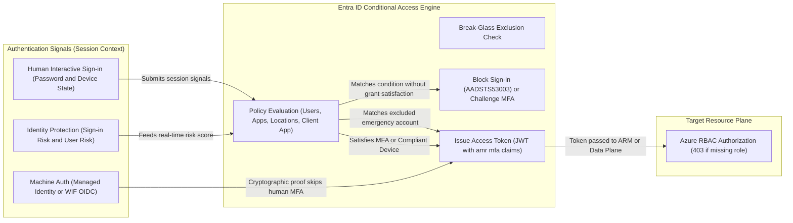
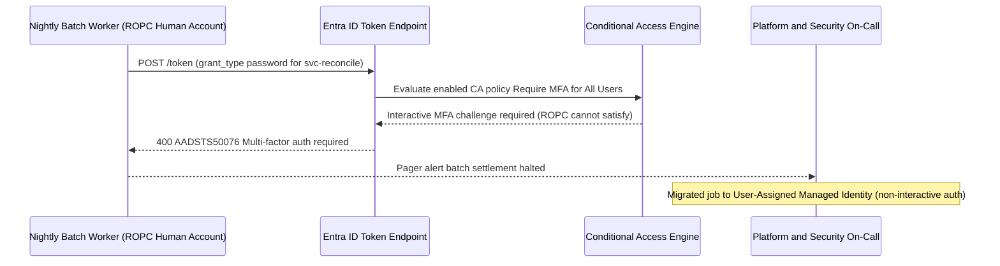

# Conditional Access and Identity Protection

> **Prerequisites:** Entra ID Token Issuance & Authn vs. Authz Split (Module 00), Service Principals, Managed Identities & WIF (Modules 01–03), and Azure RBAC Scope (Module 04).  
> **Estimated Reading Time:** 30 minutes  
> **Target Audience:** Backend Engineers, Platform Engineers, Security Engineers, Cloud Architects.

> [!TIP]
> **The Golden Rule of Conditional Access:** Conditional Access evaluates **who, where, on what device, and at what risk** *at the authentication boundary* before a token is minted (`AADSTS53003`). Never "fix" a broken automation pipeline by exempting a human user from MFA — move the workload to a non-interactive **Managed Identity or Workload Identity Federation** and always keep break-glass emergency accounts excluded from CA policies.

---

## Why This Matters

Everything so far answered "who is this identity and what may it do." This module answers a different question: **under what conditions is a sign-in even permitted?** Conditional access, MFA, and risk-based access are the controls that sit *in front of* authentication — deciding whether to allow a login, require a second factor, or block it outright based on *who, from where, on what device, and how risky*. As a platform engineer you rarely *author* these policies (that is an identity-admin role), but they constantly *affect your workflows* — a conditional access policy is why your `az login` suddenly demands MFA, or why a service principal keeps working from a pipeline where an interactive login would be challenged. This is a **survey**: enough to recognize these controls, work with them, and know their blast radius, not a full identity-governance course.

---

## 1. Architectural Mental Model: Policy Gate at the Authentication Boundary

Conditional Access (CA) acts as an explicit policy decision engine inside Entra ID's Security Token Service (STS). Every interactive sign-in submits contextual signals alongside credentials; if *any* enabled policy fails its grant control, Entra ID aborts token issuance (`AADSTS53003` / `AADSTS50076`) before Azure RBAC is ever reached. Meanwhile, cryptographic workload credentials (Managed Identity, WIF) bypass interactive MFA prompts while remaining subject to **Workload Identity CA** (IP/location/risk rules where licensed):



### MFA: something you have on top of something you know

**Multi-factor authentication (MFA)** requires a second proof of identity beyond a password — an authenticator app prompt, a hardware token, a passkey — so a stolen password alone is not enough to sign in. Conceptually it strengthens the **authentication** step (Module 00): even a correct password yields no token until the second factor is satisfied. For a platform engineer the practical points are: (1) MFA applies to **human/interactive** sign-ins, which is why your `az login` may prompt for it; (2) it generally does **not** apply to **non-interactive** service principal or managed identity or workload-identity-federation authentication, because those present cryptographic proof rather than a password — one more reason machine workloads should use those mechanisms rather than a human-style credential; and (3) requiring MFA is one of the most common *conditional access* controls, below.

### Conditional access: if-this-then-require-that

A **conditional access (CA) policy** is a rule of the form *"**if** a sign-in matches these conditions, **then** grant/require/block."* The **conditions** (signals) can include: which **users/groups**, which **cloud app** is being accessed, **location** (IP range / country), **device state** (managed/compliant or not), **client app** (browser vs. legacy protocol), and **sign-in risk** (below). The **controls** can include: require **MFA**, require a **compliant/hybrid-joined device**, **block** access, or require a **password change** (and for PIM elevation, require an **Authentication Context** step-up).

Example policies you will encounter: *"require MFA for all admins,"* *"block legacy authentication protocols,"* *"require a compliant device to reach the Azure portal,"* *"block sign-ins from outside approved countries."* CA is enforced at the **authentication** boundary — it decides whether a token is issued at all — which is *before* the RBAC authorization from Module 04 ever runs. So a CA block and an RBAC `403` are different failures at different stages, and telling them apart matters (Module 07).

### Identity protection and risk-based access

**Identity Protection** adds **risk signals** to conditional access. It continuously evaluates sign-ins and users for anomalies and assigns a **risk level**:

- **Sign-in risk** — is *this particular sign-in* suspicious? (impossible travel, anonymous/Tor IP, unfamiliar sign-in properties, a password seen in a known leak).
- **User risk** — is *this account* likely compromised overall? (leaked credentials found, a pattern of risky activity).

**Risk-based conditional access** then acts on those signals: *"if sign-in risk is high, require MFA,"* or *"if user risk is high, require a secure password change or block until an admin reviews."* This is the "risk-based access" from the track outline — automated responses to *likelihood of compromise*, not just static conditions. (These capabilities require the appropriate Entra ID premium licensing; the concepts matter regardless of whether your tenant has them enabled.)

### How this affects you as a platform engineer

You will mostly *encounter* these policies rather than write them, so know the practical implications:

- **Your interactive `az login` may be challenged** — MFA prompts, device-code flows, or outright blocks from a disallowed network. This is a CA policy doing its job, not a broken CLI.
- **Break-glass / emergency-access accounts** are deliberately *excluded* from CA policies so an over-aggressive policy cannot lock every admin out of the tenant. Knowing they exist explains why "MFA required for all users" usually has a carve-out.
- **Automation should not depend on interactive human auth.** A pipeline that logs in as a human user will eventually be broken by an MFA or device requirement. This is *another* argument for the machine mechanisms from Modules 01–03 — a service principal, managed identity, or workload identity federation is not subject to interactive MFA, so it keeps working non-interactively (which is exactly why it must be least-privileged, per Module 04).
- **A CA block looks different from an RBAC `403`.** CA failures happen at *sign-in* ("access has been blocked by conditional access policy" / `AADSTS53003`), before any resource call (or mid-session via Continuous Access Evaluation `claims` challenges). RBAC `403`s happen *after* a successful sign-in, on a specific resource action. Same instinct as every prior module: figure out whether you failed to authenticate or failed to be authorized.

---

## 2. Taxonomic Comparison & Command Reference

### Conditional Access Signals vs. Controls

| Signal / Condition Category | Example Signal Values | Typical Grant / Session Control | Platform Impact |
|---|---|---|---|
| **Users & Groups** | All Users, Admin Roles, Guest Users (exclude Break-Glass) | Require MFA (`mfa`) or Auth Strength | Prompts developers during `az login` or portal access |
| **Cloud Apps / Actions** | Azure Resource Manager, Key Vault, Graph, Auth Context | Require Compliant Device / Hybrid Joined | Blocks unmanaged personal laptops from ARM APIs |
| **Network / Named Locations** | Trusted Corporate VPN CIDR, Blocked Countries | Block Access or Require Phishing-Resistant MFA | Breaks CI runners using dynamic cloud IPs if applied to workloads |
| **Client Apps** | Browser, Mobile/Desktop vs. Legacy Auth (SMTP/IMAP/ROPC) | Block Legacy Authentication | Breaks scripts using username/password ROPC flows |
| **Identity Protection Risk** | `signInRiskLevels: high` or `userRiskLevels: high` | Require MFA or Secure Password Change | Forces immediate re-auth on impossible travel or leaked creds |

### CA Block (`AADSTS53003`) vs. Identity Protection vs. RBAC `403`

| Failure Mode | Stage | Typical Error Signature | Applies to Managed Identity / WIF? | Correct Remediation |
|---|---|---|---|---|
| **Conditional Access Block** | Authentication (Pre-Token) | `AADSTS53003` / `AADSTS50076` (MFA required) | Interactive MFA does NOT apply (Location/Risk for Workload ID requires P2 add-on) | Satisfy control (MFA/device), or migrate automation off human account |
| **CAE Claims Challenge** | Mid-Session Token Refresh | HTTP `401` with `WWW-Authenticate: Bearer claims="..."` | Evaluated if IP changes or user/SP revoked | Handle `claims` challenge in MSAL/SDK to re-acquire token |
| **Azure RBAC Denial** | Authorization (Post-Token) | HTTP `403` `AuthorizationFailed` / `Forbidden` | Yes — always enforced against `principalId` | Assign narrow built-in role at exact resource scope |

### Command Reference

> Conditional access and Identity Protection are primarily configured in the Entra admin center (portal) or via Microsoft Graph, and typically require an Identity administrator role and premium licensing — as a platform engineer you mostly *read* and *diagnose* these. The commands below are the read/diagnose surface you will actually use.

| Command | What it does | Example |
|---|---|---|
| `az ad signed-in-user show` | Confirms which identity you authenticated as (after any CA/MFA challenge) | `az ad signed-in-user show --query userPrincipalName -o tsv` |
| `az login` | Interactive login — the thing CA/MFA policies challenge | `az login --tenant <tenant-id>` |
| `az login --use-device-code` | Device-code flow, used when the default browser flow is blocked/unavailable | `az login --use-device-code` |
| `az login --service-principal` | Non-interactive SP login — generally *not* subject to interactive MFA | `az login --service-principal -u <appId> -p <secret> --tenant <tenant>` |
| `az rest --url <graph-url>` | Reads Graph resources (e.g. CA policies) when you have permission | `az rest --method GET --url "https://graph.microsoft.com/v1.0/identity/conditionalAccess/policies"` |

**Flag-by-flag breakdowns:**

`az login --tenant <tenant-id>`
- `--tenant` — forces authentication against a specific tenant. If a CA policy scoped to that tenant requires MFA, this is where you get prompted; specifying the tenant avoids landing in the wrong directory and misreading a policy block.

`az login --use-device-code`
- `--use-device-code` — switches to a code-you-paste-into-a-browser flow. Useful when the automatic browser handoff fails (headless/remote/WSL sessions), and it still honors MFA/CA challenges — the challenge just happens in the browser you complete the code in.

`az rest --method GET --url "https://graph.microsoft.com/v1.0/identity/conditionalAccess/policies"`
- `--method` / `--url` — a raw Microsoft Graph call. Reading CA policies requires directory permission (e.g. an Identity Reader/admin role); on a restricted tenant this returns a `403`, which is itself informative about your directory rights.

---

## 3. Production War Story Post-Mortem: The Nightly Cron Halted by `AADSTS50076`

> **Severity:** SEV-1 (End-of-Day Invoice Reconciliation Failure)  
> **Detection / Resolution Time:** 42 minutes to detect, 35 minutes to remediate  
> **Impact:** Overnight invoice settlement missed SLA because batch containers failed token acquisition for 2 hours.

### What Happened

To satisfy a new compliance audit, the Identity Security team switched a Conditional Access policy from `Report-only` to `Enabled`: *"Require MFA for all users accessing Azure management APIs."* Unknown to Security, a legacy Python batch worker in Azure Container Instances still authenticated using a hardcoded username/password (`svc-reconcile@contoso.com`) via the OAuth2 ROPC grant instead of a Managed Identity. At midnight UTC, the cron failed immediately with `AADSTS50076: Due to a configuration change made by your administrator, you must use multi-factor authentication`. An on-call engineer briefly considered asking Security to exempt `svc-reconcile` from MFA, which Security rightly refused because excluding a password-only account from MFA leaves it vulnerable to credential stuffing.



### Root Cause Analysis

1. **Human Identity in Non-Interactive Workload:** Using a user account with password-based ROPC meant the batch job was classified as a human user subject to interactive MFA Conditional Access policies.
2. **Missing Report-Only Telemetry Review:** Teams did not inspect `Report-only` Conditional Access hits in `SigninLogs` for service-like human accounts before switching the policy to `Enabled`.

### The Fix & Architectural Hardening

1. Assigned a **User-Assigned Managed Identity** to the batch compute container, granted it the narrow `Storage Blob Data Contributor` role on the single settlement container, and switched the SDK to `ManagedIdentityCredential`.
2. Migrated legacy ROPC automation accounts to Workload Identity Federation / Managed Identities and enabled CA policy **block legacy authentication**, while ensuring two hardware-key-protected **break-glass accounts** remained explicitly excluded and monitored by alert rules.

---

## 4. Multi-Language Production Implementation

Below are production implementations across Go, TypeScript, Python, and C# showing how services handle Conditional Access claims challenges (`Claims` / `AuthenticationRequiredException`) cleanly and inspect Conditional Access policies via Microsoft Graph for break-glass exclusion hygiene.

````carousel
**Go — Graph Conditional Access Policy Auditor (`net/http` + `azidentity`)**
```go
package main

import (
	"context"
	"encoding/json"
	"fmt"
	"net/http"
	"time"

	"github.com/Azure/azure-sdk-for-go/sdk/azcore/policy"
	"github.com/Azure/azure-sdk-for-go/sdk/azidentity"
)

type caPolicyList struct {
	Value []struct {
		ID          string `json:"id"`
		DisplayName string `json:"displayName"`
		State       string `json:"state"`
		Conditions  struct {
			Users struct {
				IncludeUsers []string `json:"includeUsers"`
				ExcludeUsers []string `json:"excludeUsers"`
			} `json:"users"`
		} `json:"conditions"`
	} `json:"value"`
}

func auditBreakGlassExclusions(ctx context.Context, breakGlassID string) error {
	cred, err := azidentity.NewDefaultAzureCredential(nil)
	if err != nil {
		return err
	}
	tk, err := cred.GetToken(ctx, policy.TokenRequestOptions{
		Scopes: []string{"https://graph.microsoft.com/.default"},
	})
	if err != nil {
		return fmt.Errorf("graph token failed (check CAE/CA challenge): %w", err)
	}

	req, _ := http.NewRequestWithContext(ctx, http.MethodGet,
		"https://graph.microsoft.com/v1.0/identity/conditionalAccess/policies", nil)
	req.Header.Set("Authorization", "Bearer "+tk.Token)

	resp, err := http.DefaultClient.Do(req)
	if err != nil {
		return err
	}
	defer resp.Body.Close()
	if resp.StatusCode == http.StatusForbidden {
		return fmt.Errorf("403 from Graph: caller lacks Policy.Read.All directory permission")
	}

	var policies caPolicyList
	if err := json.NewDecoder(resp.Body).Decode(&policies); err != nil {
		return err
	}
	for _, p := range policies.Value {
		if p.State == "enabled" && len(p.Conditions.Users.IncludeUsers) > 0 &&
			p.Conditions.Users.IncludeUsers[0] == "All" {
			excluded := false
			for _, ex := range p.Conditions.Users.ExcludeUsers {
				if ex == breakGlassID {
					excluded = true
				}
			}
			if !excluded {
				fmt.Printf("WARNING: enabled All-Users CA policy %q lacks break-glass exclusion\n", p.DisplayName)
			}
		}
	}
	return nil
}

func main() {
	ctx, cancel := context.WithTimeout(context.Background(), 15*time.Second)
	defer cancel()
	_ = ctx
}
```
<!-- slide -->
**TypeScript — CA Claims Challenge Handling & Policy Audit (`@azure/identity`)**
```typescript
import { DefaultAzureCredential, AuthenticationRequiredError } from "@azure/identity";

interface CaPolicy {
  displayName: string;
  state: "enabled" | "disabled" | "enabledForReportingButNotEnforced";
  conditions: {
    users: { includeUsers: string[]; excludeUsers: string[] };
  };
}

export async function fetchCaPoliciesWithChallengeHandling(
  breakGlassObjectId: string
): Promise<void> {
  const credential = new DefaultAzureCredential();

  let token;
  try {
    token = await credential.getToken("https://graph.microsoft.com/.default");
  } catch (err) {
    if (err instanceof AuthenticationRequiredError) {
      console.error("Interactive/CA challenge triggered; claims:", err.claims);
    }
    throw err;
  }

  const res = await fetch(
    "https://graph.microsoft.com/v1.0/identity/conditionalAccess/policies",
    { headers: { Authorization: `Bearer ${token.token}` } }
  );

  if (res.status === 403) {
    throw new Error("403 Forbidden: account lacks Policy.Read.All directory permission.");
  }
  const body = (await res.json()) as { value: CaPolicy[] };
  for (const policy of body.value) {
    const targetsAll = policy.conditions.users.includeUsers.includes("All");
    const hasExclusion = policy.conditions.users.excludeUsers.includes(breakGlassObjectId);
    if (policy.state === "enabled" && targetsAll && !hasExclusion) {
      console.warn(`Policy "${policy.displayName}" covers All users without break-glass exclusion!`);
    }
  }
}
```
<!-- slide -->
**Python — Conditional Access Policy Auditor & CAE Challenge Guard (`azure-identity`)**
```python
import urllib.request
import urllib.error
import json
from azure.identity import DefaultAzureCredential
from azure.core.exceptions import ClientAuthenticationError


def inspect_ca_policies(break_glass_id: str) -> None:
    cred = DefaultAzureCredential()
    try:
        token = cred.get_token("https://graph.microsoft.com/.default")
    except ClientAuthenticationError as exc:
        raise SystemExit(f"Authentication/CA gate blocked token acquisition: {exc}")

    req = urllib.request.Request(
        "https://graph.microsoft.com/v1.0/identity/conditionalAccess/policies",
        headers={"Authorization": f"Bearer {token.token}"},
    )
    try:
        with urllib.request.urlopen(req, timeout=10) as resp:
            data = json.loads(resp.read().decode("utf-8"))
    except urllib.error.HTTPError as err:
        if err.code == 403:
            raise SystemExit("403 from Microsoft Graph: missing Policy.Read.All role.")
        raise

    for pol in data.get("value", []):
        users = pol.get("conditions", {}).get("users", {})
        if (
            pol.get("state") == "enabled"
            and "All" in users.get("includeUsers", [])
            and break_glass_id not in users.get("excludeUsers", [])
        ):
            print(f"RISK: '{pol['displayName']}' targets All users without break-glass exclusion.")
```
<!-- slide -->
**C# — Conditional Access Claims Challenge & Graph Inspector (`Azure.Identity`)**
```csharp
using System.Net;
using System.Net.Http.Headers;
using System.Text.Json;
using Azure.Core;
using Azure.Identity;

public static class ConditionalAccessAuditor
{
    public static async Task InspectPoliciesAsync(string breakGlassUserId, CancellationToken ct = default)
    {
        var credential = new DefaultAzureCredential();
        AccessToken token;
        try
        {
            token = await credential.GetTokenAsync(
                new TokenRequestContext(new[] { "https://graph.microsoft.com/.default" }), ct);
        }
        catch (AuthenticationFailedException ex)
        {
            Console.Error.WriteLine($"Authn/CA challenge failed (check AADSTS53003): {ex.Message}");
            throw;
        }

        using var http = new HttpClient { Timeout = TimeSpan.FromSeconds(10) };
        http.DefaultRequestHeaders.Authorization = new AuthenticationHeaderValue("Bearer", token.Token);
        using var resp = await http.GetAsync(
            "https://graph.microsoft.com/v1.0/identity/conditionalAccess/policies", ct);

        if (resp.StatusCode == HttpStatusCode.Forbidden)
            throw new UnauthorizedAccessException("403 from Graph: Policy.Read.All permission required.");

        resp.EnsureSuccessStatusCode();
        using var doc = JsonDocument.Parse(await resp.Content.ReadAsStringAsync(ct));
        foreach (var policy in doc.RootElement.GetProperty("value").EnumerateArray())
        {
            var state = policy.GetProperty("state").GetString();
            var name = policy.GetProperty("displayName").GetString();
            var users = policy.GetProperty("conditions").GetProperty("users");
            var includesAll = users.GetProperty("includeUsers").EnumerateArray().Any(x => x.GetString() == "All");
            var excludesBg = users.GetProperty("excludeUsers").EnumerateArray().Any(x => x.GetString() == breakGlassUserId);

            if (state == "enabled" && includesAll && !excludesBg)
                Console.WriteLine($"ALERT: Policy '{name}' applies to All without break-glass exclusion.");
        }
    }
}
```
````

---

## 5. Practical Hands-On Verification CLI Workflows

> These exercises are **survey/observation** oriented — several depend on your tenant's licensing and your directory role. Where you cannot perform an action, the exercise says what to *observe or reason about* instead. None create billable resources.

1. **Observe your own sign-in requirements.** Run `az logout` then `az login`.
   ```powershell
   az logout
   az login
   az ad signed-in-user show --query "{upn:userPrincipalName, id:id}" -o jsonc
   ```
   **Expected Output:**
   ```json
   {
     "id": "aaaaaaaa-1111-2222-3333-bbbbbbbbbbbb",
     "upn": "engineer@yourdomain.onmicrosoft.com"
   }
   ```
   Verify: note whether you are prompted for MFA, a device, or a specific browser flow. Whatever happens is a conditional-access-and-authentication experience — write down which factors you were asked for.

2. **Contrast interactive vs. non-interactive auth.** If you still have a service principal from Module 01 (or create a throwaway), log in with it (`az login --service-principal ...`).
   Verify: the SP login completes with **no MFA prompt** even if your user login required one — non-interactive machine auth is not subject to interactive MFA. Reason about why this makes SP/managed-identity/WIF the right choice for automation (and why they must therefore be least-privileged).

3. **Try the device-code flow.** Run:
   ```powershell
   az login --use-device-code
   ```
   **Expected Output:**
   ```text
   To sign in, use a web browser to open the page https://microsoft.com/devicelogin and enter the code A1B2C3D4E to authenticate.
   ```
   Verify: you get a code and a URL instead of an automatic browser handoff, complete it, and note that any MFA/CA challenge still applies inside that browser step. This is the flow to know for headless/WSL/remote sessions.

4. **Read the conditional access policies (if permitted).** Run:
   ```powershell
   az rest --method GET --url "https://graph.microsoft.com/v1.0/identity/conditionalAccess/policies" -o jsonc
   ```
   Verify one of two outcomes: either you see policy objects (each with `conditions` and `grantControls` — the if/then structure from the concepts), or you get a `403` because your account lacks the directory role. **Both are informative:** the `403` here is an *authorization* failure on the *directory*, the same authn/authz split as always, just against Microsoft Graph.

5. **Map a policy to its if/then, on paper.** Whether you read a real policy in Exercise 4 or use the example "require MFA for all admins," decompose it into its **conditions** (users = admins group; cloud app = all) and its **controls** (require MFA). Verify: you can state, for any CA policy, "if these signals, then require/block this."

6. **Predict the failure signature of a CA block vs. an RBAC 403.** Without triggering a real block, write down the exact difference: a CA block appears at **sign-in** (e.g. "access blocked by conditional access policy" / `AADSTS53003`) with no resource call attempted; an RBAC `403` appears **after** a successful sign-in on a specific resource action. Verify against Module 04's `403` experience — you already produced the RBAC side.

7. **Diagnose-and-fix: automation broken by an interactive requirement (reasoned scenario).**
   - **Scenario:** a scheduled job authenticated as a *human user* worked for months, then started failing at login with a conditional-access/MFA error after a new "require MFA for all users" policy shipped.
   - **Diagnose:** the job depends on **interactive** human auth, which a CA/MFA policy now challenges — a non-interactive job cannot satisfy an interactive second factor, so it fails at the **authentication** stage (not a `403`).
   - **Fix:** stop using a human identity for automation — switch the job to a **service principal, managed identity, or workload identity federation** (Modules 01–03), which are not subject to interactive MFA, and grant that identity the least-privilege role it needs (Module 04). Write out why this is the correct fix rather than "exempt the user from MFA," which would weaken security for a human account.

8. **Locate where a real sign-in failure would be recorded.** Note (for Module 07) that CA/MFA outcomes are captured in **Entra ID sign-in logs**, where each sign-in shows the applied CA policies and the result. Verify you know the destination: the sign-in logs are where you confirm *"was this a CA block?"* before assuming an app bug — the exact skill Module 07 develops.

### Independent Challenge

Design (on paper — you are not expected to have admin rights to deploy it) a minimal conditional-access posture for a small platform team, and justify every policy in terms of blast radius and the automation implications from this module. Decide: which human roles must have MFA, whether you would require compliant devices for portal access, what you would do about a high-risk sign-in, and — critically — how you keep all of it from breaking the machine identities your pipelines and clusters depend on (drawing on Modules 01–03 for why those are not subject to interactive challenges, and Module 04 for why they must still be least-privileged). Include a **break-glass account** in your design and explain why it is excluded from the policies. The deliverable is a short policy table (policy → conditions → control → who/what it must NOT break) plus a paragraph on why over-aggressive conditional access can be its own outage risk.

<details>
<summary>Stuck? One hint</summary>

The trap in this design is locking out either yourself or your automation. Two guardrails prevent it: (1) a **break-glass** admin account explicitly *excluded* from every CA policy, so a bad policy can never lock all admins out of the tenant; and (2) routing all automation through **non-interactive** machine identities (SP/managed identity/WIF), which interactive MFA and device controls do not challenge — so a "require MFA for all users" policy scoped to *humans* never touches your pipelines. Every policy row should name what it must not break.

</details>

### Common Mistakes & Troubleshooting

- **Mistaking a conditional-access block for an application or RBAC error.** A CA block happens at **sign-in** (`AADSTS53003`, "blocked by conditional access"), before any resource call — not a `403` on a resource. Check the sign-in logs, not the app.
- **Running automation as a human identity.** It will eventually be broken by an MFA/device/CA requirement. Use a service principal, managed identity, or WIF for anything non-interactive.
- **"Fixing" a broken automation by weakening a human's MFA.** Exempting a human account from MFA to unblock a job trades security for convenience on the wrong identity. The fix is a machine identity, not a weaker human one.
- **Forgetting break-glass accounts.** A "require MFA for all users" policy with no exclusions can lock every admin out if MFA infrastructure fails. Excluded, monitored emergency-access accounts are standard practice.
- **Assuming machine identities are MFA-protected.** They are not subject to *interactive* MFA — which is exactly why their role assignments must be tight (Module 04) and their credentials modern (managed identity / WIF over stored secrets).
- **Expecting CLI access to CA policies on a locked-down tenant.** Reading CA policies needs a directory role; a `403` from Graph means your account lacks it, not that no policies exist.

---

## 6. Operational Validation Checkpoints & Checkpoint Quiz

### Operational Validation Checkpoints

<details>
<summary><strong>Checkpoint 1: Device-Code Flow Blocked on Unmanaged Linux Workstation</strong></summary>

**Scenario:** An engineer SSHs into a headless Linux jump box, runs `az login --use-device-code`, completes MFA in their laptop browser, and receives `AADSTS53003: Access has been blocked by Conditional Access policies` requiring a compliant device. Why did completing MFA on a compliant laptop still fail?

**Validation:**
In device-code flow, the token request originates from the CLI client on the headless Linux box or evaluates device state properties depending on the session/policy configuration (`require compliant device` or `device code flow` block policies). Organizations commonly block `deviceCodeFlow` via Conditional Access authentication-flows rules or require managed device status at the requesting client. The engineer must either run `az login` directly from a compliant workstation or execute automated deployments via GitHub OIDC WIF rather than interactive CLI sessions on jump hosts.

</details>

<details>
<summary><strong>Checkpoint 2: High User Risk Detected After Developer Laptop Loss</strong></summary>

**Scenario:** Identity Protection flags a backend engineer's account with `User Risk: High` after leaked session tokens appear on a credential dump. What is the difference between a CA policy triggered by `Sign-in Risk` vs. `User Risk`, and why is `User Risk` remediation stricter?

**Validation:**
`Sign-in Risk` evaluates an individual login event (e.g., anonymous IP) and can often be satisfied with an interactive MFA challenge. `User Risk` indicates the account's underlying credentials or persistent state are compromised across sessions, so risk-based CA requires **blocking access or enforcing a secure password change + MFA** alongside session revocation (`revokeSignInSessions`) before restoring normal access.

</details>

<details>
<summary><strong>Checkpoint 3: Break-Glass Lockout Prevention During MFA Provider Outage</strong></summary>

**Scenario:** Your company's cloud MFA push service experiences a regional outage, preventing all DevOps admins from completing `az login`. Why are two FIDO2/hardware-token emergency accounts excluded from every CA policy, and what alerts must wrap them?

**Validation:**
If a "Require MFA for All Admins" policy has zero exclusions, an MFA outage or misconfigured CA location block locks out 100% of Global/Identity Administrators. Excluding two dedicated emergency break-glass accounts (using long random passwords or FIDO2 security keys stored offline) guarantees tenant recovery, while high-priority Azure Monitor alerts fire immediately on **any** sign-in by those two object IDs.

</details>

### Checkpoint Quiz

Write down your answer to each question before expanding it — checking without attempting first is the single easiest way to fool yourself into thinking you've learned this.

1. What does MFA add to the authentication step, and does it typically apply to non-interactive service principal / managed identity sign-ins?
2. State the general form of a conditional access policy, and name three conditions and two controls it can use.
3. At which stage — authentication or authorization — is conditional access enforced, and how does a CA block therefore differ from an RBAC `403`?
4. What is the difference between **sign-in risk** and **user risk** in Identity Protection?
5. A scheduled job that logged in as a human user starts failing after a new MFA policy ships. What is the root cause, and what is the correct fix (and the tempting wrong one)?
6. Why do "require MFA for all users" policies usually exclude a break-glass account?
7. Give the practical reason a platform engineer prefers machine identities (SP/managed identity/WIF) for automation, framed in terms of conditional access.

<details>
<summary>Show answers</summary>

1. MFA requires a **second proof of identity** beyond a password, so a stolen password alone yields no token. It typically **does not** apply to non-interactive SP/managed-identity/WIF auth, because those present cryptographic proof rather than an interactive password + factor.
2. Form: **"if a sign-in matches these conditions, then grant/require/block."** Conditions (any three): users/groups, cloud app, location, device state, client app, sign-in risk. Controls (any two): require MFA, require a compliant device, block access, require password change.
3. It is enforced at the **authentication** boundary (whether a token is issued at all), *before* RBAC runs. So a CA block appears at **sign-in** (`AADSTS53003`) with no resource call, whereas an RBAC `403` appears **after** a successful sign-in on a specific resource action.
4. **Sign-in risk** = how suspicious *this particular sign-in* is (impossible travel, anonymous IP, leaked password). **User risk** = how likely *the account overall* is compromised (leaked credentials, pattern of risky activity).
5. Root cause: the job relies on **interactive human auth**, which the new MFA/CA policy now challenges and a non-interactive job cannot satisfy — an **authentication**-stage failure. Correct fix: move the job to a **machine identity** (SP/managed identity/WIF) with a least-privilege role. Tempting wrong fix: exempt the human user from MFA, weakening a human account's security.
6. So that a failure or misconfiguration in MFA/CA cannot lock **every** admin out of the tenant — the excluded, closely monitored emergency-access account is the way back in.
7. Machine identities are **not subject to interactive MFA/device conditional access**, so they keep working non-interactively when human-oriented CA policies ship — which is exactly why their permissions must be tightly scoped (Module 04).

</details>

---

## Next

[06-cross-resource-identity-patterns](../06-cross-resource-identity-patterns/README.md) — assembling everything from Modules 00–05 into one mental map: a Terraform pipeline, an AKS pod, and a Container App each authenticating correctly across resource boundaries.
