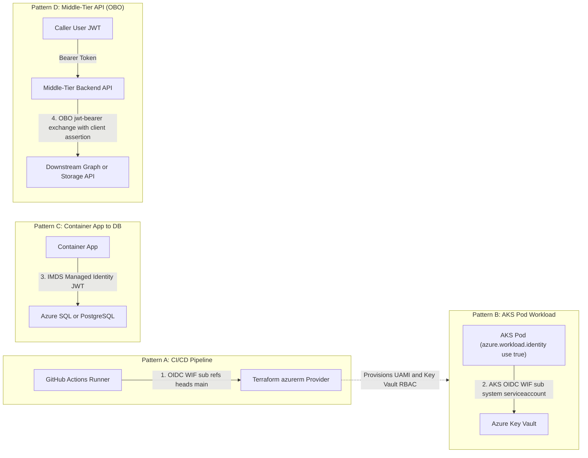
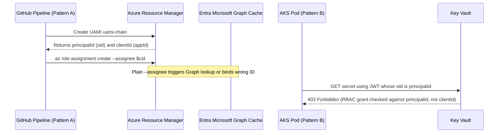

# Cross-Resource Identity Patterns

> **Prerequisites:** Entra ID Objects (Module 00), Service Principals (Module 01), Managed Identity (Module 02), Workload Identity Federation (Module 03), Azure RBAC Scope (Module 04), and Conditional Access (Module 05).  
> **Estimated Reading Time:** 40 minutes  
> **Target Audience:** Backend Engineers, Platform Engineers, Distributed Systems Architects.

> [!TIP]
> **The Golden Rule of Cross-Resource Identity:** Answer three questions **independently at every hop** — *(1) What identity is it? (2) How does it authenticate? (3) What is it authorized to do?* — choose Managed Identity inside Azure, WIF outside Azure or per-pod, and On-Behalf-Of (OBO) delegation only when a middle-tier API must preserve the original caller's user permissions downstream; always grant with `principalId` using `--assignee-object-id` to bypass the Graph-lookup race.

---

## Why This Matters

You now hold every piece: Entra ID objects (00), service principals (01), managed identity (02), workload identity federation (03), RBAC scope (04), and the conditional-access context (05). Real systems combine several of these in a single request path — a Terraform pipeline authenticates via WIF, then *creates* a managed identity, which an AKS pod later *uses* via WIF to read a Key Vault secret. This module assembles the pieces into **one mental map** so that, faced with any workload, you can name its identity, its authentication mechanism, and its authorization at each hop. This map is the direct blueprint for the capstone.

---

## 1. Architectural Mental Model: Multi-Hop Identity & Delegation Map

A multi-hop architecture never shares one blanket credential end-to-end; each boundary executes its own discrete authentication exchange and authorization evaluation:



### The universal identity question, applied at every hop

For **any** actor touching Azure, the same three-part question answers everything (it is Modules 00–04 compressed):

1. **What identity is it?** (a user, a group, a service principal, a system-/user-assigned managed identity)
2. **How does it authenticate?** (interactive login, a stored secret/cert, Azure-managed credential, or a federated OIDC token — worst to best from Module 01)
3. **What is it authorized to do?** (which role at which scope — Module 04)

When a request crosses a boundary — a pipeline calling ARM, a pod calling Key Vault — you answer these three at *each* hop. A failure is always one hop's authn or authz breaking. The rest of this module walks canonical hops and then chains them.

### Pattern A — Terraform pipeline authenticating via workload identity federation

A CI pipeline running `terraform apply` needs to authenticate to Azure to create resources. The **best** answer combines Module 03 and Module 04:

- **Identity:** a user-assigned managed identity (or an app registration) that represents the pipeline.
- **Authentication:** **workload identity federation** — the GitHub Actions job gets an OIDC token (`id-token: write`), and `azure/login` exchanges it for an Azure token with **no stored secret**. This is exactly the [10-cicd-and-gitops/07](../../10-cicd-and-gitops/07-pipeline-security-and-secrets/README.md) pattern, now understood fully.
- **Authorization:** the identity has a **`Contributor`-scoped-to-one-resource-group** assignment (Module 04) — enough to create the infra Terraform manages (as in [09-terraform-on-azure](../../09-terraform-on-azure/README.md)), not the whole subscription. The Terraform `azurerm` provider picks up the federated token automatically when the standard `ARM_*`/OIDC env vars are present.

The subtlety the capstone exploits: this same pipeline can *create* a **second** identity (below) for the workload it deploys — Terraform authenticating as one identity to provision another.

### Pattern B — AKS pod using workload identity to reach Key Vault

A pod needs one Key Vault secret. The **best** answer is Module 03's AKS variant plus Module 02's identity plus Module 04's grant — *not* the whole-cluster identity:

- **Identity:** a **user-assigned managed identity** (so it can be created by the Terraform pipeline before the cluster exists, and reused).
- **Authentication:** **AKS workload identity federation** — a Kubernetes ServiceAccount annotated with the identity's `clientId`, a federated credential on the identity whose subject is `system:serviceaccount:<ns>:<sa>` and whose issuer is the cluster's OIDC issuer URL, and a pod labeled `azure.workload.identity/use: "true"`. The pod gets a projected token and exchanges it for an Azure token as the identity — **no secret in the cluster**.
- **Authorization:** `Key Vault Secrets User` on **that one vault** (Module 04's narrowest sensible scope). This is strictly better than the [07-aks/07](../../07-aks/07-security-aks-aad-rbac-and-keyvault/README.md) CSI add-on's *cluster-wide* identity: here the *specific pod* is authorized, nothing else in the cluster is.

### Pattern C — Container App using managed identity to reach a database

A Container App needs to reach a managed database (say Azure SQL or PostgreSQL) without a connection-string password:

- **Identity:** a **managed identity** (system- or user-assigned) on the app — the [06/06](../../06-azure-container-apps/06-secrets-managed-identity-and-config/README.md) mechanism.
- **Authentication:** the app runs *inside* Azure, so plain **managed identity** is the right tool (no federation needed — that is for *outside*-Azure or per-pod cases). The app's SDK requests a token for the database's resource automatically.
- **Authorization:** two layers that people forget are separate — an **Azure RBAC role** may govern management operations, but *data-plane* access to the database is granted **inside the database** (e.g. creating a contained DB user mapped to the managed identity and `GRANT`-ing it rights). This is the database analog of the Azure-RBAC-vs-Kubernetes-RBAC split from Module 04: the identity is Entra ID, but the *authorization to read a table* lives in the database's own permission system, not solely in an Azure role assignment.

### Pattern D — Middle-Tier API Using On-Behalf-Of (OBO) Token Delegation

When a user calls Service A (an API backed by Entra ID) and Service A must call downstream Service B (e.g., Microsoft Graph or an Azure SQL / internal API) **as that specific user** rather than as Service A's own privileged Managed Identity:

- **Identity:** Dual context — Service A's App Registration/Managed Identity acts as the confidential client presenting the user's incoming access token (`assertion`).
- **Authentication:** **OAuth 2.0 On-Behalf-Of flow** (`grant_type=urn:ietf:params:oauth:grant-type:jwt-bearer`, `requested_token_use=on_behalf_of`), ideally backed by a **Managed Identity / Federated Identity Credential** (`ClientAssertion`) instead of a stored client secret.
- **Authorization:** Service B evaluates the resulting token's `oid` (the original human user) and delegated `scp` claims (`access_as_user`), preventing the "confused deputy" escalation that would happen if Service A queried everything using a service-wide Managed Identity.

### The one map: choosing the mechanism by where the workload runs

Collapse all patterns into a single decision rule you can apply to any workload:

- **Runs inside Azure, needs to call another Azure service as itself?** → **managed identity** + a narrow role on the target (Patterns B's identity object and C).
- **Runs outside Azure (GitHub Actions) or is a specific K8s pod?** → **workload identity federation** onto a managed identity/app registration + a narrow role (Patterns A and B's auth).
- **Middle-tier API needing to preserve caller user identity downstream?** → **On-Behalf-Of (OBO) delegation** backed by a Federated Identity Credential / Managed Identity assertion (Pattern D).
- **Neither is possible (legacy/on-prem, no federation support)?** → a **service principal with a certificate** (secret only as last resort) + a narrow role, and accept the credential-management burden (Module 01).
- **Always, at every hop:** the identity is only *authenticated* by the above — it still needs the right **role at the right scope** to be *authorized* (Module 04), and a `403` after a successful auth is always a missing/mis-scoped role, never a login problem.

Hold this table in your head and the capstone is just wiring the boxes together.

---

## 2. Taxonomic Comparison & Command Reference

### Cross-Resource Hop Comparison Matrix

| Pattern | Actor / Hop | Identity Object | Authentication Mechanism | Authorization Boundary | Common Failure Signature |
|---|---|---|---|---|---|
| **Pattern A** | GitHub Actions -> ARM | User-Assigned MI / App Reg | GitHub OIDC WIF (`id-token: write`) | `Contributor` on 1 RG | `AADSTS70021` (sub mismatch) or ARM `403` |
| **Pattern B** | AKS Pod -> Key Vault | User-Assigned MI | AKS OIDC WIF (`system:serviceaccount`) | `Key Vault Secrets User` on 1 vault | Pod missing label -> falls back to kubelet MI `403` |
| **Pattern C** | Container App -> Azure DB | System or User-Assigned MI | Local `IDENTITY_ENDPOINT` / IMDS | Contained DB User + SQL `GRANT` | `Login failed for user <token-identified>` inside DB |
| **Pattern D** | API A -> API B (User Context) | Confidential Client App + User | OAuth 2.0 OBO (`on_behalf_of`) | Delegated `scp` + User's downstream RBAC | `AADSTS65001` (missing consent) or invalid `aud` |

### Command Reference

> This module is integrative — the commands are ones you already met, now used *in combination*. The reference emphasizes the "which ID at which hop" choices.

| Command | What it does in the chain | Example |
|---|---|---|
| `az identity create` | Creates the user-assigned identity reused across pipeline, pod, or app | `az identity create --name uami-chain --resource-group rg-id-chain` |
| `az identity federated-credential create` | Federates GitHub (Pattern A) or the AKS SA (Pattern B) onto that identity | see Module 03 |
| `az role assignment create` | Grants each hop its narrow role at its narrow scope | `az role assignment create --assignee <principalId> --role "Key Vault Secrets User" --scope <vaultId>` |
| `az aks show --query oidcIssuerProfile.issuerUrl` | The issuer for the AKS pod federated credential (Pattern B) | `az aks show -g rg-aks -n aks-chain --query oidcIssuerProfile.issuerUrl -o tsv` |
| `az containerapp identity assign --user-assigned` | Attaches the identity to a Container App (Pattern C) | `az containerapp identity assign -n app -g rg-id-chain --user-assigned <identity-id>` |
| `az role assignment list --assignee ... --all` | Audits every grant an identity holds across the chain | `az role assignment list --assignee <principalId> --all -o table` |

**Flag-by-flag breakdowns (the cross-cutting choices):**

`az role assignment create --assignee-object-id <principalId> --assignee-principal-type ServicePrincipal --role "Key Vault Secrets User" --scope <vaultId>`
- `--assignee-object-id` + `--assignee-principal-type ServicePrincipal` — use these (instead of plain `--assignee`) right after creating a managed identity: they skip the Microsoft Graph name-resolution lookup, which frequently races and fails for a just-created principal ("principal does not exist"). A key reliability trick when a pipeline creates an identity and grants it a role in the same run.

`az identity federated-credential create --subject "system:serviceaccount:<ns>:<sa>" ...` (Pattern B) vs. `--subject "repo:<org>/<repo>:ref:refs/heads/main" ...` (Pattern A)
- The **only** structural difference between federating an AKS pod and a GitHub pipeline onto the *same* identity is the `--issuer` and `--subject`. One identity can hold *both* credentials and thus be reachable from both the pipeline and the pod — a pattern the capstone can use to keep the identity count small.

---

## 3. Production War Story Post-Mortem: The Graph-Lookup Race & `clientId`-Keyed Grant

> **Severity:** SEV-2 (Multi-Region Environment Provisioning Outage)  
> **Detection / Resolution Time:** 16 minutes to detect, 12 minutes to remediate  
> **Impact:** Automated staging/prod bootstrap pipelines broke intermittently (`PrincipalNotFound`), and a hurried script hotfix left newly deployed AKS pods receiving `403 Forbidden` from Key Vault.

### What Happened

A platform pipeline ran `az identity create` followed immediately by `az role assignment create --assignee $uamiName --role "Key Vault Secrets User" --scope $vaultId`. Roughly 35% of runs failed immediately with `ERROR: Cannot find user or service principal in graph database`. Hoping to bypass name resolution, an engineer switched the script variable to `--assignee $cid` (`clientId`) instead of `--assignee $pid` (`principalId`). When `$cid` wasn't rejected at creation (or when they copied the wrong GUID), subsequent AKS pods booted with `WorkloadIdentityCredential`, received valid Entra tokens, and immediately threw `403 Forbidden` on Key Vault secret reads.



### Root Cause Analysis

1. **Entra-to-Graph Replication Lag:** Plain `--assignee` triggers a Microsoft Graph query to resolve the principal's type; immediately after `az identity create`, Graph replication lags behind ARM.
2. **`principalId` vs. `clientId` Confusion:** Runtime JWT assertions carry `oid = principalId`. Passing `clientId` into a role assignment (or Terraform `principal_id`) creates a grant that never matches the runtime token's `oid`.

### The Fix & Architectural Hardening

1. Switched CLI bootstrap scripts to `--assignee-object-id $pid --assignee-principal-type ServicePrincipal` (and Terraform `azurerm_role_assignment` to `principal_id = azurerm_user_assigned_identity.app.principal_id` with `principal_type = "ServicePrincipal"`).
2. Added a CI integration smoke test running `az role assignment list --assignee $pid --scope $vaultId` before triggering Kubernetes deployments.

---

## 4. Multi-Language Production Implementation

Below are production implementations across Go, TypeScript, Python, and C# modeling **Pattern D: OAuth 2.0 On-Behalf-Of (OBO) Token Delegation** backed by a secretless Federated Identity Credential / Managed Identity client assertion (`OnBehalfOfCredential`), allowing a middle-tier microservice to exchange a caller's incoming user bearer token for a downstream scoped token without storing a client secret.

````carousel
**Go — Secretless OBO Token Delegation (`azidentity.NewOnBehalfOfCredential`)**
```go
package main

import (
	"context"
	"fmt"
	"os"
	"time"

	"github.com/Azure/azure-sdk-for-go/sdk/azcore/policy"
	"github.com/Azure/azure-sdk-for-go/sdk/azidentity"
)

func exchangeUserTokenOBO(ctx context.Context, userBearerJWT string) (string, error) {
	tenantID := os.Getenv("AZURE_TENANT_ID")
	clientID := os.Getenv("AZURE_CLIENT_ID")
	miClientID := azidentity.ClientID(os.Getenv("MANAGED_IDENTITY_CLIENT_ID"))

	// Secretless confidential client proof: Managed Identity mints assertion for api://AzureADTokenExchange
	miCred, err := azidentity.NewManagedIdentityCredential(&azidentity.ManagedIdentityCredentialOptions{
		ID: miClientID,
	})
	if err != nil {
		return "", fmt.Errorf("init MI assertion credential: %w", err)
	}

	oboCred, err := azidentity.NewOnBehalfOfCredentialWithAssertion(
		tenantID,
		clientID,
		userBearerJWT,
		func(ctx context.Context) (string, error) {
			tk, err := miCred.GetToken(ctx, policy.TokenRequestOptions{
				Scopes: []string{"api://AzureADTokenExchange/.default"},
			})
			if err != nil {
				return "", err
			}
			return tk.Token, nil
		},
		nil,
	)
	if err != nil {
		return "", fmt.Errorf("init OBO credential: %w", err)
	}

	tk, err := oboCred.GetToken(ctx, policy.TokenRequestOptions{
		Scopes: []string{"https://graph.microsoft.com/User.Read"},
	})
	if err != nil {
		return "", fmt.Errorf("OBO downstream exchange failed: %w", err)
	}
	return tk.Token, nil
}

func main() {
	ctx, cancel := context.WithTimeout(context.Background(), 10*time.Second)
	defer cancel()
	_ = ctx
}
```
<!-- slide -->
**TypeScript — Secretless OBO Token Exchange (`@azure/msal-node` + Managed Identity Assertion)**
```typescript
import { ConfidentialClientApplication } from "@azure/msal-node";
import { ManagedIdentityCredential } from "@azure/identity";

export async function acquireDownstreamOboToken(
  userAssertionJwt: string,
  downstreamScopes: string[]
): Promise<string> {
  const tenantId = process.env.AZURE_TENANT_ID!;
  const apiClientId = process.env.AZURE_CLIENT_ID!;
  const miCredential = new ManagedIdentityCredential(process.env.MANAGED_IDENTITY_CLIENT_ID);

  const cca = new ConfidentialClientApplication({
    auth: {
      clientId: apiClientId,
      authority: `https://login.microsoftonline.com/${tenantId}`,
      clientAssertion: async () => {
        const assertion = await miCredential.getToken("api://AzureADTokenExchange/.default");
        return assertion.token;
      },
    },
  });

  const result = await cca.acquireTokenOnBehalfOf({
    oboAssertion: userAssertionJwt,
    scopes: downstreamScopes,
  });

  if (!result?.accessToken) {
    throw new Error("OBO exchange returned null token (verify downstream API permissions and consent).");
  }
  return result.accessToken;
}
```
<!-- slide -->
**Python — Secretless OBO Token Exchange (`msal` + `ManagedIdentityCredential`)**
```python
import os
import msal
from azure.identity import ManagedIdentityCredential


def exchange_user_token_obo(user_assertion_jwt: str, scopes: list[str]) -> str:
    tenant_id = os.environ["AZURE_TENANT_ID"]
    api_client_id = os.environ["AZURE_CLIENT_ID"]
    mi_cred = ManagedIdentityCredential(client_id=os.environ.get("MANAGED_IDENTITY_CLIENT_ID"))

    # Use Managed Identity to mint a federated client assertion rather than a stored secret
    client_assertion = mi_cred.get_token("api://AzureADTokenExchange/.default").token

    app = msal.ConfidentialClientApplication(
        client_id=api_client_id,
        authority=f"https://login.microsoftonline.com/{tenant_id}",
        client_credential={"client_assertion": client_assertion},
    )

    result = app.acquire_token_on_behalf_of(
        user_assertion=user_assertion_jwt,
        scopes=scopes,
    )
    if "access_token" not in result:
        raise RuntimeError(f"OBO delegation failed: {result.get('error')} - {result.get('error_description')}")

    return result["access_token"]
```
<!-- slide -->
**C# — Secretless OBO Token Delegation (`Azure.Identity.OnBehalfOfCredential`)**
```csharp
using Azure.Core;
using Azure.Identity;

public static class OboDelegationClient
{
    public static async Task<string> GetDownstreamTokenAsync(
        string incomingUserJwt,
        string[] downstreamScopes,
        CancellationToken ct = default)
    {
        var tenantId = Environment.GetEnvironmentVariable("AZURE_TENANT_ID")!;
        var apiClientId = Environment.GetEnvironmentVariable("AZURE_CLIENT_ID")!;
        var miCred = new ManagedIdentityCredential(Environment.GetEnvironmentVariable("MANAGED_IDENTITY_CLIENT_ID"));

        var oboCred = new OnBehalfOfCredential(
            tenantId,
            apiClientId,
            async tokenCt =>
            {
                var assertion = await miCred.GetTokenAsync(
                    new TokenRequestContext(new[] { "api://AzureADTokenExchange/.default" }),
                    tokenCt);
                return assertion.Token;
            },
            incomingUserJwt);

        var downstreamToken = await oboCred.GetTokenAsync(
            new TokenRequestContext(downstreamScopes),
            ct);

        return downstreamToken.Token;
    }
}
```
````

---

## 5. Practical Hands-On Verification CLI Workflows

> Full end-to-end wiring (pipeline + cluster + vault) is the capstone. Here you build the pieces and, crucially, practice *reading* the chain and diagnosing which hop fails.

1. **Create one identity you will reuse across patterns.**
   ```powershell
   az group create --name rg-id-chain --location eastus
   az identity create --name uami-chain --resource-group rg-id-chain --location eastus
   $pid = az identity show --name uami-chain --resource-group rg-id-chain --query principalId -o tsv
   $cid = az identity show --name uami-chain --resource-group rg-id-chain --query clientId -o tsv
   Write-Host "principalId=$pid  clientId=$cid"
   ```
   **Expected Output:**
   ```text
   principalId=aaaaaaaa-bbbb-cccc-dddd-eeeeeeeeeeee  clientId=11111111-2222-3333-4444-555555555555
   ```
   Verify both IDs print. This single identity will (conceptually) serve a pipeline *and* a pod — the small-identity-count pattern.

2. **Pattern A hop — federate a pipeline and grant it RG-scoped Contributor.** Add a GitHub federated credential (Module 03) for `main`, then:
   ```powershell
   $subId = az account show --query id -o tsv
   az role assignment create --assignee-object-id $pid --assignee-principal-type ServicePrincipal `
     --role Contributor --scope /subscriptions/$subId/resourceGroups/rg-id-chain
   ```
   Verify the assignment lists, and note you used `--assignee-object-id` to dodge the Graph-lookup race — the reliability trick for pipelines that create and grant in one run.

3. **Pattern B hop — grant the same identity Key Vault read.**
   ```powershell
   $kv = "kvchain$((Get-Random -Max 9999))"
   az keyvault create --name $kv --resource-group rg-id-chain --location eastus --enable-rbac-authorization true
   az keyvault secret set --vault-name $kv --name chain-secret --value "reached-via-identity"
   $vaultId = az keyvault show --name $kv --resource-group rg-id-chain --query id -o tsv
   az role assignment create --assignee-object-id $pid --assignee-principal-type ServicePrincipal `
     --role "Key Vault Secrets User" --scope $vaultId
   az role assignment list --assignee $pid --all -o table
   ```
   **Expected Output:**
   ```text
   Principal                         Role                     Scope
   --------------------------------  -----------------------  -------------------------------------------------------------
   uami-chain (aaaaaaaa-...)         Contributor              /subscriptions/.../resourceGroups/rg-id-chain
   uami-chain (aaaaaaaa-...)         Key Vault Secrets User   /subscriptions/.../resourceGroups/rg-id-chain/providers/.../kvchain...
   ```
   Verify: `az role assignment list --assignee $pid --all -o table` now shows **two** grants at **two** scopes — Contributor on the RG, Secrets User on the one vault. Read them as a least-privilege story.

4. **Write the chain map for your setup.** On paper, fill the three-part question (identity / authn / authz) for: (a) the pipeline hop, (b) a pod that would use `uami-chain` via AKS WIF, (c) a Container App that would use it to reach a database. Verify: you can name the mechanism at each hop *without looking* — this is the map the capstone requires.

5. **Attach the identity to a Container App (Pattern C, partial).**
   ```powershell
   az containerapp env create --name env-chain --resource-group rg-id-chain --location eastus
   az containerapp create --name app-chain --resource-group rg-id-chain --environment env-chain `
     --image mcr.microsoft.com/k8se/quickstart:latest --target-port 80 --ingress external
   $uamiId = az identity show --name uami-chain --resource-group rg-id-chain --query id -o tsv
   az containerapp identity assign --name app-chain --resource-group rg-id-chain --user-assigned $uamiId
   ```
   Verify the identity shows on the app. Note the app-inside-Azure case needs plain managed identity, *not* federation — the decision rule in action.

6. **Diagnose-and-fix: which hop failed? (the core skill).** You have three plausible failures in a chain. For each *signature*, name the hop and the fix — this is the whole module distilled:
   - "No matching federated identity record found" during `azure/login` in the pipeline → **Pattern A authn**: subject-claim mismatch (Module 03). Fix: make the federated credential's subject match the run context.
   - `terraform apply` authenticates but `Error: creating resource ... 403 AuthorizationFailed` → **Pattern A authz**: the pipeline identity lacks Contributor at the RG scope (Module 04). Fix: add/scope the role.
   - The pod authenticates (token injected) but reading the vault returns `Forbidden` → **Pattern B authz**: missing `Key Vault Secrets User` on the vault. Fix: grant it on the vault scope.
   Verify by reproducing at least one: delete the vault role assignment from Exercise 3, and reason that a pod using this identity would now get the third signature — an authz failure at the Key Vault hop, not an auth or federation problem. Re-grant to fix.

7. **Diagnose-and-fix: right identity, wrong ID used to grant.** Recreate the Module 02 mistake in a chain context: grant a role using `$cid` (clientId) instead of `$pid` (principalId).
   - **Diagnose:** the runtime identity presents its object/principalId, so a grant keyed to the clientId does not authorize it — a `403` at that hop despite an assignment "existing."
   - **Fix:** grant with `$pid`. Reinforces *grant with principalId, select with clientId* across every pattern.

8. **Clean up.** `az group delete --name rg-id-chain --yes --no-wait`. Confirm no assignments linger for `$pid` (`az role assignment list --assignee $pid --all -o table` empty). If a real pod/pipeline test created federated credentials on an identity you keep, list and prune them (`az identity federated-credential list ...`).

### Independent Challenge

Produce a **single diagram-in-words** (a written map, no full commands) of a realistic multi-hop system that uses *at least three* of the identity mechanisms from this track, and annotate every hop with its identity, authentication mechanism, and authorization (role + scope). A good target is the capstone's own shape: a GitHub Actions pipeline (WIF) that runs Terraform to create a user-assigned identity, an AKS pod that uses that identity via WIF to read a Key Vault secret, and least-privilege role assignments at each step — but you may model any system you have built across Tracks 06–11 instead. For each hop, also state the *single most likely failure* and its signature (authn vs. authz), so the map doubles as a troubleshooting guide. Draw on Module 03 (federation), 04 (scope), and the decision rule above. The deliverable is the annotated map — it is effectively your capstone design document, so make it good.

<details>
<summary>Stuck? One hint</summary>

Do not think of it as one big system — think of it as a sequence of independent *hops*, and answer the same three questions (identity / authn / authz) at each one in isolation. The pipeline hop's authn is federation (subject = `repo:...:ref:refs/heads/main`); its authz is Contributor on one RG. The pod hop's authn is federation (subject = `system:serviceaccount:ns:sa`); its authz is `Key Vault Secrets User` on one vault. Written that way, the map is just Patterns A and B stacked, and each hop's "most likely failure" is whichever of its two answers is easiest to get wrong (the subject string, or the scope).

</details>

### Common Mistakes & Troubleshooting

- **Not knowing which hop failed.** A multi-hop chain fails at exactly one hop. Answer identity/authn/authz for each hop separately; do not treat the whole chain as one opaque failure.
- **Using federation where plain managed identity suffices (or vice versa).** Inside Azure → managed identity. Outside Azure / per-pod → federation. Mixing them up adds needless complexity or fails to work at all.
- **Forgetting the database's own permission layer (Pattern C).** An Entra ID identity + an Azure role is not enough to read a *table* — data-plane access is granted inside the database. Same authn-here/authz-there split as Azure-vs-K8s RBAC.
- **The Graph-lookup race when granting a just-created identity.** Use `--assignee-object-id ... --assignee-principal-type ServicePrincipal` in pipelines to avoid "principal does not exist" right after `az identity create`.
- **Reusing one identity so broadly it becomes over-privileged.** Sharing an identity across hops is fine *if* each grant stays narrow; it is a problem if you widen its roles to cover every hop at once. Keep each role assignment scoped to its specific target.
- **`principalId` vs `clientId` confusion, again.** Grant with `principalId`, select/annotate with `clientId` — at every hop.

---

## 6. Operational Validation Checkpoints, Checkpoint Quiz & Cumulative Review

### Operational Validation Checkpoints

<details>
<summary><strong>Checkpoint 1: Container App to Azure PostgreSQL Contained User Gap</strong></summary>

**Scenario:** A Container App has a User-Assigned Managed Identity assigned, and `AZURE_CLIENT_ID` is configured. You granted the identity `Contributor` on the Azure PostgreSQL Flexible Server resource, yet the app throws `FATAL: password authentication failed for user "uami-app"` / Entra role missing. Why didn't Azure `Contributor` let the app query tables?

**Validation:**
`Contributor` on the PostgreSQL ARM resource authorizes control-plane operations (scaling vCores, configuring firewall rules), **not** SQL data-plane authentication/authorization inside PostgreSQL. You must enable Microsoft Entra authentication on the Flexible Server and create a database role mapped to the managed identity (`SELECT * FROM pgaadauth_create_principal('uami-app', false, false);` + SQL `GRANT SELECT ON TABLE ...`), mirroring the Azure-vs-Kubernetes RBAC boundary.

</details>

<details>
<summary><strong>Checkpoint 2: Why OBO Beats Service-Wide Managed Identity in Multi-Tenant APIs</strong></summary>

**Scenario:** An internal portal backend calls Microsoft Graph and an HR Document API on behalf of logged-in employees. Why should the backend use **On-Behalf-Of (OBO)** delegation rather than giving the backend's Managed Identity `Files.Read.All` / HR Admin rights directly?

**Validation:**
Giving the backend's Managed Identity global `Files.Read.All` creates a classic **confused-deputy** vulnerability: any bug or authorization bypass in the backend lets a regular employee read executive documents. OBO exchanges the user's incoming JWT for a downstream token carrying the user's `oid` and delegated `scp`, enforcing the caller's exact permissions at the downstream resource.

</details>

<details>
<summary><strong>Checkpoint 3: Tracing a 3-Hop Outage to One Exact Hop</strong></summary>

**Scenario:** Your end-to-end deployment runs: (1) GitHub Actions `azure/login` succeeds; (2) `terraform apply` successfully updates Key Vault network settings; (3) newly deployed AKS pods start, fail readiness probes with `KeyVaultErrorException: Caller is not authorized (403)` against `kv-orders-prod`. Which hop broke, and is it authn or authz?

**Validation:**
Hops 1 and 2 succeeded (proving pipeline WIF authn and RG `Contributor` authz are healthy). Hop 3 reached Key Vault and received HTTP `403` (not `AADSTS70021`), proving **Pattern B authz** failed: check whether `uami-orders` has `Key Vault Secrets User` on `kv-orders-prod` keyed to `principalId` (not `clientId`), or whether RBAC propagation is still settling.

</details>

### Checkpoint Quiz

Write down your answer to each question before expanding it — checking without attempting first is the single easiest way to fool yourself into thinking you've learned this.

1. State the universal three-part question you ask at every hop where an actor touches Azure.
2. Give the full decision rule for choosing among managed identity, workload identity federation, and a certificate-based service principal — keyed on where the workload runs.
3. For the Terraform-pipeline hop (Pattern A), name the authentication mechanism and the least-privilege authorization (role + scope) you would grant.
4. Why is a per-pod workload-identity setup (Pattern B) strictly better, in authorization terms, than the cluster-wide Key Vault CSI identity from Track 07?
5. A Container App inside Azure needs to read a table in a managed database (Pattern C). Which auth mechanism, why *not* federation, and where does the authorization to read the table actually live?
6. In a pipeline that creates an identity and grants it a role in the same run, the grant fails with "principal does not exist." What is happening, and what flags fix it?
7. A multi-hop chain fails. What is the disciplined way to find which hop broke, and how do you tell an authn failure from an authz failure at that hop?

<details>
<summary>Show answers</summary>

1. **What identity is it? How does it authenticate? What is it authorized to do?** — asked independently at each hop.
2. Inside Azure calling another Azure service → **managed identity**. Outside Azure (GitHub Actions) or a specific K8s pod → **workload identity federation**. Neither possible → **certificate-based service principal** (secret as last resort). Always add a **narrow role at a narrow scope** on top.
3. Authentication: **workload identity federation** (OIDC token exchange, no stored secret). Authorization: **`Contributor` scoped to the one resource group** Terraform manages — not the subscription.
4. Because only the **specific pod's** identity (its ServiceAccount) is authorized to read the vault; the cluster-wide CSI identity is shared by every workload, so its grant over-exposes the secret to the whole cluster.
5. **Plain managed identity** — the app runs *inside* Azure, so no federation is needed (federation is for outside-Azure or per-pod cases). The authorization to read the **table** lives **inside the database** (a DB user mapped to the identity with granted rights), not solely in an Azure role assignment.
6. A **Microsoft Graph name-resolution race** — the just-created principal is not yet resolvable by name. Fix with `--assignee-object-id <principalId> --assignee-principal-type ServicePrincipal` (or the Terraform `principal_id` + `principal_type` form).
7. Answer **identity / authn / authz for each hop in isolation**; exactly one hop is failing. At that hop: if the identity **never got a token** (e.g. "no matching federated identity") it is **authn**; if it got a token but the resource call is **`403`/Forbidden**, it is **authz** (missing/mis-scoped role or wrong-ID grant).

</details>

### Cumulative Review

Closed-book. Don't reopen Modules 03–06 while attempting these — the point is to find out what actually stuck.

1. State the universal three-part question you ask of any actor touching Azure, and which two of the three a `403`-after-login versus a failed-login map to.
2. A GitHub Actions job must run `terraform apply` with **no stored secret**. Name the authentication mechanism, the two workflow requirements that make it work, and the authorization (role + scope) you would grant the pipeline identity to create resources in one resource group.
3. For an AKS pod reading one Key Vault secret via workload identity, list the four things that must line up (cluster setting, ServiceAccount, pod, federated credential subject) and the one role assignment required.
4. Why is per-pod workload identity federation strictly better than the cluster-wide Key Vault CSI identity from Track 07, in authorization terms?
5. A Container App inside Azure needs to reach a managed database. Which auth mechanism (and why *not* federation), and where does the authorization to read a *table* actually live?
6. Give the full decision rule for choosing among managed identity, workload identity federation, and a certificate-based service principal, keyed on where the workload runs.
7. In a pipeline that creates an identity and immediately grants it a role, the grant fails with "principal does not exist." What is happening and what flags fix it?
8. You federate GitHub to an identity for `ref:refs/heads/main` but the pipeline runs from a `production` environment and login fails. Classify the failure and give the fix.
9. An identity has a role assignment on a vault, yet the pod using it gets `Forbidden`. Give two distinct root causes (one about *which ID* was granted, one about *timing*) and how you would tell them apart.
10. Explain why "Azure `Owner` on the AKS cluster resource" does not let you `kubectl get pods`, and what the database-permission layer in Pattern C has in common with that fact.

<details>
<summary>Show answers</summary>

1. **What identity is it? How does it authenticate? What is it authorized to do?** A **failed login** is the authentication answer breaking; a **`403`-after-login** is the authorization answer breaking.
2. Mechanism: **workload identity federation**. Requirements: the workflow sets `permissions: id-token: write`, and `azure/login` is configured with `client-id`/`tenant-id`/`subscription-id` and **no** `client-secret`. Authorization: **`Contributor` scoped to the one resource group** (not the subscription).
3. Cluster has `--enable-oidc-issuer`/`--enable-workload-identity`; the **ServiceAccount** is annotated with the identity's `clientId`; the **pod** is labeled `azure.workload.identity/use: "true"`; the **federated credential** subject is `system:serviceaccount:<ns>:<sa>` with the cluster's issuer URL. The one role: **`Key Vault Secrets User` on that vault**.
4. Because only the **specific pod's** identity is authorized — the grant is scoped to the ServiceAccount's identity, not shared by every workload on the cluster. The cluster-wide CSI identity authorizes anything that can use it.
5. **Plain managed identity** (the app runs *inside* Azure, so no federation is needed — federation is for outside-Azure or per-pod cases). The authorization to read a **table** lives **inside the database** (a DB user mapped to the identity with granted rights), not solely in an Azure role assignment.
6. Inside Azure calling another Azure service → **managed identity**. Outside Azure (GitHub Actions) or a specific K8s pod → **workload identity federation**. Neither possible → **certificate-based service principal** (secret as last resort). Always add a narrow **role at a narrow scope** on top.
7. A **Graph name-resolution race** — the just-created principal is not yet resolvable by name. Fix: `--assignee-object-id <principalId> --assignee-principal-type ServicePrincipal` to skip the lookup.
8. **Authentication** failure — a **subject-claim mismatch** (the run's `sub` is `...:environment:production`, but the federated credential matches `...:ref:refs/heads/main`). Fix: add/adjust a federated credential whose subject matches the context the job actually runs in.
9. (1) The role was granted to the **clientId** (or wrong object) rather than the **principalId**, so it does not match the runtime identity. (2) **RBAC propagation lag** — the grant is correct but not yet effective. Tell them apart: check `az role assignment list --assignee <principalId> --scope <vaultId>` — if the correct-principal grant is present, it is timing; if it is absent/keyed to the wrong ID, it is the ID mistake.
10. Azure RBAC governs the Azure **resource** (the cluster object), while listing pods is a **Kubernetes API** action governed by Kubernetes RBAC — two separate systems. Pattern C's database has the same shape: Entra ID authenticates the identity, but the **database's own permission system** authorizes reading a table — authz lives in a different system from where the identity is defined.

</details>

---

## Next

[07-auditing-and-troubleshooting-identity](../07-auditing-and-troubleshooting-identity/README.md) — the operational payoff: sign-in logs, and a disciplined method for diagnosing a `403` as a missing role vs. a missing federated credential vs. mere propagation delay.
