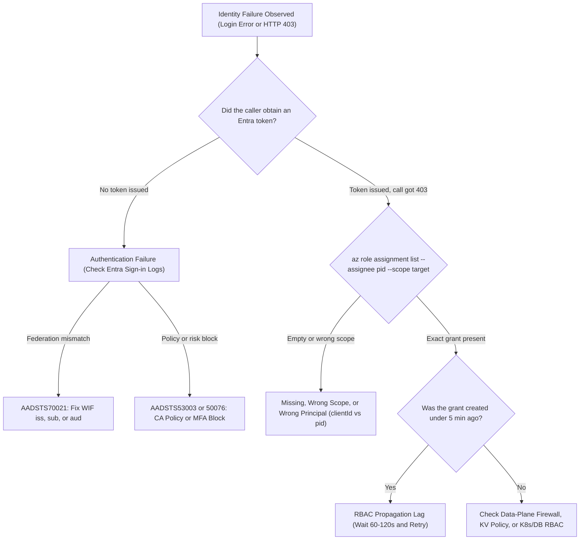
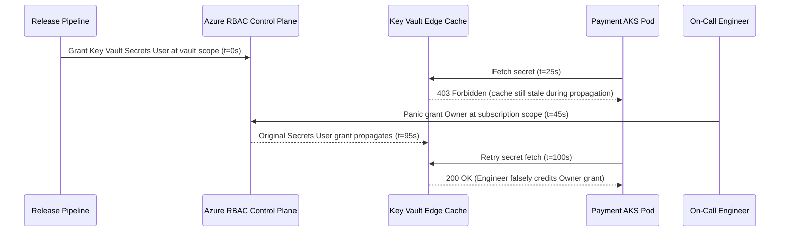

# Auditing and Troubleshooting Identity

> **Prerequisites:** Entra ID Objects & Tokens (Module 00), Managed Identity & WIF (Modules 02–03), Azure RBAC Scope (Module 04), Conditional Access (Module 05), and Cross-Resource Hop Mapping (Module 06).  
> **Estimated Reading Time:** 35 minutes  
> **Target Audience:** Backend Engineers, Platform Engineers, SREs, Security Analysts.

> [!TIP]
> **The Golden Rule of Identity Troubleshooting:** **Classify before you mutate.** Check Entra ID sign-in logs first to confirm whether a token was minted (`AADSTS70021` / `AADSTS53003` = authentication), then inspect `az role assignment list --assignee <principalId> --scope <resourceId> --all` and Azure Activity Logs (`AuthorizationFailed` = authorization) — and if a fresh, exact grant was created within the last two minutes, **wait and retry** rather than widening scope during propagation lag.

---

## Why This Matters

Every module ended with a diagnose-and-fix, because identity failures are where you actually spend your time. This module makes the diagnosis a **method** rather than a guess: where identity events are recorded (Entra ID **sign-in logs** and Azure **activity log**), and a disciplined way to separate the three failure classes that all *look* like "it's broken" — a missing **role assignment** (authz), a missing/mismatched **federated credential** (authn), and plain **propagation delay** (nothing is wrong yet). Getting fast at this distinction is the operational payoff of the whole track, and it is what the capstone's audit trail proves you can do.

---

## 1. Architectural Mental Model: Identity Telemetry & Deterministic Triage Tree

Every failure along an Azure identity path terminates in one of three branches: pre-token rejection (Entra STS), post-token authorization rejection (ARM / Data Plane), or eventual-consistency replication lag between the two planes:



### Where identity events are recorded

Two logs answer "what happened to this identity," and they are different:

- **Entra ID sign-in logs** — every **authentication** attempt: who signed in (or a service principal / managed identity), from where, which app, whether MFA/conditional access applied, and the **result with an error code**. This is where you confirm *"did this identity even get a token?"* — the authn side. It distinguishes interactive user sign-ins (`SigninLogs`), non-interactive user sign-ins, and **service principal / managed identity sign-ins** (`AADServicePrincipalSignInLogs` / `AADManagedIdentitySignInLogs`, where your pipelines and pods show up).
- **Azure activity log** — every **control-plane operation** on resources: who did what to which resource and the result, including **authorization failures** (`AzureActivity` in Log Analytics). This is where a `403 AuthorizationFailed` on a resource action is recorded — the authz side. It ties an action to a principal and a role decision. (Note: **Entra Audit Logs** / `AuditLogs` separately capture directory changes and **PIM role elevation** events.)

The mental split mirrors the whole track: **sign-in logs = authentication story; activity log = authorization story.** When something breaks, you go to one or the other depending on whether you suspect authn or authz — and often you check sign-in logs *first* to confirm a token was even issued.

### The three failure classes, and how to tell them apart

Almost every identity failure is one of three. The skill is a fast triage:

- **Missing/mis-scoped role assignment (authz).** The identity **authenticated fine** (a token was issued — visible as a successful sign-in) but the action was **denied**: `403`, `AuthorizationFailed`, `Forbidden`. The fix is a role assignment at the right scope (Module 04). Telltale: success in sign-in logs, failure in the activity log / on the resource call.
- **Missing/mismatched federated credential (authn).** The identity **never got a token**: `AADSTS70021` / "No matching federated identity record found," or a subject-claim mismatch (Module 03). The fix is correcting the federated credential's issuer/subject/audience. Telltale: a **failed** sign-in (or no successful token exchange at all) — the request dies before any resource call.
- **Propagation delay (nothing is wrong).** The role assignment or the identity or the federated credential was **just created** and has not taken effect everywhere yet. The same call **succeeds a minute or two later with no change**. The fix is **wait and retry** — and *not* to start "fixing" a configuration that is already correct. Telltale: a fresh change, a `403`/failure that is intermittent or resolves on its own.

The single most valuable habit: **before changing anything, classify the failure.** A `403` seconds after a correct grant is propagation, not a bug; "no matching federated identity" is never fixed by adding a role; a missing role is never fixed by touching federation.

### Reading a 403: role vs. scope vs. principal

When you have decided it *is* an authz `403`, three sub-causes remain (all from Module 04):

- **Wrong/no role** — the identity has no role that permits the action.
- **Right role, wrong scope** — the role exists but on a different resource than the one being accessed (the vault-A-vs-vault-B case from Module 04).
- **Right role, wrong principal** — the grant was keyed to the `clientId` or a different object than the runtime identity presents (the `principalId` vs `clientId` trap from Module 02/06).

One command settles all three:
`az role assignment list --assignee <principalId> --scope <target-resource-id> --all`.
Empty → no role at that scope. Present at a broader scope only → check inheritance. Present but you granted a different ID → principal mismatch.

### Diagnosing federation failures specifically

A federation (authn) failure is diagnosed by comparing **what the token presented** against **what you configured**:

- Get the **subject the workload actually used**: from the GitHub Actions run logs (the `azure/login` step prints the subject on failure), or for AKS from the projected token's claims.
- List **what you configured**: `az identity federated-credential list --identity-name <id> --resource-group <rg>` (or `az ad app federated-credential list`), and read off issuer/subject/audience.
- **They must match exactly.** A different branch, a `pull_request` vs a `ref:refs/heads/main`, a wrong namespace/SA, a typo, or the wrong issuer URL — any single mismatch means "no matching federated identity." This is the Module 03 failure, now with a repeatable diagnostic.

### Auditing: proving who can do what, after the fact

Beyond firefighting, you audit *proactively* — the capstone requires a written trail. Two queries do most of the work:

- **"What can this identity do?"** → `az role assignment list --assignee <principalId> --all -o table` (every grant, every scope). Run it to justify or prune an identity's power.
- **"Who can touch this resource?"** → `az role assignment list --scope <resource-id> --all -o table` (every principal with access to this vault/registry/cluster). Run it to answer "who can read this secret?"

Together with the sign-in logs (who *actually* authenticated) and the activity log (who *actually* did what), these let you reconstruct any identity's story — which is what an audit trail *is*.

---

## 2. Taxonomic Comparison & Command Reference

### Telemetry Store Taxonomy

| Log / Table | Primary Scope | Records What? | Key Fields to Filter | Permission Required |
|---|---|---|---|---|
| **Entra User Sign-ins** (`SigninLogs`) | Authentication (Human) | Interactive & non-interactive user logins, CA/MFA status, `AADSTS*` error codes | `UserPrincipalName`, `ResultType`, `ConditionalAccessStatus`, `CorrelationId` | Directory Reader / Security Reader |
| **Service Principal Sign-ins** (`AADServicePrincipalSignInLogs`) | Authentication (Machine) | SP, Managed Identity, and WIF `client_assertion` token exchanges | `ServicePrincipalId`, `AppId`, `ResultType`, `ResourceDisplayName` | Directory Reader / Log Analytics Reader |
| **Azure Activity Log** (`AzureActivity`) | Authorization & Control Plane | ARM writes/deletes and `AuthorizationFailed` `403` events | `Caller`, `Authorization_d`, `ActivityStatusValue`, `ResourceId` | Subscription/RG `Reader` |
| **Entra Audit Logs** (`AuditLogs`) | Directory Governance & PIM | App/FIC changes, role membership edits, PIM JIT activations | `OperationName`, `Category`, `InitiatedBy`, `TargetResources` | Directory Reader / Security Reader |

### Incident Signature Quick-Reference

| Observed Symptom | Failure Class | Diagnostic Check | Root Cause & Remediation |
|---|---|---|---|
| `AADSTS70021: No matching federated identity record found` | Authn (WIF) | Compare workload `sub`/`iss` vs. `az identity federated-credential list` | Fix exact `subject` or `issuer`; never add RBAC roles to fix this |
| `AADSTS53003` / `AADSTS50076` at login | Authn (Conditional Access) | Query Graph `/auditLogs/signIns` `conditionalAccessPolicies` | Satisfy MFA/device or move automation off human user account |
| `403 AuthorizationFailed` + empty `az role assignment list --scope <res>` | Authz (Missing/Wrong Scope) | `az role assignment list --assignee <pid> --all` | Assign narrow role at exact `<resourceId>` using `--assignee-object-id` |
| `403 Forbidden` + exact assignment present `< 2 min` old | Propagation Delay | Compare assignment `createdOn` timestamp vs. failure time | Wait 60–120s and retry with exponential backoff; do not widen scope |

### Command Reference

| Command | What it does | Example |
|---|---|---|
| `az monitor activity-log list` | Lists control-plane operations, incl. authorization failures | `az monitor activity-log list --resource-group rg-id-audit --max-events 20 -o table` |
| `az role assignment list --assignee` | "What can this identity do" — every grant it holds | `az role assignment list --assignee <principalId> --all -o table` |
| `az role assignment list --scope` | "Who can touch this resource" — every principal with access | `az role assignment list --scope <resourceId> --all -o table` |
| `az identity federated-credential list` | The federated credentials configured on a user-assigned identity (diagnose subject mismatch) | `az identity federated-credential list --identity-name uami --resource-group rg -o jsonc` |
| `az ad app federated-credential list` | Same, for an app registration | `az ad app federated-credential list --id <app-id> -o jsonc` |
| `az rest --url <graph sign-in logs>` | Reads Entra ID sign-in logs via Graph (needs directory permission) | `az rest --method GET --url "https://graph.microsoft.com/v1.0/auditLogs/signIns?\$top=10"` |
| `az role assignment list --include-inherited` | Shows assignments inherited from broader scopes (diagnose scope issues) | `az role assignment list --scope <resourceId> --include-inherited -o table` |

**Flag-by-flag breakdowns:**

`az role assignment list --assignee <principalId> --scope <target-resource-id> --all`
- `--assignee` — the runtime identity's **principalId**. An empty result here for the exact `--scope` you are debugging is the smoking gun for an authz `403`.
- `--scope` — the specific resource being accessed. Combined with `--assignee`, this answers "does *this identity* have *any* grant on *this exact resource*."
- `--all` — includes assignments at all scopes visible, not just the default filter — needed so you do not miss an inherited grant.

`az monitor activity-log list --resource-group rg-id-audit --max-events 20 --query "[?authorization.action!=null].{op:operationName.value, status:status.value, caller:caller}" -o table`
- `--resource-group` — narrows the log to the resources you are debugging.
- `--query "[?...]"` — projects operation, status, and caller so an `AuthorizationFailed` and the principal that hit it jump out — the activity-log view of an authz failure.

`az rest --method GET --url "https://graph.microsoft.com/v1.0/auditLogs/signIns?\$top=10&\$filter=status/errorCode ne 0"`
- `$filter=status/errorCode ne 0` — returns only **failed** sign-ins, i.e. authentication failures (including federation "no matching credential"). A `403` calling this endpoint means your account lacks the directory role to read sign-in logs — itself an authz answer.

### Log Analytics KQL Audit Queries

When Entra ID diagnostic settings stream logs to a Log Analytics Workspace, these three KQL queries separate authn, authz, and PIM elevations in seconds:

```kusto
// 1. Failed Workload / Managed Identity / WIF Sign-ins (Authn)
AADServicePrincipalSignInLogs
| where TimeGenerated > ago(2h)
| where ResultType != "0"
| project TimeGenerated, ServicePrincipalName, ServicePrincipalId, AppId, ResultType, ResultDescription, CorrelationId
| order by TimeGenerated desc

// 2. ARM Authorization Failures (Authz 403s)
AzureActivity
| where TimeGenerated > ago(2h)
| where ActivityStatusValue == "Failure" and ActivitySubstatusValue has "Forbidden"
| project TimeGenerated, Caller, CallerIpAddress, OperationNameValue, ResourceId, Properties
| order by TimeGenerated desc

// 3. PIM Role Activations & Directory Role Grants (Governance Audit)
AuditLogs
| where TimeGenerated > ago(24h)
| where Category == "RoleManagement"
| project TimeGenerated, OperationName, InitiatedBy = tostring(InitiatedBy.user.userPrincipalName), TargetResources, Result
| order by TimeGenerated desc
```

---

## 3. Production War Story Post-Mortem: The Propagation Panic That Created a Subscription `Owner`

> **Severity:** SEV-1 (Critical Privilege Escalation During Release Cutover)  
> **Detection / Resolution Time:** 5 minutes to detect anomaly, 38 minutes to verify and strip excess `Owner` grant  
> **Impact:** A production payment pod briefly ran with subscription-wide `Owner` rights after an engineer misdiagnosed normal RBAC propagation lag as a missing role.

### What Happened

A release pipeline deployed a new Key Vault and granted a workload UAMI `Key Vault Secrets User` at vault scope. Thirty seconds later, the newly rolled AKS pods executed their startup secret fetch and logged `403 Forbidden (AccessDenied)`. Without checking `az role assignment list` or timestamps, the on-call engineer panicked under deployment pressure and ran `az role assignment create --assignee $pid --role Owner --scope /subscriptions/$subId` to "eliminate RBAC as a variable." Two minutes later, the original `Key Vault Secrets User` grant finished propagating and the pods went healthy — convincing the engineer that `Owner` had fixed the outage, so they moved on without deleting it. Security CSPM paged 40 minutes later for a runtime workload holding subscription `Owner`.



### Root Cause Analysis

1. **Skipping Classification (`az role assignment list`):** Running `az role assignment list --assignee $pid --scope $vaultId` would have shown the exact `Key Vault Secrets User` grant already persisted in ARM, proving propagation lag.
2. **Data-Plane Cache Latency:** Key Vault RBAC evaluates cached policy tokens up to 1–3 minutes after a new role assignment is committed.

### The Fix & Architectural Hardening

1. Deleted the subscription-level `Owner` grant immediately and rotated any secrets exposed during the window.
2. Added exponential-backoff readiness retries (up to 180s) for first-boot Key Vault access in deployment pipelines, plus an Azure Policy blocking `Owner` assignments to ServicePrincipals altogether.

---

## 4. Multi-Language Production Implementation

Below are production diagnostic helpers across Go, TypeScript, Python, and C# that decode an Entra JWT token's identity claims (`oid`, `appid`/`azp`, `aud`, `iss`, `tid`, `roles`, `scp`, `exp`) to verify `principalId` vs. `clientId` and audience correctness locally, then correlate failed sign-ins via Microsoft Graph `/v1.0/auditLogs/signIns`.

````carousel
**Go — JWT Identity Claims Inspector & Graph Sign-In Correlator**
```go
package main

import (
	"context"
	"encoding/base64"
	"encoding/json"
	"fmt"
	"net/http"
	"net/url"
	"strings"
	"time"

	"github.com/Azure/azure-sdk-for-go/sdk/azcore/policy"
	"github.com/Azure/azure-sdk-for-go/sdk/azidentity"
)

type entraClaims struct {
	OID     string   `json:"oid"`
	AppID   string   `json:"appid"`
	AZP     string   `json:"azp"`
	Aud     string   `json:"aud"`
	Iss     string   `json:"iss"`
	TID     string   `json:"tid"`
	Roles   []string `json:"roles"`
	Scp     string   `json:"scp"`
	Exp     int64    `json:"exp"`
}

func decodeEntraClaims(jwt string) (*entraClaims, error) {
	parts := strings.Split(jwt, ".")
	if len(parts) != 3 {
		return nil, fmt.Errorf("invalid JWT segment count: %d", len(parts))
	}
	raw, err := base64.RawURLEncoding.DecodeString(parts[1])
	if err != nil {
		return nil, err
	}
	var c entraClaims
	if err := json.Unmarshal(raw, &c); err != nil {
		return nil, err
	}
	return &c, nil
}

func fetchFailedSignInsForApp(ctx context.Context, appID string) error {
	cred, err := azidentity.NewDefaultAzureCredential(nil)
	if err != nil {
		return err
	}
	tk, err := cred.GetToken(ctx, policy.TokenRequestOptions{
		Scopes: []string{"https://graph.microsoft.com/.default"},
	})
	if err != nil {
		return err
	}

	filter := url.QueryEscape(fmt.Sprintf("appId eq '%s' and status/errorCode ne 0", appID))
	endpoint := "https://graph.microsoft.com/v1.0/auditLogs/signIns?$top=10&$filter=" + filter
	req, _ := http.NewRequestWithContext(ctx, http.MethodGet, endpoint, nil)
	req.Header.Set("Authorization", "Bearer "+tk.Token)

	resp, err := http.DefaultClient.Do(req)
	if err != nil {
		return err
	}
	defer resp.Body.Close()
	fmt.Printf("Graph sign-in correlation HTTP status=%d\n", resp.StatusCode)
	return nil
}

func main() {
	ctx, cancel := context.WithTimeout(context.Background(), 10*time.Second)
	defer cancel()
	_ = ctx
}
```
<!-- slide -->
**TypeScript — JWT Principal/Audience Validator & Sign-In Log Query**
```typescript
import { DefaultAzureCredential } from "@azure/identity";

export interface EntraTokenDiagnostic {
  oid?: string;
  appid?: string;
  azp?: string;
  aud: string;
  iss: string;
  exp: number;
  roles?: string[];
  scp?: string;
}

export function inspectJwtForRbacMismatch(jwt: string, expectedAud: string): EntraTokenDiagnostic {
  const parts = jwt.split(".");
  if (parts.length !== 3) {
    throw new Error("Malformed JWT");
  }
  const claims = JSON.parse(
    Buffer.from(parts[1], "base64url").toString("utf8")
  ) as EntraTokenDiagnostic;

  if (claims.aud !== expectedAud) {
    console.warn(`Audience mismatch: got ${claims.aud}, expected ${expectedAud}`);
  }
  console.info(
    `Grant RBAC using oid=${claims.oid}, select UAMI using clientId=${claims.appid ?? claims.azp}`
  );
  return claims;
}

export async function queryFailedSignIns(correlationId: string): Promise<unknown> {
  const cred = new DefaultAzureCredential();
  const token = await cred.getToken("https://graph.microsoft.com/.default");
  const filter = encodeURIComponent(`correlationId eq '${correlationId}' and status/errorCode ne 0`);
  const res = await fetch(
    `https://graph.microsoft.com/v1.0/auditLogs/signIns?$top=5&$filter=${filter}`,
    { headers: { Authorization: `Bearer ${token.token}` } }
  );
  if (res.status === 403) {
    throw new Error("Caller lacks AuditLog.Read.All directory permission.");
  }
  return res.json();
}
```
<!-- slide -->
**Python — JWT Claims Diagnostic & Sign-In Error Correlator**
```python
import base64
import json
import urllib.parse
import urllib.request
from azure.identity import DefaultAzureCredential


def inspect_entra_jwt(token: str) -> dict:
    parts = token.split(".")
    if len(parts) != 3:
        raise ValueError("Invalid JWT structure")
    padded = parts[1] + "=" * (-len(parts[1]) % 4)
    claims = json.loads(base64.urlsafe_b64decode(padded))
    print(
        f"oid (principalId for RBAC)={claims.get('oid')} | "
        f"appId/azp (clientId)={claims.get('appid') or claims.get('azp')} | "
        f"aud={claims.get('aud')}"
    )
    return claims


def correlate_failed_signins(service_principal_id: str) -> list[dict]:
    cred = DefaultAzureCredential()
    graph_token = cred.get_token("https://graph.microsoft.com/.default").token
    flt = urllib.parse.quote(
        f"servicePrincipalId eq '{service_principal_id}' and status/errorCode ne 0"
    )
    url = f"https://graph.microsoft.com/v1.0/auditLogs/signIns?$top=10&$filter={flt}"
    req = urllib.request.Request(url, headers={"Authorization": f"Bearer {graph_token}"})
    with urllib.request.urlopen(req, timeout=10) as resp:
        return json.loads(resp.read().decode("utf-8")).get("value", [])
```
<!-- slide -->
**C# — Entra Access Token Claim Inspector & Sign-In Correlator**
```csharp
using System.Net;
using System.Net.Http.Headers;
using System.Text;
using System.Text.Json;
using Azure.Core;
using Azure.Identity;

public static class IdentityDiagnostics
{
    public static JsonElement DecodeClaims(string jwt)
    {
        var segments = jwt.Split('.');
        if (segments.Length != 3)
            throw new ArgumentException("Token is not a valid JWT.", nameof(jwt));

        var padded = segments[1].Replace('-', '+').Replace('_', '/');
        padded = padded.PadRight(padded.Length + (4 - padded.Length % 4) % 4, '=');
        var json = Encoding.UTF8.GetString(Convert.FromBase64String(padded));
        using var doc = JsonDocument.Parse(json);
        return doc.RootElement.Clone();
    }

    public static async Task<string> QueryFailedSignInsAsync(string appId, CancellationToken ct = default)
    {
        var cred = new DefaultAzureCredential();
        var tk = await cred.GetTokenAsync(
            new TokenRequestContext(new[] { "https://graph.microsoft.com/.default" }), ct);

        using var http = new HttpClient { Timeout = TimeSpan.FromSeconds(10) };
        http.DefaultRequestHeaders.Authorization = new AuthenticationHeaderValue("Bearer", tk.Token);
        var filter = Uri.EscapeDataString($"appId eq '{appId}' and status/errorCode ne 0");
        using var resp = await http.GetAsync(
            $"https://graph.microsoft.com/v1.0/auditLogs/signIns?$top=10&$filter={filter}", ct);

        if (resp.StatusCode == HttpStatusCode.Forbidden)
            throw new UnauthorizedAccessException("403 from Graph signIns: missing AuditLog.Read.All role.");

        resp.EnsureSuccessStatusCode();
        return await resp.Content.ReadAsStringAsync(ct);
    }
}
```
````

---

## 5. Practical Hands-On Verification CLI Workflows

1. **Set up an identity and a target to generate real log entries.**
   ```powershell
   az group create --name rg-id-audit --location eastus
   az identity create --name uami-audit --resource-group rg-id-audit --location eastus
   $pid = az identity show --name uami-audit --resource-group rg-id-audit --query principalId -o tsv
   $kv = "kvaudit$((Get-Random -Max 9999))"
   az keyvault create --name $kv --resource-group rg-id-audit --location eastus --enable-rbac-authorization true
   az keyvault secret set --vault-name $kv --name audit-secret --value "watch-the-logs"
   $vaultId = az keyvault show --name $kv --resource-group rg-id-audit --query id -o tsv
   ```

2. **"What can this identity do?" — before any grant.** Run:
   ```powershell
   az role assignment list --assignee $pid --all -o table
   ```
   **Expected Output:**
   ```text
   (empty output — zero assignments)
   ```
   Verify: **empty** — the identity exists but is authorized for nothing. This is the baseline an authz `403` starts from.

3. **"Who can touch this vault?"** Run:
   ```powershell
   az role assignment list --scope $vaultId --all -o table
   ```
   Verify: you (and whatever inherited admin grants exist) appear, but `uami-audit` does not — it has no access to this vault yet. These two queries (Exercises 2 and 3) are your core audit tools.

4. **Grant, then re-audit both directions.** Grant `Key Vault Secrets User` on the vault, then re-run both queries:
   ```powershell
   az role assignment create --assignee-object-id $pid --assignee-principal-type ServicePrincipal `
     --role "Key Vault Secrets User" --scope $vaultId
   az role assignment list --assignee $pid --all -o table
   az role assignment list --scope $vaultId --all -o table
   ```
   **Expected Output (`--assignee $pid --all`):**
   ```text
   Principal                         Role                     Scope
   --------------------------------  -----------------------  -----------------------------------------------------------
   uami-audit (aaaaaaaa-...)         Key Vault Secrets User   /subscriptions/.../resourceGroups/rg-id-audit/providers/...
   ```
   Verify: the identity's "what can it do" list now shows the vault grant, and the vault's "who can touch it" list now includes `uami-audit`. You can now *prove* the grant from both perspectives — the essence of an audit trail.

5. **Read the activity log for a control-plane operation.** Run:
   ```powershell
   az monitor activity-log list --resource-group rg-id-audit --max-events 20 -o table
   ```
   Verify: your recent operations (identity create, keyvault create, role assignment create) appear with a caller and status. This is where authz *failures* would also show up as `AuthorizationFailed`.

6. **Diagnose-and-fix: classify a 403 as role vs. scope vs. propagation.** Create a *second* vault `kv2` with a secret, but grant the identity nothing on it. Now walk the method for "the identity can't read `kv2`":
   - Run `az role assignment list --assignee $pid --scope <kv2-id> --all`. **Empty → authz, missing role at this scope.** Contrast with `--scope $vaultId` (vault 1), which is populated — so it is specifically a **wrong-scope** situation (right role on vault 1, none on vault 2), the Module 04 case.
   - **Fix** by granting `Key Vault Secrets User` on `kv2`, then immediately re-test. If it still `403`s *right after granting*, **do not re-fix** — classify it as **propagation delay**, wait ~2 minutes, and retry; it should then succeed with no further change. Verify you can articulate: first failure = wrong scope (real), second (transient) = propagation (not real).

7. **Diagnose-and-fix: federation subject mismatch, read from the config.** Add a GitHub federated credential to `uami-audit` for `ref:refs/heads/main`, then *inspect* it as if debugging a failed pipeline:
   ```powershell
   az identity federated-credential list --identity-name uami-audit --resource-group rg-id-audit -o jsonc
   ```
   - **Diagnose the scenario:** a pipeline that failed with "no matching federated identity" was triggered from a `pull_request`, whose subject is `repo:<org>/<repo>:pull_request` — which does **not** match the configured `...:ref:refs/heads/main`. Confirm by comparing the two strings.
   - **Fix:** either run the job in the federated context (`main`) or add a federated credential for the pull-request subject. Verify you did **not** touch any role assignment — this was purely an **authn** problem, and adding a role would have been the wrong instinct.

8. **Diagnose-and-fix: the misleading "it fixed itself."** Grant a *fresh* role (e.g. `Reader` at the RG scope) and *immediately* attempt an action that needs it. If it fails, resist changing anything: note the time, wait, retry. Verify: it succeeds on retry with **zero** configuration change. **Diagnose:** this was **propagation delay** all along — had you "fixed" it by re-granting at a broader scope, you would have introduced a real over-grant to solve a non-problem. Write down the rule: *a fresh, correct grant that fails then succeeds unchanged was never broken.*

9. **Attempt to read sign-in logs (permission-dependent).** Run:
   ```powershell
   az rest --method GET --url "https://graph.microsoft.com/v1.0/auditLogs/signIns?\$top=5" -o jsonc
   ```
   Verify one of: you see sign-in records (each with an `appDisplayName`, `status.errorCode`, and any applied CA policies — where you would confirm a federation authn failure or a CA block), **or** a `403` because your account lacks the directory role. Note which, and that the `403` is itself an authorization answer about *your* directory rights.

10. **Clean up.** `az group delete --name rg-id-audit --yes --no-wait`; confirm no assignments linger for `$pid`. Purge the vaults if you want the names back.

### Independent Challenge

Take any *working* identity setup you built earlier in this track (Module 03's federated pipeline, Module 06's chain, or a fresh one) and deliberately introduce **one** of the three failure classes without telling yourself which — then practice the triage cold: reproduce the failure, capture its exact signature, and *classify it before touching anything* as missing-role (authz), missing/mismatched-federated-credential (authn), or propagation (non-failure). Prove your classification with the diagnostic query for that class (`az role assignment list --assignee ... --scope ...` for authz, `az identity federated-credential list` for authn, a timed retry for propagation) *before* applying the fix, and write a short incident note: signature → class → evidence → fix. Draw on Module 03 (federation), Module 04 (scope), and this module's method. The deliverable is the incident note demonstrating you diagnosed by *evidence*, not by guessing — exactly the discipline [11-security-deep-dive](../../11-security-deep-dive/README.md)'s incident-response module asked for, applied to identity.

<details>
<summary>Stuck? One hint</summary>

Force yourself to answer one question first: **did the identity get a token?** If the failure is "no matching federated identity" / a sign-in-log failure, it never got a token → **authn** → look at `az identity federated-credential list` and compare subjects. If it got a token but the resource call is `403` → **authz** → run `az role assignment list --assignee <principalId> --scope <resource-id>` and see whether the grant is absent (wrong role/scope) or present (then suspect **propagation** and just wait). Never apply a fix from one class to a failure from another.

</details>

### Common Mistakes & Troubleshooting

- **Adding a role to fix a federation failure.** "No matching federated identity" is authn — no role assignment will ever fix it. Compare configured vs. presented **subject** instead.
- **"Fixing" propagation delay.** A correct, fresh grant that fails then succeeds unchanged was never broken. Re-granting at a broader scope to "make it work" creates a real over-grant. Wait and retry first.
- **Checking the wrong log.** Sign-in logs = authentication; activity log = authorization. Looking for a `403 AuthorizationFailed` in sign-in logs (or a federation error in the activity log) wastes time.
- **Ignoring scope and principal when reading a 403.** A `403` can be no role, right role at the wrong scope, or a grant keyed to the wrong ID. Use `az role assignment list --assignee <principalId> --scope <resource>` to distinguish, and remember `--include-inherited` for scope-inheritance cases.
- **Assuming you can read sign-in logs.** It needs a directory role; a `403` from the Graph audit endpoint means *your* account lacks the permission, not that there is nothing to see.
- **Not keeping an audit trail.** Without a written record of who was granted what and why, every incident is archaeology. The two `role assignment list` queries are your reconstruction tools — but a proactive trail is far cheaper than reconstruction.

---

## 6. Operational Validation Checkpoints & Checkpoint Quiz

### Operational Validation Checkpoints

<details>
<summary><strong>Checkpoint 1: JWT Inspection Reveals `clientId` vs. `principalId` Mismatch</strong></summary>

**Scenario:** A Kubernetes pod acquires a valid token (proven by Entra `AADServicePrincipalSignInLogs` showing `ResultType: 0`), yet every call to Key Vault returns `403 Forbidden`. Running `az role assignment list --scope $vaultId -o table` shows `Key Vault Secrets User` assigned to GUID `11111111-...`. Decoding the pod's access token reveals `oid: aaaaaaaa-...` and `appid: 11111111-...`. What caused the `403`, and what log misled you if you only checked Entra sign-in logs?

**Validation:**
1. The deployment script assigned the role to the identity's `clientId` (`appid = 11111111-...`) instead of its `principalId` (`oid = aaaaaaaa-...`). Azure RBAC evaluates against `oid`.
2. Entra sign-in logs only confirm **authentication** succeeded (`ResultType: 0`) — they do not evaluate Azure RBAC authorization. Fixing it requires deleting the `clientId` grant and creating the assignment with `--assignee-object-id aaaaaaaa-... --assignee-principal-type ServicePrincipal`.

</details>

<details>
<summary><strong>Checkpoint 2: Auditing PIM Elevation History After an Incident</strong></summary>

**Scenario:** An emergency change deleted a Key Vault secret at 02:14 UTC. `AzureActivity` shows `caller: alice@contoso.com`, even though Alice normally holds only `Reader` on the resource group. Which Entra log proves whether Alice elevated via Privileged Identity Management (PIM) and who approved it?

**Validation:**
Query **Entra ID Audit Logs** (`AuditLogs` in Log Analytics or Microsoft Graph `/v1.0/auditLogs/directoryAudits`) filtering for `Category == "RoleManagement"` / `ActivityDisplayName == "Add member to role completed (PIM activation)"`. This correlates the temporary `Key Vault Administrator` activation window, justification string, and approver identity to Alice's 02:14 UTC resource action.

</details>

<details>
<summary><strong>Checkpoint 3: Distinguishing Key Vault Network Firewall 403 from RBAC 403</strong></summary>

**Scenario:** `az role assignment list --assignee $pid --scope $vaultId` shows `Key Vault Secrets User` created 3 days ago, and `AADServicePrincipalSignInLogs` shows `ResultType: 0`. Yet the AKS pod still receives `403 Forbidden` with message `Client address is not authorized and caller is not a trusted service`. Is this an Entra identity failure?

**Validation:**
No — authentication succeeded and RBAC role assignment is valid and long past propagation delay. The `403` originates from Key Vault's **data-plane network firewall** (`PublicNetworkAccess` / VNet ACL / Private Endpoint configuration), not Entra ID or RBAC. Always read the full `403` error body before re-checking identity grants.

</details>

### Checkpoint Quiz

Write down your answer to each question before expanding it — checking without attempting first is the single easiest way to fool yourself into thinking you've learned this.

1. Which log records **authentication** events and which records **authorization** / control-plane operations, and which do you check to confirm "did this identity get a token at all"?
2. Name the three failure classes that most identity problems fall into, and the one-line fix for each.
3. A `403 AuthorizationFailed` appears on a resource call, but the sign-in succeeded. Which class is it, and which single command narrows role-vs-scope-vs-principal?
4. A pipeline fails with "no matching federated identity record found." Which class, which log/command do you use, and what are you comparing?
5. A brand-new, correctly-scoped role assignment fails immediately, then succeeds two minutes later with no changes. What was it, and what is the danger of "fixing" it?
6. Give the two `az role assignment list` queries that answer "what can this identity do?" and "who can touch this resource?", and say why an audit needs both.
7. You get a `403` when calling the Microsoft Graph sign-in logs endpoint. What does that tell you, and is it about the resource you were originally debugging?

<details>
<summary>Show answers</summary>

1. **Entra ID sign-in logs** record authentication events; the **Azure activity log** records authorization/control-plane operations. Check the **sign-in logs** to confirm whether the identity got a token.
2. **Missing/mis-scoped role (authz)** → add/scope the role assignment. **Missing/mismatched federated credential (authn)** → fix the credential's issuer/subject/audience. **Propagation delay (not a real failure)** → wait and retry.
3. **Authz.** `az role assignment list --assignee <principalId> --scope <resource-id> --all` — empty means no role at that scope, present-at-broader scope means check inheritance, present-but-wrong-ID means a principal mismatch.
4. **Authentication** (federation). Use `az identity federated-credential list` (or the app variant) and/or the sign-in logs, and compare the **subject the workload presented** against the **subject you configured** (plus issuer/audience) — they must match exactly.
5. **Propagation delay** — the assignment was correct but not yet effective. The danger of "fixing" it is introducing a real misconfiguration (e.g. a broader grant) to solve a problem that never existed.
6. `az role assignment list --assignee <principalId> --all` ("what can this identity do") and `az role assignment list --scope <resource-id> --all` ("who can touch this resource"). An audit needs both because one proves an identity's total power and the other proves a resource's total exposure.
7. It tells you **your account lacks the directory role** to read sign-in logs — an authorization answer about *your* permissions on the directory. It is **not** about the resource you were originally debugging.

</details>

---

## Next

[08-capstone-project](../08-capstone-project/README.md) — put every mechanism together: a secretless GitHub Actions pipeline, Terraform creating a user-assigned identity, an AKS pod using it via workload identity federation to read Key Vault, least-privilege roles at every step, and a written audit trail.
