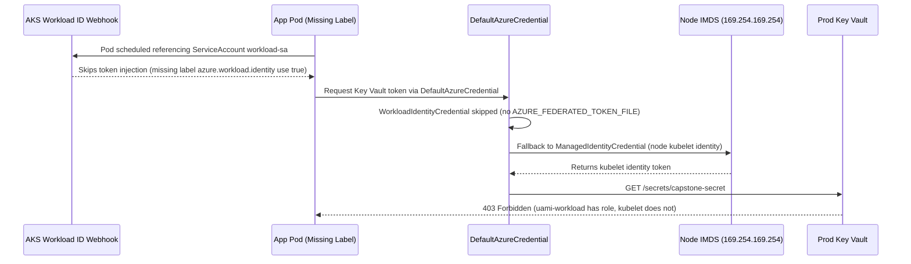

# Capstone Project

> **Prerequisites:** All Track 16 modules (Modules 00–07), CI/CD secretless pipelines ([10-cicd-and-gitops/07](../../10-cicd-and-gitops/07-pipeline-security-and-secrets/README.md)), Terraform on Azure ([09-terraform-on-azure](../../09-terraform-on-azure/README.md)), and AKS security ([07-aks/07](../../07-aks/07-security-aks-aad-rbac-and-keyvault/README.md)).  
> **Estimated Reading Time:** 45 minutes (2–3 hours hands-on build & audit)  
> **Target Audience:** Backend Engineers, Platform Engineers, DevSecOps Engineers, Cloud Architects.

> [!TIP]
> **The Golden Rule of the Identity Capstone:** Prove **zero stored long-lived secrets** across every boundary — build one hop at a time (GitHub WIF -> Terraform -> AKS OIDC Pod -> RBAC Key Vault), bind every role assignment with `principal_id` + `principal_type = "ServicePrincipal"` at the narrowest resource scope, and maintain a **live written audit trail** where every identity and every grant carries a one-line justification.

---

## Why This Matters

This is the last module of the track, and it has no new concepts, no quiz, and no independent challenge — it is the integration test. Every earlier module gave you one mechanism in isolation and one diagnose-and-fix; here you wire them into a single, real, secretless system and — critically — produce the **written audit trail** that a platform engineer is actually judged on. The point is not that each piece works, but that you can stand in front of the whole chain and answer, for every identity and every permission, *what it is, how it authenticates, what it is authorized to do, and why that grant is the least one that works.* If you can build this and defend the audit trail, you have mastered identity as a discipline rather than as a set of copied commands.

---

## 1. Architectural Mental Model: Secretless End-to-End Blueprint

Notice how the two User-Assigned Managed Identities (`uami-pipeline` and `uami-workload`) completely decouple CI/CD infrastructure provisioning permissions from runtime pod data-plane permissions — neither holds a secret, and neither can escalate across the other's boundary:

```mermaid
flowchart LR
    subgraph Pipeline["Hop 1: Secretless CI/CD Provisioning"]
        GH["GitHub Actions (main branch, id-token write)"]
        UAMI1["uami-pipeline (Federated sub repo main)"]
        TF["Terraform azurerm Provider"]
        GH -->|1. Exchanges GitHub OIDC JWT| UAMI1
        UAMI1 -->|2. Contributor plus RBAC grant on rg-capstone| TF
    end

    subgraph Infra["Provisioned Azure Resource Group (rg-capstone)"]
        AKS["AKS Cluster (OIDC Issuer and Workload ID Enabled)"]
        KV["Azure Key Vault (RBAC Mode, 1 Secret)"]
        UAMI2["uami-workload (User-Assigned Identity)"]
    end

    subgraph Runtime["Hop 2: Per-Pod Runtime Secret Fetch"]
        SA["ServiceAccount workload-sa (clientId annotation)"]
        Pod["App Pod (azure.workload.identity use true)"]
        SA -->|3. Projects K8s OIDC JWT| Pod
        Pod -->|4. Exchanges K8s JWT for uami-workload token| UAMI2
        UAMI2 -->|5. Key Vault Secrets User on single vault| KV
    end

    TF -->|Provisions resources and FIC| Infra
    AKS -->|Hosts| Runtime
```



### The project

Build an end-to-end pipeline in which **no long-lived secret is stored anywhere**, and every permission is least-privilege and documented. The shape is the Module 06 chain, made real:

1. **A GitHub Actions pipeline authenticates to Azure via workload identity federation** — no stored client secret. The workflow uses `id-token: write` and `azure/login` with only `client-id`/`tenant-id`/`subscription-id` (Module 03, building on [10-cicd-and-gitops/07](../../10-cicd-and-gitops/07-pipeline-security-and-secrets/README.md)).
2. **A Terraform apply runs *through that pipeline* and creates a user-assigned managed identity** (and the supporting resources), using the `azurerm` provider you know from [09-terraform-on-azure](../../09-terraform-on-azure/README.md) — the pipeline authenticates as *one* federated identity to provision *another* identity for the workload (Modules 02 and 06).
3. **An AKS workload uses that user-assigned identity via workload identity federation to read a Key Vault secret** — a ServiceAccount annotated with the identity's `clientId`, a federated credential whose subject is the SA, a pod labeled `azure.workload.identity/use: "true"`, reading a secret from Key Vault (Module 03's AKS variant + Module 02, going beyond the cluster-wide CSI identity of [07-aks/07](../../07-aks/07-security-aks-aad-rbac-and-keyvault/README.md)).
4. **Least-privilege role assignments scoped correctly at each step** — the pipeline identity gets only what it needs to run Terraform in one resource group; the workload identity gets only `Key Vault Secrets User` on the one vault (Module 04). Nothing at subscription scope, nothing broader than the job requires.
5. **A written audit trail** documenting *every* identity created and *every* permission granted, with the justification for each — the deliverable that proves you designed this rather than stumbled into it.

Treat this as a project, not a checklist of isolated steps — each piece depends on the ones before it, in roughly the order you would build it for real. Build it incrementally: get the federated pipeline logging in first, then Terraform creating the identity, then the AKS workload, then tighten every scope, then write the trail.

---

## 2. Taxonomic Comparison & Capstone Reference Blueprint

### Written Audit Trail Template (Deliverable Model)

| Identity Name | Type | Authentication Mechanism & Subject | Role Assigned | Exact Scope | One-Line Least-Privilege Justification |
|---|---|---|---|---|---|
| `uami-pipeline` | User-Assigned MI | GitHub WIF (`repo:<org>/<repo>:ref:refs/heads/main`) | `Contributor` + `User Access Administrator` (ABAC constrained) | `/subscriptions/<sub>/resourceGroups/rg-capstone` | Provisions infra & creates narrow workload role grants inside `rg-capstone` only |
| `uami-workload` | User-Assigned MI | AKS WIF (`system:serviceaccount:app:workload-sa`) | `Key Vault Secrets User` | `/subscriptions/<sub>/resourceGroups/rg-capstone/providers/Microsoft.KeyVault/vaults/<kv>` | Reads runtime secret values from the single workload Key Vault; zero write or RG scope |

### Reference Workflow, Terraform, & Kubernetes Manifests

**1. GitHub Actions Secretless Terraform Workflow (`.github/workflows/deploy-capstone.yml`):**
```yaml
name: deploy-capstone
on:
  push:
    branches: [ main ]
  workflow_dispatch: {}

permissions:
  id-token: write
  contents: read

env:
  ARM_CLIENT_ID: ${{ vars.AZURE_CLIENT_ID }}
  ARM_TENANT_ID: ${{ vars.AZURE_TENANT_ID }}
  ARM_SUBSCRIPTION_ID: ${{ vars.AZURE_SUBSCRIPTION_ID }}
  ARM_USE_OIDC: "true"

jobs:
  terraform-apply:
    runs-on: ubuntu-latest
    steps:
      - uses: actions/checkout@v4
      - uses: azure/login@v2
        with:
          client-id: ${{ vars.AZURE_CLIENT_ID }}
          tenant-id: ${{ vars.AZURE_TENANT_ID }}
          subscription-id: ${{ vars.AZURE_SUBSCRIPTION_ID }}
      - uses: hashicorp/setup-terraform@v3
      - run: terraform init
      - run: terraform apply -auto-approve
```

**2. Terraform Identity, Vault, & AKS Federation (`identity.tf`):**
```hcl
resource "azurerm_user_assigned_identity" "workload" {
  name                = "uami-workload"
  resource_group_name = azurerm_resource_group.capstone.name
  location            = azurerm_resource_group.capstone.location
}

resource "azurerm_federated_identity_credential" "aks_pod" {
  name                = "aks-workload-sa"
  resource_group_name = azurerm_resource_group.capstone.name
  parent_id           = azurerm_user_assigned_identity.workload.id
  audience            = ["api://AzureADTokenExchange"]
  issuer              = azurerm_kubernetes_cluster.aks.oidc_issuer_url
  subject             = "system:serviceaccount:app:workload-sa"
}

resource "azurerm_role_assignment" "kv_secrets_user" {
  scope                = azurerm_key_vault.capstone.id
  role_definition_name = "Key Vault Secrets User"
  principal_id         = azurerm_user_assigned_identity.workload.principal_id
  principal_type       = "ServicePrincipal" # Skips Graph lookup race (Module 06)
}
```

**3. Kubernetes Workload Identity Manifests (`k8s/workload.yaml`):**
```yaml
apiVersion: v1
kind: Namespace
metadata:
  name: app
---
apiVersion: v1
kind: ServiceAccount
metadata:
  name: workload-sa
  namespace: app
  annotations:
    azure.workload.identity/client-id: "<uami-workload-client-id>"
---
apiVersion: v1
kind: Pod
metadata:
  name: kv-reader-pod
  namespace: app
  labels:
    azure.workload.identity/use: "true"
spec:
  serviceAccountName: workload-sa
  containers:
    - name: reader
      image: mcr.microsoft.com/azure-cli:latest
      command:
        - /bin/sh
        - -c
        - >
          az login --federated-token "$(cat $AZURE_FEDERATED_TOKEN_FILE)"
          --service-principal -u "$AZURE_CLIENT_ID" -t "$AZURE_TENANT_ID" &&
          az keyvault secret show --vault-name <kv-name> --name capstone-secret --query value -o tsv &&
          sleep 3600
```

---

## 3. Production War Story Post-Mortem: The Silent Fallback to Node Kubelet Identity

> **Severity:** SEV-2 (Staging-to-Production Cutover `403` & Wrong-Principal Audit Failure)  
> **Detection / Resolution Time:** 28 minutes to detect, 15 minutes to remediate  
> **Impact:** Production pods returned `403 Forbidden` from Key Vault while staging pods succeeded under the wrong identity, invalidating the security boundary.

### What Happened

During a capstone-style deployment cutover, an engineer applied the ServiceAccount annotated with `azure.workload.identity/client-id` and ran `DefaultAzureCredential` inside the application container. In staging, Key Vault calls succeeded — leading the team to ship to production, where every pod immediately crashed with `403 Forbidden`. Inspecting `AADServicePrincipalSignInLogs` showed the pods were authenticating not as `uami-workload`, but as the AKS node pool's `aks-agentpool` kubelet Managed Identity (which happened to hold an old test role in staging, masking the bug until prod).



### Root Cause Analysis

1. **Missing Pod Label:** The Deployment omitted `azure.workload.identity/use: "true"` under `spec.template.metadata.labels` (it was placed on the outer `Deployment.metadata.labels` by mistake).
2. **Permissive Credential Chain Fallback:** `DefaultAzureCredential` silently stepped past `WorkloadIdentityCredential` and fell back to `ManagedIdentityCredential` (IMDS kubelet identity), masking the missing webhook injection until production RBAC blocked it.

### The Fix & Architectural Hardening

1. Added `azure.workload.identity/use: "true"` onto `spec.template.metadata.labels` in the Pod template.
2. Switched production runtime code from `DefaultAzureCredential` to explicit **`WorkloadIdentityCredential`** (fail-closed if `AZURE_FEDERATED_TOKEN_FILE` is missing rather than falling back to host IMDS) and added a readiness startup check logging the active `oid` claim.

---

## 4. Multi-Language Production Implementation

Below are fail-closed production implementations across Go, TypeScript, Python, and C# for the Capstone AKS pod (`WorkloadIdentityCredential` — never silently falling back to node IMDS) with exponential-backoff handling for initial RBAC propagation lag when reading the Key Vault secret.

````carousel
**Go — Fail-Closed Capstone Key Vault Secret Reader (`azsecrets` + `WorkloadIdentityCredential`)**
```go
package main

import (
	"context"
	"fmt"
	"os"
	"time"

	"github.com/Azure/azure-sdk-for-go/sdk/azidentity"
	"github.com/Azure/azure-sdk-for-go/sdk/security/keyvault/azsecrets"
)

func fetchCapstoneSecret(ctx context.Context, vaultURL, secretName string) (string, error) {
	// Fail-closed: never fall back to node IMDS if webhook vars are absent
	cred, err := azidentity.NewWorkloadIdentityCredential(&azidentity.WorkloadIdentityCredentialOptions{
		ClientID:      os.Getenv("AZURE_CLIENT_ID"),
		TenantID:      os.Getenv("AZURE_TENANT_ID"),
		TokenFilePath: os.Getenv("AZURE_FEDERATED_TOKEN_FILE"),
	})
	if err != nil {
		return "", fmt.Errorf("workload identity configuration missing: %w", err)
	}

	client, err := azsecrets.NewClient(vaultURL, cred, nil)
	if err != nil {
		return "", err
	}

	// Retry briefly for fresh RBAC propagation lag (Module 07)
	var lastErr error
	for attempt := 0; attempt < 4; attempt++ {
		resp, err := client.GetSecret(ctx, secretName, "", nil)
		if err == nil && resp.Value != nil {
			return *resp.Value, nil
		}
		lastErr = err
		time.Sleep(time.Duration(1<<attempt) * 2 * time.Second)
	}
	return "", fmt.Errorf("secret fetch failed after retries: %w", lastErr)
}

func main() {
	ctx, cancel := context.WithTimeout(context.Background(), 45*time.Second)
	defer cancel()
	_, _ = fetchCapstoneSecret(ctx, os.Getenv("KEY_VAULT_URL"), "capstone-secret")
}
```
<!-- slide -->
**TypeScript — Fail-Closed Capstone Key Vault Secret Reader (`@azure/keyvault-secrets`)**
```typescript
import { WorkloadIdentityCredential } from "@azure/identity";
import { SecretClient } from "@azure/keyvault-secrets";

async function readCapstoneSecret(vaultUrl: string, secretName: string): Promise<string> {
  // Explicit WorkloadIdentityCredential avoids silent node IMDS fallback
  const credential = new WorkloadIdentityCredential({
    tenantId: process.env.AZURE_TENANT_ID,
    clientId: process.env.AZURE_CLIENT_ID,
    tokenFilePath: process.env.AZURE_FEDERATED_TOKEN_FILE,
  });

  const client = new SecretClient(vaultUrl, credential);

  for (let attempt = 0; attempt < 4; attempt++) {
    try {
      const secret = await client.getSecret(secretName);
      if (!secret.value) {
        throw new Error(`Secret ${secretName} exists but value is empty.`);
      }
      return secret.value;
    } catch (err: unknown) {
      const status = (err as { statusCode?: number })?.statusCode;
      if (status === 403 && attempt < 3) {
        await new Promise((r) => setTimeout(r, 2000 * 2 ** attempt));
        continue;
      }
      throw err;
    }
  }
  throw new Error("Unreachable");
}

readCapstoneSecret(process.env.KEY_VAULT_URL!, "capstone-secret").catch((err) => {
  console.error("Capstone secret fetch failed:", err);
  process.exit(1);
});
```
<!-- slide -->
**Python — Fail-Closed Capstone Key Vault Secret Reader (`azure-keyvault-secrets`)**
```python
import os
import time
from azure.core.exceptions import HttpResponseError
from azure.identity import WorkloadIdentityCredential
from azure.keyvault.secrets import SecretClient


def read_capstone_secret(vault_url: str, secret_name: str) -> str:
    # Explicit WorkloadIdentityCredential prevents silent fallback to AKS node kubelet identity
    credential = WorkloadIdentityCredential(
        tenant_id=os.environ["AZURE_TENANT_ID"],
        client_id=os.environ["AZURE_CLIENT_ID"],
        token_file_path=os.environ["AZURE_FEDERATED_TOKEN_FILE"],
    )
    client = SecretClient(vault_url=vault_url, credential=credential)

    for attempt in range(4):
        try:
            secret = client.get_secret(secret_name)
            return secret.value or ""
        except HttpResponseError as err:
            if err.status_code == 403 and attempt < 3:
                time.sleep(2 * (2**attempt))
                continue
            raise
    raise RuntimeError("Exhausted secret fetch retries")


if __name__ == "__main__":
    val = read_capstone_secret(os.environ["KEY_VAULT_URL"], "capstone-secret")
    print(f"Successfully retrieved secret (length={len(val)}) via Workload Identity.")
```
<!-- slide -->
**C# — Fail-Closed Capstone Key Vault Secret Reader (`Azure.Security.KeyVault.Secrets`)**
```csharp
using Azure;
using Azure.Identity;
using Azure.Security.KeyVault.Secrets;

public static class CapstoneSecretReader
{
    public static async Task<string> ReadSecretAsync(Uri vaultUri, string secretName, CancellationToken ct = default)
    {
        // Fail-closed: reads AZURE_TENANT_ID, AZURE_CLIENT_ID, AZURE_FEDERATED_TOKEN_FILE
        var credential = new WorkloadIdentityCredential();
        var client = new SecretClient(vaultUri, credential);

        for (var attempt = 0; attempt < 4; attempt++)
        {
            try
            {
                KeyVaultSecret secret = await client.GetSecretAsync(secretName, cancellationToken: ct);
                return secret.Value;
            }
            catch (RequestFailedException ex) when (ex.Status == 403 && attempt < 3)
            {
                await Task.Delay(TimeSpan.FromSeconds(2 * Math.Pow(2, attempt)), ct);
            }
        }

        throw new InvalidOperationException("Failed to fetch Key Vault secret after propagation backoff.");
    }
}
```
````

---

## 5. Practical Hands-On Verification CLI Workflows, Acceptance Checklist & Hints

### Verification Commands (Run After Pipeline & Pod Deployment)

```powershell
# 1. Verify Federated Credentials on both identities
az identity federated-credential list --identity-name uami-pipeline --resource-group rg-capstone -o table
az identity federated-credential list --identity-name uami-workload --resource-group rg-capstone -o table

# 2. Verify Least-Privilege RBAC on both directions (Audit Trail evidence)
$workloadPid = az identity show --name uami-workload --resource-group rg-capstone --query principalId -o tsv
$vaultId = az keyvault show --name <kv-name> --resource-group rg-capstone --query id -o tsv
az role assignment list --assignee $workloadPid --all -o table
az role assignment list --scope $vaultId --all -o table

# 3. Verify Pod Workload Identity Injection
kubectl exec -n app kv-reader-pod -- env | Select-String "AZURE_"
```

**Expected Output:**
```text
AZURE_CLIENT_ID=11111111-2222-3333-4444-555555555555
AZURE_TENANT_ID=99999999-8888-7777-6666-555555555555
AZURE_FEDERATED_TOKEN_FILE=/var/run/secrets/azure/tokens/azure-identity-token
AZURE_AUTHORITY_HOST=https://login.microsoftonline.com/
```

### Acceptance Checklist

Work through these in order; each depends on the previous ones actually working, not merely existing.

- [ ] A GitHub Actions workflow authenticates to Azure with **no `client-secret` anywhere** — only `client-id`/`tenant-id`/`subscription-id` and `permissions: id-token: write`. You have proven it by watching an `azure/login` step succeed on a push to `main`, and you can point to the federated credential whose **subject** matches the run context.
- [ ] `terraform apply` runs **inside that pipeline** (not from your laptop) and creates a **user-assigned managed identity** plus the supporting resources (resource group, Key Vault, and — if you provision it via Terraform — the AKS cluster). The pipeline's own identity has only the role/scope needed to do this, and you can show the assignment.
- [ ] A Key Vault exists with at least one secret, on the RBAC-authorization model (`--enable-rbac-authorization true` or the Terraform equivalent).
- [ ] The AKS cluster has the **OIDC issuer and workload identity** enabled, and a **federated credential** on the user-assigned identity whose subject is `system:serviceaccount:<ns>:<sa>` and whose issuer is the cluster's actual OIDC issuer URL.
- [ ] A **ServiceAccount** annotated with the identity's `clientId` exists, and a pod using it (labeled `azure.workload.identity/use: "true"`) **reads the Key Vault secret at runtime** — you have proven it (e.g. the pod logs/exec show the secret value), and there is **no Kubernetes Secret and no stored credential** involved in getting it there.
- [ ] Every role assignment is **least-privilege and correctly scoped**: the workload identity has `Key Vault Secrets User` on **the one vault** (not the resource group, not the subscription); the pipeline identity has the narrowest role that lets Terraform run in **one resource group**. You can show, via `az role assignment list --scope <resource>`, that no principal has broader access than its job requires.
- [ ] A **written audit trail** exists (a Markdown file, a table — your choice) listing **every identity** (name, type, why it exists) and **every role assignment** (principal → role → scope → the one-line justification for why it is the least grant that works). Anyone reading it can answer "who can read this secret, and why" without inspecting Azure.
- [ ] You can **trace a failure to the right hop**: deliberately break one thing (a subject-claim mismatch, a role at the wrong scope, or a revoked grant), classify it as authn vs. authz vs. propagation using Module 07's method, capture the signature, and fix it — and your audit trail/notes reflect the incident.
- [ ] You can **explain every piece**: for each identity and grant, what authenticates it, what authorizes it, and what Azure manages versus what you configured. If you cannot explain a piece, that is the signal to go back and understand it rather than leaving a copied command in place.

### Hints

- **Build the chain one hop at a time.** Get the federated pipeline doing a trivial `az group show` first (Module 03's Exercise 4). Only once login works with no secret should you add Terraform; only once Terraform creates the identity should you add the AKS workload. Debugging federation and Terraform and workload identity simultaneously is how you lose an evening.
- **Two identities, two federation subjects.** The pipeline identity federates a **GitHub** subject (`repo:...:ref:refs/heads/main`); the workload identity federates a **Kubernetes** subject (`system:serviceaccount:<ns>:<sa>`). You can even use one identity with both federated credentials (Module 06) — but keeping them separate makes the least-privilege story cleaner and the audit trail clearer.
- **Watch the Graph-lookup race.** When Terraform (or the pipeline) creates an identity and grants it a role in the same run, use the object-id form of the assignment (`--assignee-object-id ... --assignee-principal-type ServicePrincipal`, or the Terraform `azurerm_role_assignment` with `principal_id` + `principal_type`) to avoid "principal does not exist" (Module 06).
- **Scope every grant from the action, not the role.** For each identity, write down the exact operation it must perform, then pick the narrowest role and narrowest scope (Module 04). If you catch yourself typing `Contributor` at subscription scope, stop — that is the antipattern this whole track was about.
- **If the pod authenticates but gets `Forbidden`,** it is authz at the Key Vault hop — check `az role assignment list --assignee <workload-principalId> --scope <vaultId>` (Module 06/07). If `azure/login` fails with "no matching federated identity," it is authn — compare the presented subject to the configured one (Module 03/07). Never apply one class's fix to the other's failure.
- **Write the audit trail as you go, not at the end.** Every time you create an identity or a role assignment, add its row immediately with the justification. A trail written after the fact is guesswork; one written live is a record. This is also the artifact that makes final cleanup a checklist rather than archaeology.
- **Reuse patterns you already validated** in Modules 02–06 rather than inventing new configuration — the capstone is integration, not new discovery.

### Final Cleanup

- [ ] Delete the resource group(s) you created: `az group delete --name <rg> --yes --no-wait`. Remember AKS bills for node VMs until it is gone (the Track 07 cost warning still applies).
- [ ] Remove the GitHub Actions workflow and the repo variables/secrets (the three federated identifiers) if you are done, and delete the federated credentials on any identity you keep (`az identity federated-credential list` / `delete`).
- [ ] Confirm no orphaned role assignments remain (`az role assignment list --all -o table` filtered to your principals) and no soft-deleted Key Vault lingers (`az keyvault list-deleted -o table`; purge if you want the name back).
- [ ] Keep the **audit trail file** — it is the one artifact worth saving, and it is the template you will reuse for real systems.

---

## 6. Operational Validation Checkpoints & Before You Move On

### Operational Validation Checkpoints (Architecture Defense Readiness)

<details>
<summary><strong>Checkpoint 1: Defending Why Terraform's Identity Needs Role-Creation Rights Without Subscription Owner</strong></summary>

**Scenario:** Your `uami-pipeline` identity must run `terraform apply` to create a Key Vault, an AKS cluster, `uami-workload`, and the `Key Vault Secrets User` assignment inside `rg-capstone`. Why does `Contributor` on `rg-capstone` fail at `azurerm_role_assignment`, and how do you avoid giving the pipeline unrestricted `Owner`?

**Validation:**
`Contributor` explicitly excludes `Microsoft.Authorization/roleAssignments/write` via `NotActions`. Instead of granting `Owner`, grant `uami-pipeline` `Contributor` **plus** `User Access Administrator` (or `Role Based Access Control Administrator`) scoped strictly to `rg-capstone` — and ideally attach an Azure RBAC **ABAC role assignment condition** constraining it so the pipeline can only assign `Key Vault Secrets User` to ServicePrincipals, preventing privilege escalation!

</details>

<details>
<summary><strong>Checkpoint 2: Proving Zero Secret Storage End-to-End</strong></summary>

**Scenario:** A security auditor inspects your GitHub repository settings, Terraform state, and Kubernetes cluster (`kubectl get secrets -A`) and asks: *"Show me where the credential that unlocks Key Vault is stored."* How do you walk them through both authentication hops?

**Validation:**
Point out that **zero static credentials exist anywhere**:
1. GitHub Actions receives a short-lived signed JWT from `https://token.actions.githubusercontent.com` (`id-token: write`) matched against `uami-pipeline`'s federated credential; repo variables hold only public identifiers (`client-id`, `tenant-id`, `subscription-id`).
2. The AKS pod receives a short-lived projected ServiceAccount JWT from the cluster's `oidc_issuer_url` matched against `uami-workload`'s federated credential; no Kubernetes `Secret` holds a password or key.

</details>

<details>
<summary><strong>Checkpoint 3: Cold Fault Injection Across Both Hops</strong></summary>

**Scenario:** During your fault-injection test, `azure/login` succeeds and `terraform apply` passes, yet `kubectl logs -n app kv-reader-pod` prints `ClientAuthenticationError` or `403`. How do you distinguish whether the pod's WIF `sub` string had a typo versus whether `azurerm_role_assignment` used `client_id` instead of `principal_id`?

**Validation:**
1. Check `kubectl logs` / `AADServicePrincipalSignInLogs`: `AADSTS70021` (no token issued) proves an **authn** mismatch on `uami-workload`'s federated credential (`iss`/`sub`/`aud`) or missing pod label/SA annotation.
2. HTTP `403 Forbidden` from Key Vault alongside a valid `AZURE_FEDERATED_TOKEN_FILE` exchange proves **authz**: inspect `az role assignment list --assignee <uami-workload-principalId> --scope <vaultId> --all`. If empty while `--scope <vaultId>` shows a different GUID, `client_id` was passed instead of `principal_id`.

</details>

### Before You Move On

Once it is all torn down, do not consider this finished yet. Wait a few days, then — with no notes, no earlier modules open, and none of the commands in front of you — rebuild the core of it from memory: a federated GitHub Actions login with no secret, Terraform through that pipeline creating a user-assigned identity, and an AKS pod using that identity via workload identity federation to read a Key Vault secret, every grant least-privilege. Rebuilding it cold, and noticing exactly where you stall — was it the federation subject format? the `principalId`-vs-`clientId` choice? the scope of a role? — is the truest retention check there is, because those stall points are precisely the things you had only *recognized* before, not yet *recalled*. Tear it down again afterward, and — most importantly — be able to walk someone else through your audit trail and defend every single grant. That defense is what "mastered identity" actually means.

This track deliberately built identity as its own discipline because it is the foundation the next one stands on: **[17-governance-at-scale](../../17-governance-at-scale/README.md)** takes the management-group scope you met in Module 04, the least-privilege role-design habit you built throughout, and the audit-trail discipline you just practiced, and scales them across *many* subscriptions with Azure Policy, management groups, and landing zones. You now know how a *single* identity is authenticated, authorized, and audited; governance-at-scale is how you enforce that correctly across an entire organization without doing it by hand one role assignment at a time.

---

## Next

[Back to the track index](../README.md) · then continue to [17-governance-at-scale](../../17-governance-at-scale/README.md) when it is available.
