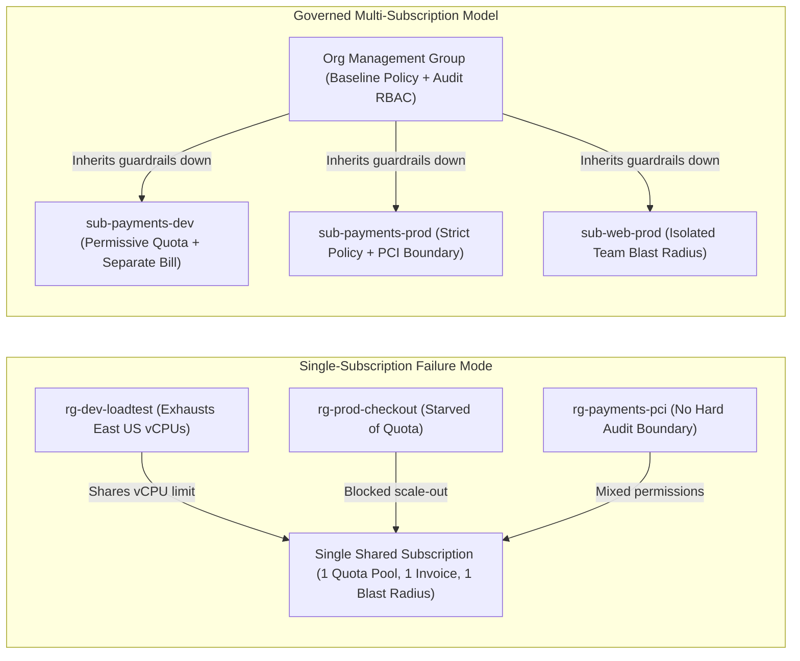
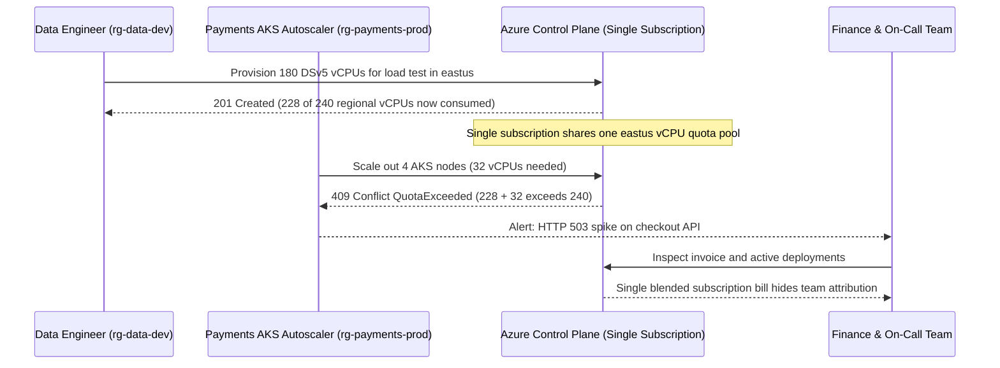

# Governance, and Why Single-Subscription Thinking Breaks Down

> **Prerequisites:** Azure Policy (`11/05`), Azure RBAC and Entra ID fundamentals (`16`), and Terraform modules (`09/04`).  
> **Estimated Reading Time:** 25 minutes  
> **Target Audience:** Backend Engineers, Platform Engineers, Cloud Architects.

> [!TIP]
> **The Golden Rule of Governance at Scale:** Treat the **subscription**—never the resource group—as Azure's true boundary for **billing, quota, and blast-radius isolation**, and apply guardrails **centrally via downward inheritance** so every new environment arrives pre-governed as a platform product rather than hardened by hand.

---

## Why This Matters

For sixteen tracks you have lived inside **one subscription** — one billing boundary, one blast radius, one set of RBAC assignments you could hold in your head. That is the right way to learn, and the wrong way to run a company on Azure. The moment there are multiple teams, multiple environments, real money being allocated to real cost centres, and an auditor asking "prove prod is isolated from dev," the single-subscription model quietly collapses. This module is the *why* before all the *how* — it names the forces that make an organization's Azure footprint fundamentally different from your dev subscription, so the hierarchy, policy, and Terraform patterns in the rest of the track land as solutions to problems you can already see.

---

## 1. Architectural Mental Model: Why One Subscription Collapses

When multiple teams, environments, and regulated workloads share a single subscription, their failure domains, quotas, and invoices fuse together. Moving to a multi-subscription model governed from above separates blast radii while keeping policy consistent through inheritance:



### What "governance" actually means (beyond the buzzword)

Governance is the set of **guardrails and structure** that let many people build in a cloud *without* each of them being able to break, overspend, or mis-secure the whole thing. You have already built individual guardrails: an Azure Policy `Deny` on public storage (track 11 module 05), an RBAC role assignment scoped to a resource group (track 16), a Terraform module that bakes in a safe VNet layout (track 9 module 04). Governance at scale is those same primitives applied **centrally and by default**, so a new team gets the guardrails automatically instead of being trusted to remember them. The shift is from *"I secured my subscription"* to *"every subscription in the org is secured the same way, and I can prove it."* Nothing here is a new Azure service — it's the primitives you know, applied at a level above the subscription.

### The four forces that break one subscription

A single subscription works until one of four organizational realities shows up, and in a real company all four show up at once:

- **Multiple teams.** Two teams in one subscription can see, and often modify, each other's resources. RBAC scoped per-resource-group helps, but the *blast radius* of an Owner assignment, a runaway script, or a bad policy is still the whole subscription. Teams want isolation, not just permissions.
- **Multiple environments.** Dev and prod in the same subscription share a quota, a policy set, and a failure domain. A dev load test that exhausts a regional quota can starve prod. You want dev to be *loud and permissive* and prod to be *quiet and strict* — different policy, different access, ideally a different subscription.
- **Multiple cost centres.** Finance needs to allocate spend to teams, projects, and business units. A single subscription is a single invoice; you can slice it with tags (module 06) but the cleanest allocation boundary Azure offers is the **subscription** itself. "Which team spent this \$40k?" is very hard to answer inside one shared subscription.
- **Compliance boundaries.** A regulated workload (PCI, HIPAA-style data, a data-residency requirement) needs a *provable* boundary: "these resources, under these controls, in these regions, and nothing else touches them." Auditors want a boundary they can point at. A shared subscription full of unrelated dev resources is not that boundary.

Each force independently pushes you toward *more subscriptions* and *a structure above them* to govern the set.

### The subscription is the unit of isolation, quota, and billing

Why not just use resource groups for everything? Because a **subscription** is the boundary Azure itself uses for the things that matter at scale:

- **Billing** — each subscription is a line item / invoice section; it's the natural cost-allocation unit (track 21 builds on this).
- **Quota / limits** — many Azure limits (regional vCPU quota, number of resources of a type) are *per subscription*. Separate subscriptions = separate quota pools, so one team's scale test can't exhaust another's.
- **Isolation** — an Owner on subscription A has no inherent access to subscription B. The subscription is a hard RBAC and policy boundary.

A resource group, by contrast, is an *organizational and lifecycle* grouping *within* a subscription — great for "delete this whole app at once," useless as a billing or quota boundary. So real orgs end up with **many subscriptions**, and immediately need a way to manage them as a set. That "way" is the management group, which module 01 is entirely about.

### Inheritance is the whole point (and the whole danger)

The reason a structure *above* subscriptions is powerful is **inheritance**: apply a policy or a role assignment once, high in the tree, and everything below inherits it. You already saw a two-level version of this — an Azure Policy assigned at *subscription* scope applies to every resource group under it (track 11 module 05), and an RBAC role assigned at a resource group flows to every resource in it (track 16). Management groups extend that to *many levels*: assign the "no public IPs on databases" policy once at the top and every subscription in the org inherits it, forever, including subscriptions created next year. That is enormous leverage — and it means a mistake high in the tree also inherits everywhere. Governance at scale is largely the discipline of using inheritance deliberately: broad guardrails high, specific exceptions low.

### Governance is a platform-team product, not a one-time setup

The last mental shift: at scale, governance is **owned by a platform team** and consumed by application teams as a *product*. The platform team defines the hierarchy, the baseline policies, the landing-zone template a new team gets, and the tagging rules — then application teams request a subscription and receive it *already governed*. This is the Cloud Adoption Framework's central idea (module 02) and it reframes everything in this track: you're not securing resources one at a time, you're building the **paved road** every future team drives on. The rest of the curriculum's platform-engineering tracks (24 especially) assume this framing.

---

## 2. Taxonomic Comparison & Command Reference

### Scope Boundary Comparison Matrix

| Dimension | Resource Group | Subscription | Management Group |
|---|---|---|---|
| **Primary Purpose** | Lifecycle grouping (deploy/delete an app together) | Hard isolation, billing, and regional quota boundary | Hierarchical policy and RBAC inheritance container |
| **Billing / Invoice Boundary** | None (blended into parent subscription invoice) | Native invoice section / line-item boundary | Aggregates costs across descendant subscriptions |
| **Quota & Limit Pool** | Shares parent subscription's vCPU/resource limits | Dedicated regional quota pool per subscription | Does not own quota; governs subscriptions below it |
| **RBAC Blast Radius** | Scoped to RG, but sub-level Owners still reach inside | Hard access wall (Sub A Owner has zero access to Sub B) | Additive downward inheritance across all child subs |
| **Policy Inheritance** | Applies only to resources inside that RG | Flows to all RGs in that single subscription | Flows down up to 6 MG levels to all present/future subs |
| **Compliance Auditability** | Weak when mixed with non-regulated RGs | Strong provable boundary for PCI / HIPAA workloads | Enforces org-wide regulatory baselines uniformly |

### Organizational Forces to Governance Design Matrix

| Force | Failure in Single Subscription | Architectural Resolution |
|---|---|---|
| **Multiple Teams** | Shared subscription Owners can delete or view sibling team RGs | Dedicated subscription per team (or team x env) |
| **Multiple Environments** | Dev load tests consume Prod regional vCPU quotas; mixed policy needs | Separate Dev/Non-Prod and Prod subscriptions with distinct policies |
| **Multiple Cost Centres** | One blended invoice obscures which business unit incurred spend | Map subscriptions to invoice sections + enforce `CostCenter` tags |
| **Compliance Boundaries** | Auditors reject regulated resources sharing scope with sandbox dev RGs | Isolate regulated workload (e.g., Payments-Prod) in its own subscription |

### Command Reference

This module is conceptual, but a few read-only commands let you *see* the current shape of your environment — the "before" picture you'll restructure.

| Command | What it does | Example |
|---|---|---|
| `az account show` | Shows the currently active subscription (your single subscription so far) | `az account show -o table` |
| `az account list` | Lists every subscription your identity can see | `az account list -o table` |
| `az account management-group list` | Lists management groups in the tenant (likely just the root today) | `az account management-group list -o table` |
| `az role assignment list --all` | Shows every RBAC assignment your identity can see, across scopes | `az role assignment list --all -o table` |
| `az group list` | Lists resource groups in the active subscription | `az group list -o table` |
| `az consumption usage list` | Shows usage/cost detail for the subscription (billing boundary made concrete) | `az consumption usage list --top 5 -o table` |

Flag breakdown — `az role assignment list --all --assignee <you> --query "[].{role:roleDefinitionName, scope:scope}" -o table`:

- `--all` — includes assignments inherited from *above* the current subscription (management group / tenant root), not just those defined in it. This is the flag that reveals inheritance you might not know you have.
- `--assignee <you>` — filters to a single principal (your user or an SP); omit to see all assignments you're allowed to read.
- `--query "[].{role:..., scope:...}"` — a JMESPath projection reshaping the output to just the role name and the scope, so you can *see* which scope level each assignment lives at (resource group vs. subscription vs. MG).

---

## 3. Production War Story Post-Mortem: Shared-Subscription Quota Exhaustion & Unattributed Billing Spike

- **Severity:** SEV-1
- **Detection Time:** 18 minutes (Checkout AKS cluster autoscaler failed + HTTP 503 spike)
- **Resolution Time:** 3 hours 40 minutes
- **Impact:** Production checkout could not scale past 12 nodes during a flash sale, dropping 6.4% of checkout requests for 45 minutes. Separately, FinOps discovered \$42,800 in unattributed `Standard_NC24ads_A100_v4` GPU spend on the shared invoice with no clear team owner.

### What Happened

A fast-growing fintech company kept three engineering teams (`Payments`, `Web`, `Data`) and both `dev` and `prod` environments inside a single legacy Azure subscription using separate resource groups (`rg-data-dev`, `rg-payments-prod`, etc.). On Tuesday afternoon, a Data engineer ran a Terraform stress test in `rg-data-dev` requesting 180 DSv5 vCPUs in `eastus`, unaware that the subscription's regional quota ceiling was 240 vCPUs. Minutes later, a marketing campaign triggered autoscaling on `rg-payments-prod`'s AKS cluster. Azure Resource Manager rejected the production VMSS scale-out with `OperationNotAllowed: QuotaExceeded`.



### Root Cause Analysis

1. **Shared Quota Pool:** Resource groups do not isolate Azure regional compute quotas. A non-production load test in `rg-data-dev` consumed the exact quota pool `rg-payments-prod` relied upon for burst scaling.
2. **Subscription-Wide Blast Radius & Missing Billing Isolation:** Several senior engineers held subscription-level `Contributor` permissions to debug cross-team deployments, blurring accountability and preventing automated cost attribution per team on the monthly invoice.

### The Fix & Architectural Hardening

1. **Immediate Mitigation:** Terminated the `rg-data-dev` scale-set deployment to release 180 vCPUs, allowing `rg-payments-prod` AKS nodes to join immediately, and requested an emergency quota bump.
2. **Permanent Architectural Fix:** Decomposed the single subscription into dedicated subscriptions per `(team x environment)` (`sub-payments-prod`, `sub-payments-dev`, `sub-data-dev`, `sub-web-prod`), nested under `mg-prod` and `mg-nonprod` management groups. Each subscription now owns an isolated vCPU quota pool, a separate invoice line item, and strict environment-appropriate Azure Policies.

---

## 4. Multi-Language Production Implementation: Subscription Isolation & Readiness Auditor

Platform teams codify the "four forces" as an automated pre-flight check before onboarding workloads or approving subscription topologies. Each implementation below validates whether a proposed subscription catalog satisfies team isolation, environment separation, cost-centre attribution, compliance boundary isolation, and regional vCPU quota headroom.

````carousel
### Go — Subscription Topology & Force Validator

```go
package governance

import (
	"fmt"
	"strings"
)

type Environment string

const (
	EnvProd    Environment = "prod"
	EnvNonProd Environment = "nonprod"
)

type SubscriptionSpec struct {
	SubscriptionID      string
	Teams               []string
	Environments        []Environment
	CostCentre          string
	ContainsRegulated   bool
	EastUSVCPUUsed      int
	EastUSVCPUQuota     int
}

type Violation struct {
	SubscriptionID string
	Force          string
	Message        string
}

func AuditSubscriptionBoundaries(specs []SubscriptionSpec) []Violation {
	var violations []Violation
	for _, s := range specs {
		if len(s.Teams) != 1 {
			violations = append(violations, Violation{
				SubscriptionID: s.SubscriptionID,
				Force:          "MultipleTeams",
				Message:        fmt.Sprintf("expected 1 team owner, found %d (%s)", len(s.Teams), strings.Join(s.Teams, ",")),
			})
		}
		if len(s.Environments) != 1 {
			violations = append(violations, Violation{
				SubscriptionID: s.SubscriptionID,
				Force:          "MultipleEnvironments",
				Message:        "dev and prod must not share one subscription quota or failure domain",
			})
		}
		if strings.TrimSpace(s.CostCentre) == "" {
			violations = append(violations, Violation{
				SubscriptionID: s.SubscriptionID,
				Force:          "MultipleCostCentres",
				Message:        "missing CostCentre invoice allocation metadata",
			})
		}
		if s.ContainsRegulated && (len(s.Teams) > 1 || len(s.Environments) > 1) {
			violations = append(violations, Violation{
				SubscriptionID: s.SubscriptionID,
				Force:          "ComplianceBoundary",
				Message:        "regulated PCI/HIPAA workload requires an exclusive isolated subscription",
			})
		}
		if s.EastUSVCPUQuota > 0 && float64(s.EastUSVCPUUsed)/float64(s.EastUSVCPUQuota) > 0.80 {
			violations = append(violations, Violation{
				SubscriptionID: s.SubscriptionID,
				Force:          "QuotaHeadroom",
				Message:        fmt.Sprintf("eastus vCPU utilization %d/%d exceeds 80%% safety threshold", s.EastUSVCPUUsed, s.EastUSVCPUQuota),
			})
		}
	}
	return violations
}
```
<!-- slide -->
### TypeScript — Subscription Topology & Force Validator

```typescript
export type Environment = "prod" | "nonprod" | "sandbox";

export interface SubscriptionSpec {
  subscriptionId: string;
  teams: string[];
  environments: Environment[];
  costCentre?: string;
  containsRegulatedWorkload: boolean;
  regionalVcpuUsed: number;
  regionalVcpuQuota: number;
}

export interface GovernanceFinding {
  subscriptionId: string;
  force: "Teams" | "Environments" | "CostCentres" | "Compliance" | "QuotaHeadroom";
  severity: "HIGH" | "CRITICAL";
  detail: string;
}

export function auditSubscriptionForces(specs: SubscriptionSpec[]): GovernanceFinding[] {
  const findings: GovernanceFinding[] = [];

  for (const sub of specs) {
    if (sub.teams.length !== 1) {
      findings.push({
        subscriptionId: sub.subscriptionId,
        force: "Teams",
        severity: "HIGH",
        detail: `Subscription shared by ${sub.teams.length} teams (${sub.teams.join(", ")}); split per team.`,
      });
    }

    if (sub.environments.length !== 1) {
      findings.push({
        subscriptionId: sub.subscriptionId,
        force: "Environments",
        severity: "CRITICAL",
        detail: `Mixed environments (${sub.environments.join(", ")}) share one failure domain and quota pool.`,
      });
    }

    if (!sub.costCentre?.trim()) {
      findings.push({
        subscriptionId: sub.subscriptionId,
        force: "CostCentres",
        severity: "HIGH",
        detail: "Subscription lacks a CostCentre invoice tag for chargeback attribution.",
      });
    }

    if (sub.containsRegulatedWorkload && (sub.teams.length > 1 || sub.environments[0] !== "prod")) {
      findings.push({
        subscriptionId: sub.subscriptionId,
        force: "Compliance",
        severity: "CRITICAL",
        detail: "Regulated workload must reside in a dedicated production-only subscription boundary.",
      });
    }

    const utilization = sub.regionalVcpuQuota > 0 ? sub.regionalVcpuUsed / sub.regionalVcpuQuota : 0;
    if (utilization > 0.8) {
      findings.push({
        subscriptionId: sub.subscriptionId,
        force: "QuotaHeadroom",
        severity: "HIGH",
        detail: `Quota utilization ${(utilization * 100).toFixed(1)}% threatens autoscale headroom.`,
      });
    }
  }

  return findings;
}
```
<!-- slide -->
### Python — Subscription Topology & Force Validator

```python
from dataclasses import dataclass
from typing import List


@dataclass(frozen=True)
class SubscriptionSpec:
    subscription_id: str
    teams: List[str]
    environments: List[str]
    cost_centre: str
    contains_regulated: bool
    vcpu_used: int
    vcpu_quota: int


@dataclass(frozen=True)
class BoundaryViolation:
    subscription_id: str
    force: str
    reason: str


def validate_subscription_boundaries(specs: List[SubscriptionSpec]) -> List[BoundaryViolation]:
    violations: List[BoundaryViolation] = []

    for sub in specs:
        if len(sub.teams) != 1:
            violations.append(BoundaryViolation(
                sub.subscription_id,
                "MultipleTeams",
                f"Expected 1 owning team, found {sub.teams}",
            ))
        if len(sub.environments) != 1:
            violations.append(BoundaryViolation(
                sub.subscription_id,
                "MultipleEnvironments",
                f"Environments {sub.environments} share one quota and policy boundary",
            ))
        if not sub.cost_centre.strip():
            violations.append(BoundaryViolation(
                sub.subscription_id,
                "MultipleCostCentres",
                "Missing CostCentre mapping for subscription billing line item",
            ))
        if sub.contains_regulated and (len(sub.teams) > 1 or len(sub.environments) > 1):
            violations.append(BoundaryViolation(
                sub.subscription_id,
                "ComplianceBoundary",
                "Regulated workload requires an exclusive single-team single-env subscription",
            ))
        if sub.vcpu_quota > 0 and (sub.vcpu_used / sub.vcpu_quota) > 0.80:
            violations.append(BoundaryViolation(
                sub.subscription_id,
                "QuotaHeadroom",
                f"vCPU usage {sub.vcpu_used}/{sub.vcpu_quota} exceeds 80% threshold",
            ))

    return violations
```
<!-- slide -->
### C# — Subscription Topology & Force Validator

```csharp
using System;
using System.Collections.Generic;

namespace Governance.Audit;

public sealed record SubscriptionSpec(
    string SubscriptionId,
    IReadOnlyList<string> Teams,
    IReadOnlyList<string> Environments,
    string? CostCentre,
    bool ContainsRegulatedWorkload,
    int RegionalVcpuUsed,
    int RegionalVcpuQuota);

public sealed record BoundaryViolation(string SubscriptionId, string Force, string Reason);

public static class SubscriptionBoundaryValidator
{
    public static IReadOnlyList<BoundaryViolation> Validate(IEnumerable<SubscriptionSpec> specs)
    {
        var findings = new List<BoundaryViolation>();

        foreach (var sub in specs)
        {
            if (sub.Teams.Count != 1)
            {
                findings.Add(new BoundaryViolation(
                    sub.SubscriptionId,
                    "MultipleTeams",
                    $"Shared across {sub.Teams.Count} teams; isolate each team into its own subscription."));
            }

            if (sub.Environments.Count != 1)
            {
                findings.Add(new BoundaryViolation(
                    sub.SubscriptionId,
                    "MultipleEnvironments",
                    "Dev and Prod cannot share a regional quota pool or policy boundary."));
            }

            if (string.IsNullOrWhiteSpace(sub.CostCentre))
            {
                findings.Add(new BoundaryViolation(
                    sub.SubscriptionId,
                    "MultipleCostCentres",
                    "Missing CostCentre billing attribution metadata."));
            }

            if (sub.ContainsRegulatedWorkload && (sub.Teams.Count > 1 || sub.Environments.Count > 1))
            {
                findings.Add(new BoundaryViolation(
                    sub.SubscriptionId,
                    "ComplianceBoundary",
                    "Regulated workloads must live in an unshared production subscription."));
            }

            if (sub.RegionalVcpuQuota > 0 && (double)sub.RegionalVcpuUsed / sub.RegionalVcpuQuota > 0.80)
            {
                findings.Add(new BoundaryViolation(
                    sub.SubscriptionId,
                    "QuotaHeadroom",
                    $"vCPU utilization ({sub.RegionalVcpuUsed}/{sub.RegionalVcpuQuota}) exceeds 80% safe limit."));
            }
        }

        return findings;
    }
}
```
````

---

## 5. Practical Hands-On Verification CLI Workflows

These are **read-only and free** — you're surveying your current world, not changing it. Nothing here bills.

### 1. (Azure) Confirm you really are in one subscription

```bash
az account list -o table
az account show --query "{name:name, id:id, tenant:tenantId}" -o table
```

**Expected Output:**
```text
Name                       CloudName    SubscriptionId                        State    IsDefault
-------------------------  -----------  ------------------------------------  -------  -----------
Azure subscription 1       AzureCloud   11111111-2222-3333-4444-555555555555  Enabled  True

Name                  Id                                    Tenant
--------------------  ------------------------------------  ------------------------------------
Azure subscription 1  11111111-2222-3333-4444-555555555555  aaaaaaaa-bbbb-cccc-dddd-eeeeeeeeeeee
```

Note how many subscriptions you can see. For most learners it's one — that single subscription is the entire world this curriculum has used. Write down its ID; you'll place it under a management group in module 01.

### 2. (Azure) See the (empty) hierarchy above you

```bash
az account management-group list -o table
```

**Expected Output:**
```text
DisplayName        Name                                  TenantId
-----------------  ------------------------------------  ------------------------------------
Tenant Root Group  aaaaaaaa-bbbb-cccc-dddd-eeeeeeeeeeee  aaaaaaaa-bbbb-cccc-dddd-eeeeeeeeeeee
```

Expect either nothing, or just the **tenant root group** (its name is your tenant ID). That root is the invisible top of every Azure hierarchy — your subscription already hangs off it, you've just never looked up. This is the tree module 01 fills in.

### 3. (Azure) Inventory the "teams" collision inside one subscription

List your resource groups and imagine they belonged to different teams:

```bash
az group list --query "[].{name:name, location:location}" -o table
```

**Expected Output:**
```text
Name                  Location
--------------------  ----------
rg-aks-lab            eastus
rg-storage-demo       westus2
NetworkWatcherRG      eastus
```

For each, ask: *if this were team A's and that were team B's, what stops team A's Owner from deleting team B's resource group?* (Answer: within one subscription, often nothing but convention.) This is the multiple-teams force made concrete.

### 4. (Azure) Find your inherited RBAC

```bash
az role assignment list --all --assignee "$(az account show --query user.name -o tsv)" \
  --query "[].{role:roleDefinitionName, scope:scope}" -o table
```

**Expected Output:**
```text
Role                       Scope
-------------------------  ---------------------------------------------------
Owner                      /subscriptions/11111111-2222-3333-4444-555555555555
```

Look at the `scope` column. Most assignments will be at the subscription scope (`/subscriptions/<id>`) — meaning they flow *down* to every resource group. Note that today you have no scopes *above* the subscription; module 01 adds a management-group scope you can assign at.

### 5. (Azure) Make the billing boundary concrete

```bash
az consumption usage list --top 5 --query "[].{resource:instanceName, cost:pretaxCost, meter:meterId}" -o table 2>/dev/null || echo "consumption API may be unavailable on some subscription types — that's fine"
```

**Expected Output:**
```text
Resource              Cost     Meter
--------------------  -------  ------------------------------------
sa-backend-logs       0.42     c4d6e8f0-1234-5678-9abc-def012345678
vmss-aks-nodepool     18.75    a1b2c3d4-5678-90ef-1234-567890abcdef
```

Whatever this shows (or doesn't), the key realization: this is **one invoice**. Every team, environment, and project you might have is blended into this single bill. That blending is the multiple-cost-centres force — and it's exactly what a subscription-per-team split (and the tags in module 06) untangles.

### 6. (Reflection, written) Design pressure test — no commands

In a scratch file, write down, for *your own* imagined org (invent 3 teams and dev/prod), how many subscriptions you'd want and why, using the four forces as headings. Don't design the hierarchy yet (that's module 01) — just justify the *count*. Keep this note; module 01 asks you to turn it into a tree and the capstone asks you to defend it.

### 7. (Reflection, written) Map the guardrails you already have

List three specific guardrails you built earlier in the curriculum (e.g. the track 11 module 05 public-storage `Deny`, a track 16 RBAC assignment, a track 9 Terraform module baking in a VNet). For each, write one sentence on what would change if it had to apply to *fifty* subscriptions instead of one. This is the exact gap the rest of the track closes.

### Independent Challenge

No commands — this is a design-thinking task drawing on this module plus track 11 module 05 (policy/scope/effects) and track 16 (RBAC and role scope). Imagine you've just been handed the platform-team role at a company with three product teams (Payments, Web, Data), each needing a dev and a prod environment, where Payments is under a PCI-style compliance obligation and must be provably isolated. In one page of prose, argue **how many subscriptions** you'd create and **why**, mapping each of the four forces (teams, environments, cost centres, compliance) to a concrete grouping decision. Then name **two specific guardrails** from earlier tracks you'd want applied to *every* subscription automatically, and **one** you'd want applied *only* to the Payments prod boundary — and explain, using the inheritance idea from this module, at what level of a not-yet-designed hierarchy each would have to be attached to get that behaviour. Do not design the tree itself; the point is to reason from the forces to the requirements.

<details>
<summary>Stuck? One hint</summary>

Start from the compliance force because it's the hardest constraint: PCI "provably isolated" almost forces Payments-prod into its **own subscription** with nothing else in it, so the auditor has a clean boundary to point at. Then apply the environments force (dev vs prod differ in policy strictness -> separate subscriptions per environment) and the teams force (blast-radius isolation -> separate per team), and you'll land around one subscription per (team x environment), roughly six, plus shared platform ones later. The "every subscription" guardrails are the broad ones (allowed regions, no public storage) that belong *high* in a hierarchy so all subscriptions inherit them; the Payments-prod-only one (e.g. a stricter PCI initiative) belongs *low*, on just that boundary — which is exactly the "broad high, specific low" inheritance discipline this module ends on.

</details>

---

## 6. Common Mistakes & Troubleshooting

- **Assuming resource groups are enough isolation.** They organize resources and scope RBAC, but they share a subscription's quota, billing, and ultimate blast radius. For team/environment/compliance isolation you want *subscriptions*, grouped by *management groups* — resource groups are the wrong tool for that job.
- **Treating governance as a one-time hardening pass.** At scale it's an ongoing product: new subscriptions and teams appear continuously, and they must be governed *by default* (inheritance), not hardened by hand after the fact.
- **Confusing "I can restrict access" with "I can allocate cost."** RBAC controls *who can do what*; it does nothing for *whose budget paid for it*. Cost allocation wants subscription boundaries and tags (module 06), a separate axis from permissions.
- **Forgetting the tenant root already exists.** You don't build a hierarchy from nothing — every subscription already hangs off the tenant root management group. Module 01 fills in the middle; it doesn't create the top.
- **Designing the hierarchy before understanding the forces.** A tree that looks tidy but doesn't map to real teams/environments/compliance boundaries will fight you forever. Forces first (this module), tree second (module 01).

---

## 7. Operational Validation Checkpoints

<details>
<summary><strong>Checkpoint 1: Production AKS Scale-Out Failure During Dev Load Test</strong></summary>

**Scenario:** Your Data Science team runs a burst load test in `rg-ml-dev`, spinning up 40 D16s_v5 VMs in `westus2`. Ten minutes later, your Production Payments AKS cluster in `rg-payments-prod` fails to autoscale, logging `QuotaExceeded` errors. Both resource groups sit inside the same subscription, and both teams have `Contributor` only on their own resource groups.

**Question:** Why did resource-group RBAC fail to protect Production, and what architectural boundary change fixes this permanently?

**Answer:** Resource-group RBAC only governs who can invoke ARM actions inside each RG; it does **not** isolate subscription-level regional vCPU quotas or billing. Because `rg-ml-dev` and `rg-payments-prod` share one subscription, they draw from a single `westus2` vCPU quota pool. Separating Dev and Prod into **different subscriptions** creates hard per-subscription quota pools and isolated failure domains.

</details>

<details>
<summary><strong>Checkpoint 2: Proving PCI Scope to an External Auditor</strong></summary>

**Scenario:** An external QSA auditor asks your platform lead to prove that non-PCI developer sandboxes cannot reach, alter, or exhaust resources belonging to the cardholder data environment (CDE). Currently, `rg-cde-prod` sits alongside `rg-marketing-dev` in `sub-company-main`, where three platform engineers hold subscription-level `Owner`.

**Question:** Why will the auditor reject this topology, and how should the subscription boundary and inheritance model be redesigned?

**Answer:** Subscription-level `Owner` inherits down to every resource group inside `sub-company-main`, meaning engineers with access for marketing or general ops automatically hold full control over `rg-cde-prod`, and any subscription-level policy or quota change affects both. The fix is placing the CDE workload in its own dedicated **`sub-payments-pci-prod` subscription**, scoping strict PCI policies and minimal RBAC directly to that boundary while inheriting org-wide rules (e.g., allowed regions) from the parent management group.

</details>

<details>
<summary><strong>Checkpoint 3: Unstoppable Root-Level Policy Mistake</strong></summary>

**Scenario:** An engineer wants to enforce "Deny Public IP addresses" for production databases and accidentally assigns the `Deny` policy at the Tenant Root Management Group instead of waiting to create a `Production` branch. Within 15 minutes, developers in sandbox environments and network engineers deploying a hub firewall gateway report deployment blocks.

**Question:** Which property of governance inheritance caused this org-wide outage, and what rule prevents it?

**Answer:** Governance inheritance flows **downward to every descendant scope**, including current and future subscriptions beneath the assignment node. Applying a strict `Deny` at the highest node affects every workload indiscriminately. Following **"broad high, specific low"** keeps universal safety baselines at the top and scopes workload- or environment-specific restrictions to dedicated lower management groups or subscriptions.

</details>

### Checkpoint Quiz (Self-Check)

Write down your answer to each question before expanding it — checking without attempting first is the single easiest way to fool yourself into thinking you've learned this.

<details>
<summary>Show questions</summary>

1. Name the four organizational forces that make a single subscription stop working, and give a one-line reason each pushes toward more subscriptions.
2. Why is a subscription — not a resource group — the natural unit of billing, quota, and isolation?
3. What is "inheritance" in this context, and why is it described as both the whole point and the whole danger of a hierarchy?
4. You already built individual guardrails in earlier tracks. In one sentence, what does "governance at scale" change about *how* those guardrails are applied?
5. Why can't RBAC alone solve the cost-centre problem?
6. What does it mean to say governance is "a platform-team product, not a one-time setup"?

</details>

<details>
<summary>Show answers</summary>

1. **Multiple teams** (blast-radius/isolation between teams within one subscription is weak); **multiple environments** (dev and prod want different policy/access/quota and shouldn't share a failure domain); **multiple cost centres** (a subscription is one invoice, so shared subscriptions blur who spent what); **compliance boundaries** (regulated workloads need a provable, isolated boundary an auditor can point at). Each pushes toward separate subscriptions.
2. Azure itself uses the subscription as the boundary for billing (one invoice/line item), quota/limits (many limits are per-subscription), and isolation (RBAC/policy don't cross subscriptions by default). A resource group is only a lifecycle/organizational grouping *within* a subscription and shares all of those.
3. Inheritance = a policy or role assignment applied high in the tree flows down to everything beneath it. It's the whole point because it lets you govern every current *and future* subscription with one assignment; it's the whole danger because a mistake high in the tree inherits everywhere too.
4. It applies them **centrally and by default** (via inheritance from above the subscription) so every team gets them automatically and provably, rather than each subscription being hardened by hand.
5. RBAC governs *who can do what*, not *whose budget paid for it*. Cost allocation needs billing boundaries (subscriptions) and tags, which is an orthogonal axis to permissions.
6. It means the platform team defines and owns the hierarchy, baseline policies, landing-zone templates, and tagging rules as an ongoing offering, and application teams *consume* a pre-governed subscription — versus a one-and-done hardening that new teams and subscriptions would immediately escape.

</details>

---

## Sources & Further Reading

- [Azure Subscriptions, Management Groups, and Resource Organization](https://learn.microsoft.com/en-us/azure/cloud-adoption-framework/ready/azure-setup-guide/organize-resources) — Microsoft Cloud Adoption Framework
- [Azure Subscription and Service Limits, Quotas, and Constraints](https://learn.microsoft.com/en-us/azure/azure-resource-manager/management/azure-subscription-service-limits) — Microsoft Learn

## Next

Continue to [01-management-groups-and-subscription-hierarchy](../01-management-groups-and-subscription-hierarchy/README.md) — you've seen *why* one subscription breaks down; now build the tree that sits above subscriptions and makes inheritance real.
