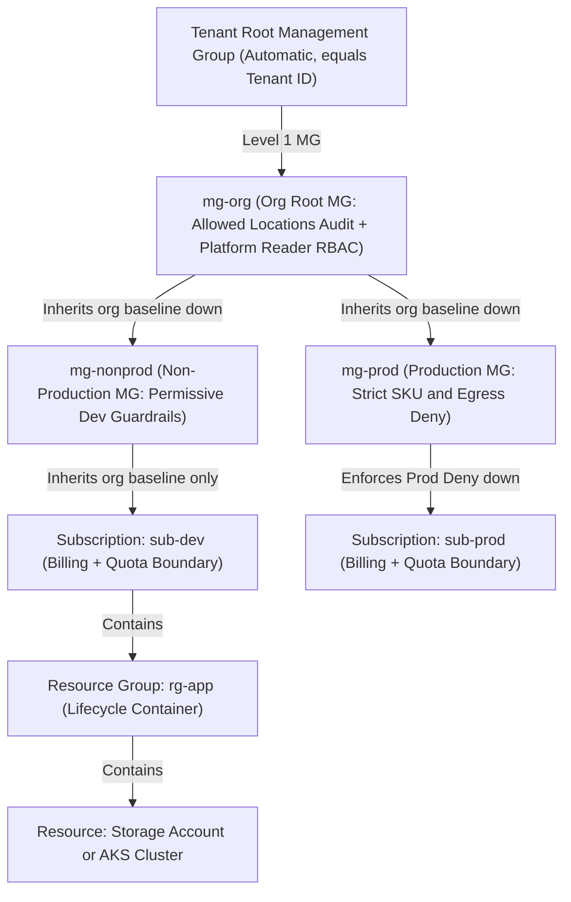
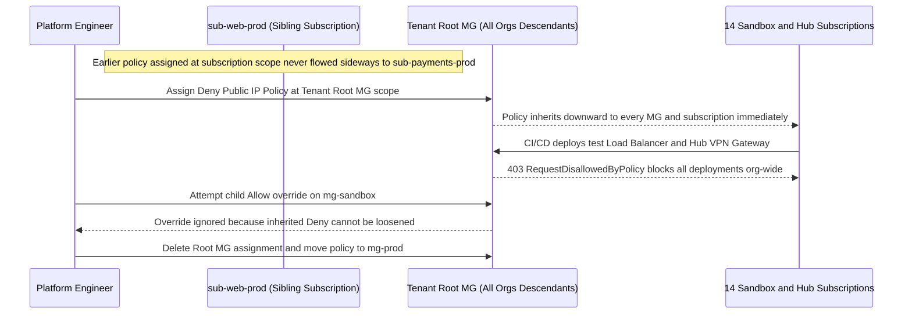

# Management Groups and Subscription Hierarchy

> **Prerequisites:** Why single-subscription thinking breaks down (Module 00), Azure Policy scope & effects (`11/05`), and Azure RBAC assignments (`16`).  
> **Estimated Reading Time:** 35 minutes  
> **Target Audience:** Backend Engineers, Platform Engineers, Cloud Architects.

> [!TIP]
> **The Golden Rule of Management Groups:** Keep your hierarchy **shallow and purposeful (2–4 levels)** aligned to your strictest policy axis, remember that **inheritance flows strictly downward** (`Deny` policies are non-overridable while RBAC is additive), and fix missing coverage by assigning **at a higher common ancestor** rather than duplicating on siblings.

---

## Why This Matters

Module 00 argued that a real org needs *many subscriptions* and *a structure above them*. **Management groups** are that structure: a tree whose leaves are subscriptions and whose nodes let you assign policy and RBAC once and have them inherit downward. This is the single most load-bearing concept in the whole track — initiatives (module 03), landing zones (module 02), and the capstone all attach to a management-group hierarchy. Get the tree right and governance becomes "assign once, inherit everywhere"; get it wrong and you'll fight scope mismatches forever. This module builds a real (small) hierarchy in your tenant and proves inheritance with your own eyes.

---

## 1. Architectural Mental Model: Scope Ladder & Downward Inheritance

Azure organizes every governable entity into a strict five-level scope tree (with up to six custom management group levels nested beneath the automatic Tenant Root Group). Assignments always inherit downward and never sideways between siblings:



### The tree: tenant root -> management groups -> subscriptions -> RGs -> resources

Every Azure tenant has a single **tenant root management group** at the top (you saw it, empty, in module 00). Beneath it you can nest **management groups** up to six levels deep, and at the bottom of any branch you place **subscriptions**. Below each subscription are the resource groups and resources you already know. So the full scope ladder, top to bottom, is:

```text
Tenant Root Management Group        (one, automatic, = your tenant ID)
└─ Management Group                 (you create these; up to 6 levels)
   └─ Management Group
      └─ Subscription               (the leaf; billing/quota/isolation unit)
         └─ Resource Group          (track 9's grouping)
            └─ Resource             (a storage account, an AKS cluster...)
```

Each of these five levels is a **scope** you can assign policy and RBAC at — and this is the same `scope` concept from track 11 module 05 and track 16, now with three more levels above the subscription. A subscription lives under *exactly one* management group at a time (you can move it), and a management group lives under exactly one parent. It's a strict tree, not a graph.

### Inheritance flows down, and only down

An assignment at any node applies to **everything beneath it** and nothing above or beside it. Assign the "allowed locations = `[eastus, westus]`" policy at a management group and every subscription, resource group, and resource under that MG inherits it — *including subscriptions you add to that MG next year*. This is precisely the subscription-scope inheritance you saw in track 11 module 05 ("assign at subscription level and every resource group inherits it"), extended upward: now you can assign *above* the subscription so multiple subscriptions inherit at once.

Inheritance is **cumulative and non-overridable for `Deny`**: a `Deny` inherited from a grandparent MG cannot be "un-denied" by a child — the most restrictive wins (with a narrow escape hatch, *exemptions*, which module 03 covers). RBAC inheritance is **additive**: a role granted at an MG is granted on everything under it, and lower-scope grants only *add* permissions, they never subtract. Remembering "down, only down, most-restrictive-`Deny`-wins, additive-RBAC" prevents most scope confusion.

### Two hierarchy shapes: by org chart vs. by environment

The big design question is *what the intermediate management groups represent*. Two archetypes:

- **By org chart / business unit** — MGs mirror the company: `Payments`, `Web`, `Data`, each containing that team's subscriptions. Good when teams are the primary axis of ownership, budget, and access. Weakness: dev and prod for a team sit together, so "prod is stricter than dev" needs per-subscription policy rather than a clean MG boundary.
- **By environment** — top-level MGs are `Production`, `Non-Production`, `Sandbox`, each containing every team's subscription of that environment. Good when the *strictest* differences are environmental (prod policy vs. dev policy), which is very common. Weakness: a single team's resources are spread across MGs, complicating team-level budget/access.

Real hierarchies **combine both axes** — e.g. environment at the top, business unit beneath, or vice versa — and the Cloud Adoption Framework (module 02) has a specific opinionated shape (Platform / Landing Zones / Sandbox / Decommissioned) you'll meet next. There is no single right tree; there's the tree that matches *how your org actually allocates policy, budget, and access*. Design for the axis whose differences are strictest and hardest to express per-subscription.

### The hierarchy is for governance, not for everything

A crucial discipline: management groups are for **policy and RBAC inheritance**, not for modelling every organizational nuance. Resist the urge to build a deep, elaborate tree that mirrors your full org chart with ten levels — every level is a place governance can be attached and therefore a place a future engineer must *check* when debugging why a policy applies. Keep it **shallow and purposeful**: a level exists because you need to attach a distinct set of guardrails there. Two-to-four meaningful levels covers almost every real org. Depth is a cost (more scopes to reason about), not a feature.

### Moving subscriptions and the "management group scope" string

Subscriptions aren't nailed down — you **move** a subscription from one MG to another, and it instantly picks up the new parent's inherited policy/RBAC and drops the old. This is how a subscription gets "promoted" from a sandbox MG to a governed landing-zone MG. Every management group also has a **scope string** you'll use constantly for assignments: `/providers/Microsoft.Management/managementGroups/<mg-id>`. This is the exact analogue of the `/subscriptions/<id>` and `/subscriptions/<id>/resourceGroups/<rg>` scope strings you used in track 11 module 05 — just the level above. Every `az policy assignment create --scope` and every RBAC assignment you make at MG level uses this form.

---

## 2. Taxonomic Comparison & Command Reference

### Hierarchy Design Axis Comparison

| Hierarchy Shape | Top-Level Split | Primary Strength | Primary Weakness | Best Fit |
|---|---|---|---|---|
| **Org Chart / Business Unit** | `Payments`, `Web`, `Data` | Clean team ownership, cost-centre alignment, and team RBAC | Dev and Prod sit together; requires per-sub prod policy | Autonomous divisions with identical compliance baselines |
| **Environment-First** | `Production`, `Non-Production`, `Sandbox` | Clean `prod` vs `dev` policy strictness at MG boundaries | One team's subscriptions scatter across branches | Organizations prioritizing strict environment controls |
| **Combined (Hybrid)** | `Prod` / `NonProd` -> Team MGs (or CAF Platform / Landing Zones) | Separates both policy strictness and team/compliance isolation | Slightly deeper tree (3–4 levels) | Multi-team orgs with regulated workloads (e.g., PCI) |

### Inheritance Mechanics by Governance Primitive

| Primitive | Inheritance Direction | Child Override Behaviour | Moving Subscription Impact |
|---|---|---|---|
| **Azure Policy (`Deny`)** | Strictly downward | Non-overridable (most restrictive wins; requires explicit exemption) | Immediately swaps old ancestor denials for new parent denials |
| **Azure Policy (`Audit`)** | Strictly downward | Non-overridable (evaluations accumulate across all ancestor rules) | Next evaluation cycle scores against new parent policies |
| **Azure RBAC Role** | Strictly downward | Strictly additive (lower scope can add permissions, never subtract) | Old MG-inherited roles disappear; new MG roles take effect |

### Command Reference

| Command | What it does | Example |
|---|---|---|
| `az account management-group list` | Lists management groups in the tenant | `az account management-group list -o table` |
| `az account management-group create` | Creates a management group under the root (or a parent) | see breakdown below |
| `az account management-group show` | Shows an MG, optionally with its descendants | `az account management-group show -n mg-org --expand --recurse -o json` |
| `az account management-group subscription add` | Moves a subscription under a management group | see breakdown below |
| `az account management-group subscription remove` | Removes a subscription from an MG (returns it toward root) | `az account management-group subscription remove -n mg-dev --subscription <sub-id>` |
| `az account management-group delete` | Deletes an MG (must be empty of child MGs/subscriptions first) | `az account management-group delete -n mg-dev` |
| `az role assignment create --scope <mg-scope>` | Assigns an RBAC role at management-group scope (inherits down) | see breakdown below |
| `az policy assignment create --scope <mg-scope>` | Assigns a policy/initiative at MG scope (module 03 uses this) | `az policy assignment create --name loc --policy <def> --scope /providers/Microsoft.Management/managementGroups/mg-org` |

Flag breakdown — `az account management-group create --name mg-payments --display-name "Payments" --parent mg-org`:

- `--name mg-payments` — the **immutable ID** of the MG (used in scope strings and every reference). Choose a stable, kebab-ish id; you can't rename it later, only the display name.
- `--display-name "Payments"` — the human-friendly name shown in the portal; this one *is* changeable.
- `--parent mg-org` — the parent MG's **id** (or full scope string). Omit `--parent` and the new MG is created directly under the **tenant root** group.

Flag breakdown — `az account management-group subscription add --name mg-dev --subscription <sub-id>`:

- `--name mg-dev` — the **destination** management group id the subscription will hang under.
- `--subscription <sub-id>` — the subscription's GUID to move. After this, the subscription inherits everything assigned on `mg-dev` and its ancestors. A subscription is under exactly one MG, so this *moves* it (removing it from its previous parent), it doesn't add a second parent.

Flag breakdown — `az role assignment create --assignee <principal> --role Reader --scope /providers/Microsoft.Management/managementGroups/mg-org`:

- `--assignee <principal>` — the user/group/SP object id or sign-in name (the same principals from track 16).
- `--role Reader` — the role definition; granted on **everything** under `mg-org` by inheritance (every subscription, RG, resource beneath it).
- `--scope /providers/Microsoft.Management/managementGroups/mg-org` — the **management-group scope string**. This is the new, higher scope level this track unlocks; contrast with track 16's `/subscriptions/<id>` scope.

Terraform equivalent — an MG hierarchy plus an MG-scoped role assignment in HCL (builds on track 9):

```hcl
resource "azurerm_management_group" "org" {
  display_name = "Contoso Platform Org"
  # no parent_management_group_id => created under the tenant root group
}

resource "azurerm_management_group" "prod" {
  display_name               = "Production"
  parent_management_group_id = azurerm_management_group.org.id
}

resource "azurerm_management_group" "nonprod" {
  display_name               = "Non-Production"
  parent_management_group_id = azurerm_management_group.org.id
  subscription_ids           = [var.dev_subscription_id]  # place a sub under this MG
}

resource "azurerm_role_assignment" "platform_readers" {
  scope                = azurerm_management_group.org.id   # inherits to every sub below
  role_definition_name = "Reader"
  principal_id         = var.platform_team_group_object_id
}
```

- `azurerm_management_group.org` with no `parent_management_group_id` -> created under the tenant root, exactly like omitting `--parent` in the CLI.
- `parent_management_group_id = azurerm_management_group.prod`'s parent wiring is a **reference**, not a string — this is the same dependency-ordering reference pattern from track 9 module 04 (the network/subnet wiring), so Terraform creates `org` before `prod`.
- `subscription_ids` on an MG resource is the declarative form of `az account management-group subscription add` — Terraform will *move* the listed subscription under that MG.
- The `azurerm_role_assignment.scope` set to an MG id is the HCL form of the MG-scoped `az role assignment create` above.

---

## 3. Production War Story Post-Mortem: Sideways Sibling Policy Gap & Accidental Root `Deny`

- **Severity:** SEV-1
- **Detection Time:** 11 minutes (automated CI/CD pipelines across 14 unrelated subscriptions started failing with `RequestDisallowedByPolicy`)
- **Resolution Time:** 1 hour 50 minutes
- **Impact:** All Sandbox, Data, and Connectivity deployments across 14 subscriptions were blocked for 68 minutes after an engineer attempted to close a sibling-scope inheritance gap by assigning a strict `Deny` policy directly onto the Tenant Root Management Group.

### What Happened

A platform engineer discovered that a newly provisioned `sub-payments-prod` subscription was missing the company's "Deny Public IP Addresses" guardrail. Checking the older `sub-web-prod` subscription, the engineer saw the policy had originally been assigned directly at `/subscriptions/<sub-web-prod>` rather than on their shared `mg-prod` parent—leaving sibling `sub-payments-prod` completely uncovered. Attempting an urgent fix during an incident bridge, the engineer ran `az policy assignment create` with `Deny` mode, omitting the `mg-prod` segment and targeting the Tenant Root Management Group instead.



### Root Cause Analysis

1. **Sideways Assumption:** The original `Deny Public IP` policy was assigned to a single subscription (`sub-web-prod`). Because inheritance only flows downward, sibling `sub-payments-prod` never received it.
2. **Non-Overridable High-Scope `Deny`:** Assigning the `Deny` rule at the Tenant Root MG propagated downward to every branch, including `mg-sandbox` and `mg-connectivity` (which legitimately require public IPs for VPN gateways). Trying to assign a permissive child policy failed because `Deny` inheritance is cumulative and non-overridable.

### The Fix & Architectural Hardening

1. **Immediate Mitigation:** Deleted the Tenant Root policy assignment and recreated it strictly at `/providers/Microsoft.Management/managementGroups/mg-prod` (and excluded `mg-connectivity`).
2. **Permanent Architectural Fix:** Enabled Tenant Root hierarchy protection (`--require-authorization-for-group-creation true`), banned direct `Deny` assignments on Tenant Root via CI/CD OPA/Conftest policy validation, and automated an inheritance tree auditor verifying all environment guardrails attach at `mg-org` (`Audit`) or `mg-prod` (`Deny`).

---

## 4. Multi-Language Production Implementation: ARM Management Group Hierarchy & Inheritance Validator

Before Terraform or Bicep applies management group changes, platform CI pipelines validate the tree structure against Azure's 6-level nesting ceiling, strict single-parent acyclic tree invariants, valid `/providers/Microsoft.Management/managementGroups/<id>` scope formatting, and compute effective inherited `Deny` policies and additive RBAC roles at any target subscription.

````carousel
### Go — ARM Management Group Hierarchy Validator

```go
package hierarchy

import (
	"fmt"
	"strings"
)

const (
	MaxAzureMGDepth    = 6 // Azure hard limit excluding Tenant Root and Subscriptions
	RecommendedMaxDepth = 4 // Platform engineering shallow-tree ceiling
	MGScopePrefix      = "/providers/Microsoft.Management/managementGroups/"
)

type ManagementGroup struct {
	ID            string
	ParentID      string // Empty means child of Tenant Root
	DenyPolicies  []string
	RBACBindings  []string
}

type ValidationReport struct {
	Errors         []string
	Warnings       []string
	EffectiveDenys []string
	EffectiveRBAC  []string
}

func ValidateAndResolve(tree map[string]ManagementGroup, targetMG string) ValidationReport {
	var report ValidationReport

	for id, mg := range tree {
		if strings.Contains(id, " ") || id == "" {
			report.Errors = append(report.Errors, fmt.Sprintf("invalid immutable MG id %q", id))
		}
		if mg.ParentID != "" {
			if _, ok := tree[mg.ParentID]; !ok {
				report.Errors = append(report.Errors, fmt.Sprintf("MG %q references missing parent %q", id, mg.ParentID))
			}
		}
	}

	// Walk upward from targetMG to detect cycles, check depth, and collect downward inheritance
	visited := make(map[string]bool)
	var chain []ManagementGroup
	curr := targetMG
	for curr != "" {
		if visited[curr] {
			report.Errors = append(report.Errors, fmt.Sprintf("cycle detected at management group %q", curr))
			break
		}
		visited[curr] = true
		node, ok := tree[curr]
		if !ok {
			report.Errors = append(report.Errors, fmt.Sprintf("target MG %q not found in hierarchy", curr))
			break
		}
		chain = append(chain, node)
		curr = node.ParentID
	}

	depth := len(chain)
	if depth > MaxAzureMGDepth {
		report.Errors = append(report.Errors, fmt.Sprintf("depth %d exceeds Azure hard limit of %d MG levels", depth, MaxAzureMGDepth))
	} else if depth > RecommendedMaxDepth {
		report.Warnings = append(report.Warnings, fmt.Sprintf("depth %d exceeds recommended shallow depth (%d levels)", depth, RecommendedMaxDepth))
	}

	// Accumulate top-down: Deny is cumulative/non-overridable; RBAC is additive
	for i := len(chain) - 1; i >= 0; i-- {
		report.EffectiveDenys = append(report.EffectiveDenys, chain[i].DenyPolicies...)
		report.EffectiveRBAC = append(report.EffectiveRBAC, chain[i].RBACBindings...)
	}
	return report
}

func FormatMGScope(mgID string) string {
	return MGScopePrefix + mgID
}
```
<!-- slide -->
### TypeScript — ARM Management Group Hierarchy Validator

```typescript
export const MAX_AZURE_MG_DEPTH = 6;
export const RECOMMENDED_MAX_DEPTH = 4;

export interface ManagementGroupNode {
  id: string;
  displayName: string;
  parentId?: string;
  denyPolicies: string[];
  rbacRoles: string[];
}

export interface InheritanceResolution {
  scopeString: string;
  depth: number;
  errors: string[];
  warnings: string[];
  effectiveDenyPolicies: string[];
  effectiveRbacRoles: string[];
}

export function validateAndResolveHierarchy(
  nodes: Record<string, ManagementGroupNode>,
  targetMgId: string
): InheritanceResolution {
  const errors: string[] = [];
  const warnings: string[] = [];
  const visited = new Set<string>();
  const lineage: ManagementGroupNode[] = [];

  for (const node of Object.values(nodes)) {
    if (!/^[a-zA-Z0-9._()-]+$/.test(node.id)) {
      errors.push(`Invalid immutable MG id '${node.id}' for ARM scope path.`);
    }
    if (node.parentId && !nodes[node.parentId]) {
      errors.push(`MG '${node.id}' points to unknown parent '${node.parentId}'.`);
    }
  }

  let cursor: string | undefined = targetMgId;
  while (cursor) {
    if (visited.has(cursor)) {
      errors.push(`Hierarchy cycle detected involving MG '${cursor}'.`);
      break;
    }
    const current = nodes[cursor];
    if (!current) {
      errors.push(`MG '${cursor}' does not exist in hierarchy map.`);
      break;
    }
    visited.add(cursor);
    lineage.push(current);
    cursor = current.parentId;
  }

  if (lineage.length > MAX_AZURE_MG_DEPTH) {
    errors.push(`Depth ${lineage.length} exceeds Azure maximum of ${MAX_AZURE_MG_DEPTH} levels.`);
  } else if (lineage.length > RECOMMENDED_MAX_DEPTH) {
    warnings.push(`Depth ${lineage.length} exceeds recommended shallow tree ceiling (${RECOMMENDED_MAX_DEPTH}).`);
  }

  // Ancestor-to-child order: Deny cannot be overridden; RBAC accumulates additively
  const topDown = [...lineage].reverse();
  return {
    scopeString: `/providers/Microsoft.Management/managementGroups/${targetMgId}`,
    depth: lineage.length,
    errors,
    warnings,
    effectiveDenyPolicies: topDown.flatMap((n) => n.denyPolicies),
    effectiveRbacRoles: topDown.flatMap((n) => n.rbacRoles),
  };
}
```
<!-- slide -->
### Python — ARM Management Group Hierarchy Validator

```python
from dataclasses import dataclass, field
from typing import Dict, List, Optional

MAX_AZURE_MG_DEPTH = 6
RECOMMENDED_SHALLOW_DEPTH = 4
MG_SCOPE_PREFIX = "/providers/Microsoft.Management/managementGroups/"


@dataclass(frozen=True)
class ManagementGroup:
    mg_id: str
    display_name: str
    parent_id: Optional[str] = None
    deny_policies: List[str] = field(default_factory=list)
    rbac_roles: List[str] = field(default_factory=list)


@dataclass
class HierarchyAuditResult:
    scope_string: str
    depth: int
    errors: List[str] = field(default_factory=list)
    warnings: List[str] = field(default_factory=list)
    effective_denies: List[str] = field(default_factory=list)
    effective_rbac: List[str] = field(default_factory=list)


def validate_hierarchy(tree: Dict[str, ManagementGroup], target_mg_id: str) -> HierarchyAuditResult:
    result = HierarchyAuditResult(scope_string=f"{MG_SCOPE_PREFIX}{target_mg_id}", depth=0)

    for mg_id, node in tree.items():
        if not mg_id or " " in mg_id:
            result.errors.append(f"Invalid immutable MG id: {mg_id!r}")
        if node.parent_id and node.parent_id not in tree:
            result.errors.append(f"MG '{mg_id}' references missing parent '{node.parent_id}'")

    visited = set()
    chain: List[ManagementGroup] = []
    cursor: Optional[str] = target_mg_id

    while cursor is not None:
        if cursor in visited:
            result.errors.append(f"Cycle detected at MG '{cursor}'")
            break
        if cursor not in tree:
            result.errors.append(f"Missing MG node '{cursor}'")
            break
        visited.add(cursor)
        node = tree[cursor]
        chain.append(node)
        cursor = node.parent_id

    result.depth = len(chain)
    if result.depth > MAX_AZURE_MG_DEPTH:
        result.errors.append(f"Depth {result.depth} exceeds Azure limit ({MAX_AZURE_MG_DEPTH})")
    elif result.depth > RECOMMENDED_SHALLOW_DEPTH:
        result.warnings.append(f"Depth {result.depth} exceeds recommended shallow limit ({RECOMMENDED_SHALLOW_DEPTH})")

    for ancestor in reversed(chain):
        result.effective_denies.extend(ancestor.deny_policies)
        result.effective_rbac.extend(ancestor.rbac_roles)

    return result
```
<!-- slide -->
### C# — ARM Management Group Hierarchy Validator

```csharp
using System;
using System.Collections.Generic;
using System.Linq;

namespace Governance.Hierarchy;

public sealed record ManagementGroupNode(
    string Id,
    string DisplayName,
    string? ParentId,
    IReadOnlyList<string> DenyPolicies,
    IReadOnlyList<string> RbacRoles);

public sealed record HierarchyValidationResult(
    string ScopeString,
    int Depth,
    IReadOnlyList<string> Errors,
    IReadOnlyList<string> Warnings,
    IReadOnlyList<string> EffectiveDenyPolicies,
    IReadOnlyList<string> EffectiveRbacRoles);

public static class ManagementGroupValidator
{
    public const int MaxAzureDepth = 6;
    public const int RecommendedShallowDepth = 4;

    public static HierarchyValidationResult ValidateAndResolve(
        IReadOnlyDictionary<string, ManagementGroupNode> tree,
        string targetMgId)
    {
        var errors = new List<string>();
        var warnings = new List<string>();

        foreach (var (id, node) in tree)
        {
            if (string.IsNullOrWhiteSpace(id) || id.Contains(' '))
                errors.Add($"Invalid immutable MG id '{id}'.");
            if (node.ParentId is not null && !tree.ContainsKey(node.ParentId))
                errors.Add($"MG '{id}' references missing parent '{node.ParentId}'.");
        }

        var visited = new HashSet<string>(StringComparer.OrdinalIgnoreCase);
        var lineage = new List<ManagementGroupNode>();
        string? cursor = targetMgId;

        while (cursor is not null)
        {
            if (!visited.Add(cursor))
            {
                errors.Add($"Cycle detected at MG '{cursor}'.");
                break;
            }
            if (!tree.TryGetValue(cursor, out var current))
            {
                errors.Add($"MG '{cursor}' not found in tree.");
                break;
            }
            lineage.Add(current);
            cursor = current.ParentId;
        }

        if (lineage.Count > MaxAzureDepth)
            errors.Add($"Nesting depth {lineage.Count} exceeds Azure hard limit of {MaxAzureDepth}.");
        else if (lineage.Count > RecommendedShallowDepth)
            warnings.Add($"Nesting depth {lineage.Count} exceeds recommended shallow limit of {RecommendedShallowDepth}.");

        lineage.Reverse();
        return new HierarchyValidationResult(
            $"/providers/Microsoft.Management/managementGroups/{targetMgId}",
            lineage.Count,
            errors,
            warnings,
            lineage.SelectMany(n => n.DenyPolicies).ToArray(),
            lineage.SelectMany(n => n.RbacRoles).ToArray());
    }
}
```
````

---

## 5. Practical Hands-On Verification CLI Workflows

Management groups, policy/RBAC assignments, and subscription moves are **free**. You need rights to create an MG at the tenant root — see exercise 1. You have only one real subscription, so several exercises **simulate** multiple subscriptions with multiple resource groups and note where a real org would have more subscriptions.

### 1. (Azure) Check you can create management groups

MG creation requires the `Microsoft.Management/managementGroups/write` permission at the root (Owner/Contributor at tenant root, or the "Management Group Contributor" role). Test cheaply:

```bash
az account management-group list -o table
az account management-group create --name mg-smoke-test --display-name "smoke test" 2>&1 | head
```

**Expected Output:**
```text
DisplayName        Name                                  TenantId
-----------------  ------------------------------------  ------------------------------------
Tenant Root Group  aaaaaaaa-bbbb-cccc-dddd-eeeeeeeeeeee  aaaaaaaa-bbbb-cccc-dddd-eeeeeeeeeeee

{
  "displayName": "smoke test",
  "id": "/providers/Microsoft.Management/managementGroups/mg-smoke-test",
  "name": "mg-smoke-test",
  "type": "Microsoft.Management/managementGroups"
}
```

If it succeeds, delete it: `az account management-group delete -n mg-smoke-test`. If you get an **authorization** error, you may need the tenant admin to grant you "Management Group Contributor" at the root, or enable "hierarchy protection." Note the exact error — being *unable* to create an MG is itself a governance finding (someone owns the root and hasn't delegated it).

### 2. (Azure) Build a small real hierarchy

Create a three-node tree — an org root MG with a prod and a non-prod child:

```bash
az account management-group create --name mg-org --display-name "Contoso Org"
az account management-group create --name mg-prod --display-name "Production" --parent mg-org
az account management-group create --name mg-nonprod --display-name "Non-Production" --parent mg-org
az account management-group show -n mg-org --expand --recurse --query "children[].{id:name, children:children[].name}" -o json
```

**Expected Output:**
```json
[
  {
    "children": null,
    "id": "mg-prod"
  },
  {
    "children": null,
    "id": "mg-nonprod"
  }
]
```

Expect a tree with `mg-org` containing `mg-prod` and `mg-nonprod`. You've just created the first governance structure above your subscription.

### 3. (Azure) Place your subscription under the tree

Move your one real subscription under `mg-nonprod` (it's a dev subscription, after all):

```bash
SUB=$(az account show --query id -o tsv)
az account management-group subscription add --name mg-nonprod --subscription "$SUB"
az account management-group show -n mg-nonprod --expand --query "children[].{name:name, type:type}" -o table
```

**Expected Output:**
```text
Name                                  Type
------------------------------------  -------------------
11111111-2222-3333-4444-555555555555  /subscriptions
```

Expect your subscription listed as a child of `mg-nonprod`. It now inherits anything assigned on `mg-nonprod` or `mg-org`. In a real org, *many* subscriptions would hang here — you have one, so imagine the rest.

### 4. (Azure) Prove RBAC inheritance from the MG

Assign yourself Reader at `mg-org` and observe it appears as an *inherited* assignment on your subscription:

```bash
ME=$(az ad signed-in-user show --query id -o tsv)
az role assignment create --assignee "$ME" --role Reader \
  --scope /providers/Microsoft.Management/managementGroups/mg-org
az role assignment list --all --assignee "$ME" \
  --query "[?contains(scope,'managementGroups')].{role:roleDefinitionName, scope:scope}" -o table
```

**Expected Output:**
```text
Role    Scope
------  -------------------------------------------------------
Reader  /providers/Microsoft.Management/managementGroups/mg-org
```

Expect the Reader assignment showing a `managementGroups/mg-org` scope — an assignment that lives *above* your subscription and flows down. This is track 16's role assignment, now at the new higher scope.

### 5. (Azure) Assign a policy at MG scope and watch it reach the subscription

Reuse the "allowed locations" built-in (the same kind of built-in from track 11 module 05), assigned at `mg-org` in `Audit`:

```bash
LOC_DEF=$(az policy definition list --query "[?displayName=='Allowed locations'].name" -o tsv)
az policy assignment create --name allowed-locations-org \
  --policy "$LOC_DEF" \
  --scope /providers/Microsoft.Management/managementGroups/mg-org \
  --params '{"listOfAllowedLocations":{"value":["eastus","westus"]}}'
az policy assignment list --scope /subscriptions/$(az account show --query id -o tsv) --query "[?name=='allowed-locations-org']" -o table
az policy assignment list --disable-scope-strict-match --query "[?name=='allowed-locations-org'].{name:name, scope:scope}" -o table
```

**Expected Output:**
```text
Name                   Scope
---------------------  -------------------------------------------------------
allowed-locations-org  /providers/Microsoft.Management/managementGroups/mg-org
```

Expect the assignment to exist at MG scope and be *visible to* your subscription (inherited). Assigned **once**, at the top — every subscription under `mg-org`, present and future, gets it. That is the leverage module 00 promised. Leave it in `Audit`; module 03 builds on it.

### 6. (Azure) Simulate a second subscription with a resource group

You can't create a real second subscription in a lab, so model "team A vs team B" as two resource groups and reason about the boundary:

```bash
az group create -n rg-team-a -l eastus
az group create -n rg-team-b -l eastus
```

**Expected Output:**
```text
Name       Location    ProvisioningState
---------  ----------  -------------------
rg-team-a  eastus      Succeeded
rg-team-b  eastus      Succeeded
```

Note explicitly what you *lose* versus real subscriptions: these two RGs still share one subscription's quota, one invoice, and one blast radius. In a real org each team would be its own subscription under `mg-nonprod`. Write that limitation down — it's the single-subscription lab's honest gap.

### 7. Diagnose and fix: "my policy isn't applying to this resource group."

This is the classic scope/inheritance misunderstanding. Assign a policy at a *sibling* scope and watch it **not** reach where you expected:

```bash
# Assign 'allowed locations' at rg-team-a ONLY:
az policy assignment create --name loc-team-a --policy "$LOC_DEF" \
  --scope $(az group show -n rg-team-a --query id -o tsv) \
  --params '{"listOfAllowedLocations":{"value":["eastus"]}}'
# Now try to see it from rg-team-b — it won't be there:
az policy assignment list --scope $(az group show -n rg-team-b --query id -o tsv) --query "[?name=='loc-team-a']" -o table
```

Expect **empty** output for `rg-team-b`: the assignment lives on a *sibling* resource group, and inheritance only flows *down*, never sideways.

**Diagnose:** confirm the assignment's real scope with `az policy assignment show --name loc-team-a --scope $(az group show -n rg-team-a --query id -o tsv) --query scope -o tsv`.

**Fix:** if you wanted *both* RGs covered, assign at a scope *above both* — the subscription (or the MG) — not on one sibling:

```bash
az policy assignment delete --name loc-team-a --scope $(az group show -n rg-team-a --query id -o tsv)
az policy assignment create --name loc-both --policy "$LOC_DEF" \
  --scope /subscriptions/$(az account show --query id -o tsv) \
  --params '{"listOfAllowedLocations":{"value":["eastus"]}}'
az policy assignment list --scope $(az group show -n rg-team-b --query id -o tsv) --query "[?name=='loc-both']" -o table
```

**Expected Output:**
```text
Name      DisplayName    Scope                                                EnforcementMode
--------  -------------  ---------------------------------------------------  -----------------
loc-both                 /subscriptions/11111111-2222-3333-4444-555555555555  Default
```

Now `rg-team-b` *does* see it (inherited from the subscription above it). The lesson: **the fix for "it didn't inherit" is almost always "assign higher," not "assign again on each sibling."**

### 8. (Azure) Clean up the lab resources, keep the hierarchy

Remove the RGs and the RG-scoped assignments, but you can leave `mg-org`/`mg-prod`/`mg-nonprod` and the MG-scoped `Audit` assignment standing — later modules reuse them (they're free):

```bash
az policy assignment delete --name loc-both --scope /subscriptions/$(az account show --query id -o tsv)
az group delete -n rg-team-a --yes --no-wait
az group delete -n rg-team-b --yes --no-wait
```

If you *do* want to tear the MGs down (e.g. end of track), you must first move your subscription back out (`az account management-group subscription remove -n mg-nonprod --subscription "$SUB"`) then delete children before parents — an MG must be empty to delete.

### Independent Challenge

No commands given — design and partially build, drawing on this module plus module 00 (the four forces) and track 16 (RBAC scope). Take the org you reasoned about in module 00's challenge (Payments/Web/Data, each dev+prod, with Payments-prod under compliance) and design a **concrete management-group hierarchy** for it on paper: name every management group, show the parent/child relationships, and mark where each team's (imagined) subscriptions attach. Justify your *choice of axis* — environment-first vs. business-unit-first vs. combined — in two or three sentences, explicitly tying it to which differences are strictest. Then, in your real tenant, **build just the top two levels** of that tree with `az account management-group create` (you don't have the subscriptions to fill it, and that's fine — note where they'd go), place your one real subscription in the MG where it best fits, and assign an `Audit` "allowed locations" policy at the level you decided *all* environments should inherit it. Finally, state at which single MG you would attach a stricter, Payments-prod-only guardrail and why that level (and not higher or lower) is correct. Tear down any resource groups you create; you may leave the MGs for later modules.

<details>
<summary>Stuck? One hint</summary>

The cleanest combined shape for this org is **environment at the top, business unit beneath**: `mg-org` -> {`mg-prod`, `mg-nonprod`} -> per-team MGs (`mg-prod-payments`, `mg-prod-web`, ... under `mg-prod`; the dev equivalents under `mg-nonprod`), with each team's subscription hanging off its team MG. Broad guardrails (allowed locations, no public storage) go on `mg-org` so *everything* inherits them; environment-wide strictness (e.g. deny certain SKUs in prod) goes on `mg-prod`; and the Payments-prod-only compliance guardrail goes on `mg-prod-payments` — the *lowest* MG that still contains exactly the Payments-prod boundary and nothing else, so the strict rule inherits to that subscription without leaking onto Web or Data. That "lowest MG that exactly bounds the target" instinct is the whole skill.

</details>

---

## 6. Common Mistakes & Troubleshooting

- **Assigning on a sibling and expecting it to inherit sideways.** Inheritance is strictly *down*. If two resource groups (or subscriptions) both need a rule, assign it at their common ancestor, not on each — and never on just one of them expecting the other to pick it up. (This is exercise 7's whole point.)
- **Building a deep tree that mirrors the full org chart.** Every MG level is a scope someone must check when debugging "why does this policy apply." Keep it shallow (2-4 meaningful levels); add a level only when you need to attach distinct guardrails there.
- **Confusing the MG `--name` (immutable id) with `--display-name`.** The id goes in every scope string and can't be changed; only the display name is editable. Pick a stable id.
- **Trying to delete a non-empty management group.** An MG must have no child MGs and no subscriptions before it can be deleted. Move subscriptions out and delete children first (leaves before roots).
- **Forgetting a `Deny` inherited from above can't be overridden below.** A child MG or subscription cannot "un-deny" a `Deny` from an ancestor; the most restrictive wins. The only escape is a scoped **exemption** (module 03), not a looser child assignment.
- **Missing permission to create MGs and blaming Azure.** MG creation needs rights at the tenant root; an authorization error usually means the root is owned by someone who hasn't delegated "Management Group Contributor" to you.

---

## 7. Operational Validation Checkpoints

<details>
<summary><strong>Checkpoint 1: Deleting an Old Business-Unit Management Group Fails</strong></summary>

**Scenario:** After restructuring from org-chart MGs to environment-first MGs, you run `az account management-group delete -n mg-legacy-web`, and Azure Resource Manager returns `BadRequest: Group mg-legacy-web cannot be deleted because it has children`.

**Question:** What exact steps are required before `mg-legacy-web` can be deleted?

**Answer:** An Azure management group must be **completely empty** before deletion. You must move every child subscription out (`az account management-group subscription add` to its new parent MG, or `subscription remove`), and delete or reparent every child management group beneath `mg-legacy-web` (leaves before parent) before running `az account management-group delete`.

</details>

<details>
<summary><strong>Checkpoint 2: Attempting to "Override" an Inherited `Deny` in Sandbox</strong></summary>

**Scenario:** Your CISO assigned a `Deny` policy blocking GPU VM SKUs at `mg-org`. Your ML team asks you to assign an `Audit`-only version of that same policy at `mg-sandbox` so they can test GPU VMs in `sub-ml-sandbox`.

**Question:** Will assigning `Audit` on `mg-sandbox` allow GPU VM deployments in `sub-ml-sandbox`? Why or why not?

**Answer:** **No.** `Deny` policy inheritance is cumulative and **non-overridable** — the most restrictive effect across the ancestor chain always wins. Assigning `Audit` at `mg-sandbox` simply adds an audit evaluation alongside the inherited `Deny` from `mg-org`. To unblock `sub-ml-sandbox`, you must either move the `Deny` down from `mg-org` to `mg-prod` / `mg-nonprod`, or create a scoped, time-bound **Policy Exemption** (Module 03).

</details>

<details>
<summary><strong>Checkpoint 3: RBAC Permissions Surprise After Subscription Promotion</strong></summary>

**Scenario:** A subscription `sub-analytics` is promoted from `mg-sandbox` (where the Data team had `Contributor` assigned at `mg-sandbox`) to `mg-prod` (where the Platform SRE group holds `Reader` at `mg-prod` and `Owner` is withheld). Suddenly the Data team loses write access to `sub-analytics`, while Platform SREs gain read visibility.

**Question:** Why did permissions change instantaneously without editing any RBAC assignment on `sub-analytics` itself?

**Answer:** Moving a subscription via `az account management-group subscription add` immediately disconnects it from the old parent MG's downward inheritance (`mg-sandbox`) and attaches it to the new parent's inheritance (`mg-prod`). The Data team's `Contributor` grant lived on `mg-sandbox`, not on the subscription, so it dropped on move while `mg-prod`'s `Reader` role inherited down immediately.

</details>

### Checkpoint Quiz (Self-Check)

Write down your answer to each question before expanding it — checking without attempting first is the single easiest way to fool yourself into thinking you've learned this.

<details>
<summary>Show questions</summary>

1. List the five scope levels from the tenant root down to an individual resource, in order.
2. In which direction(s) does an assignment at a management group apply, and what does that mean for two sibling subscriptions?
3. Give the two archetype hierarchy shapes and one strength and weakness of each.
4. Can a child subscription override a `Deny` policy it inherits from an ancestor management group? What's the only exception?
5. What is the management-group scope string format, and how does it relate to the subscription and resource-group scope strings from earlier tracks?
6. Your policy assigned to `rg-team-a` doesn't show up on `rg-team-b`. Why, and what's the correct fix if you wanted both covered?
7. Why is a deep, org-chart-mirroring hierarchy discouraged?
8. How do you get a subscription to pick up a different set of inherited guardrails without changing any assignment?

</details>

<details>
<summary>Show answers</summary>

1. Tenant root management group -> (nested) management group(s) -> subscription -> resource group -> resource. Each is a scope you can assign policy/RBAC at.
2. Downward only — it applies to every subscription, resource group, and resource *beneath* the MG, present and future. It does **not** apply sideways, so a sibling subscription under a *different* MG gets nothing from it; only a common ancestor covers both.
3. **By org chart / business unit** (MGs = teams): strength — clean team ownership/budget/access; weakness — dev and prod for a team sit together, so environmental strictness needs per-subscription policy. **By environment** (MGs = prod/non-prod): strength — clean prod-vs-dev policy boundary; weakness — a team's resources are spread across MGs, complicating team-level budget/access. Real orgs combine both.
4. No — a `Deny` inherited from an ancestor cannot be overridden by a child; the most restrictive wins. The only exception is a **policy exemption** scoped to the child (module 03), which is an explicit, auditable carve-out, not a looser reassignment.
5. `/providers/Microsoft.Management/managementGroups/<mg-id>`. It's the same idea as `/subscriptions/<id>` and `/subscriptions/<id>/resourceGroups/<rg>` from tracks 11/16 — just the scope level(s) above the subscription.
6. Inheritance only flows down, and `rg-team-a` and `rg-team-b` are *siblings*, so an assignment on one never reaches the other. The fix is to assign at a scope *above both* — the subscription or a management group — not to reassign on each sibling.
7. Every MG level is another scope an engineer must inspect when reasoning about which policies/roles apply, so depth adds debugging cost. Add a level only when you genuinely need to attach distinct guardrails there.
8. **Move** it to a different management group — it instantly inherits the new parent's (and ancestors') assignments and drops the old parent's, with no change to any assignment itself.

</details>

---

## Sources & Further Reading

- [Organize your resources with Azure management groups](https://learn.microsoft.com/en-us/azure/governance/management-groups/overview) — Microsoft Learn
- [Management group limits and inheritance](https://learn.microsoft.com/en-us/azure/governance/management-groups/how-to/protect-resource-hierarchy) — Microsoft Learn

## Next

Continue to [02-cloud-adoption-framework-and-landing-zones](../02-cloud-adoption-framework-and-landing-zones/README.md) — you can build a hierarchy; now meet the opinionated, battle-tested shape Microsoft recommends for one (the Cloud Adoption Framework) and what a "landing zone" actually is.
