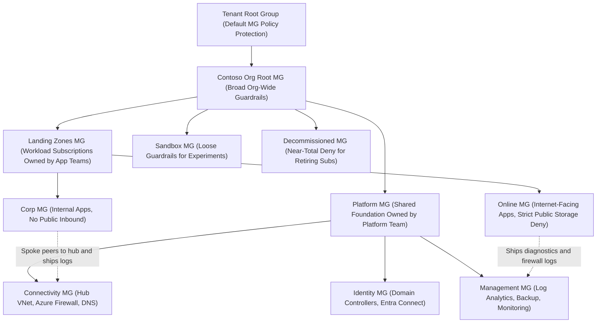
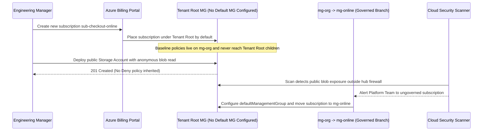

# The Cloud Adoption Framework and Landing Zones

> **Prerequisites:** Management groups and downward inheritance (Module 01), Hub-Spoke networking (`05`), and central monitoring / Log Analytics (`06` / `12`).  
> **Estimated Reading Time:** 35 minutes  
> **Target Audience:** Backend Engineers, Platform Engineers, Cloud Architects.

> [!TIP]
> **The Golden Rule of CAF Landing Zones:** A landing zone's governance comes **entirely from where its subscription sits in the hierarchy**—separate **Platform** shared services (Connectivity, Identity, Management) from **Application** workloads (`Corp` / `Online`), and always configure a tenant **default management group** so no new subscription is ever born ungoverned at the root.

---

## Why This Matters

You can now build a management-group hierarchy (module 01) — but *which* one? Rather than invent a tree from scratch, Microsoft publishes an opinionated, battle-tested answer: the **Cloud Adoption Framework (CAF)** and its **landing zone** architecture. A landing zone is the single most over-used and under-defined term in Azure governance, so this module's job is to make it concrete: what a landing zone actually *is*, the reference hierarchy CAF recommends, and the crucial split between *platform* and *application* landing zones. This is survey-level on purpose — you won't deploy the full enterprise accelerator in a lab — but the vocabulary and shape here is what every later module (and real platform team) assumes.

---

## 1. Architectural Mental Model: CAF Reference Hierarchy & Platform/Application Split

CAF splits your tenant beneath an org-root management group by **function** (`Platform`, `Landing Zones`, `Sandbox`, `Decommissioned`) and further splits application workloads by **network exposure** (`Corp` internal vs. `Online` internet-facing). Application subscriptions consume shared services hosted inside the Platform subscriptions:



### The Cloud Adoption Framework in one paragraph

The **Cloud Adoption Framework** is Microsoft's prescriptive guidance for adopting Azure at organizational scale — a set of methodologies (Strategy, Plan, Ready, Adopt, Govern, Manage, Secure) plus reference architectures and tooling. For this track, the part that matters is **Ready / Govern**: how to lay out the environment so teams can build safely. You do *not* need to memorize CAF's phases. You need its central deliverable: a **governed landing-zone architecture** built on exactly the management groups, policy, and RBAC primitives you already know. CAF is not a product you install; it's a blueprint (small-b) for arranging the primitives from modules 00-01.

### What a "landing zone" actually is

A **landing zone** is a **pre-provisioned, pre-governed environment** that a workload "lands" in — a subscription (or set of subscriptions) that already has the networking, identity, policy, RBAC, and monitoring wired up *before* any app team touches it. Contrast with what you've done all curriculum: an empty subscription you configured by hand, per resource. A landing zone flips that — the *environment arrives governed*, so a team requesting one gets guardrails, a network, and a tagging/policy baseline **by default**. Concretely, a landing zone is usually **one subscription** placed under the right management group, with a baseline of policy assignments (inherited from that MG) and a standard network/identity footprint. "Landing zone" ≈ "a governed subscription handed to a team, ready to build in." It's the physical realization of module 00's "governance is a platform-team product."

### Platform landing zones vs. application landing zones

The most important distinction in the whole CAF model:

- **Platform landing zones** host the **shared services** the whole organization depends on — connectivity (the hub VNet, VPN/ExpressRoute, Azure Firewall from track 5), identity (domain controllers, Entra Connect), and management (Log Analytics, backup, central monitoring from track 6/12). These are run by the **platform team**, typically in a small number of dedicated subscriptions, and everything else depends on them.
- **Application landing zones** are the subscriptions handed to **application teams** to deploy their workloads into. They *consume* the platform (peer to the hub network, send logs to the central workspace, inherit the baseline policy) but the app team owns what runs inside. Each app or team typically gets its own application landing zone (subscription), which is exactly the "subscription per team x environment" instinct from module 00.

The split is a separation of concerns: platform teams own the shared foundation; app teams own their workloads on top of it. Getting this boundary clean is what lets a platform team scale to hundreds of app teams.

### The CAF reference management-group hierarchy

CAF recommends a specific management-group shape under the tenant root — this is the concrete tree module 01 was building toward:

```text
Tenant Root Group
└─ Contoso (org root MG; broad "everyone" guardrails live here)
   ├─ Platform            (shared-services subscriptions)
   │  ├─ Connectivity     (hub network, firewall, DNS)
   │  ├─ Identity         (domain services, identity infra)
   │  └─ Management       (Log Analytics, automation, backup)
   ├─ Landing Zones       (application landing zones — the app teams' subs)
   │  ├─ Corp             (internal apps, no public inbound)
   │  └─ Online           (internet-facing apps)
   ├─ Sandbox             (loose, experiment-only subs; cheap guardrails)
   └─ Decommissioned      (subs being retired; deny-most policy)
```

Notice how the axes from module 01 combine: the top split is *by function* (platform vs. workloads vs. sandbox vs. decommissioned), and `Landing Zones` sub-splits `Corp`/`Online` *by network exposure*. Broad guardrails (allowed regions, no public storage) attach at `Contoso` so everything inherits them; `Online` gets stricter public-exposure policy than `Corp`; `Sandbox` gets a deliberately loose set so experimentation isn't strangled; `Decommissioned` gets a near-total `Deny` so retiring subs can't grow new resources. This is "broad high, specific low" (module 01) made into a template.

### Landing zone "accelerators" and how much to adopt

Microsoft ships **landing zone accelerators** — ready-made Terraform/Bicep deployments (the "Azure Landing Zones" or ALZ modules) that stand up the entire hierarchy, baseline policies, and platform networking in one go. They're powerful and *heavy*: designed for enterprises with connectivity, identity, and management teams already in place. For a small org — or your lab — adopting the full accelerator is overkill. The pragmatic path most teams take is **"start with the concepts, adopt incrementally"**: build the management-group skeleton (module 01), attach a handful of baseline policies (module 03), and add platform subscriptions only when you actually have shared services to run. This module is the *conceptual foundation*; you deliberately won't run the full accelerator here. Knowing it exists — and that it's built from exactly the MG + policy + Terraform primitives you're learning — is the goal.

---

## 2. Taxonomic Comparison & Command Reference

### CAF Management Group Archetypes Matrix

| CAF Branch | Landing Zone Class | Owner | Typical Hosted Resources | Guardrail Posture |
|---|---|---|---|---|
| **Platform / Connectivity** | Platform LZ | Platform Networking Team | Hub VNet, Azure Firewall, ExpressRoute/VPN Gateway, Private DNS Zones | Strict network security; allows public IPs only on edge gateways |
| **Platform / Identity** | Platform LZ | Platform Identity Team | AD DS Domain Controllers, Entra Connect, PKI infra | Restricted admin RBAC; isolated from app deployments |
| **Platform / Management** | Platform LZ | Platform Observability Team | Central Log Analytics workspace, Automation, Backup Vaults | Retention & immutable log policies; cross-sub log ingestion |
| **Landing Zones / Corp** | Application LZ | Application / Product Team | Internal APIs, internal AKS, private databases peered to Hub | Blocks public inbound internet exposure; requires private endpoints |
| **Landing Zones / Online** | Application LZ | Application / Product Team | Public web frontends, API Management, WAF-protected endpoints | Strict public storage/DB denial; mandatory WAF/DDoS protection |
| **Sandbox** | Non-governed / Dev | Individual Engineers | Ephemeral POCs, learning sandboxes | Loose guardrails + budget/TTL alerts; isolated from Corp VNet |
| **Decommissioned** | Retirement | Platform Operations | Frozen resources awaiting final deletion | Near-total `Deny` (blocks all new resource creation) |

### Full ALZ Accelerator vs. Incremental Adoption

| Criterion | Full Enterprise ALZ Accelerator | Incremental CAF Adoption |
|---|---|---|
| **Team Prerequisite** | Dedicated Networking, Identity, Security, and Platform teams | Single platform/backend team or small startup |
| **Time to Initial Value** | Weeks of customization across hundreds of policy definitions | Hours to stand up MG tree + 5 core baseline policies |
| **Blast Radius / Complexity** | High (hundreds of policies + hub-spoke DNS/firewall wiring) | Low and transparent (every policy rule is understood and intentional) |
| **Evolution Path** | Ready day one for multi-region enterprise scale | Grows cleanly by adding Platform subs and initiatives over time |

### Command Reference

CAF is architecture, not a CLI surface, so most "commands" here are the module-01 primitives arranged into the reference shape, plus ways to *inspect* it. There's no `az caf` command.

| Command | What it does | Example |
|---|---|---|
| `az account management-group create` | Builds a node of the CAF reference hierarchy | `az account management-group create --name mg-platform --display-name Platform --parent mg-contoso` |
| `az account management-group show --expand --recurse` | Renders your whole hierarchy to compare against the CAF shape | `az account management-group show -n mg-contoso --expand --recurse -o json` |
| `az account management-group hierarchy-settings create` | Sets tenant-level defaults (e.g. a default MG new subscriptions land in) | see breakdown below |
| `az policy assignment list --scope <mg>` | Confirms which baseline policies a landing-zone MG inherits | `az policy assignment list --scope /providers/Microsoft.Management/managementGroups/mg-contoso -o table` |

Flag breakdown — `az account management-group hierarchy-settings create --name <tenant-root-id> --default-management-group /providers/Microsoft.Management/managementGroups/mg-sandbox --require-authorization-for-group-creation true`:

- `--name <tenant-root-id>` — the tenant root group these settings apply to (hierarchy settings live on the root).
- `--default-management-group .../mg-sandbox` — **where brand-new subscriptions automatically land** instead of directly under the root. Setting this to a governed (or sandbox) MG means a newly created subscription is *already* under guardrails rather than ungoverned at the root — a key CAF safety default.
- `--require-authorization-for-group-creation true` — locks down who can create management groups (requires explicit `Microsoft.Management/.../write`), preventing sprawl of ad-hoc MGs. The governance-of-the-governance setting.

---

## 3. Production War Story Post-Mortem: Ungoverned New Subscription Born at Tenant Root

- **Severity:** SEV-2
- **Detection Time:** 6 days (external CSPM vulnerability scanner flagged publicly readable blob container)
- **Resolution Time:** 2 hours 15 minutes
- **Impact:** A newly provisioned `sub-checkout-online` subscription landed directly under Tenant Root with zero inherited policies, allowing a team to deploy an internet-accessible storage account with anonymous blob access and direct internet egress bypassing the Platform Connectivity firewall.

### What Happened

A product engineering manager provisioned a new Azure subscription (`sub-checkout-online`) through the Enterprise Agreement portal on Friday afternoon so the team could start Monday morning. Because the organization had never configured `hierarchy-settings` on the Tenant Root Management Group, Azure placed the new subscription directly beneath the Tenant Root instead of `mg-sandbox` or `mg-online`. Over the next week, engineers deployed resources assuming the org's "no public storage" and "mandatory spoke-to-hub routing" baselines were active—while the subscription sat outside `mg-org` completely ungoverned.



### Root Cause Analysis

1. **Missing Tenant Hierarchy Settings:** `defaultManagementGroup` was unset on the Tenant Root Group, causing every new subscription to spawn outside `mg-org`'s policy inheritance tree.
2. **Untested Placement Assumption:** Developers assumed every subscription in the tenant automatically carried org guardrails, rather than understanding that governance depends entirely on *where in the tree* the subscription sits.

### The Fix & Architectural Hardening

1. **Immediate Mitigation:** Restricted the storage account's public network access, moved `sub-checkout-online` into `mg-online`, and triggered an immediate Azure Policy compliance scan.
2. **Permanent Architectural Fix:** Executed `az account management-group hierarchy-settings create` setting `--default-management-group` to `mg-sandbox` (which enforces baseline region/tag/no-public-blob guardrails) and `--require-authorization-for-group-creation true`, plus added an Event Grid subscription-creation webhook alerting the platform team whenever a subscription enters `mg-sandbox` awaiting landing-zone onboarding.

---

## 4. Multi-Language Production Implementation: CAF Landing Zone Placement & Hierarchy Settings Guard

Platform compliance scripts continuously verify two invariants: (1) tenant root hierarchy settings enforce a governed `defaultManagementGroup` and authorization lock, and (2) every subscription sits in an allowed CAF leaf branch with no workload subscriptions stranded at Tenant Root or inside `Platform` management groups.

````carousel
### Go — CAF Landing Zone Placement & Hierarchy Guard

```go
package caf

import "fmt"

type HierarchySettings struct {
	TenantRootID                      string
	DefaultManagementGroup            string
	RequireAuthorizationForGroupWrite bool
}

type SubscriptionPlacement struct {
	SubscriptionID string
	ParentMG       string
	WorkloadType   string // "platform" | "application" | "sandbox" | "retiring"
	HasHubPeering  bool
	HasCentralLogs bool
}

var validCAFBranches = map[string]string{
	"mg-connectivity":   "platform",
	"mg-identity":       "platform",
	"mg-management":     "platform",
	"mg-corp":           "application",
	"mg-online":         "application",
	"mg-sandbox":        "sandbox",
	"mg-decommissioned": "retiring",
}

func AuditCAFCompliance(settings HierarchySettings, subs []SubscriptionPlacement) []string {
	var findings []string

	if settings.DefaultManagementGroup == "" || settings.DefaultManagementGroup == settings.TenantRootID {
		findings = append(findings, "CRITICAL: tenant defaultManagementGroup must point to a governed MG, not Tenant Root")
	}
	if !settings.RequireAuthorizationForGroupWrite {
		findings = append(findings, "HIGH: requireAuthorizationForGroupCreation must be true to prevent MG sprawl")
	}

	for _, sub := range subs {
		expectedClass, ok := validCAFBranches[sub.ParentMG]
		if !ok {
			findings = append(findings, fmt.Sprintf("CRITICAL: subscription %s sits in non-CAF or root MG %q", sub.SubscriptionID, sub.ParentMG))
			continue
		}
		if expectedClass != sub.WorkloadType {
			findings = append(findings, fmt.Sprintf("HIGH: %s workload %s placed in %s branch (%s)", sub.WorkloadType, sub.SubscriptionID, sub.ParentMG, expectedClass))
		}
		if sub.WorkloadType == "application" && (!sub.HasHubPeering || !sub.HasCentralLogs) {
			findings = append(findings, fmt.Sprintf("MEDIUM: application LZ %s missing Connectivity hub peering or Management Log Analytics link", sub.SubscriptionID))
		}
	}
	return findings
}
```
<!-- slide -->
### TypeScript — CAF Landing Zone Placement & Hierarchy Guard

```typescript
export type WorkloadClass = "platform" | "application" | "sandbox" | "retiring";

export interface TenantHierarchySettings {
  tenantRootId: string;
  defaultManagementGroupId?: string;
  requireAuthorizationForGroupCreation: boolean;
}

export interface LandingZoneSubscription {
  subscriptionId: string;
  parentMgId: string;
  workloadClass: WorkloadClass;
  peeredToConnectivityHub: boolean;
  diagnosticTargetWorkspaceId?: string;
}

const CAF_BRANCH_MAP: Record<string, WorkloadClass> = {
  "mg-connectivity": "platform",
  "mg-identity": "platform",
  "mg-management": "platform",
  "mg-corp": "application",
  "mg-online": "application",
  "mg-sandbox": "sandbox",
  "mg-decommissioned": "retiring",
};

export function auditCafTopology(
  settings: TenantHierarchySettings,
  subscriptions: LandingZoneSubscription[]
): string[] {
  const findings: string[] = [];

  if (!settings.defaultManagementGroupId || settings.defaultManagementGroupId === settings.tenantRootId) {
    findings.push("CRITICAL: New subscriptions default to ungoverned Tenant Root; set defaultManagementGroupId.");
  }
  if (!settings.requireAuthorizationForGroupCreation) {
    findings.push("HIGH: Enable requireAuthorizationForGroupCreation to block ad-hoc MG creation.");
  }

  for (const sub of subscriptions) {
    const branchClass = CAF_BRANCH_MAP[sub.parentMgId];
    if (!branchClass) {
      findings.push(`CRITICAL: Subscription ${sub.subscriptionId} sits in non-CAF/Root MG '${sub.parentMgId}'.`);
      continue;
    }
    if (branchClass !== sub.workloadClass) {
      findings.push(`HIGH: ${sub.workloadClass} sub ${sub.subscriptionId} misplaced under ${sub.parentMgId}.`);
    }
    if (sub.workloadClass === "application" && (!sub.peeredToConnectivityHub || !sub.diagnosticTargetWorkspaceId)) {
      findings.push(`MEDIUM: Application LZ ${sub.subscriptionId} is not wired to Platform Connectivity/Management.`);
    }
  }

  return findings;
}
```
<!-- slide -->
### Python — CAF Landing Zone Placement & Hierarchy Guard

```python
from dataclasses import dataclass
from typing import List, Optional

CAF_BRANCHES = {
    "mg-connectivity": "platform",
    "mg-identity": "platform",
    "mg-management": "platform",
    "mg-corp": "application",
    "mg-online": "application",
    "mg-sandbox": "sandbox",
    "mg-decommissioned": "retiring",
}


@dataclass(frozen=True)
class HierarchySettings:
    tenant_root_id: str
    default_management_group: Optional[str]
    require_authorization_for_group_creation: bool


@dataclass(frozen=True)
class SubscriptionPlacement:
    subscription_id: str
    parent_mg_id: str
    workload_class: str
    has_hub_peering: bool
    has_central_diagnostics: bool


def audit_caf_landing_zones(
    settings: HierarchySettings,
    subscriptions: List[SubscriptionPlacement],
) -> List[str]:
    findings: List[str] = []

    if not settings.default_management_group or settings.default_management_group == settings.tenant_root_id:
        findings.append("CRITICAL: default_management_group leaves new subscriptions ungoverned at Tenant Root")
    if not settings.require_authorization_for_group_creation:
        findings.append("HIGH: require_authorization_for_group_creation should be True")

    for sub in subscriptions:
        expected = CAF_BRANCHES.get(sub.parent_mg_id)
        if expected is None:
            findings.append(f"CRITICAL: Subscription {sub.subscription_id} sits outside CAF leaf MGs ({sub.parent_mg_id})")
            continue
        if expected != sub.workload_class:
            findings.append(
                f"HIGH: {sub.workload_class} subscription {sub.subscription_id} placed in {sub.parent_mg_id} ({expected})"
            )
        if sub.workload_class == "application" and (not sub.has_hub_peering or not sub.has_central_diagnostics):
            findings.append(
                f"MEDIUM: Application LZ {sub.subscription_id} lacks Platform hub peering or central Log Analytics"
            )

    return findings
```
<!-- slide -->
### C# — CAF Landing Zone Placement & Hierarchy Guard

```csharp
using System;
using System.Collections.Generic;

namespace Governance.Caf;

public sealed record HierarchySettings(
    string TenantRootId,
    string? DefaultManagementGroupId,
    bool RequireAuthorizationForGroupCreation);

public sealed record SubscriptionPlacement(
    string SubscriptionId,
    string ParentMgId,
    string WorkloadClass,
    bool HasHubPeering,
    bool HasCentralDiagnostics);

public static class CafTopologyGuard
{
    private static readonly IReadOnlyDictionary<string, string> ValidBranches =
        new Dictionary<string, string>(StringComparer.OrdinalIgnoreCase)
        {
            ["mg-connectivity"] = "platform",
            ["mg-identity"] = "platform",
            ["mg-management"] = "platform",
            ["mg-corp"] = "application",
            ["mg-online"] = "application",
            ["mg-sandbox"] = "sandbox",
            ["mg-decommissioned"] = "retiring",
        };

    public static IReadOnlyList<string> Audit(
        HierarchySettings settings,
        IEnumerable<SubscriptionPlacement> subscriptions)
    {
        var findings = new List<string>();

        if (string.IsNullOrWhiteSpace(settings.DefaultManagementGroupId) ||
            string.Equals(settings.DefaultManagementGroupId, settings.TenantRootId, StringComparison.OrdinalIgnoreCase))
        {
            findings.Add("CRITICAL: DefaultManagementGroupId must point to a governed MG, not Tenant Root.");
        }

        if (!settings.RequireAuthorizationForGroupCreation)
        {
            findings.Add("HIGH: RequireAuthorizationForGroupCreation must be enabled.");
        }

        foreach (var sub in subscriptions)
        {
            if (!ValidBranches.TryGetValue(sub.ParentMgId, out var branchClass))
            {
                findings.Add($"CRITICAL: Subscription {sub.SubscriptionId} placed in invalid/root MG '{sub.ParentMgId}'.");
                continue;
            }
            if (!string.Equals(branchClass, sub.WorkloadClass, StringComparison.OrdinalIgnoreCase))
            {
                findings.Add($"HIGH: {sub.WorkloadClass} subscription {sub.SubscriptionId} is in {sub.ParentMgId} ({branchClass}).");
            }
            if (string.Equals(sub.WorkloadClass, "application", StringComparison.OrdinalIgnoreCase) &&
                (!sub.HasHubPeering || !sub.HasCentralDiagnostics))
            {
                findings.Add($"MEDIUM: Application LZ {sub.SubscriptionId} lacks hub peering or central Log Analytics wiring.");
            }
        }

        return findings;
    }
}
```
````

---

## 5. Practical Hands-On Verification CLI Workflows

Everything here is **free** (MGs, policy assignments, inspection). You'll shape the hierarchy you started in module 01 into the CAF reference form. You have one subscription, so most landing zones are *modelled, not populated* — noted where it matters.

### 1. (Azure) Reshape your module-01 tree toward the CAF reference

Building on `mg-org`/`mg-prod`/`mg-nonprod` from module 01 (rename in your head to `mg-contoso`), add the CAF top-level nodes:

```bash
az account management-group create --name mg-platform --display-name "Platform" --parent mg-org
az account management-group create --name mg-landingzones --display-name "Landing Zones" --parent mg-org
az account management-group create --name mg-sandbox --display-name "Sandbox" --parent mg-org
az account management-group create --name mg-decommissioned --display-name "Decommissioned" --parent mg-org
```

**Expected Output:**
```json
{
  "displayName": "Decommissioned",
  "id": "/providers/Microsoft.Management/managementGroups/mg-decommissioned",
  "name": "mg-decommissioned",
  "type": "Microsoft.Management/managementGroups"
}
```

Expect a tree matching the CAF reference top level. You now have the standard skeleton — empty, but correctly shaped.

### 2. (Azure) Add the platform and landing-zone sub-tiers

Fill in the second level:

```bash
az account management-group create --name mg-connectivity --display-name "Connectivity" --parent mg-platform
az account management-group create --name mg-identity --display-name "Identity" --parent mg-platform
az account management-group create --name mg-management --display-name "Management" --parent mg-platform
az account management-group create --name mg-corp --display-name "Corp" --parent mg-landingzones
az account management-group create --name mg-online --display-name "Online" --parent mg-landingzones
```

Expect the full reference hierarchy. Render it:

```bash
az account management-group show -n mg-org --expand --recurse \
  --query "{name:displayName, children:children[].{name:displayName, children:children[].displayName}}" -o json
```

**Expected Output:**
```json
{
  "children": [
    {
      "children": ["Connectivity", "Identity", "Management"],
      "name": "Platform"
    },
    {
      "children": ["Corp", "Online"],
      "name": "Landing Zones"
    },
    {
      "children": null,
      "name": "Sandbox"
    },
    {
      "children": null,
      "name": "Decommissioned"
    }
  ],
  "name": "Contoso Org"
}
```

### 3. (Azure) Place your one subscription as an application landing zone

Your dev subscription is best modelled as a `Corp` application landing zone (or move it to `mg-sandbox` if you prefer). Move it:

```bash
SUB=$(az account show --query id -o tsv)
az account management-group subscription add --name mg-corp --subscription "$SUB"
```

**Expected Output:**
```text
(Command returns 0; subscription now sits under /providers/Microsoft.Management/managementGroups/mg-corp)
```

Expect your subscription under `mg-corp`. **Write down** what a real org would have that you don't: separate subscriptions under `mg-connectivity` (the hub network), `mg-management` (Log Analytics), and one per app team under `mg-corp`/`mg-online`. You're modelling the shape with one real leaf.

### 4. (Azure) Attach a broad baseline at the org root, a stricter one at `Online`

Demonstrate "broad high, specific low." Assign allowed-locations at `mg-org` (broad) and a public-network-restriction flavour at `mg-online` (specific) — both in `Audit`:

```bash
LOC=$(az policy definition list --query "[?displayName=='Allowed locations'].name" -o tsv)
az policy assignment create --name baseline-locations --policy "$LOC" \
  --scope /providers/Microsoft.Management/managementGroups/mg-org \
  --params '{"listOfAllowedLocations":{"value":["eastus","westus"]}}'
# A public-exposure-related built-in for the internet-facing tier (pick any storage-public built-in):
PUB=$(az policy definition list --query "[?displayName=='Storage account public access should be disallowed'].name" -o tsv)
az policy assignment create --name online-no-public-storage --policy "$PUB" \
  --scope /providers/Microsoft.Management/managementGroups/mg-online \
  --params '{"effect":{"value":"Audit"}}' 2>/dev/null || echo "adapt display name to an available built-in"
```

Confirm `mg-online` sees *both* (its own + the inherited baseline), while `mg-corp` sees only the baseline:

```bash
az policy assignment list --scope /providers/Microsoft.Management/managementGroups/mg-online -o table
az policy assignment list --scope /providers/Microsoft.Management/managementGroups/mg-corp -o table
```

**Expected Output:**
```text
# On mg-online (shows both online-no-public-storage and baseline-locations):
Name                       Scope
-------------------------  ---------------------------------------------------------
online-no-public-storage   /providers/Microsoft.Management/managementGroups/mg-online
baseline-locations         /providers/Microsoft.Management/managementGroups/mg-org

# On mg-corp (shows only baseline-locations):
Name                       Scope
-------------------------  ---------------------------------------------------------
baseline-locations         /providers/Microsoft.Management/managementGroups/mg-org
```

### 5. (Azure) Distinguish a platform landing zone from an application one — on paper, backed by the tree

In a scratch file, list which of your MGs are *platform* landing zones (`mg-connectivity`, `mg-identity`, `mg-management`) and which are *application* landing zones (`mg-corp`, `mg-online`), and for each platform one name the shared service from an earlier track it would host (hub VNet/firewall from track 5 -> Connectivity; Log Analytics from track 6/12 -> Management). This cements the consume-vs-own boundary.

### 6. (Azure) Inspect the tenant hierarchy setting (read-only)

See whether a default landing MG is configured for new subscriptions:

```bash
az account management-group hierarchy-settings list --name $(az account management-group list --query "[?contains(displayName,'Tenant Root')].name | [0]" -o tsv) 2>/dev/null || echo "no custom hierarchy settings (new subs land at root by default)"
```

**Expected Output:**
```text
no custom hierarchy settings (new subs land at root by default)
```

Understand the implication: with no default set, a brand-new subscription lands **ungoverned at the tenant root**. A CAF-aligned org sets the default to a governed MG so nothing is ever born ungoverned. (Don't change the tenant setting in a shared tenant without permission — this is read/awareness only.)

### 7. Diagnose and fix: "the landing zone isn't inheriting the baseline."

A very common CAF mistake — a subscription placed in the *wrong* MG silently misses the baseline. Simulate it: temporarily move your subscription to `mg-sandbox` (which has *no* baseline attached), then observe it loses the `Online` exposure policy and keeps only whatever `mg-org` provides:

```bash
az account management-group subscription add --name mg-sandbox --subscription "$SUB"
az policy assignment list --scope /subscriptions/$SUB --disable-scope-strict-match \
  --query "[].{name:name, scope:scope}" -o table
```

**Diagnose:** the subscription now inherits only `mg-org` -> `mg-sandbox` assignments; anything attached under `mg-landingzones`/`mg-online` no longer applies because sandbox is a *different branch*. **Fix:** move it back to the intended landing-zone MG:

```bash
az account management-group subscription add --name mg-corp --subscription "$SUB"
az policy assignment list --scope /subscriptions/$SUB --disable-scope-strict-match \
  --query "[].{name:name, scope:scope}" -o table
```

**Expected Output:**
```text
Name                Scope
------------------  -------------------------------------------------------
baseline-locations  /providers/Microsoft.Management/managementGroups/mg-org
```

Lesson: **a landing zone's governance comes entirely from *where in the tree* its subscription sits.** "The baseline isn't applying" is almost always "the subscription is in the wrong MG," not a broken policy.

### 8. (Azure) Clean up the extra policy assignments; keep the hierarchy

Later modules reuse the MG tree (free), so leave it, but remove the demo assignments if you like:

```bash
az policy assignment delete --name online-no-public-storage --scope /providers/Microsoft.Management/managementGroups/mg-online 2>/dev/null; true
# Leave baseline-locations on mg-org — module 03 builds on it.
```

### Independent Challenge

No commands given — a design task drawing on this module, module 01 (hierarchy axes), module 00 (the four forces), and track 5 (hub/spoke networking, firewall) and track 6/12 (central monitoring). For the Payments/Web/Data org you've been carrying since module 00, produce a **one-page landing-zone design document**: draw the full CAF-aligned management-group hierarchy, then for **every** subscription (real or imagined) label it as a *platform* or *application* landing zone and name what it hosts. For each of the three platform landing zones (Connectivity, Identity, Management), name the *specific* earlier-track resource it would contain and which application landing zones depend on it and how (e.g. "Web-prod's spoke VNet peers to the Connectivity hub"). Finally, decide where Payments-prod's compliance-strict subscription attaches in this CAF shape and argue whether `Corp` or `Online` (or a dedicated child) is correct for it. Do not stand up an accelerator; the deliverable is the reasoned design and, optionally, the top two MG levels built in your tenant.

<details>
<summary>Stuck? One hint</summary>

The platform-vs-application split maps almost directly onto "who runs it": the three platform landing zones are the shared foundation the platform team runs once (Connectivity = the track-5 hub VNet + Azure Firewall; Identity = domain/identity infra; Management = the track-6/12 Log Analytics workspace + backup), and *every* application landing zone consumes all three (peers its spoke to the hub, authenticates against Identity, ships diagnostics to the Management workspace). Payments-prod, being internet-facing *and* compliance-bound, belongs under `Online` (public exposure) but almost certainly as its **own** application landing zone subscription with an extra compliance initiative attached at its level — the CAF shape gives you `Online` for the exposure axis, and module 01's "lowest MG that exactly bounds the target" gives you where the extra strictness attaches.

</details>

---

## 6. Common Mistakes & Troubleshooting

- **Thinking a landing zone is a product you deploy.** It's a *pattern* — a governed subscription under the right MG with baseline policy/network/identity — realized from the primitives in modules 00-01. The accelerator automates it; the concept is what matters.
- **Blurring platform and application landing zones.** Platform LZs host shared services owned by the platform team (network, identity, management); app LZs host workloads owned by app teams. Mixing shared services into app subscriptions destroys the separation of concerns that lets the model scale.
- **Adopting the full accelerator into a small org.** The enterprise ALZ accelerator assumes connectivity/identity/management teams already exist. For a small org or a lab it's overkill — build the skeleton and add platform subs when you actually have shared services.
- **Letting new subscriptions be born at the tenant root.** With no default management group set, a fresh subscription is *ungoverned*. CAF sets a default landing MG so nothing is ever created outside the guardrails.
- **Putting a subscription in the wrong branch and blaming policy.** A landing zone's entire governance comes from *where its subscription sits* in the tree (exercise 7). Wrong MG = wrong (or missing) inherited baseline.

---

## 7. Operational Validation Checkpoints

<details>
<summary><strong>Checkpoint 1: App Team Requests Public Firewall Inside Application Subscription</strong></summary>

**Scenario:** A new product team building a customer portal inside `sub-web-online` asks for permission to deploy their own Azure Firewall and ExpressRoute circuit inside `sub-web-online` rather than peering to the shared hub.

**Question:** Which CAF architectural boundary does this violate, and what is the correct design?

**Answer:** It violates the **Platform vs. Application landing zone separation of concerns**. Shared connectivity infrastructure (hub VNet, Azure Firewall, ExpressRoute/VPN gateways, central DNS) belongs strictly in the **Platform / Connectivity** landing zone owned by the platform networking team. `sub-web-online` should deploy a spoke VNet peered to the Connectivity hub, routing egress through the central firewall while keeping WAF/app endpoints inside its own application subscription.

</details>

<details>
<summary><strong>Checkpoint 2: Retiring Legacy Subscription Keeps Spawning Resources</strong></summary>

**Scenario:** Finance cancels a legacy product (`sub-legacy-crm`), and you announce its retirement. Three weeks later, a forgotten Terraform pipeline recreates three VMSS instances inside it, incurring \$2,400 in unexpected charges.

**Question:** Which CAF management group and policy pattern prevents retired subscriptions from accepting new deployments before full deletion?

**Answer:** Move the subscription into the **`Decommissioned`** management group (`mg-decommissioned`), which carries a near-total **`Deny`** policy blocking all new resource deployments while preserving historical audit logs or billing records until final subscription cancellation.

</details>

<details>
<summary><strong>Checkpoint 3: Newly Provisioned Subscription Escapes Baseline Tagging & Region Locks</strong></summary>

**Scenario:** An enterprise team spins up five new subscriptions for a hackathon via the billing portal. Two days later, an auditor finds VMs running in `australiaeast` (disallowed region) with zero baseline policies assigned to those subscriptions.

**Question:** What tenant-level CAF control was missing, and how do you fix it?

**Answer:** The tenant root was missing **`hierarchy-settings` (`--default-management-group`)** pointing new subscriptions to a governed landing MG (such as `mg-sandbox` beneath `mg-org`). Without that setting, new subscriptions are born directly under the Tenant Root Group and miss every policy attached to `mg-org`. Set `--default-management-group` to `mg-sandbox` and `--require-authorization-for-group-creation true`, and move the five subscriptions beneath `mg-sandbox`.

</details>

### Checkpoint Quiz (Self-Check)

Write down your answer to each question before expanding it — checking without attempting first is the single easiest way to fool yourself into thinking you've learned this.

<details>
<summary>Show questions</summary>

1. In one sentence, what *is* a landing zone?
2. What's the difference between a platform landing zone and an application landing zone, and who owns each?
3. Name the CAF reference hierarchy's top-level management groups and one guardrail characteristic of `Sandbox` vs. `Decommissioned`.
4. Why is the Cloud Adoption Framework described as "a blueprint built from primitives you already know" rather than a product?
5. What does setting a tenant *default management group* accomplish, and what goes wrong without it?
6. A newly created application landing-zone subscription isn't inheriting the org baseline policy. What's the most likely cause and the fix?
7. Should a small org adopt the full landing-zone accelerator? Why or why not?

</details>

<details>
<summary>Show answers</summary>

1. A pre-provisioned, pre-governed environment (typically a subscription under the right management group) that a workload "lands" in — arriving with networking, identity, policy, RBAC, and monitoring already wired up.
2. A **platform** landing zone hosts shared services (connectivity, identity, management) owned by the **platform team**; an **application** landing zone is a subscription handed to an **application team** for its workloads, which consume the platform. Platform = shared foundation; application = workloads on top.
3. Top level: `Platform`, `Landing Zones` (with `Corp`/`Online`), `Sandbox`, `Decommissioned` (under an org root). `Sandbox` has deliberately **loose** guardrails for experimentation; `Decommissioned` has a near-total **`Deny`** so retiring subscriptions can't create new resources.
4. Because CAF is architecture/guidance, not software you install — its deliverable (the governed landing-zone hierarchy) is assembled from management groups, policy assignments, RBAC, and Terraform/Bicep, all of which you learned as separate primitives.
5. It makes brand-new subscriptions automatically land under a governed (or sandbox) MG instead of directly under the tenant root. Without it, new subscriptions are born **ungoverned** at the root, escaping every baseline until someone notices and moves them.
6. The subscription is in the **wrong management group** (wrong branch of the tree), so it inherits a different set — or none — of the baseline. Fix: move it to the intended landing-zone MG; its governance comes entirely from where it sits.
7. Generally no for a small org — the full accelerator assumes dedicated connectivity/identity/management teams and heavy platform infrastructure. Better to build the MG skeleton and baseline policies and add platform subscriptions incrementally as real shared services appear.

</details>

### Cumulative Review (Modules 00–02)

Closed-book. Don't reopen modules 00-02 or earlier tracks while attempting these — the point is to find out what actually stuck. These mix this track's first three modules with the baselines from tracks 9, 11, and 16.

1. Trace the full scope ladder from an individual storage account up to the tenant root, naming all five levels, and state at which levels you can attach a policy assignment.
2. A company has three teams, each with dev and prod, and one PCI-bound prod workload. Using module 00's four forces, justify a subscription *count*, then (module 01) sketch a management-group tree for them, then (module 02) label which nodes are platform vs. application landing zones.
3. You assigned an `Audit` "allowed locations" policy at a management group. Explain, using track 11 module 05's effect model, what would change if you promoted it to `Deny`, and why the existing non-compliant resources in a child subscription would *not* be deleted.
4. Explain "inheritance flows down, only down" and give a concrete example of a policy assigned on one subscription that a *sibling* subscription does not receive, plus the correct fix if both needed it.
5. Distinguish RBAC inheritance (additive) from `Deny`-policy inheritance (non-overridable) down a management-group hierarchy, referencing how role assignments worked in track 16.
6. What does it mean that "a landing zone's governance comes entirely from where its subscription sits"? Describe the exercise-7 failure and fix from module 02 in your own words.
7. Give the Terraform (track 9) resource types you'd use to declare a two-level management-group hierarchy with one subscription placed under a child MG, and explain why the parent/child wiring should be a *reference* not a string.
8. Why is a subscription — not a resource group — the right boundary for isolating the PCI workload, in terms of billing, quota, and RBAC/policy?
9. Contrast an "environment-first" and a "business-unit-first" hierarchy for the three-team org, and say which makes "prod is stricter than dev" a clean MG boundary and why.
10. Name two guardrails you'd attach at the org-root MG (so everything inherits) and one you'd attach only at an `Online`/internet-facing MG, and justify the placement with "broad high, specific low."

<details>
<summary>Show answers</summary>

1. Resource (storage account) -> resource group -> subscription -> management group(s) -> tenant root management group. You can attach a policy assignment at the resource group, subscription, and every management group level (including the root) — not at the individual-resource level.
2. **Count:** compliance forces PCI-prod into its own subscription; environments force dev/prod apart; teams force per-team isolation -> roughly one subscription per (team x environment) ≈ six, plus platform subs. **Tree:** e.g. org root -> {Production, Non-Production} -> per-team MGs, subscriptions as leaves (or CAF's Platform/Landing Zones/Sandbox/Decommissioned). **Labels:** Connectivity/Identity/Management subs = platform landing zones; each team's workload sub (incl. PCI-prod) = application landing zones.
3. Promoting to `Deny` (track 11 module 05) makes Azure *reject* new/updated resources in disallowed locations across every child scope, instead of just marking them non-compliant. Existing non-compliant resources are **not** deleted because `Deny` only acts at create/update time on future writes; pre-existing drift is reported, not removed (needs remediation or manual fix).
4. An assignment applies only to the scope it's on and everything *beneath* it, never sideways or upward. Example: a policy assigned on subscription A is not received by sibling subscription B (both under the same MG) — B is beside, not below, A. Fix: assign at their common ancestor (the shared MG), so both inherit it.
5. RBAC is **additive**: a role granted at an MG applies to everything below, and lower-scope grants only add permissions (track 16's role assignments, now at MG scope) — nothing subtracts. A `Deny` **policy** is **non-overridable**: a child cannot loosen a `Deny` inherited from an ancestor; the most restrictive wins, and the only carve-out is a scoped exemption.
6. A landing zone has no governance of its own — it inherits entirely from the management group it sits under. In module 02 exercise 7, moving the subscription to `Sandbox` (a different branch with no baseline) silently dropped the `Online` policy; moving it back to the intended landing-zone MG restored the inherited baseline. Right MG = right governance.
7. `azurerm_management_group` for each MG (parent via `parent_management_group_id`) and `subscription_ids` on the child MG to place the subscription (or a separate association). The wiring is a reference (`parent_management_group_id = azurerm_management_group.parent.id`) so Terraform orders creation correctly (parent before child) — the same dependency-ordering discipline as track 9 module 04's subnet references.
8. A subscription is Azure's boundary for billing (its own invoice line — clean cost allocation for the PCI workload), quota (its own limit pool, so other workloads can't starve it), and RBAC/policy isolation (access and `Deny` don't cross into it by default). A resource group shares all three with the rest of its subscription, so it can't provide a provable isolation boundary.
9. **Environment-first** (top MGs = Production/Non-Production) makes "prod stricter than dev" a clean MG boundary — attach strict policy on the Production MG and every team's prod inherits it. **Business-unit-first** (top MGs = teams) groups a team's dev+prod together, so environmental strictness must be applied per-subscription instead of at one clean MG. Environment-first wins for that specific requirement.
10. Org-root (broad, everything inherits): allowed regions/locations, and "no public blob storage." `Online`-only (specific): a stricter public-network / inbound-exposure policy that would wrongly block internal Corp apps. Broad universal rules go high so all subscriptions inherit; exposure-specific strictness goes low on just the internet-facing branch — "broad high, specific low."

</details>

---

## Sources & Further Reading

- [What is an Azure landing zone? — Cloud Adoption Framework](https://learn.microsoft.com/en-us/azure/cloud-adoption-framework/ready/landing-zone/) — Microsoft Learn
- [Azure landing zone conceptual architecture](https://learn.microsoft.com/en-us/azure/cloud-adoption-framework/ready/landing-zone/design-area/resource-org-management-groups) — Microsoft Learn

## Next

Continue to [03-azure-policy-at-scale-initiatives-and-exemptions](../03-azure-policy-at-scale-initiatives-and-exemptions/README.md) — you have a governed hierarchy; now bundle the individual policies from track 11 into an **initiative**, assign it at the management-group level, and learn the one escape hatch (**exemptions**) for legitimate exceptions.
