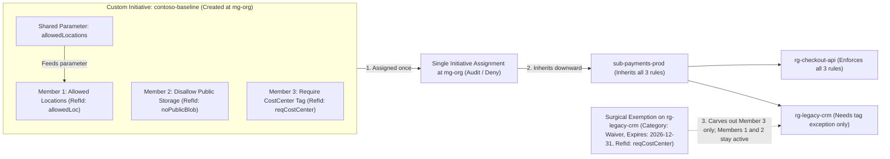
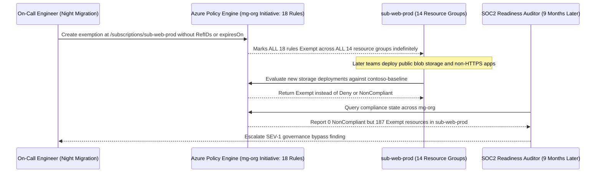

# Azure Policy at Scale: Initiatives and Exemptions

> **Prerequisites:** Azure Policy definitions, effects, and DINE remediation (`11/05`), plus management-group inheritance (Modules 01–02).  
> **Estimated Reading Time:** 35 minutes  
> **Target Audience:** Backend Engineers, Platform Engineers, Cloud Architects.

> [!TIP]
> **The Golden Rule of Policy at Scale:** Bundle related rules into a **policy initiative (`--policy-set-definition`)** assigned high at management-group scope with shared parameters, and whenever a genuine exception is needed, issue a **time-bound exemption** at the **lowest scope** targeting only the **specific `policyDefinitionReferenceIds`**—never exempt an entire subscription from an entire bundle.

---

## Why This Matters

In track 11 module 05 you assigned *one* policy to *one* resource group. That doesn't survive contact with an organization: a real governance baseline is *dozens* of related policies (allowed regions, no public storage, required encryption, required tags) that must apply consistently to *every* subscription. Assigning them one at a time, per scope, is unmanageable. **Initiatives** (a.k.a. policy sets) solve the "many policies" problem by bundling them into one assignable unit; assigning at a **management-group scope** (module 01) solves the "every subscription" problem via inheritance. And **exemptions** solve the inevitable "this one resource legitimately needs an exception" problem without weakening the policy for everyone. Together these three are how policy actually operates at scale — this module turns the single-policy skill from track 11 into an org-wide control plane.

---

## 1. Architectural Mental Model: Initiatives, Shared Parameters & Surgical Exemptions

An initiative wires one shared parameter (like `allowedLocations`) across multiple member policy definitions, assigns the whole standard once at a management group, and allows scoped exemptions to carve out individual member rules only where explicitly justified:



### From policy definition to initiative (policy set)

You already met the building blocks in track 11 module 05: a **policy definition** is reusable logic (the `if`/`then` rule), a **policy assignment** applies a definition to a scope with parameters and an effect. An **initiative** (the API name is **policy set definition**) is a third object that **groups many policy definitions** into one bundle with shared parameters. You then create a single **initiative assignment** — and all the bundled policies apply at once. This is the exact concept track 11 module 05 previewed ("an initiative bundles a group of definitions under one assignable unit... the building block track 17 scales up") — now you build and assign one yourself. The mental model: definition = one rule, initiative = a *standard* made of many rules, assignment = that standard applied somewhere.

### Why bundle: consistency, single assignment, shared parameters

Three concrete payoffs over assigning policies individually:

- **One assignment, many rules.** Assign the initiative once at `mg-org` and every subscription inherits *all* its policies — versus creating and tracking dozens of separate assignments per scope. Add a policy to the initiative later and every scope that assigned the initiative picks it up automatically.
- **Consistency.** A named standard ("Contoso Baseline") means every scope gets *the same* set — no subscription accidentally missing the "no public storage" rule because someone forgot to assign it there.
- **Shared parameters.** An initiative can expose one parameter (e.g. `allowedLocations`) that feeds several of its member policies, so you set the allowed regions once for the whole bundle instead of per policy.

This is the same abstraction win as a Terraform module (track 9 module 04): package many pieces behind one interface, assign/call it once, stay DRY.

### Built-in initiatives vs. custom initiatives

Like definitions, initiatives come in two flavours. **Built-in initiatives** ship with Azure — the Microsoft Cloud Security Benchmark, CIS, and the regulatory compliance sets (PCI-DSS, ISO 27001, etc., which module 07 uses). You *assign* these; you don't author them. **Custom initiatives** are ones you build by selecting existing definitions (built-in or your own) into a set — this is how you create *your org's* baseline ("Contoso Baseline" = allowed locations + no public storage + require tags). Most orgs do both: assign a built-in security benchmark for breadth, plus a lean custom initiative for their specific house rules. Authoring a custom initiative is *assembly* (pick definitions, wire parameters), not writing rule logic from scratch — the same "governance is assembly, not authoring" point from track 11 module 05.

### Assigning at management-group scope: inheritance meets initiatives

The payoff of combining this module with module 01: assign the initiative at a **management-group scope** and it inherits to every subscription beneath, using the exact same `--scope /providers/Microsoft.Management/managementGroups/<id>` string from module 01. This is the difference the whole track is about — track 11 module 05 assigned "at a management-group scope instead of one resource group" as a forward promise; here you cash it in. One initiative assignment at `mg-org` = your entire baseline applied to the whole org, including future subscriptions. Effects still work identically (start `Audit`, promote to `Deny` — the track 11 discipline), and compliance still evaluates on a schedule; the only thing that changed is the *scope* and the *bundling*, not the mechanics.

### Exemptions: the auditable escape hatch

Inevitably, one resource legitimately can't comply — a legacy app that must live in a non-approved region during migration, a workload that genuinely needs a public endpoint. You do **not** loosen the policy or the initiative for everyone (that defeats the baseline), and you *can't* override an inherited `Deny` from a child (module 01). Instead you create a **policy exemption**: a scoped, explicit, **time-bound**, auditable carve-out that says "this specific scope is exempt from this specific assignment (or these members of it), for this reason, until this date." Two exemption categories: **Waiver** (accept the non-compliance as-is) and **Mitigated** (the risk is handled by other means). The key properties: an exemption is *narrow* (a resource group or resource, not the whole subscription), *documented* (it carries a reason and metadata), and ideally *expiring* (an `expiresOn` date forces re-review). An exemption is the governed way to say "yes, we know, and here's why" — the opposite of silently weakening the rule.

### Exemption scope is the whole game (the footgun preview)

The single most common exemption mistake — which you'll deliberately create and fix in the exercises — is making the exemption **too broad**. An exemption at *subscription* scope for the *whole initiative* exempts *everything* in that subscription from *every* policy in the bundle, quietly gutting the baseline for that entire subscription. The discipline mirrors module 01's inheritance rule in reverse: **exempt at the *lowest* scope that covers exactly the resource(s) that need it, and for the *specific* policy definitions within the initiative that they violate — never the whole initiative at a high scope.** A good exemption is surgical; a bad one is a hole you forgot you cut.

---

## 2. Taxonomic Comparison & Command Reference

### Azure Policy Governance Object Taxonomy

| Object | ARM Resource Type | Typical Scope Created At | Purpose |
|---|---|---|---|
| **Policy Definition** | `Microsoft.Authorization/policyDefinitions` | Built-in or Org-Root MG | Single atomic `if`/`then` rule + effect parameter |
| **Initiative (Policy Set)** | `Microsoft.Authorization/policySetDefinitions` | Org-Root MG (must be >= assignment scope) | Bundles many definitions behind shared parameters |
| **Policy Assignment** | `Microsoft.Authorization/policyAssignments` | Management Group (or Sub / RG) | Attaches a definition or initiative to a scope; carries MI for DINE/Modify |
| **Policy Exemption** | `Microsoft.Authorization/policyExemptions` | Resource Group or single Resource | Auditable, time-bound carve-out (`Waiver` or `Mitigated`) for specific member ref IDs |

### Surgical Exemption vs. Blanket Footgun Comparison

| Attribute | Surgical Production Exemption | Blanket Footgun Exemption |
|---|---|---|
| **Target Scope** | Resource Group or specific Resource ID | Subscription or Management Group ID |
| **Member Targeting** | Explicit `--policy-definition-reference-ids` | Omitted (exempts every policy in the initiative) |
| **Expiration (`expiresOn`)** | Hard future ISO-8601 expiry forcing CAB re-review | Omitted (becomes permanent shadow bypass) |
| **Category & Audit Trail** | `Waiver` or `Mitigated` + CAB ticket in `--description` | Vague "temporary fix" without ticket reference |

### Command Reference

| Command | What it does | Example |
|---|---|---|
| `az policy set-definition create` | Creates a **custom initiative** from a list of member definitions | see breakdown below |
| `az policy set-definition list` | Lists initiatives (built-in and custom) | `az policy set-definition list --query "[?policyType=='Custom'].displayName" -o tsv` |
| `az policy assignment create --policy-set-definition <id> --scope <mg>` | Assigns an **initiative** to a scope (note the `-set-` flag, vs `--policy` for a single definition) | see breakdown below |
| `az policy exemption create` | Creates a scoped, categorized, optionally time-bound exemption from an assignment | see breakdown below |
| `az policy exemption list` | Lists exemptions at/under a scope | `az policy exemption list --scope <scope> -o table` |
| `az policy exemption delete` | Removes an exemption (re-subjecting the scope to the policy) | `az policy exemption delete --name legacy-region-waiver --scope <rg-id>` |
| `az policy state summarize` | Summarizes compliance for an initiative assignment across a scope | `az policy state summarize --management-group mg-org` |

Flag breakdown — `az policy set-definition create --name contoso-baseline --display-name "Contoso Baseline" --definitions @definitions.json --params @params.json --management-group mg-org`:

- `--name contoso-baseline` — the immutable id of the initiative.
- `--definitions @definitions.json` — a JSON **array** of member policies, each `{ "policyDefinitionId": "<def-id>", "parameters": {...} }`. This is the list of individual definitions (from track 11) the bundle contains.
- `--params @params.json` — the initiative-level parameters (e.g. a single `allowedLocations`) that member policies reference via `"[parameters('allowedLocations')]"` — the shared-parameter mechanism.
- `--management-group mg-org` — creates the initiative *definition* at MG scope so it (and everything under it) can assign it. Definitions live at a scope too; create them high enough that every scope needing them can see them.

Flag breakdown — `az policy assignment create --name contoso-baseline-assign --policy-set-definition contoso-baseline --scope /providers/Microsoft.Management/managementGroups/mg-org --params '{"allowedLocations":{"value":["eastus","westus"]}}' --mi-system-assigned --location eastus`:

- `--policy-set-definition contoso-baseline` — assign an **initiative** (this is the flag that differs from track 11's `--policy <definition>` for a single policy).
- `--scope .../managementGroups/mg-org` — the MG scope; the whole bundle inherits to every subscription below.
- `--params '{"allowedLocations":{"value":[...]}}'` — sets the shared initiative parameter once for all member policies.
- `--mi-system-assigned --location eastus` — creates a **managed identity** for the assignment, required only if the initiative contains `DeployIfNotExists` / `Modify` policies that *write* resources (track 11 module 05's DINE note); the identity needs a role grant to remediate. Pure `Audit`/`Deny` initiatives don't need this.

Flag breakdown — `az policy exemption create --name legacy-region-waiver --policy-assignment <assignment-id> --exemption-category Waiver --scope <rg-id> --policy-definition-reference-ids allowedLocations --expires-on 2026-12-31T00:00:00Z --description "Legacy CRM mid-migration; approved by CAB-1423"`:

- `--policy-assignment <assignment-id>` — *which* assignment this exempts from (the initiative assignment above).
- `--exemption-category Waiver` — `Waiver` (accept the non-compliance) or `Mitigated` (risk handled elsewhere); makes the *intent* auditable.
- `--scope <rg-id>` — the **narrow** scope the exemption applies to; a resource group or single resource, *not* the whole subscription. This flag is where the too-broad footgun lives.
- `--policy-definition-reference-ids allowedLocations` — exempt only the **specific member policy** within the initiative (by its reference id), not the entire bundle — surgical, not blanket.
- `--expires-on 2026-12-31...` — a hard expiry forcing re-review; an exemption without one tends to become permanent and forgotten.
- `--description "..."` — the *reason* and approval reference; the documentation that makes it a governed carve-out rather than a silent hole.

---

## 3. Production War Story Post-Mortem: Subscription-Scoped Blanket Exemption Disables Org Security Baseline

- **Severity:** SEV-1
- **Detection Time:** 9 months (discovered during pre-SOC2 compliance audit when non-compliant resources reported `Exempt` instead of `NonCompliant`)
- **Resolution Time:** 1 hour 10 minutes
- **Impact:** All 18 baseline security policies (including `Disallow public blob access`, `Require HTTPS`, and `Allowed Locations`) were silently disabled across the entire `sub-web-prod` subscription for 9 months, permitting 4 unapproved public storage containers to exist undetected.

### What Happened

During a late-night database migration nine months earlier, a legacy reporting resource in `rg-reporting-legacy` inside `sub-web-prod` failed deployment because it lacked a mandatory `CostCenter` tag enforced by the `contoso-baseline` initiative at `mg-org`. To unblock the release quickly, the on-call engineer ran `az policy exemption create` targeting `/subscriptions/<sub-web-prod>` while omitting both `--policy-definition-reference-ids` and `--expires-on`. Because the exemption covered the entire subscription and every member definition inside the initiative, every subsequent deployment in `sub-web-prod` evaluated as `Exempt` for all 18 security rules.



### Root Cause Analysis

1. **Over-Broad Exemption Scope:** Attaching the exemption at `/subscriptions/<id>` instead of `/subscriptions/<id>/resourceGroups/rg-reporting-legacy` covered every resource group in the subscription.
2. **Missing Member Reference IDs & Expiry:** Omitting `--policy-definition-reference-ids` exempted all 18 member policies instead of just `require-costcenter-tag`, and omitting `--expires-on` allowed the "temporary" bypass to live indefinitely.

### The Fix & Architectural Hardening

1. **Immediate Mitigation:** Deleted the subscription-wide exemption, remediated the 4 misconfigured storage containers, and created a narrow RG-scoped exemption on `rg-reporting-legacy` referencing only `requireCostCenterTag` with a 60-day `expiresOn`.
2. **Permanent Architectural Fix:** Deployed an automated daily Policy Exemption Auditor (modeled in Section 4) that alerts and fails CI/CD if any exemption targets a subscription/MG scope, lacks `policyDefinitionReferenceIds` on an initiative assignment, or omits a bounded `expiresOn` timestamp.

---

## 4. Multi-Language Production Implementation: Policy Exemption Scope & Expiry Auditor

Platform governance pipelines continuously audit `Microsoft.Authorization/policyExemptions` objects so blanket or permanent exemptions are caught within minutes instead of months later during an external audit.

````carousel
### Go — Policy Exemption Scope & Expiry Auditor

```go
package policyaudit

import (
	"fmt"
	"strings"
	"time"
)

type Exemption struct {
	Name                        string
	Scope                       string
	PolicyAssignmentID          string
	IsInitiativeAssignment      bool
	PolicyDefinitionReferenceIDs []string
	ExemptionCategory           string // "Waiver" | "Mitigated"
	ExpiresOn                   *time.Time
	Description                 string
}

func AuditExemptions(exemptions []Exemption, now time.Time, maxTTLDays int) []string {
	var findings []string
	maxExpiry := now.Add(time.Duration(maxTTLDays) * 24 * time.Hour)

	for _, ex := range exemptions {
		// 1. Scope must be RG or individual resource, never MG or bare subscription
		isMG := strings.Contains(ex.Scope, "/providers/Microsoft.Management/managementGroups/")
		isBareSub := strings.HasPrefix(ex.Scope, "/subscriptions/") && !strings.Contains(ex.Scope, "/resourceGroups/")
		if isMG || isBareSub {
			findings = append(findings, fmt.Sprintf("CRITICAL [%s]: overly broad scope %q (exempt at RG or resource level)", ex.Name, ex.Scope))
		}

		// 2. Initiative exemptions must target specific member policy reference IDs
		if ex.IsInitiativeAssignment && len(ex.PolicyDefinitionReferenceIDs) == 0 {
			findings = append(findings, fmt.Sprintf("CRITICAL [%s]: blanket initiative exemption missing policyDefinitionReferenceIds", ex.Name))
		}

		// 3. Enforce bounded expiry
		if ex.ExpiresOn == nil {
			findings = append(findings, fmt.Sprintf("HIGH [%s]: missing expiresOn date (permanent exemption risk)", ex.Name))
		} else if !ex.ExpiresOn.After(now) {
			findings = append(findings, fmt.Sprintf("HIGH [%s]: exemption expired on %s and must be removed or renewed", ex.Name, ex.ExpiresOn.Format(time.RFC3339)))
		} else if ex.ExpiresOn.After(maxExpiry) {
			findings = append(findings, fmt.Sprintf("MEDIUM [%s]: expiry %s exceeds max %d-day review window", ex.Name, ex.ExpiresOn.Format(time.RFC3339), maxTTLDays))
		}

		// 4. Validate category and documented justification
		if ex.ExemptionCategory != "Waiver" && ex.ExemptionCategory != "Mitigated" {
			findings = append(findings, fmt.Sprintf("HIGH [%s]: invalid category %q", ex.Name, ex.ExemptionCategory))
		}
		if len(strings.TrimSpace(ex.Description)) < 15 {
			findings = append(findings, fmt.Sprintf("MEDIUM [%s]: missing CAB ticket / justification in description", ex.Name))
		}
	}
	return findings
}
```
<!-- slide -->
### TypeScript — Policy Exemption Scope & Expiry Auditor

```typescript
export type ExemptionCategory = "Waiver" | "Mitigated";

export interface PolicyExemption {
  name: string;
  scope: string;
  isInitiativeAssignment: boolean;
  policyDefinitionReferenceIds: string[];
  exemptionCategory: ExemptionCategory;
  expiresOn?: string; // ISO-8601
  description?: string;
}

export interface ExemptionFinding {
  exemptionName: string;
  severity: "CRITICAL" | "HIGH" | "MEDIUM";
  message: string;
}

export function auditPolicyExemptions(
  exemptions: PolicyExemption[],
  now: Date = new Date(),
  maxTtlDays: number = 180
): ExemptionFinding[] {
  const findings: ExemptionFinding[] = [];
  const maxExpiryMs = now.getTime() + maxTtlDays * 86_400_000;

  for (const ex of exemptions) {
    const isMgScope = ex.scope.includes("/providers/Microsoft.Management/managementGroups/");
    const isSubscriptionScope =
      ex.scope.startsWith("/subscriptions/") && !ex.scope.includes("/resourceGroups/");

    if (isMgScope || isSubscriptionScope) {
      findings.push({
        exemptionName: ex.name,
        severity: "CRITICAL",
        message: `Over-broad scope '${ex.scope}'; restrict exemptions to resourceGroup or resource scope.`,
      });
    }

    if (ex.isInitiativeAssignment && ex.policyDefinitionReferenceIds.length === 0) {
      findings.push({
        exemptionName: ex.name,
        severity: "CRITICAL",
        message: "Blanket initiative exemption omits policyDefinitionReferenceIds.",
      });
    }

    if (!ex.expiresOn) {
      findings.push({
        exemptionName: ex.name,
        severity: "HIGH",
        message: "Missing expiresOn timestamp; open-ended exemptions become permanent.",
      });
    } else {
      const expMs = Date.parse(ex.expiresOn);
      if (Number.isNaN(expMs) || expMs <= now.getTime()) {
        findings.push({
          exemptionName: ex.name,
          severity: "HIGH",
          message: `Exemption expired (${ex.expiresOn}); delete or renew with CAB approval.`,
        });
      } else if (expMs > maxExpiryMs) {
        findings.push({
          exemptionName: ex.name,
          severity: "MEDIUM",
          message: `Expiry exceeds maximum ${maxTtlDays}-day governance review window.`,
        });
      }
    }

    if (!ex.description || ex.description.trim().length < 15) {
      findings.push({
        exemptionName: ex.name,
        severity: "MEDIUM",
        message: "Insufficient audit justification/CAB reference in description.",
      });
    }
  }

  return findings;
}
```
<!-- slide -->
### Python — Policy Exemption Scope & Expiry Auditor

```python
from dataclasses import dataclass
from datetime import datetime, timedelta, timezone
from typing import List, Optional


@dataclass(frozen=True)
class PolicyExemption:
    name: str
    scope: str
    is_initiative_assignment: bool
    policy_definition_reference_ids: List[str]
    exemption_category: str
    expires_on: Optional[datetime]
    description: str


def audit_policy_exemptions(
    exemptions: List[PolicyExemption],
    now: Optional[datetime] = None,
    max_ttl_days: int = 180,
) -> List[str]:
    current = now or datetime.now(timezone.utc)
    max_expiry = current + timedelta(days=max_ttl_days)
    findings: List[str] = []

    for ex in exemptions:
        is_mg = "/providers/Microsoft.Management/managementGroups/" in ex.scope
        is_sub = ex.scope.startswith("/subscriptions/") and "/resourceGroups/" not in ex.scope
        if is_mg or is_sub:
            findings.append(f"CRITICAL [{ex.name}]: over-broad scope '{ex.scope}'; must be RG or resource")

        if ex.is_initiative_assignment and not ex.policy_definition_reference_ids:
            findings.append(f"CRITICAL [{ex.name}]: missing policy_definition_reference_ids for initiative")

        if ex.expires_on is None:
            findings.append(f"HIGH [{ex.name}]: missing expires_on timestamp")
        elif ex.expires_on <= current:
            findings.append(f"HIGH [{ex.name}]: expired at {ex.expires_on.isoformat()}")
        elif ex.expires_on > max_expiry:
            findings.append(f"MEDIUM [{ex.name}]: expires_on exceeds {max_ttl_days}-day review limit")

        if ex.exemption_category not in ("Waiver", "Mitigated"):
            findings.append(f"HIGH [{ex.name}]: invalid category '{ex.exemption_category}'")

        if len(ex.description.strip()) < 15:
            findings.append(f"MEDIUM [{ex.name}]: description lacks CAB ticket or mitigation context")

    return findings
```
<!-- slide -->
### C# — Policy Exemption Scope & Expiry Auditor

```csharp
using System;
using System.Collections.Generic;

namespace Governance.Policy;

public sealed record PolicyExemptionRecord(
    string Name,
    string Scope,
    bool IsInitiativeAssignment,
    IReadOnlyList<string> PolicyDefinitionReferenceIds,
    string ExemptionCategory,
    DateTimeOffset? ExpiresOn,
    string? Description);

public static class PolicyExemptionAuditor
{
    public static IReadOnlyList<string> Audit(
        IEnumerable<PolicyExemptionRecord> exemptions,
        DateTimeOffset now,
        int maxTtlDays = 180)
    {
        var findings = new List<string>();
        var maxExpiry = now.AddDays(maxTtlDays);

        foreach (var ex in exemptions)
        {
            var isMg = ex.Scope.Contains("/providers/Microsoft.Management/managementGroups/", StringComparison.OrdinalIgnoreCase);
            var isSubOnly = ex.Scope.StartsWith("/subscriptions/", StringComparison.OrdinalIgnoreCase)
                         && !ex.Scope.Contains("/resourceGroups/", StringComparison.OrdinalIgnoreCase);

            if (isMg || isSubOnly)
                findings.Add($"CRITICAL [{ex.Name}]: over-broad scope '{ex.Scope}'; restrict to RG or resource.");

            if (ex.IsInitiativeAssignment && ex.PolicyDefinitionReferenceIds.Count == 0)
                findings.Add($"CRITICAL [{ex.Name}]: initiative exemption missing PolicyDefinitionReferenceIds.");

            if (ex.ExpiresOn is null)
                findings.Add($"HIGH [{ex.Name}]: missing ExpiresOn date.");
            else if (ex.ExpiresOn <= now)
                findings.Add($"HIGH [{ex.Name}]: exemption expired at {ex.ExpiresOn:O}.");
            else if (ex.ExpiresOn > maxExpiry)
                findings.Add($"MEDIUM [{ex.Name}]: ExpiresOn exceeds {maxTtlDays}-day governance TTL.");

            if (!string.Equals(ex.ExemptionCategory, "Waiver", StringComparison.OrdinalIgnoreCase) &&
                !string.Equals(ex.ExemptionCategory, "Mitigated", StringComparison.OrdinalIgnoreCase))
            {
                findings.Add($"HIGH [{ex.Name}]: invalid ExemptionCategory '{ex.ExemptionCategory}'.");
            }

            if (string.IsNullOrWhiteSpace(ex.Description) || ex.Description.Trim().Length < 15)
                findings.Add($"MEDIUM [{ex.Name}]: missing CAB ticket / justification in Description.");
        }

        return findings;
    }
}
```
````

---

## 5. Practical Hands-On Verification CLI Workflows

Initiatives, assignments, and exemptions are **free**. Reuse the `mg-org` hierarchy from modules 01-02 and your one subscription under it. Compliance evaluation is not instant (track 11 module 05's ~30-minute lesson still applies).

### 1. (Azure) Gather three built-in definitions for your baseline

Grab the ids of three cheap, universal built-ins (the same kind from track 11):

```bash
LOC=$(az policy definition list --query "[?displayName=='Allowed locations'].id" -o tsv)
PUB=$(az policy definition list --query "[?displayName=='Storage account public access should be disallowed'].id" -o tsv)
TAG=$(az policy definition list --query "[?displayName=='Require a tag on resources'].id" -o tsv)
echo "$LOC"; echo "$PUB"; echo "$TAG"
```

**Expected Output:**
```text
/providers/Microsoft.Authorization/policyDefinitions/e56962a6-4747-49cd-b67b-bf8b01975c4c
/providers/Microsoft.Authorization/policyDefinitions/4fa4b6c0-31ca-4c0d-b10d-24b96f62a751
/providers/Microsoft.Authorization/policyDefinitions/1e30110a-5ceb-460c-a204-c1c3969c6d62
```

Expect three definition ids. (If a display name differs in your cloud, pick the nearest built-in — the point is *three* real definitions.)

### 2. (Azure) Build a custom initiative from them

Write the member list and create the initiative at `mg-org`:

```bash
cat > /tmp/definitions.json <<JSON
[
  { "policyDefinitionId": "$LOC", "parameters": { "listOfAllowedLocations": { "value": "[parameters('allowedLocations')]" } } },
  { "policyDefinitionId": "$PUB", "parameters": {} },
  { "policyDefinitionId": "$TAG", "parameters": { "tagName": { "value": "CostCenter" } } }
]
JSON
cat > /tmp/params.json <<JSON
{ "allowedLocations": { "type": "Array", "defaultValue": ["eastus","westus"] } }
JSON
az policy set-definition create --name contoso-baseline \
  --display-name "Contoso Baseline" \
  --definitions @/tmp/definitions.json --params @/tmp/params.json \
  --management-group mg-org
```

**Expected Output:**
```json
{
  "displayName": "Contoso Baseline",
  "id": "/providers/Microsoft.Management/managementGroups/mg-org/providers/Microsoft.Authorization/policySetDefinitions/contoso-baseline",
  "name": "contoso-baseline",
  "policyType": "Custom"
}
```

Expect an initiative created at `mg-org` bundling three policies with one shared `allowedLocations` parameter. You just built a *standard*.

### 3. (Azure) Assign the initiative at the management-group scope

One assignment, whole org, `Audit` first:

```bash
SETID=$(az policy set-definition show --name contoso-baseline --management-group mg-org --query id -o tsv)
az policy assignment create --name contoso-baseline-assign \
  --policy-set-definition "$SETID" \
  --scope /providers/Microsoft.Management/managementGroups/mg-org \
  --params '{"allowedLocations":{"value":["eastus","westus"]}}'
```

Confirm your subscription (under `mg-org`) sees it inherited:

```bash
az policy assignment list --scope /subscriptions/$(az account show --query id -o tsv) \
  --disable-scope-strict-match --query "[?name=='contoso-baseline-assign'].{name:name, scope:scope}" -o table
```

**Expected Output:**
```text
Name                     Scope
-----------------------  -------------------------------------------------------
contoso-baseline-assign  /providers/Microsoft.Management/managementGroups/mg-org
```

Expect the assignment listed with an `mg-org` scope — three policies applied to the whole org from one command. This is the module's headline.

### 4. (Azure) Create a violating resource and watch bundle compliance

In a lab RG, create a resource that violates one member (a storage account with no `CostCenter` tag), then summarize compliance for the initiative:

```bash
az group create -n rg-policy-lab -l eastus
az storage account create -n govlab$RANDOM -g rg-policy-lab --sku Standard_LRS 2>/dev/null || echo "created (or name taken)"
# after the evaluation delay (up to ~30 min):
az policy state summarize --management-group mg-org \
  --query "policyAssignments[?policyAssignmentId!=null] | [0].results" -o json 2>/dev/null || \
az policy state list --filter "complianceState eq 'NonCompliant'" -o table
```

**Expected Output:**
```json
{
  "nonCompliantPolicies": 1,
  "nonCompliantResources": 1,
  "policyDetails": { "nonCompliant": 1 }
}
```

Expect (after the delay) the storage account non-compliant against the *require-tag* member of the initiative — one bundle, per-policy compliance results.

### 5. (Azure) Add a legitimate exception the RIGHT way — a narrow, expiring exemption

Suppose `rg-policy-lab` holds a legacy resource that genuinely can't carry the `CostCenter` tag yet. Exempt **only that RG**, **only the tag policy**, **with an expiry and a reason**:

```bash
ASSIGN=$(az policy assignment show --name contoso-baseline-assign \
  --scope /providers/Microsoft.Management/managementGroups/mg-org --query id -o tsv)
az policy exemption create --name legacy-tag-waiver \
  --policy-assignment "$ASSIGN" \
  --exemption-category Waiver \
  --scope $(az group show -n rg-policy-lab --query id -o tsv) \
  --expires-on 2026-12-31T00:00:00Z \
  --description "Legacy CRM cannot be tagged until migration; approved CAB-1423"
az policy exemption list --scope $(az group show -n rg-policy-lab --query id -o tsv) -o table
```

**Expected Output:**
```text
Name               ExemptionCategory    ExpiresOn             ResourceGroup
-----------------  -------------------  --------------------  ---------------
legacy-tag-waiver  Waiver               2026-12-31T00:00:00Z  rg-policy-lab
```

Expect one exemption, scoped to just `rg-policy-lab`, with a category, reason, and expiry. This is the governed way to say "we know, and here's why." (In production, also pass `--policy-definition-reference-ids <member-ref-id>` so only the tag member is waived.)

### 6. (Azure) Promote the initiative to enforce and observe exemptions still hold

Flip the tag member to `Deny` behaviour (via the initiative assignment's effect override or by re-assigning with a Deny param, depending on the member's exposed effect) — the track 11 audit-then-enforce move — and confirm a *new* untagged resource elsewhere is blocked while the exempted RG is not. (If the chosen built-in doesn't expose an `effect` param, articulate in writing what *would* happen and move on — the exemption behaviour is the learning target.)

### 7. Diagnose and fix: an exemption that's far too broad

This is the money footgun. Create a deliberately over-broad exemption at *subscription* scope for the *whole initiative*, then prove it guts the baseline:

```bash
BADSCOPE=/subscriptions/$(az account show --query id -o tsv)
az policy exemption create --name oops-blanket \
  --policy-assignment "$ASSIGN" \
  --exemption-category Waiver \
  --scope "$BADSCOPE" \
  --description "temporary — quick fix (this is the mistake)"
az policy exemption list --scope "$BADSCOPE" -o table
```

**Diagnose:** this exemption has no `--policy-definition-reference-ids` (so it exempts *every* member policy) and sits at *subscription* scope (so *every* resource group under it is exempt) — the entire baseline is now off for the whole subscription, not the one legacy resource that needed relief. Spot it by noting the scope is a whole subscription and no specific member is named.

**Fix:** delete the blanket exemption; keep only the narrow RG-scoped, single-policy one from exercise 5:

```bash
az policy exemption delete --name oops-blanket --scope "$BADSCOPE"
az policy exemption list --scope "$BADSCOPE" -o table   # gone
az policy exemption list --scope $(az group show -n rg-policy-lab --query id -o tsv) -o table  # narrow one remains
```

**Expected Output:**
```text
Name               ExemptionCategory    ExpiresOn             ResourceGroup
-----------------  -------------------  --------------------  ---------------
legacy-tag-waiver  Waiver               2026-12-31T00:00:00Z  rg-policy-lab
```

Lesson: **exempt at the lowest scope, for the specific member policy, with an expiry.** A subscription-wide, whole-initiative exemption is a hole you'll forget you cut.

### 8. (Azure) Clean up the lab resources; keep the initiative and hierarchy

```bash
az policy exemption delete --name legacy-tag-waiver --scope $(az group show -n rg-policy-lab --query id -o tsv) 2>/dev/null; true
az group delete -n rg-policy-lab --yes --no-wait
# Leave contoso-baseline + its mg-org assignment — modules 06/07 reuse them (free).
```

### Independent Challenge

No commands given — build it yourself, drawing on this module, track 11 module 05 (definitions, effects, audit-then-enforce, exemptions preview), and module 01 (MG scope, inheritance). Design and assemble a **custom initiative representing a defensible org baseline** of at least four built-in policies — pick a coherent set (e.g. allowed locations, no public storage, require a `CostCenter` tag, require HTTPS/secure transport). Expose at least **one shared parameter** the whole bundle consumes, create the initiative at your org-root management group, and assign it once — in `Audit` — at that MG so every subscription inherits it. Then create *one* violating resource in a lab resource group, confirm the correct member reports it non-compliant, and grant a **single narrow, time-bound, documented exemption** for exactly that resource against exactly the member policy it violates — no broader. Finally, write two or three sentences explaining why this initiative-at-MG-scope approach is strictly better than assigning the four policies individually per subscription, and why your exemption's scope and `expiresOn` were chosen the way they were. Clean up the lab resource; keep the initiative.

<details>
<summary>Stuck? One hint</summary>

The member-definitions JSON is the part people get wrong: it's an array of objects each with a `policyDefinitionId` (the built-in's full id from `az policy definition list ... --query [].id`) and a `parameters` map, where a member parameter can reference an initiative-level parameter with `"[parameters('allowedLocations')]"` — that string is what wires the *shared* parameter through to a member. Create the initiative with `az policy set-definition create --management-group <root> --definitions @members.json --params @setparams.json`, assign it with `az policy assignment create --policy-set-definition <id> --scope <mg>` (note `--policy-set-definition`, not `--policy`), and make the exemption surgical with `--scope <the-one-rg>`, `--policy-definition-reference-ids <the-one-member>`, and `--expires-on <a-real-date>`. If you find yourself exempting at subscription scope or omitting the reference id, you've recreated exercise 7's footgun.

</details>

---

## 6. Common Mistakes & Troubleshooting

- **Using `--policy` when you mean `--policy-set-definition`.** A single policy and an initiative are different objects with different assignment flags. `az policy assignment create --policy <def>` assigns one definition; `--policy-set-definition <set>` assigns the whole bundle.
- **Creating the initiative definition at too low a scope.** If you author the initiative at a subscription but want to assign it at a management group, the MG can't see it. Create the *definition* at a scope at or above every scope that will assign it (typically the org-root MG).
- **Exemptions that are too broad.** A subscription-scoped, whole-initiative exemption silently disables the entire baseline for that subscription. Exempt the *lowest* scope that covers the resource, name the *specific* member policy, and set an expiry. (Exercise 7.)
- **Exemptions with no expiry.** An open-ended exemption becomes permanent and forgotten. Always set `--expires-on` so it forces a re-review.
- **Expecting the initiative to remove existing non-compliant resources.** Like any policy (track 11 module 05), `Deny` members block new/updated resources only; pre-existing drift is reported, not deleted — remediation needs DINE/Modify members and a managed identity.
- **Forgetting the managed identity for DINE/Modify members.** If your initiative contains a `DeployIfNotExists` or `Modify` policy, the assignment needs `--mi-system-assigned --location <region>` and a role grant, or remediation silently fails (the track 11 module 05 DINE lesson).
- **Assuming compliance is instant.** Evaluation runs on a schedule (up to ~30 min for a new assignment). "No results yet" is timing, not a broken initiative.

---

## 7. Operational Validation Checkpoints

<details>
<summary><strong>Checkpoint 1: Initiative Assignment Rejected Because Definition Lives Too Low</strong></summary>

**Scenario:** You create a custom initiative `sec-baseline` scoped to your dev subscription (`--subscription sub-dev-01`). When you run `az policy assignment create --policy-set-definition sec-baseline --scope /providers/Microsoft.Management/managementGroups/mg-org`, ARM fails with `PolicySetDefinitionNotFound`.

**Question:** Why can't `mg-org` see `sec-baseline`, and how do you fix it?

**Answer:** Policy definitions and initiative definitions are only visible at the scope where they are saved **and scopes below it**. Saving an initiative at `sub-dev-01` hides it from parent management groups like `mg-org`. Recreate the initiative definition at **`--management-group mg-org`** (or the Tenant Root) so `mg-org` and every descendant scope can assign it.

</details>

<details>
<summary><strong>Checkpoint 2: Auto-Remediation (`DeployIfNotExists`) Silently Fails in Org Initiative</strong></summary>

**Scenario:** Your platform team adds a `DeployIfNotExists` member policy to `contoso-baseline` to auto-enable diagnostic logging on Key Vaults. After assigning it at `mg-org`, newly created Key Vaults are flagged `NonCompliant`, yet remediation tasks never deploy the diagnostic setting.

**Question:** What two assignment configuration pieces are almost certainly missing?

**Answer:** `DeployIfNotExists` and `Modify` policies write resources into Azure and require a **managed identity** on the policy assignment (`--mi-system-assigned --location <region>`) **plus RBAC permissions** (such as `Monitoring Contributor` or `Contributor` granted to that identity's `principalId` at `mg-org`). Without both, evaluation flags drift but remediation fails silently.

</details>

<details>
<summary><strong>Checkpoint 3: Choosing Between `Waiver` and `Mitigated` Exemption Categories</strong></summary>

**Scenario:** A security policy requires private endpoints on all Azure SQL servers. One legacy vendor integration server in `rg-vendor-bridge` cannot use Private Link yet, so the team places an Azure Firewall + strict IP allowlist in front of it instead.

**Question:** Which exemption category (`Waiver` vs. `Mitigated`) accurately reflects this posture for auditors, and what flags must accompany it?

**Answer:** Use **`--exemption-category Mitigated`**, because an alternative compensating control (firewall + strict IP allowlist) reduces the exposure risk—whereas `Waiver` means accepting the risk unmitigated. Pair it with `--scope <rg-vendor-bridge-id>`, `--policy-definition-reference-ids <sql-private-endpoint-ref-id>`, `--expires-on <ISO-date>`, and a `--description` documenting the compensating firewall rule and CAB approval.

</details>

### Checkpoint Quiz (Self-Check)

Write down your answer to each question before expanding it — checking without attempting first is the single easiest way to fool yourself into thinking you've learned this.

<details>
<summary>Show questions</summary>

1. Define, in one line each, a policy *definition*, an *initiative* (policy set), and an *assignment*. Which one did you not need in track 11 module 05?
2. Give three concrete advantages of assigning an initiative over assigning its member policies individually.
3. What does assigning an initiative at a *management-group* scope buy you that assigning at a subscription doesn't?
4. What is a policy exemption, and why is it preferable to loosening the policy or the initiative for a legitimate one-off exception?
5. Name the two exemption categories and what each communicates.
6. What are the three properties of a *good* (surgical) exemption, and what does a too-broad one look like?
7. Your initiative contains a `DeployIfNotExists` member and remediation isn't happening. What did you likely forget?
8. Where must an initiative *definition* be created if you want to assign it at the org-root management group, and why?

</details>

<details>
<summary>Show answers</summary>

1. **Definition** = one reusable rule (`if`/`then` + effect). **Initiative / policy set** = a bundle of many definitions with shared parameters, assignable as one. **Assignment** = a definition or initiative applied to a scope with parameters. Track 11 module 05 used definitions and assignments but you didn't *build* an initiative there — that's new here.
2. One assignment applies many rules (and new members are picked up automatically); consistency (every scope gets the same named standard, none missing a rule); shared parameters (set e.g. allowed locations once for the whole bundle instead of per policy).
3. Inheritance to *every* subscription beneath the MG — present and future — from a single assignment, versus a subscription assignment that only covers that one subscription and its resource groups.
4. A scoped, categorized, documented, optionally time-bound carve-out exempting a specific scope from a specific assignment (or specific member policies). It's preferable because it keeps the baseline intact for everyone else and is auditable ("we know, here's why, until when"), whereas loosening the policy removes the guardrail for all and can't even override an inherited `Deny`.
5. **Waiver** — accept the non-compliance as-is; **Mitigated** — the risk is handled by other means. Both make the *intent* of the exception explicit and auditable.
6. Good: (a) the *lowest* scope that covers exactly the resource(s) needing it, (b) targeting the *specific* member policy via its reference id (not the whole initiative), (c) a real `expiresOn` forcing re-review. Too-broad: a subscription- (or MG-) scoped exemption for the *whole* initiative with no member targeting and no expiry — it silently disables the entire baseline for that scope.
7. The assignment's managed identity — a DINE/Modify member *writes* resources, so the assignment needs `--mi-system-assigned --location <region>` and the identity must be granted the right role, or remediation fails silently.
8. At a scope **at or above** every scope that will assign it — for org-root assignment, at the org-root management group (or the tenant root). A definition created lower (e.g. in a subscription) isn't visible to assign at a higher MG scope.

</details>

---

## Sources & Further Reading

- [Azure Policy initiative definitions](https://learn.microsoft.com/en-us/azure/governance/policy/concepts/initiative-definition-structure) — Microsoft Learn
- [Azure Policy exemptions structure and governance](https://learn.microsoft.com/en-us/azure/governance/policy/concepts/exemption-structure) — Microsoft Learn

## Next

Continue to [04-repeatable-environments-deployment-stacks-and-template-specs](../04-repeatable-environments-deployment-stacks-and-template-specs/README.md) — you can govern what exists; now provision *whole environments* repeatably with the current Azure mechanisms (Deployment Stacks and Template Specs), and learn why the service you might have read about — Azure Blueprints — is deprecated.
