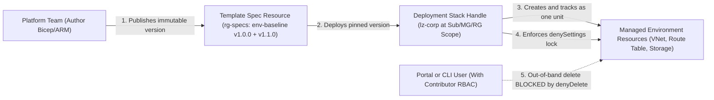
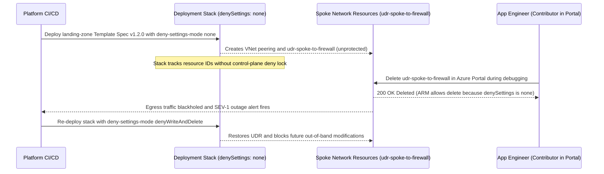

# Repeatable Environments: Deployment Stacks and Template Specs

> **Prerequisites:** Declarative IaC and pinned Terraform modules (`09`), Cloud Adoption Framework landing zones (Module 02), and Policy initiatives (Module 03).  
> **Estimated Reading Time:** 35 minutes  
> **Target Audience:** Backend Engineers, Platform Engineers, Cloud Architects.

> [!TIP]
> **The Golden Rule of Native Repeatable Environments:** Compose **Template Specs** (immutable, RBAC-governed versioned templates) with **Deployment Stacks** (whole-unit lifecycle tracking + `denySettings` control-plane locks), explicitly configure `--action-on-unmanage`, never design anything new on deprecated **Azure Blueprints** (retiring July 2026), and avoid managing the same resources with both Deployment Stacks and Terraform.

---

## Why This Matters

A landing zone (module 02) is only useful if you can hand out *many* of them consistently. When a new team needs an environment, you don't want someone click-opsing resources or copy-pasting a script — you want a **versioned, governed template** that provisions the whole thing the same way every time, and a way to manage the resulting set of resources as *one lifecycle unit*. Azure has native mechanisms for this — **Template Specs** and **Deployment Stacks** — and it also *had* one (**Azure Blueprints**) that you'll still find in old docs and that is now deprecated. This module makes you accurate about the current tooling: what each native mechanism is, when to use it, and how it relates to the Terraform you already know (track 9) and will scale in module 05.

---

## 1. Architectural Mental Model: Template Specs + Deployment Stacks

Combining Template Specs and Deployment Stacks gives you both a versioned, RBAC-controlled template artifact on the shelf and a locked, lifecycle-managed resource set in production:



### The problem: repeatable, governed, managed-as-a-unit provisioning

Three requirements stack up when you provision environments at scale:

1. **Repeatable** — the same inputs produce the same environment, every time, with no manual steps to forget. (This is the declarative-IaC argument from track 9 module 00, now at environment granularity.)
2. **Versioned & governed** — the template is a first-class, immutable, shareable artifact with versions, so "environment v2" is a known thing and teams can only deploy blessed versions.
3. **Managed as a unit** — the resources a template creates form one lifecycle: you can see them together, update them together, and *delete them together*, and ideally *prevent* someone deleting or drifting them out from under you.

Terraform (track 9) gives you 1 and part of 3 (via state and `destroy`). Azure's native mechanisms give you 2 and a stronger version of 3. Knowing both — and that they *overlap* — is the point; you don't need all of them, you need the right one for a given org's tooling.

### Template Specs: a versioned, shareable ARM/Bicep template as an Azure resource

A **Template Spec** is an ARM/Bicep template stored **as a first-class Azure resource**, with **versions**. Instead of passing a `template.json` file around (email, repo, wiki), you publish it once as a Template Spec; it lives in a resource group, has RBAC on it (so you control who can deploy it), and every publish creates an immutable **version**. Teams then deploy *a specific version* of the spec. This solves requirement 2 (versioned, governed, shareable): the template is a governed artifact, not a loose file. What a Template Spec does *not* do by itself is manage the deployed resources as a tracked unit — it's the *template* that's versioned, not the *deployment*. Think of it as "the blessed blueprint on a shelf, with a version label," analogous to a pinned, published Terraform module (track 9 module 04) but native to Azure.

### Deployment Stacks: manage a set of resources as one governed lifecycle unit

A **Deployment Stack** is the newer, GA mechanism that addresses requirement 3 head-on. A stack is an Azure resource that represents a **collection of resources deployed together and managed as a single unit**. Deploy a template (or a Template Spec) *as a stack* and Azure tracks exactly which resources the stack owns. That unlocks two things a plain deployment can't:

- **Whole-unit lifecycle** — update the stack and it reconciles the managed resources (adding, updating, and optionally *deleting* resources that fell out of the template — like a Terraform apply that prunes); delete the stack and it can delete all its managed resources in one action.
- **Deny-settings (drift/deletion protection)** — a stack can apply **`denySettings`** that *prevent* anyone from deleting or modifying the stack's managed resources outside the stack itself, even users with permissions. This is the "don't let someone hand-delete a landing-zone resource" guardrail Blueprints used to provide via locks.

Stacks can be scoped at resource group, subscription, or **management group** level — so a platform team can deploy a governed environment across a scope and lock it against tampering. Stacks are the current native answer to "provision a governed environment and keep it governed."

### Azure Blueprints is deprecated — know what replaced it

You will find **Azure Blueprints** in older governance docs and tutorials. Be accurate: **Azure Blueprints has been deprecated by Microsoft** (it never left preview), with its retirement in **July 2026**, and Microsoft's guidance is to **use Template Specs and Deployment Stacks instead**. Blueprints tried to bundle ARM templates + policy assignments + RBAC assignments into one versioned, lockable package applied at a subscription/MG scope — conceptually attractive for landing zones, but it's now a dead end. The replacement mapping:

| Old Blueprints capability | Current mechanism |
|---|---|
| Versioned, shareable template artifact | **Template Spec** |
| Deploy + manage resources as one locked unit | **Deployment Stack** (with `denySettings`) |
| Bundled policy/RBAC assignments at scope | **Policy initiatives** (module 03) + **RBAC at MG** (module 01), assigned directly |

So don't design anything new on Blueprints. If you inherit a Blueprints-based environment, the migration path is Template Specs + Deployment Stacks for the provisioning, and native policy/RBAC assignments for the governance the blueprint used to carry. Being able to *say this accurately in an interview or design review* is the concrete takeaway.

### Where Terraform fits (and why this track still teaches both)

If you're all-in on Terraform (module 05), do you need stacks and specs at all? Often no — Terraform already gives you repeatability (state), pruning (`destroy` / plan), and versioned modules (registry pins). Many orgs standardize on Terraform and never touch Deployment Stacks. But you should know the native mechanisms because: (a) some orgs are Bicep/ARM shops and stacks are their idiom; (b) stacks' `denySettings` deletion-protection is a *native control-plane* guarantee Terraform can't fully replicate (Terraform state doesn't stop a portal user deleting a resource); and (c) the CAF accelerators and Microsoft reference material assume this vocabulary. The honest framing: **Terraform and Deployment Stacks are overlapping tools for repeatable provisioning — pick one primary mechanism per org, and know the other exists.** Module 05 goes deep on the Terraform path because it's this curriculum's spine; this module makes sure you can name and reason about the native alternative.

---

## 2. Taxonomic Comparison & Command Reference

### Repeatable Provisioning Mechanisms Matrix

| Dimension | Plain ARM / Bicep Deployment | Template Spec | Deployment Stack | Terraform (Module 05) |
|---|---|---|---|---|
| **Primary Role** | One-shot imperative-feel deploy | Versioned, RBAC-governed template artifact | Managed resource lifecycle unit + control-plane locks | Declarative state-tracked IaC across clouds |
| **Version Pinning** | Git commit / local file only | Immutable Azure resource version (`1.0.0`) | Consumes template file or pinned Template Spec | Pinned module registry (`version = "~> 1.4"`) |
| **Pruning / Whole-Unit Delete** | None (orphans stay behind) | None (artifact only) | Automatic via `--action-on-unmanage` (`deleteAll`) | Automatic via state graph & `terraform destroy` |
| **Out-of-Band Tamper Lock** | None (requires separate Locks) | None | Native `denySettings` (`denyDelete` / `denyWriteAndDelete`) | None (detects drift on next plan only) |
| **Best Fit** | Ad-hoc deploys | Sharing blessed Bicep/ARM templates across teams | Bicep/ARM orgs provisioning protected landing zones | Multi-subscription Terraform platform shops |

### Deployment Stack Protection & Unmanaged Action Options

| Setting | Option Value | Behaviour |
|---|---|---|
| `--deny-settings-mode` | `none` | Tracks resources as a unit, **zero** deletion or write protection (default trap!) |
| `--deny-settings-mode` | `denyDelete` | Blocks out-of-band deletion of stack resources, even for `Contributor`/`Owner` (unless excluded) |
| `--deny-settings-mode` | `denyWriteAndDelete` | Blocks both out-of-band modification and deletion outside stack updates |
| `--action-on-unmanage` | `deleteResources` / `deleteAll` | Automatically deletes resources (and RGs for `deleteAll`) removed from template or when stack is deleted |
| `--action-on-unmanage` | `detachAll` | Leaves orphaned resources running in Azure, detached from stack management |

### Command Reference

| Command | What it does | Example |
|---|---|---|
| `az ts create` | Publishes/updates a **Template Spec** version | see breakdown below |
| `az ts show` | Shows a Template Spec (and versions) | `az ts show --name env-baseline --resource-group rg-specs --version 1.0.0` |
| `az deployment group create --template-spec <id>` | Deploys a specific Template Spec version (plain deployment) | `az deployment group create -g rg-app --template-spec <version-id>` |
| `az stack sub create` | Creates a **Deployment Stack** at *subscription* scope | see breakdown below |
| `az stack group create` | Creates a Deployment Stack at *resource-group* scope | `az stack group create --name app-stack -g rg-app --template-file main.bicep --deny-settings-mode denyDelete --action-on-unmanage deleteAll` |
| `az stack mg create` | Creates a Deployment Stack at *management-group* scope | `az stack mg create --name lz-stack -m mg-corp --location eastus --template-file lz.bicep --deny-settings-mode denyWriteAndDelete --action-on-unmanage detachAll` |
| `az stack sub list` | Lists Deployment Stacks at a scope | `az stack sub list -o table` |
| `az stack sub delete` | Deletes a stack (and, per `--action-on-unmanage`, its resources) | `az stack sub delete --name lz-stack` |

Flag breakdown — `az ts create --name env-baseline --version 1.0.0 --resource-group rg-specs --location eastus --template-file env.bicep`:

- `--name env-baseline` — the Template Spec resource's name (the artifact on the shelf).
- `--version 1.0.0` — the **immutable version** being published; deployers pin to a version, so publishing `1.1.0` later doesn't change anyone already on `1.0.0` (the pinning discipline from track 9 module 04).
- `--resource-group rg-specs` — where the spec lives; RBAC on this RG controls who can deploy the spec.
- `--template-file env.bicep` — the ARM/Bicep template captured as this version.

Flag breakdown — `az stack sub create --name lz-corp --location eastus --template-file lz.bicep --deny-settings-mode denyDelete --action-on-unmanage deleteResources --deployment-resource-group-name rg-lz`:

- `--name lz-corp` — the stack's name; the handle for the whole managed unit.
- `--location eastus` — where the stack *resource* itself is stored (not necessarily where every deployed resource goes).
- `--template-file lz.bicep` — the template (or `--template-spec <id>` to deploy a governed spec version as a stack — combining both mechanisms).
- `--deny-settings-mode denyDelete` — the **drift/deletion protection**: `denyDelete` blocks deletion of managed resources, `denyWriteAndDelete` blocks modification too, `none` disables it. This is the native "lock" that replaces Blueprints locks.
- `--action-on-unmanage deleteResources` — what happens to managed resources when they leave the stack or the stack is deleted: `deleteResources` / `deleteAll` prunes them, `detachAll` leaves them behind (unmanaged). This is the whole-unit lifecycle control — the "delete the environment in one action" power.
- `--deployment-resource-group-name rg-lz` — for a subscription-scope stack, which RG the resources deploy into.

---

## 3. Production War Story Post-Mortem: Unprotected Deployment Stack (`denySettings: none`) Allows Out-of-Band Route Table Deletion

- **Severity:** SEV-1
- **Detection Time:** 4 minutes (synthetic spoke-to-hub health probes failed; egress traffic dropped)
- **Resolution Time:** 48 minutes
- **Impact:** Outbound traffic from `sub-payments-corp` AKS workloads blackholed for 38 minutes after an engineer troubleshooting DNS manually deleted the landing zone's hub-routing UDR table in the Azure Portal. Meanwhile, an architecture audit flagged two legacy Azure Blueprint assignments still running unmigrated ahead of the July 2026 retirement deadline.

### What Happened

A platform team migrated their landing zone spoke provisioning to Azure Deployment Stacks (`az stack sub create`), assuming "Deployment Stack" automatically meant Blueprint-style lock protection. However, their pipeline omitted `--deny-settings-mode` (or left it at `none`), so the stack tracked resources without locking them. During an unrelated DNS latency investigation, an app engineer with `Contributor` rights inside `sub-payments-corp` opened the Azure Portal and deleted `udr-spoke-to-firewall` thinking it would reset a stale route—immediately severing hub firewall routing.



### Root Cause Analysis

1. **Stack != Locked:** The platform team conflated managed-unit tracking (`az stack`) with tamper protection (`--deny-settings-mode denyDelete` or `denyWriteAndDelete`). With `denySettings.mode = none`, Azure RBAC `Contributor` rights permitted out-of-band deletion.
2. **Legacy Blueprint Debt:** Unmigrated Azure Blueprints created configuration confusion because engineers expected old Blueprint-style `DoNotDelete` locks without verifying Deployment Stack `denySettings`.

### The Fix & Architectural Hardening

1. **Immediate Mitigation:** Re-ran the stack deployment to recreate `udr-spoke-to-firewall` and upgraded `--deny-settings-mode` to `denyWriteAndDelete`.
2. **Permanent Architectural Fix:** Added a pre-deployment CI gate (Section 4) rejecting any production Deployment Stack with `denySettings.mode == "none"`, requiring explicit `--action-on-unmanage` (`deleteAll` for stateless/ephemeral envs, `detachAll` for stateful DB stacks), pinning immutable Template Spec versions, and blocking all `Microsoft.Blueprint` resources in favor of Template Specs + Deployment Stacks + Policy Initiatives.

---

## 4. Multi-Language Production Implementation: Deployment Stacks Drift Guard & Blueprints Migration Validator

Before platform CI/CD executes `az stack` or publishes ARM/Bicep environment definitions, automated guardrails verify: (1) zero deprecated `Microsoft.Blueprint` artifacts remain, (2) production stacks enforce `denyDelete` or `denyWriteAndDelete`, (3) `actionOnUnmanage` is explicitly set (preventing accidental orphan drift or database destruction), (4) Template Spec references pin an explicit version, and (5) Terraform does not co-manage the same stack scope.

````carousel
### Go — Deployment Stack Drift Guard & Blueprint Validator

```go
package stacks

import (
	"fmt"
	"strings"
)

type StackConfig struct {
	Name                   string
	Environment            string // "prod" | "nonprod" | "sandbox"
	TemplateSpecID         string // e.g. .../templateSpecs/env-baseline/versions/1.0.0
	DenySettingsMode       string // "none" | "denyDelete" | "denyWriteAndDelete"
	ActionOnUnmanageRes    string // "delete" | "detach"
	ManagedByTerraformAlso bool
	UsesBlueprintAPI       bool
}

func ValidateStackDeployment(cfg StackConfig) []string {
	var errors []string

	if cfg.UsesBlueprintAPI {
		errors = append(errors, fmt.Sprintf("CRITICAL [%s]: Azure Blueprints is deprecated (retiring July 2026); migrate to Template Specs + Deployment Stacks + Policy Initiatives", cfg.Name))
	}
	if cfg.ManagedByTerraformAlso {
		errors = append(errors, fmt.Sprintf("CRITICAL [%s]: competing sources of truth — do not manage the same resources with both Deployment Stacks and Terraform", cfg.Name))
	}
	if cfg.Environment == "prod" && cfg.DenySettingsMode != "denyDelete" && cfg.DenySettingsMode != "denyWriteAndDelete" {
		errors = append(errors, fmt.Sprintf("HIGH [%s]: prod stack has denySettingsMode=%q; require denyDelete or denyWriteAndDelete", cfg.Name, cfg.DenySettingsMode))
	}
	if cfg.ActionOnUnmanageRes != "delete" && cfg.ActionOnUnmanageRes != "detach" {
		errors = append(errors, fmt.Sprintf("HIGH [%s]: actionOnUnmanage for resources must be explicitly 'delete' or 'detach'", cfg.Name))
	}
	if cfg.TemplateSpecID != "" && !strings.Contains(cfg.TemplateSpecID, "/versions/") {
		errors = append(errors, fmt.Sprintf("HIGH [%s]: templateSpecId %q must pin an immutable /versions/<semver>", cfg.Name, cfg.TemplateSpecID))
	}
	return errors
}
```
<!-- slide -->
### TypeScript — Deployment Stack Drift Guard & Blueprint Validator

```typescript
export type DenySettingsMode = "none" | "denyDelete" | "denyWriteAndDelete";
export type UnmanageAction = "delete" | "detach" | "unset";

export interface DeploymentStackManifest {
  name: string;
  environment: "prod" | "nonprod" | "sandbox";
  templateSpecId?: string;
  denySettingsMode: DenySettingsMode;
  actionOnUnmanageResources: UnmanageAction;
  hasTerraformStateOverlap: boolean;
  referencesMicrosoftBlueprint: boolean;
}

export function validateStackPolicy(manifest: DeploymentStackManifest): string[] {
  const issues: string[] = [];

  if (manifest.referencesMicrosoftBlueprint) {
    issues.push(
      `CRITICAL [${manifest.name}]: Azure Blueprints is deprecated (July 2026 retirement); replace with Template Specs + Deployment Stacks.`
    );
  }

  if (manifest.hasTerraformStateOverlap) {
    issues.push(
      `CRITICAL [${manifest.name}]: Competing sources of truth detected between Deployment Stack and Terraform state.`
    );
  }

  if (manifest.environment === "prod" && manifest.denySettingsMode === "none") {
    issues.push(
      `HIGH [${manifest.name}]: Production stack has denySettingsMode='none'; opt into 'denyDelete' or 'denyWriteAndDelete'.`
    );
  }

  if (manifest.actionOnUnmanageResources === "unset") {
    issues.push(
      `HIGH [${manifest.name}]: Explicitly declare actionOnUnmanage ('delete' or 'detach') to prevent unintended orphans or deletions.`
    );
  }

  if (manifest.templateSpecId && !/\/versions\/[^/]+$/.test(manifest.templateSpecId)) {
    issues.push(
      `HIGH [${manifest.name}]: Template Spec '${manifest.templateSpecId}' must pin an immutable version segment.`
    );
  }

  return issues;
}
```
<!-- slide -->
### Python — Deployment Stack Drift Guard & Blueprint Validator

```python
import re
from dataclasses import dataclass
from typing import List, Optional

VERSION_PIN_RE = re.compile(r"/versions/[^/]+$")


@dataclass(frozen=True)
class DeploymentStackSpec:
    name: str
    environment: str
    template_spec_id: Optional[str]
    deny_settings_mode: str
    action_on_unmanage: str
    co_managed_by_terraform: bool
    uses_deprecated_blueprint: bool


def guard_deployment_stack(spec: DeploymentStackSpec) -> List[str]:
    violations: List[str] = []

    if spec.uses_deprecated_blueprint:
        violations.append(
            f"CRITICAL [{spec.name}]: Azure Blueprints is deprecated (retiring July 2026); use Template Specs + Deployment Stacks"
        )

    if spec.co_managed_by_terraform:
        violations.append(
            f"CRITICAL [{spec.name}]: Do not mix Terraform and Deployment Stacks on the same resource set"
        )

    if spec.environment == "prod" and spec.deny_settings_mode not in ("denyDelete", "denyWriteAndDelete"):
        violations.append(
            f"HIGH [{spec.name}]: Prod stack deny_settings_mode={spec.deny_settings_mode!r} lacks out-of-band lock protection"
        )

    if spec.action_on_unmanage not in ("deleteAll", "deleteResources", "detachAll"):
        violations.append(
            f"HIGH [{spec.name}]: action_on_unmanage={spec.action_on_unmanage!r} must be explicit"
        )

    if spec.template_spec_id and not VERSION_PIN_RE.search(spec.template_spec_id):
        violations.append(
            f"HIGH [{spec.name}]: template_spec_id must pin an immutable /versions/<ver> resource ID"
        )

    return violations
```
<!-- slide -->
### C# — Deployment Stack Drift Guard & Blueprint Validator

```csharp
using System;
using System.Collections.Generic;
using System.Text.RegularExpressions;

namespace Governance.DeploymentStacks;

public sealed record StackDeploymentSpec(
    string Name,
    string Environment,
    string? TemplateSpecId,
    string DenySettingsMode,
    string ActionOnUnmanage,
    bool CoManagedByTerraform,
    bool UsesDeprecatedBlueprint);

public static partial class DeploymentStackDriftGuard
{
    [GeneratedRegex(@"/versions/[^/]+$", RegexOptions.IgnoreCase)]
    private static partial Regex VersionPinRegex();

    public static IReadOnlyList<string> Validate(StackDeploymentSpec spec)
    {
        var errors = new List<string>();

        if (spec.UsesDeprecatedBlueprint)
            errors.Add($"CRITICAL [{spec.Name}]: Azure Blueprints is deprecated (retiring July 2026); migrate to Template Specs + Deployment Stacks.");

        if (spec.CoManagedByTerraform)
            errors.Add($"CRITICAL [{spec.Name}]: Competing sources of truth — avoid managing the same scope via both Terraform and Deployment Stacks.");

        if (string.Equals(spec.Environment, "prod", StringComparison.OrdinalIgnoreCase) &&
            !string.Equals(spec.DenySettingsMode, "denyDelete", StringComparison.OrdinalIgnoreCase) &&
            !string.Equals(spec.DenySettingsMode, "denyWriteAndDelete", StringComparison.OrdinalIgnoreCase))
        {
            errors.Add($"HIGH [{spec.Name}]: Production stack must set denySettingsMode to denyDelete or denyWriteAndDelete (found '{spec.DenySettingsMode}').");
        }

        if (string.IsNullOrWhiteSpace(spec.ActionOnUnmanage))
            errors.Add($"HIGH [{spec.Name}]: Explicit actionOnUnmanage policy (deleteAll/deleteResources/detachAll) is required.");

        if (!string.IsNullOrWhiteSpace(spec.TemplateSpecId) && !VersionPinRegex().IsMatch(spec.TemplateSpecId))
            errors.Add($"HIGH [{spec.Name}]: TemplateSpecId '{spec.TemplateSpecId}' must pin an immutable version.");

        return errors;
    }
}
```
````

---

## 5. Practical Hands-On Verification CLI Workflows

Template Specs and stack *metadata* are free; the **resources a stack/spec deploys are real and billable**, so every exercise deploys something trivial and cheap (a storage account or a resource group) and cleans up. Reuse your `mg-corp` landing-zone MG from module 02 where noted. Bicep is used for the templates (ARM JSON works identically); if you don't have Bicep, `az bicep install` first.

### 1. (Azure) Author a tiny environment template

Create `env.bicep` describing a minimal "environment" — one storage account with a required tag:

```bash
mkdir -p ~/gov-labs/04 && cd ~/gov-labs/04
cat > env.bicep <<'BICEP'
param location string = resourceGroup().location
param costCenter string
resource sa 'Microsoft.Storage/storageAccounts@2023-01-01' = {
  name: 'govstk${uniqueString(resourceGroup().id)}'
  location: location
  sku: { name: 'Standard_LRS' }
  kind: 'StorageV2'
  tags: { CostCenter: costCenter }
}
BICEP
```

This is the repeatable unit you'll publish and deploy governed.

### 2. (Azure) Publish it as a versioned Template Spec

Put the template on the shelf as a governed artifact:

```bash
az group create -n rg-specs -l eastus
az ts create --name env-baseline --version 1.0.0 \
  --resource-group rg-specs --location eastus --template-file env.bicep
az ts show --name env-baseline -g rg-specs --query "versions" -o json
```

**Expected Output:**
```json
{
  "1.0.0": {
    "id": "/subscriptions/11111111-2222-3333-4444-555555555555/resourceGroups/rg-specs/providers/Microsoft.Resources/templateSpecs/env-baseline/versions/1.0.0",
    "timeCreated": "2026-11-11T04:20:00+00:00"
  }
}
```

Expect a Template Spec `env-baseline` with version `1.0.0`. This is now a shareable, RBAC-controllable artifact — not a loose file.

### 3. (Azure) Deploy a specific spec version (plain deployment)

Provision an environment *from the versioned artifact*:

```bash
az group create -n rg-env-a -l eastus
SPECV=$(az ts show --name env-baseline -g rg-specs --version 1.0.0 --query id -o tsv)
az deployment group create -g rg-env-a --template-spec "$SPECV" --parameters costCenter=CC-1001
az resource list -g rg-env-a -o table
```

**Expected Output:**
```text
Name              ResourceGroup    Location    Type                               Status
----------------  ---------------  ----------  ---------------------------------  --------
govstk4b8f2a9c12  rg-env-a         eastus      Microsoft.Storage/storageAccounts
```

Expect a storage account created from spec `1.0.0`. Two teams deploying the *same version* get identical environments — requirement 1 + 2 met.

### 4. (Azure) Now deploy as a Deployment Stack and see the managed unit

Deploy the same template as a *stack* so Azure tracks the resources as one unit:

```bash
az stack group create --name env-b-stack -g rg-env-a \
  --template-file env.bicep --parameters costCenter=CC-1002 \
  --deny-settings-mode none --action-on-unmanage deleteAll --yes
az stack group show --name env-b-stack -g rg-env-a --query "resources[].id" -o json
```

**Expected Output:**
```json
[
  "/subscriptions/11111111-2222-3333-4444-555555555555/resourceGroups/rg-env-a/providers/Microsoft.Storage/storageAccounts/govstk4b8f2a9c12"
]
```

Expect the stack listing the exact resources it manages. Unlike the plain deployment in exercise 3, this set now has a *handle* (`env-b-stack`) you can manage and delete as one.

### 5. (Azure) Turn on deletion protection (`denySettings`) and prove it

Update the stack to `denyDelete` and then try to delete a managed resource directly — Azure blocks it:

```bash
az stack group create --name env-b-stack -g rg-env-a \
  --template-file env.bicep --parameters costCenter=CC-1002 \
  --deny-settings-mode denyDelete --action-on-unmanage deleteAll --yes
SA=$(az stack group show --name env-b-stack -g rg-env-a --query "resources[0].id" -o tsv)
az resource delete --ids "$SA" 2>&1 | head   # expect a denial from the stack's deny-settings
```

**Expected Output:**
```text
ERROR: (DenyAssignmentAuthorizationFailed) The client '...' with object id '...' has permission to perform action 'Microsoft.Storage/storageAccounts/delete' on scope '...'; however, the access is denied because of the deny assignment with name '...' created by deployment stack 'env-b-stack'.
```

Expect the direct delete to be **rejected** — the stack protects its managed resources even from users with delete permission. This is the native control Terraform state alone can't give you, and the replacement for Blueprints locks.

### 6. (Azure) Delete the whole environment in one action

The whole-unit lifecycle payoff — remove the stack and, per `--action-on-unmanage`, its resources:

```bash
az stack group delete --name env-b-stack -g rg-env-a --action-on-unmanage deleteAll --yes
az resource list -g rg-env-a -o table   # the stack-managed storage account is gone
```

**Expected Output:**
```text
(Empty table — all resources managed by env-b-stack have been deleted cleanly)
```

Expect the managed resources deleted together. Compare to Terraform `destroy` (track 9) — same "tear down the environment with one command" idea, native.

### 7. (Written) Map Blueprints to its replacements — accuracy check

Without deploying anything, write down: (a) that Azure Blueprints is **deprecated** (retiring July 2026) and you would *not* build new on it; (b) for each of the three things Blueprints bundled — versioned template artifact, locked deploy-as-a-unit, bundled policy/RBAC — which *current* mechanism replaces it (Template Spec; Deployment Stack with `denySettings`; policy initiatives from module 03 + RBAC at MG from module 01). This is the interview-ready takeaway.

### 8. Diagnose and fix: "someone deleted a landing-zone resource we thought was protected."

A governance-real scenario. You deployed a stack with `--deny-settings-mode none` (the default in exercise 4) believing it was protected, and a resource got hand-deleted. Reproduce and fix:

```bash
# (Re)create a stack WITHOUT protection — the mistake:
az group create -n rg-env-c -l eastus
az stack group create --name unprotected-stack -g rg-env-c \
  --template-file env.bicep --parameters costCenter=CC-1003 \
  --deny-settings-mode none --action-on-unmanage deleteAll --yes
SA=$(az stack group show --name unprotected-stack -g rg-env-c --query "resources[0].id" -o tsv)
az resource delete --ids "$SA"   # SUCCEEDS — no protection
```

**Diagnose:** the stack existed, but `deny-settings-mode` was `none`, so it tracked the resources without *protecting* them — a stack is not automatically a lock. Confirm with `az stack group show --name unprotected-stack -g rg-env-c --query "denySettings" -o json` (mode `none`).

**Fix:** redeploy the stack with `--deny-settings-mode denyDelete` (or `denyWriteAndDelete` for full drift protection) so managed resources can't be deleted/modified outside the stack:

```bash
az stack group create --name unprotected-stack -g rg-env-c \
  --template-file env.bicep --parameters costCenter=CC-1003 \
  --deny-settings-mode denyDelete --action-on-unmanage deleteAll --yes
```

**Expected Output:**
```json
{
  "denySettings": {
    "mode": "denyDelete"
  },
  "provisioningState": "Succeeded"
}
```

Lesson: **deploying *as* a stack gives you the managed-unit lifecycle; protection is a separate opt-in (`denySettings`) you must set.** "It's a stack" != "it's protected."

### 9. (Azure) Clean up everything

Remove stacks, specs, and lab RGs:

```bash
az stack group delete --name unprotected-stack -g rg-env-c --action-on-unmanage deleteAll --yes 2>/dev/null; true
az group delete -n rg-env-a --yes --no-wait
az group delete -n rg-env-c --yes --no-wait
az group delete -n rg-specs --yes --no-wait   # removes the Template Spec too
```

Confirm with `az stack group list -g rg-env-a -o table` (should error/empty) and `az group list -o table`.

### Independent Challenge

No commands given — build it yourself, drawing on this module, track 9 (declarative IaC, versioned modules) and module 02 (landing zones). Design a **repeatable "application landing zone" provisioning mechanism** using the current native tooling: author a small Bicep/ARM template that stands up a minimal governed environment (at least a resource group's worth of resources with required tags), publish it as a **versioned Template Spec** so it's a governed artifact teams deploy by version, and then deploy it **as a Deployment Stack** with **deletion-protection** (`denySettings`) turned on and an explicit `action-on-unmanage` policy, so the environment is both provisioned repeatably and protected from ad-hoc tampering. Deploy two "environments" from the *same* spec version to prove repeatability, then delete one entirely via its stack in a single action. Finally, write a short paragraph stating precisely why you would **not** use Azure Blueprints for this, and mapping each capability you used (versioned artifact, locked managed unit) to the mechanism that provided it — and note in one sentence how you'd achieve the same outcome in Terraform (module 05) and what the native `denySettings` gives you that Terraform state does not. Clean up all billable resources.

<details>
<summary>Stuck? One hint</summary>

Combine the two mechanisms rather than choosing between them: publish the template once with `az ts create --name <spec> --version 1.0.0`, then deploy it *as a stack* by passing the spec's version id to the stack (`az stack group create --template-spec <version-id> --deny-settings-mode denyDelete --action-on-unmanage deleteAll`). That gives you the governed, versioned artifact (Template Spec) *and* the protected, managed-as-a-unit lifecycle (Deployment Stack) in one flow — which is exactly the pair of things Blueprints tried to do in a single now-deprecated object. The Terraform equivalent is a pinned published module + `terraform destroy`; the thing `denySettings` adds that Terraform can't is a *control-plane* guarantee that even a portal user with delete rights can't remove the resource out of band.

</details>

---

## 6. Common Mistakes & Troubleshooting

- **Designing anything new on Azure Blueprints.** It's deprecated (retiring July 2026) and never left preview. Use Template Specs + Deployment Stacks + native policy/RBAC assignments instead. Recognize Blueprints in old docs; don't build on it.
- **Assuming a Deployment Stack automatically protects its resources.** The managed-unit tracking and the *protection* are separate — protection requires `--deny-settings-mode denyDelete`/`denyWriteAndDelete`. A stack with mode `none` tracks but does not lock. (Exercise 8.)
- **Confusing a Template Spec with a Deployment Stack.** A Template Spec is a *versioned template artifact* (the blueprint on the shelf); a Deployment Stack is a *managed set of deployed resources* (the running environment). Specs version the template; stacks manage the deployment. They compose.
- **Forgetting `--action-on-unmanage`.** When you delete a stack or a resource leaves it, this flag decides whether the resources are deleted or detached (left orphaned). Not setting it deliberately can leave billable resources behind after you thought you'd torn everything down.
- **Publishing a new Template Spec version and expecting existing deployments to change.** Versions are immutable and deployers pin to one; publishing `1.1.0` doesn't touch anything on `1.0.0` — you must re-deploy the new version (the same pinning behaviour as track 9 module modules).
- **Reaching for stacks when your org is all-Terraform.** Terraform already gives repeatability and pruning; adding stacks on top can create two competing sources of truth. Pick one primary mechanism per environment.

---

## 7. Operational Validation Checkpoints

<details>
<summary><strong>Checkpoint 1: Removing a Production Database from Bicep Without Losing Data</strong></summary>

**Scenario:** You manage a landing zone via `az stack group create` with `--action-on-unmanage deleteAll`. You need to refactor a stateful Azure SQL Database out of that stack so a separate database team's stack can adopt it—without deleting the live production database during stack reconciliation.

**Question:** What happens if you remove the SQL server resource block from `main.bicep` and update the stack with `--action-on-unmanage deleteAll`, and how should you reconfigure the update safely?

**Answer:** With `--action-on-unmanage deleteAll` (or `deleteResources`), Deployment Stacks immediately **deletes** any resource removed from the template when reconciling the managed unit—wiping your production database. To remove a stateful resource from stack ownership without destroying it, update the stack using **`--action-on-unmanage detachAll`** (or `--delete-resources false`) so Azure detaches the resource cleanly instead of deleting it.

</details>

<details>
<summary><strong>Checkpoint 2: Publishing Template Spec v2.0.0 Leaves Existing Environments Untouched</strong></summary>

**Scenario:** Your platform team publishes `env-baseline` Template Spec version `2.0.0` adding mandatory Diagnostic Settings to every landing zone. Two hours later, an engineer inspects three existing landing zones deployed from `1.0.0` and wonders why none of them updated automatically.

**Question:** Why didn't existing deployments pick up `2.0.0`, and how do you roll it out safely?

**Answer:** Template Spec versions are **immutable artifacts** — callers pin directly to a specific `/versions/1.0.0` resource ID, just like pinned Terraform module versions. Publishing `2.0.0` never mutates deployed environments; you must explicitly redeploy each target Deployment Stack pointing `--template-spec` to the `2.0.0` version ID.

</details>

<details>
<summary><strong>Checkpoint 3: Interview Design Question — Migrating Off Azure Blueprints</strong></summary>

**Scenario:** An enterprise architect asks you to modernize a 2021 landing-zone platform built entirely on Azure Blueprints before the July 2026 retirement deadline.

**Question:** How do you map each Blueprint component cleanly onto current GA Azure services?

**Answer:** Replace the three Blueprint capabilities with native GA equivalents: (1) versioned ARM artifact storage -> **Template Specs**, (2) whole-unit lifecycle + `DoNotDelete` resource locking -> **Deployment Stacks** with `--deny-settings-mode denyDelete` or `denyWriteAndDelete`, and (3) bundled RBAC + policy definitions/assignments -> **Azure Policy Initiatives** (Module 03) and **Management Group RBAC assignments** (Module 01) applied declaratively.

</details>

### Checkpoint Quiz (Self-Check)

Write down your answer to each question before expanding it — checking without attempting first is the single easiest way to fool yourself into thinking you've learned this.

<details>
<summary>Show questions</summary>

1. What is a Template Spec, and which of the three provisioning requirements (repeatable / versioned-governed / managed-as-a-unit) does it primarily satisfy?
2. What does a Deployment Stack give you that a plain deployment does not? Name the two headline capabilities.
3. What is `denySettings` on a stack, and what governance guarantee does it provide that Terraform state cannot?
4. Is Azure Blueprints something you'd design a new landing-zone mechanism on today? Explain, and give the replacement for each thing Blueprints bundled.
5. You deployed resources as a stack but a user still deleted one. What was almost certainly misconfigured?
6. What does `--action-on-unmanage deleteAll` vs `detachAll` control?
7. When might an org legitimately skip Deployment Stacks entirely?

</details>

<details>
<summary>Show answers</summary>

1. A Template Spec is an ARM/Bicep template stored as a first-class, RBAC-controlled Azure resource with immutable **versions**. It primarily satisfies **versioned & governed** (a shareable, pinned template artifact) — not managed-as-a-unit by itself.
2. Whole-unit lifecycle (update reconciles/prunes the managed set; delete can remove all managed resources in one action) and **deletion/drift protection** via `denySettings`. A plain deployment does neither — it just creates resources and forgets the grouping.
3. `denySettings` prevents deletion (`denyDelete`) or modification and deletion (`denyWriteAndDelete`) of a stack's managed resources *outside* the stack, even by users with permissions — a native control-plane lock. Terraform state can't stop a portal/CLI user from deleting a resource out of band; it only detects the drift afterward.
4. No — Blueprints is deprecated (retiring July 2026) and never left preview. Replacements: versioned template artifact -> **Template Spec**; locked deploy-as-one-unit -> **Deployment Stack** with `denySettings`; bundled policy/RBAC assignments -> **policy initiatives** (module 03) + **RBAC at MG** (module 01) assigned natively.
5. The stack's `--deny-settings-mode` was `none` (the default) — it tracked the resources as a unit but did not protect them. Protection is a separate opt-in (`denyDelete`/`denyWriteAndDelete`); being a stack isn't the same as being locked.
6. What happens to the stack's managed resources when they leave the stack or the stack is deleted: `deleteAll` deletes them (tear the environment down), `detachAll` leaves them in place as unmanaged resources (orphaned from the stack).
7. When the org standardizes on Terraform (module 05), which already provides repeatability (state), pruning (`destroy`/plan), and versioned modules — adding stacks would create a second, competing source of truth. They'd still note stacks' native `denySettings` as the one capability Terraform lacks.

</details>

---

## Sources & Further Reading

- [Deployment stacks overview (ARM / Bicep)](https://learn.microsoft.com/en-us/azure/azure-resource-manager/bicep/deployment-stacks) — Microsoft Learn
- [Azure Resource Manager template specs](https://learn.microsoft.com/en-us/azure/azure-resource-manager/templates/template-specs) — Microsoft Learn

## Next

Continue to [05-multi-subscription-terraform-patterns](../05-multi-subscription-terraform-patterns/README.md) — you've seen the native provisioning mechanisms; now scale the Terraform from track 9 across *multiple subscriptions and environments* with provider aliasing, module reuse, and per-environment state strategies.
