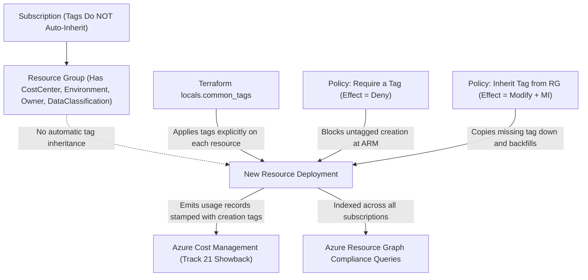
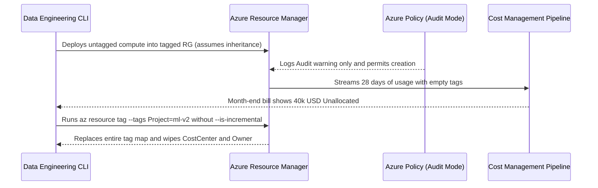

# Tagging Strategy and Resource Organization

> **Prerequisites:** Azure Management Groups and Policy Inheritance (Modules 01–03), Azure Policy effects (`Deny`, `Modify`, `DeployIfNotExists`) (Track 11, Module 05), and Terraform locals/variables (Track 9).  
> **Estimated Reading Time:** 30 minutes  
> **Target Audience:** Platform Engineers, FinOps Engineers, Cloud Architects.

> [!TIP]
> **The Golden Rule of Azure Tagging:** Tags **do not inherit automatically** from subscriptions or resource groups — enforce required keys at creation time with **`Deny`**, backfill and propagate missing tags from parent resource groups with **`Modify` + Managed Identity + Remediation Tasks**, and always pass `--is-incremental` when modifying CLI tags so you never wipe existing metadata.

---

## Why This Matters

You've structured the org (management groups), governed it (initiatives), and provisioned it (stacks/Terraform) — but you still can't answer the question finance will ask on day one: *"which team, project, and cost centre does this \$40,000 belong to?"* Subscriptions give a coarse billing boundary (Module 00); **tags** give the fine-grained, queryable metadata that turns a cloud bill into an allocatable, filterable, ownable inventory. A real tagging *taxonomy* — agreed names, required keys, enforced by policy, inherited down resource groups — is the difference between tags as decoration and tags as the backbone of cost management (Track 21), automation, and ownership. This module builds that taxonomy and enforces it with the exact policy machinery from Module 03.

---

## 1. Architectural Mental Model: Tag Non-Inheritance, Policy Enforcement & FinOps Flow

Unlike Azure RBAC and Azure Policy (which flow down automatically from Management Groups to Subscriptions and Resource Groups), **Azure Resource Tags stop at the scope where you wrote them**. To turn tags into reliable metadata for Cost Management and Resource Graph queries, your platform uses policy enforcement (`Deny` + `Modify`) and IaC `locals`:



### Tags are queryable metadata, and the taxonomy is the point

A **tag** is a `key = value` pair you attach to a subscription, resource group, or resource. Individually trivial; collectively they're the metadata layer the whole org queries — "show me all `Environment=prod` resources," "sum cost by `CostCenter`," "who owns this?" The value is *entirely* in **consistency**: if half the org writes `env=prod`, some `Environment=Production`, and some `ENV=PRD`, no query works. So the deliverable of tagging is not "we use tags" but a **taxonomy**: a documented, agreed set of *required* tag keys, their allowed values, and their meaning. The taxonomy is a governance artifact the platform team owns, exactly like the policy baseline (Module 03) — and, like a baseline, it's worthless unless *enforced*, not merely recommended.

### A real starter taxonomy (the four every org needs)

There are dozens of possible tags; a defensible *minimum* taxonomy that earns its keep is four required keys:

- **`CostCenter`** — the financial allocation code (e.g. `CC-1001`). This is the one finance lives on; it maps spend to a budget/team. It's the tag that makes the cloud bill *allocatable* (Track 21).
- **`Environment`** — `dev` / `test` / `prod` (fixed allowed values). Drives filtering, automation ("stop all `dev` at night"), and correlates resources to the environment strictness you set at the MG level (Module 01).
- **`Owner`** — a *team* or *distribution list* (e.g. `team-payments@contoso.com`), **not** an individual person (people leave; teams persist). Answers "who do I page about this resource?"
- **`DataClassification`** — `public` / `internal` / `confidential` / `restricted`. Drives security and compliance handling (Module 07) — e.g. `restricted` data implies stricter policy and audit scope.

Beyond these, common optional keys are `Project`, `Application`, `ManagedBy` (`terraform`/`portal`), and `ExpiryDate` (for sandbox cleanup). Start with the four required, keep the list short, and *define allowed values* for the categorical ones — an unconstrained free-text tag drifts as badly as no tag.

### Enforcing and defaulting tags with policy (reuse of Module 03)

A taxonomy is only real if resources *can't* be created without it and *inherit* it where sensible. Azure Policy — the exact machinery from Module 03 — provides the built-ins:

- **`Require a tag on resources`** (effect **`Deny`**) — blocks creating a resource (or RG) that lacks a required tag. This is the Track 11 Module 05 `Deny` effect, now enforcing metadata instead of security config. Put these in your baseline initiative (Module 03).
- **`Inherit a tag from the resource group`** (effect **`Modify`**) — auto-adds a tag to resources from their parent resource group if missing, so you tag the RG once and resources inherit it. Because it *writes*, it's a `Modify` policy needing a managed identity and a **remediation task** for existing resources (the DINE/Modify lesson from Track 11 Module 05 and Module 03).
- **`Require a tag and its value`** — enforce not just presence but an *allowed value* (pairs well with the categorical keys).

The pattern: **`Deny` missing required tags at create time, `Modify`/inherit to propagate and backfill, and remediate existing resources.** This is why the taxonomy belongs *in* the governance baseline, not in a wiki — a wiki tag rule is forgotten; a policy tag rule is enforced.

### Tag inheritance is NOT automatic — the mental-model trap

The single biggest tagging misconception: **tags do not inherit down the resource hierarchy by default.** A tag on a subscription does *not* automatically appear on its resource groups, and a tag on a resource group does *not* automatically appear on the resources inside it. (This is the opposite of *policy/RBAC* inheritance from Module 01, which is automatic — so it's an easy mental-model collision.) Cost reports can *group by* a resource's own tags, and some tools can *roll up* by RG, but the *tag value itself* only lands on a resource if it was set there or an **`Inherit a tag`/`Modify` policy** copied it down. Assume nothing inherits; enforce inheritance explicitly with policy. This trap is the module's diagnose-and-fix.

### How tags feed cost management (the Track 21 handoff)

The payoff for finance: Azure **Cost Management** can group, filter, and budget by tag. With a consistent `CostCenter`/`Environment`/`Owner` taxonomy you can produce "spend by cost centre," "dev vs prod spend," and per-team budgets and alerts — turning the single subscription invoice (Module 00) into an allocatable breakdown *without* needing a subscription per team. Track 21 (cost management & FinOps) builds its entire practice on this: right-sizing, showback/chargeback, budgets, and forecasts all key off the tags you standardize here. A crucial caveat to know now: **untagged resources at creation time are the permanent gap** — Cost Management shows historical cost against the tags a resource *had at the time*, and backfilling a tag later doesn't retroactively re-tag past usage. So enforcing tags *at create time* (the `Deny`) is what makes cost data trustworthy; this module is really cost management's foundation.

---

## 2. Taxonomic Comparison & Command Reference

### Starter Tagging Taxonomy Specification

| Tag Key | Requirement | Allowed Values / Format | Primary Consumer | Policy Enforcement Mode |
|---|---|---|---|---|
| `CostCenter` | Required | `CC-####` (e.g. `CC-1001`) | Finance / Cost Management (Track 21) | `Deny` at create + `Modify` inherit from RG |
| `Environment` | Required | `dev`, `test`, `prod` | Platform automation / FinOps | `Deny` (Require a tag and its value) |
| `Owner` | Required | Team email / DL (never individual) | Incident response / On-call paging | `Deny` at create + `Modify` inherit from RG |
| `DataClassification` | Required | `public`, `internal`, `confidential`, `restricted` | Security / Regulatory Compliance (Module 07) | `Deny` (Require a tag and its value) |
| `Project` / `Application` | Optional | Service catalog ID | Engineering portfolio mapping | `Audit` or Terraform `locals` |
| `ExpiryDate` | Optional (Sandbox) | `YYYY-MM-DD` | Automated sandbox cleanup | `Audit` in sandbox MG |

### Tag Governance & Propagation Mechanisms

| Mechanism | Auto-Backfills Existing? | Prevents Untagged Creation? | Requires Managed Identity? | Primary Trade-off |
|---|---|---|---|---|
| **Wiki / Documentation Only** | No | No | No | Ignored under delivery pressure; causes permanent billing gaps |
| **Terraform `locals.common_tags`** | No (only TF-managed) | Only inside TF code | No | Portal/CLI click-ops bypasses it unless paired with Policy |
| **Policy `Require a tag` (`Deny`)** | No | Yes | No | Blocks non-compliant deploys immediately; best combined with `Modify` |
| **Policy `Inherit a tag from RG` (`Modify`)** | Yes (via Remediation Task) | No (populates if RG tagged) | Yes (`Contributor` / Tag Contributor) | Requires MI role propagation and explicit remediation for brownfield resources |

### Command Reference

| Command | What it does | Example |
|---|---|---|
| `az tag list` / `az resource show --query tags` | Reads tags on a resource/RG | `az resource show --ids <id> --query tags -o json` |
| `az resource tag` | Sets/replaces tags on a resource | `az resource tag --tags CostCenter=CC-1001 Environment=prod --ids <id>` |
| `az group update --set tags.<k>=<v>` | Adds/updates a tag on a resource group | `az group update -n rg-app --set tags.Owner=team-web@contoso.com` |
| `az policy assignment create` (Require a tag) | Enforces required tags via `Deny` (Module 03 machinery) | see breakdown below |
| `az policy remediation create` | Backfills tags for existing resources under a `Modify`/inherit policy | `az policy remediation create --name backfill --policy-assignment <id>` |
| `az consumption usage list` / Cost Management | Groups/filters cost by tag (Track 21) | `az consumption usage list --query "[].{name:instanceName, tags:tags, cost:pretaxCost}" -o json` |
| `az graph query` (Resource Graph) | Queries resources by tag across subscriptions at scale | `az graph query -q "Resources | where isnull(tags.CostCenter) | project name, type, resourceGroup"` |

**Flag breakdown — `az resource tag --tags CostCenter=CC-1001 Environment=prod Owner=team-web@contoso.com DataClassification=internal --ids <resource-id> --is-incremental`:**

- `--tags k=v ...` — the space-separated tag pairs to set. Without `--is-incremental`, this **replaces the entire tag set** (a common way to accidentally wipe existing tags).
- `--is-incremental` — **merges** these tags with the resource's existing ones instead of replacing them. Use this whenever you're adding a tag and want to keep the others — the flag that prevents clobbering.
- `--ids <resource-id>` — the target resource; can be repeated for bulk tagging.

**Flag breakdown — `az policy assignment create --name require-costcenter --policy <require-tag-def-id> --scope /providers/Microsoft.Management/managementGroups/mg-org --params '{"tagName":{"value":"CostCenter"}}'`:**

- `--policy <require-tag-def-id>` — the built-in "Require a tag on resources" definition (default effect `Deny`).
- `--scope .../managementGroups/mg-org` — assign at the MG so *every* subscription enforces the required tag (Module 01 inheritance + Module 03 scale). Better still, add this policy to your `contoso-baseline` initiative from Module 03 rather than as a standalone assignment.
- `--params '{"tagName":{"value":"CostCenter"}}'` — which tag key is required. You'd repeat/parameterize per required key (or use the multi-tag initiative).

**Flag breakdown — Terraform tag defaults with provider-level tags + `azurerm_resource_group`:**

```hcl
provider "azurerm" {
  features {}
}

locals {
  common_tags = {
    CostCenter         = var.cost_center
    Environment        = var.environment
    Owner              = var.owner_team
    DataClassification = var.data_classification
  }
}

resource "azurerm_resource_group" "app" {
  name     = "rg-app-${var.environment}"
  location = var.location
  tags     = local.common_tags
}

resource "azurerm_storage_account" "app" {
  # ...
  tags = local.common_tags   # applied explicitly; tags do NOT auto-inherit from the RG
}
```

- `locals.common_tags` — define the taxonomy once and spread it onto every resource (the Track 9 DRY habit); this is how you keep tags consistent in code.
- `tags = local.common_tags` on **each** resource — note it's repeated because, as the concept says, tags don't inherit; the `local` keeps that repetition DRY and consistent rather than error-prone.

---

## 3. Production War Story: The Unallocatable \$40,000 Spend & Metadata Clobber

- **Severity:** SEV-2
- **Detection Time:** 28 days (end-of-month finance reconciliation)
- **Resolution Time:** 6 hours for forward-looking enforcement (historical unallocated billing remained unattributed)
- **Impact:** \$40,000 of experimental compute landed as "Unallocated" on the shared subscription invoice, followed by an emergency tagging script that wiped `CostCenter` and `Owner` tags off 140 production storage accounts.

### What Happened

A data engineering squad provisioned a fleet of high-memory compute nodes into a pre-tagged Resource Group (`CostCenter=CC-4400`) assuming Azure worked like RBAC and auto-inherited the RG's tags down to child VMs and managed disks. Because the org's tagging policy was still in `Audit` mode, Azure Resource Manager allowed the untagged compute resources to spin up and emit usage records for an entire month:



When finance flagged the \$40,000 unallocated spike, a well-meaning engineer ran a bulk `az resource tag --tags Project=ml-v2` loop across resources to annotate them — omitting `--is-incremental` — wiping every existing tag key on 140 resources.

### Root Cause Analysis

1. **Mental-model collision:** Assumed Resource Group tags auto-inherit to child resources like RBAC/Policy.
2. **Permissive policy posture:** Leaving `Require a tag` in `Audit` allowed resources to accrue 28 days of untagged billing records that retroactive tagging can never rewrite.
3. **Destructive CLI default:** `az resource tag` performs a full tag-set replacement (`PUT`) unless `--is-incremental` is explicitly supplied.

### The Fix & Architectural Hardening

1. **Enforced `Deny` at Create Time:** Added `Require a tag on resources` (`Deny`) for `CostCenter`, `Environment`, `Owner`, and `DataClassification` directly into `contoso-baseline` at `mg-org`.
2. **Enabled `Modify` Inheritance + Remediation:** Assigned `Inherit a tag from the resource group if missing` with a system-assigned managed identity (`Tag Contributor`) and executed a remediation task for existing resources.
3. **Standardized IaC & Safe CLI Wrappers:** Mandated `locals.common_tags` in all Terraform modules and banned raw `az resource tag` commands in runbooks unless `--is-incremental` is present.

---

## 4. Multi-Language Production Implementation

Platform automation frequently audits resource inventories across subscriptions, checks parent Resource Group inheritance parity, validates categorical tag formats (`CostCenter`, `Environment`, `Owner`, `DataClassification`), and constructs safe incremental patches that never clobber existing keys.

````carousel
```go
package main

import (
	"fmt"
	"regexp"
	"strings"
)

var (
	costCenterRe = regexp.MustCompile(`^CC-\d{4}$`)
	validEnvs    = map[string]bool{"dev": true, "test": true, "prod": true}
	validClasses = map[string]bool{"public": true, "internal": true, "confidential": true, "restricted": true}
)

// ValidateTaxonomy checks the four required keys and categorical formats.
func ValidateTaxonomy(tags map[string]string) []string {
	var violations []string
	if cc, ok := tags["CostCenter"]; !ok || !costCenterRe.MatchString(cc) {
		violations = append(violations, "CostCenter missing or invalid (expected CC-####)")
	}
	if env, ok := tags["Environment"]; !ok || !validEnvs[env] {
		violations = append(violations, "Environment must be one of: dev, test, prod")
	}
	if owner, ok := tags["Owner"]; !ok || !strings.Contains(owner, "@") || !strings.HasPrefix(owner, "team-") {
		violations = append(violations, "Owner must be a team distribution list (team-*@domain)")
	}
	if dc, ok := tags["DataClassification"]; !ok || !validClasses[dc] {
		violations = append(violations, "DataClassification must be public, internal, confidential, or restricted")
	}
	return violations
}

// MergeIncremental mirrors `az resource tag --is-incremental` to avoid clobbering.
func MergeIncremental(existing, additions map[string]string) map[string]string {
	merged := make(map[string]string, len(existing)+len(additions))
	for k, v := range existing {
		merged[k] = v
	}
	for k, v := range additions {
		merged[k] = v
	}
	return merged
}

func main() {
	rgTags := map[string]string{
		"CostCenter": "CC-1001", "Environment": "prod",
		"Owner": "team-payments@contoso.com", "DataClassification": "restricted",
	}
	merged := MergeIncremental(rgTags, map[string]string{"Project": "checkout"})
	if errs := ValidateTaxonomy(merged); len(errs) > 0 {
		panic(errs)
	}
	fmt.Printf("PASS: %d validated tags ready for incremental update\n", len(merged))
}
```
<!-- slide -->
```typescript
type AllowedEnv = "dev" | "test" | "prod";
type DataClass = "public" | "internal" | "confidential" | "restricted";

interface ResourceRecord {
  id: string;
  resourceGroupTags: Record<string, string>;
  resourceTags: Record<string, string>;
}

const REQUIRED_KEYS = ["CostCenter", "Environment", "Owner", "DataClassification"] as const;
const ALLOWED_ENVS = new Set<string>(["dev", "test", "prod"]);
const ALLOWED_CLASSES = new Set<string>(["public", "internal", "confidential", "restricted"]);

export function auditNonInheritanceAndCompliance(resources: ResourceRecord[]) {
  return resources.map((r) => {
    const missing = REQUIRED_KEYS.filter((k) => !r.resourceTags[k]);
    const inheritCandidates = missing.filter((k) => Boolean(r.resourceGroupTags[k]));
    const formatErrors: string[] = [];

    if (r.resourceTags.CostCenter && !/^CC-\d{4}$/.test(r.resourceTags.CostCenter)) {
      formatErrors.push("CostCenter must match CC-####");
    }
    if (r.resourceTags.Environment && !ALLOWED_ENVS.has(r.resourceTags.Environment)) {
      formatErrors.push(`Invalid Environment '${r.resourceTags.Environment}' (case/drift check)`);
    }
    if (r.resourceTags.DataClassification && !ALLOWED_CLASSES.has(r.resourceTags.DataClassification)) {
      formatErrors.push(`Invalid DataClassification '${r.resourceTags.DataClassification}'`);
    }

    // Safe incremental merge preserves existing tags (prevents clobbering)
    const safeBackfillPatch: Record<string, string> = { ...r.resourceTags };
    for (const key of inheritCandidates) {
      safeBackfillPatch[key] = r.resourceGroupTags[key];
    }

    return { id: r.id, missing, inheritCandidates, formatErrors, safeBackfillPatch };
  });
}
```
<!-- slide -->
```python
import re
from typing import Dict, List, Tuple

COST_CENTER_RE = re.compile(r"^CC-\d{4}$")
ALLOWED_ENVS = {"dev", "test", "prod"}
ALLOWED_DATA_CLASSES = {"public", "internal", "confidential", "restricted"}


def evaluate_resource_tags(
    resource_tags: Dict[str, str], rg_tags: Dict[str, str]
) -> Tuple[List[str], Dict[str, str]]:
    """Detect missing/drifted tags and generate an incremental backfill from parent RG."""
    issues: List[str] = []
    backfill: Dict[str, str] = {}

    for key in ("CostCenter", "Environment", "Owner", "DataClassification"):
        if not resource_tags.get(key):
            issues.append(f"Missing required tag '{key}'")
            if rg_tags.get(key):
                backfill[key] = rg_tags[key]  # candidate for Modify / remediation

    cc = resource_tags.get("CostCenter", "")
    if cc and not COST_CENTER_RE.match(cc):
        issues.append(f"Invalid CostCenter '{cc}' (expected CC-####)")

    env = resource_tags.get("Environment", "")
    if env and env not in ALLOWED_ENVS:
        issues.append(f"Free-text Environment drift '{env}'; allowed: {sorted(ALLOWED_ENVS)}")

    owner = resource_tags.get("Owner", "")
    if owner and not owner.startswith("team-"):
        issues.append(f"Owner '{owner}' appears individual; must be a team distribution list")

    dc = resource_tags.get("DataClassification", "")
    if dc and dc not in ALLOWED_DATA_CLASSES:
        issues.append(f"Invalid DataClassification '{dc}'")

    # Incremental merge equivalent to `az resource tag --is-incremental`
    merged = {**resource_tags, **backfill}
    return issues, merged


if __name__ == "__main__":
    findings, merged = evaluate_resource_tags(
        resource_tags={"Environment": "Prod"},
        rg_tags={"CostCenter": "CC-1001", "Owner": "team-web@contoso.com", "DataClassification": "internal"},
    )
    print("Findings:", findings)
    print("Safe incremental payload:", merged)
```
<!-- slide -->
```csharp
using System;
using System.Collections.Generic;
using System.Text.RegularExpressions;

public static class TagTaxonomyCompliance
{
    private static readonly Regex CostCenterPattern = new(@"^CC-\d{4}$", RegexOptions.Compiled);
    private static readonly HashSet<string> AllowedEnvs = new(StringComparer.Ordinal) { "dev", "test", "prod" };
    private static readonly HashSet<string> AllowedClasses = new(StringComparer.Ordinal)
    {
        "public", "internal", "confidential", "restricted"
    };

    public static IReadOnlyList<string> Audit(IReadOnlyDictionary<string, string> tags)
    {
        var errors = new List<string>();
        if (!tags.TryGetValue("CostCenter", out var cc) || !CostCenterPattern.IsMatch(cc))
            errors.Add("CostCenter missing or does not match CC-####.");
        if (!tags.TryGetValue("Environment", out var env) || !AllowedEnvs.Contains(env))
            errors.Add("Environment must strictly equal dev, test, or prod.");
        if (!tags.TryGetValue("Owner", out var owner) || !owner.Contains("@", StringComparison.Ordinal) || !owner.StartsWith("team-", StringComparison.OrdinalIgnoreCase))
            errors.Add("Owner must reference a team distribution list (team-*@...).");
        if (!tags.TryGetValue("DataClassification", out var dc) || !AllowedClasses.Contains(dc))
            errors.Add("DataClassification must be public, internal, confidential, or restricted.");
        return errors;
    }

    public static Dictionary<string, string> MergeIncremental(
        IReadOnlyDictionary<string, string> existing,
        IReadOnlyDictionary<string, string> updates)
    {
        var result = new Dictionary<string, string>(existing, StringComparer.OrdinalIgnoreCase);
        foreach (var (k, v) in updates)
            result[k] = v;
        return result;
    }
}
```
````

---

## 5. Practical Hands-On Verification CLI Workflows

Tags, policy assignments, and Resource Graph queries are **free**; the storage accounts used as tag targets are trivially cheap and cleaned up. Reuse the `mg-org` hierarchy and the `contoso-baseline` initiative from Modules 01–03.

### 1. (Written) Draft your taxonomy

In a scratch file, write your org's tag taxonomy: the four required keys (`CostCenter`, `Environment`, `Owner`, `DataClassification`), the **allowed values** for the categorical ones (`Environment` ∈ `{dev,test,prod}`; `DataClassification` ∈ `{public,internal,confidential,restricted}`), the format for `CostCenter` (`CC-####`) and `Owner` (a team DL, never a person), and two optional keys. This document *is* the deliverable — everything else enforces it.

### 2. (Azure) Tag a resource group and a resource by hand, and feel the non-inheritance

Create an RG, tag it, create a resource in it *without* tags, and observe the resource is untagged:

```bash
az group create -n rg-tag-lab -l eastus
az group update -n rg-tag-lab --set tags.CostCenter=CC-1001 tags.Environment=dev \
  tags.Owner=team-web@contoso.com tags.DataClassification=internal
SA=govtag$RANDOM
az storage account create -n "$SA" -g rg-tag-lab --sku Standard_LRS
az resource show --ids $(az storage account show -n "$SA" -g rg-tag-lab --query id -o tsv) --query tags -o json
```

**Expected Output:**

```json
{}
```

Expect the storage account's tags to be **empty or null** even though its RG is fully tagged — tags did **not** inherit. This is the mental-model trap made concrete.

### 3. (Azure) Tag the resource, using `--is-incremental` to avoid clobbering

Add the taxonomy to the resource, then add one more tag without wiping the rest:

```bash
SAID=$(az storage account show -n "$SA" -g rg-tag-lab --query id -o tsv)
az resource tag --ids "$SAID" --tags CostCenter=CC-1001 Environment=dev Owner=team-web@contoso.com DataClassification=internal
az resource tag --ids "$SAID" --tags Project=billing --is-incremental
az resource show --ids "$SAID" --query tags -o json
```

**Expected Output:**

```json
{
  "CostCenter": "CC-1001",
  "DataClassification": "internal",
  "Environment": "dev",
  "Owner": "team-web@contoso.com",
  "Project": "billing"
}
```

Expect all five tags present. Now repeat the second command *without* `--is-incremental` and watch it **replace** the whole set with just `Project` — then re-add. This is the clobber footgun; `--is-incremental` is the guard.

### 4. (Azure) Enforce a required tag at scale with policy (Module 03 reuse)

Assign the "Require a tag on resources" built-in for `CostCenter` at `mg-org` in `Deny`, then prove an untagged create is blocked:

```bash
REQ=$(az policy definition list --query "[?displayName=='Require a tag on resources'].id" -o tsv)
az policy assignment create --name require-costcenter \
  --policy "$REQ" --scope /providers/Microsoft.Management/managementGroups/mg-org \
  --params '{"tagName":{"value":"CostCenter"}}'
# allow a few minutes for the assignment to take hold, then try an untagged resource:
az storage account create -n govnotag$RANDOM -g rg-tag-lab --sku Standard_LRS
```

**Expected Output:**

```text
ERROR: (RequestDisallowedByPolicy) Resource 'govnotag...' was disallowed by policy.
Policy identifiers: '[{"policyAssignment":{"name":"require-costcenter",...}}]'.
```

Expect the create to be **rejected** for missing the `CostCenter` tag (a policy-violation error). Metadata is now mandatory org-wide — the same `Deny` discipline from Track 11 Module 05, applied to tags. (In production you'd add this to the `contoso-baseline` initiative rather than as a standalone assignment.)

### 5. (Azure) Auto-inherit a tag from the RG with a `Modify` policy + remediation

Assign the "Inherit a tag from the resource group" built-in for `CostCenter`, with a managed identity, and remediate existing resources:

```bash
INH=$(az policy definition list --query "[?displayName=='Inherit a tag from the resource group if missing'].id" -o tsv)
az policy assignment create --name inherit-costcenter \
  --policy "$INH" --scope $(az group show -n rg-tag-lab --query id -o tsv) \
  --params '{"tagName":{"value":"CostCenter"}}' \
  --mi-system-assigned --location eastus --role Contributor \
  --identity-scope $(az group show -n rg-tag-lab --query id -o tsv)
# trigger backfill for resources that predate the policy:
az policy remediation create --name backfill-costcenter \
  --policy-assignment $(az policy assignment show --name inherit-costcenter --scope $(az group show -n rg-tag-lab --query id -o tsv) --query id -o tsv) \
  --resource-group rg-tag-lab 2>/dev/null || echo "remediation may need a few minutes for the identity role to propagate"
```

Expect (after the identity role propagates and remediation runs) resources in `rg-tag-lab` to gain `CostCenter` from the RG. This is `Modify` + remediation — the write-and-backfill pattern from Module 03 — enforcing *inheritance* that Azure doesn't do on its own.

### 6. (Azure) Find untagged resources across the estate with Resource Graph

The audit query every platform team runs:

```bash
az graph query -q "Resources | where isnull(tags.CostCenter) or tags.CostCenter == '' | project name, type, resourceGroup, subscriptionId" -o table 2>/dev/null \
  || echo "install the resource-graph extension: az extension add --name resource-graph"
```

**Expected Output:**

```text
name              type                                 resourceGroup    subscriptionId
----------------  -----------------------------------  ---------------  ------------------------------------
govlegacy01       Microsoft.Storage/storageAccounts    rg-legacy        11111111-2222-3333-4444-555555555555
```

Expect a list of resources missing the required tag — your compliance gap. This is how you *measure* tagging adoption before and after enforcement, across every subscription at once.

### 7. (Azure) Connect tags to cost (Track 21 preview)

Inspect how cost data carries tags:

```bash
az consumption usage list --top 10 \
  --query "[].{resource:instanceName, cost:pretaxCost, tags:tags}" -o json 2>/dev/null \
  || echo "consumption API may be unavailable on some subscription types — the point stands"
```

Note that each usage record can carry the resource's tags, which is what lets Cost Management group spend by `CostCenter`/`Environment`. Write down the caveat: resources that were **untagged at the time** of usage can't be retroactively allocated — which is *why* the create-time `Deny` in Exercise 4 matters for trustworthy cost data.

### 8. Diagnose and fix: "a tag-enforcement policy is blocking a legitimate deployment"

A governance-real incident: you added a `Deny` requiring `DataClassification`, and a pipeline that deploys a legitimate resource suddenly fails because it doesn't set that tag. Reproduce:

```bash
REQ=$(az policy definition list --query "[?displayName=='Require a tag on resources'].id" -o tsv)
az policy assignment create --name require-dataclass \
  --policy "$REQ" --scope $(az group show -n rg-tag-lab --query id -o tsv) \
  --params '{"tagName":{"value":"DataClassification"}}'
# a "legitimate" deployment that just forgot the tag now fails:
az storage account create -n govdc$RANDOM -g rg-tag-lab --sku Standard_LRS --tags CostCenter=CC-1001
```

Expect a **`RequestDisallowed`** rejection for missing `DataClassification`. **Diagnose:** the deployment is legitimate but non-compliant — it isn't a broken policy, it's a real missing tag. Two correct fixes, and one wrong one to *avoid*:

(a) **fix the deployment** to set the required tag (the right default — the policy is doing its job):

```bash
az storage account create -n govdc$RANDOM -g rg-tag-lab --sku Standard_LRS \
  --tags CostCenter=CC-1001 DataClassification=internal   # now succeeds
```

(b) if the resource type genuinely can't carry the tag yet, add a **narrow, time-bound exemption** (Module 03) for just that scope — *not* a broadening of the policy. The wrong fix is deleting or loosening the org-wide `Deny`, which removes the guardrail for everyone. Lesson: **a tag `Deny` blocking a deploy usually means "add the tag," not "remove the policy"** — and when a real exception exists, exempt narrowly (Module 03), never weaken broadly.

### 9. (Azure) Clean up

```bash
az policy assignment delete --name require-dataclass --scope $(az group show -n rg-tag-lab --query id -o tsv) 2>/dev/null; true
az policy assignment delete --name inherit-costcenter --scope $(az group show -n rg-tag-lab --query id -o tsv) 2>/dev/null; true
az policy assignment delete --name require-costcenter --scope /providers/Microsoft.Management/managementGroups/mg-org 2>/dev/null; true
az group delete -n rg-tag-lab --yes --no-wait
```

Confirm with `az group show -n rg-tag-lab -o table` (gone). Keep the MG hierarchy and `contoso-baseline` for Module 07.

### Independent Challenge

No commands given — build it yourself, drawing on this module, Module 03 (initiatives, `Deny`/`Modify`, exemptions), Module 01 (MG scope/inheritance), and Track 9 (Terraform `locals`/tags). Design a **complete tagging taxonomy** for the Payments/Web/Data org you've carried since Module 00: document the required keys (at least the four), their allowed values and formats, and which are enforced `Deny` (required at create) vs. `Modify`/inherited vs. optional. Then **enforce it**: add the required-tag policies to your `contoso-baseline` initiative (Module 03) so they're assigned once at the org-root MG and inherited by every subscription, and add an inherit/`Modify` policy so resources pick up `CostCenter` from their resource group with a remediation task for existing resources. Prove enforcement by attempting an untagged create (blocked) and a tagged create (allowed), and run a Resource Graph query to measure how many existing resources still lack a required tag. Finally, write two or three sentences on how this taxonomy will feed Cost Management in Track 21, including *why enforcing tags at create time* (rather than backfilling later) is what makes per-cost-centre spend reports trustworthy. Clean up all billable resources.

<details>
<summary>Stuck? One hint</summary>

The enforcement has two halves that map to two policy effects you already know from Module 03: **`Deny`** the *presence* of required tags at create time (the "Require a tag on resources" built-in, one per required key or bundled in your initiative) so nothing is born untagged, and **`Modify`** to *inherit* tags the resource group already carries (the "Inherit a tag from the resource group if missing" built-in) — which, because it writes, needs `--mi-system-assigned --location <region> --role Contributor` and an `az policy remediation create` to backfill existing resources. In Terraform, keep the taxonomy DRY with a `locals.common_tags` map spread onto every resource's `tags` (repeated per resource *because tags don't inherit*). The create-time-`Deny` point for cost: Cost Management allocates historical usage by the tags a resource *had at the time*, so a tag added later never retroactively fixes past months — only enforcing at create keeps the cost breakdown complete.

</details>

---

## 6. Common Mistakes & Troubleshooting

- **Assuming tags inherit like policy/RBAC.** They don't — a tag on an RG does *not* appear on resources inside it automatically. Enforce inheritance explicitly with a `Modify`/"Inherit a tag" policy, or set tags on every resource (a Terraform `locals` map keeps that DRY). This is the opposite of Module 01's automatic policy inheritance — an easy collision.
- **Clobbering existing tags.** `az resource tag --tags ...` *replaces* the whole set unless you pass `--is-incremental`. Forgetting the flag wipes tags you didn't mean to touch.
- **Free-text categorical tags.** `Environment=Prod` vs `production` vs `PRD` breaks every query. Define *allowed values* and enforce them ("Require a tag and its value"), especially for `Environment` and `DataClassification`.
- **`Owner` set to an individual.** People change teams and leave; tag `Owner` to a team or distribution list so the tag survives staff churn.
- **Forgetting the managed identity/remediation for `Modify`/inherit.** Inherit and value-setting policies *write*, so they need a managed identity with a role and a remediation task to affect *existing* resources — the Module 03 / Track 11 Module 05 DINE/Modify lesson.
- **Backfilling tags and expecting historical cost to fix itself.** Cost Management allocates by the tags a resource had *at the time* of usage; enforcing tags at *create* time (a `Deny`) is what makes cost data complete — late tags don't rewrite the past.
- **Loosening a tag `Deny` because it blocked a deploy.** The block usually means the deployment forgot the tag — fix the deployment. For a genuine exception, add a narrow, time-bound exemption (Module 03), never a broad weakening.

---

## 7. Operational Validation Checkpoints & Checkpoint Quiz

### Operational Validation Checkpoints

<details>
<summary><strong>Checkpoint 1: Accidental Metadata Wipe After Quick CLI Tag Update</strong></summary>

**Scenario:** An engineer updates 30 Kubernetes node-pool resource groups with `az tag update` / `az resource tag --ids ... --tags MigrationWave=2`. Five minutes later, Cost Management alerts show `CostCenter`, `Environment`, and `Owner` vanished from all 30 resources.

**Diagnosis & Fix:** Calling `az resource tag --tags ...` without `--is-incremental` replaces the entire tag JSON object with only `MigrationWave=2`. Re-apply the missing taxonomy keys from IaC state (`terraform apply` restores desired tags for Terraform-managed resources), or pull prior values from Activity Log / Resource Graph snapshots and pass `--is-incremental` (or `az tag update --operation Merge`) on every future tag addition.

</details>

<details>
<summary><strong>Checkpoint 2: Why Backfilling Tags on Day 28 Left &#36;40,000 Unallocated in Billing</strong></summary>

**Scenario:** Your platform team noticed 20 production databases lacked `CostCenter`, added the tags via a remediation task on the 28th of the month, and expected the monthly Cost Management report by `CostCenter` to drop "Unallocated" to \$0. Instead, 93% of that database spend still shows under Unallocated.

**Diagnosis & Fix:** Azure Cost Management stamps usage records with the tags present **at the hour the usage occurred**; retroactive tag edits only affect future billing meters and never rewrite past line items. Prevent future billing gaps by switching `Require a tag on resources` (`CostCenter`) from `Audit` to `Deny` inside your org-root baseline initiative so nothing can ever accrue untagged runtime.

</details>

<details>
<summary><strong>Checkpoint 3: Inherit-a-Tag Policy Assignment Shows Zero Backfilled Resources</strong></summary>

**Scenario:** You assigned `Inherit a tag from the resource group if missing` (`Modify`) at `mg-org`, yet an Azure Resource Graph query confirms 85 older storage accounts inside tagged resource groups are still missing `CostCenter`.

**Diagnosis & Fix:** `Modify` policies only fire automatically on new `PUT` / resource writes and require two additional prerequisites to fix brownfield resources: (1) the policy assignment's managed identity must have `Contributor` or `Tag Contributor` RBAC at the assigned scope, and (2) you must explicitly run `az policy remediation create` to backfill existing non-compliant resources. Verify the identity's role assignment and trigger remediation.

</details>

### Checkpoint Quiz

Write down your answer to each question before expanding it — checking without attempting first is the single easiest way to fool yourself into thinking you've learned this.

<details>
<summary>Show questions</summary>

1. What makes a set of tags valuable — the tags themselves, or something else? Name the four required keys of a starter taxonomy and what each is for.
2. Do tags inherit down the resource hierarchy by default? How is this different from policy/RBAC inheritance, and how do you actually get inheritance?
3. Which policy effect enforces a *required* tag at create time, and which *propagates/backfills* a tag — and what does the second one need to work?
4. Why should `Owner` be a team/DL rather than a person, and why should categorical tags have enforced allowed values?
5. What does `--is-incremental` do on `az resource tag`, and what goes wrong without it?
6. Why is enforcing tags *at create time* important for trustworthy cost reporting, rather than backfilling later?
7. A `Deny` tag policy is blocking a legitimate deployment. What's the usual correct fix, and what's the correct fix if the resource genuinely can't carry the tag — and what should you *not* do?

</details>

<details>
<summary>Show answers</summary>

1. The **consistency** (the agreed taxonomy), not the tags themselves — inconsistent tags break every query. Four required keys: **`CostCenter`** (financial allocation code, feeds cost management), **`Environment`** (dev/test/prod, drives filtering/automation), **`Owner`** (team/DL for contact/paging), **`DataClassification`** (public→restricted, drives security/compliance handling).
2. No — tags do **not** inherit down the hierarchy by default (an RG's tag doesn't land on its resources). This is the *opposite* of policy/RBAC inheritance (Module 01), which *is* automatic. To get tag inheritance you set tags explicitly on each resource or use a `Modify`/"Inherit a tag from the resource group" policy.
3. **`Deny`** ("Require a tag on resources") enforces a required tag at create time; **`Modify`** ("Inherit a tag from the resource group" / set value) propagates or backfills a tag. The `Modify` policy *writes*, so it needs a managed identity with a role and a remediation task to affect existing resources.
4. `Owner` as a person breaks when they leave or change teams; a team/DL survives churn and stays a valid contact. Categorical tags need enforced allowed values because free-text drift (`Prod`/`production`/`PRD`) breaks grouping and filtering — the whole point of the tag.
5. `--is-incremental` **merges** the given tags with the resource's existing ones; without it, `az resource tag --tags ...` **replaces the entire tag set**, silently wiping tags you didn't include.
6. Cost Management allocates historical usage by the tags a resource *had at the time* of that usage; a tag added later doesn't retroactively re-tag past months. Enforcing at create time (a `Deny`) ensures resources are never billed while untagged, keeping per-cost-centre reports complete and trustworthy.
7. Usual fix: **add the missing tag to the deployment** — the policy is doing its job. If the resource genuinely can't carry the tag, add a **narrow, time-bound exemption** (Module 03) for just that scope. Do **not** delete or loosen the org-wide `Deny`, which would remove the guardrail for everyone.

</details>

---

## Next

Continue to [07-compliance-and-regulatory-as-code](../07-compliance-and-regulatory-as-code/README.md) — you have structure, policy, provisioning, and metadata; now tie them into *regulatory* compliance: the built-in compliance initiatives, what "compliance as code" means in practice, and how to be audit-ready.
