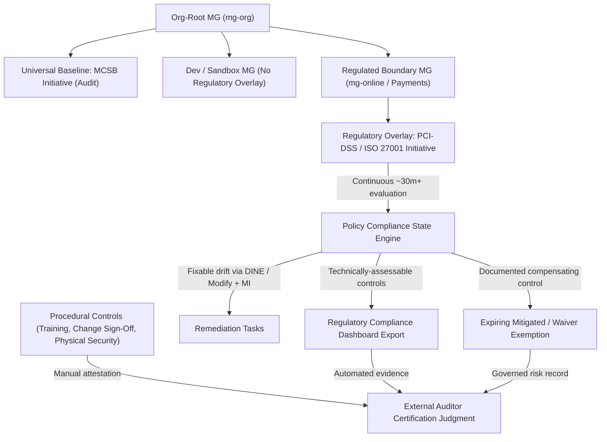
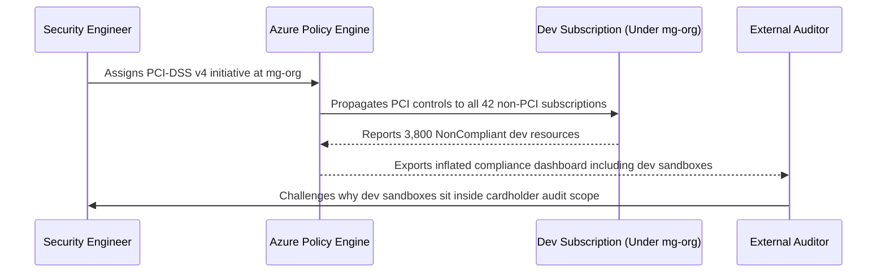

# Compliance and Regulatory as Code

> **Prerequisites:** Management Group scope and inheritance (Modules 01–02), Policy Initiatives and Exemptions (Module 03), Tagging and `DataClassification` (Module 06), and Azure Policy evaluation cycles / effects (Track 11, Module 05).  
> **Estimated Reading Time:** 30 minutes  
> **Target Audience:** Platform Engineers, Security & Compliance Engineers, Cloud Architects.

> [!TIP]
> **The Golden Rule of Compliance as Code:** Layer the **Microsoft Cloud Security Benchmark (MCSB)** broadly at the org-root MG (`"broad high"`) and overlay heavy **regulatory initiatives** (PCI-DSS, ISO 27001, HIPAA) *only* on the regulated boundary (`"specific low"`), start in `Audit` mode, record real exceptions as expiring **`Waiver`/`Mitigated` exemptions**, and never mistake a 100% automated dashboard for full regulatory certification.

---

## Why This Matters

Everything you've built in this track — the hierarchy, the initiatives, the tagging taxonomy — exists partly to answer one high-stakes question from an auditor or regulator: *"prove you're meeting this standard."* Historically that proof was a spreadsheet, screenshots, and a consultant. **Compliance as code** replaces that with something better: Azure's **regulatory compliance initiatives** map named controls (PCI-DSS, ISO 27001, NIST, CIS, etc.) to concrete policy definitions you assign at scale, and the **compliance dashboard** becomes continuously-evaluated, exportable *evidence*. This module is where the governance machinery becomes an audit-readiness engine — the same initiatives and effects from Modules 03/06, now framed as regulatory controls, plus the honest limits of what a tool can and can't prove.

---

## 1. Architectural Mental Model: Layered Initiatives, Evidence Loop & Attestation Boundary

Compliance as code separates **org-wide security hygiene** (assigned broadly at `mg-org`), **framework-specific regulatory overlays** (assigned narrowly at the regulated boundary like `mg-online` / Payments), and **external certification reality** (automated control-plane evidence combined with human procedural attestations):



### What "compliance as code" actually means

**Compliance as code** means expressing regulatory/security requirements as *machine-enforced and machine-evaluated* policy, rather than as prose humans are trusted to follow. Concretely: a control like "PCI-DSS 3.4 — data at rest must be encrypted" stops being a wiki paragraph and becomes an Azure Policy definition (effect `Audit`/`Deny`) inside a **regulatory compliance initiative**, assigned at a management-group scope (Module 03), whose compliance state is continuously evaluated and reported. The win is threefold: **prevention** (some controls `Deny` violations outright), **continuous assurance** (compliance is re-evaluated constantly, not once a year), and **evidence** (the dashboard *is* the audit artifact). This is the exact policy-as-code discipline from Track 11 Module 05, elevated: there the goal was "block a public storage account"; here the goal is "demonstrate control X of standard Y is satisfied across the whole org, on demand."

### Regulatory compliance initiatives: named standards as built-in policy sets

Azure ships large **built-in regulatory compliance initiatives** — one per major standard (PCI-DSS, ISO 27001, NIST SP 800-53, SOC 2, HIPAA/HITRUST, CIS Azure Foundations, the Microsoft Cloud Security Benchmark, and many regional ones like UK OFFICIAL or Germany C5). Each is an **initiative** (Module 03) whose member policies are **grouped by the standard's control domains** — so the PCI-DSS initiative's policies are organized under PCI's requirement numbers, ISO's under ISO's Annex A controls, and so on. You **assign** one of these initiatives at a management-group or subscription scope and Azure evaluates every resource in scope against every mapped control, then shows compliance *per control*. You don't author these — you assign them, exactly the "governance is assembly, not authoring" point from Track 11 Module 05, now for whole regulatory frameworks.

### The compliance dashboard is your evidence — and its honest limits

Once a regulatory initiative is assigned, the **Regulatory Compliance dashboard** (in Microsoft Defender for Cloud / Azure Policy compliance) shows, per control, how many in-scope resources are compliant, and lets you drill into which resource fails which control and **export** the result — this export is the evidence you hand an auditor. But be precise about its limits, because overclaiming here is a real professional risk:

- Azure Policy can only evaluate **what it can technically inspect** — resource configuration in the Azure control plane. Many real controls are **procedural** (background checks, change-management sign-off, physical security, staff training) and *cannot* be evaluated by policy at all.
- A regulatory initiative therefore maps only the **technically-assessable subset** of a standard's controls; each control card carries a note about **manual attestation** for the rest.
- "100% compliant in the dashboard" means "every *policy-assessable* control we mapped is satisfied," **not** "we are certified compliant with the standard." Certification is an auditor's judgment over *both* the automated evidence and the manual attestations.

Compliance as code makes the *technical* controls continuous, provable, and cheap; it does **not** replace the auditor or the procedural controls. Knowing that boundary is what separates a credible platform engineer from someone who misreads a green dashboard as a certificate.

### Audit readiness: continuous, exportable, and remediable

The operational payoff is **audit readiness** — being able to produce current evidence at any moment instead of scrambling before an audit. Three practices make it real, all reusing machinery you already have:

- **Continuous evaluation** — the initiative re-evaluates on a schedule and on change (Track 11 Module 05's compliance loop), so the dashboard is always current; drift shows up as a control going non-compliant, not as an audit surprise.
- **Remediation for fixable drift** — controls backed by `DeployIfNotExists`/`Modify` members (e.g. "enable diagnostic settings," "enforce TLS") can be **remediated** with a remediation task and a managed identity (Modules 03/06), so you *fix* non-compliance at scale, not just report it.
- **Exemptions as documented, expiring exceptions** — where a control genuinely can't be met for a specific scope, a **`Waiver`/`Mitigated` exemption** (Module 03) with a reason and `expiresOn` becomes part of the audit record — the governed "we accept/mitigate this risk, here's why, until this date" that auditors actually want to see, versus an undocumented gap.

Audit readiness is thus not a separate tool — it's the initiatives, remediation, and exemptions from earlier modules, *pointed at a named standard and kept continuously current*.

### Layering: security benchmark baseline, then regulatory overlays

The practical assembly most orgs use, combining this module with Modules 01–03: assign the **Microsoft Cloud Security Benchmark (MCSB)** initiative broadly at the org-root MG as the universal security baseline (it's the default in Defender for Cloud), then **overlay** the *specific* regulatory initiative only on the scope that needs it — e.g. the PCI-DSS initiative on just the `mg-online` (or a dedicated Payments) branch that handles cardholder data. This is "broad high, specific low" (Module 01) applied to compliance: everyone gets the security baseline; only the regulated boundary carries the heavier regulatory initiative and its stricter `Deny`s. It also keeps the compliance dashboard legible — the PCI view is scoped to the PCI boundary, not blurred across the whole org. A regulated workload's own subscription/MG (Modules 00–02) is exactly the clean boundary that makes this overlay meaningful to an auditor.

---

## 2. Taxonomic Comparison & Command Reference

### Control Assessment Boundary Comparison

| Control Category | Examples | Evaluated By | Audit Evidence Artifact |
|---|---|---|---|
| **Policy-Assessable (`Audit`/`Deny`)** | Encryption at rest, TLS 1.2+, no public blob access | Azure Policy control plane | Regulatory Compliance dashboard export + `az policy state` JSON |
| **Remediable Configuration (`DINE`/`Modify`)** | Enable diagnostic settings, inherit tags, enforce HTTPS | Azure Policy + Managed Identity | Remediation task completion logs + compliant state summary |
| **Procedural / Organizational** | Staff security training, background checks, change approval, physical facility locks | Humans & external assessors | Manual attestation records + signed auditor documentation |

### Compliance Initiative Layering Strategy

| Layer | Built-In / Custom Artifact | Assigned Scope | Principle Applied |
|---|---|---|---|
| **Universal Security Baseline** | Microsoft Cloud Security Benchmark (MCSB) | `mg-org` (Org-Root MG) | Broad High — every workload gets baseline security telemetry |
| **Org Governance Baseline** | Custom `contoso-baseline` initiative (Module 03) | `mg-org` | Broad High — shared locations, tagging `Deny`, storage hygiene |
| **Regulatory Overlay** | Built-in PCI-DSS v4, ISO 27001, or HIPAA/HITRUST | `mg-online` / Payments MG | Specific Low — keeps audit boundary crisp and avoids false dev findings |
| **Exception Handling** | `Waiver` / `Mitigated` Policy Exemption | Resource or RG (lowest scope) | Surgical + Expiring — compensates risk without weakening org guardrails |

### Command Reference

| Command | What it does | Example |
|---|---|---|
| `az policy set-definition list` (regulatory) | Lists built-in regulatory compliance initiatives | `az policy set-definition list --query "[?policyType=='BuiltIn' && category=='Regulatory Compliance'].displayName" -o tsv` |
| `az policy assignment create --policy-set-definition <id>` | Assigns a regulatory initiative at a scope | see breakdown below |
| `az policy state summarize` | Summarizes compliance for an assignment/scope (the dashboard, as data) | `az policy state summarize --management-group mg-online` |
| `az policy state list --filter "complianceState eq 'NonCompliant'"` | Lists resources failing controls (drill-down / evidence) | `az policy state list --filter "complianceState eq 'NonCompliant'" -o table` |
| `az policy remediation create` | Remediates fixable non-compliant controls (DINE/Modify) | `az policy remediation create --name fix-tls --policy-assignment <id>` |
| `az policy exemption create` | Records a documented, expiring exception to a control | see Module 03 breakdown |
| `az security regulatory-compliance-standards list` | Lists regulatory standards tracked in Defender for Cloud | `az security regulatory-compliance-standards list -o table` |

**Flag breakdown — `az policy assignment create --name pci-dss-online --policy-set-definition <pci-initiative-id> --scope /providers/Microsoft.Management/managementGroups/mg-online --display-name "PCI-DSS v4 (Online tier)" --mi-system-assigned --location eastus`:**

- `--policy-set-definition <pci-initiative-id>` — the built-in **regulatory initiative** for the standard (get its id from the `set-definition list` query above). Assigning the *initiative*, not individual policies, is what maps the whole standard at once.
- `--scope .../managementGroups/mg-online` — the **regulated boundary** — assign the heavy regulatory initiative *only* on the branch that needs it ("specific low"), not org-wide, keeping the dashboard scoped and the `Deny`s off unrelated workloads.
- `--display-name "PCI-DSS v4 (Online tier)"` — a human-readable name that shows in the compliance dashboard/evidence export; make it say *which standard* and *which scope*.
- `--mi-system-assigned --location eastus` — a managed identity, needed because regulatory initiatives commonly include `DeployIfNotExists`/`Modify` members (enable logging, enforce TLS) that remediate; the identity needs role grants to do so (Modules 03/06).

**Flag breakdown — `az policy state summarize --management-group mg-online --query "policyAssignments[].{name:policyAssignmentId, compliant:results.resourceDetails[?complianceState=='Compliant'].count | [0], noncompliant:results.resourceDetails[?complianceState=='NonCompliant'].count | [0]}"`:**

- `--management-group mg-online` — summarize compliance across the whole regulated branch, mirroring the scoped dashboard view.
- the `--query` projection — pulls compliant vs non-compliant counts per assignment, i.e. the dashboard's headline numbers *as exportable data* — the scriptable form of the audit evidence.

---

## 3. Production War Story: The Accidental Org-Wide PCI Audit Explosion

- **Severity:** SEV-2
- **Detection Time:** 14 days (pre-audit readiness review with external QSA)
- **Resolution Time:** 3 hours
- **Impact:** 42 non-cardholder dev and internal-tooling subscriptions inherited PCI-DSS v4 controls, generating 3,800+ non-compliant findings and blocking routine developer storage deployments across non-regulated teams.

### What Happened

To prepare for an upcoming PCI-DSS v4 assessment, a security engineer assigned the built-in PCI-DSS v4 initiative at `mg-org` instead of the dedicated `mg-payments` management group. Because management-group policy inheritance flows down to every child branch, sandbox and internal dev workloads instantly became evaluated under cardholder requirements:



Not only did the compliance dashboard drown in irrelevant non-compliance noise, the auditor questioned whether the organization actually had network and administrative isolation around cardholder environments.

### Root Cause Analysis

1. **Violated "broad high, specific low":** Placed a framework-specific regulatory initiative at the org-root MG instead of isolating it on the regulated Payments branch.
2. **Missing Audit-First Rollout:** Enabled enforcement parameters before reviewing compliance posture across the target boundary.
3. **Lack of Scope Validation:** No automated check verified that regulatory initiative assignments only existed beneath designated compliance management groups.

### The Fix & Architectural Hardening

1. **Removed Org-Root Regulatory Assignment:** Deleted the PCI-DSS assignment from `mg-org` while retaining MCSB (`Audit`) at `mg-org` as the universal security baseline.
2. **Re-Scoped to Regulated Boundary:** Assigned PCI-DSS v4 strictly to `mg-payments` (`mg-online`) with a system-assigned managed identity for remediable controls.
3. **Formalized Exemption Records:** Created expiring `Mitigated` exemptions with compensating-control notes and tracking tickets for two legacy appliances pending migration.

---

## 4. Multi-Language Production Implementation

Before an audit window opens, platform teams automate **compliance evidence collection**: querying policy state summaries, checking that regulatory initiatives sit on bounded scopes (never `mg-org`), auditing upcoming exemption expirations (`Mitigated`/`Waiver`), and stamping explicit reminders that automated scores exclude procedural controls.

````carousel
```go
package main

import (
	"fmt"
	"strings"
	"time"
)

type AssignmentSummary struct {
	Name         string
	Scope        string
	Compliant    int
	NonCompliant int
}

type ExemptionRecord struct {
	Name      string
	Category  string
	ExpiresOn time.Time
	Reason    string
}

// AuditReadinessReport checks regulatory scope hygiene and exemption expiry windows.
func AuditReadinessReport(assignments []AssignmentSummary, exemptions []ExemptionRecord, now time.Time) []string {
	var alerts []string
	for _, a := range assignments {
		isReg := strings.Contains(a.Name, "pci") || strings.Contains(a.Name, "iso27001")
		if isReg && strings.HasSuffix(a.Scope, "/mg-org") {
			alerts = append(alerts, fmt.Sprintf("CRITICAL: regulatory assignment %s is scoped too broadly at mg-org", a.Name))
		}
		if a.NonCompliant > 0 {
			alerts = append(alerts, fmt.Sprintf("DRIFT: %s has %d non-compliant resource evaluations requiring remediation or exemption", a.Name, a.NonCompliant))
		}
	}
	for _, ex := range exemptions {
		if ex.ExpiresOn.Before(now) {
			alerts = append(alerts, fmt.Sprintf("EXPIRED EXEMPTION: %s (%s) expired on %s", ex.Name, ex.Category, ex.ExpiresOn.Format(time.RFC3339)))
		} else if ex.ExpiresOn.Sub(now) < 30*24*time.Hour {
			alerts = append(alerts, fmt.Sprintf("RENEWAL DUE: %s expires within 30 days (%s)", ex.Name, ex.ExpiresOn.Format("2006-01-02")))
		}
	}
	alerts = append(alerts, "NOTE: Dashboard covers technically-assessable controls only; attach manual attestations for procedural controls.")
	return alerts
}

func main() {
	now := time.Date(2026, 11, 10, 0, 0, 0, 0, time.UTC)
	findings := AuditReadinessReport(
		[]AssignmentSummary{{Name: "iso27001-online", Scope: "/providers/Microsoft.Management/managementGroups/mg-online", Compliant: 118, NonCompliant: 2}},
		[]ExemptionRecord{{Name: "legacy-tls-mitigated", Category: "Mitigated", ExpiresOn: now.Add(20 * 24 * time.Hour), Reason: "WAF compensating control"}},
		now,
	)
	for _, f := range findings {
		fmt.Println(f)
	}
}
```
<!-- slide -->
```typescript
interface ComplianceSnapshot {
  assignmentName: string;
  scope: string;
  compliantResources: number;
  nonCompliantResources: number;
  proceduralControlsPendingManualAttestation: string[];
}

interface ExemptionAuditItem {
  name: string;
  category: "Waiver" | "Mitigated";
  expiresOn: string;
  description: string;
}

export function evaluateAuditReadiness(
  snapshots: ComplianceSnapshot[],
  exemptions: ExemptionAuditItem[],
  referenceDate = new Date()
) {
  const warnings: string[] = [];
  let certificationReadyClaimAllowed = false;

  for (const s of snapshots) {
    const isRegulatory = /pci|iso|hipaa|nist/i.test(s.assignmentName);
    if (isRegulatory && s.scope.endsWith("/mg-org")) {
      warnings.push(`Scope violation: ${s.assignmentName} should target regulated MG, not mg-org.`);
    }
    if (s.nonCompliantResources > 0) {
      warnings.push(`${s.assignmentName}: ${s.nonCompliantResources} resources failing technical controls.`);
    }
    if (s.proceduralControlsPendingManualAttestation.length > 0) {
      warnings.push(
        `${s.assignmentName}: ${s.proceduralControlsPendingManualAttestation.length} procedural controls require manual attestation.`
      );
    }
  }

  for (const ex of exemptions) {
    if (!ex.expiresOn) warnings.push(`Exemption ${ex.name} lacks mandatory expiresOn date.`);
    if (new Date(ex.expiresOn) <= referenceDate) warnings.push(`Exemption ${ex.name} has expired.`);
    if (!ex.description.trim()) warnings.push(`Exemption ${ex.name} lacks compensating-control rationale.`);
  }

  // Honest-limits rule: automated compliance alone never equals certification
  certificationReadyClaimAllowed = false;

  return {
    automatedSummary: snapshots,
    warnings,
    certificationReadyClaimAllowed,
    disclaimer: "100% policy compliance covers technical control-plane checks only, not external certification.",
  };
}
```
<!-- slide -->
```python
from dataclasses import dataclass
from datetime import datetime, timezone
from typing import List


@dataclass
class ControlResult:
    control_id: str
    assessable_by_policy: bool
    compliant_count: int
    non_compliant_count: int
    manual_attestation_present: bool = False


def build_audit_evidence_summary(
    standard_name: str, assigned_scope: str, controls: List[ControlResult]
) -> dict:
    if assigned_scope.endswith("/mg-org") and standard_name.upper() != "MCSB":
        raise ValueError(
            f"Regulatory overlay '{standard_name}' must be scoped to regulated branch, not org-root ({assigned_scope})."
        )

    failing_technical = [
        c.control_id for c in controls if c.assessable_by_policy and c.non_compliant_count > 0
    ]
    missing_manual = [
        c.control_id for c in controls if not c.assessable_by_policy and not c.manual_attestation_present
    ]

    return {
        "standard": standard_name,
        "scope": assigned_scope,
        "generated_at": datetime.now(timezone.utc).isoformat(),
        "technical_pass": len(failing_technical) == 0,
        "failing_technical_controls": failing_technical,
        "missing_procedural_attestations": missing_manual,
        "is_certified": False,  # Certification is solely the external auditor's judgment
    }


if __name__ == "__main__":
    report = build_audit_evidence_summary(
        "ISO 27001",
        "/providers/Microsoft.Management/managementGroups/mg-online",
        [
            ControlResult("A.10.1.1-Encryption", True, 42, 0),
            ControlResult("A.7.2.2-SecurityTraining", False, 0, 0, manual_attestation_present=False),
        ],
    )
    print(report)
```
<!-- slide -->
```csharp
using System;
using System.Collections.Generic;
using System.Linq;

public sealed record PolicyControlEvidence(
    string ControlId,
    bool IsPolicyAssessable,
    int CompliantResources,
    int NonCompliantResources,
    bool HasManualAttestation);

public sealed record PolicyExemptionRecord(
    string Name,
    string Category,
    DateTimeOffset? ExpiresOn,
    string CompensatingControlNote);

public static class ComplianceEvidenceCollector
{
    public static IReadOnlyList<string> EvaluateAuditGaps(
        string initiativeName,
        string scope,
        IEnumerable<PolicyControlEvidence> controls,
        IEnumerable<PolicyExemptionRecord> exemptions,
        DateTimeOffset now)
    {
        var gaps = new List<string>();
        if (!initiativeName.Contains("MCSB", StringComparison.OrdinalIgnoreCase) &&
            scope.EndsWith("/mg-org", StringComparison.OrdinalIgnoreCase))
        {
            gaps.Add($"Scope drift: {initiativeName} assigned at mg-org instead of regulated boundary.");
        }

        foreach (var ctrl in controls)
        {
            if (ctrl.IsPolicyAssessable && ctrl.NonCompliantResources > 0)
                gaps.Add($"Technical control {ctrl.ControlId} has {ctrl.NonCompliantResources} non-compliant resources.");
            if (!ctrl.IsPolicyAssessable && !ctrl.HasManualAttestation)
                gaps.Add($"Procedural control {ctrl.ControlId} requires manual attestation before audit.");
        }

        foreach (var ex in exemptions)
        {
            if (ex.ExpiresOn is null || ex.ExpiresOn <= now)
                gaps.Add($"Exemption {ex.Name} ({ex.Category}) is missing or past expiry.");
            if (string.IsNullOrWhiteSpace(ex.CompensatingControlNote))
                gaps.Add($"Exemption {ex.Name} lacks documented compensating control.");
        }

        return gaps;
    }
}
```
````

---

## 5. Practical Hands-On Verification CLI Workflows

Assigning and evaluating initiatives is **free** (no resources are created by an `Audit`-heavy regulatory initiative). Compliance evaluation is **not instant** (Track 11 Module 05's ~30-minute rule fully applies — a regulatory initiative can take longer to first-populate). Reuse the `mg-org`/`mg-online` hierarchy from Modules 01–02. **Do not** assign a broad regulatory initiative with `Deny` members to a scope containing resources you care about without reviewing it — keep effects at `Audit` for the lab.

### 1. (Azure) Browse the available regulatory standards

See what ships built-in:

```bash
az policy set-definition list \
  --query "[?policyType=='BuiltIn' && metadata.category=='Regulatory Compliance'].displayName" -o tsv | sort | head -40
```

**Expected Output:**

```text
CIS Microsoft Azure Foundations Benchmark v2.0.0
HIPAA HITRUST 9.2
ISO 27001:2013
NIST SP 800-53 Rev. 5
PCI DSS v4.0
SOC 2 Type 2
```

Expect PCI-DSS, ISO 27001, NIST SP 800-53, CIS Azure Foundations, SOC 2, and many regional standards. Each is an initiative you *assign*, not author. Pick one (e.g. CIS or ISO 27001) to use below.

### 2. (Azure) Inspect a regulatory initiative's structure

See how its members map to the standard's control domains:

```bash
ISO=$(az policy set-definition list --query "[?contains(displayName,'ISO 27001')].name | [0]" -o tsv)
az policy set-definition show --name "$ISO" \
  --query "{name:displayName, memberCount:length(policyDefinitions), groups:policyDefinitionGroups[0:5].{name:name, category:category}}" -o json
```

**Expected Output:**

```json
{
  "groups": [
    { "category": "Access Control", "name": "ISO_27001_A.9" },
    { "category": "Cryptography", "name": "ISO_27001_A.10" }
  ],
  "memberCount": 146,
  "name": "ISO 27001:2013"
}
```

Expect dozens-to-hundreds of member policies grouped by ISO control domains. This *is* the standard, expressed as assignable policy — compliance as code made literal.

### 3. (Azure) Assign a regulatory initiative at the regulated boundary in Audit

Overlay it on `mg-online` only (the "specific low" tier), report-only:

```bash
ISOID=$(az policy set-definition show --name "$ISO" --query id -o tsv)
az policy assignment create --name iso27001-online \
  --policy-set-definition "$ISOID" \
  --scope /providers/Microsoft.Management/managementGroups/mg-online \
  --display-name "ISO 27001 (Online tier)" \
  --mi-system-assigned --location eastus 2>/dev/null \
  || az policy assignment create --name iso27001-online --policy-set-definition "$ISOID" \
     --scope /providers/Microsoft.Management/managementGroups/mg-online --display-name "ISO 27001 (Online tier)"
```

Expect the assignment created at `mg-online`. Only that branch now carries the regulatory overlay — the org-wide baseline stays separate. (First compliance results take a while; move on.)

### 4. (Azure) Read the compliance dashboard as data

After the evaluation delay, summarize:

```bash
az policy state summarize --management-group mg-online -o json \
  --query "policyAssignments[?contains(policyAssignmentId,'iso27001-online')].results" 2>/dev/null \
  || az policy state list --filter "complianceState eq 'NonCompliant'" -o table
```

**Expected Output:**

```json
[
  {
    "nonCompliantPolicies": 3,
    "nonCompliantResources": 4,
    "resourceDetails": [
      { "complianceState": "Compliant", "count": 28 },
      { "complianceState": "NonCompliant", "count": 4 }
    ]
  }
]
```

Expect per-control compliant/non-compliant counts (or a list of failing resources). This scriptable output is the *evidence* — the same numbers the portal Regulatory Compliance dashboard shows, exportable for an auditor.

### 5. (Azure) Drill into one failing control

Pick a non-compliant control and see exactly which resource fails it:

```bash
az policy state list --management-group mg-online \
  --filter "complianceState eq 'NonCompliant'" \
  --query "[0:10].{resource:resourceId, policy:policyDefinitionName}" -o table 2>/dev/null \
  || echo "no non-compliant results yet — evaluation may still be running"
```

Expect specific resources tied to specific control policies — the drill-down an auditor (or you, pre-audit) uses to know precisely what to fix.

### 6. (Written) Separate assessable from procedural controls

Pick three controls from your chosen standard (read their names in the initiative) and classify each as **policy-assessable** (Azure can evaluate it — e.g. encryption at rest, TLS, diagnostic logging) or **procedural/manual** (e.g. staff security training, change-approval process, physical access) that requires **manual attestation**. Write one sentence on why "100% in the dashboard" is *not* "certified compliant." This is the honest-limits concept made concrete — and exactly the nuance an interviewer probes.

### 7. (Azure) Record a documented, expiring exemption as audit evidence

Suppose one resource can't meet a control during a migration window. Add a `Mitigated` exemption with a reason and expiry (Module 03 machinery) — now the *exception itself* is part of the audit trail:

```bash
ASSIGN=$(az policy assignment show --name iso27001-online --scope /providers/Microsoft.Management/managementGroups/mg-online --query id -o tsv)
az group create -n rg-compliance-lab -l eastus
az policy exemption create --name legacy-tls-mitigated \
  --policy-assignment "$ASSIGN" \
  --exemption-category Mitigated \
  --scope $(az group show -n rg-compliance-lab --query id -o tsv) \
  --expires-on 2026-12-31T00:00:00Z \
  --description "Legacy appliance behind WAF (compensating control); migration tracked in JIRA-8842"
az policy exemption list --scope $(az group show -n rg-compliance-lab --query id -o tsv) -o table
```

Expect a documented, categorized, expiring exemption. This is what "we accept this risk, here's the compensating control, until this date" looks like in the evidence — far better than an unexplained non-compliant resource.

### 8. Diagnose and fix: "the auditor says our PCI scope includes systems it shouldn't"

A compliance-scoping incident: the regulatory initiative was assigned too high (at `mg-org`), so *every* subscription — including unrelated dev — shows up in the PCI compliance view, bloating scope and dragging in irrelevant non-compliance. Reproduce the mistake and fix the scope:

```bash
# The mistake: assign the regulatory initiative org-wide instead of on the regulated boundary
az policy assignment create --name iso27001-toobroad \
  --policy-set-definition "$ISOID" \
  --scope /providers/Microsoft.Management/managementGroups/mg-org \
  --display-name "ISO 27001 (WHOLE ORG - too broad)" 2>/dev/null; true
az policy assignment list --scope /subscriptions/$(az account show --query id -o tsv) \
  --disable-scope-strict-match --query "[?contains(name,'iso27001')].{name:name, scope:scope}" -o table
```

**Diagnose:** the subscription now inherits *two* ISO assignments — the correct `mg-online` one *and* the too-broad `mg-org` one — so dev workloads that were never in regulatory scope are being assessed and reported against the standard, inflating the audit surface. The tell: the initiative appears at an `mg-org` scope that includes non-regulated branches. **Fix:** delete the over-broad assignment; keep the regulatory initiative only on the regulated boundary (`mg-online`), and rely on the *separate* MCSB baseline for org-wide security:

```bash
az policy assignment delete --name iso27001-toobroad --scope /providers/Microsoft.Management/managementGroups/mg-org
```

Lesson: **scope regulatory initiatives to the regulated boundary, not the whole org** — over-broad compliance scope creates audit work and false findings for systems that were never in scope. "Broad high, specific low" (Module 01) applies to *compliance* too: the security baseline is broad; the regulatory overlay is narrow.

### 9. (Azure) Clean up

```bash
az policy exemption delete --name legacy-tls-mitigated --scope $(az group show -n rg-compliance-lab --query id -o tsv) 2>/dev/null; true
az policy assignment delete --name iso27001-online --scope /providers/Microsoft.Management/managementGroups/mg-online 2>/dev/null; true
az group delete -n rg-compliance-lab --yes --no-wait
```

Keep the MG hierarchy and `contoso-baseline` for the capstone.

### Independent Challenge

No commands given — build it yourself, drawing on this module, Module 03 (initiatives, exemptions, effects), Module 01 (MG scope, "broad high specific low"), Module 06 (tagging, `DataClassification`), and Modules 00–02 (the regulated-boundary subscription/MG). For the Payments/Web/Data org, produce a **compliance-as-code plan and a working demonstration**: (1) assign the **Microsoft Cloud Security Benchmark** initiative broadly at the org-root MG as the universal baseline, in `Audit`; (2) assign a **specific regulatory initiative** (PCI-DSS or ISO 27001) *only* on the regulated boundary (the Online or a dedicated Payments MG), and explain why that scope and not org-wide; (3) read the compliance summary as data and identify at least one non-compliant control; (4) for one control the org genuinely can't meet yet, record a **documented, expiring `Mitigated` exemption** describing the compensating control; and (5) write a one-paragraph "audit-readiness statement" that distinguishes the **policy-assessable** controls (which the dashboard proves continuously) from the **procedural** controls (which need manual attestation), and explicitly states why a green dashboard is evidence but not a certificate. Clean up any billable resources; the assignments and exemptions are free to leave briefly but remove them at the end.

<details>
<summary>Stuck? One hint</summary>

The structure is two layers, mapping straight onto Module 01's "broad high, specific low": the **MCSB** initiative goes at `mg-org` (everyone, always — it's the Defender for Cloud default baseline), and the **regulatory** initiative (`az policy set-definition list --query "[?metadata.category=='Regulatory Compliance']"` to find its id) goes *only* on the regulated branch (`mg-online`/Payments) so the PCI/ISO dashboard is scoped to exactly the systems in scope — assigning it org-wide is Exercise 8's mistake. Read compliance with `az policy state summarize --management-group <regulated-mg>`, record the exception with `az policy exemption create --exemption-category Mitigated --expires-on <date> --description "<compensating control + ticket>"`, and for the audit-readiness statement lean on the honest-limits concept: the dashboard proves only the *technically-assessable* controls it maps, procedural controls (training, change management, physical security) need human attestation, and certification is the auditor's judgment over *both*.

</details>

---

## 6. Common Mistakes & Troubleshooting

- **Reading "100% compliant" as "certified."** The dashboard only reflects the *policy-assessable* subset of a standard's controls; procedural controls need manual attestation, and certification is an auditor's judgment over both. Overclaiming here is a genuine professional risk.
- **Assigning a regulatory initiative org-wide.** It bloats compliance scope, drags unrelated (e.g. dev) systems into the standard's view, and creates false findings and audit work. Scope regulatory initiatives to the regulated boundary; use the MCSB baseline for org-wide security. (Exercise 8.)
- **Forgetting the managed identity for remediable controls.** Regulatory initiatives commonly include `DeployIfNotExists`/`Modify` members; without a managed identity and role grants, remediation of those controls silently fails (Modules 03/06, Track 11 Module 05).
- **Expecting instant compliance results.** Regulatory initiatives are large and can take well beyond the usual ~30 minutes to first-populate. "No results yet" is timing, not failure.
- **Undocumented non-compliance instead of a recorded exemption.** A control you can't meet should be a **documented, expiring `Waiver`/`Mitigated` exemption** with a compensating-control note — that's audit evidence. A silent non-compliant resource is a finding with no story.
- **Assigning `Deny`-heavy regulatory initiatives without an Audit pass.** The audit-then-enforce discipline (Track 11 Module 05) still applies — a broad regulatory initiative in enforce mode can block legitimate deployments across the scope. Assess in `Audit`, review, then tighten.

---

## 7. Operational Validation Checkpoints & Checkpoint Quiz

### Operational Validation Checkpoints

<details>
<summary><strong>Checkpoint 1: Executive Claims "100% Compliant Dashboard Means We Passed ISO 27001"</strong></summary>

**Scenario:** Your leadership sees 100% green across all 146 controls in the Azure Regulatory Compliance dashboard for ISO 27001 and prepares to announce certification to enterprise customers before the external auditor arrives.

**Diagnosis & Fix:** Step in immediately to clarify the technical vs. procedural boundary. Azure Policy evaluates **only** the technically-assessable control-plane subset (encryption, TLS, diagnostics, network rules). Procedural controls (staff security training, background checks, change-management sign-off, physical data-center security) require **manual attestation** and external review. Present the dashboard export as automated technical evidence alongside documented procedural attestations — never claim certification from a dashboard score alone.

</details>

<details>
<summary><strong>Checkpoint 2: Sandbox Subscriptions Appearing Inside PCI-DSS Audit Scope</strong></summary>

**Scenario:** During pre-audit verification, `az policy state list` under the PCI-DSS assignment surfaces failing VMs from internal sandbox and R&D subscriptions that handle zero cardholder data.

**Diagnosis & Fix:** Run `az policy assignment list --scope /subscriptions/<sandbox-sub-id> --disable-scope-strict-match` to inspect inherited assignments. You will find the PCI-DSS initiative assigned too high (at `mg-org`). Delete the org-root PCI assignment, keep MCSB broadly at `mg-org`, and re-assign PCI-DSS strictly onto the regulated boundary (`mg-online` or `mg-payments`) following `"broad high, specific low"`.

</details>

<details>
<summary><strong>Checkpoint 3: Newly Assigned Regulatory Initiative Shows Zero Evaluation Data After 10 Minutes</strong></summary>

**Scenario:** You assigned the built-in NIST SP 800-53 initiative at `mg-online`, waited 10 minutes, and `az policy state summarize` returns empty results. A teammate assumes the assignment syntax was wrong and plans to delete and recreate it.

**Diagnosis & Fix:** Do **not** recreate the assignment (which resets evaluation). First verify the assignment exists with `az policy assignment list --scope /providers/Microsoft.Management/managementGroups/mg-online`. Built-in regulatory initiatives bundle hundreds of member policies and require 30+ minutes (sometimes longer on first evaluation) for Azure Policy's compliance scan cycle to populate initial state. Wait for the evaluation cycle or trigger an on-demand scan (`az policy state trigger-scan`) on a scoped RG if needed.

</details>

### Checkpoint Quiz

Write down your answer to each question before expanding it — checking without attempting first is the single easiest way to fool yourself into thinking you've learned this.

<details>
<summary>Show questions</summary>

1. What does "compliance as code" mean, and what three things does it buy you over a prose policy document?
2. What is a regulatory compliance initiative, and how are its member policies organized?
3. Does a 100%-compliant Regulatory Compliance dashboard mean you're certified against the standard? Explain precisely.
4. Which categories of control can Azure Policy *not* evaluate, and what handles those?
5. Where should you assign a regulatory initiative (PCI/ISO) versus the Microsoft Cloud Security Benchmark, and why — cite the Module 01 principle.
6. How do exemptions contribute to audit readiness rather than undermining it?
7. Your PCI compliance view includes dev systems that were never in scope. What went wrong and how do you fix it?

</details>

<details>
<summary>Show answers</summary>

1. Expressing regulatory/security requirements as machine-enforced and machine-evaluated policy instead of prose. It buys **prevention** (some controls `Deny` outright), **continuous assurance** (re-evaluated constantly, not annually), and **evidence** (the exportable compliance dashboard is the audit artifact).
2. A built-in **initiative** (policy set) for a named standard (PCI-DSS, ISO 27001, NIST, CIS, MCSB, …) whose member policies are **grouped by that standard's control domains** (e.g. PCI requirement numbers, ISO Annex A). You assign it; you don't author it.
3. No. It means every **policy-assessable** control the initiative *maps* is satisfied — not that procedural controls are met or that an auditor has certified you. Certification is the auditor's judgment over both the automated evidence and the manual attestations.
4. **Procedural/organizational** controls — staff training, change-management sign-off, physical security, background checks — can't be evaluated from resource configuration. Those require **manual attestation** by the organization, noted on each control card.
5. Assign the **regulatory** initiative *only* on the regulated boundary (the MG/subscription handling the regulated data — "specific low") to keep scope and the dashboard accurate; assign the **MCSB** broadly at the org-root MG as the universal baseline ("broad high"). This is Module 01's "broad high, specific low" applied to compliance.
6. A control you can't meet becomes a **documented, categorized (`Waiver`/`Mitigated`), expiring exemption** with a reason/compensating-control note — part of the audit record showing you *knowingly* accepted/mitigated the risk, with an expiry forcing re-review. That's stronger evidence than an unexplained non-compliant resource, not a weakening of the standard.
7. The regulatory initiative was assigned **too high** (e.g. at the org-root MG), so unrelated branches including dev inherited it and appear in the standard's compliance view, inflating scope and producing false findings. Fix: delete the over-broad assignment and assign the regulatory initiative only on the regulated boundary; use the MCSB baseline for org-wide security.

</details>

---

## Next

Continue to [08-capstone-project](../08-capstone-project/README.md) — the integration test for the whole track: design an org hierarchy, build a policy initiative at the management-group level, document a tagging taxonomy, and stand up a two-environment Terraform structure, then defend every decision.
