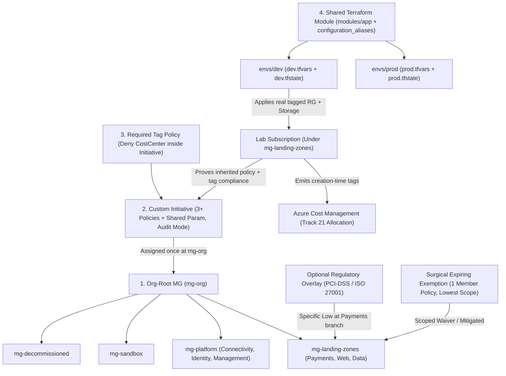
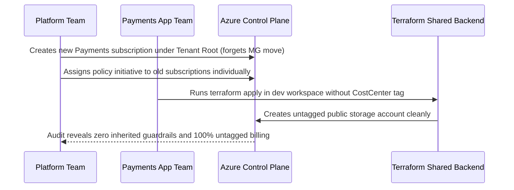

# Capstone Project

> **Prerequisites:** Completion of Track 17 Modules 00–07 (Management Groups, Landing Zones, Policy Initiatives & Exemptions, Deployment Stacks, Multi-Subscription Terraform, Tagging Strategy, Compliance as Code) alongside Track 9, Track 11, and Track 16 baselines.  
> **Estimated Reading Time:** 90–120 minutes (Architecture Design, Implementation & Defense)  
> **Target Audience:** Platform Engineers, Cloud Architects, Senior Backend Engineers.

> [!TIP]
> **The Golden Rule of the Governance Capstone:** Build and defend **one integrated governance system**, not four unrelated artifacts — design the **CAF management-group hierarchy** first, inherit an **org-root policy initiative** (with a surgical, expiring exemption and optional regulated overlay) down that tree, embed **required tag `Deny` enforcement** inside the baseline, and provision resources via **directory-per-environment Terraform** so every deployed resource inherits governance and carries full taxonomy metadata.

---

## Why This Matters

This is where the whole track converges. Across Modules 00–07 you learned each piece of governance-at-scale in isolation — why one subscription breaks down, a management-group hierarchy, landing zones, initiatives and exemptions, repeatable provisioning, multi-subscription Terraform, a tagging taxonomy, and compliance as code. A real platform team doesn't get to practise these separately; they arrive as one coherent design decision: *"here is how our organization is structured, governed, tagged, and provisioned, and here is why."* There is no new concept and no quiz here. The goal is to prove you can **compose** the track into a governance design a real org would recognize — and, crucially, **defend every decision**, because at this level the reasoning is the skill. Some of it is *designed* (written) rather than fully provisioned, because you have one subscription and can't create a real multi-subscription org in a lab — that constraint is explicitly part of the exercise, exactly as it was throughout the track.

Treat this as a project, not a checklist of isolated tasks — the pieces depend on each other in the order you'd actually build them: structure first, then the governance that hangs off it, then the metadata and provisioning that live inside it.

---

## 1. Architectural Mental Model: Integrated Governance Foundation

Each of the four capstone deliverables locks directly into the layer above and below it — hierarchy determines inheritance, policy enforces structure and taxonomy, and Terraform delivers repeatable, isolated, pre-tagged workloads beneath that governed tree:



---

## 2. Taxonomic Comparison & Command Reference

### Integrated Capstone Architecture Matrix

| Deliverable | Governing Mechanism | Target Scope | Primary Alternative Rejected | Key Defense Argument |
|---|---|---|---|---|
| **Part 1: MG Hierarchy** | CAF-aligned MG tree (`mg-org` top two levels real) | Tenant / Org Root | Flat single subscription or deep per-team silos | Separates platform vs. workload blast radius and mirrors policy inheritance boundaries |
| **Part 2: Policy Initiative** | Custom Initiative (`>= 3` policies, shared param, `Audit`) + surgical exemption | `mg-org` (inherited) + lowest scope for exemption | Per-subscription standalone policy assignments | One assignment governs all current and future subscriptions automatically; narrow exemption preserves baseline |
| **Part 3: Tagging Taxonomy** | 4 required keys (`CostCenter`, `Environment`, `Owner`, `DataClassification`) + `Deny` inside initiative | `mg-org` + Terraform `locals.common_tags` | Wiki-only guidelines or post-creation backfill | Tags do not inherit automatically and billing cannot rewrite past untagged usage |
| **Part 4: Multi-Env Terraform** | `envs/dev` and `envs/prod` calling shared module with `configuration_aliases` + distinct state | Separate state keys/backends per env | Single root with `terraform workspace` | Prevents silent wrong-workspace state collisions structurally; prod differs only via `.tfvars` |

### Capstone Verification & Teardown Command Reference

| Phase | Command | Purpose |
|---|---|---|
| **Hierarchy** | `az account management-group create --name mg-org` | Builds real top two MG levels and places lab subscription |
| **Hierarchy Verify** | `az account management-group show -n mg-org --expand --recurse` | Verifies full tree and attached subscription placement |
| **Initiative** | `az policy set-definition create --name contoso-baseline --management-group mg-org ...` | Bundles `>= 3` definitions + shared parameter at org-root MG |
| **Inheritance Proof** | `az policy assignment list --scope /subscriptions/$SUB_ID --disable-scope-strict-match -o table` | Proves subscription inherits MG-level assignment without reassigning |
| **Exemption** | `az policy exemption create --name ... --policy-assignment ... --policy-definition-reference-ids ... --expires-on ...` | Creates surgical, member-targeted, expiring exception |
| **Tag Enforcement** | `az storage account create ...` (without vs with `CostCenter`) | Demonstrates `Deny` blocks untagged creation while allowing compliant creates |
| **Terraform Isolation** | `terraform -chdir=envs/dev apply -var-file=dev.tfvars` & `terraform -chdir=envs/prod plan -var-file=prod.tfvars` | Proves `envs/prod` reads independent empty state and sees zero dev resources |

---

## 3. Production War Story: The Disconnected Governance Launch

- **Severity:** SEV-2
- **Detection Time:** 10 days (post-launch security & FinOps audit)
- **Resolution Time:** 1 day
- **Impact:** A newly launched Payments workload subscription deployed public storage endpoints without `CostCenter` tags and suffered a near-miss Terraform workspace overwrite between `dev` and `prod`.

### What Happened

Four teams built the right governance artifacts in isolation — an MG diagram on Confluence, a baseline initiative assigned only to existing subscriptions, a tagging wiki page, and a workspace-based Terraform repo — without verifying how the pieces interconnected at runtime:



Because the new subscription stayed directly beneath the Tenant Root instead of `mg-landing-zones`, and the initiative had been assigned per subscription rather than at `mg-org`, zero guardrails applied. Because tag `Deny` lived outside the baseline (in fact, only in a wiki), untagged resources spun up freely.

### Root Cause Analysis

1. **Broken inheritance chain:** Assigning policies per subscription instead of once at `mg-org` meant every newly minted subscription launched completely ungoverned.
2. **Orphaned placement:** No onboarding check confirmed the subscription sat under `mg-landing-zones` via `az account management-group show`.
3. **Unintegrated Terraform:** Copy-pasted resource blocks and shared workspaces obscured tag consistency (`locals.common_tags`) and environment state isolation.

### The Fix & Architectural Hardening

1. **Enforced Onboarding Acceptance Gate:** Every new workload subscription must be placed under its CAF landing-zone MG and pass `az policy assignment list --disable-scope-strict-match` verification before workload credentials are issued.
2. **Unified Baseline Initiative:** Embedded required-tag `Deny` policies directly inside the org-root initiative (`mg-org`) alongside security guardrails, governed by a shared parameter list.
3. **Directory-per-Environment Mandate:** Replaced workspaces with `envs/dev` and `envs/prod` calling one shared module, verified with `terraform state list` isolation checks.

---

## 4. Multi-Language Production Implementation

Before signing off on a landing-zone capstone submission (or promoting a new organization branch in CI), platform teams execute an **automated governance acceptance validator** across all four pillars: MG tree alignment, inherited MG initiative + surgical exemption checks, 4-key tagging enforcement, and directory-per-env Terraform state isolation.

````carousel
```go
package main

import (
	"fmt"
	"strings"
	"time"
)

type CapstoneSubmission struct {
	TopLevelMGs         []string
	SubParentMG         string
	InitiativeScope     string
	InitiativePolicies  int
	HasSharedParam      bool
	ExemptionScope      string
	ExemptionTargetRef  string
	ExemptionExpiresOn  time.Time
	RequiredTagPolicies []string
	DevBackendKey       string
	ProdBackendKey      string
	SharedModuleUsed    bool
}

func VerifyCapstone(s CapstoneSubmission, now time.Time) []string {
	var errs []string
	if len(s.TopLevelMGs) < 2 {
		errs = append(errs, "Part 1: build at least top two MG levels for real")
	}
	if s.SubParentMG == "TenantRoot" || s.SubParentMG == "" {
		errs = append(errs, "Part 1: place subscription under a landing-zone MG, not Tenant Root")
	}
	if !strings.Contains(s.InitiativeScope, "/managementGroups/") || s.InitiativePolicies < 3 || !s.HasSharedParam {
		errs = append(errs, "Part 2: custom initiative must have >=3 policies, >=1 shared param, assigned at MG scope")
	}
	if s.ExemptionTargetRef == "" || !s.ExemptionExpiresOn.After(now) || strings.Contains(s.ExemptionScope, "/managementGroups/") {
		errs = append(errs, "Part 2: exemption must be surgical (RG/resource scope), target 1 member policy, and have future expiresOn")
	}
	if len(s.RequiredTagPolicies) < 1 {
		errs = append(errs, "Part 3: enforce required tag Deny policy inside initiative")
	}
	if !s.SharedModuleUsed || s.DevBackendKey == "" || s.ProdBackendKey == "" || s.DevBackendKey == s.ProdBackendKey {
		errs = append(errs, "Part 4: directory-per-env requires 1 shared module and distinct dev/prod state keys")
	}
	return errs
}

func main() {
	sub := CapstoneSubmission{
		TopLevelMGs: []string{"mg-org", "mg-platform", "mg-landing-zones"}, SubParentMG: "mg-landing-zones",
		InitiativeScope: "/providers/Microsoft.Management/managementGroups/mg-org", InitiativePolicies: 4, HasSharedParam: true,
		ExemptionScope: "/subscriptions/111/resourceGroups/rg-legacy", ExemptionTargetRef: "requireCostCenterTag",
		ExemptionExpiresOn: time.Now().Add(60 * 24 * time.Hour), RequiredTagPolicies: []string{"CostCenter"},
		DevBackendKey: "app-dev.tfstate", ProdBackendKey: "app-prod.tfstate", SharedModuleUsed: true,
	}
	if errs := VerifyCapstone(sub, time.Now()); len(errs) > 0 {
		panic(errs)
	}
	fmt.Println("CAPSTONE PASS: All 4 integrated governance pillars verified.")
}
```
<!-- slide -->
```typescript
interface CapstoneAuditInput {
  hierarchy: { rootMg: string; children: string[]; labSubscriptionMg: string };
  initiative: { scope: string; memberCount: number; sharedParams: string[]; effectMode: "Audit" | "Deny" };
  exemption: { scopeLevel: "mg" | "sub" | "rg" | "resource"; memberRefId?: string; expiresOn?: string };
  taxonomy: { requiredKeys: string[]; enforcedInInitiative: boolean };
  terraform: { devDir: string; prodDir: string; sharedModulePath: string; devStateKey: string; prodStateKey: string; hasAliasConfig: boolean };
}

export function validateCapstoneIntegration(input: CapstoneAuditInput): { passed: boolean; failures: string[] } {
  const failures: string[] = [];

  if (!input.hierarchy.children.includes(input.hierarchy.labSubscriptionMg)) {
    failures.push("Hierarchy: lab subscription must sit beneath a designed child MG.");
  }
  if (!input.initiative.scope.includes("/managementGroups/") || input.initiative.memberCount < 3 || input.initiative.sharedParams.length < 1) {
    failures.push("Initiative: requires >=3 policies, >=1 shared parameter, assigned at MG scope.");
  }
  if (input.exemption.scopeLevel === "mg" || input.exemption.scopeLevel === "sub" || !input.exemption.memberRefId || !input.exemption.expiresOn) {
    failures.push("Exemption: must target lowest scope (RG/resource), single member policy, with expiresOn.");
  }
  for (const key of ["CostCenter", "Environment", "Owner", "DataClassification"]) {
    if (!input.taxonomy.requiredKeys.includes(key)) failures.push(`Taxonomy: missing required key ${key}.`);
  }
  if (!input.terraform.hasAliasConfig || input.terraform.devStateKey === input.terraform.prodStateKey) {
    failures.push("Terraform: requires provider alias structure and separate dev/prod state keys.");
  }

  return { passed: failures.length === 0, failures };
}
```
<!-- slide -->
```python
from datetime import datetime, timezone
from typing import Dict, List


def verify_capstone_acceptance(evidence: Dict) -> List[str]:
    """Validates end-to-end integration of MG hierarchy, initiative, tagging, and Terraform."""
    gaps: List[str] = []

    if len(evidence.get("mg_levels_built", [])) < 2:
        gaps.append("Top two MG levels must be built for real via az account management-group create.")

    inherited = evidence.get("inherited_assignments_on_sub", [])
    if not any("/managementGroups/" in a.get("scope", "") for a in inherited):
        gaps.append("Policy inheritance not proven: no MG-scoped assignment visible on subscription.")

    ex = evidence.get("exemption", {})
    if not ex.get("policyDefinitionReferenceIds") or not ex.get("expiresOn"):
        gaps.append("Exemption must name a specific member policy referenceId and expiresOn timestamp.")
    elif datetime.fromisoformat(ex["expiresOn"].replace("Z", "+00:00")) <= datetime.now(timezone.utc):
        gaps.append("Exemption expiresOn must be in the future.")

    if not evidence.get("tag_deny_blocked_untagged", False):
        gaps.append("Tag enforcement missing empirical proof that untagged create was blocked.")

    tf = evidence.get("terraform", {})
    if tf.get("dev_state_key") == tf.get("prod_state_key") or tf.get("prod_plan_references_dev", True):
        gaps.append("Terraform state isolation failed: prod plan must see zero dev resources.")

    return gaps


if __name__ == "__main__":
    sample = {
        "mg_levels_built": ["mg-org", "mg-landing-zones"],
        "inherited_assignments_on_sub": [{"name": "contoso-baseline", "scope": "/providers/Microsoft.Management/managementGroups/mg-org"}],
        "exemption": {"policyDefinitionReferenceIds": ["requireCostCenter"], "expiresOn": "2027-06-01T00:00:00Z"},
        "tag_deny_blocked_untagged": True,
        "terraform": {"dev_state_key": "app-dev.tfstate", "prod_state_key": "app-prod.tfstate", "prod_plan_references_dev": False},
    }
    issues = verify_capstone_acceptance(sample)
    assert not issues, issues
    print("All capstone acceptance gates passed.")
```
<!-- slide -->
```csharp
using System;
using System.Collections.Generic;

public sealed record CapstoneEvidence(
    int RealMgLevelsCount,
    bool SubscriptionInheritedInitiative,
    bool ExemptionTargetsSingleMemberPolicy,
    DateTimeOffset? ExemptionExpiresOn,
    bool TagDenyBlockedUntaggedCreate,
    bool DevAndProdShareSingleModule,
    bool ProdPlanCleanOfDevResources);

public static class CapstoneReadinessGate
{
    public static IReadOnlyList<string> Evaluate(CapstoneEvidence e, DateTimeOffset now)
    {
        var blockers = new List<string>();
        if (e.RealMgLevelsCount < 2)
            blockers.Add("MG Hierarchy: must build top two management group levels in tenant.");
        if (!e.SubscriptionInheritedInitiative)
            blockers.Add("Initiative: must prove inheritance from MG scope via --disable-scope-strict-match.");
        if (!e.ExemptionTargetsSingleMemberPolicy || e.ExemptionExpiresOn is null || e.ExemptionExpiresOn <= now)
            blockers.Add("Exemption: must be surgical (single member policy), lowest scope, and non-expired.");
        if (!e.TagDenyBlockedUntaggedCreate)
            blockers.Add("Tagging: demonstrate Deny policy blocking an untagged resource creation.");
        if (!e.DevAndProdShareSingleModule || !e.ProdPlanCleanOfDevResources)
            blockers.Add("Terraform: directory-per-env must share one module with clean, isolated prod state.");
        return blockers;
    }
}
```
````

---

## 5. The Capstone Project Specification, Acceptance Checklist & CLI Workflows

### The project

Design and (as far as a single subscription allows) build a **complete governance foundation** for a fictional organization of your choosing — the Payments/Web/Data org you've carried since Module 00 is the natural candidate, with three teams, dev/prod environments, and one compliance-bound workload. Your deliverable has four parts, all of which must fit together:

1. **A management-group hierarchy design** (Modules 00–02). A written design — a diagram plus prose — of the full hierarchy: every management group named, parent/child relationships shown, and every (real or imagined) subscription placed as a platform or application landing zone. It must be **CAF-aligned** in spirit (a clear platform vs. application-landing-zone split, a sandbox and a decommissioned path) and justify its **axis choice** (environment-first, business-unit-first, or combined). Build the **top two levels for real** in your tenant with `az account management-group create`, place your one real subscription where it best fits, and clearly note where the subscriptions you can't create would attach.

2. **A policy initiative at the management-group level** (Modules 03, 06, 07). A **custom initiative** grouping **at least three** individual policies (drawn from the kinds you used in Track 11 Module 05 and this track — e.g. allowed locations, no public storage, a required `CostCenter` tag), created at your org-root MG and **assigned once at a management-group scope** so every subscription inherits it. It must expose at least one **shared parameter**, start in **`Audit`**, and be accompanied by **one narrow, documented, time-bound exemption** for a legitimate exception. Optionally overlay a **regulatory initiative** (Module 07) on just the compliance-bound branch.

3. **A documented tagging taxonomy** (Module 06). A written taxonomy: the required keys (at least `CostCenter`, `Environment`, `Owner`, `DataClassification`), their allowed values/formats, and which are enforced `Deny` at create vs. `Modify`/inherited vs. optional — plus how it will feed Cost Management (Track 21). Enforce at least the required-tag `Deny` via policy (ideally *inside* the initiative from part 2), and demonstrate it blocking an untagged create and allowing a tagged one.

4. **A two-environment Terraform structure** (Modules 05, Track 9). A working **directory-per-environment** Terraform layout (`envs/dev`, `envs/prod`) where both environments call a **single shared module** and differ **only** in `*.tfvars` (SKU/size, tags), with **appropriate provider configuration** (structured for multi-subscription via aliasing, even if pointed at your one id) and **per-environment backend configuration** (separate state key per env). Apply **dev** for real, and prove via separate state that a dev apply cannot touch prod. Every resource the module creates must carry the taxonomy tags from part 3.

Then **integrate, prove, and defend** it — see the acceptance checklist.

### Acceptance checklist

Work top to bottom; each item leans on the previous ones actually working, not just existing.

- [ ] **Hierarchy design document** exists: a diagram + prose naming every management group, showing parent/child links, placing every subscription as platform or application landing zone, with a CAF-aligned shape (platform vs. landing-zones split, sandbox, decommissioned) and a written justification of the axis choice.
- [ ] The **top two MG levels are built for real** (`az account management-group list` shows them), your subscription is placed under the correct MG, and the document marks where the un-creatable subscriptions would attach.
- [ ] A **custom initiative** groups **≥3** policies, is created at the org-root MG, exposes **≥1 shared parameter**, and is **assigned once at a management-group scope** in **`Audit`**. `az policy assignment list --scope <your-subscription> --disable-scope-strict-match` shows it **inherited** from the MG.
- [ ] **Inheritance is demonstrated**, not asserted: you can point to the initiative applying to your subscription purely because of where it sits in the tree, and explain what a *sibling* subscription would/wouldn't get.
- [ ] **One narrow, documented, time-bound exemption** exists for a legitimate exception — scoped to the *lowest* scope that covers it, targeting the *specific* member policy, with a category, a reason, and an `expiresOn`. You can explain why a subscription-wide, whole-initiative exemption would have been wrong.
- [ ] A **tagging taxonomy document** defines the required keys, allowed values/formats, and enforcement mode of each, and states how it feeds Cost Management. The required-tag **`Deny`** is enforced (ideally within the initiative) and **demonstrably blocks an untagged create** while allowing a tagged one.
- [ ] A **directory-per-environment** Terraform layout exists: `envs/dev` and `envs/prod` each call the **same shared module**, differ **only** in `*.tfvars`, and have **separate backend/state**. Provider configuration is structured for multi-subscription (aliasing present and explained), even if pointed at one real subscription id.
- [ ] **Dev is applied for real** and every created resource carries the part-3 taxonomy tags. `terraform state list` in `envs/dev` shows the resources; `terraform plan` in `envs/prod` references **nothing** about dev (proving state isolation). You **read the plan's `N to add`** before applying.
- [ ] The four parts **fit together**: the initiative and tag `Deny` are assigned at the hierarchy you designed; the Terraform resources land in a subscription under that hierarchy and are tagged per the taxonomy and would be governed by the inherited initiative. It's one system, not four unrelated artifacts.
- [ ] You can **defend every decision**: for each of the four parts, why this shape and not an obvious alternative (why this axis, why assign at *this* MG level, why directory-per-env over workspaces, why these required tags). If you can't justify a piece, that's a signal to revisit the module, not to leave a decision you can't explain.

### Practical CLI Verification Workflows (Proof Commands)

Run these verification checks after completing Parts 1–4 to capture concrete proof for every acceptance item:

```bash
# 1. Prove top two MG levels exist and your subscription sits beneath the intended branch
az account management-group show -n mg-org --expand --recurse -o json

# 2. Prove the org-root initiative is inherited down onto your subscription
SUB_ID=$(az account show --query id -o tsv)
az policy assignment list --scope "/subscriptions/$SUB_ID" --disable-scope-strict-match \
  --query "[?contains(scope,'managementGroups/mg-org')].{name:name, scope:scope, mode:enforcementMode}" -o table

# 3. Prove state isolation between envs/dev (applied) and envs/prod (unapplied/clean)
terraform -chdir=envs/dev state list
terraform -chdir=envs/prod plan -var-file=prod.tfvars
```

**Expected Output:**

```text
# Policy assignment output proves MG inheritance:
Name               Scope                                                     Mode
-----------------  --------------------------------------------------------  -------
contoso-baseline   /providers/Microsoft.Management/managementGroups/mg-org   Default

# Terraform isolation proof:
# envs/dev state list shows dev resources only:
module.app.azurerm_resource_group.this
module.app.azurerm_storage_account.this

# envs/prod plan shows clean additions with zero references to dev:
Plan: 2 to add, 0 to change, 0 to destroy.
```

### Hints

- **Design the hierarchy first, on paper, before touching the CLI.** The structure is what everything else attaches to; a shaky tree makes parts 2–4 fight you. Get the axis choice and the platform/application split settled in prose, then build the top two levels. (Modules 01–02.)
- **Assign the initiative at the *lowest MG that covers everything that needs it*.** For an org-wide baseline that's the org-root MG; resist assigning it on each subscription. The whole point is one assignment, inherited — demonstrate that, don't reassign per scope. (Modules 01, 03.)
- **Put the tag `Deny` *inside* the initiative rather than as a separate assignment.** It keeps the baseline a single named standard and proves you understand that tagging enforcement *is* policy (Modules 03, 06). One shared parameter (e.g. `allowedLocations` or the required tag name) satisfies the shared-parameter requirement.
- **Make the exemption surgical and boring.** Lowest scope, one member policy, a real reason, a real `expiresOn`. The capstone is testing that you *didn't* reach for a broad exemption (Module 03's footgun).
- **For Terraform, let `*.tfvars` be the only diff.** If you find yourself editing resource blocks between dev and prod, stop — the difference belongs in variables, and the structure belongs in one shared module (Modules 05, Track 9 Module 04). A `locals.common_tags` map keeps the taxonomy DRY across resources (remember tags don't inherit — Module 06).
- **Prove isolation, don't claim it.** The convincing artifact is `envs/prod`'s plan showing it knows nothing about dev's applied resources because it reads a different state — that's the directory-per-env payoff (Module 05, Exercise 8).
- **Keep everything cheap and destroy promptly.** The only billable pieces are the handful of resources your Terraform dev environment creates (a storage account, a resource group). Two tiny resources prove the point; there's no need for a cluster here.
- **Reuse what you already built.** The `mg-org` hierarchy from Module 01, the `contoso-baseline` initiative from Module 03, and the tagging policies from Module 06 are all still standing (they're free) — the capstone is about *integrating and defending* them as one design, not rediscovering each piece.

### Final cleanup

The only real spend is the Terraform dev environment; the governance constructs are free, but clean them up too so you leave your tenant as you found it.

1. Confirm what you built: `terraform state list` (in `envs/dev`), `az policy assignment list --scope /providers/Microsoft.Management/managementGroups/<root> -o table`, and `az account management-group show -n <root> --expand --recurse`.
2. Destroy the Terraform environment: in `envs/dev`, `terraform destroy -var-file=dev.tfvars` — review the destroy plan, then confirm. (Prod was only ever planned, so there's nothing to destroy there.)
3. Remove the governance constructs you added: the policy **exemption**, the **initiative assignment(s)** at the MG scope, and the custom **initiative definition** (`az policy assignment delete`, then `az policy set-definition delete`).
4. Tear down the hierarchy **leaves before roots**: move your subscription back toward the root (`az account management-group subscription remove`), then `az account management-group delete` each MG from the bottom up (an MG must be empty to delete). Or, if you're continuing straight into Track 18, you may leave the empty MG skeleton standing — it costs nothing.
5. Final sweep: `az group list -o table` shows nothing from this project, and `az policy assignment list --disable-scope-strict-match --query "[?contains(name,'baseline') || contains(name,'contoso')]" -o table` is empty.

### Before you move on

Once it's torn down, don't consider this finished yet. Wait a few days, then — with no notes, none of the earlier modules open, and none of the HCL or CLI in front of you — **redesign the whole governance foundation from a blank page**: sketch the management-group hierarchy and justify its axis, list the `>= 3` policies in your baseline initiative and the exact MG scope you'd assign it at, write the four required tags and their enforcement modes from memory, and describe the directory-per-env Terraform layout with its separate backends and the one-line provider-aliasing change that would move a workload to another subscription. Then note *where you stalled* — was it which MG level to assign the initiative at? The difference between a Deployment Stack and a Template Spec? Why tags don't inherit? Whatever you couldn't reconstruct cold is exactly the module to redo. Rebuilding the entire design from memory, and noticing precisely where it breaks down, is the truest retention check there is — far more than re-reading the prose.

---

## 6. Common Capstone Pitfalls & Troubleshooting

- **Re-assigning the initiative per subscription instead of inheriting from `mg-org`.** If `az policy assignment list --scope <sub-id> --disable-scope-strict-match` shows the assignment's `scope` is `/subscriptions/...` instead of `/providers/Microsoft.Management/managementGroups/mg-org`, you broke inheritance — new subscriptions won't get it automatically.
- **Creating an exemption without `--policy-definition-reference-ids`.** Exempting the entire `contoso-baseline` initiative at a subscription scope turns off location locks, storage TLS, and tagging all at once. Always scope to the lowest RG/resource and target only the single member policy reference ID.
- **Omitting `locals.common_tags` on child Terraform resources.** Tagging only `azurerm_resource_group` leaves child storage accounts untagged and blocked by your initiative's tag `Deny`, because Azure tags never inherit automatically.
- **Using Terraform workspaces instead of `envs/dev` + `envs/prod`.** Workspaces fail the structural state-isolation check and expose you to cross-environment state collisions.
- **Forgetting `az account management-group subscription remove` during cleanup.** Deleting an MG fails while subscriptions or child MGs still sit inside it — always empty and delete leaves before roots.

---

## 7. Operational Validation Checkpoints (Architecture Defense Scenarios)

<details>
<summary><strong>Checkpoint 1: Defending Your Management Group Axis & Sibling Inheritance</strong></summary>

**Scenario:** During an architecture review, a VP asks why you structured top-level MGs around CAF Platform vs. Landing Zones (with Payments/Web/Data beneath) rather than creating top-level `Dev` and `Prod` MGs first, and asks what happens when a brand-new `Data` subscription is added next month.

**Defense:** Assigning policy baselines at `mg-org` (`"broad high"`) ensures every current and future subscription automatically inherits core security and tag rules regardless of branch. Splitting `mg-platform` from `mg-landing-zones` separates shared infrastructure (Connectivity hub, Identity) from application teams (`Payments`, `Web`, `Data`), while putting `Online`/`Payments` on its own landing-zone child branch (`"specific low"`) lets us overlay strict PCI-DSS controls without burdening `Web` or `Sandbox`. When a new `Data` sibling subscription lands under `mg-landing-zones`, it inherits `contoso-baseline` automatically on day zero while skipping the Payments-only regulatory overlay.

</details>

<details>
<summary><strong>Checkpoint 2: Defending a Surgical Exemption Over Weakening the Org Baseline</strong></summary>

**Scenario:** A developer team asks you to disable the `CostCenter` tag `Deny` policy org-wide (or grant a subscription-wide waiver on the entire `contoso-baseline` initiative) because one legacy migration resource group cannot accept tags during import.

**Defense:** Weakening `mg-org` removes cost-allocation enforcement for every team across the company and causes permanent unallocated billing gaps in Cost Management. Granting a whole-initiative exemption disables unrelated security controls (like allowed locations and no public blob access) on that subscription. The defensible architecture keeps `contoso-baseline` intact at `mg-org` and creates one `az policy exemption` scoped strictly to that **single resource group**, referencing **only** the `CostCenter` member policy's `policyDefinitionReferenceIds`, categorized as `Waiver`, with a concrete `expiresOn` timestamp forcing re-evaluation.

</details>

<details>
<summary><strong>Checkpoint 3: Defending Directory-per-Env Terraform & Aliased Providers Under One-Sub Lab Constraints</strong></summary>

**Scenario:** A reviewer challenges why your capstone separates `envs/dev/` and `envs/prod/` calling a single `modules/app` with `configuration_aliases`, given that both currently point at your single lab subscription ID, and suggests merging into one folder using Terraform workspaces.

**Defense:** Pointing both provider aliases (`default` and `workload`) at the same lab subscription ID is purely a lab constraint; changing one input variable (`workload_subscription_id`) immediately routes spoke resources into a real workload subscription without altering a line of module HCL. Using `envs/dev` and `envs/prod` with distinct backend keys (`app-dev.tfstate` vs. `app-prod.tfstate`) makes state isolation **structural**: `terraform -chdir=envs/prod plan` reads a separate state file with separate prod RBAC and sees zero dev resources, eliminating the invisible-workspace footgun where applying `prod.tfvars` in a `dev` workspace silently mutates dev infrastructure.

</details>

---

## Next

You've now taken sixteen tracks' worth of single-subscription skill and learned to structure, govern, tag, provision, and prove compliance for an entire organization's Azure footprint — the platform-team foundation every later track assumes. The immediate next step is **[18-supply-chain-security](../../18-supply-chain-security/README.md)**, which takes the policy-and-admission-control mindset you scaled up here — governing *what is allowed to exist* — and points it at the **software supply chain**: signing container images, generating SBOMs, verifying provenance, and enforcing admission control so that only trusted, attested artifacts ever reach the clusters and subscriptions you now know how to govern. The guardrail discipline is the same; the boundary moves from "what Azure resources exist" to "what code we trust to run."

[Back to track index](../README.md) · [Back to main curriculum](../../README.md)
