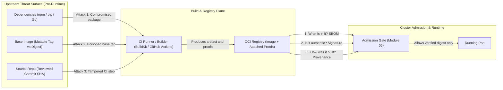
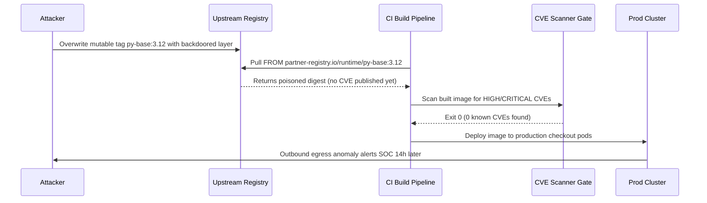

# Supply Chain Attacks and the SLSA Framework

> **Prerequisites:** Container builds (Track 02), CI/CD pipelines (Track 10), STRIDE threat modeling (`11-container-security/00`), and vulnerability scanning (`11-container-security/01`).  
> **Estimated Reading Time:** 30 minutes  
> **Target Audience:** Backend Engineers, Platform Engineers, Security Engineers, DevSecOps Practitioners.

> [!TIP]
> **The Golden Rule of Supply-Chain Security:** Never confuse **vulnerability scanning** ("does it contain known CVEs?") with **provenance and integrity** ("was it built from reviewed source by a trusted builder without tampering?"); pin external artifacts by immutable `sha256:` digest rather than mutable tag, and climb the SLSA v1.0 maturity ladder (`L1` provenance exists -> `L2` hosted-signed -> `L3` isolated) one verifiable control at a time.

---

## Why This Matters

Track 11 module 01 taught you to *scan* an image and to hold a mental model: "scanning = is it safe, signing = is it authentic." That module deliberately stopped at the preview. This track picks up exactly there and goes the whole distance. But before any tool, you need the threat model that makes signing, SBOMs, and provenance worth the effort: a supply-chain attack doesn't break into your running container — it corrupts the *artifact* or the *process that built it*, so the malicious thing is already inside the image you scanned, signed, and trusted. SLSA is the industry's maturity model for defending against exactly that, and it frames every remaining module in this track.

---

## 1. Architectural Mental Model & Threat Surface

Every container travels a linear build-and-delivery pipeline from developer commit to running Pod. Attackers deliberately strike *upstream* of production runtime — compromising dependencies, repointing mutable base-image tags, or subverting CI runners — so malicious payloads inherit your organization's own trust boundaries:



### What a supply-chain attack actually is

Track 11 module 00's STRIDE model had a **Tampering** category, and module 01 said signing addresses it — but *where* does the tampering happen? A supply-chain attack targets one of the steps *before* your image ever runs:

- **A compromised dependency.** You `pip install`/`npm install` a package that a maintainer (or an attacker who took over the maintainer's account) laced with malicious code. The most famous real cases — `event-stream`, `xz-utils`/CVE-2024-3094 — shipped through the normal, trusted update path. Your build pulled it in automatically. Nothing you wrote is malicious; your *bill of materials* is.
- **A poisoned base image.** Your Dockerfile says `FROM someorg/base:1.4`. If that tag is repointed (or was malicious from the start), every image you build inherits the payload. This is the base-image hygiene lesson from track 11 module 01, now framed as an *attack*, not just a CVE-count nuisance.
- **A tampered build step.** An attacker who can influence your CI — a malicious GitHub Action, a compromised runner, a modified build script — injects code *during* the build, so the image you ship differs from the source you reviewed. SolarWinds is the canonical example: the source was clean, the *build* was subverted.

The through-line: in every case the resulting image can pass a vulnerability scan clean, because the malicious code isn't a *known, published* CVE — it's a freshly-planted payload. Scanning (track 11) cannot catch this. That's the gap this track closes.

### Why scanning is necessary but not sufficient

Track 11 module 01 was explicit that a clean scan tells you nothing about tampering, zero-days, or your own logic bugs. Reframe that here as the precise reason this track exists:

- Scanning answers **"does this image contain known-vulnerable packages?"**
- Supply-chain security answers **"is this the exact artifact my trusted pipeline produced from source I reviewed, built by a process I trust, with a known and attested set of contents?"**

Those are orthogonal. A validly signed image can still be vulnerable; a freshly-scanned image can still be a tampered impostor or built from a poisoned dependency. You need *both* axes, and this track is the second axis in full: **provenance and integrity**.

### The three questions this track answers

Every remaining module maps to one of three questions an image should be able to answer for itself:

1. **What is in it?** — the **SBOM** (module 01). A cryptographically attestable inventory, going far past the throwaway `trivy image --format cyclonedx` you generated in track 11.
2. **Is it authentic and unmodified?** — the **signature** (modules 02, 05). Cosign/Sigstore signing plus admission control that *refuses to run anything unsigned*.
3. **How was it built?** — the **provenance attestation** (module 03). A signed statement of *which* CI job built it, from *which* commit, with *which* builder — so a subverted build is detectable.

Hold these three questions; they're the spine of the whole track.

### SLSA: a maturity model, not a product

**SLSA** (Supply-chain Levels for Software Artifacts, pronounced "salsa") is an OpenSSF framework that grades *how trustworthy an artifact's build process is*. It's a maturity ladder, exactly like the way track 11 layered controls — you don't jump to the top, you climb. The current levels (v1.0) are about **build integrity** specifically:

- **Level 0** — no guarantees. A build with no provenance at all. Most images in the world.
- **Level 1** — provenance *exists*. The build produces a provenance document describing how it was made. It's not tamper-proof yet, but it's there and consumers can inspect it. This is roughly "you generate a provenance attestation" (module 03).
- **Level 2** — provenance is *signed* and generated by a hosted build service, so it can't be forged by whoever ran the build. This is "your CI platform signs the provenance for you" — GitHub Actions' generator, for example.
- **Level 3** — the build runs in a *hardened, isolated* environment where even the build's own scripts can't tamper with the provenance (non-falsifiable provenance, isolated build). This is the SolarWinds-resistant tier.

The point of naming the levels: they give you a *target* and a shared vocabulary. "We're at SLSA 2 and want to reach 3" is a concrete, auditable goal. Each level constrains a specific class of attack from the first concept above — provenance (L1) makes a tampered build *visible*, signed provenance (L2) makes it *unforgeable*, isolation (L3) stops the build from lying about itself.

### Where SLSA meets the rest of this track

SLSA is the *why*; cosign, Syft, and admission control are the *how*. The map:

- Reaching **L1/L2** is modules 01–03 (SBOM, signing, provenance attestation) wired into the track-10 pipeline you already know.
- **Enforcing** that consumers only run L2+ artifacts is module 05 — the same Gatekeeper admission-control mechanism from track 11 module 04, now checking for a valid signature and attestation instead of a label.
- Keeping the whole thing *honest over time* — dependencies drift, CVEs land in already-signed images — is modules 04 (ongoing vuln management), 06 (dependency/base hygiene at scale), and 07 (what to do when a signed image turns out to be compromised anyway).

You are, in effect, building a SLSA-graded pipeline across this track and then enforcing it at the cluster door.

---

## 2. Taxonomic Comparison & Command Reference

### SLSA v1.0 Build Track Maturity Ladder

| Level | Provenance Requirement | Trust / Isolation Guarantee | Attack Class Mitigated | Track 18 Mapping |
|---|---|---|---|---|
| **SLSA Build L0** | None | No build-integrity evidence | None (blind trust) | Baseline before Track 18 |
| **SLSA Build L1** | Machine-readable provenance exists | Consistent build process & inspectable metadata | Accidental misbuilds; makes tampered builds *visible* | Module 03 (`docker buildx --provenance=true`) |
| **SLSA Build L2** | Provenance generated & **signed by hosted build service** | Prevents forgery by downstream actors / local laptops | Registry swaps, forged artifacts, rogue uploads | Modules 02 & 03 (keyless OIDC CI + `cosign attest`) |
| **SLSA Build L3** | Non-falsifiable provenance from **isolated, hardened builder** | Build steps/scripts cannot access signing keys or alter provenance | Subverted CI scripts / persistent runner compromise (SolarWinds-class) | Hosted isolated builders + admission policy (Module 05) |

### Supply-Chain Attack Vectors vs. Verification Axis

| Attack Shape | Real-World Precedent | Caught by CVE Scan Alone? | Primary Supply-Chain Control |
|---|---|---|---|
| **Compromised Dependency** | `event-stream`, `xz-utils` (CVE-2024-3094) | No (until after disclosure) | Lockfile pinning + SBOM inventory (01) + continuous scanning (04) |
| **Poisoned Base Image** | Silently repointed `:1.4` tag | No (planted payload has no CVE) | Immutable `@sha256:` digest pinning + signature verification (02, 06) |
| **Tampered Build Step** | SolarWinds Orion build injection | No (source was clean; scanner sees valid binary) | Signed provenance from isolated hosted builder, SLSA L2/L3 (03, 05) |

### Command reference

This module is conceptual; the tools arrive in module 01. These are the inspection commands that let you *see* the supply-chain surface you're about to defend.

| Command | What it does | Example |
|---|---|---|
| `docker history <image>` | Shows each layer/instruction, exposing base image + build steps | `docker history myapp:1.0` |
| `docker inspect <image>` | Full image metadata incl. config, env, entrypoint | `docker inspect myapp:1.0` |
| `docker buildx imagetools inspect <ref>` | Shows an image's manifest, incl. any attached attestations/SBOMs | `docker buildx imagetools inspect myreg.azurecr.io/app:1.0` |
| `crane manifest <ref>` | Prints the raw OCI manifest of a remote image (no pull) | `crane manifest myreg.azurecr.io/app:1.0` |
| `crane digest <ref>` | Resolves a tag to its immutable content digest | `crane digest myapp:1.0` |

Flag/field breakdown for `docker buildx imagetools inspect myreg.azurecr.io/app:1.0 --format '{{json .}}'`:

- `buildx imagetools inspect` — reads the image's manifest *from the registry* without pulling the whole image; the tool this track uses to see whether an image has SBOM/provenance attachments.
- `<ref>` — the image reference. Prefer a **digest** (`app@sha256:...`) over a **tag** (`app:1.0`) whenever integrity matters: a tag is mutable (the poisoned-base-image attack), a digest is content-addressed and cannot be silently repointed.
- `--format '{{json .}}'` — emit machine-readable JSON so you can grep for `SLSA`/`SPDX`/`in-toto` attestation predicate types (you'll do this for real in module 03).

---

## 3. Production War Story Post-Mortem

- **Incident:** `SEV-1` — Silent Base-Image Tag Repointing Evades Clean Trivy Gate in Checkout API
- **Detection / Resolution Time:** 14 hours to detect via outbound DNS anomaly / 4 hours to purge & re-pin fleet
- **Impact:** 3 production replicas exfiltrated ephemeral environment tokens before egress firewall blocked unknown C2 IPs; full secret rotation across 2 clusters required.

### What Happened

A backend platform team maintained a payment service built with `FROM partner-registry.io/runtime/py-base:3.12`. Their CI pipeline strictly enforced `trivy image --exit-code 1 --severity HIGH,CRITICAL` before pushing to Azure Container Registry. Overnight, an attacker compromised credentials for `partner-registry.io` and overwrote the mutable `:3.12` tag with an identical OS/Python stack plus a compiled ELF helper inside `/usr/local/bin/` that had zero known CVEs. On Monday morning's rebuild, CI pulled the altered `:3.12` tag, Trivy reported `0 CRITICAL, 0 HIGH` vulnerabilities, and the pipeline automatically promoted the image to production:



### Root Cause Analysis

1. **Mutable tag dependency:** Using `FROM ...:3.12` instead of `FROM ...@sha256:<digest>` allowed silent upstream byte substitution between builds.
2. **Single-axis security gate:** Relying solely on a CVE scanner answered "are there known vulnerabilities?" rather than "is this base image authentic and unchanged from what we reviewed?"
3. **SLSA Level 0 blindness:** Neither build provenance nor upstream signature verification existed to prove which exact base digest and inputs entered the build.

### The Fix & Architectural Hardening

1. Replaced all `FROM` references across Dockerfiles with digest-pinned references (`FROM partner-registry.io/runtime/py-base:3.12@sha256:...`), automated via Renovate/Dependabot PRs (Module 06).
2. Added keyless image signature verification for third-party base images and SLSA L2 provenance generation for internal images (Modules 02–03).
3. Deployed an admission controller refusing any Pod spec without an `@sha256:` digest and valid CI signature (Module 05).

---

## 4. Multi-Language Production Implementation

Production supply-chain policy evaluators enforce two foundational Module 00 invariants before any build or admission proceeds: **(1)** external artifact references must be pinned to an immutable `sha256:` digest, and **(2)** an image's provenance metadata must satisfy the target SLSA v1.0 Build Level (`L1`, `L2`, or `L3`).

````carousel
```go
package slsa

import (
	"errors"
	"fmt"
	"regexp"
	"strings"
)

var sha256DigestRe = regexp.MustCompile(`^sha256:[0-9a-f]{64}$`)

type BuildEvidence struct {
	ArtifactRef          string
	HasProvenance        bool
	SignedByHostedCI     bool
	IsolatedBuildHost    bool
	SourceCommitPinned   bool
}

type Assessment struct {
	AchievedLevel int
	Digest        string
	Warnings      []string
}

func EvaluateSupplyChainPolicy(ev BuildEvidence, minLevel int) (Assessment, error) {
	parts := strings.SplitN(ev.ArtifactRef, "@", 2)
	if len(parts) != 2 || !sha256DigestRe.MatchString(parts[1]) {
		return Assessment{}, fmt.Errorf("mutable reference rejected (%s): must pin immutable @sha256:<64-hex> digest", ev.ArtifactRef)
	}

	level := 0
	var warnings []string
	if ev.HasProvenance {
		level = 1
		if ev.SignedByHostedCI {
			level = 2
			if ev.IsolatedBuildHost {
				level = 3
			}
		} else {
			warnings = append(warnings, "provenance is unsigned or self-signed locally; capped at SLSA Build L1")
		}
	}
	if !ev.SourceCommitPinned {
		warnings = append(warnings, "source input is not pinned to an immutable commit SHA")
	}
	if level < minLevel {
		return Assessment{AchievedLevel: level, Digest: parts[1], Warnings: warnings},
			fmt.Errorf("policy denied: achieved SLSA L%d < required SLSA L%d", level, minLevel)
	}
	if level == 0 && minLevel == 0 {
		return Assessment{}, errors.New("unexpected zero-guarantee policy")
	}
	return Assessment{AchievedLevel: level, Digest: parts[1], Warnings: warnings}, nil
}
```
<!-- slide -->
```typescript
const SHA256_DIGEST_RE = /^sha256:[0-9a-f]{64}$/;

export interface BuildEvidence {
  artifactRef: string;
  hasProvenance: boolean;
  signedByHostedCI: boolean;
  isolatedBuildHost: boolean;
  sourceCommitPinned: boolean;
}

export interface PolicyAssessment {
  achievedLevel: 0 | 1 | 2 | 3;
  digest: string;
  warnings: string[];
}

export function evaluateSupplyChainPolicy(
  ev: BuildEvidence,
  minLevel: 1 | 2 | 3
): PolicyAssessment {
  const atIndex = ev.artifactRef.indexOf("@");
  if (atIndex === -1) {
    throw new Error(`Mutable tag rejected (${ev.artifactRef}): immutable @sha256: digest required`);
  }
  const digest = ev.artifactRef.slice(atIndex + 1);
  if (!SHA256_DIGEST_RE.test(digest)) {
    throw new Error(`Invalid content digest '${digest}': expected sha256:<64-hex>`);
  }

  let achievedLevel: 0 | 1 | 2 | 3 = 0;
  const warnings: string[] = [];

  if (ev.hasProvenance) {
    achievedLevel = 1;
    if (ev.signedByHostedCI) {
      achievedLevel = 2;
      if (ev.isolatedBuildHost) {
        achievedLevel = 3;
      }
    } else {
      warnings.push("Provenance lacks hosted CI signature; capped at SLSA Build L1");
    }
  }

  if (!ev.sourceCommitPinned) {
    warnings.push("Source input lacks immutable commit SHA pinning");
  }
  if (achievedLevel < minLevel) {
    throw new Error(`Policy denied: SLSA Build L${achievedLevel} < required L${minLevel}`);
  }

  return { achievedLevel, digest, warnings };
}
```
<!-- slide -->
```python
from dataclasses import dataclass, field
import re

SHA256_RE = re.compile(r"^sha256:[0-9a-f]{64}$")


@dataclass(frozen=True)
class BuildEvidence:
    artifact_ref: str
    has_provenance: bool
    signed_by_hosted_ci: bool
    isolated_build_host: bool
    source_commit_pinned: bool


@dataclass(frozen=True)
class PolicyAssessment:
    achieved_level: int
    digest: str
    warnings: list[str] = field(default_factory=list)


def evaluate_supply_chain_policy(ev: BuildEvidence, min_level: int = 2) -> PolicyAssessment:
    if "@" not in ev.artifact_ref:
        raise ValueError(f"Mutable reference rejected ({ev.artifact_ref}): @sha256: digest required")
    _, digest = ev.artifact_ref.split("@", 1)
    if not SHA256_RE.match(digest):
        raise ValueError(f"Malformed digest '{digest}': expected sha256:<64-hex>")

    level = 0
    warnings: list[str] = []
    if ev.has_provenance:
        level = 1
        if ev.signed_by_hosted_ci:
            level = 2
            if ev.isolated_build_host:
                level = 3
        else:
            warnings.append("Provenance is unsigned or local-only; capped at SLSA Build L1")

    if not ev.source_commit_pinned:
        warnings.append("Source input is not pinned to an exact commit SHA")

    if level < min_level:
        raise PermissionError(f"Policy denied: SLSA Build L{level} < required L{min_level}")

    return PolicyAssessment(achieved_level=level, digest=digest, warnings=warnings)
```
<!-- slide -->
```csharp
using System.Text.RegularExpressions;

namespace SupplyChain.Policy;

public sealed record BuildEvidence(
    string ArtifactRef,
    bool HasProvenance,
    bool SignedByHostedCi,
    bool IsolatedBuildHost,
    bool SourceCommitPinned);

public sealed record PolicyAssessment(int AchievedLevel, string Digest, IReadOnlyList<string> Warnings);

public static partial class SlsaPolicyEvaluator
{
    [GeneratedRegex("^sha256:[0-9a-f]{64}$", RegexOptions.Compiled)]
    private static partial Regex Sha256DigestRegex();

    public static PolicyAssessment Evaluate(BuildEvidence ev, int minLevel = 2)
    {
        var parts = ev.ArtifactRef.Split('@', 2);
        if (parts.Length != 2 || !Sha256DigestRegex().IsMatch(parts[1]))
        {
            throw new ArgumentException(
                $"Mutable reference rejected ({ev.ArtifactRef}): immutable @sha256:<64-hex> digest required.");
        }

        int level = 0;
        var warnings = new List<string>();
        if (ev.HasProvenance)
        {
            level = 1;
            if (ev.SignedByHostedCi)
            {
                level = ev.IsolatedBuildHost ? 3 : 2;
            }
            else
            {
                warnings.Add("Provenance lacks hosted CI signature; capped at SLSA Build L1.");
            }
        }

        if (!ev.SourceCommitPinned)
        {
            warnings.Add("Source input is not pinned to an exact commit SHA.");
        }

        if (level < minLevel)
        {
            throw new InvalidOperationException(
                $"Policy denied: SLSA Build L{level} does not satisfy required L{minLevel}.");
        }

        return new PolicyAssessment(level, parts[1], warnings);
    }
}
```
````

---

## 5. Practical Hands-On Verification CLI Workflows

No new tools yet — these build the *threat intuition* using tools you already have from tracks 02/11, so the defenses in later modules land on something concrete.

1. **(WSL2) See a base image you're inheriting blind.** Pull an image and read its ancestry:

   ```bash
   docker pull python:3.12-slim
   docker history python:3.12-slim --no-trunc | head -20
   ```

   **Expected Output:**

   ```text
   IMAGE          CREATED       CREATED BY                                                                     SIZE
   a1b2c3d4e5f6   2 weeks ago   CMD ["python3"]                                                                0B
   <missing>      2 weeks ago   RUN /bin/sh -c set -eux; savedAptMark="$(apt-mark showmanual)"; ...             34.2MB
   <missing>      2 weeks ago   ENV PYTHON_VERSION=3.12.7                                                      0B
   <missing>      2 weeks ago   ADD rootfs.tar.xz /                                                            74.8MB
   ```

   Every one of those layers is code you didn't write and are trusting. Note you have *no* way, from this output alone, to know *who* built them or *whether* they match any published source — that missing information is exactly what provenance (module 03) supplies.

2. **(WSL2) Prove a tag is mutable but a digest isn't.** Resolve a tag to its digest, then reason about the difference:

   ```bash
   docker pull nginx:1.27
   docker inspect --format '{{index .RepoDigests 0}}' nginx:1.27
   ```

   **Expected Output:**

   ```text
   nginx@sha256:0a399eb16751829e1af26fea27b20c3ec28d7ab1fb72182779d7372615a27ec7
   ```

   Expect something like `nginx@sha256:...`. The tag `1.27` can be repointed by whoever controls the repo; the `sha256:` digest is the content itself and cannot change without changing the digest. Write one sentence on why `FROM nginx:1.27` is a weaker supply-chain statement than `FROM nginx@sha256:<digest>` (this is the pinning lesson module 06 revisits).

3. **(WSL2) Map a real attack to a SLSA level.** For each of the three attack types in Concepts (compromised dependency, poisoned base, tampered build), write down: *which SLSA level's guarantee would have made it detectable, and why.* (Hint: a tampered build is caught by provenance existing at all — L1 — and made unforgeable at L2; a poisoned base is a dependency-hygiene problem more than a build-integrity one.)

4. **(WSL2) Inventory your trust surface for one image.** Take any image you built in track 02 (or pull one), and list on paper every distinct *source of code* in it: base image, each OS package layer, each language dependency from your lockfile, your own code. This list *is* the SBOM you'll generate mechanically in module 01 — doing it by hand once shows you why an automated, attestable SBOM matters.

5. **(WSL2) Find whether an image already ships provenance.** Pick a well-known image built by a modern pipeline and inspect for attestations:

   ```bash
   docker buildx imagetools inspect docker.io/library/alpine:latest --format '{{json .}}' | grep -io 'provenance\|sbom\|slsa\|in-toto' | sort -u
   ```

   **Expected Output:**

   ```text
   in-toto
   provenance
   sbom
   slsa
   ```

   Some images will show attestation references, some won't. The presence or absence *is the SLSA-level signal* — an image with no provenance is Level 0 by definition, no matter how clean its scan.

6. **(WSL2) Reason about the "clean scan, still compromised" case.** Re-run a scan from track 11 on a current base:

   ```bash
   trivy image --severity HIGH,CRITICAL --ignore-unfixed python:3.12-slim
   ```

   **Expected Output:**

   ```text
   python:3.12-slim (debian 12.7)
   Total: 0 (HIGH: 0, CRITICAL: 0)
   ```

   Now argue in two sentences: if an attacker had planted a backdoor in one of these packages *before* it was published (a supply-chain compromise, not a known CVE), would this scan show it? Why not? This is the exact gap modules 02–03 close.

7. **Diagnose: which control stops which attack.** You're handed three incidents: (a) an image whose base tag was silently repointed to a malicious layer overnight; (b) a dependency update that added a credential-stealing payload; (c) a CI runner that was compromised and injected a miner into the build. For each, name — from this track's roadmap — the *primary* control that would have prevented or detected it (digest-pinning + admission signature check; SBOM + dependency review + continuous scanning; signed provenance from a trusted builder, SLSA L2+). There's overlap; justify your primary choice.

### Independent challenge

No commands given. Drawing on track 11 module 00's threat-modeling method and this module's SLSA ladder, write a one-page **supply-chain threat model** for a single service you've built earlier in this curriculum (reuse the track 02 or track 10 app). Enumerate every point between "a developer types code" and "a Pod runs the image" where an attacker could inject something — source, each dependency source, the base image, the CI system, the registry, the deployment step. For each injection point, state the STRIDE category (module 00), the SLSA level or specific control from this track's roadmap that would defend it, and whether that defense is *preventive* (blocks it) or *detective* (reveals it after the fact). Finish by naming your current honest SLSA level for that service today and the single highest-leverage step to raise it one level.

<details>
<summary>Stuck? One hint</summary>

Draw the pipeline as a left-to-right line: `source → deps → base image → build (CI) → image → registry → admission → running Pod`. Put an arrow *into* the line at each point an attacker could inject, and label each arrow with a STRIDE category from module 00. Then, under the line, write the control from this track's roadmap that guards that arrow: pinning/digests and SBOM review guard the dep/base arrows; signed provenance from a hosted builder (SLSA L2) guards the build arrow; a signature-checking admission policy (module 05) guards the admission arrow. Your "current level" is honestly Level 0 until you're generating provenance at all.

</details>

---

## 6. Operational Validation Checkpoints

<details>
<summary><strong>Checkpoint 1: Clean CVE Scan vs. Compromised Upstream Tag</strong></summary>

**Scenario:** Your CI pipeline builds an API image from `FROM node:20-alpine` and enforces `trivy image --exit-code 1 --severity HIGH,CRITICAL`. Last night an upstream mirror compromise repointed `node:20-alpine` to an image containing a stealthy reverse shell in `/usr/local/bin/node`. Trivy passes with exit code `0`. Why did Trivy miss it, and what two controls stop this class of attack?

**Validation Answer:** Trivy only checks installed packages against *known, published CVE databases*. A freshly injected binary or compromised upstream build has no CVE assigned yet, so the scan returns clean. Two controls stop this: (1) pinning the base image to an immutable `sha256:` digest (`FROM node:20-alpine@sha256:...`) so upstream tag repointing fails or never silently resolves, and (2) verifying the upstream publisher's signature and provenance attestation before consuming the base image.

</details>

<details>
<summary><strong>Checkpoint 2: Self-Signed Laptop Provenance vs. SLSA Build L2</strong></summary>

**Scenario:** A developer adds `--provenance=true` to their local `docker buildx build` command on a corporate laptop, signs the resulting image manually, and declares the service "SLSA Level 2 compliant." Should platform security accept this claim?

**Validation Answer:** No. Local `--provenance=true` reaches **SLSA Build L1** at best because provenance exists. **SLSA Build L2** strictly requires the provenance to be generated and signed by a *hosted build service* (such as GitHub Actions OIDC + SLSA generator) so the developer or whoever triggered the build cannot forge build inputs, commit SHAs, or build metadata off-platform.

</details>

<details>
<summary><strong>Checkpoint 3: Isolating the Three Supply-Chain Proofs</strong></summary>

**Scenario:** During an audit, an engineer claims: "We already push a CycloneDX SBOM to our artifact bucket, so we don't need Cosign signatures or SLSA provenance." Explain precisely what questions the SBOM leaves unanswered and what an attacker can still spoof.

**Validation Answer:** An SBOM only answers **"what is in it?"** — and without a signature it is an unverified claim that an attacker can fabricate for a malicious image. It does not prove **"is it authentic and unmodified?"** (which requires cryptographic signatures binding the digest, Module 02) or **"how was it built?"** (which requires SLSA provenance binding source commit SHA, workflow, and builder identity, Module 03).

</details>

---

## Common Mistakes & Troubleshooting

- **Thinking a passing scan means "supply-chain secure."** Track 11's warning, sharpened: scanning finds *known, published* CVEs. A supply-chain attack plants code that is not yet a CVE, so it scans clean. Different axis, both required.
- **Treating SLSA as a product to install.** SLSA is a *maturity model* and a vocabulary for build-integrity guarantees. You reach levels by adopting practices (provenance, signing, isolated builds) — there's nothing named "SLSA" to `apt install`.
- **Confusing the SBOM (contents) with provenance (build process).** "What's in it" and "how it was made" are different attestations answering different questions. Module 01 does the first, module 03 the second.
- **Pinning base images by tag and calling it pinned.** A tag is mutable; only a `sha256:` digest is truly pinned. "Pinned to `:1.4`" still lets the poisoned-base attack through if the tag is repointed (module 06).
- **Assuming the attack targets the running container.** Supply-chain attacks target the *artifact and the build*, so the malicious code is already inside the trusted image before it ever runs — runtime defenses (track 11) are too late for this class.
- **Aiming straight for SLSA 3.** Like every rollout in track 11, you climb: get provenance existing (L1), then signed by a hosted builder (L2), then isolated (L3). Skipping levels usually means none of them are real.

---

## Checkpoint Quiz

Write down your answer to each question before expanding it — checking without attempting first is the single easiest way to fool yourself into thinking you've learned this.

<details>
<summary>Show questions</summary>

1. Name the three canonical shapes of a supply-chain attack from this module, with a one-line example of each.
2. Why can an image that passes a Trivy scan clean still be the product of a supply-chain compromise?
3. State the three questions an image should be able to answer for itself, and which artifact answers each.
4. What does SLSA measure, and is it a tool you install? Explain in one sentence.
5. Describe SLSA Levels 1, 2, and 3 in terms of *provenance*, and which class of attack each additional level defends against.
6. Why is `FROM base@sha256:...` a stronger supply-chain statement than `FROM base:1.4`?
7. Which STRIDE category (track 11 module 00) does this entire track primarily address, and why doesn't scanning cover it?

</details>

<details>
<summary>Show answers</summary>

1. A **compromised dependency** (a malicious `npm`/`pip` package, e.g. `event-stream`/`xz-utils`); a **poisoned base image** (a repointed or malicious `FROM` base); and a **tampered build step** (code injected during CI, e.g. SolarWinds). All three land inside the image before it runs.
2. Because scanning detects only *known, published* CVEs by cross-referencing the SBOM against vulnerability feeds. A supply-chain compromise plants *new*, unpublished malicious code, which no feed lists yet — so the scan reports clean.
3. **What is in it?** → the SBOM (module 01). **Is it authentic/unmodified?** → the signature (modules 02/05). **How was it built?** → the provenance attestation (module 03).
4. SLSA measures the *integrity of an artifact's build process* on a maturity ladder (Levels 0–3); it is **not** a tool you install — it's a framework and vocabulary you reach by adopting practices like provenance and signing.
5. **L1:** provenance *exists* (build describes how it was made) — makes a tampered build *visible*. **L2:** provenance is *signed by a hosted build service* — makes it *unforgeable* by whoever ran the build. **L3:** the build is *isolated/hardened* so even its own scripts can't falsify provenance — defends against a subverted build (SolarWinds class).
6. Because a tag is mutable — whoever controls the repo can silently repoint `:1.4` to a malicious layer (the poisoned-base attack) — while a `sha256:` digest is content-addressed and cannot change without changing the digest, so it names the *exact* bytes you reviewed.
7. **Tampering** (integrity/provenance). Scanning only inspects *contents* for known CVEs; it cannot tell you whether the artifact is the authentic, unmodified output of a build process you trust — which is precisely what signing and provenance provide.

</details>

---

## Next

Continue to [01-software-bills-of-materials-sboms](../01-software-bills-of-materials-sboms/README.md) — start answering the first of the three questions ("what's *in* it?") by generating a real, structured SBOM with Syft, going far past the throwaway inventory you produced in track 11.
