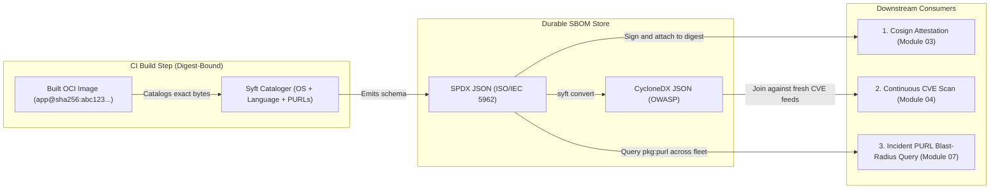
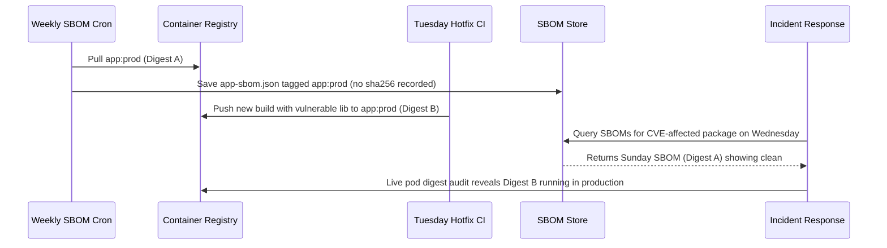

# Software Bills of Materials (SBOMs)

> **Prerequisites:** Supply-chain threat model & digest pinning (Module 00), container builds (Track 02), and container vulnerability scanning (`11-container-security/01`).  
> **Estimated Reading Time:** 35 minutes  
> **Target Audience:** Backend Engineers, Platform Engineers, Release Engineers, Security Architects.

> [!TIP]
> **The Golden Rule of SBOMs:** Generate the SBOM **in CI against the exact immutable `sha256:` image digest** you are about to ship (never days later against a mutable tag), treat **SPDX vs. CycloneDX** purely as a consumer interoperability detail (`syft convert`), and never mistake an SBOM (an unverified inventory noun) for a clean vulnerability scan or cryptographic authenticity.

---

## Why This Matters

Module 00 named the first of the three questions an image must answer for itself: **what is in it?** Track 11 module 01 already told you a scanner builds an SBOM under the hood and let you dump one with `trivy image --format cyclonedx` — but there it was a throwaway byproduct of scanning. Here the SBOM is the *product*. A first-class SBOM is the thing you'll later sign, attach to the image, and hand to admission control; it's also what turns a future "is-package-X-in-any-of-our-images?" incident question (module 07) from a frantic rebuild-and-grep into a fast query against artifacts you already have. This module makes the SBOM a real, durable artifact, generated the way a supply-chain pipeline generates it.

---

## 1. Architectural Mental Model: The Noun vs. Verb Pipeline

An SBOM decouples **inventory extraction** (the durable noun computed once per immutable image digest) from **vulnerability evaluation** (the repeatable verb re-run whenever CVE databases change):



### What an SBOM actually contains

An SBOM is a structured inventory of every **component** in an artifact. For a container image, that means, per component:

- **Name and version** — `openssl 3.0.11`, `express 4.18.2`.
- **Type/ecosystem** — OS package (apk/deb/rpm), language library (npm, pip, Go module, Maven), or the image itself.
- **A unique identifier** — a **PURL** (package URL, e.g. `pkg:npm/express@4.18.2`) and/or a **CPE**, so tools can match it against vulnerability databases unambiguously (this is the join key module 04's continuous scanning relies on).
- **Location/provenance hints** — which layer or file it came from.
- Often **licenses** and **checksums** for each component.

That's the "what's in the box" list module 00 promised, made machine-readable. Note what it is *not*: an SBOM is not a vulnerability report. It lists components; a scanner *joins* that list against CVE feeds. Same split track 11 drew — the SBOM is the noun, the scan is the verb.

### The two dominant formats: SPDX and CycloneDX

You'll meet two standards at a survey level; you don't need to author either by hand, but you must recognize them and know when each is used:

- **SPDX** (Software Package Data Exchange) — an ISO standard (ISO/IEC 5962), originally license-compliance-focused, now general-purpose. It's the format GitHub, `docker buildx`, and much of the Linux Foundation world default to. Verbose, relationship-rich.
- **CycloneDX** — an OWASP standard, security-first from the start, compact, strong at expressing vulnerability and dependency relationships. Widely used in security tooling (Trivy defaults to it, Dependency-Track consumes it).

They express the same core idea (a component inventory with identifiers); they differ in schema, verbosity, and lineage. The practical rule: **produce whichever format the consumer expects.** Your admission controller, your scanner, and your registry may each prefer one — good SBOM tools convert between them, and you'll do that conversion in the exercises. Don't religious-war this; treat format as an interop detail.

### Syft: a dedicated SBOM generator

Track 11 used Trivy, which *also* emits SBOMs. This track adds **Syft** (from Anchore) — a tool whose *single job* is SBOM generation, which makes it the natural fit for a pipeline where the SBOM is a first-class deliverable rather than a scan side-effect. Key properties, echoing why track 11 liked Trivy:

- **Single binary, no account, runs locally** — practice for real on this machine.
- **Many catalogers** — it inventories OS packages *and* language dependencies across dozens of ecosystems, and can scan an image, a directory, or an archive.
- **Multi-format output** — SPDX (JSON/tag-value), CycloneDX (JSON/XML), and its own native format, selectable with one flag. This is what makes the "produce whichever the consumer wants" rule practical.

Syft pairs with **Grype** (its sibling scanner) exactly the way an SBOM pairs with a scan: `syft` produces the inventory, `grype` consumes it to find CVEs. You'll use that pairing in module 04.

### Generating the SBOM at the right moment (and pinning by digest)

*When* you generate the SBOM matters as much as *that* you do. Two rules:

- **Generate it in CI, against the exact image you're about to ship**, right after build — the same "shift left, in the pipeline" timing track 11 module 01 drilled for scanning, and the same slot you'll later add signing (module 02) and provenance (module 03). An SBOM generated later, by hand, against a re-pulled tag, can drift from what actually shipped — the "stale SBOM" failure you'll deliberately reproduce below.
- **Bind the SBOM to the image's digest, not its tag.** Module 00's digest-vs-tag point applies directly: an SBOM is only trustworthy if it's tied to the immutable `sha256:` content it describes. Attach-by-digest is how module 03 makes the binding cryptographic; here you at least record the digest the SBOM was generated against.

### What an SBOM buys you later (why this isn't busywork)

An SBOM sitting in a drawer is useless; an SBOM wired into your pipeline pays off three times over, each in a later module:

- **Attestation (module 03):** you sign the SBOM and attach it to the image, so a consumer can verify *this inventory really describes this image and came from us*.
- **Continuous scanning (module 04):** when a new CVE lands tomorrow, you re-scan *the stored SBOMs* of every image instead of re-pulling and re-analyzing every image — much faster, and it works even for images no longer in a running registry.
- **Incident blast-radius (module 07):** when `xz-utils` is announced vulnerable, "which of our 400 images contain it, at what version?" is a query over your SBOM store, answerable in minutes instead of a fleet-wide rebuild.

That third one is the payoff that makes SBOMs worth the pipeline cost — you're pre-computing the answer to the worst question you'll ever be asked under pressure.

---

## 2. Taxonomic Comparison & Command Reference

### SBOM Format Comparison

| Dimension | SPDX (`spdx-json`) | CycloneDX (`cyclonedx-json`) | Syft Native (`syft-json`) |
|---|---|---|---|
| **Steward / Standard** | Linux Foundation / ISO/IEC 5962 | OWASP / ECMA-424 | Anchore (tool-native) |
| **Origin & Strength** | Licensing, legal provenance, rich graph relationships | AppSec, dependency trees, VEX & vulnerability linking | Maximum fidelity metadata for Syft-to-Grype lossless roundtrips |
| **Core Component Keys** | `packages[]`, `relationships[]`, `externalRefs` (PURL) | `metadata.component`, `components[]`, `dependencies[]` | `artifacts[]`, `source`, `distro`, `artifactRelationships[]` |
| **Ecosystem Defaults** | GitHub Dependency Graph, `docker buildx --sbom=true` | Trivy default, OWASP Dependency-Track, Grype VEX | Lossless intermediate source before `syft convert` |

### Syft Layer Scope Comparison

| Flag | Filesystem View | Deleted Build Packages | Recommended Use Case |
|---|---|---|---|
| `--scope squashed` (default) | Final merged container filesystem | Excluded | Runtime vulnerability triage (only packages present in live container) |
| `--scope all-layers` | Every individual OCI image layer | **Included** | Deep supply-chain forensics, provenance auditing, and multi-stage leak checks |

### Command reference

| Command | What it does | Example |
|---|---|---|
| `syft <image>` | Generates an SBOM, printing a component table | `syft python:3.12-slim` |
| `syft <image> -o spdx-json` | Emits SPDX in JSON | `syft myapp:1.0 -o spdx-json` |
| `syft <image> -o cyclonedx-json` | Emits CycloneDX in JSON | `syft myapp:1.0 -o cyclonedx-json` |
| `syft <image> -o spdx-json=sbom.spdx.json` | Writes SBOM to a file (format=path form) | `syft myapp:1.0 -o spdx-json=sbom.spdx.json` |
| `syft <dir-or-archive>` | SBOMs a filesystem/source tree instead of an image | `syft dir:.` |
| `syft scan <ref>@sha256:<digest>` | SBOMs a specific immutable digest | `syft myreg.azurecr.io/app@sha256:abc...` |
| `syft convert <sbom> -o cyclonedx-json` | Converts an existing SBOM between formats | `syft convert sbom.spdx.json -o cyclonedx-json` |
| `docker buildx build --sbom=true ...` | Has BuildKit generate and attach an SBOM at build time | see exercise 7 |
| `trivy image --format spdx-json -o s.json <image>` | Trivy's SBOM output, for comparison with Syft | `trivy image --format spdx-json -o s.json myapp:1.0` |

Flag breakdown for `syft python:3.12-slim -o spdx-json=sbom.spdx.json --scope all-layers`:

- (subject) `python:3.12-slim` — the scan target. Can be an image ref, a `dir:` path, or an archive; prefer `image@sha256:<digest>` when the binding to exact content matters.
- `-o spdx-json=sbom.spdx.json` — output selector in `format=path` form: `spdx-json` picks the SPDX-in-JSON format; the part after `=` is the file to write. Omit the `=path` to print to stdout. You can pass `-o` multiple times to emit several formats at once.
- `--scope all-layers` — catalog packages in *every* layer, including files deleted in later layers (default `squashed` sees only the final filesystem). `all-layers` catches things that were installed then removed but may still matter for provenance.

Flag breakdown for `docker buildx build --sbom=true --provenance=mode=max -t app:1.0 --push .`:

- `--sbom=true` — BuildKit generates an SPDX SBOM *during the build* and attaches it to the image as an OCI attestation (no separate Syft step).
- `--provenance=mode=max` — also attach SLSA provenance (module 03's topic); shown here only so you see SBOM and provenance are attached the same way.
- `--push` — attestations live in the registry alongside the image manifest, so attaching only makes sense when pushing.

---

## 3. Production War Story Post-Mortem

- **Incident:** `SEV-1` — Stale Weekly SBOM Inventory Causes False-Negative Blast-Radius Report During Critical CVE Response
- **Detection / Resolution Time:** 7 hours after zero-day advisory / 5 hours to re-catalog running cluster digests
- **Impact:** 14 production microservices running a vulnerable `libssl3` build were cleared as "not affected" on initial triage, delaying emergency patching by nearly half a day while manual `kubectl exec` checks uncovered the discrepancy.

### What Happened

A platform team generated SBOMs via a Sunday-night cron job that pulled `:prod` tags from ACR and saved `service-sbom.json` to object storage without recording the image digest. On Tuesday afternoon, a hotfix added a new transitive OS library to three services and pushed updated images to `:prod`. On Wednesday morning, a critical OpenSSL advisory dropped. Security queried the Sunday SBOM archive, saw the older version or absent transitive library, and declared the fleet clean — while running pods in AKS had already switched to the Tuesday digest:



### Root Cause Analysis

1. **Out-of-band SBOM generation:** Generating SBOMs asynchronously on a cron schedule decoupled the inventory from the exact build step that produced the artifact.
2. **Tag-bound metadata:** Storing SBOMs keyed by mutable `:prod` tag instead of immutable `@sha256:<digest>` hid drift whenever tags moved.

### The Fix & Architectural Hardening

1. Moved `syft <image>@<digest> -o spdx-json` directly into the CI build-and-push workflow immediately after image creation.
2. Keyed every stored SBOM and attestation strictly by `sha256:` digest (`sboms/<repo>/<sha256>.spdx.json`), ensuring stale-SBOM drift is impossible by design.

---

## 4. Multi-Language Production Implementation

Before storing an SBOM or indexing it for Module 04/07 vulnerability queries, production pipelines validate three structural invariants: **(1)** valid SPDX or CycloneDX schema structure, **(2)** binding to an immutable `sha256:` subject digest, and **(3)** well-formed `pkg:` PURL identifiers for deterministic CVE joins and incident blast-radius lookups.

````carousel
```go
package sbom

import (
	"encoding/json"
	"errors"
	"fmt"
	"regexp"
	"strings"
)

var (
	digestRe = regexp.MustCompile(`^sha256:[0-9a-f]{64}$`)
	purlRe   = regexp.MustCompile(`^pkg:[a-z0-9.+-]+/.+@.+$`)
)

type Component struct {
	Name    string
	Version string
	PURL    string
}

type cyclonedxDoc struct {
	BomFormat string `json:"bomFormat"`
	Metadata  struct {
		Component struct {
			Hashes []struct {
				Alg     string `json:"alg"`
				Content string `json:"content"`
			} `json:"hashes"`
		} `json:"component"`
	} `json:"metadata"`
	Components []struct {
		Name    string `json:"name"`
		Version string `json:"version"`
		PURL    string `json:"purl"`
	} `json:"components"`
}

func ValidateAndQueryCycloneDX(raw []byte, expectedDigest string, targetPkg string) ([]Component, error) {
	if !digestRe.MatchString(expectedDigest) {
		return nil, fmt.Errorf("expected immutable sha256 digest, got %q", expectedDigest)
	}
	var doc cyclonedxDoc
	if err := json.Unmarshal(raw, &doc); err != nil {
		return nil, fmt.Errorf("invalid SBOM JSON: %w", err)
	}
	if doc.BomFormat != "CycloneDX" || len(doc.Components) == 0 {
		return nil, errors.New("invalid CycloneDX SBOM: missing bomFormat or empty components")
	}

	bound := false
	wantHex := strings.TrimPrefix(expectedDigest, "sha256:")
	for _, h := range doc.Metadata.Component.Hashes {
		if strings.EqualFold(h.Alg, "SHA-256") && strings.EqualFold(h.Content, wantHex) {
			bound = true
			break
		}
	}
	if !bound {
		return nil, fmt.Errorf("stale or unbound SBOM: missing metadata subject digest %s", expectedDigest)
	}

	var matches []Component
	for _, c := range doc.Components {
		if c.PURL != "" && !purlRe.MatchString(c.PURL) {
			return nil, fmt.Errorf("malformed PURL %q on component %s", c.PURL, c.Name)
		}
		if strings.EqualFold(c.Name, targetPkg) {
			matches = append(matches, Component{Name: c.Name, Version: c.Version, PURL: c.PURL})
		}
	}
	return matches, nil
}
```
<!-- slide -->
```typescript
const SHA256_DIGEST_RE = /^sha256:[0-9a-f]{64}$/;
const PURL_RE = /^pkg:[a-z0-9.+-]+\/.+@.+$/;

export interface SbomComponent {
  name: string;
  version: string;
  purl?: string;
}

interface CycloneDxDocument {
  bomFormat?: string;
  metadata?: {
    component?: {
      hashes?: Array<{ alg?: string; content?: string }>;
    };
  };
  components?: SbomComponent[];
}

export function validateAndQueryCycloneDx(
  rawJson: string,
  expectedDigest: string,
  targetPackage: string
): SbomComponent[] {
  if (!SHA256_DIGEST_RE.test(expectedDigest)) {
    throw new Error(`Subject digest must be sha256:<64-hex>, got '${expectedDigest}'`);
  }

  const doc = JSON.parse(rawJson) as CycloneDxDocument;
  if (doc.bomFormat !== "CycloneDX" || !Array.isArray(doc.components) || doc.components.length === 0) {
    throw new Error("Invalid CycloneDX SBOM: missing bomFormat or empty component inventory");
  }

  const expectedHex = expectedDigest.slice("sha256:".length).toLowerCase();
  const hashes = doc.metadata?.component?.hashes ?? [];
  const isBound = hashes.some(
    (h) => h.alg?.toUpperCase() === "SHA-256" && h.content?.toLowerCase() === expectedHex
  );
  if (!isBound) {
    throw new Error(`Unbound or stale SBOM: subject hash does not match ${expectedDigest}`);
  }

  const hits: SbomComponent[] = [];
  for (const comp of doc.components) {
    if (comp.purl && !PURL_RE.test(comp.purl)) {
      throw new Error(`Malformed PURL '${comp.purl}' for component '${comp.name}'`);
    }
    if (comp.name.toLowerCase() === targetPackage.toLowerCase()) {
      hits.push(comp);
    }
  }
  return hits;
}
```
<!-- slide -->
```python
from dataclasses import dataclass
import json
import re

DIGEST_RE = re.compile(r"^sha256:[0-9a-f]{64}$")
PURL_RE = re.compile(r"^pkg:[a-z0-9.+-]+/.+@.+$")


@dataclass(frozen=True)
class SbomComponent:
    name: str
    version: str
    purl: str


def validate_and_query_spdx(raw_json: str, expected_digest: str, target_pkg: str) -> list[SbomComponent]:
    if not DIGEST_RE.match(expected_digest):
        raise ValueError(f"Expected immutable sha256 digest, got {expected_digest!r}")

    doc = json.loads(raw_json)
    if "spdxVersion" not in doc or not doc.get("packages"):
        raise ValueError("Invalid SPDX SBOM: missing spdxVersion or empty packages list")

    expected_hex = expected_digest.removeprefix("sha256:").lower()
    subject_bound = any(
        c.get("algorithm") == "SHA256" and c.get("checksumValue", "").lower() == expected_hex
        for pkg in doc["packages"]
        for c in pkg.get("checksums", [])
    )
    if not subject_bound:
        raise ValueError(f"Stale or unbound SBOM: no package checksum matches {expected_digest}")

    matches: list[SbomComponent] = []
    for pkg in doc["packages"]:
        purls = [
            ref.get("referenceLocator", "")
            for ref in pkg.get("externalRefs", [])
            if ref.get("referenceType") == "purl"
        ]
        for p in purls:
            if not PURL_RE.match(p):
                raise ValueError(f"Malformed PURL {p!r} on package {pkg.get('name')}")
        if pkg.get("name", "").lower() == target_pkg.lower():
            matches.append(
                SbomComponent(
                    name=pkg["name"],
                    version=pkg.get("versionInfo", "unknown"),
                    purl=purls[0] if purls else "",
                )
            )
    return matches
```
<!-- slide -->
```csharp
using System.Text.Json;
using System.Text.RegularExpressions;

namespace SupplyChain.Sbom;

public sealed record SbomMatch(string Name, string Version, string Purl);

public static partial class CycloneDxValidator
{
    [GeneratedRegex("^sha256:[0-9a-f]{64}$", RegexOptions.Compiled)]
    private static partial Regex Sha256Regex();

    [GeneratedRegex("^pkg:[a-z0-9.+-]+/.+@.+$", RegexOptions.Compiled)]
    private static partial Regex PurlRegex();

    public static IReadOnlyList<SbomMatch> ValidateAndQuery(
        string rawJson, string expectedDigest, string targetPackage)
    {
        if (!Sha256Regex().IsMatch(expectedDigest))
            throw new ArgumentException($"Expected sha256:<64-hex> digest, got '{expectedDigest}'.");

        using var doc = JsonDocument.Parse(rawJson);
        var root = doc.RootElement;
        if (!root.TryGetProperty("bomFormat", out var fmt) || fmt.GetString() != "CycloneDX")
            throw new InvalidDataException("Invalid SBOM: bomFormat is not CycloneDX.");

        if (!root.TryGetProperty("components", out var components) || components.GetArrayLength() == 0)
            throw new InvalidDataException("Invalid CycloneDX SBOM: empty components inventory.");

        var expectedHex = expectedDigest["sha256:".Length..];
        bool bound = false;
        if (root.TryGetProperty("metadata", out var meta) &&
            meta.TryGetProperty("component", out var subject) &&
            subject.TryGetProperty("hashes", out var hashes))
        {
            foreach (var h in hashes.EnumerateArray())
            {
                if (string.Equals(h.GetProperty("alg").GetString(), "SHA-256", StringComparison.OrdinalIgnoreCase) &&
                    string.Equals(h.GetProperty("content").GetString(), expectedHex, StringComparison.OrdinalIgnoreCase))
                {
                    bound = true;
                    break;
                }
            }
        }
        if (!bound)
            throw new InvalidOperationException($"Unbound SBOM: subject digest does not match {expectedDigest}.");

        var matches = new List<SbomMatch>();
        foreach (var comp in components.EnumerateArray())
        {
            var name = comp.GetProperty("name").GetString() ?? "";
            var version = comp.TryGetProperty("version", out var v) ? v.GetString() ?? "" : "";
            var purl = comp.TryGetProperty("purl", out var p) ? p.GetString() ?? "" : "";
            if (!string.IsNullOrEmpty(purl) && !PurlRegex().IsMatch(purl))
                throw new InvalidDataException($"Malformed PURL '{purl}' for component '{name}'.");

            if (string.Equals(name, targetPackage, StringComparison.OrdinalIgnoreCase))
                matches.Add(new SbomMatch(name, version, purl));
        }
        return matches;
    }
}
```
````

---

## 5. Practical Hands-On Verification CLI Workflows

Syft runs locally and for real, like Trivy in track 11.

1. **(WSL2) Install Syft (and Grype for later).**

   ```bash
   curl -sSfL https://raw.githubusercontent.com/anchore/syft/main/install.sh | sh -s -- -b /usr/local/bin
   curl -sSfL https://raw.githubusercontent.com/anchore/grype/main/install.sh | sh -s -- -b /usr/local/bin
   syft version && grype version
   ```

   **Expected Output:**

   ```text
   Application:   syft
   Version:       1.x.x
   Application:   grype
   Version:       0.x.x
   ```

   Expect version strings for both. (If the install script is blocked, a `brew install syft grype` in WSL works too.)

2. **(WSL2) Generate your first real SBOM and read it.**

   ```bash
   syft python:3.12-slim
   ```

   **Expected Output:**

   ```text
   NAME                 VERSION              TYPE
   adduser              3.134                deb
   apt                  2.6.1                deb
   base-files           12.4+deb12u8         deb
   ...
   pip                  24.2                 python
   setuptools           70.0.0               python
   ```

   Expect a table of components: OS packages (deb) *and* the Python packages present, each with a name, version, and type. Note the count — this is the full "what's in the box" list module 00 had you build by hand.

3. **(WSL2) Emit both standard formats and eyeball the difference.**

   ```bash
   syft python:3.12-slim -o spdx-json=sbom.spdx.json
   syft python:3.12-slim -o cyclonedx-json=sbom.cdx.json
   grep -o '"name"' sbom.spdx.json | wc -l
   grep -o '"purl"' sbom.cdx.json | wc -l
   ```

   **Expected Output:**

   ```text
   98
   96
   ```

   Open both briefly. Same components, different schema (SPDX's `packages`/`relationships` vs CycloneDX's `components`). This is the format-is-interop-detail lesson made concrete.

4. **(WSL2) Convert between formats without regenerating.**

   ```bash
   syft convert sbom.spdx.json -o cyclonedx-json=converted.cdx.json
   diff <(grep -o '"name":"[^"]*"' sbom.cdx.json | sort) \
        <(grep -o '"name":"[^"]*"' converted.cdx.json | sort) | head
   ```

   Expect the component *set* to match (minor field differences are fine). This is why you don't fight over formats — one SBOM converts to whatever a consumer wants.

5. **(WSL2) SBOM your own image, pinned by digest.** Build a tiny image (reuse any Dockerfile from track 02, or the one below), then SBOM the exact digest:

   ```bash
   printf 'FROM python:3.12-slim\nRUN pip install requests==2.32.3\n' > Dockerfile
   docker build -t sbom-lab:1.0 .
   DIGEST=$(docker inspect --format '{{index .RepoDigests 0}}' sbom-lab:1.0 2>/dev/null)
   syft sbom-lab:1.0 -o spdx-json=app-sbom.json
   grep -o '"name":"requests"' app-sbom.json
   ```

   **Expected Output:**

   ```text
   "name":"requests"
   ```

   Expect `requests` to appear in the SBOM — your added dependency is now inventoried. (If `RepoDigests` is empty because you never pushed, that's expected locally; module 03 pins by digest against a real registry.)

6. **(WSL2) Feed the SBOM to a scanner — the noun/verb split, for real.**

   ```bash
   grype sbom:app-sbom.json
   ```

   **Expected Output:**

   ```text
   NAME          INSTALLED  FIXED-IN  TYPE    VULNERABILITY   SEVERITY
   libssl3       3.0.11-1   ...       deb     CVE-2024-...    Medium
   ...
   ```

   Expect Grype to report CVEs *derived from the SBOM you already made*, without re-analyzing the image. This is exactly module 04's continuous-scanning pattern in miniature: scan the stored inventory, not the image.

7. **(WSL2, optional) Let BuildKit attach the SBOM at build time.** If you have `docker buildx`:

   ```bash
   docker buildx build --sbom=true -t sbom-lab:2.0 --load .
   docker buildx imagetools inspect sbom-lab:2.0 --format '{{json .SBOM}}' 2>/dev/null | head -c 300; echo
   ```

   Expect an SBOM attestation to be attached to the image itself — the SBOM travels *with* the image, previewing module 03's attach-to-image model.

8. **Diagnose and fix: a stale SBOM.** Reproduce the classic supply-chain footgun — an SBOM that no longer matches the image it claims to describe:

   ```bash
   # Generate an SBOM against the current image
   syft sbom-lab:1.0 -o spdx-json=stale-sbom.json
   grep -c '"name":"flask"' stale-sbom.json    # expect 0 — flask isn't installed
   # Now change the image WITHOUT regenerating the SBOM
   printf 'FROM python:3.12-slim\nRUN pip install requests==2.32.3 flask==3.0.3\n' > Dockerfile
   docker build -t sbom-lab:1.0 .
   ```

   The image now contains Flask, but `stale-sbom.json` still doesn't mention it. Prove the drift and fix it:

   ```bash
   syft sbom-lab:1.0 -o spdx-json=fresh-sbom.json
   grep -c '"name":"flask"' stale-sbom.json     # 0 — the lie
   grep -c '"name":"flask"' fresh-sbom.json      # >=1 — the truth
   ```

   **Expected Output:**

   ```text
   0
   1
   ```

   Diagnose: the SBOM was generated *before* the image changed, so it under-reports contents — a scanner trusting it would miss Flask's CVEs entirely. The fix is process, not a flag: **generate the SBOM in the same CI step that produces the final image, bound to its digest**, so an SBOM can never describe a different build than the one that shipped (module 03 makes this binding cryptographic).

9. **(WSL2) Clean up.**

   ```bash
   rm -f sbom.spdx.json sbom.cdx.json converted.cdx.json app-sbom.json stale-sbom.json fresh-sbom.json Dockerfile
   docker rmi sbom-lab:1.0 sbom-lab:2.0 2>/dev/null; true
   ```

### Independent challenge

No commands given — build it using this module plus the CI knowledge from track 10 and the digest-vs-tag reasoning from module 00. Take one of your own images and produce a *repeatable SBOM step*: describe (in prose or as a real workflow snippet) where in a build-scan-push pipeline the SBOM generation belongs so it can never go stale, which format you'd emit and *why* given a named downstream consumer, and how you'd bind the SBOM to the image's digest rather than its tag. Then demonstrate the payoff: generate the SBOM, feed it to Grype to produce a vulnerability report *from the SBOM alone*, and write two sentences on how this same stored SBOM would let you answer "which of our images contain `openssl < 3.0.12`?" during an incident (module 07) without touching any image.

<details>
<summary>Stuck? One hint</summary>

The SBOM step goes immediately after the build and against the *just-built digest*, before or alongside the scan gate — same slot as track 11's Trivy step, so build → **SBOM(digest)** → scan → sign → push. Emit whatever your consumer needs (CycloneDX if it's a security tool like Dependency-Track, SPDX if it's GitHub/`buildx`), and you can always `syft convert` later. For the incident query, remember the SBOM already contains a PURL per component (`pkg:deb/openssl@...`), so answering "who has vulnerable openssl?" is a `grep`/query over stored SBOM files, not a rebuild.

</details>

---

## 6. Operational Validation Checkpoints

<details>
<summary><strong>Checkpoint 1: Default Squashed Scope vs. Deleted Build Artifacts</strong></summary>

**Scenario:** Your Dockerfile installs `curl` and `gcc` in an early `RUN` layer to compile a Python C-extension, then runs `apt-get purge -y gcc` in a later `RUN` layer. Running `syft myapp:1.0` shows no `gcc`, yet compliance asks for proof of *all* packages that touched intermediate layers. What Syft flag resolves this?

**Validation Answer:** Pass `--scope all-layers` (`syft myapp:1.0 --scope all-layers -o spdx-json=sbom.spdx.json`). By default Syft uses `--scope squashed`, which inspects only the final merged container filesystem. Passing `--scope all-layers` catalogs every OCI layer, capturing tools that were installed and subsequently deleted in later layers.

</details>

<details>
<summary><strong>Checkpoint 2: Format Friction Between BuildKit and Dependency-Track</strong></summary>

**Scenario:** Your Docker BuildKit pipeline attaches an **SPDX** SBOM via `--sbom=true`, but your security team's OWASP Dependency-Track server ingests **CycloneDX**. A developer suggests writing a custom Python parser or rebuilding every image with Trivy. What is the clean operational fix?

**Validation Answer:** Neither rebuilding nor writing a custom parser is needed. Treat SPDX vs. CycloneDX strictly as an interoperability detail and convert the existing artifact losslessly with `syft convert sbom.spdx.json -o cyclonedx-json=sbom.cdx.json` (or configure CI to emit both formats in one pass via multiple `-o` flags).

</details>

<details>
<summary><strong>Checkpoint 3: Accurate SBOM, Compromised Image</strong></summary>

**Scenario:** An external contractor delivers a container image accompanied by an accurate CycloneDX SBOM listing every package inside. Does validating that the SBOM matches the image prove the image is authentic and uncompromised?

**Validation Answer:** No. An SBOM describes *what is inside* the box, not *who built it* or *whether it was tampered with*. An attacker can generate a completely accurate SBOM for a trojanized container image. Authenticity and provenance require cryptographic signing and attestation (Modules 02 and 03).

</details>

---

## Common Mistakes & Troubleshooting

- **Treating the SBOM as a vulnerability report.** It's the *inventory* (noun); a scanner *joins* it against CVE feeds (verb). An SBOM with zero CVEs listed isn't "clean" — it simply hasn't been scanned yet.
- **Generating the SBOM by hand, later, against a re-pulled tag.** That's how it drifts from what shipped (exercise 8). Generate it in CI, in the build step, bound to the digest.
- **Binding the SBOM to a tag.** A tag is mutable (module 00); an SBOM tied to `:1.0` can silently describe a different image tomorrow. Bind to `sha256:`.
- **Fighting over SPDX vs CycloneDX.** They express the same inventory; produce what the consumer wants and `syft convert` for the rest. Format is an interop detail, not a decision worth blocking on.
- **Using `--scope squashed` and wondering where a removed package went.** The default sees only the final filesystem; use `--scope all-layers` if you need packages that were installed then deleted in a later layer.
- **Assuming an SBOM proves authenticity.** It describes contents, nothing more. An attacker can generate a perfectly accurate SBOM for a malicious image. Authenticity comes from *signing* the SBOM and the image (modules 02–03) — the SBOM alone is claims, not proof.

---

## Checkpoint Quiz

Write down your answer to each question before expanding it — checking without attempting first is the single easiest way to fool yourself into thinking you've learned this.

<details>
<summary>Show questions</summary>

1. List four things an SBOM records per component, and name the identifier that lets a scanner match a component to a CVE database.
2. What is the difference between an SBOM and a vulnerability scan report?
3. Name the two dominant SBOM formats, their lineage/focus, and the practical rule for choosing between them.
4. Why should the SBOM be generated in CI against the image's *digest* rather than by hand later against its tag?
5. Describe the stale-SBOM failure from exercise 8 and the *process* fix for it.
6. Give the three later-module payoffs an SBOM enables, one sentence each.
7. Does having an accurate SBOM prove an image is authentic? Why or why not?

</details>

<details>
<summary>Show answers</summary>

1. Per component: **name**, **version**, **type/ecosystem** (OS package vs language library), a **unique identifier** (PURL and/or CPE), and often **license** and **checksum** plus a location hint. The **PURL/CPE** is the identifier scanners join against CVE databases.
2. An SBOM is the *inventory* of components (the noun); a scan report is the result of *cross-referencing* that inventory against known-CVE feeds (the verb). The SBOM lists what's present; the scan says which of those have known problems.
3. **SPDX** (Linux Foundation / ISO standard, originally license-focused, the GitHub/`buildx` default) and **CycloneDX** (OWASP, security-first, the Trivy default). Practical rule: produce whichever format the *consumer* expects, and convert between them with `syft convert` — format is an interop detail.
4. Because a hand-generated, later SBOM against a mutable tag can drift from what actually shipped (the tag may point elsewhere, or the image may have changed), so it can under- or over-report contents. Generating in CI against the immutable `sha256:` digest guarantees the SBOM describes exactly the bytes that shipped.
5. The SBOM was generated *before* the image changed (Flask was added after), so it under-reported contents and any scanner trusting it would miss Flask's CVEs. The fix is process, not a flag: generate the SBOM in the same CI step that produces the final image, bound to its digest, so it can't describe a different build.
6. **Attestation (03):** sign and attach the SBOM so consumers can verify it describes this image and came from you. **Continuous scanning (04):** re-scan stored SBOMs when new CVEs land, without re-pulling images. **Incident blast-radius (07):** answer "which images contain vulnerable package X?" as a fast query over stored SBOMs instead of a fleet-wide rebuild.
7. No. An SBOM only *describes contents* — an attacker can produce an accurate SBOM for a malicious image. Authenticity requires *signing* the image and attesting the SBOM (modules 02–03); the SBOM by itself is an unverified claim.

</details>

---

## Next

Continue to [02-image-signing-with-cosign-and-sigstore](../02-image-signing-with-cosign-and-sigstore/README.md) — you can now say *what's in* an image; next, answer the second question, *is it authentic?*, by signing it with cosign and Sigstore's keyless flow.
