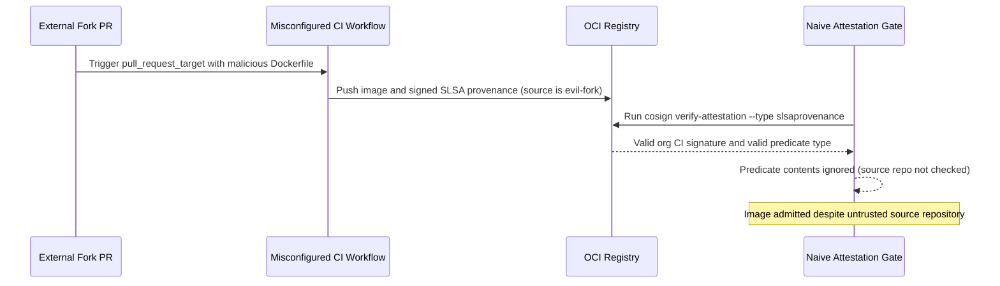

# Provenance and Build Attestations

> **Prerequisites:** Supply-chain threat model & SLSA levels (Module 00), SBOMs (Module 01), and Sigstore/cosign keyless signing (Module 02).  
> **Estimated Reading Time:** 40 minutes  
> **Target Audience:** Backend Engineers, Platform Engineers, Security Engineers, Release Engineers.

> [!TIP]
> **The Golden Rule of Build Provenance:** Verifying that an attestation *exists and has a valid signature* is never enough — an attacker or misconfigured workflow can produce a validly signed attestation pointing to an untrusted fork or branch; always verify **both** the signer identity (`--certificate-identity` + `--certificate-oidc-issuer`) and the **predicate contents** (`builder.id`, source repo URI, branch, and commit SHA) bound to the exact `@sha256:` digest.

---

## Why This Matters

Module 02 answered *is it authentic?* — a signature proves an image came from your CI and wasn't altered. But it doesn't say *how* the image was built: from which commit, by which workflow, with which builder. That's module 00's third question — **how was it built?** — and it's exactly the gap the SolarWinds-class "tampered build" attack lives in, where the source is clean but the build is subverted. **Provenance** closes it: a signed statement binding the image to *this exact commit, built by this exact CI job, using this exact builder*. Provenance is what moves you up the SLSA ladder (module 00) from Level 0 to Levels 1–2, and it's the richest thing module 05's admission controller can check. This module also shows how the SBOM from module 01 becomes a *signed attestation* riding on the image, not a loose file.

---

## 1. Architectural Mental Model: in-toto Attestations & Two-Stage Policy Verification

An **in-toto attestation** wraps structured metadata (an SBOM or SLSA provenance) inside a signed envelope bound to an artifact's digest, storing it alongside the image in the OCI registry so admission control can inspect *how* the image was produced before letting it run:

```mermaid
flowchart LR
    subgraph InToto["in-toto Attestation Statement"]
        Subj["Subject (app@sha256:abc123...)"]
        Type["PredicateType (SLSA Provenance / SPDX SBOM)"]
        Pred["Predicate Body (builder.id + configSource.uri + commit SHA)"]
    end

    subgraph Sign["Trust Attachment"]
        Envelope["DSSE Signed Envelope (Fulcio Cert + Rekor SET)"]
        OCI["OCI Registry (.att Manifest Linked by Digest)"]
        InToto -->|Signed by CI OIDC or BuildKit| Envelope
        Envelope -->|Stored next to image| OCI
    end

    subgraph Gate["Two-Stage Verification Gate"]
        Stage1["Stage 1: Verify Signature, Identity, Issuer, --type"]
        Stage2["Stage 2: Policy Check Predicate (Source Repo + Branch + Builder)"]
        Allow["Admit Workload (SLSA L2+ Verified)"]
        OCI --> Stage1
        Stage1 -->|Signature valid| Stage2
        Stage2 -->|Matches org repo and main branch| Allow
    end
```



### Attestations: signed statements *about* an artifact

Module 02 signed the image itself. An **attestation** is the same cryptographic machinery pointed at a *claim about* the image rather than the image bytes. Its shape (the **in-toto** attestation format Sigstore uses):

- a **subject** — which artifact the claim is about, identified by digest (module 00's digest binding again);
- a **predicate type** — what kind of claim this is (SLSA provenance, an SPDX SBOM, a Trivy vuln report, a custom claim);
- a **predicate** — the actual structured content of the claim;
- and it's **signed** exactly like a module-02 signature (keyless via Fulcio/Rekor, or with a key).

So "signature" and "attestation" are the same trust primitive: a signature says *"this image is authentic"*; an attestation says *"this **statement** about the image is authentic and came from me."* An SBOM attestation is your module-01 SBOM turned into a signed, image-bound claim; a provenance attestation is a signed claim about the build. Same verify mechanics, different predicate.

### SLSA provenance: what it records

**SLSA provenance** is a specific, standardized predicate type describing how an artifact was produced. Conceptually (you rarely hand-author it — the builder emits it), it records:

- **What was built** — the output artifact's digest (the subject).
- **From what inputs** — the source repository and the **exact commit SHA**, and often the resolved digests of build inputs.
- **By whom/what** — the **builder** identity (e.g. the GitHub Actions runner / the reusable workflow that generated it) and the build **invocation** (workflow file, run ID, trigger, parameters).
- **When** — build start/finish timestamps.

Read back the module-00 attacks against that list: a *tampered build* becomes detectable because the provenance names the exact builder and invocation; a *wrong-commit* build stands out because the recorded source SHA won't match the commit you reviewed. Provenance is the audit trail that makes "the source was clean but the build wasn't" a *checkable* claim instead of a blind spot.

### How provenance maps to SLSA levels (module 00, made concrete)

Module 00 defined the levels abstractly; provenance is what you actually add:

- **Level 1** — provenance *exists*. Your build emits a provenance document you can inspect. `docker buildx build --provenance=true` gets you here.
- **Level 2** — provenance is *signed by a hosted build service*, so the entity that ran the build can't forge it. GitHub's **SLSA provenance generator** (a reusable workflow) or `cosign attest` from a keyless CI job produces signed provenance bound to the CI identity — you can't fake it from a laptop.
- **Level 3** — the build runs *isolated/hardened* so even the build's own steps can't tamper with the provenance. This is a property of the *build platform*, not a flag you pass; hosted, ephemeral runners with generated provenance approach it.

The capstone targets L2: keyless-signed provenance from a GitHub Actions job, verifiable by identity — the same identity you pinned for signatures in module 02, now also vouching for *how* the image was built.

### Attaching attestations to the image (they travel together)

An attestation is only useful if a consumer can find it. Two attachment models, both storing the attestation in the registry next to the image (like module 02's signatures):

- **cosign attest** — attach an arbitrary predicate (SBOM, SLSA provenance, vuln report) as a signed attestation: `cosign attest --predicate sbom.json --type spdxjson `. Verify with `cosign verify-attestation`, pinning identity/issuer *and* the predicate `--type`, so you check both *who* attested and *what kind* of claim it is.
- **BuildKit attestations** — `docker buildx build --sbom=true --provenance=mode=max --push` has the builder attach SBOM and provenance automatically at build time, as OCI attestation manifests linked to the image (viewable with `docker buildx imagetools inspect` or `cosign tree`).

Either way, the guarantee is that the image, its SBOM, its provenance, and their signatures move as one unit through the registry — so at admission time (module 05) the controller can fetch and verify all of it from the digest alone.

### Verifying provenance is policy, not just presence

Just like keyless *signature* verification (module 02), verifying provenance means asserting expectations, not merely "an attestation exists":

- the attestation is **signed by the expected builder identity** (the `--certificate-identity`/`--certificate-oidc-issuer` pins from module 02);
- the predicate is the **expected type** (SLSA provenance, not just any claim);
- and — the powerful part — **fields inside the predicate match policy**: the source repo is *yours*, the commit is on an allowed branch, the builder is your approved workflow. A provenance attestation signed by the right identity but claiming a build from a *forked, untrusted repo* should be **rejected**.

This "check the contents of the claim, not just its signature" is what module 05 encodes as an admission policy, and it's why provenance is more powerful than a bare signature: it lets policy reason about *the build*, not just *the signer*.

---

## 2. Taxonomic Comparison & Command Reference

### Standard Attestation Predicate Types (`cosign attest --type`)

| `--type` Flag | Canonical Predicate URI / Standard | Claim Contents | Typical Producer |
|---|---|---|---|
| `slsaprovenance` | `https://slsa.dev/provenance/v0.2` or `v1` | Builder ID, source repo URI, commit SHA, inputs, timestamps | GitHub SLSA generator, BuildKit `--provenance` |
| `spdxjson` | `https://spdx.dev/Document` | Full SPDX package inventory & PURLs (Module 01) | `syft -o spdx-json`, BuildKit `--sbom=true` |
| `cyclonedx` | `https://cyclonedx.org/bom` | OWASP CycloneDX SBOM component inventory | `syft -o cyclonedx-json`, `trivy --format cyclonedx` |
| `vuln` | `https://cosign.sigstore.dev/attestation/vuln/v1` | Timestamped Trivy / Grype scan report snapshot | CI vulnerability scan gate |
| Custom URI | `https://example.com/...` | Custom QA sign-off, test pass, or compliance evidence | Internal release automation |

### Bare Signature vs. Attestation Verification

| Dimension | Image Signature (`cosign verify`) | SBOM Attestation (`--type spdxjson`) | Provenance Attestation (`--type slsaprovenance`) |
|---|---|---|---|
| **Question Answered** | Is this image authentic & unmodified? | What components are inside this digest? | How, where, and from which commit was it built? |
| **Trust Bound** | Digest bytes + signer identity | Digest + signed component inventory | Digest + signed build inputs, repo, branch, builder |
| **Failure Without Stage 2 Policy** | Cannot see inside build history | Cannot evaluate CVE/license policy rules | Passes validly signed provenance claiming an untrusted fork |

### Command reference

| Command | What it does | Example |
|---|---|---|
| `docker buildx build --provenance=true -t  --push .` | Build with SLSA provenance attached (SLSA L1) | `docker buildx build --provenance=true -t myreg.azurecr.io/app:1.0 --push .` |
| `docker buildx build --provenance=mode=max --sbom=true --push .` | Attach max-detail provenance *and* an SBOM | see exercise 5 |
| `docker buildx imagetools inspect  --format '{{json .Provenance}}'` | Read the provenance attached to an image | `docker buildx imagetools inspect myreg.azurecr.io/app:1.0` |
| `cosign attest --predicate <file> --type <type> ` | Attach a signed attestation (SBOM/provenance/custom) | `cosign attest --predicate sbom.json --type spdxjson app@sha256:...` |
| `cosign verify-attestation --type <type> --certificate-identity ... ` | Verify a signed attestation by type + identity | see breakdown |
| `cosign tree ` | Lists signatures *and* attestations on an image | `cosign tree myreg.azurecr.io/app:1.0` |
| `cosign download attestation ` | Downloads the raw attestation(s) for inspection | `cosign download attestation myreg.azurecr.io/app:1.0` |

Flag breakdown for `cosign attest --predicate provenance.json --type slsaprovenance --yes myreg.azurecr.io/app@sha256:...`:

- `attest` — create a *signed attestation* about the subject image (vs `sign`, which signs the image bytes). Same keyless flow as module 02 — Fulcio issues the cert, Rekor logs it.
- `--predicate provenance.json` — the file containing the claim's body (the provenance document, or an SBOM, or a vuln report).
- `--type slsaprovenance` — the predicate type, so verifiers can ask for *this specific kind* of claim. Common values: `slsaprovenance`, `spdxjson`, `cyclonedx`, `vuln`, or a custom URI.
- `` — the subject, always by digest so the claim binds to exact content.

Flag breakdown for `cosign verify-attestation --type slsaprovenance --certificate-identity-regexp 'https://github.com/myorg/.+' --certificate-oidc-issuer https://token.actions.githubusercontent.com myreg.azurecr.io/app:1.0`:

- `verify-attestation` — verify a *signed attestation* (not the image signature); fails if no attestation matches all checks.
- `--type slsaprovenance` — require the attestation to be of this predicate type; a valid attestation of a *different* type doesn't satisfy it.
- `--certificate-identity-regexp` / `--certificate-oidc-issuer` — the same identity-is-the-policy pins from module 02, now over *who attested*.
- (then, in a real gate) pipe the verified predicate through a policy check (e.g. `--policy` / a CUE/Rego policy) to assert the *source repo and commit* inside the predicate — module 05.

---

## 3. Production War Story Post-Mortem

- **Incident:** `SEV-1` — Validly Signed Fork Provenance Bypasses Signature-Only Attestation Gate
- **Detection / Resolution Time:** 5 hours via commit-to-release reconciliation audit / 1 hour to roll out Rego predicate URI enforcement
- **Impact:** An image built from an unauthorized external fork (`ATTACKER/evil-fork`) via an overly permissive `pull_request_target` CI trigger received a genuine org workflow OIDC signature and passed `cosign verify-attestation`, entering pre-production before release diffing caught the unreviewed commit SHA.

### What Happened

A platform team added `cosign verify-attestation --type slsaprovenance --certificate-identity-regexp 'https://github.com/myorg/.+' --certificate-oidc-issuer https://token.actions.githubusercontent.com` to their deployment pipeline. However, the CI repository still had a legacy workflow triggered on `pull_request_target` that checked out the PR author's fork code and built and attested the image using the base repo's OIDC identity. Because the deployment gate only verified *who signed the attestation* and *that its type was `slsaprovenance`*, it never inspected the JSON inside `predicate` to confirm the build's source URI belonged to `myorg/app`:



### Root Cause Analysis

1. **Stage-1-only attestation checking:** Treating `cosign verify-attestation` exit `0` as sufficient without passing `--policy` (CUE/Rego) to inspect `predicate` fields.
2. **Unsafe CI trigger context:** Mixing `pull_request_target` with build/attest permissions let untrusted fork inputs receive privileged organizational OIDC attestations.

### The Fix & Architectural Hardening

1. Added Stage-2 predicate policy validation verifying `subject[0].digest.sha256`, `predicateType`, `builder.id`, and `invocation.configSource.uri` (or SLSA v1 `buildDefinition.externalParameters.workflow.repository`) strictly match `git+https://github.com/myorg/myrepo@refs/heads/main`.
2. Restricted OIDC signing/attestation jobs solely to protected `main` / release tag workflows (`push` events) and isolated PR checks onto unprivileged runners.

---

## 4. Multi-Language Production Implementation

Verifying a SLSA provenance attestation in production requires **two stages**: after cryptographic DSSE/Fulcio verification succeeds, application or admission code decodes the base64 in-toto statement payload, verifies the subject `sha256` digest matches the requested artifact, confirms the `predicateType` URI, and enforces policy over `builder.id` and `invocation.configSource.uri` so an untrusted fork can never sneak past a valid CI signature.

````carousel
```go
package provenance

import (
	"encoding/base64"
	"encoding/json"
	"errors"
	"fmt"
	"strings"
)

type DsseEnvelope struct {
	PayloadType string `json:"payloadType"`
	Payload     string `json:"payload"`
}

type InTotoStatement struct {
	Type          string `json:"_type"`
	PredicateType string `json:"predicateType"`
	Subject       []struct {
		Name   string            `json:"name"`
		Digest map[string]string `json:"digest"`
	} `json:"subject"`
	Predicate struct {
		Builder struct {
			ID string `json:"id"`
		} `json:"builder"`
		Invocation struct {
			ConfigSource struct {
				URI    string            `json:"uri"`
				Digest map[string]string `json:"digest"`
			} `json:"configSource"`
		} `json:"invocation"`
	} `json:"predicate"`
}

func VerifySlsaPredicate(envelopeJSON []byte, expectedSha256Hex, allowedBuilder, allowedRepoPrefix string) error {
	var env DsseEnvelope
	if err := json.Unmarshal(envelopeJSON, &env); err != nil {
		return fmt.Errorf("invalid DSSE envelope: %w", err)
	}
	rawStmt, err := base64.StdEncoding.DecodeString(env.Payload)
	if err != nil {
		return fmt.Errorf("failed to decode base64 payload: %w", err)
	}
	var stmt InTotoStatement
	if err := json.Unmarshal(rawStmt, &stmt); err != nil {
		return fmt.Errorf("invalid in-toto statement: %w", err)
	}
	if !strings.HasPrefix(stmt.PredicateType, "https://slsa.dev/provenance/") {
		return fmt.Errorf("unexpected predicateType %q", stmt.PredicateType)
	}
	subjectMatch := false
	for _, s := range stmt.Subject {
		if strings.EqualFold(s.Digest["sha256"], expectedSha256Hex) {
			subjectMatch = true
			break
		}
	}
	if !subjectMatch {
		return fmt.Errorf("provenance subject does not cover digest sha256:%s", expectedSha256Hex)
	}
	if stmt.Predicate.Builder.ID != allowedBuilder {
		return fmt.Errorf("untrusted builder %q (expected %q)", stmt.Predicate.Builder.ID, allowedBuilder)
	}
	srcURI := stmt.Predicate.Invocation.ConfigSource.URI
	if !strings.HasPrefix(srcURI, allowedRepoPrefix) {
		return fmt.Errorf("untrusted source repo URI %q: expected prefix %q", srcURI, allowedRepoPrefix)
	}
	if stmt.Predicate.Invocation.ConfigSource.Digest["sha1"] == "" {
		return errors.New("provenance missing immutable source commit sha1")
	}
	return nil
}
```
<!-- slide -->
```typescript
interface DsseEnvelope {
  payloadType: string;
  payload: string;
}

interface InTotoProvenanceStatement {
  predicateType: string;
  subject: Array<{ name: string; digest: Record<string, string> }>;
  predicate: {
    builder?: { id?: string };
    invocation?: {
      configSource?: { uri?: string; digest?: Record<string, string> };
    };
  };
}

export function verifySlsaPredicate(
  envelopeJson: string,
  expectedSha256Hex: string,
  allowedBuilderId: string,
  allowedRepoPrefix: string
): { sourceUri: string; commitSha: string } {
  const env = JSON.parse(envelopeJson) as DsseEnvelope;
  const decoded = Buffer.from(env.payload, "base64").toString("utf8");
  const stmt = JSON.parse(decoded) as InTotoProvenanceStatement;

  if (!stmt.predicateType.startsWith("https://slsa.dev/provenance/")) {
    throw new Error(`Invalid predicateType '${stmt.predicateType}'`);
  }

  const matchesDigest = stmt.subject.some(
    (s) => s.digest?.sha256?.toLowerCase() === expectedSha256Hex.toLowerCase()
  );
  if (!matchesDigest) {
    throw new Error(`Attestation subject does not match digest sha256:${expectedSha256Hex}`);
  }

  const builderId = stmt.predicate.builder?.id ?? "";
  if (builderId !== allowedBuilderId) {
    throw new Error(`Untrusted builder '${builderId}'; expected '${allowedBuilderId}'`);
  }

  const sourceUri = stmt.predicate.invocation?.configSource?.uri ?? "";
  if (!sourceUri.startsWith(allowedRepoPrefix)) {
    throw new Error(`Untrusted source URI '${sourceUri}'; must start with '${allowedRepoPrefix}'`);
  }

  const commitSha = stmt.predicate.invocation?.configSource?.digest?.sha1 ?? "";
  if (!commitSha) {
    throw new Error("Provenance predicate missing immutable source commit SHA");
  }

  return { sourceUri, commitSha };
}
```
<!-- slide -->
```python
import base64
import json


def verify_slsa_predicate(
    envelope_json: str,
    expected_sha256_hex: str,
    allowed_builder_id: str,
    allowed_repo_prefix: str,
) -> tuple[str, str]:
    envelope = json.loads(envelope_json)
    statement = json.loads(base64.b64decode(envelope["payload"]).decode("utf-8"))

    predicate_type = statement.get("predicateType", "")
    if not predicate_type.startswith("https://slsa.dev/provenance/"):
        raise PermissionError(f"Unexpected predicateType: {predicate_type!r}")

    subjects = statement.get("subject", [])
    if not any(s.get("digest", {}).get("sha256", "").lower() == expected_sha256_hex.lower() for s in subjects):
        raise PermissionError(f"Subject digest mismatch: expected sha256:{expected_sha256_hex}")

    predicate = statement.get("predicate", {})
    builder_id = predicate.get("builder", {}).get("id", "")
    if builder_id != allowed_builder_id:
        raise PermissionError(f"Untrusted builder ID {builder_id!r} != {allowed_builder_id!r}")

    config_src = predicate.get("invocation", {}).get("configSource", {})
    source_uri = config_src.get("uri", "")
    if not source_uri.startswith(allowed_repo_prefix):
        raise PermissionError(f"Untrusted source repository URI {source_uri!r}")

    commit_sha = config_src.get("digest", {}).get("sha1", "")
    if not commit_sha:
        raise PermissionError("Provenance predicate missing source commit sha1")

    return source_uri, commit_sha
```
<!-- slide -->
```csharp
using System.Text;
using System.Text.Json;

namespace SupplyChain.Provenance;

public sealed record VerifiedProvenance(string BuilderId, string SourceUri, string CommitSha);

public static class SlsaProvenancePolicyGate
{
    public static VerifiedProvenance VerifyPredicate(
        string envelopeJson,
        string expectedSha256Hex,
        string allowedBuilderId,
        string allowedRepoPrefix)
    {
        using var envDoc = JsonDocument.Parse(envelopeJson);
        var payloadB64 = envDoc.RootElement.GetProperty("payload").GetString()
            ?? throw new InvalidDataException("Missing DSSE payload.");

        var stmtBytes = Convert.FromBase64String(payloadB64);
        using var stmtDoc = JsonDocument.Parse(Encoding.UTF8.GetString(stmtBytes));
        var root = stmtDoc.RootElement;

        var predicateType = root.GetProperty("predicateType").GetString() ?? "";
        if (!predicateType.StartsWith("https://slsa.dev/provenance/", StringComparison.Ordinal))
            throw new UnauthorizedAccessException($"Unexpected predicateType '{predicateType}'.");

        bool subjectMatch = false;
        foreach (var subj in root.GetProperty("subject").EnumerateArray())
        {
            if (subj.GetProperty("digest").TryGetProperty("sha256", out var shaProp) &&
                string.Equals(shaProp.GetString(), expectedSha256Hex, StringComparison.OrdinalIgnoreCase))
            {
                subjectMatch = true;
                break;
            }
        }
        if (!subjectMatch)
            throw new UnauthorizedAccessException($"Subject does not match digest sha256:{expectedSha256Hex}.");

        var predicate = root.GetProperty("predicate");
        var builderId = predicate.GetProperty("builder").GetProperty("id").GetString() ?? "";
        if (!string.Equals(builderId, allowedBuilderId, StringComparison.Ordinal))
            throw new UnauthorizedAccessException($"Untrusted builder '{builderId}'.");

        var cfg = predicate.GetProperty("invocation").GetProperty("configSource");
        var sourceUri = cfg.GetProperty("uri").GetString() ?? "";
        if (!sourceUri.StartsWith(allowedRepoPrefix, StringComparison.Ordinal))
            throw new UnauthorizedAccessException($"Untrusted source repository URI '{sourceUri}'.");

        var commitSha = cfg.GetProperty("digest").GetProperty("sha1").GetString() ?? "";
        if (string.IsNullOrWhiteSpace(commitSha))
            throw new UnauthorizedAccessException("Provenance missing source commit SHA.");

        return new VerifiedProvenance(builderId, sourceUri, commitSha);
    }
}
```
````

---

## 5. Practical Hands-On Verification CLI Workflows

Runs against the **local registry** from module 02 — no cost. Keyless attestation needs a real OIDC identity, so the keyless steps are studied as the capstone's CI commands; local steps use key-based `attest` to exercise the mechanics.

1. **(WSL2) Recreate the local registry and push an image.**

   ```bash
   docker run -d -p 5000:5000 --name registry registry:2
   docker pull alpine:3.20 && docker tag alpine:3.20 localhost:5000/app:1.0 && docker push localhost:5000/app:1.0
   DIGEST=$(crane digest localhost:5000/app:1.0)
   echo "$DIGEST"
   ```

   **Expected Output:**

   ```text
   sha256:beefdbd8a1da6d2915566fde36db9db0b524eb737fc57cd1367effd16dc0d06d
   ```

   Expect a `sha256:` digest — the subject for every attestation below.

2. **(WSL2) Generate an SBOM (module 01) and attach it as a signed attestation.**

   ```bash
   syft localhost:5000/app:1.0 -o spdx-json=sbom.json
   COSIGN_PASSWORD="" cosign generate-key-pair
   cosign attest --key cosign.key --predicate sbom.json --type spdxjson --yes localhost:5000/app@${DIGEST#*@}
   ```

   Expect the SBOM to be pushed as an attestation next to the image. Your module-01 loose file is now a *signed, image-bound claim* — this is the upgrade Concepts described.

3. **(WSL2) Hand-write a minimal provenance predicate and attest it.** Real provenance comes from the builder; here you author a tiny one to feel the shape:

   ```bash
   cat > provenance.json <<'EOF'
   {
     "buildType": "https://example.com/manual-build/v1",
     "builder": { "id": "https://github.com/YOURORG/YOURREPO/.github/workflows/ci.yml@refs/heads/main" },
     "invocation": { "configSource": {
        "uri": "git+https://github.com/YOURORG/YOURREPO@refs/heads/main",
        "digest": { "sha1": "abc123def456commitsha" } } }
   }
   EOF
   cosign attest --key cosign.key --predicate provenance.json --type slsaprovenance --yes localhost:5000/app@${DIGEST#*@}
   ```

   Expect a second attestation attached. Note the fields — builder, source URI, commit SHA — the exact things module 05 will check.

4. **(WSL2) List and download what's attached.**

   ```bash
   cosign tree localhost:5000/app:1.0
   cosign download attestation localhost:5000/app:1.0 | head -c 400; echo
   ```

   **Expected Output:**

   ```text
   📦 Supply Chain Security Related artifacts for an image: localhost:5000/app:1.0
   └── 🔐 Attestations for an image tag: localhost:5000/app:sha256-...att
       ├── 🍒 sha256:... (spdxjson)
       └── 🍒 sha256:... (slsaprovenance)
   {"payloadType":"application/vnd.in-toto+json","payload":"eyJfdHlwZSI6...
   ```

   Expect `tree` to show the image plus two attestations (SBOM + provenance). Everything travels with the image in the registry — no side channel.

5. **(WSL2) Let BuildKit generate real provenance at build time (SLSA L1).**

   ```bash
   printf 'FROM alpine:3.20\nCMD ["true"]\n' > Dockerfile
   docker buildx build --provenance=mode=max --sbom=true -t localhost:5000/app:2.0 --push .
   docker buildx imagetools inspect localhost:5000/app:2.0 --format '{{json .Provenance}}' | head -c 400; echo
   ```

   **Expected Output:**

   ```text
   {"SLSA":{"buildType":"https://mobyproject.org/buildkit@v1","builder":{"id":""},"invocation":{"configSource":{},...}}}
   ```

   Expect a provenance document the *builder* produced — recording the build steps, base image, and materials automatically. This is Level 1 with one flag; the capstone signs it via CI identity for Level 2.

6. **(WSL2) Verify an attestation by type and reject the wrong type.**

   ```bash
   cosign verify-attestation --key cosign.pub --type slsaprovenance localhost:5000/app:1.0 >/dev/null && echo "provenance OK"
   cosign verify-attestation --key cosign.pub --type vuln localhost:5000/app:1.0; echo "exit for wrong type: $?"
   ```

   **Expected Output:**

   ```text
   provenance OK
   Error: no matching attestations: ...
   exit for wrong type: 1
   ```

   Expect the first to succeed and the second to **fail** — there's no `vuln` attestation, so requiring that type rejects the image. Requiring the *right predicate type* is half the policy.

7. **Diagnose and fix: provenance signed by the right identity but claiming the wrong source.** This is the subtle attack a bare signature misses. Create a provenance that is validly signed but claims a build from an *untrusted fork*:

   ```bash
   cat > bad-prov.json <<'EOF'
   { "buildType": "https://example.com/manual-build/v1",
     "builder": { "id": "https://github.com/YOURORG/YOURREPO/.github/workflows/ci.yml@refs/heads/main" },
     "invocation": { "configSource": {
        "uri": "git+https://github.com/ATTACKER/evil-fork@refs/heads/main",
        "digest": { "sha1": "0000000000000000000000000000000000000000" } } } }
   EOF
   cosign attest --key cosign.key --predicate bad-prov.json --type slsaprovenance --yes localhost:5000/app@${DIGEST#*@}
   # A naive check only verifies the SIGNATURE and the TYPE — and PASSES:
   cosign verify-attestation --key cosign.pub --type slsaprovenance localhost:5000/app:1.0 >/dev/null && echo "naive check: PASSED (but source is a fork!)"
   ```

   The naive verify passes because the attestation *is* validly signed and *is* provenance — yet it claims a build from `ATTACKER/evil-fork`. Diagnose: bare signature/type verification never inspects the **predicate contents**. Fix: the verification must assert the source `uri` inside the predicate, e.g. by piping the verified predicate through a policy:

   ```bash
   cosign download attestation localhost:5000/app:1.0 \
     | jq -r '.payload' | base64 -d 2>/dev/null \
     | jq -r '.predicate.invocation.configSource.uri' | sort -u
   # A correct gate rejects any uri that isn't git+https://github.com/YOURORG/YOURREPO...
   ```

   **Expected Output:**

   ```text
   git+https://github.com/ATTACKER/evil-fork@refs/heads/main
   git+https://github.com/YOURORG/YOURREPO@refs/heads/main
   ```

   The lesson: provenance's power is in its *fields*, and a real gate (module 05) checks that the recorded source repo, branch, and builder match policy — not merely that a signed provenance exists.

8. **(WSL2) Clean up.**

   ```bash
   docker rm -f registry 2>/dev/null; true
   rm -f cosign.key cosign.pub sbom.json provenance.json bad-prov.json Dockerfile
   docker rmi localhost:5000/app:1.0 localhost:5000/app:2.0 alpine:3.20 2>/dev/null; true
   ```

### Independent challenge

No commands given — build it using this module plus module 01 (SBOM), module 02 (keyless verify semantics), and track 10 (CI). Design the *provenance step* of a pipeline that targets **SLSA Level 2**: state where in build → SBOM → scan → sign → **attest** → push the provenance and SBOM attestations are attached and why they bind to the digest; explain what would have to change to *claim* Level 2 versus Level 1 (who signs the provenance); and write the exact `cosign verify-attestation` command plus the *additional* policy assertion a consumer needs so that a validly-signed provenance claiming the *wrong source repo or branch* is rejected. Finish by explaining, in two sentences, which module-00 attack (compromised dependency / poisoned base / tampered build) this provenance step primarily defends and why a signature alone (module 02) does not.

<details>
<summary>Stuck? One hint</summary>

Provenance and SBOM attach right after signing, against the same `@sha256:` digest, via `cosign attest --type slsaprovenance` / `--type spdxjson` (or BuildKit's `--provenance/--sbom`). Level 1 is "provenance exists" (`--provenance=true`); Level 2 is "a *hosted builder* signed it" — i.e. keyless attestation from your GitHub Actions identity, so it can't be forged off-platform. The consumer's gate is `cosign verify-attestation --type slsaprovenance --certificate-identity ... --certificate-oidc-issuer ...` *plus* a policy that inspects `predicate...configSource.uri` and rejects anything not `git+https://github.com/YOURORG/YOURREPO`. It primarily defends the **tampered build** (SolarWinds) attack, which a signature can't — a signature proves the image is authentic, provenance proves *how and from what* it was built.

</details>

---

## 6. Operational Validation Checkpoints

<details>
<summary><strong>Checkpoint 1: Bare `verify-attestation` Passing on Untrusted Fork Input</strong></summary>

**Scenario:** Your deployment pipeline runs `cosign verify-attestation --type slsaprovenance --certificate-identity-regexp 'https://github.com/myorg/.+' --certificate-oidc-issuer https://token.actions.githubusercontent.com app@sha256:...` and exits `0`. Later you find `predicate.invocation.configSource.uri` inside the attestation points to `git+https://github.com/attacker/fork@refs/heads/main`. Why did `cosign` pass it?

**Validation Answer:** `cosign verify-attestation` checks cryptographic validity, the Fulcio signer identity/issuer, and the `--type` (`slsaprovenance`), but it does **not** evaluate the semantic contents inside the JSON predicate unless you supply `--policy` (CUE/Rego) or pipe the decoded payload into a policy evaluator (Module 05). Signing proves *who* attested, not that the *build inputs inside the statement* satisfy organizational policy.

</details>

<details>
<summary><strong>Checkpoint 2: Requiring `--type` to Enforce Specific Claims</strong></summary>

**Scenario:** An engineer attaches a signed SPDX SBOM via `cosign attest --type spdxjson`, then notices that `cosign verify-attestation --type slsaprovenance` fails even though the key and image digest match. Why?

**Validation Answer:** An attestation carries a specific `predicateType` claim. Requiring `--type slsaprovenance` rejects an image that only has an `spdxjson` SBOM attestation because proving *what is in the box* (SBOM) does not satisfy a policy requiring proof of *how it was built* (provenance). Production pipelines attach both predicates independently.

</details>

<details>
<summary><strong>Checkpoint 3: BuildKit `--provenance=true` vs. SLSA Build Level 2</strong></summary>

**Scenario:** Running `docker buildx build --provenance=mode=max --push` creates an unsigned BuildKit provenance object in the registry. Does this achieve SLSA Build Level 2?

**Validation Answer:** No — bare BuildKit `--provenance` produces unsigned provenance, which is **SLSA Build Level 1** (provenance exists). Reaching **SLSA Build Level 2** requires the provenance to be *generated and cryptographically signed by a hosted build service* (such as GitHub Actions OIDC keyless signing via `slsa-github-generator` or hosted CI `cosign attest`), making it unforgeable off-platform.

</details>

---

## Common Mistakes & Troubleshooting

- **Treating an attestation as different machinery from a signature.** It's the same keyless/Fulcio/Rekor trust primitive with a *predicate* attached. If you understand module 02's verify, you understand attestation verify — just add `--type`.
- **Verifying provenance exists but not its *contents*.** A signed provenance claiming a build from an attacker's fork will pass a bare `verify-attestation`. Real policy must assert the source repo, branch, and builder inside the predicate (exercise 7 / module 05).
- **Claiming SLSA Level 2 with laptop-generated provenance.** Level 2 requires a *hosted* build service to sign the provenance so it's unforgeable. Provenance you generate and sign locally is Level 1 at best — anyone with your key could have made it.
- **Confusing SBOM and provenance predicates.** SBOM = *what's in it*; provenance = *how it was built*. They're different predicate types answering different module-00 questions; you attach both.
- **Signing a tag-based subject.** Attestations bind to the digest like signatures. Attest `app@sha256:...`; a tag subject is ambiguous once the tag moves.
- **Letting registry GC prune attestations.** Like signatures (module 02), attestations are OCI objects a naive cleanup can delete, orphaning the image from its provenance. Use attestation-aware retention.

---

## Checkpoint Quiz

Write down your answer to each question before expanding it — checking without attempting first is the single easiest way to fool yourself into thinking you've learned this.

<details>
<summary>Show questions</summary>

1. What is an attestation, and how is it related to the image signature from module 02?
2. Name the four things SLSA provenance records, and which module-00 attack each helps detect.
3. Map `--provenance=true` (BuildKit) and keyless CI-signed provenance to SLSA Levels 1 and 2 — what's the difference that changes the level?
4. Why is verifying that provenance *exists and is signed* insufficient, and what must a real gate additionally check?
5. What are the two attachment models for getting attestations onto an image, and where do the attestations physically live?
6. In `cosign verify-attestation`, what does `--type` assert, and why does requiring the right type matter?
7. A signature (module 02) and provenance (module 03) are both valid on an image. Which module-00 attack does provenance defend that the signature alone does not, and why?

</details>

<details>
<summary>Show answers</summary>

1. An attestation is a *signed statement about* an artifact (subject + predicate type + predicate body), signed with the same keyless Fulcio/Rekor machinery as a module-02 signature. A signature says "this image is authentic"; an attestation says "this *claim* about the image is authentic and came from me."
2. **What was built** (output digest), **from what inputs** (source repo + exact commit SHA), **by whom/what** (builder identity + invocation), and **when** (timestamps). The builder/invocation fields expose a **tampered build**; the source SHA exposes a **wrong-commit/poisoned-source** build.
3. `--provenance=true` produces provenance that merely *exists* → **Level 1**. Keyless CI-signed provenance is signed by a *hosted build service* bound to the CI identity, so whoever ran the build can't forge it → **Level 2**. The difference is *who signs it and whether it's forgeable off-platform*.
4. Because a validly-signed provenance can still *claim* a build from an attacker's fork or wrong branch (exercise 7) — the signature only proves the attestation is authentic, not that its *contents* are acceptable. A real gate must assert the source repo, branch/ref, and builder recorded *inside* the predicate match policy.
5. **`cosign attest`** (attach an arbitrary signed predicate) and **BuildKit attestations** (`--sbom`/`--provenance` at build time). Both store the attestation in the **registry, next to the image**, linked by digest — so it travels with the image and is fetchable at admission time.
6. `--type` asserts the attestation's *predicate type* (e.g. `slsaprovenance`, `spdxjson`, `vuln`). Requiring the right type matters because a valid attestation of a *different* type shouldn't satisfy a policy that needs provenance — presence of *some* signed claim isn't presence of the *right* claim.
7. Provenance defends the **tampered-build** (SolarWinds-class) attack: it records *how and from what* the image was built (builder, workflow, source commit), making a subverted build or wrong source detectable. A signature only proves the image is the authentic, unmodified output of *whoever signed* — it says nothing about the build process that produced those bytes.

</details>

---

## Next

Continue to [04-vulnerability-management-as-an-ongoing-practice](../04-vulnerability-management-as-an-ongoing-practice/README.md) — you can now prove what's in an image, that it's authentic, and how it was built; next, keep it *trustworthy over time* as new CVEs land in images you already signed.
