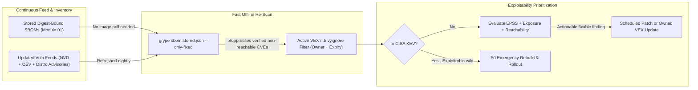
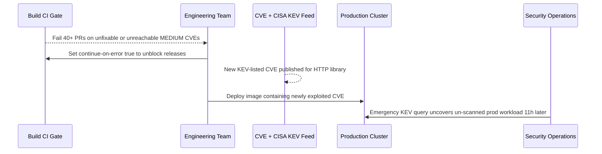

# Vulnerability Management as an Ongoing Practice

> **Prerequisites:** SBOMs (Module 01), container signing & provenance (Modules 02–03), and build-time vulnerability gates (`11-container-security/01`).  
> **Estimated Reading Time:** 40 minutes  
> **Target Audience:** Backend Engineers, Security Engineers, SREs, Platform Owners.

> [!TIP]
> **The Golden Rule of Ongoing Vulnerability Management:** Never treat a clean build-time scan as permanent — continuously re-scan **stored digest-bound SBOMs** against updated vulnerability databases (`grype db update`), prioritize findings by **real exploitability** (`CISA KEV` + `EPSS` + code reachability) rather than raw CVSS score, and record justified false positives in **owned, expiring VEX statements** so triage compounds instead of eroding trust in your gate.

---

## Why This Matters

Track 11 module 01 made scanning a *gate*: a one-time check between build and push that stops a known-vulnerable image from shipping. That's necessary and still not enough, because the world doesn't hold still. An image you scanned clean, signed (module 02), and attested (module 03) on Monday can be *critically vulnerable* by Friday when a new CVE lands in a package it already contains — no rebuild, no change, and yet now exploitable. Vulnerability management is the *ongoing* discipline that catches that: continuous re-scanning, understanding where CVE data comes from, and — the hardest and most valuable skill — triaging findings by whether they're actually *exploitable in your context* rather than by CVSS number alone. This is what keeps a signed, provenance-rich pipeline from being confidently, verifiably shipping something that's now dangerous.

---

## 1. Architectural Mental Model: Continuous SBOM Re-Scanning & Exploitability Triage

Continuous vulnerability management separates **build-time prevention** (blocking known fixable CVEs before push) from **post-deploy detection** (nightly re-scanning of stored digest-bound SBOMs against refreshed CVE feeds and filtering through VEX, KEV, and EPSS):



### The one-time-scan fallacy

The gate from track 11 answers "is this image free of *known* CVEs *right now*?" But "known" is a moving target: the vulnerability was always in the code; it just wasn't *published* yet when you scanned. Three consequences:

- **A passing gate has a shelf life.** Yesterday's clean scan says nothing about today's CVE feed. The image didn't change; the *knowledge* did.
- **Already-deployed images are the real exposure.** The images running in prod right now were scanned when they shipped, possibly months ago. New CVEs land against *them*, and nothing re-checks them unless you build that in.
- **You can't rebuild your way out fast enough.** With hundreds of images, "just rebuild everything when a CVE drops" isn't a plan — you need to know *which* images are affected before you can act (module 07's blast-radius question).

The fix is to make scanning **continuous**, and to make it cheap by scanning the **stored SBOMs** (module 01) rather than re-pulling and re-analyzing every image.

### Continuous scanning against stored SBOMs

Module 01 promised this payoff; here's the mechanism. Because an SBOM is a durable inventory bound to a digest, you can re-scan it any time the CVE feed updates, *without the image*:

- **Scan the SBOM, not the image.** `grype sbom:app-sbom.json` re-evaluates a stored inventory against today's database. Fast, works offline, works for images no longer pulled anywhere.
- **Schedule it.** A nightly job re-scans every stored SBOM against a freshly updated vulnerability DB and flags newly-affected images — this is the continuous half of the practice, the exact complement to track 11's build-time gate.
- **Registry- and cluster-level scanners** do the managed version of this: Trivy Operator in-cluster, Microsoft Defender for Containers (track 11 module 01) re-scanning ACR on a schedule, GitHub Dependabot alerts on your source repos. Same idea — someone re-checks known artifacts as the feed changes.

The stored SBOM is what makes "re-scan the whole fleet nightly" tractable instead of a fleet-wide rebuild.

### Where CVE data comes from (and why scanners disagree)

A scanner is only as good as the databases it joins your SBOM against. Knowing the sources explains why two scanners give different answers for the same image:

- **NVD (National Vulnerability Database)** — the U.S. government feed, the canonical source of CVE IDs and CVSS base scores. Authoritative but often *slow* to enrich and sometimes lacks precise affected-version ranges.
- **Distro/ecosystem advisories** — Debian, Alpine, Red Hat, GitHub Advisory Database (GHSA), the Go vuln DB, etc. These are usually *more accurate* about which exact package versions are fixed, because the maintainers publish them.
- **OSV (Open Source Vulnerabilities)** — an aggregated, machine-readable feed spanning many ecosystems (what Grype and others increasingly lean on).

Scanners differ because they pull different combinations of these, update on different schedules, and match versions with different precision. That's why a finding on one tool and not another isn't necessarily a bug — it's a data-source difference, and it's a reason to understand triage rather than trust a single number.

### CVSS is a starting point, not a verdict — triage by exploitability

The single most valuable skill in this module: **a CVSS score measures severity in the abstract, not risk in your context.** A CVSS 9.8 CRITICAL in a code path your image never executes is lower *real* risk than a CVSS 6.5 in your internet-facing auth flow. Triage means asking, per finding:

- **Is the vulnerable code reachable/executed** in how you run the image? A library present but never called is far lower risk.
- **Is there a fix available?** (`--ignore-unfixed` from track 11 — an unfixable CVE you can't remediate by rebuilding is triaged differently from a fixable one.)
- **Is it actually being exploited in the wild?** This is where **KEV** and **EPSS** come in (next section) — known-exploited or high-probability CVEs jump the queue regardless of CVSS.
- **What's the exposure?** Internet-facing vs internal-only, privileged vs sandboxed, reachable vs dead code.

The output of triage is a *decision* per finding: fix now, fix on the next cycle, or accept-and-document. "Sort by CVSS desc and panic at the top" is how teams drown in noise and start ignoring the scanner entirely — the same "gate that can't be satisfied gets disabled" failure track 11 warned about, in triage form.

### KEV, EPSS, and VEX: triage tooling

Three artifacts turn triage from vibes into signal:

- **CISA KEV (Known Exploited Vulnerabilities)** — a curated list of CVEs *observed being exploited in the wild*. A KEV-listed CVE is a drop-everything signal even at modest CVSS; it means attackers are actually using it now.
- **EPSS (Exploit Prediction Scoring System)** — a probability (0–1) that a CVE will be exploited in the next 30 days. It ranks the vast middle of "high CVSS, unclear if anyone cares" so you spend effort where exploitation is likely.
- **VEX (Vulnerability Exploitability eXchange)** — a machine-readable statement from a vendor/producer saying "CVE-X is present in our product but **not exploitable** because [reason]" (or "affected, fix here"). VEX is how you *record and share* a triage decision so downstream consumers and your own future scans don't re-litigate the same false positive. It's the structured form of "we looked, it's not reachable."

Together: KEV/EPSS tell you *what to prioritize*; VEX lets you *record what you already decided*, including justified false positives — so triage compounds instead of repeating.

### Handling false positives without turning off the alarm

Scanners over-report: a package version matched too coarsely, a CVE that doesn't apply to how the package is compiled, a component present but unused. The wrong responses are (a) disabling the scanner and (b) blanket-ignoring by severity. The right response mirrors track 11's exemption discipline (module 04's narrow, reviewable exemptions):

- **Suppress specific findings, explicitly and with a reason** — Trivy's `.trivyignore` / VEX, Grype's ignore rules — never a blanket "ignore all HIGH."
- **Record *why*** (not reachable, false match, accepted risk with owner and expiry) so the suppression is auditable and revisited, not permanent amnesia.
- **Keep the gate meaningful.** A gate drowning in un-triaged noise gets ignored; a gate that blocks only on triaged, actionable, exploitable findings stays trusted. Sustainability is a security property.

---

## 2. Taxonomic Comparison & Command Reference

### Vulnerability Prioritization & Triage Signals

| Artifact / Metric | What It Measures | Decision Action | Limitation If Used Alone |
|---|---|---|---|
| **CVSS Base Score** | Abstract technical severity (`0.0–10.0`) | Initial triage baseline | Ignores reachability, runtime exposure, and real-world attacker activity |
| **CISA KEV** | Confirmed active exploitation in the wild | **Drop everything / P0 patch** regardless of CVSS | Covers actively exploited subset; misses emerging pre-KEV threats |
| **EPSS** | 30-day probability (`0.0–1.0`) of in-the-wild exploitation | Ranks large backlog of `HIGH`/`MEDIUM` CVEs | Probabilistic estimate; doesn't evaluate code reachability in your app |
| **VEX Statement** | Exploitability status (`not_affected`, `affected`, `fixed`, `under_investigation`) | Suppresses verified non-exploitable CVEs with reason/owner | Only reflects analysis quality; requires expiry/review hygiene |

### CVE Data Feed Comparison

| Feed | Source Authority | Update & Precision Profile |
|---|---|---|
| **NVD** | NIST (U.S. Gov) | Canonical CVE IDs & CVSS; slower enrichment and broader CPE version ranges |
| **Distro / Ecosystem Advisories** | Debian, Alpine, Red Hat, GHSA, Go Vuln DB | Fast, exact fixed package versions including backported distro patches |
| **OSV** | Open Source Vulnerabilities (aggregated) | Machine-readable, package-ecosystem exact version ranges (PURL-aligned) |

### Command reference

| Command | What it does | Example |
|---|---|---|
| `grype <image>` | Scans an image for CVEs (Syft's sibling scanner) | `grype myapp:1.0` |
| `grype sbom:<file>` | Scans a **stored SBOM** — continuous scanning without the image | `grype sbom:app-sbom.json` |
| `grype db update` | Refreshes the local vulnerability database | `grype db update` |
| `grype  --only-fixed` | Shows only findings with an available fix | `grype myapp:1.0 --only-fixed` |
| `grype  -o json` | Machine-readable output for triage pipelines | `grype myapp:1.0 -o json` |
| `trivy image --vex <file> ` | Applies a VEX document to suppress non-exploitable findings | see exercise 7 |
| `trivy image --ignorefile .trivyignore ` | Applies explicit, reasoned suppressions | `trivy image --ignorefile .trivyignore myapp:1.0` |
| `grype  --fail-on critical` | Non-zero exit on findings at/above a severity (the CI gate) | `grype myapp:1.0 --fail-on critical` |

Flag breakdown for `grype sbom:app-sbom.json --only-fixed --fail-on high -o json`:

- `sbom:app-sbom.json` — scan a **stored SBOM** rather than an image; the source form is `sbom:`, `dir:`, or an image ref. This is the continuous-scan mode — cheap, offline, image-not-required.
- `--only-fixed` — report only findings that have an upstream fix, so the output is *actionable* (the `--ignore-unfixed` idea from track 11, Grype's spelling).
- `--fail-on high` — exit non-zero if any finding is HIGH or above, turning the re-scan into a gate a scheduled job can alert on.
- `-o json` — structured output you can post-process (enrich with EPSS, filter by KEV, feed a ticketing system).

Flag breakdown for `trivy image --vex vex.json --ignore-unfixed --severity HIGH,CRITICAL myapp:1.0`:

- `--vex vex.json` — apply a VEX document so findings marked *not exploitable* are suppressed *with a recorded justification* (not blindly hidden).
- `--ignore-unfixed` — drop findings with no available fix, keeping the gate achievable (track 11 module 01's sustainability lesson).
- `--severity HIGH,CRITICAL` — the triage threshold you can justify; combine with VEX/ignore so what remains is exploitable *and* fixable.

---

## 3. Production War Story Post-Mortem

- **Incident:** `SEV-1` — Blanket-Disabled CI Gate Lets Actively Exploited KEV Vulnerability Reach Production
- **Detection / Resolution Time:** 11 hours via threat-intel feed correlation / 3 hours to patch & deploy continuous SBOM re-scanning
- **Impact:** An internet-facing ingress microservice shipped with a `MEDIUM`-rated (CVSS 6.8) actively exploited library vulnerability (`CISA KEV`) after developers disabled an un-triaged scanner blocking 40+ unfixable alerts.

### What Happened

To improve security posture, platform engineering turned on `--fail-on medium` in CI without `--only-fixed` or VEX suppression. Within 48 hours, dozens of PRs blocked on upstream unfixable distro CVEs and unused library code paths. Under delivery pressure, a team lead bypassed the step with `continue-on-error: true`. Six days later, a newly published CVE was added to CISA's KEV catalog for an HTTP parsing library inside the service. Because the build gate was disabled and no continuous SBOM re-scan existed for running containers, the exposed service ran in production until an external threat-intel audit flagged the version:



### Root Cause Analysis

1. **Unsustainable gate configuration:** Blocking builds on unfixable findings (`--only-fixed` omitted) and already-reviewed false positives destroyed developer trust in the signal.
2. **Missing continuous post-deploy loop:** No nightly `grype sbom:` job existed to re-evaluate running workloads when new CVEs or KEV additions dropped.

### The Fix & Architectural Hardening

1. Scoped the CI gate strictly to actionable risk (`--only-fixed --fail-on high`) plus a mandatory **CISA KEV** check at any severity, paired with an owned, expiring VEX file (`--vex vex.json`) for verified unreachable findings.
2. Scheduled nightly `grype db update && grype sbom:<digest>.spdx.json` sweeps across all active production digests, routing new KEV matches directly to on-call PagerDuty.

---

## 4. Multi-Language Production Implementation

Production vulnerability gates combine **VEX suppression** (honoring non-expired `not_affected` statements with documented justifications), **fixability filtering** (`--only-fixed`), and **exploitability prioritization** (escalating any `CISA KEV` entry to immediate `P0` regardless of CVSS score, then ranking remaining findings by `EPSS` probability).

````carousel
```go
package vuln

import (
	"errors"
	"fmt"
	"sort"
	"time"
)

type Finding struct {
	CVEID       string
	Package     string
	CVSS        float64
	EPSS        float64
	InCisaKEV   bool
	FixedIn     string
}

type VexStatement struct {
	CVEID         string
	Status        string // "not_affected", "affected", "fixed"
	Justification string
	Owner         string
	ExpiresAt     time.Time
}

type TriageResult struct {
	P0Blockers   []Finding
	Scheduled    []Finding
	Suppressed   []string
}

func EvaluateVulnGate(findings []Finding, vexList []VexStatement, now time.Time, epssThreshold float64) (TriageResult, error) {
	vexMap := make(map[string]VexStatement)
	for _, v := range vexList {
		if v.Status == "not_affected" && v.ExpiresAt.After(now) && v.Owner != "" && v.Justification != "" {
			vexMap[v.CVEID] = v
		}
	}

	var res TriageResult
	for _, f := range findings {
		if v, suppressed := vexMap[f.CVEID]; suppressed {
			res.Suppressed = append(res.Suppressed, fmt.Sprintf("%s (owner=%s, reason=%s)", f.CVEID, v.Owner, v.Justification))
			continue
		}
		if f.FixedIn == "" && !f.InCisaKEV {
			continue // keep gate sustainable by skipping unfixable non-KEV noise
		}
		if f.InCisaKEV || f.EPSS >= epssThreshold || f.CVSS >= 9.0 {
			res.P0Blockers = append(res.P0Blockers, f)
		} else {
			res.Scheduled = append(res.Scheduled, f)
		}
	}

	sort.Slice(res.P0Blockers, func(i, j int) bool {
		if res.P0Blockers[i].InCisaKEV != res.P0Blockers[j].InCisaKEV {
			return res.P0Blockers[i].InCisaKEV
		}
		return res.P0Blockers[i].EPSS > res.P0Blockers[j].EPSS
	})

	if len(res.P0Blockers) > 0 {
		return res, errors.New("gate failed: actionable KEV or high-exploitability vulnerabilities found")
	}
	return res, nil
}
```
<!-- slide -->
```typescript
export interface Finding {
  cveId: string;
  pkg: string;
  cvss: number;
  epss: number;
  inCisaKev: boolean;
  fixedIn?: string;
}

export interface VexStatement {
  cveId: string;
  status: "not_affected" | "affected" | "fixed";
  justification: string;
  owner: string;
  expiresAt: Date;
}

export interface GateDecision {
  passed: boolean;
  p0Blockers: Finding[];
  scheduled: Finding[];
  suppressed: string[];
}

export function evaluateVulnGate(
  findings: Finding[],
  vexStatements: VexStatement[],
  now: Date = new Date(),
  epssThreshold = 0.5
): GateDecision {
  const activeVex = new Map<string, VexStatement>();
  for (const v of vexStatements) {
    if (v.status === "not_affected" && v.expiresAt > now && v.owner && v.justification) {
      activeVex.set(v.cveId, v);
    }
  }

  const p0Blockers: Finding[] = [];
  const scheduled: Finding[] = [];
  const suppressed: string[] = [];

  for (const f of findings) {
    const vex = activeVex.get(f.cveId);
    if (vex) {
      suppressed.push(`${f.cveId} (owner=${vex.owner}, justification=${vex.justification})`);
      continue;
    }
    if (!f.fixedIn && !f.inCisaKev) {
      continue;
    }
    if (f.inCisaKev || f.epss >= epssThreshold || f.cvss >= 9.0) {
      p0Blockers.push(f);
    } else {
      scheduled.push(f);
    }
  }

  p0Blockers.sort((a, b) => Number(b.inCisaKev) - Number(a.inCisaKev) || b.epss - a.epss);
  return { passed: p0Blockers.length === 0, p0Blockers, scheduled, suppressed };
}
```
<!-- slide -->
```python
from dataclasses import dataclass
from datetime import datetime, timezone


@dataclass(frozen=True)
class Finding:
    cve_id: str
    package: str
    cvss: float
    epss: float
    in_cisa_kev: bool
    fixed_in: str | None


@dataclass(frozen=True)
class VexStatement:
    cve_id: str
    status: str  # "not_affected", "affected", "fixed"
    justification: str
    owner: str
    expires_at: datetime


def evaluate_vuln_gate(
    findings: list[Finding],
    vex_statements: list[VexStatement],
    epss_threshold: float = 0.5,
) -> tuple[bool, list[Finding], list[Finding], list[str]]:
    now = datetime.now(timezone.utc)
    active_vex = {
        v.cve_id: v
        for v in vex_statements
        if v.status == "not_affected" and v.expires_at > now and v.owner and v.justification
    }

    p0_blockers: list[Finding] = []
    scheduled: list[Finding] = []
    suppressed: list[str] = []

    for f in findings:
        if f.cve_id in active_vex:
            v = active_vex[f.cve_id]
            suppressed.append(f"{f.cve_id} (owner={v.owner}, reason={v.justification})")
            continue
        if not f.fixed_in and not f.in_cisa_kev:
            continue
        if f.in_cisa_kev or f.epss >= epss_threshold or f.cvss >= 9.0:
            p0_blockers.append(f)
        else:
            scheduled.append(f)

    p0_blockers.sort(key=lambda x: (x.in_cisa_kev, x.epss, x.cvss), reverse=True)
    return (len(p0_blockers) == 0, p0_blockers, scheduled, suppressed)
```
<!-- slide -->
```csharp
namespace SupplyChain.VulnManagement;

public sealed record Finding(
    string CveId,
    string Package,
    double Cvss,
    double Epss,
    bool InCisaKev,
    string? FixedIn);

public sealed record VexStatement(
    string CveId,
    string Status,
    string Justification,
    string Owner,
    DateTimeOffset ExpiresAt);

public sealed record GateReport(
    bool Passed,
    IReadOnlyList<Finding> P0Blockers,
    IReadOnlyList<Finding> Scheduled,
    IReadOnlyList<string> Suppressed);

public static class VexAwareVulnGate
{
    public static GateReport Evaluate(
        IEnumerable<Finding> findings,
        IEnumerable<VexStatement> vexStatements,
        DateTimeOffset now,
        double epssThreshold = 0.5)
    {
        var activeVex = vexStatements
            .Where(v => v.Status == "not_affected"
                        && v.ExpiresAt > now
                        && !string.IsNullOrWhiteSpace(v.Owner)
                        && !string.IsNullOrWhiteSpace(v.Justification))
            .ToDictionary(v => v.CveId, StringComparer.OrdinalIgnoreCase);

        var p0 = new List<Finding>();
        var scheduled = new List<Finding>();
        var suppressed = new List<string>();

        foreach (var f in findings)
        {
            if (activeVex.TryGetValue(f.CveId, out var vex))
            {
                suppressed.Add($"{f.CveId} (owner={vex.Owner}, reason={vex.Justification})");
                continue;
            }
            if (string.IsNullOrEmpty(f.FixedIn) && !f.InCisaKev)
            {
                continue;
            }
            if (f.InCisaKev || f.Epss >= epssThreshold || f.Cvss >= 9.0)
            {
                p0.Add(f);
            }
            else
            {
                scheduled.Add(f);
            }
        }

        var orderedP0 = p0
            .OrderByDescending(x => x.InCisaKev)
            .ThenByDescending(x => x.Epss)
            .ToList();

        return new GateReport(orderedP0.Count == 0, orderedP0, scheduled, suppressed);
    }
}
```
````

---

## 5. Practical Hands-On Verification CLI Workflows

Grype and Trivy run locally, like track 11. You'll simulate the *passage of time* by scanning the same artifact against the database on different days' logic.

1. **(WSL2) Ensure Grype + a stored SBOM exist.** (Syft/Grype installed in module 01.)

   ```bash
   grype db update
   syft python:3.11-slim -o spdx-json=py-sbom.json
   grype sbom:py-sbom.json | head
   ```

   **Expected Output:**

   ```text
   NAME           INSTALLED       FIXED-IN        TYPE   VULNERABILITY   SEVERITY
   apt            2.6.1                           deb    CVE-2011-3374   Negligible
   libc-bin       2.36-9+deb12u8                  deb    CVE-2019-1010022 Negligible
   openssl        3.0.14-1~deb12u2 3.0.15-1~deb12u1 deb  CVE-2024-...    Medium
   ```

   Expect a CVE table produced from the SBOM alone — no image re-pull. This is continuous scanning's core move.

2. **(WSL2) See the image-vs-SBOM equivalence, and why SBOM scanning scales.**

   ```bash
   time grype python:3.11-slim >/dev/null
   time grype sbom:py-sbom.json >/dev/null
   ```

   **Expected Output:**

   ```text
   real    0m8.420s   # image analyze + scan
   real    0m0.890s   # sbom-only scan (no layer fetch or extraction)
   ```

   Expect the SBOM scan to be faster (no image fetch/analyze). Now imagine 500 images: re-scanning 500 stored SBOMs nightly is tractable; re-pulling 500 images is not.

3. **(WSL2) Filter to the actionable set — triage step one.**

   ```bash
   grype sbom:py-sbom.json --only-fixed | head
   grype sbom:py-sbom.json --only-fixed --fail-on critical; echo "gate exit: $?"
   ```

   **Expected Output:**

   ```text
   NAME      INSTALLED         FIXED-IN           TYPE  VULNERABILITY  SEVERITY
   openssl   3.0.14-1~deb12u2  3.0.15-1~deb12u1   deb   CVE-2024-...   Medium
   gate exit: 0
   ```

   Note how many findings drop when you keep only fixable ones. The exit code is what a scheduled re-scan would alert on — the gate, applied continuously rather than once.

4. **(WSL2) Compare two scanners on the same image — data sources diverge.**

   ```bash
   grype python:3.11-slim -o json | grep -o '"id":"CVE-[0-9-]*"' | sort -u > grype-cves.txt
   trivy image --format json python:3.11-slim 2>/dev/null | grep -o 'CVE-[0-9-]*' | sort -u > trivy-cves.txt
   comm -3 grype-cves.txt trivy-cves.txt | head
   ```

   **Expected Output:**

   ```text
   CVE-2011-3374
           CVE-2024-22365
   ```

   Expect some CVEs found by one and not the other. This isn't a bug — it's the NVD/OSV/distro-advisory difference from Concepts. It's *why* you triage rather than trust a single tool's number.

5. **(WSL2) Triage by exploitability, not CVSS — reason it through.** Pick one HIGH/CRITICAL finding from exercise 1 and answer on paper: is the vulnerable package's code actually *reachable* in how you'd run this image? Is there a fix? Would you look it up in **CISA KEV** (exploited in the wild) or check its **EPSS** score before acting? Write the *decision* — fix now / next cycle / accept-and-document — and the justification. This reasoning *is* the module's core skill; do it by hand once.

6. **(WSL2) Prove the shelf-life problem.** Take a *specific, unchanged* older base and scan it, then note that the identical image scanned months apart can gain CRITICALs purely from new CVE publications:

   ```bash
   grype python:3.9-slim --only-fixed | grep -c -i critical
   ```

   The image is frozen; the number rises over time as the feed grows. Write one sentence on why this means a build-time gate (track 11) *must* be paired with continuous re-scanning of already-shipped images.

7. **Diagnose and fix: a scanner drowning the gate in noise, resolved with VEX, not by disabling it.** A teammate set `--fail-on medium` with no suppression, the nightly gate now fails on 40 findings — including several the team has already confirmed *not exploitable* (present but unreachable) — and someone is about to just turn the gate off. Reproduce the noisy gate:

   ```bash
   grype sbom:py-sbom.json --fail-on medium; echo "noisy gate exit: $?"
   ```

   Wrong fix: disable the scan or blanket-ignore all MEDIUM (removes the signal for everything). Right fix: triage, then *record* the decisions so they persist. Create a reasoned suppression and re-run:

   ```bash
   # A VEX/ignore document records WHY each is suppressed, with an owner:
   cat > .trivyignore <<'EOF'
   # CVE-XXXX-YYYY: vulnerable function not called in our usage; reviewed 2026-07, owner: platform, revisit: 2026-10
   # (list the specific, triaged CVE IDs here — never a blanket severity)
   EOF
   trivy image --ignorefile .trivyignore --severity HIGH,CRITICAL --ignore-unfixed python:3.11-slim; echo "triaged gate exit: $?"
   ```

   **Expected Output:**

   ```text
   noisy gate exit: 1
   python:3.11-slim (debian 12.x)
   Total: 0 (HIGH: 0, CRITICAL: 0)
   triaged gate exit: 0
   ```

   Diagnose: the gate wasn't *wrong to fire*, it was un-triaged and un-tuned — so it produced noise instead of signal, and an untrusted gate gets disabled (track 11's exact failure mode). The fix keeps the gate on but makes it block only on **triaged, exploitable, fixable** findings, with every suppression explicit, justified, owned, and set to be revisited.

8. **(WSL2) Clean up.**

   ```bash
   rm -f py-sbom.json grype-cves.txt trivy-cves.txt .trivyignore
   ```

### Independent challenge

No commands given — build it using this module plus module 01 (stored SBOMs), track 11 module 01 (the build-time gate), and track 10 (scheduling in CI). Design a *two-layer* vulnerability-management setup for a fleet of images: (1) the build-time gate (from track 11) that stops new vulnerable images shipping, and (2) a *scheduled continuous re-scan* of stored SBOMs that catches CVEs landing in already-signed, already-deployed images. Specify the threshold and how you keep the gate sustainable (unfixable handling, explicit VEX/ignore with owners and expiry), how you'd *prioritize* the re-scan output beyond CVSS (name the specific signals you'd use and why), and how a newly-affected already-deployed image flows from "the nightly re-scan flagged it" to "it's remediated." Finish by explaining, in two sentences, how this practice sets up module 07: when a re-scan reveals an image is affected, what does your stored SBOM let you answer instantly that you otherwise couldn't?

<details>
<summary>Stuck? One hint</summary>

Layer 1 is track 11's `--exit-code`/`--fail-on` gate between build and push. Layer 2 is a nightly job that runs `grype sbom:<each-stored-sbom>` against a freshly-updated DB and alerts on new HIGH/CRITICAL — cheap because it scans SBOMs, not images. Prioritize with **CISA KEV** (exploited-in-the-wild → drop everything) and **EPSS** (probability of exploitation → rank the middle), not raw CVSS. Keep it sustainable with `--ignore-unfixed` plus a VEX/ignore file where every suppression has a reason, owner, and revisit date. For module 07: the stored SBOM answers "which of our images contain the affected package, at what version?" as a query, so the re-scan's finding immediately becomes a scoped blast-radius list instead of a fleet-wide rebuild.

</details>

---

## 6. Operational Validation Checkpoints

<details>
<summary><strong>Checkpoint 1: Resolving Grype vs. Trivy Output Discrepancies</strong></summary>

**Scenario:** Running `grype` and `trivy` on the same container digest yields 18 CVEs in Grype and 14 CVEs in Trivy, including two `MEDIUM` CVEs that appear in only one tool. Should you file a bug against one of the scanners?

**Validation Answer:** No — scanner divergence is expected because each tool aggregates different combinations of **NVD**, **OSV**, and **distro security advisories** (e.g., Debian/Alpine backport trackers), updates feeds on different cadences, and applies slightly different version-matching heuristics. Use one primary scanner paired with exploitability triage (`KEV`/`EPSS`/reachability) rather than treating a raw CVE count as absolute ground truth.

</details>

<details>
<summary><strong>Checkpoint 2: Triaging CVSS 9.8 vs. CVSS 6.8 KEV</strong></summary>

**Scenario:** Your nightly SBOM sweep finds two fixable vulnerabilities: (A) CVSS `9.8` in an unused PDF parsing package installed transitively (`EPSS: 0.002`, not in KEV), and (B) CVSS `6.8` in your internet-facing HTTP router (`EPSS: 0.94`, listed in **CISA KEV**). Which gets fixed first?

**Validation Answer:** Fix **(B) first as P0**. `CISA KEV` confirms active exploitation in the wild and high `EPSS` (`0.94`) confirms imminent attack likelihood on an internet-exposed code path. Once confirmed unreachable in runtime usage, finding (A) can be documented with an owned, expiring VEX `not_affected` statement (`component_not_present` or `vulnerable_code_not_in_execute_path`) rather than jumping ahead of an actively exploited service path.

</details>

<details>
<summary><strong>Checkpoint 3: Preventing Exemption Rot</strong></summary>

**Scenario:** A developer adds `# ignore CVE-2025-1234` to `.trivyignore` with no explanation and no expiration date, or proposes `--severity CRITICAL` only to eliminate `HIGH` alerts permanently. What goes wrong?

**Validation Answer:** Blanket severity suppression hides future `HIGH` or `MEDIUM` CVEs that enter `CISA KEV`, while undated, unowned `.trivyignore` entries create permanent security amnesia even after your app starts calling the previously unused code path. Every suppression — whether in VEX or `.trivyignore` — must name the specific CVE, state the technical justification, assign an owner, and include a revisit/expiry date.

</details>

---

## Common Mistakes & Troubleshooting

- **Scanning once at build and calling it done.** A clean gate has a shelf life; new CVEs land against unchanged, already-deployed images. Pair the build-time gate with scheduled re-scans of stored SBOMs.
- **Sorting by CVSS and panicking at the top.** CVSS is abstract severity, not contextual risk. A reachable CVSS 6.5 on your auth path can outrank an unreachable CVSS 9.8. Triage by exploitability, using KEV/EPSS.
- **Trusting a single scanner's number as truth.** Scanners pull different feeds (NVD/OSV/distro) and match versions differently, so they legitimately disagree. Understand the data sources; don't treat one tool as ground truth.
- **Disabling the scanner to escape the noise.** The track 11 failure mode: an un-triaged, un-tuned gate gets turned off. Suppress *specific* findings with a recorded reason (VEX/ignore), keep the gate blocking on triaged/exploitable findings only.
- **Blanket-ignoring by severity.** "Ignore all MEDIUM" hides tomorrow's KEV MEDIUM too. Suppress named CVEs with justification, owner, and an expiry, not whole severities.
- **Re-litigating the same false positive every scan.** Record triage decisions as VEX so downstream consumers and future scans inherit them — triage should compound, not repeat.
- **Forgetting to update the vuln DB.** A re-scan against a stale database finds stale results. `grype db update` / Trivy's auto-update must run before the scan, or "continuous" is a fiction.

---

## Checkpoint Quiz

Write down your answer to each question before expanding it — checking without attempting first is the single easiest way to fool yourself into thinking you've learned this.

<details>
<summary>Show questions</summary>

1. Why does a passing build-time scan gate (track 11) have a "shelf life," and what practice addresses it?
2. How does scanning a stored SBOM (module 01) make continuous, fleet-wide re-scanning tractable?
3. Name three sources of CVE data and explain why two scanners can legitimately report different findings for the same image.
4. Why is a CVSS score a starting point rather than a verdict? Give a concrete case where a lower-CVSS finding is higher real risk.
5. What do KEV, EPSS, and VEX each contribute to triage?
6. Describe the *right* way to handle a false positive versus the two wrong ways.
7. When a nightly re-scan reveals an already-deployed image is newly affected, what does the stored SBOM let you answer immediately (previewing module 07)?

</details>

<details>
<summary>Show answers</summary>

1. Because "known CVEs" grows over time — a vulnerability was always in the code but gets *published* later, so an unchanged image scanned clean today can be critical tomorrow. Continuous re-scanning of stored SBOMs / deployed images (not just a one-time build gate) addresses it.
2. Because an SBOM is a durable inventory bound to a digest, you can re-scan it against today's DB *without the image* — fast, offline, and even for images no longer pulled anywhere. Re-scanning hundreds of SBOMs nightly is tractable where re-pulling hundreds of images is not.
3. **NVD** (canonical CVE IDs + CVSS, often slow/imprecise on versions), **distro/ecosystem advisories** (Debian/Alpine/RedHat/GHSA/Go — precise fix versions), and **OSV** (aggregated machine-readable feed). Scanners pull different combinations, update on different schedules, and match versions with different precision — so they disagree legitimately.
4. CVSS measures abstract severity, not risk in *your* context (reachability, exposure, exploitation-in-the-wild). Example: a reachable CVSS 6.5 in your internet-facing auth flow is higher real risk than a CVSS 9.8 in a code path your image never executes.
5. **KEV** lists CVEs *observed exploited in the wild* — a drop-everything signal regardless of CVSS. **EPSS** gives a probability of exploitation in the next 30 days — ranks the ambiguous middle. **VEX** is a machine-readable statement recording that a present CVE is (not) exploitable and why — so triage decisions persist and are shareable.
6. Right: suppress the *specific* finding with a recorded justification (VEX / ignore file), owner, and revisit date, keeping the gate on for everything else. Wrong: (a) disabling the scanner, and (b) blanket-ignoring by severity — both remove signal you need.
7. "Which of our images contain the affected package, and at what version?" — a query over stored SBOMs turns the finding into a scoped blast-radius list in minutes, instead of a fleet-wide rebuild-and-check (module 07's core move).

</details>

---

## Next

Continue to [05-admission-control-enforcement-of-supply-chain-policy](../05-admission-control-enforcement-of-supply-chain-policy/README.md) — you've built and maintained the proofs (SBOM, signature, provenance); now make the cluster *refuse to run* anything that can't present them, extending track 11's Gatekeeper to verify signatures and attestations at admission.
