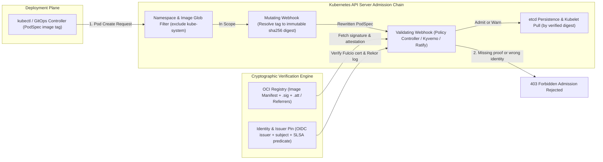
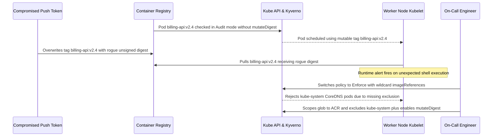

# Admission Control Enforcement of Supply-Chain Policy

> **Prerequisites:** Supply-Chain Threat Model (Module 00), SBOMs (Module 01), Keyless & Keyed Cosign Signing (Module 02), SLSA Provenance Attestations (Module 03), Continuous Vulnerability Triage (Module 04), and Kubernetes Admission Control & Gatekeeper (Track 11, Modules 03–04).  
> **Estimated Reading Time:** 35 minutes  
> **Target Audience:** Platform Engineers, DevSecOps Engineers, Kubernetes Cluster Administrators, Backend Engineers.

> [!TIP]
> **The Golden Rule of Supply-Chain Admission Control:** A `cosign verify` step in CI is advisory and bypassable; the real trust boundary is the Kubernetes API server. Always enforce image authenticity at admission using an audit-first (`warn`/`Audit`) rollout, pin explicit OIDC `issuer` and `subject` identities, enable `mutateDigest` so kubelets run the exact `@sha256:` digest that passed verification, and prove your gate works by watching it **reject** a known-bad unsigned Pod.

---

## Why This Matters

Everything before this module produced *proofs*: an SBOM (01), a signature (02), provenance (03), and a triage discipline that keeps them trustworthy over time (04). But a proof nobody checks is theater. Module 00's whole point was that a supply-chain attack lands *before* runtime — so the last line of defense is the cluster **refusing to run any image that can't present valid proof**. This is the exact "the system won't let you" shift track 11 module 04 made with Gatekeeper for labels and registries, now aimed at signatures and attestations: an unsigned image, or one signed by the wrong identity, or lacking provenance, simply **cannot start a Pod**. This module turns your pipeline's proofs into an enforced gate at the cluster door.

---

## 1. Architectural Mental Model: Webhook Verification & Digest Mutation

When a user, Argo CD, or Deployment controller submits a Pod spec, the Kubernetes API server runs Mutating Admission Webhooks before Validating Admission Webhooks. Supply-chain policy engines hook into both phases: they first resolve mutable image tags into immutable `@sha256:` digests (closing the time-of-check to time-of-use window), then verify OCI cryptographic signatures (Cosign or Notation) and SLSA provenance attestations against Fulcio certificates, Rekor transparency proofs, or trusted public keys before persisting the Pod to `etcd`:



### The same admission-control mechanism, a new check

Track 11 module 03 introduced admission control (the API server consulting a controller before persisting an object), and module 04 generalized it with Gatekeeper's validating admission webhook running *your* logic. Signature enforcement is **the same mechanism with a different question**. Where track 11's `K8sAllowedRepos` ConstraintTemplate checked "is this image's registry in the allowed list?", a supply-chain policy checks "does this image carry a valid cosign signature from *our* identity?" — a validating webhook intercepts every Pod create, and *rejects* it if verification fails. If you understood `ConstraintTemplate` + `Constraint` (track 11 module 04), you already understand the shape; only the predicate changed from a labeling rule to a cryptographic-verification rule.

### The tools: Sigstore Policy Controller, Kyverno, and Ratify

Three production engines dominate Kubernetes image-signature verification at admission; each implements "a validating webhook that runs cryptographic signature and attestation checks":

- **Sigstore Policy Controller** — the Sigstore project's own admission controller, purpose-built for cosign signatures and attestations. You express a `ClusterImagePolicy` naming which images it covers and which identities/issuers are authorized to have signed them (the same `--certificate-identity`/`--certificate-oidc-issuer` pins from module 02, now as policy fields).
- **Kyverno** — a general Kubernetes policy engine (a YAML-native alternative to Gatekeeper's Rego) with a first-class `verifyImages` rule that runs cosign verification and digest mutation. One tool handles both generic structural policy *and* cryptographic signature verification.
- **Ratify + OPA Gatekeeper** — a CNCF verification engine built specifically as an `externaldata` provider for OPA Gatekeeper (and used under the hood by Azure Policy's AKS Image Integrity). Ratify supports both **Cosign** and **Notation** (Notary v2) artifacts stored via OCI Referrers API, letting teams already invested in Gatekeeper `ConstraintTemplate`s add supply-chain verification without replacing their Rego stack.

They relate to track 11's Gatekeeper exactly as Concepts framed: layering, not replacing. Gatekeeper enforces custom structural rules; a signature-verifying controller enforces cryptographic supply-chain rules. Many clusters run a policy engine that does both. This module uses the **Policy Controller** for the canonical signature case and shows the **Kyverno** equivalent (while contrasting **Ratify**), so you recognize all three in the wild.

### What the policy actually asserts (identity is still the policy)

Module 02 hammered that keyless verification means pinning *identity* and *issuer*, and module 03 added *check the predicate contents*. A supply-chain admission policy encodes all of that as cluster config:

- **Which images** the policy governs — a glob like `myreg.azurecr.io/**`, so you don't accidentally block `kube-system` infra images (the exclude-infra discipline from track 11 module 04).
- **A valid cosign signature must exist**, and it must be from an **authorized identity + issuer** (e.g., your GitHub workflow + GitHub's OIDC issuer). A signature from the wrong identity is rejected — the identity-mismatch failure from module 02, now enforced automatically.
- **Optionally, required attestations** — "must also carry SLSA provenance whose source repo is ours" (module 03), so the gate checks *how it was built*, not just that it's signed.

The result: the cluster admits an image only if it can cryptographically prove authenticity (and, optionally, provenance) from an identity you trust — the whole track's proofs, verified at the door.

### Audit before enforce, exemptions, and mutate-to-digest

The rollout discipline is *identical* to track 11 module 04's, because the failure mode is identical — a `deny` policy shipped blind can block every legitimate deployment:

- **`warn`/`audit` mode first.** Policy Controller and Kyverno both support a non-blocking mode that *reports* what would be rejected without blocking. This is track 11's `dryrun`/audit pass: measure blast radius (how many running workloads use unsigned images?) before switching to `enforce`.
- **Narrow, explicit exemptions.** A legitimate third-party image with no signature you control needs an exemption — scoped by namespace or image glob, *visible in the policy*, exactly the narrow-and-reviewable exemption pattern from track 11 module 04, not a global off-switch.
- **Resolve tags to digests at admission.** Because signatures bind to digests (module 00/02), a strong policy also *mutates* the Pod's image reference from a mutable tag to the verified `@sha256:` digest, so what runs is exactly what was verified — closing the "verified `:1.0`, but the tag moved before the kubelet pulled" gap.

### Where this sits with the rest of your enforcement stack

Layer this onto what track 11 already gave you, so you see it's additive:

- **Pod Security Admission** (track 11 module 03) — enforces the Pod-hardening baseline (non-root, no privilege escalation).
- **Gatekeeper** (track 11 module 04) — enforces custom structural rules (allowed registries, required labels, no `:latest`).
- **Signature/attestation verification** (this module) — enforces *supply-chain* rules (valid signature from our identity, required provenance).
- **Azure Policy for AKS** (track 11 module 05) — the managed, Azure-side version; Azure Policy's image-integrity/`verifyImages` built-ins (powered by Gatekeeper + Ratify) deliver this same check as a managed guardrail across many clusters.

A Pod that would run must satisfy *all* applicable layers. This module adds the one axis track 11 explicitly deferred to track 18: does the image carry verifiable proof it's the authentic output of your pipeline?

---

## 2. Taxonomic Comparison & Command Reference

### Admission Engine Comparison

| Feature / Dimension | Sigstore Policy Controller | Kyverno (`verifyImages`) | Ratify + OPA Gatekeeper | Azure Policy (AKS Image Integrity) |
|---|---|---|---|---|
| **Primary Policy CRD** | `ClusterImagePolicy` | `ClusterPolicy` / `Policy` | `Verifier` + Gatekeeper `Constraint` | Azure Policy Initiative + Gatekeeper |
| **Signature Formats** | Cosign (keyless & keyed) | Cosign & Notary v2 (Notation) | Notation & Cosign (OCI Referrers) | Notation & Cosign (via managed Ratify) |
| **Digest Mutation** | Built-in (`match` / digest rewrite) | Built-in (`mutateDigest: true`) | Gatekeeper mutation or digest-only rule | Enforces immutable digest via Rego |
| **Audit-First Mode** | `spec.mode: warn` | `validationFailureAction: Audit` | `enforcementAction: dryrun` / `warn` | `Audit` effect in Policy Assignment |
| **Attestation Checks** | `authorities[].attestations` + CUE/Rego | `attestations[].conditions` (JMESPath) | Custom Ratify plugins / Rego evaluation | Built-in artifact & signature assertions |
| **Best Fit** | Pure Sigstore/Cosign ecosystems | Unified YAML policy + image verification | Existing OPA Gatekeeper / Notation fleets | Managed multi-cluster Azure governance |

### Failure Posture & Rollout Guardrails

| Webhook Setting | Behavior When Webhook Unreachable or Timed Out | Production Guidance |
|---|---|---|
| `failurePolicy: Fail` | Rejects all matching Pod creates until webhook recovers | Required for security-critical namespaces; pair with `namespaceSelector` excluding `kube-system` |
| `failurePolicy: Ignore` | Fails open — admits unverified images silently during webhook outage | Acceptable only during initial `warn`/`Audit` telemetry gathering; never leave in Enforce |
| `reinvocationPolicy: IfNeeded` | Re-runs validating hooks after mutating webhooks rewrite tags to `@sha256:` | Essential when combining tag-to-digest mutation with Gatekeeper structural checks |

### Command Reference

| Command | What it does | Example |
|---|---|---|
| `kubectl apply -f policy-controller.yaml` | Installs Sigstore Policy Controller (webhook + CRDs) | see exercise 1 |
| `kubectl label namespace <ns> policy.sigstore.dev/include=true` | Opts a namespace into Policy Controller enforcement | `kubectl label namespace apps policy.sigstore.dev/include=true` |
| `kubectl apply -f clusterimagepolicy.yaml` | Applies a `ClusterImagePolicy` (which images, which identities) | see exercise 3 |
| `kubectl get clusterimagepolicy` | Lists installed image policies | `kubectl get cip` |
| `helm install kyverno kyverno/kyverno` | Installs Kyverno (alternative engine) | see exercise 7 |
| `kubectl apply -f verify-images-policy.yaml` | Applies a Kyverno `verifyImages` policy | see exercise 7 |
| `cosign verify --certificate-identity ... ` | The same check the controller runs, by hand (module 02) | `cosign verify --certificate-identity ... myreg.azurecr.io/app:1.0` |

Key fields of a Sigstore `ClusterImagePolicy` (from exercise 3):

- `spec.images[].glob: "myreg.azurecr.io/**"` — *which* images this policy governs; scope narrowly so you don't intercept infra images (the exclude-`kube-system` discipline from track 11 module 04).
- `spec.authorities[].keyless.identities[].issuer` — the OIDC issuer that must have vouched (e.g. `https://token.actions.githubusercontent.com`) — the `--certificate-oidc-issuer` pin from module 02, as policy.
- `spec.authorities[].keyless.identities[].subject` (or `subjectRegExp`) — *who* must have signed (your workflow identity) — the `--certificate-identity` pin, as policy.
- `spec.authorities[].attestations` — optionally require a named attestation (e.g. `slsaprovenance`) and a policy over its predicate (module 03).
- `spec.mode: warn` — audit-only mode; switch to enforce (remove/`enforce`) after measuring blast radius.

Key fields of a Kyverno `verifyImages` rule:

- `rules[].verifyImages[].imageReferences: ["myreg.azurecr.io/*"]` — image glob this rule covers.
- `attestors[].entries[].keyless.subject` / `.issuer` — the identity + issuer pins (same semantics as above).
- `mutateDigest: true` — rewrite the admitted image reference to the verified `@sha256:` digest, so what runs equals what was verified.
- `validationFailureAction: Audit` (vs `Enforce`) — Kyverno's audit-first switch, the direct analogue of Gatekeeper `dryrun`.

---

## 3. Production War Story Post-Mortem: The Tag-Swap Bypass & `kube-system` Lockout

- **Incident ID / Severity:** `INC-2026-0419` — **SEV-1** (Unverified image execution followed by control-plane scheduling freeze)
- **Detection Time:** 14 minutes (runtime alert fired on unexpected `curl`/`apk` binary inside billing container)
- **Time to Mitigate:** 42 minutes
- **Impact:** 3 production billing Pods ran an unsigned debug build pulled via a hijacked `:v2.4` tag; a panicked cluster-wide `Enforce` fix then blocked CoreDNS scale-out for 9 minutes across `prod-eastus`.

### What Happened

The team verified signatures in GitHub Actions (`cosign verify`), then deployed a Kyverno `ClusterPolicy` in `Audit` mode *without* `mutateDigest: true`. When a stale ACR push token was misused to overwrite `billing-api:v2.4`, the Pod had already passed admission against the previous `:v2.4` manifest — or had only logged an `Audit` warning — and Kubelet pulled the rogue digest. During containment, an operator patched `validationFailureAction: Enforce` with `imageReferences: ["*"]` and forgot `exclude` rules for `kube-system`, halting CoreDNS and CNI DaemonSet pod replacements during a node scale-up.



### Root Cause Analysis

1. **Mutable tag TOCTOU gap (`mutateDigest: false`):** Checking a mutable tag at admission without rewriting the PodSpec to `@sha256:` allows the registry tag to change between webhook verification and Kubelet pull.
2. **Unverified `Enforce` rollout with overly broad image matching:** Switching straight to `Enforce` on `*` intercepted `mcr.microsoft.com/oss/kubernetes/*` and `registry.k8s.io/*` infrastructure images that were outside the team's signing pipeline.
3. **Lack of negative admission regression test:** Because CI only verified that valid builds deployed, nobody noticed the policy was still in `Audit` mode with `mutateDigest` disabled.

### The Fix & Architectural Hardening

1. **Pinned `mutateDigest: true` and `verifyDigest: true`:** Kyverno rewrites every matched image tag into its verified immutable `@sha256:` reference prior to persistence.
2. **Scoped image globs + explicit infrastructure exclusions:** Policies target `myreg.azurecr.io/*` and exclude `kube-system`, `kube-public`, and `kyverno` namespaces via `namespaceSelector`.
3. **Mandatory Audit Window & Synthetic Negative Gate:** Every policy change runs 72 hours in `Audit` with policy-violation alerts before `Enforce`, and CD pipelines assert that attempting a dry-run Pod with an unsigned image returns `403 Forbidden`.

---

## 4. Production Implementation: Validating & Mutating Supply-Chain Admission Webhook

Below is a production-grade implementation across four backend languages modeling the core admission webhook logic: skipping infrastructure namespaces, validating registry scope, confirming Cosign keyless OIDC `issuer` + `subject` + SLSA attestation evidence, emitting a JSONPatch (`mutateDigest`) to bind mutable tags to immutable `@sha256:` digests, and honoring `audit` vs. `enforce` mode.

````carousel
```go
package main

import (
	"encoding/json"
	"fmt"
	"strings"
)

type ImageEvidence struct {
	Digest          string
	SignedByIssuer  string
	SignedBySubject string
	HasSLSAProv     bool
}

type AdmissionRequest struct {
	UID       string
	Namespace string
	Containers []struct {
		Name  string
		Image string
	}
}

type PolicyConfig struct {
	Mode            string // "enforce" or "warn"
	AllowedRegistry string
	TrustedIssuer   string
	TrustedSubject  string
	RequireSLSA     bool
	ExemptNS        map[string]bool
}

type AdmissionResponse struct {
	UID      string   `json:"uid"`
	Allowed  bool     `json:"allowed"`
	Warnings []string `json:"warnings,omitempty"`
	Patch    string   `json:"patch,omitempty"`
	Reason   string   `json:"reason,omitempty"`
}

func EvaluatePodAdmission(req AdmissionRequest, cfg PolicyConfig, lookup func(string) (ImageEvidence, error)) AdmissionResponse {
	if cfg.ExemptNS[req.Namespace] {
		return AdmissionResponse{UID: req.UID, Allowed: true}
	}

	var patches []map[string]string
	var warnings []string

	for idx, c := range req.Containers {
		if !strings.HasPrefix(c.Image, cfg.AllowedRegistry) {
			msg := fmt.Sprintf("container %s image %s outside trusted registry %s", c.Name, c.Image, cfg.AllowedRegistry)
			if cfg.Mode == "warn" {
				warnings = append(warnings, msg)
				continue
			}
			return AdmissionResponse{UID: req.UID, Allowed: false, Reason: msg}
		}

		ev, err := lookup(c.Image)
		if err != nil || ev.SignedByIssuer != cfg.TrustedIssuer || ev.SignedBySubject != cfg.TrustedSubject {
			msg := fmt.Sprintf("container %s failed keyless identity pin verification (issuer=%s subject=%s)", c.Name, ev.SignedByIssuer, ev.SignedBySubject)
			if cfg.Mode == "warn" {
				warnings = append(warnings, msg)
				continue
			}
			return AdmissionResponse{UID: req.UID, Allowed: false, Reason: msg}
		}

		if cfg.RequireSLSA && !ev.HasSLSAProv {
			msg := fmt.Sprintf("container %s missing required SLSA provenance attestation", c.Name)
			if cfg.Mode == "warn" {
				warnings = append(warnings, msg)
				continue
			}
			return AdmissionResponse{UID: req.UID, Allowed: false, Reason: msg}
		}

		// Mutate mutable tag to immutable verified @sha256: digest (mutateDigest)
		if !strings.Contains(c.Image, "@sha256:") && ev.Digest != "" {
			base := strings.Split(c.Image, ":")[0]
			patches = append(patches, map[string]string{
				"op":    "replace",
				"path":  fmt.Sprintf("/spec/containers/%d/image", idx),
				"value": fmt.Sprintf("%s@%s", base, ev.Digest),
			})
		}
	}

	patchBytes, _ := json.Marshal(patches)
	return AdmissionResponse{UID: req.UID, Allowed: true, Warnings: warnings, Patch: string(patchBytes)}
}
```
<!-- slide -->
```typescript
export interface ImageEvidence {
  digest: string;
  issuer: string;
  subject: string;
  hasSlsaProvenance: boolean;
}

export interface PolicyConfig {
  mode: "enforce" | "warn";
  allowedRegistry: string;
  trustedIssuer: string;
  trustedSubject: string;
  requireSlsa: boolean;
  exemptNamespaces: Set<string>;
}

export interface AdmissionResult {
  uid: string;
  allowed: boolean;
  warnings: string[];
  jsonPatches: Array<{ op: "replace"; path: string; value: string }>;
  reason?: string;
}

export function evaluatePodAdmission(
  uid: string,
  namespace: string,
  images: string[],
  cfg: PolicyConfig,
  resolveEvidence: (image: string) => ImageEvidence | null
): AdmissionResult {
  if (cfg.exemptNamespaces.has(namespace)) {
    return { uid, allowed: true, warnings: [], jsonPatches: [] };
  }

  const warnings: string[] = [];
  const jsonPatches: Array<{ op: "replace"; path: string; value: string }> = [];

  for (let i = 0; i < images.length; i++) {
    const img = images[i];
    const fail = (msg: string): AdmissionResult | null => {
      if (cfg.mode === "warn") {
        warnings.push(msg);
        return null;
      }
      return { uid, allowed: false, warnings, jsonPatches: [], reason: msg };
    };

    if (!img.startsWith(cfg.allowedRegistry)) {
      const res = fail(`Image ${img} is outside trusted registry ${cfg.allowedRegistry}`);
      if (res) return res;
      continue;
    }

    const ev = resolveEvidence(img);
    if (!ev || ev.issuer !== cfg.trustedIssuer || ev.subject !== cfg.trustedSubject) {
      const res = fail(`Signature identity/issuer mismatch for ${img}`);
      if (res) return res;
      continue;
    }

    if (cfg.requireSlsa && !ev.hasSlsaProvenance) {
      const res = fail(`Missing required SLSA provenance attestation for ${img}`);
      if (res) return res;
      continue;
    }

    if (!img.includes("@sha256:") && ev.digest.startsWith("sha256:")) {
      const repo = img.split(":")[0];
      jsonPatches.push({
        op: "replace",
        path: `/spec/containers/${i}/image`,
        value: `${repo}@${ev.digest}`,
      });
    }
  }

  return { uid, allowed: true, warnings, jsonPatches };
}
```
<!-- slide -->
```python
from dataclasses import dataclass, field
from typing import Callable, Dict, List, Optional


@dataclass(frozen=True)
class ImageEvidence:
    digest: str
    issuer: str
    subject: str
    has_slsa_provenance: bool


@dataclass(frozen=True)
class PolicyConfig:
    mode: str  # "enforce" or "warn"
    allowed_registry: str
    trusted_issuer: str
    trusted_subject: str
    require_slsa: bool = True
    exempt_namespaces: frozenset[str] = frozenset({"kube-system", "cosign-system"})


@dataclass
class AdmissionResult:
    uid: str
    allowed: bool
    warnings: List[str] = field(default_factory=list)
    patches: List[Dict[str, str]] = field(default_factory=list)
    reason: Optional[str] = None


def evaluate_pod_admission(
    uid: str,
    namespace: str,
    images: List[str],
    cfg: PolicyConfig,
    lookup_evidence: Callable[[str], Optional[ImageEvidence]],
) -> AdmissionResult:
    if namespace in cfg.exempt_namespaces:
        return AdmissionResult(uid=uid, allowed=True)

    warnings: List[str] = []
    patches: List[Dict[str, str]] = []

    for idx, image in enumerate(images):
        def handle_violation(msg: str) -> Optional[AdmissionResult]:
            if cfg.mode == "warn":
                warnings.append(msg)
                return None
            return AdmissionResult(uid=uid, allowed=False, warnings=warnings, reason=msg)

        if not image.startswith(cfg.allowed_registry):
            if denied := handle_violation(f"Image {image} outside {cfg.allowed_registry}"):
                return denied
            continue

        ev = lookup_evidence(image)
        if not ev or ev.issuer != cfg.trusted_issuer or ev.subject != cfg.trusted_subject:
            if denied := handle_violation(f"Invalid cosign identity/issuer pin for {image}"):
                return denied
            continue

        if cfg.require_slsa and not ev.has_slsa_provenance:
            if denied := handle_violation(f"Missing SLSA provenance attestation on {image}"):
                return denied
            continue

        if "@sha256:" not in image and ev.digest.startswith("sha256:"):
            repo = image.split(":", maxsplit=1)[0]
            patches.append({
                "op": "replace",
                "path": f"/spec/containers/{idx}/image",
                "value": f"{repo}@{ev.digest}",
            })

    return AdmissionResult(uid=uid, allowed=True, warnings=warnings, patches=patches)
```
<!-- slide -->
```csharp
using System;
using System.Collections.Generic;

public sealed record ImageEvidence(string Digest, string Issuer, string Subject, bool HasSlsaProvenance);

public sealed record PolicyConfig(
    string Mode,
    string AllowedRegistry,
    string TrustedIssuer,
    string TrustedSubject,
    bool RequireSlsa,
    HashSet<string> ExemptNamespaces);

public sealed record JsonPatchOp(string Op, string Path, string Value);

public sealed record AdmissionResult(
    string Uid,
    bool Allowed,
    List<string> Warnings,
    List<JsonPatchOp> Patches,
    string? Reason = null);

public static class SupplyChainAdmissionEvaluator
{
    public static AdmissionResult EvaluatePod(
        string uid,
        string ns,
        IReadOnlyList<string> images,
        PolicyConfig cfg,
        Func<string, ImageEvidence?> lookup)
    {
        var warnings = new List<string>();
        var patches = new List<JsonPatchOp>();

        if (cfg.ExemptNamespaces.Contains(ns))
            return new AdmissionResult(uid, true, warnings, patches);

        for (var i = 0; i < images.Count; i++)
        {
            var image = images[i];
            if (!image.StartsWith(cfg.AllowedRegistry, StringComparison.Ordinal))
            {
                if (cfg.Mode == "warn") { warnings.Add($"Untrusted registry: {image}"); continue; }
                return new AdmissionResult(uid, false, warnings, patches, $"Untrusted registry: {image}");
            }

            var ev = lookup(image);
            if (ev is null || ev.Issuer != cfg.TrustedIssuer || ev.Subject != cfg.TrustedSubject)
            {
                var err = $"Signature identity/issuer verification failed for {image}";
                if (cfg.Mode == "warn") { warnings.Add(err); continue; }
                return new AdmissionResult(uid, false, warnings, patches, err);
            }

            if (cfg.RequireSlsa && !ev.HasSlsaProvenance)
            {
                var err = $"Missing SLSA provenance attestation for {image}";
                if (cfg.Mode == "warn") { warnings.Add(err); continue; }
                return new AdmissionResult(uid, false, warnings, patches, err);
            }

            if (!image.Contains("@sha256:", StringComparison.Ordinal) && ev.Digest.StartsWith("sha256:", StringComparison.Ordinal))
            {
                var repo = image.Split(':')[0];
                patches.Add(new JsonPatchOp("replace", $"/spec/containers/{i}/image", $"{repo}@{ev.Digest}"));
            }
        }

        return new AdmissionResult(uid, true, warnings, patches);
    }
}
```
````

---

## 5. Practical Hands-On Verification CLI Workflows

All on your **local kind cluster** from track 03 — no Azure cost, exactly like track 11 module 04's Gatekeeper exercises. You'll use the key-based signatures from module 02 locally (keyless needs a real OIDC identity — that's the capstone's CI job).

1. **(WSL2) Install the Sigstore Policy Controller.**
   ```bash
   kubectl apply -f https://github.com/sigstore/policy-controller/releases/latest/download/policy-controller.yaml
   kubectl get pods -n cosign-system
   ```
   **Expected Output:**
   ```text
   NAME                                       READY   STATUS    RESTARTS   AGE
   policy-controller-webhook-7f9d8c6b-x2k9p   1/1     Running   0          25s
   ```
   Expect the `policy-controller-webhook` Pod to reach `Running`. This installs the validating webhook and the `ClusterImagePolicy` CRD — the same webhook idea as Gatekeeper, purpose-built for signatures.

2. **(WSL2) Opt a namespace in and watch the default deny-unsigned behavior.**
   ```bash
   kubectl create namespace signed-apps
   kubectl label namespace signed-apps policy.sigstore.dev/include=true
   kubectl run unsigned --image=nginx:latest -n signed-apps; echo "exit: $?"
   ```
   **Expected Output:**
   ```text
   Error from server (BadRequest): admission webhook "policy.sigstore.dev" denied the request: validation failed: no matching policies: spec.containers[0].image
   index.docker.io/library/nginx@sha256:...
   exit: 1
   ```
   Expect the Pod to be **rejected** — with no policy allowing it, an included namespace denies images that can't be verified. You just saw "unsigned can't run" as the default posture.

3. **(WSL2) Sign an image and write a policy that authorizes *your* key.** Reuse module 02's local registry + key:
   ```bash
   docker run -d -p 5000:5000 --name registry registry:2 2>/dev/null; true
   docker pull alpine:3.20 && docker tag alpine:3.20 localhost:5000/app:1.0 && docker push localhost:5000/app:1.0
   COSIGN_PASSWORD="" cosign generate-key-pair
   cosign sign --key cosign.key --yes localhost:5000/app:1.0
   kubectl apply -f - <<EOF
   apiVersion: policy.sigstore.dev/v1beta1
   kind: ClusterImagePolicy
   metadata:
     name: signed-by-us
   spec:
     images:
       - glob: "localhost:5000/**"
     authorities:
       - key:
           data: |
$(sed 's/^/            /' cosign.pub)
   EOF
   kubectl get clusterimagepolicy
   ```
   **Expected Output:**
   ```text
   NAME           AGE
   signed-by-us   3s
   ```
   Expect the policy listed. It says: images from the local registry must carry a signature made by *this* public key.

4. **(WSL2) Prove the happy path and the rejection path.**
   ```bash
   kubectl run signed-ok --image=localhost:5000/app:1.0 -n signed-apps; echo "signed exit: $?"
   docker tag nginx:latest localhost:5000/unsigned:1.0 && docker push localhost:5000/unsigned:1.0
   kubectl run unsigned-blocked --image=localhost:5000/unsigned:1.0 -n signed-apps; echo "unsigned exit: $?"
   ```
   **Expected Output:**
   ```text
   pod/signed-ok created
   signed exit: 0
   Error from server (BadRequest): admission webhook "policy.sigstore.dev" denied the request: validation failed: failed policy: signed-by-us: spec.containers[0].image
   localhost:5000/unsigned@sha256:... no matching signatures:
   unsigned exit: 1
   ```
   Expect `signed-ok` to be **admitted** and `unsigned-blocked` to be **rejected** ("no matching signatures"). This is the entire track in one result: the signed image runs, the unsigned one cannot. (Adjust registry reachability from kind as needed — the pass/fail *contrast* is the lesson.)

5. **(WSL2) Roll out audit-first, the track 11 way.** Add a second, stricter policy in `warn` mode and see it report without blocking:
   ```bash
   kubectl apply -f - <<'EOF'
   apiVersion: policy.sigstore.dev/v1beta1
   kind: ClusterImagePolicy
   metadata:
     name: must-have-provenance
   spec:
     mode: warn
     images:
       - glob: "localhost:5000/**"
     authorities:
       - key: {data: "PLACEHOLDER"}
         attestations:
           - name: must-have-slsa
             predicateType: slsaprovenance
   EOF
   kubectl run warn-test --image=localhost:5000/app:1.0 -n signed-apps
   ```
   **Expected Output:**
   ```text
   Warning: validation failed: failed policy: must-have-provenance: spec.containers[0].image ... missing attestation
   pod/warn-test created
   ```
   Expect the Pod to be **admitted with a warning** that it lacks the required provenance attestation — `warn` measures impact without blocking, exactly track 11's `dryrun`. You'd fix the pipeline (attach provenance, module 03) *before* switching this to enforce.

6. **Diagnose and fix: a legitimate signed image blocked by an identity/issuer mismatch.** This is module 02's identity bug, now at admission. A teammate's *validly signed* image is rejected by the policy. Reproduce with a policy that pins the wrong identity:
   ```bash
   kubectl apply -f - <<'EOF'
   apiVersion: policy.sigstore.dev/v1beta1
   kind: ClusterImagePolicy
   metadata: {name: wrong-identity}
   spec:
     images: [{glob: "localhost:5000/**"}]
     authorities:
       - keyless:
           identities:
             - issuer: https://accounts.google.com
               subject: someone-else@example.com
   EOF
   kubectl run should-run --image=localhost:5000/app:1.0 -n signed-apps; echo "exit: $?"
   ```
   Expect rejection. Diagnose: the image is signed, but the policy authorizes the *wrong identity/issuer* — the admission-time twin of module 02's exercise 8. Wrong fix: delete the policy (removes protection). Right fix: correct the authorized identity/issuer to match who *actually* signs (your CI workflow + GitHub's issuer), or, for this local key-based image, authorize the key instead:
   ```bash
   kubectl delete clusterimagepolicy wrong-identity
   # (the correct `signed-by-us` key policy from exercise 3 already admits it)
   kubectl run should-run --image=localhost:5000/app:1.0 -n signed-apps; echo "exit: $?"
   ```
   **Expected Output:**
   ```text
   clusterimagepolicy.policy.sigstore.dev "wrong-identity" deleted
   pod/should-run created
   exit: 0
   ```
   The lesson: at admission as at the CLI, a rejection is usually *policy pinning the wrong identity*, not a bad signature — align the policy's authorized identity/issuer to the real signer rather than weakening the gate.

7. **(WSL2, alternative engine) The Kyverno equivalent.** So you recognize the other common tool, express the same rule in Kyverno:
   ```bash
   helm repo add kyverno https://kyverno.github.io/kyverno/ 2>/dev/null; helm repo update >/dev/null
   helm install kyverno kyverno/kyverno -n kyverno --create-namespace --wait
   kubectl apply -f - <<'EOF'
   apiVersion: kyverno.io/v1
   kind: ClusterPolicy
   metadata: {name: verify-signature}
   spec:
     validationFailureAction: Audit
     rules:
       - name: check-signature
         match: {any: [{resources: {kinds: ["Pod"]}}]}
         verifyImages:
           - imageReferences: ["localhost:5000/*"]
             mutateDigest: true
             attestors:
               - entries:
                   - keyless:
                       subject: "https://github.com/YOURORG/YOURREPO/*"
                       issuer: "https://token.actions.githubusercontent.com"
   EOF
   kubectl get clusterpolicy verify-signature
   ```
   **Expected Output:**
   ```text
   NAME               ADMISSION   BACKGROUND   VALIDATE ACTION   READY   AGE   MESSAGE
   verify-signature   true        true         Audit             True    4s    Ready
   ```
   Note `validationFailureAction: Audit` (track 11's audit-first) and `mutateDigest: true` (rewrite tag→digest so what runs equals what was verified). Same job as Policy Controller, YAML-native like Gatekeeper's cousin.

8. **(WSL2) Clean up.**
   ```bash
   kubectl delete namespace signed-apps 2>/dev/null; true
   kubectl delete clusterimagepolicy --all 2>/dev/null; true
   kubectl delete clusterpolicy verify-signature 2>/dev/null; true
   helm uninstall kyverno -n kyverno 2>/dev/null; true
   kubectl delete -f https://github.com/sigstore/policy-controller/releases/latest/download/policy-controller.yaml 2>/dev/null; true
   docker rm -f registry 2>/dev/null; true
   rm -f cosign.key cosign.pub
   ```

### Independent Challenge

No commands given — build it using this module plus track 11 module 04 (Gatekeeper rollout discipline and exemptions), module 02 (identity pins), and module 03 (attestation predicates). On your kind cluster, author a supply-chain admission policy (Policy Controller *or* Kyverno) that admits a Pod only if its image (a) carries a valid signature from an authorized identity and (b) carries a SLSA-provenance attestation. Roll it out the disciplined way: `warn`/`Audit` first, enumerate what it *would* block among existing workloads, then switch to enforce and prove both paths — a compliant image is **admitted** and a non-compliant one (unsigned, or missing provenance) is **rejected** (not just "the good one runs" — track 11 module 04's fail-open warning applies). Finally, introduce one legitimate third-party image you *can't* sign and grant it a **narrow, visible exemption** (by namespace or image glob) rather than weakening the policy, proving an unexempted unsigned image is still blocked.

<details>
<summary>Stuck? One hint</summary>

This is track 11 module 04's exact rollout, with a cryptographic predicate instead of a label check. Policy Controller: a `ClusterImagePolicy` with `spec.mode: warn` first, `authorities[].keyless.identities[]` pinning your workflow `subject` + GitHub `issuer`, and `authorities[].attestations` requiring `predicateType: slsaprovenance`; flip to enforce after the audit pass. The exemption is a *separate, narrowly-scoped* image `glob`/namespace the strict policy doesn't cover — visible and reviewable, never a global off-switch. Prove the bad path by deploying an unsigned image and seeing it **rejected**, exactly like track 11's "test the known-bad object, not just the good one."

</details>

---

## 6. Common Mistakes & Troubleshooting

- **Verifying in CI but never enforcing at admission.** A `cosign verify` step in the pipeline is bypassable — anyone with cluster access can `kubectl run` an unsigned image. The cluster-side admission policy is what makes the check unavoidable.
- **Shipping `enforce` blind.** A deny-unsigned policy applied cluster-wide can block every deployment (including infra). Run `warn`/`Audit` first, measure blast radius, then enforce — track 11 module 04's discipline, identically.
- **Intercepting infra images.** A too-broad image glob can block `kube-system`/system Pods. Scope the policy to your registry/namespaces and exempt infra, exactly the `excludedNamespaces` habit from track 11.
- **Pinning the wrong identity/issuer in the policy.** The #1 rejection cause is the policy authorizing an identity that isn't the real signer (exercise 6) — the admission twin of module 02's CLI bug. Align policy to the actual signer; don't delete the policy.
- **Verifying a tag but running whatever the tag later points to.** Without `mutateDigest`/digest resolution, a tag can move between verification and pull. Resolve to the verified `@sha256:` digest so what runs equals what was verified.
- **Only testing the happy path.** "My signed image runs" doesn't prove the gate enforces — a broken policy can fail open. Always confirm a known-bad (unsigned/wrong-identity) image is actually **rejected** (track 11 module 04).
- **Treating this as a replacement for PSA/Gatekeeper/Azure Policy.** It's an additional layer (supply-chain axis); a running Pod must satisfy all applicable controls.

---

## 7. Operational Validation Checkpoints & Checkpoint Quiz

### Operational Validation Checkpoints

<details>
<summary><strong>Checkpoint 1: Admission Mutating Hook vs. Kubelet Tag-Move TOCTOU</strong></summary>

**Scenario:** Your Kyverno `ClusterPolicy` verifies `myreg.azurecr.io/payments:1.4.2` during `kubectl apply`, succeeds, and returns `Allowed: true`. Two seconds later, before the worker node finishes scheduling, a build pipeline pushes a different image to `:1.4.2`.

**Validation & Fix:** Inspect the deployed Pod (`kubectl get pod -o jsonpath='{.spec.containers[0].image}'`). If it still shows `:1.4.2` instead of `@sha256:...`, `mutateDigest: true` (or Policy Controller digest matching) is missing or disabled. Enable `mutateDigest: true` and `verifyDigest: true` so the API server persists the exact verified `@sha256:` digest in `etcd`.

</details>

<details>
<summary><strong>Checkpoint 2: Keyless Subject Regex Drift Across Tag vs. Branch Releases</strong></summary>

**Scenario:** Branch builds (`refs/heads/main`) pass admission, but production tag releases (`refs/tags/v1.8.0`) built by the exact same GitHub Actions workflow are rejected with `none of the expected identities matched`.

**Validation & Fix:** Fulcio embeds the exact triggering Git ref into the certificate SAN (`https://github.com/org/repo/.github/workflows/build.yml@refs/tags/v1.8.0`). Pinning `subject` to `@refs/heads/main` rejects tag builds. Fix by using `subjectRegExp` matching `^https://github\.com/org/repo/\.github/workflows/build\.yml@refs/(heads/main|tags/v[0-9]+\.[0-9]+\.[0-9]+)$` while keeping `issuer: https://token.actions.githubusercontent.com`.

</details>

<details>
<summary><strong>Checkpoint 3: Webhook `failurePolicy: Fail` Cluster Bootstrap Deadlock</strong></summary>

**Scenario:** After restarting all worker nodes in a cluster running Policy Controller with `failurePolicy: Fail`, the webhook Pod cannot start because its own namespace or image isn't exempted from admission checks, stalling CoreDNS and CNI startup.

**Validation & Fix:** Inspect webhook configuration (`kubectl get validatingwebhookconfigurations -o yaml`). Ensure `namespaceSelector` explicitly skips `kube-system`, `kube-public`, `kube-node-lease`, and `cosign-system` / `kyverno` (via `matchExpressions` `NotIn` or label exclusion), and run at least 2 webhook replicas with `podAntiAffinity` across availability zones.

</details>

### Checkpoint Quiz

Write down your answer to each question before expanding it — checking without attempting first is the single easiest way to fool yourself into thinking you've learned this.

<details>
<summary>Show questions</summary>

1. How is a signature-verifying admission policy the *same* mechanism as track 11 module 04's Gatekeeper, and what changed?
2. Why is enforcing at admission necessary even if your CI already runs `cosign verify`?
3. What three things can a `ClusterImagePolicy` (or Kyverno `verifyImages`) assert about an image?
4. What is the correct rollout order for a deny-unsigned policy, and which track 11 concept is it identical to?
5. What does `mutateDigest`/digest resolution at admission protect against, and why does it matter given how signatures bind (module 00/02)?
6. A validly signed image is rejected by the policy. What's the most likely cause and the right fix (not "delete the policy")?
7. Where does this control sit relative to PSA, Gatekeeper, and Azure Policy — replacement or layer? What unique axis does it add?

</details>

<details>
<summary>Show answers</summary>

1. It's the same validating admission webhook intercepting Pod creates and returning admit/reject (track 11 module 04). What changed is the *predicate*: instead of checking a label or registry, it runs cosign verification of a signature/attestation. The `ConstraintTemplate`/`Constraint` shape maps onto `ClusterImagePolicy`/`verifyImages`.
2. Because a CI `cosign verify` step is bypassable — anyone who can `kubectl run`/apply a manifest can deploy an unsigned image directly, skipping CI. The admission policy makes verification unavoidable at the cluster door, which is the actual trust boundary for what runs.
3. (1) That a **valid signature exists**, (2) from an **authorized identity + issuer** (the module-02 pins), and (3) optionally that a **required attestation** (e.g. SLSA provenance whose predicate matches policy, module 03) is present.
4. `warn`/`audit` first — report what it *would* block, enumerate legitimate breakages, fix/exempt — *then* switch to `enforce`/`Deny`. It's identical to track 11 module 04's Gatekeeper `dryrun`-then-`deny` (and PSA's `warn`-then-`enforce`).
5. It protects against a tag moving between verification and the kubelet's pull: without resolving to the verified `@sha256:` digest, you could verify `:1.0` and then run whatever `:1.0` points to later. Since signatures bind to digests, running the digest guarantees what runs equals what was verified.
6. Most likely the policy pins the **wrong identity/issuer** (or wrong key) — not a bad signature (exercise 6, the admission twin of module 02's CLI mismatch). Right fix: correct the policy's authorized identity/issuer to the real signer; deleting the policy removes protection for everything.
7. It's a **layer**, not a replacement: PSA enforces Pod hardening, Gatekeeper enforces custom structural rules, Azure Policy is the managed guardrail, and this adds the **supply-chain axis** — cryptographic proof the image is the authentic, provenance-backed output of your pipeline. A Pod must satisfy all applicable layers.

</details>

---

## Next

Continue to [06-dependency-and-base-image-hygiene-at-scale](../06-dependency-and-base-image-hygiene-at-scale/README.md) — enforcement is only as good as what you feed it; next, keep the *inputs* clean at scale with automated dependency and base-image updates, and revisit pinning through a supply-chain lens.
