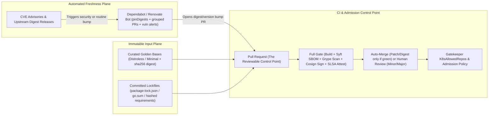
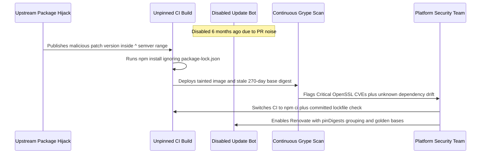

# Dependency and Base Image Hygiene at Scale

> **Prerequisites:** Supply-Chain Threat Model (Module 00), SBOMs (Module 01), Continuous Vulnerability Triage (Module 04), Admission Control (Module 05), Package Pinning Basics (Track 02), CI/PR Workflows (Track 10), and Base-Image Hygiene & Gatekeeper (Track 11, Modules 01 & 04).  
> **Estimated Reading Time:** 35 minutes  
> **Target Audience:** Platform Engineers, Backend Engineers, Security Engineers, Build & Release Maintainers.

> [!TIP]
> **The Golden Rule of Fleet Hygiene:** Pin *every* dependency (committed lockfile hashes) and *every* base image (`@sha256:` digest), then pair those immutable pins with automated update PR bots (Renovate or Dependabot) routed through your full CI gate (`build -> SBOM -> scan -> sign -> attest`). **Pinning without automation rots on known CVEs; automation without pinning silently accepts upstream attacks; a bare tag is neither.**

---

## Why This Matters

Module 05 built the gate that refuses unverified images; module 04 keeps them scanned over time. But enforcement and scanning both operate on *inputs you chose* — and module 00 showed the two most common supply-chain attacks (compromised dependency, poisoned base image) enter through exactly those inputs. Track 11 module 01 taught base-image hygiene as a one-image, manual discipline: pin a current tag, rebuild, prefer minimal bases. That doesn't survive contact with a real fleet of dozens of services, each with hundreds of transitive dependencies drifting daily. This module scales hygiene into *automation*: tooling that proposes dependency and base-image updates continuously, and a sharper, security-lens take on the pinning-vs-floating trade-off you first met in track 02. Clean inputs are what make every downstream control (signing, provenance, admission) worth having.

---

## 1. Architectural Mental Model: Pinned Inputs + Automated Gated Freshness

At organizational scale, security and freshness are separated cleanly by control plane: **immutable pins** lock what builds today, **golden base images** constrain where `FROM` lines can pull from, and **update bots** turn upstream releases into reviewable, gate-verified pull requests:



### Why hygiene is a supply-chain control, not just tidiness

Reframe track 11's hygiene lessons through module 00's attack model:

- A **poisoned base image** enters through your `FROM` line. Staying on current, minimal, digest-pinned bases shrinks both the *window* an attacker has and the *surface* they land on. Hygiene is the preventive control for this attack.
- A **compromised dependency** enters through your lockfile. Knowing exactly what you depend on (the SBOM, module 01), updating deliberately, and reacting fast when a dependency is flagged (module 04) is the preventive+detective control for this attack.
- Every un-updated dependency is also just **accumulating known CVEs** (module 04's shelf-life problem). Hygiene is how you keep the continuous-scan backlog from growing without bound.

So "keep dependencies and bases fresh" isn't housekeeping — it's directly closing the two entry points module 00 identified, at the scale a real organization actually runs.

### Pinning vs floating, through a security lens

Track 02 introduced pinning (`requests==2.32.3`) vs floating (`requests>=2.32`); here's the security tension it creates, which has *no free answer*:

- **Floating (`>=`, `latest`, unpinned)** — you automatically get upstream security fixes, but you also automatically get whatever an attacker pushes to that range. Floating is how a **compromised-dependency** or **poisoned-base** attack reaches you *silently*, with no change on your side (module 00). It also destroys reproducibility — two builds of "the same" code differ.
- **Pinning (`==`, `@sha256:` digests)** — builds are reproducible and an attacker can't slip a new version in behind your back, but pins **go stale**: a pinned dependency doesn't receive security fixes until *you* bump it, so pinning without an update process is how you rot on known CVEs.

The resolution is **pin + automate the updates**: pin everything (including base images *by digest*, module 00), so nothing changes without a reviewable commit — *and* run tooling that continuously proposes bumps, so pins don't go stale. Pinning gives you control and reproducibility; automation gives you freshness. Neither alone is safe.

### Digest-pinning base images (the real meaning of "pinned")

Track 11 said "pin to a specific tag, not `latest`." Module 00 sharpened it: a *tag* is mutable, so `FROM node:20.11-bookworm` can be silently repointed — the poisoned-base attack. True pinning is by **digest**:

```dockerfile
FROM node:20.11-bookworm@sha256:abc123...
```

The tag stays for human readability; the `@sha256:` is what's actually enforced — the image cannot change without the digest changing, so a repointed tag can't reach you. The obvious objection ("now I never get updates") is exactly why digest-pinning *requires* the update automation in the next section: a bot opens a PR bumping the digest when a new base is published, you review it, it merges. Pinned *and* fresh.

### Automating base-image and dependency updates

At fleet scale, humans cannot track updates across dozens of repos; tooling does. The mechanism is the same for both kinds of input: **a bot watches for new versions and opens a pull request** (a track-10 CI/PR workflow), which runs your full gate (build → SBOM → scan → sign) before a human merges:

- **Dependency-update bots** — **Dependabot** (GitHub-native) and **Renovate** (more configurable, multi-platform) watch your lockfiles and open PRs bumping outdated/vulnerable dependencies, often grouped and scheduled. They can be driven by *security advisories* specifically (bump only what's vulnerable) or by *freshness* (keep everything current).
- **Base-image update tooling** — the same bots also bump base-image tags/digests in your Dockerfiles; some registries and tools additionally offer auto-patching of base images. The point is the `FROM` digest becomes just another dependency a bot proposes updating.
- **The PR *is* the control point.** An update lands as a reviewable, gated change — it runs the scan (module 04), regenerates the SBOM (module 01), and re-signs (module 02) through your normal pipeline. This is how you get freshness *without* surrendering the reproducibility and review that pinning bought you. Auto-merge is reserved for changes your gate can fully vouch for (e.g. patch-level bumps that pass every check).

### Governing what's allowed in at scale

Freshness isn't the only axis — you also constrain *what may enter at all*, tying back to enforcement:

- **Curated/approved base images** — a small set of blessed, hardened, digest-pinned bases (often internal "golden images") that all services build `FROM`, so hygiene is centralized instead of re-litigated per team. Track 11 module 04's allowed-registry Gatekeeper policy enforces "only build from *our* bases."
- **Lockfiles committed and enforced** — the lockfile is the pinned truth; CI should fail if it's missing or out of sync, so no build silently floats.
- **Minimal/distroless bases** — fewer packages means fewer dependencies to update, fewer CVEs to triage (module 04), and less surface for a poisoned layer — track 11's lesson, now valued for *reducing the update/triage load* at scale, not just today's CVE count.

Hygiene at scale is a *system*: curated inputs, everything pinned, bots keeping pins fresh, and the gate re-verifying every proposed change.

---

## 2. Taxonomic Comparison & Command Reference

### Pinning vs. Floating Trade-Off Matrix

| Strategy | Example | Reproducibility | Tamper Resistance | CVE Freshness | Verdict |
|---|---|---|---|---|---|
| **Floating Range / `:latest`** | `FROM node:20`, `^4.17.20` | Broken (drifts per build) | None (silent upstream hijack) | Automatic (unsafe) | **Unsafe** — accepts attacker code silently |
| **Tag-Pinned Only** | `FROM node:20.11-bookworm` | Broken (tag is mutable) | Weak (tag repointable) | Stale | **Unsafe** — neither pinned nor fresh |
| **Digest-Pinned (No Bot)** | `FROM node:20.11-bookworm@sha256:...` | Deterministic | Strong (immutable hash) | Rots on known CVEs | **Incomplete** — freezes vulnerabilities |
| **Digest-Pinned + Bot + Gate** | `@sha256:` + Renovate + CI Gate | Deterministic | Strong (signed, reviewed PRs) | Continuous via PRs | **Gold Standard** — pinned and fresh |

### Dependency & Base-Image Automation: Dependabot vs. Renovate

| Dimension | Dependabot (`.github/dependabot.yml`) | Renovate (`renovate.json`) |
|---|---|---|
| **Platform Support** | GitHub-native (zero external runner setup) | GitHub, GitLab, Azure DevOps, Bitbucket, self-hosted |
| **Base-Image Digest Pinning** | Updates existing `FROM` tags/digests in `docker` ecosystem | First-class `pinDigests: true` converts tags into `@sha256:` pins automatically |
| **Grouping & Noise Control** | `groups` per ecosystem/update-type | Advanced `packageRules` across repos, regex managers, custom schedules |
| **Auto-Merge Discipline** | Requires GitHub Actions auto-merge workflow | Built-in `automerge: true` gated on required CI status checks |
| **Security Prioritization** | Dependabot security updates (GitHub Advisory DB) | `vulnerabilityAlerts` + OSV/GitHub advisory integration |

### Base Image Surface Comparison

| Base Image Tier | Typical Size | OS Package Count | Ongoing CVE Triage / Bot PR Volume | Production Guidance |
|---|---|---|---|---|
| **Standard OS** (`node:20-bookworm`) | 350–900 MB | 300+ packages | Very High (daily OS library CVEs) | Avoid in prod; reserve for build/debug stages |
| **Slim OS** (`python:3.11-slim`) | 45–150 MB | ~90 packages | Moderate | Good fallback when glibc/shared libs needed |
| **Distroless / Golden Base** (`gcr.io/distroless/static` or internal golden) | 2–25 MB | 0–15 packages | Minimal (almost zero OS CVEs) | **Preferred** for runtime stages at scale |

### Command Reference

| Command / file | What it does | Example |
|---|---|---|
| `crane digest ` | Resolves a tag to the digest you should pin in `FROM` | `crane digest node:20.11-bookworm` |
| `docker buildx imagetools inspect ` | Confirms a `FROM` digest and inspects manifests | `docker buildx imagetools inspect node:20.11-bookworm` |
| `FROM img:tag@sha256:<digest>` | Digest-pins a base image (tag for humans, digest enforced) | `FROM node:20.11-bookworm@sha256:abc...` |
| `.github/dependabot.yml` | Configures Dependabot ecosystems/schedule/grouping | see exercise 5 |
| `renovate.json` | Configures Renovate rules (pinning, grouping, automerge) | see exercise 6 |
| `grype dir:.` | Scans a source tree's dependencies (freshness check) | `grype dir:.` |
| `syft dir:. -o spdx-json` | SBOMs the source tree to see what you depend on | `syft dir:. -o spdx-json=deps.json` |
| `pip-compile` / `npm ci` / `go mod tidy` | Produce/verify a pinned lockfile from declared deps | `npm ci` |

Fields of a `.github/dependabot.yml` (from exercise 5):

- `updates[].package-ecosystem: "pip"` (or `npm`, `docker`, `gomod`) — which dependency source to watch; `docker` watches your Dockerfile `FROM` lines.
- `updates[].directory: "/"` — where the manifest/lockfile lives.
- `updates[].schedule.interval: "weekly"` — how often to check and open PRs.
- `updates[].open-pull-requests-limit: 10` — cap concurrent update PRs so the queue stays reviewable.
- `updates[].groups` — batch related bumps into one PR (less review churn).

Fields of a `renovate.json` (from exercise 6):

- `extends: ["config:recommended"]` — sensible defaults.
- `packageRules[].matchUpdateTypes: ["patch"]` + `automerge: true` — auto-merge low-risk bumps *that pass the full gate*, keeping humans for riskier ones.
- `pinDigests: true` — have Renovate pin base images (and actions) *by digest* and keep the digest updated — automation implementing the "pinned + fresh" rule directly.
- `vulnerabilityAlerts` — prioritize security-driven updates ahead of routine freshness.

---

## 3. Production War Story Post-Mortem: The Stale Digest & Unenforced Lockfile Outage

- **Incident ID / Severity:** `INC-2026-0608` — **SEV-1** (Floating `npm install` supply-chain leak + fleet-wide unpatched OpenSSL CVEs)
- **Detection Time:** 3 hours (outbound DNS alert on unfamiliar telemetry domain + overnight Grype continuous SBOM scan failure)
- **Time to Mitigate:** 4 hours 15 minutes
- **Impact:** 2 Node.js microservices pulled an attacker-published patch release via floating `npm install`; 14 additional services remained stuck on a 9-month-old `FROM node:18-bullseye@sha256:...` digest containing 11 High/Critical OpenSSL vulnerabilities.

### What Happened

To silence daily PR notifications six months earlier, an engineering squad disabled Renovate across 18 repositories. Meanwhile, two service Dockerfiles ran `RUN npm install --omit=dev` instead of `RUN npm ci --omit=dev`, silently ignoring `package-lock.json` whenever `package.json` used `^` ranges. When a maintainer account for a transitive helper library was hijacked and published a malicious patch bump, CI pulled the backdoored version without any lockfile diff in Git. Simultaneously, continuous SBOM scanning flagged Critical CVEs across 14 services whose digest-pinned `node:18` bases had never been updated since Renovate was turned off.



### Root Cause Analysis

1. **`npm install` bypassed lockfile pinning in CI:** Because `npm install` resolves `^` ranges dynamically instead of failing on lockfile drift like `npm ci`, CI accepted a compromised dependency without any Git commit.
2. **All-or-nothing bot shutdown caused digest rot:** Without PR grouping or `open-pull-requests-limit`, Renovate overwhelmed reviewers, prompting them to disable updates entirely — freezing `@sha256:` base digests on stale CVEs.
3. **Ad-hoc OS base images multiplied triage surface:** Teams built directly from full `node:18-bullseye` images instead of curated distroless/minimal golden bases, generating 10x more CVE noise.

### The Fix & Architectural Hardening

1. **Strict lockfile enforcement in CI:** Switched all pipelines to `npm ci`, `pip install --require-hashes`, and `go build -mod=readonly` so missing or drifted lockfiles fail the build immediately.
2. **Curated Golden Base Catalog:** Consolidated 18 services onto 3 internally hardened, minimal base images enforced via Gatekeeper `K8sAllowedRepos` / Dockerfile lint rules.
3. **Grouped, Rate-Limited Renovate + Gate-Verified Automerge:** Enabled `pinDigests: true`, weekly grouped non-security bumps (`prConcurrentLimit: 5`), immediate `vulnerabilityAlerts` PRs, and `automerge: true` strictly for `patch`/`digest` updates that pass build → Syft SBOM → Grype scan → Cosign sign → SLSA attest.

---

## 4. Production Implementation: Fleet Hygiene & Bump-Gate Policy Engine

Below is a four-language production implementation modeling a CI/CD hygiene policy evaluator that validates Dockerfile `FROM` lines (rejecting bare tags, non-golden registries, and stale digests) and governs Renovate/Dependabot PR auto-merge eligibility (allowing auto-merge only on `patch`/`digest` updates that pass every security gate).

````carousel
```go
package main

import (
	"fmt"
	"strings"
	"time"
)

type BaseImageCheck struct {
	FromLine   string
	ResolvedAt time.Time
}

type BumpProposal struct {
	UpdateType   string // "digest", "patch", "minor", "major"
	IsSecurity   bool
	LockSynced   bool
	GatesPassed  bool // build + SBOM + Grype + Cosign + SLSA
}

type HygienePolicy struct {
	ApprovedRegistries []string
	MaxDigestAgeDays   int
}

type PolicyVerdict struct {
	Compliant bool
	AutoMerge bool
	Reasons   []string
}

func EvaluateHygiene(base BaseImageCheck, bump BumpProposal, pol HygienePolicy, now time.Time) PolicyVerdict {
	var reasons []string

	approved := false
	for _, reg := range pol.ApprovedRegistries {
		if strings.HasPrefix(base.FromLine, reg) {
			approved = true
			break
		}
	}
	if !approved {
		reasons = append(reasons, fmt.Sprintf("base image %s is not from an approved golden registry", base.FromLine))
	}

	if !strings.Contains(base.FromLine, "@sha256:") || strings.Contains(base.FromLine, ":latest@") {
		reasons = append(reasons, "base image must pin an immutable @sha256: digest without :latest")
	}

	ageDays := int(now.Sub(base.ResolvedAt).Hours() / 24)
	if ageDays > pol.MaxDigestAgeDays {
		reasons = append(reasons, fmt.Sprintf("pinned digest age (%dd) exceeds max freshness SLA (%dd)", ageDays, pol.MaxDigestAgeDays))
	}

	if !bump.LockSynced {
		reasons = append(reasons, "lockfile missing or out of sync with manifest")
	}
	if !bump.GatesPassed {
		reasons = append(reasons, "full CI gate (build/SBOM/scan/sign/attest) has not passed")
	}

	compliant := len(reasons) == 0
	lowRisk := bump.UpdateType == "digest" || bump.UpdateType == "patch"
	autoMerge := compliant && lowRisk

	return PolicyVerdict{Compliant: compliant, AutoMerge: autoMerge, Reasons: reasons}
}
```
<!-- slide -->
```typescript
export interface BaseImageRef {
  fromLine: string;
  pinnedAtIso: string;
}

export interface DependencyBump {
  updateType: "digest" | "patch" | "minor" | "major";
  vulnerabilityAlert: boolean;
  lockfileInSync: boolean;
  allGatesGreen: boolean; // build + SBOM + scan + cosign + SLSA
}

export interface HygieneResult {
  compliant: boolean;
  autoMergeAllowed: boolean;
  priority: "immediate" | "scheduled";
  violations: string[];
}

export function evaluateHygienePolicy(
  base: BaseImageRef,
  bump: DependencyBump,
  approvedPrefixes: string[],
  maxDigestAgeDays = 30,
  now = new Date()
): HygieneResult {
  const violations: string[] = [];

  if (!approvedPrefixes.some((p) => base.fromLine.startsWith(p))) {
    violations.push(`Base image '${base.fromLine}' violates curated golden registry policy.`);
  }
  if (!/@sha256:[a-f0-9]{64}$/.test(base.fromLine) || base.fromLine.includes(":latest@")) {
    violations.push("Base image must use a readable non-latest tag pinned with @sha256:<64-hex>.");
  }

  const ageMs = now.getTime() - new Date(base.pinnedAtIso).getTime();
  const ageDays = Math.floor(ageMs / 86_400_000);
  if (ageDays > maxDigestAgeDays) {
    violations.push(`Base digest is ${ageDays} days old (SLA max: ${maxDigestAgeDays} days).`);
  }

  if (!bump.lockfileInSync) violations.push("Lockfile check failed: run npm ci / pip-compile.");
  if (!bump.allGatesGreen) violations.push("CI gates (SBOM/scan/sign/attest) must pass before merge.");

  const compliant = violations.length === 0;
  const isLowRisk = bump.updateType === "digest" || bump.updateType === "patch";

  return {
    compliant,
    autoMergeAllowed: compliant && isLowRisk,
    priority: bump.vulnerabilityAlert ? "immediate" : "scheduled",
    violations,
  };
}
```
<!-- slide -->
```python
from dataclasses import dataclass, field
from datetime import datetime, timezone
import re
from typing import List


DIGEST_RE = re.compile(r"@sha256:[a-f0-9]{64}$")


@dataclass(frozen=True)
class BaseImageCheck:
    from_line: str
    pinned_at: datetime


@dataclass(frozen=True)
class BumpRequest:
    update_type: str  # "digest" | "patch" | "minor" | "major"
    is_security_advisory: bool
    lockfile_synced: bool
    ci_gates_passed: bool


@dataclass
class HygieneDecision:
    compliant: bool
    automerge: bool
    queue: str
    violations: List[str] = field(default_factory=list)


def evaluate_fleet_hygiene(
    base: BaseImageCheck,
    bump: BumpRequest,
    approved_registries: tuple[str, ...],
    max_age_days: int = 30,
) -> HygieneDecision:
    violations: List[str] = []

    if not base.from_line.startswith(approved_registries):
        violations.append(f"Unapproved base registry: {base.from_line}")

    if not DIGEST_RE.search(base.from_line) or ":latest@" in base.from_line:
        violations.append("FROM must pin an immutable @sha256 digest without :latest")

    age_days = (datetime.now(timezone.utc) - base.pinned_at).days
    if age_days > max_age_days:
        violations.append(f"Digest pin stale ({age_days}d > {max_age_days}d SLA)")

    if not bump.lockfile_synced:
        violations.append("Lockfile missing or drifted from manifest")
    if not bump.ci_gates_passed:
        violations.append("Required build/SBOM/scan/sign/attest gate did not pass")

    compliant = len(violations) == 0
    low_risk = bump.update_type in {"digest", "patch"}
    return HygieneDecision(
        compliant=compliant,
        automerge=compliant and low_risk,
        queue="security-fast-track" if bump.is_security_advisory else "routine-batch",
        violations=violations,
    )
```
<!-- slide -->
```csharp
using System;
using System.Collections.Generic;
using System.Linq;
using System.Text.RegularExpressions;

public sealed record BaseImageSpec(string FromLine, DateTimeOffset PinnedAt);

public sealed record UpdateProposal(
    string UpdateType,
    bool IsSecurityAdvisory,
    bool LockfileSynced,
    bool AllGatesPassed);

public sealed record HygieneEvaluation(
    bool Compliant,
    bool AutoMergeAllowed,
    string QueuePriority,
    IReadOnlyList<string> Violations);

public static partial class FleetHygieneGate
{
    [GeneratedRegex("@sha256:[a-f0-9]{64}$")]
    private static partial Regex Sha256DigestRegex();

    public static HygieneEvaluation Evaluate(
        BaseImageSpec baseSpec,
        UpdateProposal proposal,
        IReadOnlyList<string> approvedGoldenRegistries,
        int maxDigestAgeDays = 30)
    {
        var violations = new List<string>();

        if (!approvedGoldenRegistries.Any(reg => baseSpec.FromLine.StartsWith(reg, StringComparison.Ordinal)))
            violations.Add($"Base image '{baseSpec.FromLine}' is not from an approved golden registry.");

        if (!Sha256DigestRegex().IsMatch(baseSpec.FromLine) || baseSpec.FromLine.Contains(":latest@", StringComparison.Ordinal))
            violations.Add("Dockerfile FROM must pin a non-latest tag with an immutable @sha256 digest.");

        var ageDays = (DateTimeOffset.UtcNow - baseSpec.PinnedAt).TotalDays;
        if (ageDays > maxDigestAgeDays)
            violations.Add($"Pinned digest age ({ageDays:F0}d) exceeds {maxDigestAgeDays}d freshness policy.");

        if (!proposal.LockfileSynced) violations.Add("Committed lockfile missing or out of sync.");
        if (!proposal.AllGatesPassed) violations.Add("Full gate (build/SBOM/scan/sign/attest) not satisfied.");

        var compliant = violations.Count == 0;
        var lowRisk = proposal.UpdateType is "digest" or "patch";
        var priority = proposal.IsSecurityAdvisory ? "security-fast-track" : "routine-scheduled";

        return new HygieneEvaluation(compliant, compliant && lowRisk, priority, violations);
    }
}
```
````

---

## 5. Practical Hands-On Verification CLI Workflows

Local and free — these operate on source trees, Dockerfiles, and config files; the bots themselves run in GitHub (the capstone wires one up for real).

1. **(WSL2) Turn a tag into a digest pin.**
   ```bash
   crane digest node:20.11-bookworm 2>/dev/null || docker pull node:20.11-bookworm && docker inspect --format '{{index .RepoDigests 0}}' node:20.11-bookworm
   ```
   **Expected Output:**
   ```text
   sha256:6b89e4e2a9c4a7f2b5c8d1f3e0a4c2d9b8f1e6a3c7d2b4f8e1a9c3d5b7f0a123
   ```
   Take the `sha256:` and write a Dockerfile line:
   ```bash
   echo 'FROM node:20.11-bookworm@sha256:PUT_DIGEST_HERE' > Dockerfile
   ```
   You've now pinned by digest — a repointed `node:20.11-bookworm` tag can no longer change what you build. This is module 00's poisoned-base defense made concrete.

2. **(WSL2) Feel the staleness half of the trade-off.** A digest pin never updates itself:
   ```bash
   grype node:20.11-bookworm --only-fixed | grep -c -i 'high\|critical'
   ```
   **Expected Output:**
   ```text
   24
   ```
   That count only grows until *you* bump the digest. Write one sentence: why does digest-pinning *require* update automation to be safe, rather than optional?

3. **(WSL2) SBOM and scan a source tree to see your real dependency surface.**
   ```bash
   printf '{\n  "name":"demo","dependencies":{"lodash":"4.17.20","express":"4.17.1"}\n}\n' > package.json
   syft dir:. -o spdx-json=deps.json 2>/dev/null; grype dir:. | head
   ```
   **Expected Output:**
   ```text
   NAME     INSTALLED  FIXED-IN  TYPE  VULNERABILITY        SEVERITY
   lodash   4.17.20    4.17.21   npm   GHSA-35jh-r3h4-6jhm  High
   lodash   4.17.20    4.17.21   npm   GHSA-29mw-wpgm-hmr9  High
   express  4.17.1     4.19.2    npm   GHSA-rv95-896h-c2vc  Medium
   ```
   Expect findings on the deliberately-old `lodash`/`express`. These are exactly the PRs a dependency bot would open — you're seeing the input to the automation.

4. **(WSL2) Reason about pin vs float on one dependency.** For `lodash` above, write down both failure modes: if you *float* it (`^4.17.20`), what supply-chain risk from module 00 do you accept? If you *pin* it (`4.17.20`) and set up no automation, what module-04 problem do you accept? Then state the resolution in one line. This is the core concept; articulate it yourself.

5. **(WSL2) Author a Dependabot config for both dependencies *and* base images.**
   ```bash
   mkdir -p .github
   cat > .github/dependabot.yml <<'EOF'
   version: 2
   updates:
     - package-ecosystem: "npm"
       directory: "/"
       schedule: {interval: "weekly"}
       open-pull-requests-limit: 10
     - package-ecosystem: "docker"
       directory: "/"
       schedule: {interval: "weekly"}
   EOF
   cat .github/dependabot.yml
   ```
   Note the two ecosystems: `npm` watches your lockfile, `docker` watches your `FROM` lines. Both open gated PRs — freshness without surrendering review.

6. **(WSL2) Author a Renovate config that pins digests and auto-merges safe bumps.**
   ```bash
   cat > renovate.json <<'EOF'
   {
     "extends": ["config:recommended"],
     "pinDigests": true,
     "vulnerabilityAlerts": {"labels": ["security"]},
     "packageRules": [
       {"matchUpdateTypes": ["patch", "pin", "digest"], "automerge": true}
     ]
   }
   EOF
   cat renovate.json
   ```
   Read what this encodes: `pinDigests` implements "pinned + fresh" automatically, `vulnerabilityAlerts` prioritizes security bumps, and auto-merge is limited to low-risk changes *that still pass your full gate* (build → SBOM → scan → sign).

7. **Diagnose and fix: a "pinned" base that's actually floating, plus a stale pin.** Two hygiene bugs at once. First, a teammate believes they're pinned:
   ```bash
   echo 'FROM python:3.11-slim' > Dockerfile      # a TAG — mutable, not pinned
   ```
   Diagnose bug one: `python:3.11-slim` is a *tag*, so the base can be repointed silently (module 00). Fix: pin by digest.
   ```bash
   docker pull python:3.11-slim
   DIG=$(docker inspect --format '{{index .RepoDigests 0}}' python:3.11-slim | sed 's/.*@//')
   echo "FROM python:3.11-slim@${DIG}" > Dockerfile
   ```
   **Expected Output:**
   ```text
   FROM python:3.11-slim@sha256:9f0c...
   ```
   Now bug two: you've digest-pinned but set up *no automation*, so it will rot. Reproduce the rot risk and state the fix:
   ```bash
   grype python:3.11-slim --only-fixed | grep -c -i 'high\|critical'
   # This number climbs over time with a frozen digest and no update bot.
   ```
   Fix bug two: the digest pin is only safe *with* a bot (exercises 5/6) that opens a gated PR bumping it when a patched base ships. The lesson, and the whole module: **pinning without automation rots; automation without pinning is silently attackable — you need both, and a tag is neither.**

8. **(WSL2) Clean up.**
   ```bash
   rm -f Dockerfile package.json deps.json renovate.json
   rm -rf .github
   ```

### Independent Challenge

No commands given — build it using this module plus track 02 (pinning basics), track 10 (CI/PR workflows), module 01 (SBOM), and module 04 (continuous scan). Design a *fleet-scale hygiene system* for a set of services: state your policy on pinning (what gets pinned, base images by digest or tag, where lockfiles live and how CI enforces them), which update-automation tool you'd use and how you'd configure it so that pins stay fresh *without* auto-merging anything your gate can't fully vouch for, and how a security-driven update (a dependency flagged vulnerable by module 04's continuous scan) flows differently from a routine freshness update. Explain how this system closes *both* module-00 input attacks (poisoned base, compromised dependency), and finish by naming which track 11 module 04 control you'd use to enforce "services may only build from our curated, approved base images."

<details>
<summary>Stuck? One hint</summary>

Pin *everything*, base images *by digest* (`@sha256:`), lockfiles committed and verified in CI (`npm ci`/`pip-compile --generate-hashes`), so nothing changes without a reviewable commit — then run Renovate/Dependabot with `pinDigests`, `vulnerabilityAlerts` for security-first bumps, and `automerge` limited to patch/digest bumps that pass build → SBOM → scan → sign. A security update jumps the queue and may auto-merge if fully gated; a routine freshness bump waits for scheduled human review. Poisoned base is closed by digest-pinning + curated bases; compromised dependency is closed by pinned lockfiles + SBOM visibility + fast bot-driven bumps. The "only our bases" enforcement is track 11 module 04's allowed-registry/repo Gatekeeper `Constraint`.

</details>

---

## 6. Common Mistakes & Troubleshooting

- **Believing a tag is a pin.** `FROM img:1.4` is mutable and repointable — the poisoned-base attack. Only `@sha256:<digest>` is truly pinned. A tag is neither pinned nor fresh.
- **Digest-pinning with no update automation.** Pins go stale and rot on known CVEs (module 04's shelf life). Digest-pinning *requires* a bot to stay safe — otherwise you've frozen yourself on old vulnerabilities.
- **Floating to "get security fixes automatically."** You also get whatever an attacker pushes to that range, silently and with no reviewable change — the compromised-dependency/poisoned-base vector. Freshness must come through gated PRs, not open version ranges.
- **Auto-merging everything the bot opens.** Auto-merge is safe only for low-risk bumps that pass your *full* gate (scan, SBOM, signature). Auto-merging a major/unverified bump ships an unreviewed change straight through.
- **Not committing/enforcing lockfiles.** Without a committed, CI-verified lockfile, builds silently float even when you think they're pinned. Fail CI on a missing/out-of-sync lock.
- **Ignoring base images as a dependency.** Teams bot their app deps but leave `FROM` lines to rot for years. The base is your largest dependency; automate its updates too (Dependabot `docker` ecosystem / Renovate).
- **Skipping the "minimal base" lever at scale.** Fewer packages means fewer update PRs and less triage (module 04). Distroless/minimal bases reduce *ongoing* work, not just today's CVE count.

---

## 7. Operational Validation Checkpoints, Checkpoint Quiz & Cumulative Review

### Operational Validation Checkpoints

<details>
<summary><strong>Checkpoint 1: CI Build Uses `npm install` Instead of `npm ci`</strong></summary>

**Scenario:** A developer commits `package-lock.json` pinned to `axios@1.6.7`, yet production SBOMs generated in GitHub Actions suddenly report `axios@1.7.2` after an upstream release without any Git diff.

**Validation & Fix:** Inspect the `Dockerfile` and CI build scripts. Running `npm install` respects `package.json` semver ranges (`^1.6.0`) and silently resolves newer versions rather than honoring the committed lockfile. Replace with `npm ci --ignore-scripts` (or `pip install --require-hashes -r requirements.txt` / `go build -mod=readonly`) and add a CI check asserting `git diff --exit-code` after dependency verification.

</details>

<details>
<summary><strong>Checkpoint 2: Multi-Architecture Manifest Digest vs. Single-Arch Digest</strong></summary>

**Scenario:** After running `docker inspect --format '{{index .RepoDigests 0}}' node:20.11-bookworm` on an Apple Silicon (`arm64`) laptop and pinning that `sha256:` in `Dockerfile`, CI runners (`amd64`) fail or pull the wrong architecture manifest.

**Validation & Fix:** `docker inspect` may display the platform-specific manifest digest rather than the multi-arch OCI manifest list digest. Use `crane digest node:20.11-bookworm` or `docker buildx imagetools inspect node:20.11-bookworm` to obtain the top-level OCI index digest so both `arm64` dev laptops and `amd64` CI builders pull the verified architecture cleanly.

</details>

<details>
<summary><strong>Checkpoint 3: PR Overload Causing Teams to Disable Renovate</strong></summary>

**Scenario:** A platform team turns on Renovate across 40 microservices without limits; reviewers face 300 ungrouped dependency PRs on Monday morning and disable the bot.

**Validation & Fix:** Configure `schedule: ["before 6am on Monday"]`, `prConcurrentLimit: 5`, grouped `packageRules` (combining minor/patch non-security updates by ecosystem), and safe `automerge: true` strictly for `patch` and `digest` bumps that pass the full build → SBOM → scan → sign → SLSA pipeline, keeping human review focused on major upgrades and `vulnerabilityAlerts`.

</details>

### Checkpoint Quiz

Write down your answer to each question before expanding it — checking without attempting first is the single easiest way to fool yourself into thinking you've learned this.

<details>
<summary>Show questions</summary>

1. Reframe base-image and dependency hygiene as supply-chain *controls*: which module-00 attack does each close, and is it preventive or detective?
2. Explain why pinning and floating are *both* unsafe on their own, and state the single resolution.
3. Why is `FROM img:1.4` not truly pinned, and what exactly makes it pinned? What must additionally exist for that pin to stay fresh?
4. How does an update bot (Dependabot/Renovate) give you freshness *without* surrendering the reproducibility and review that pinning bought you? Name the control point.
5. What does Renovate's `pinDigests: true` implement, in the vocabulary of this module, and why is it more than a convenience?
6. When is auto-merging a bot's update PR acceptable, and when is it dangerous?
7. Which track 11 module 04 control enforces "services may only build from our curated, approved base images," and why is centralizing to curated bases a scale win beyond today's CVE count?

</details>

<details>
<summary>Show answers</summary>

1. **Base-image hygiene** (current, minimal, digest-pinned bases) closes the **poisoned-base** attack — mostly *preventive* (shrinks the window and surface). **Dependency hygiene** (SBOM visibility + deliberate, fast updates) closes the **compromised-dependency** attack — *detective* (you know what you depend on and react) plus preventive (pinned lockfiles stop silent substitution). Both also hold down module 04's CVE backlog.
2. **Floating** silently accepts whatever lands in the range — including attacker-pushed versions — and destroys reproducibility; **pinning** is reproducible and tamper-resistant but goes stale, rotting on known CVEs until you bump. Resolution: **pin everything (bases by digest) + automate the updates** — control/reproducibility from pinning, freshness from automation.
3. `FROM img:1.4` uses a *tag*, which is mutable and can be silently repointed (the poisoned-base attack), so it's not pinned. Adding `@sha256:<digest>` pins it to immutable content. For it to also stay fresh, an **update bot** must open gated PRs bumping the digest when a patched base ships.
4. The bot proposes each update as a **reviewable pull request** that runs your full gate (build → SBOM → scan → sign) before merge — so nothing changes without a gated, reviewable commit. The **PR is the control point**: freshness arrives through review, not through open version ranges.
5. It has Renovate **pin base images (and actions) by digest and keep the digest updated** — i.e. it implements the "pinned *and* fresh" rule automatically. It's more than convenience because it removes the standing tension: you get digest-level immutability without the staleness that digest-pinning alone causes.
6. Acceptable for **low-risk bumps that pass your full gate** (e.g. patch-level or digest updates that clear scan/SBOM/signature checks). Dangerous for major/unverified bumps — auto-merging those ships an unreviewed change straight through, defeating the review the PR gate exists to provide.
7. Track 11 module 04's **allowed-registry/repo Gatekeeper `Constraint`** (an allowed-repos ConstraintTemplate + Constraint) enforces building only from approved bases. Centralizing to a small set of curated, digest-pinned bases is a scale win because it means fewer distinct bases to update and triage (fewer PRs, less module-04 work) and one place to harden — not just a lower CVE count today.

</details>

### Cumulative Review

Closed-book. Don't reopen modules 04–06 (or the earlier ones) while attempting these — the point is to find out what actually stuck. These mix this track's middle third with the enforcement baseline from track 11 and the CI baseline from track 10.

<details>
<summary>Show questions</summary>

1. A build-time scan gate (track 11) passed for an image now running in prod. Two weeks later a CVE is published against a package it contains. Trace what *should* happen, naming the module-04 mechanism that detects it and the module-01 artifact that scopes the impact.
2. Explain why pinning and floating are *both* unsafe on their own, and state the single resolution — then say what role automation (module 06) and the CI gate (track 10/11) each play in making it safe.
3. Your admission policy (module 05) requires a valid signature *and* SLSA provenance. Describe the audit-first rollout and the one test that proves the gate actually enforces (not just admits good Pods) — and name the track 11 module it mirrors.
4. Why is `FROM img:1.4` neither pinned nor fresh, and what single change makes it pinned? What additional thing must exist for that pin to also stay fresh?
5. Two scanners disagree on an image's CVEs. Give the legitimate reason (module 04) and explain why this pushes you toward triage-by-exploitability rather than trusting one tool's CVSS.
6. Map each module-00 attack (poisoned base, compromised dependency, tampered build) to the *primary* control across modules 02–06 that defends it, and say whether that control is preventive or detective.
7. A `cosign verify` in CI passes, but you also run an admission policy (module 05). Why isn't the CI check sufficient on its own, and what's the trust boundary the admission check actually guards?
8. Describe the full lifecycle of a Dependabot/Renovate security PR from "the bot opens it" to "it's running in prod," naming every gate from this track (01/02/03/04) it must pass on the way.
9. What does `mutateDigest`/digest resolution at admission (module 05) protect against, and how does it connect to the digest-pinning argument in module 06?
10. Your continuous re-scan (module 04) flags 30 new findings overnight. Outline how you'd triage them into fix-now / next-cycle / accept, naming the signals (module 04) and how you'd *record* the accept decisions so they don't recur.

</details>

<details>
<summary>Show answers</summary>

1. A **scheduled continuous re-scan** (module 04) of the stored SBOM re-evaluates the unchanged image against the updated feed and flags it. The stored **SBOM** (module 01) answers "which images/what version contain the affected package," scoping the blast radius. The image is then remediated via a gated rebuild/bump (module 06) that re-runs SBOM/scan/sign before re-deploy.
2. **Floating** silently accepts whatever (incl. attacker-pushed) versions land in the range and breaks reproducibility; **pinning** is reproducible and tamper-resistant but goes stale on known CVEs. Resolution: **pin everything (bases by digest) + automate updates**. Automation (module 06) keeps pins fresh via gated PRs; the CI gate (track 10/11) re-verifies every proposed bump so freshness never bypasses review.
3. Roll out in `warn`/`Audit` first, enumerate what it would block among running workloads, fix/exempt, then switch to `enforce`. The proving test is that a **known-bad** image (unsigned or missing provenance) is actually **rejected** — not merely that a compliant one is admitted (fail-open). It mirrors track 11 module 04's Gatekeeper `dryrun`→`deny` discipline.
4. A tag is *mutable* (can be repointed — not pinned) and doesn't auto-update (not fresh). Adding `@sha256:<digest>` makes it truly pinned. For it to also stay fresh, an **update bot** (Dependabot/Renovate) must open gated PRs bumping the digest when a patched base ships.
5. Scanners pull different data sources (NVD/OSV/distro advisories), update on different schedules, and match versions with different precision — so disagreement is legitimate, not a bug. That unreliability of any single number is exactly why you triage by *exploitability* (reachability, KEV, EPSS, exposure) rather than trusting one tool's CVSS.
6. **Poisoned base** → digest-pinning + curated bases + signature/admission (modules 06/05) — mostly *preventive*. **Compromised dependency** → SBOM visibility (01) + continuous scan (04) + fast gated updates (06) — *detective* + preventive. **Tampered build** → signed provenance (03) verified at admission (05) — *detective* (reveals a subverted build), enforced preventively at the door.
7. A CI `cosign verify` is bypassable — anyone with cluster access can apply a manifest that never went through CI. The admission check guards the actual trust boundary: *what the cluster agrees to run*. Only enforcing at admission makes the signature check unavoidable.
8. Bot opens PR → CI **builds** the image → generates **SBOM** (01) → **scans** it (04, fail-on threshold) → **signs** keyless (02) → attaches **provenance** (03) → merges (auto only if fully gated) → pushed to registry → **admission policy** (05) verifies signature+provenance before the Pod runs. Every gate re-runs on the bumped inputs.
9. It protects against a **tag moving between verification and pull** — without digest resolution you could verify `:1.0` and run whatever `:1.0` later points to. It's the same principle as module 06's digest-pinning: only a `sha256:` digest names immutable content, so binding to the digest guarantees what-runs == what-was-verified.
10. Prioritize with **CISA KEV** (exploited-in-the-wild → fix-now) and **EPSS** (high exploitation probability → fix-now/next), check **reachability and exposure** for the rest; unfixable or unreachable → *accept*. Record accepts as **VEX**/ignore entries with a justification, owner, and revisit date so they persist and don't recur (and aren't blanket-by-severity).

</details>

---

## Next

Continue to [07-incident-response-for-supply-chain-compromise](../07-incident-response-for-supply-chain-compromise/README.md) — you've prevented, verified, enforced, and maintained; now face the day it fails anyway, when a *signed* image turns out to be built from a compromised dependency, and respond using the very artifacts this track produced.
