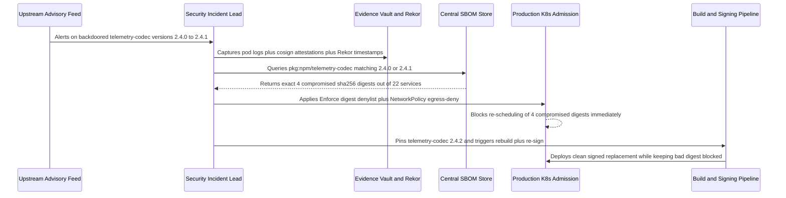

# Incident Response for a Supply-Chain Compromise

> **Prerequisites:** Supply-Chain Threat Model (Module 00), SBOMs (Module 01), Keyless & Keyed Cosign Signing (Module 02), SLSA Provenance (Module 03), Continuous Scanning & Triage (Module 04), Admission Control (Module 05), Fleet Hygiene (Module 06), and General Incident Response (Track 11, Module 07).  
> **Estimated Reading Time:** 35 minutes  
> **Target Audience:** SREs, Security Incident Responders, Platform Engineers, DevSecOps Engineers.

> [!TIP]
> **The Golden Rule of Supply-Chain Incident Response:** Never treat a valid signature or SLSA provenance as proof of safety — your pipeline faithfully signed an upstream compromise because **integrity is not safety**. In an incident, use the exact artifacts this track built: **preserve** SBOMs, attestations, and Rekor entries before deleting Pods; **query** stored SBOMs to scope blast radius in minutes; **contain** by denying immutable `@sha256:` digests at admission (never mutable tags); and **recover** by rebuilding and re-signing the clean replacement.

---

## Why This Matters

This track built prevention (signing, provenance, hygiene) and enforcement (admission control). Track 11 module 07 taught general incident response — isolate, preserve, rotate, root-cause. This module is the *intersection*: what you do the day a **signed, verified, admitted** image turns out to be built from a compromised dependency. That's the nightmare case, because every control you built said "yes" — the image was authentic, the provenance was valid, admission let it run — and it was malicious anyway, because the compromise was upstream of all of it (module 00's compromised-dependency attack). The good news: the exact artifacts this track produced — the SBOM, the signatures, the provenance, Rekor's log — are precisely what turn this from a blind, fleet-wide panic into a scoped, fast, evidence-driven response. This is the payoff the whole track was setting up.

---

## 1. Architectural Mental Model: Artifact-Driven Supply-Chain Incident Loop

When an upstream dependency is disclosed as backdoored, your pre-computed supply-chain telemetry replaces guesswork with deterministic queries and immutable containment:

```mermaid
flowchart LR
    subgraph Trigger["1. Detect & Preserve"]
        Adv["Upstream Advisory / KEV / Grype Rescan"]
        Preserve["Preserve Evidence (Pod spec + SBOM + Attestations + Rekor UUID)"]
        Adv --> Preserve
    end

    subgraph Scope["2. Query Blast Radius"]
        SBOMStore["Central SBOM Store (Search PURL + affected semver range)"]
        Runtime["Cluster Inventory (Cross-reference running image digests)"]
        SBOMStore --> Runtime
    end

    subgraph Contain["3. Contain & Eradicate"]
        Deny["Admission Digest Denylist (Enforce immediate block on sha256)"]
        Isolate["Workload Quarantine (NetworkPolicy egress-deny + scale to 0)"]
        Fix["Bump & Pin Clean Version (Module 06 PR + rebuild + re-sign)"]
        Runtime --> Deny
        Deny --> Isolate
        Isolate --> Fix
    end

    Preserve --> Scope
```



### Why prevention passing doesn't mean you're safe

Every control in this track answers a question honestly, and *none* of them answers "is this dependency trustworthy?":

- The **signature** (02) proved the image is the authentic output of your CI — and it was. Your CI faithfully built and signed an image containing the poisoned dependency.
- The **provenance** (03) proved it was built by your workflow from your commit — and it was. The commit legitimately pulled the compromised package.
- **Admission** (05) verified all of that and admitted it — correctly.

The compromise entered *before* your trust boundary, so your integrity controls faithfully certified a malicious artifact. This is not a failure of signing; it's signing working as designed on a poisoned input. The lesson from module 00, now lived: integrity ≠ safety. Which means you also need a *response* plan for when a validly-signed thing is bad — that's this module.

### The SBOM is your blast-radius map

The single most valuable incident artifact this track produced is the **SBOM store** (module 01), because the first question in any supply-chain incident is *"where are we exposed?"* — and the SBOM answers it as a query, not a fleet-wide investigation:

- **Which images contain the compromised package, at which version?** A search over stored SBOMs (`pkg:npm/compromised-lib@1.2.3`) returns the exact list — in minutes, across hundreds of images, including ones no longer in a running registry. Without SBOMs, this is a rebuild-and-grep of your entire fleet under time pressure.
- **Which of those are actually deployed, and where?** Cross-reference the affected-image list with what's running (the admission/deployment records).
- **What's the transitive reach?** The SBOM's dependency relationships show whether the bad package is a direct or transitive dependency, informing how many services inherit it.

This is exactly the payoff module 01 promised and module 04 reinforced: pre-computing the answer to the worst question you'll be asked under pressure. Your blast-radius assessment is a query because you did the SBOM work in advance.

### The response sequence, specialized for supply chain

Track 11 module 07's ordering still governs — **detect → preserve → isolate → eradicate → recover → root-cause** — but each step has a supply-chain-specific form:

1. **Detect** — the trigger is usually external: an upstream advisory (the package is announced malicious), a KEV listing (module 04), or your continuous re-scan flagging it. You rarely find it yourself first.
2. **Preserve evidence** — snapshot affected Pods/images *and their attestations and Rekor entries* before you delete anything. The signatures and provenance are evidence of *what was deployed and when*, and Rekor is an immutable timeline (below). Track 11's "don't destroy the crime scene" rule applies to attestations too.
3. **Isolate / contain** — stop the bleeding: cordon/quarantine affected workloads (NetworkPolicy egress-deny from track 11, scale to zero), and — the supply-chain-specific move — **tighten admission (module 05) to block the compromised digests** so the bad image can't be re-scheduled anywhere.
4. **Eradicate** — remove the compromised dependency: pin to a safe version, bump via the module-06 automation, rebuild.
5. **Recover** — rebuild → SBOM → scan → **re-sign** → re-attest → deploy the clean image through the normal gated pipeline (this track, end to end).
6. **Root-cause & prevent** — how did it get in, and what stops the *next* one (below).

The through-line: your response *uses this track's artifacts at every step* — SBOM to scope, attestations/Rekor to preserve, admission to contain, the pipeline to recover.

### Revocation and re-signing: what "revoke a signature" really means

A natural instinct is "revoke the signature on the bad image." Understand what that does and doesn't mean in the Sigstore model:

- There's **no CRL-style revocation of a keyless signature** — the signature legitimately attests the image *was* built by you, which remains true. You don't un-say a true statement.
- Instead you **revoke at the *policy* layer**: update admission (module 05) to **deny the specific compromised digests** (a denylist / an updated `ClusterImagePolicy`), and remove/repoint the tags so nothing pulls them. Trust is withdrawn by the *verifier's policy*, not by deleting the signature.
- **Re-signing** applies to the *fixed* image: the rebuilt, clean image gets a fresh signature and provenance through the normal pipeline. You don't "re-sign the bad one" — you sign its replacement and shift traffic.
- If a **signing *key*** (key-based mode, module 02) was compromised — a different, worse incident — you rotate the key and must **re-sign every image that key signed**, and update every verifier's trusted key. This is precisely the pain keyless avoids (no standing key to compromise), reinforcing module 02's argument in an incident.

So "revocation" in practice = *policy-layer denial of specific digests* + *re-signing the fixed replacement*, not cryptographic un-signing.

### Rekor and provenance as the forensic timeline

The transparency log and attestations you built for *prevention* double as *forensics*:

- **Rekor** (module 02) is an immutable, append-only record of every signature and attestation, with timestamps. During an incident it answers *"when was this image signed, and by which identity/workflow run?"* — an auditable timeline you can't get from mutable registry tags.
- **Provenance** (module 03) pinpoints the **exact build**: which commit, which CI run, which workflow pulled the compromised dependency. That turns "sometime in the last three months something went wrong" into "the compromise entered at commit `abc123`, build run #4471, on this date" — scoping *which* images (by provenance) are affected and *when* the bad dependency first entered.
- Combined with the **SBOM**, you get the full picture: *what* is affected (SBOM), *how it got built* (provenance), and *when it was signed/deployed* (Rekor) — a complete, evidence-backed incident timeline built from artifacts you already had.

Root-cause and prevention then close the loop: add the compromised package to a denylist, tighten dependency review (module 06), and if the entry point was a build-step compromise rather than a dependency, that's a SLSA-level gap (module 00) — raise the build's integrity level.

---

## 2. Taxonomic Comparison & Command Reference

### Compromise Class & Remediation Blast Radius

| Compromise Scenario | Integrity Controls Status | Blast Radius Determination | "Revocation" Mechanism | Recovery Path |
|---|---|---|---|---|
| **Upstream Compromised Dependency** | Passed signing & provenance honestly (poisoned input) | Query SBOM store by PURL & version range | Deny compromised `@sha256:` digests at admission policy | Bump & pin clean dep -> rebuild -> fresh keyless signature |
| **Compromised Build Step (SLSA Gap)** | Attacker tampered inside CI runner before signing | Query Rekor & SLSA provenance (`builder.id`, workflow run window) | Deny all `@sha256:` digests built within compromise window | Harden runner / raise SLSA level -> rebuild from clean commit |
| **Compromised Static Signing Key** | Attacker can forge arbitrary valid signatures | All artifacts signed by leaked public key | Rotate/delete old public key from every verifier policy | Re-sign **every** legitimate image with new key (or move to keyless) |

### Supply-Chain Incident Runbook Matrix

| IR Phase | Primary Supply-Chain Action | Artifact / Command Used | Exit Criteria (Done Check) |
|---|---|---|---|
| **1. Detect** | Triage advisory, KEV, or continuous Grype alert | `grype sbom:<file>` + advisory version check | Confirmed affected package name, PURL, and semver range |
| **2. Preserve** | Snapshot Pods, SBOMs, attestations, Rekor log entries | `cosign download attestation`, `rekor-cli search` | Immutable evidence archived prior to workload deletion |
| **3. Scope** | Query fleet SBOM store & correlate live cluster digests | `grep -rl` / PURL query + `kubectl get pods` | Exact list of affected vs. unaffected image digests |
| **4. Isolate / Contain** | Block bad digests at admission + quarantine running Pods | Digest denylist `ClusterImagePolicy` / Kyverno + `NetworkPolicy` | Attempt to schedule compromised digest returns `403 Forbidden` |
| **5. Eradicate** | Pin safe dependency version & update lockfile | Module 06 PR (`npm ci` / `pip-compile` / Renovate) | Clean dependency verified locally/CI without backdoor range |
| **6. Recover** | Rebuild -> SBOM -> scan -> re-sign -> re-attest -> deploy | Full gated CI pipeline + traffic shift | Clean `@sha256:` running; bad digest remains denied |
| **7. Root-Cause** | Audit entry vector (dep hygiene vs. SLSA build isolation) | Provenance commit/run review + dependency denylist | Preventive guardrail merged and post-mortem published |

### Command Reference

| Command | What it does | Example |
|---|---|---|
| `grep -rl 'pkg:npm/badlib@' sboms/` | Blast radius: find every stored SBOM containing the bad package | `grep -rl 'pkg:npm/left-pad@' sboms/` |
| `grype sbom:<file>` | Re-scan a stored SBOM to confirm a newly-announced CVE hits it | `grype sbom:app-sbom.json` |
| `cosign download attestation ` | Retrieve provenance/SBOM attestations as evidence (preserve) | `cosign download attestation myreg.azurecr.io/app@sha256:...` |
| `rekor-cli search --sha <digest>` | Find the transparency-log entries (timeline) for an artifact | `rekor-cli search --artifact app.tar` |
| `kubectl cordon` / `kubectl scale --replicas=0` | Contain: stop scheduling / drain affected workloads | `kubectl scale deploy/app --replicas=0` |
| `kubectl apply -f deny-digest-policy.yaml` | Contain: update admission to deny the compromised digests | see exercise 5 |
| `crane digest ` | Confirm which digest a tag currently resolves to | `crane digest myreg.azurecr.io/app:1.0` |
| `cosign copy` / re-run pipeline | Recover: re-sign/re-attest the rebuilt clean image | see exercise 6 |

Flag/field breakdown for a containment `ClusterImagePolicy` denylist (from exercise 5):

- A dedicated policy whose `authorities` cannot be satisfied for the named compromised digests (or a Kyverno rule matching those digests with `validationFailureAction: Enforce`) — the module-05 mechanism used *in reverse*, to block specific known-bad content rather than require good content.
- Scope it by **digest**, not tag — the compromised artifact is defined by its immutable content (module 00), and denying the tag alone is bypassable by pulling the digest directly.
- Keep it in enforce from the moment of containment (this is not the audit-first case — you have a *confirmed* bad artifact), but scope it narrowly to the specific digests so you don't halt unrelated deploys.

---

## 3. Production War Story Post-Mortem: The Signed Trojan Dependency (`INC-2026-0814`)

- **Incident ID / Severity:** `INC-2026-0814` — **SEV-1** (Backdoored transitive package shipped in signed, SLSA-attested production Pods)
- **Detection Time:** 18 minutes (upstream OSV advisory triggered continuous SBOM rescan webhook)
- **Time to Mitigate:** 29 minutes
- **Impact:** 4 of 22 production microservices contained `telemetry-codec@2.4.1` (credential-harvesting post-install script); 18 unaffected services avoided unnecessary downtime because SBOM queries proved zero exposure.

### What Happened

Four days after a routine release, an upstream maintainer's registry token was abused to publish `telemetry-codec@2.4.1`. Because a service used a permissive lockfile update earlier that week, CI legitimately pulled `2.4.1`, built the image, generated an SPDX SBOM, signed it keyless via Fulcio/Rekor, attached SLSA Level 2 provenance, and passed Kyverno admission. When the advisory dropped, a responder initially suggested ignoring the alert because "the Pod passed Kyverno verification," then nearly wiped the Deployment before archiving attestations. Using the IR runbook, the team preserved Rekor entries and attestations first, queried the central SBOM store to isolate the exact 4 impacted `@sha256:` digests, enforced an immediate Kyverno digest denylist, and rolled out patched replacements.



### Root Cause Analysis

1. **False assumption that signing guarantees code safety:** An engineer temporarily hesitated because Kyverno reported the signature valid — failing to distinguish *build authenticity* from *upstream dependency safety*.
2. **Permissive dependency acceptance without delay cooldown:** Renovate auto-merged a patch release within 20 minutes of upstream publication before community compromise detection could fire.
3. **Near-miss on tag-based containment:** An initial draft policy matched `:v3.1.0` instead of `@sha256:...`, which would have allowed rollback manifests referencing the digest directly to re-admit the compromised image.

### The Fix & Architectural Hardening

1. **Automated SBOM-to-Cluster Blast-Radius Script:** Wired OSV advisories directly to stored SBOM PURL queries cross-referenced with active cluster digests (`< 2 minutes` scoping time).
2. **Pre-Staged Digest Denylist Template:** Maintained an emergency Kyverno/Policy Controller manifest template keyed strictly by `@sha256:` digest in `Enforce` mode.
3. **Dependency Stability Cooldown & Artifact Preservation:** Configured Renovate `minimumReleaseAge: "3 days"` for routine non-security bumps and scripted automated `cosign download attestation` archival prior to Pod termination.

---

## 4. Production Implementation: SBOM Blast-Radius Query & Containment Generator

Below is a four-language production implementation modeling an emergency IR engine: scanning a stored SPDX JSON SBOM index for a compromised package name + vulnerable version set, cross-referencing live cluster workloads to isolate deployed blast radius, and emitting immutable `@sha256:` containment policy targets alongside forensic preservation items.

````carousel
```go
package main

import (
	"fmt"
	"strings"
)

type SBOMPackage struct {
	Name    string
	Version string
	PURL    string
}

type ImageSBOM struct {
	ImageDigest string
	Packages    []SBOMPackage
}

type ClusterWorkload struct {
	Namespace   string
	Deployment  string
	ImageDigest string
}

type BlastRadiusReport struct {
	CompromisedDigests []string
	ImpactedWorkloads  []string
	SafeImages         int
	ContainmentRules   []string
}

func ComputeBlastRadius(
	sboms []ImageSBOM,
	running []ClusterWorkload,
	targetPkg string,
	badVersions map[string]bool,
) BlastRadiusReport {
	exposedDigests := make(map[string]bool)
	var compromised []string

	for _, s := range sboms {
		for _, pkg := range s.Packages {
			if (pkg.Name == targetPkg || strings.Contains(pkg.PURL, targetPkg)) && badVersions[pkg.Version] {
				if !exposedDigests[s.ImageDigest] {
					exposedDigests[s.ImageDigest] = true
					compromised = append(compromised, s.ImageDigest)
				}
			}
		}
	}

	var impacted []string
	for _, w := range running {
		if exposedDigests[w.ImageDigest] {
			impacted = append(impacted, fmt.Sprintf("%s/%s (%s)", w.Namespace, w.Deployment, w.ImageDigest))
		}
	}

	var denyRules []string
	for _, d := range compromised {
		denyRules = append(denyRules, fmt.Sprintf("DENY image matching immutable digest %s (preserve Rekor/SBOM first)", d))
	}

	return BlastRadiusReport{
		CompromisedDigests: compromised,
		ImpactedWorkloads:  impacted,
		SafeImages:         len(sboms) - len(compromised),
		ContainmentRules:   denyRules,
	}
}
```
<!-- slide -->
```typescript
export interface SbomPackage {
  name: string;
  version: string;
  purl?: string;
}

export interface ImageSbomRecord {
  digest: string; // e.g. "sha256:9b8f..."
  packages: SbomPackage[];
}

export interface RunningWorkload {
  namespace: string;
  name: string;
  imageDigest: string;
}

export interface IncidentBlastRadius {
  affectedDigests: string[];
  deployedTargets: string[];
  preserveCommands: string[];
  admissionDenyDigests: string[];
}

export function queryBlastRadius(
  sbomStore: ImageSbomRecord[],
  runningWorkloads: RunningWorkload[],
  compromisedPkg: string,
  affectedVersions: Set<string>
): IncidentBlastRadius {
  const affectedDigests = new Set<string>();

  for (const record of sbomStore) {
    const hit = record.packages.some(
      (p) =>
        (p.name === compromisedPkg || p.purl?.includes(compromisedPkg)) &&
        affectedVersions.has(p.version)
    );
    if (hit) affectedDigests.add(record.digest);
  }

  const deployedTargets = runningWorkloads
    .filter((w) => affectedDigests.has(w.imageDigest))
    .map((w) => `${w.namespace}/${w.name}@${w.imageDigest}`);

  const digests = [...affectedDigests];
  return {
    affectedDigests: digests,
    deployedTargets,
    preserveCommands: digests.map((d) => `cosign download attestation myreg.azurecr.io/app@${d} > evidence-${d.slice(7, 19)}.att`),
    admissionDenyDigests: digests,
  };
}
```
<!-- slide -->
```python
from dataclasses import dataclass
from typing import Dict, List, Set


@dataclass(frozen=True)
class SbomPackage:
    name: str
    version: str
    purl: str = ""


@dataclass(frozen=True)
class ImageSbom:
    image_ref: str
    digest: str
    packages: List[SbomPackage]


@dataclass(frozen=True)
class RunningPod:
    namespace: str
    pod_name: str
    digest: str


def build_incident_blast_radius(
    sbom_store: List[ImageSbom],
    running_pods: List[RunningPod],
    bad_package: str,
    bad_versions: Set[str],
) -> Dict[str, List[str]]:
    exposed: Dict[str, str] = {}
    for sbom in sbom_store:
        if any(
            (pkg.name == bad_package or bad_package in pkg.purl) and pkg.version in bad_versions
            for pkg in sbom.packages
        ):
            exposed[sbom.digest] = sbom.image_ref

    live_hits = [
        f"{pod.namespace}/{pod.pod_name} -> {pod.digest}"
        for pod in running_pods
        if pod.digest in exposed
    ]

    preserve_steps = [
        f"cosign download attestation {ref}@{dig} && rekor-cli search --sha {dig}"
        for dig, ref in exposed.items()
    ]

    return {
        "exposed_digests": list(exposed.keys()),
        "live_impacted_pods": live_hits,
        "preserve_commands": preserve_steps,
        "deny_policy_digests": [f"*@{dig}" for dig in exposed.keys()],
    }
```
<!-- slide -->
```csharp
using System;
using System.Collections.Generic;
using System.Linq;

public sealed record SbomPackage(string Name, string Version, string Purl = "");
public sealed record StoredImageSbom(string Repository, string Digest, IReadOnlyList<SbomPackage> Packages);
public sealed record RunningClusterPod(string Namespace, string Name, string Digest);

public sealed record IncidentScopeResult(
    IReadOnlyList<string> CompromisedDigests,
    IReadOnlyList<string> LiveImpactedWorkloads,
    IReadOnlyList<string> PreservationCommands);

public static class SupplyChainBlastRadiusEngine
{
    public static IncidentScopeResult ScopeCompromise(
        IEnumerable<StoredImageSbom> sbomStore,
        IEnumerable<RunningClusterPod> runningPods,
        string badPackage,
        IReadOnlySet<string> affectedVersions)
    {
        var exposedMap = sbomStore
            .Where(s => s.Packages.Any(p =>
                (p.Name.Equals(badPackage, StringComparison.OrdinalIgnoreCase) ||
                 p.Purl.Contains(badPackage, StringComparison.OrdinalIgnoreCase)) &&
                affectedVersions.Contains(p.Version)))
            .ToDictionary(s => s.Digest, s => s.Repository, StringComparer.OrdinalIgnoreCase);

        var liveImpacted = runningPods
            .Where(pod => exposedMap.ContainsKey(pod.Digest))
            .Select(pod => $"{pod.Namespace}/{pod.Name} ({pod.Digest})")
            .ToList();

        var preserve = exposedMap
            .Select(kv => $"cosign download attestation {kv.Value}@{kv.Key}")
            .ToList();

        return new IncidentScopeResult(exposedMap.Keys.ToList(), liveImpacted, preserve);
    }
}
```
````

---

## 5. Practical Hands-On Verification CLI Workflows

Local and free — you'll run a tabletop-style response against real SBOMs and a local registry, exercising the scoping and containment muscles. (A full end-to-end incident is the capstone's implicit stress test.)

1. **(WSL2) Build a small SBOM "store" to query.** Generate SBOMs for a few images so you have a fleet to search:
   ```bash
   mkdir -p sboms
   for i in python:3.11-slim node:20-slim alpine:3.20; do
     syft "$i" -o spdx-json="sboms/$(echo $i | tr ':/' '__').json"
   done
   ls sboms/
   ```
   **Expected Output:**
   ```text
   alpine__3.20.json  node__20-slim.json  python__3.11-slim.json
   ```
   Expect several SBOM files. This is your pre-computed blast-radius index.

2. **(WSL2) Scope a blast radius by query, not rebuild.** Pretend `zlib` is announced compromised. Find every affected image *without touching any image*:
   ```bash
   grep -rl '"name":"zlib"' sboms/ || grep -rl 'zlib' sboms/
   grep -rh '"name":"zlib"' sboms/ | head
   ```
   **Expected Output:**
   ```text
   sboms/alpine__3.20.json
   sboms/node__20-slim.json
   sboms/python__3.11-slim.json
   ```
   Expect the exact list of SBOMs (images) that contain `zlib`, with versions. Note the speed: this is minutes over stored SBOMs vs a fleet-wide rebuild-and-grep. This *is* the module-01 payoff, in an incident.

3. **(WSL2) Confirm exploitability, don't just match the name.** Re-scan an affected SBOM to see whether the announced CVE actually applies at that version (module 04's triage, under incident pressure):
   ```bash
   grype db update
   grype sbom:sboms/python_3.11-slim.json | grep -i zlib || echo "no matching CVE at this version — triage as not-affected"
   ```
   **Expected Output:**
   ```text
   no matching CVE at this version — triage as not-affected
   ```
   Write one line: why does "contains the package" not automatically mean "affected"? (Version ranges, and whether the vulnerable code path is present — module 04.)

4. **(WSL2) Preserve evidence before touching anything.** Simulate capturing the attestations/timeline for an affected image before remediation:
   ```bash
   docker run -d -p 5000:5000 --name registry registry:2 2>/dev/null; true
   docker pull alpine:3.20 && docker tag alpine:3.20 localhost:5000/app:bad && docker push localhost:5000/app:bad
   COSIGN_PASSWORD="" cosign generate-key-pair
   cosign sign --key cosign.key --yes localhost:5000/app:bad
   syft localhost:5000/app:bad -o spdx-json=evidence-sbom.json
   cosign tree localhost:5000/app:bad     # record signatures/attestations as evidence
   ```
   **Expected Output:**
   ```text
   📦 Supply Chain Security Related artifacts for an image: localhost:5000/app:bad
   └── 💾 Signatures for an image tag: localhost:5000/app:sha256-...sig
       └── 🍒 sha256:...
   ```
   The point: snapshot the SBOM, signatures, and (in real life) Rekor entries *first* — track 11 module 07's preserve-before-you-delete rule, applied to supply-chain artifacts.

5. **(WSL2) Contain by denying the compromised digest at admission.** Get the bad image's digest and write a containment policy (module 05 in reverse):
   ```bash
   BAD=$(crane digest localhost:5000/app:bad)
   echo "compromised digest: $BAD"
   cat > deny-digest.yaml <<EOF
   # Conceptual containment: an admission policy (Policy Controller/Kyverno)
   # that DENIES this specific digest cluster-wide, so it can't be re-scheduled:
   #   match image digest == ${BAD}  ->  reject
   # Scoped by DIGEST (immutable), not tag (bypassable). Enforce immediately —
   # this is a confirmed-bad artifact, not an audit-first rollout.
   EOF
   cat deny-digest.yaml
   ```
   Reason through why the denial is by digest, not tag: the compromised artifact is its content; denying `:bad` alone is bypassed by pulling the digest directly (module 00).

6. **(WSL2) Recover: rebuild clean and re-sign the *replacement*.** You don't un-sign the bad image — you sign its fixed successor through the normal pipeline:
   ```bash
   docker tag alpine:3.20 localhost:5000/app:fixed && docker push localhost:5000/app:fixed
   FIXED=$(crane digest localhost:5000/app:fixed)
   cosign sign --key cosign.key --yes localhost:5000/app@${FIXED#*@}
   syft localhost:5000/app:fixed -o spdx-json=fixed-sbom.json
   echo "shift traffic to the fixed digest; keep the deny on ${BAD}"
   ```
   **Expected Output:**
   ```text
   Pushing signature to: localhost:5000/app
   shift traffic to the fixed digest; keep the deny on sha256:...
   ```
   Note the shape of recovery: the *fixed* image gets a fresh signature/SBOM; the *bad* digest stays denied. "Revocation" was a policy-layer denial plus re-signing the replacement — never cryptographic un-signing.

7. **Diagnose and fix: a signed, admitted image that's malicious anyway.** The scenario that names the module. Your continuous re-scan (module 04) flags a running, *validly signed and admitted* image because a dependency it contains was just disclosed as a backdoor. A teammate says "but it passed signature verification, so it must be fine." Diagnose the flaw in that reasoning and lay out the correct response *in order*, using this track's artifacts:
   ```bash
   # Reasoning check: signature/provenance prove AUTHENTICITY & BUILD, not SAFETY.
   # The compromise entered upstream of your trust boundary (module 00), so your
   # controls correctly certified a malicious artifact. Signing worked; it's the
   # wrong question for this failure.
   #
   # Correct order (track 11 module 07, supply-chain form):
   #   1. Detect  : re-scan/advisory already flagged it.
   #   2. Preserve: snapshot SBOM + attestations + Rekor entries (exercise 4).
   #   3. Scope   : grep stored SBOMs for the bad package -> affected image list (exercise 2).
   #   4. Isolate : cordon/scale-to-zero affected workloads; deny bad digests at admission (exercise 5).
   #   5. Eradicate: pin/bump the dependency to a safe version (module 06).
   #   6. Recover : rebuild -> SBOM -> scan -> re-sign -> re-attest -> deploy (exercise 6).
   #   7. Root-cause: how did the dep get in; add denylist + tighten review; raise SLSA level if the entry was a build compromise.
   echo "signature proves authenticity, not safety — respond, don't dismiss"
   ```
   The fix is both a *mindset* correction (a valid signature is not a clean bill of health) and the *ordered response* above, every step powered by an artifact this track produced.

8. **(WSL2) Clean up.**
   ```bash
   docker rm -f registry 2>/dev/null; true
   rm -rf sboms
   rm -f cosign.key cosign.pub evidence-sbom.json fixed-sbom.json deny-digest.yaml
   docker rmi localhost:5000/app:bad localhost:5000/app:fixed alpine:3.20 2>/dev/null; true
   ```

### Independent Challenge

No commands given — build it using this module plus track 11 module 07 (the response ordering and preserve-before-delete rule), module 01 (SBOM store), module 03 (provenance), and module 05 (admission). Write a **supply-chain incident-response runbook** for this exact scenario: *"an upstream advisory announces that a package many of our images depend on was backdoored in versions 1.4.0–1.6.2; some affected images are signed, provenance-attested, and currently running in prod."* The runbook must give the ordered steps (detect → preserve → scope/blast-radius → isolate/contain → eradicate → recover → root-cause), the *exact artifact or command* used at each step (which store you grep, what you snapshot, how you deny the digests at admission, how you re-sign the fix), who is responsible, and the check that tells you each step is done. Include a paragraph on what "revocation" concretely means here (policy-layer digest denial + re-signing the replacement, *not* un-signing), and end by naming the single detection signal you'd add so the *next* compromised-dependency disclosure pages you automatically.

<details>
<summary>Stuck? One hint</summary>

Structure it as track 11 module 07's ordered runbook, but make every step cite a track-18 artifact: **preserve** = snapshot SBOM + `cosign download attestation` + Rekor entries; **scope** = `grep` the SBOM store for the bad PURL/version range → affected-image list; **contain** = a module-05 `ClusterImagePolicy`/Kyverno rule denying the *specific compromised digests* (enforce immediately, scoped by digest not tag); **eradicate** = bump the dependency via module-06 automation; **recover** = rebuild → SBOM → scan → re-sign → re-attest → shift traffic, keep the deny in place. "Revocation" = withdraw trust in the verifier's *policy* and sign the *replacement*, because a keyless signature can't be un-said. The detection signal to add is continuous SBOM re-scanning wired to your advisory feed (module 04), so the next disclosure auto-scopes and pages.

</details>

---

## 6. Common Mistakes & Troubleshooting

- **Treating a valid signature as a clean bill of health.** Signing/provenance prove authenticity and build integrity, *not* that a dependency is trustworthy. A signed, admitted image can be malicious if the compromise was upstream — respond, don't dismiss.
- **Rebuilding the fleet to find the blast radius.** That's the slow panic the SBOM store exists to prevent. Query stored SBOMs for the bad package/version first; rebuild only the images that actually contain it.
- **Deleting the evidence first.** Destroying Pods/images/attestations before snapshotting loses the forensic timeline (Rekor, provenance, SBOM). Preserve before you eradicate — track 11 module 07's rule, extended to attestations.
- **"Contains the package" = "affected."** Version ranges and reachability matter (module 04). Confirm the disclosed range and exploitability before treating an image as compromised, or you'll over-scope and over-react.
- **Thinking you can "revoke" a keyless signature.** You can't un-say a true attestation. Revocation = deny the compromised digests at the *policy* layer and re-sign the fixed replacement. (A compromised signing *key* is the worse case that forces re-signing everything — the pain keyless avoids.)
- **Containing by tag instead of digest.** Denying `:bad` is bypassable by pulling the digest. Contain the immutable digest (module 00).
- **Skipping root-cause and prevention.** If you don't determine how the dependency got in (and whether it was a build-step compromise → a SLSA-level gap, module 00), you'll respond to the same class of incident again. Close the loop: denylist, tighten review (module 06), raise the build's integrity level.

---

## 7. Operational Validation Checkpoints & Checkpoint Quiz

### Operational Validation Checkpoints

<details>
<summary><strong>Checkpoint 1: Tag-Based Containment Bypass During Rollback</strong></summary>

**Scenario:** During containment, an operator updates Kyverno to block `myreg.azurecr.io/billing:v2.4.1`. Ten minutes later, Argo CD syncs an older Git manifest pinned to `myreg.azurecr.io/billing:v2.4.0@sha256:bad...` (or deploys directly by digest), and the compromised container starts running again.

**Validation & Fix:** A tag block only matches deployments referencing that string tag. Always scope containment policies by the immutable `@sha256:` digest (`*myreg.azurecr.io/*@sha256:bad...` or Policy Controller digest authority denial) in immediate `Enforce` mode so neither direct digest pulls nor tag renames can bypass admission.

</details>

<details>
<summary><strong>Checkpoint 2: Wiping Pods Before Archiving Attestations & Rekor Timeline</strong></summary>

**Scenario:** An alert triggers on a running backdoored container. An eager engineer immediately deletes the Deployment and runs registry garbage collection (`acr purge`) to remove the bad tag, erasing evidence before forensics identifies which commit and workflow run introduced the dependency.

**Validation & Fix:** Enforce the preserve-before-eradicate rule: run `kubectl get pod -o yaml`, `cosign download attestation `, `cosign tree`, and `rekor-cli search --sha <digest>` into a write-once evidence bucket *before* deleting workloads or purging registry tags.

</details>

<details>
<summary><strong>Checkpoint 3: Fleet-Wide Emergency Rebuilds Without Version-Range Filtering</strong></summary>

**Scenario:** An advisory names `libcrypto-helper` versions `1.4.0–1.4.3` as backdoored. A naive grep for `libcrypto-helper` across stored SBOMs flags all 35 services, triggering emergency rollbacks across services running safe version `1.3.9`.

**Validation & Fix:** Query stored SBOMs using both PURL/package name *and* exact version constraints (or run `grype sbom:<file>` against the updated advisory database), then cross-reference against live cluster image digests so only genuinely exposed services undergo emergency containment and rebuilds.

</details>

### Checkpoint Quiz

Write down your answer to each question before expanding it — checking without attempting first is the single easiest way to fool yourself into thinking you've learned this.

<details>
<summary>Show questions</summary>

1. How can an image that passed signature verification, provenance verification, *and* admission control still be malicious? What single distinction from module 00 explains it?
2. What is the first question in a supply-chain incident, and which artifact from this track answers it as a query rather than an investigation?
3. Give the supply-chain-specific form of each response step: preserve, isolate, recover.
4. What does "revoking" a signature concretely mean in the keyless/Sigstore model, and what does it *not* mean?
5. How do Rekor and provenance function as forensic tools during an incident, and what does each pinpoint?
6. Why do you contain by *digest* rather than tag, and why is containment the one case that isn't rolled out audit-first?
7. If a signing *key* (not just an image) were compromised, why is that a worse incident, and how does keyless signing (module 02) avoid it?

</details>

<details>
<summary>Show answers</summary>

1. Because the compromise entered *upstream of your trust boundary* — a dependency your CI legitimately pulled — so your integrity controls faithfully certified a malicious artifact. The distinction is **integrity ≠ safety** (module 00): signing proves the image is the authentic output of your build, not that its contents are trustworthy.
2. "Where are we exposed?" — the blast radius. The **stored SBOMs** (module 01) answer it as a query ("which images contain the compromised package, at what version?") in minutes, instead of a fleet-wide rebuild-and-investigate.
3. **Preserve:** snapshot affected Pods/images *and* their attestations + Rekor entries before deleting (the timeline is evidence). **Isolate:** cordon/scale-to-zero affected workloads *and* update admission to deny the compromised digests so they can't be re-scheduled. **Recover:** rebuild → SBOM → scan → re-sign → re-attest → deploy the clean image through the normal gated pipeline.
4. It means withdrawing trust at the *verifier's policy layer* — denying the specific compromised digests at admission (module 05) and repointing tags — plus re-signing the *fixed replacement*. It does **not** mean cryptographically un-signing: a keyless signature truthfully attests the image *was* built by you, and you can't (and don't) un-say that.
5. **Rekor** is an immutable, timestamped log answering "when was this signed and by which workflow run?" — a tamper-proof timeline. **Provenance** pinpoints the *exact build*: which commit and CI run pulled the compromised dependency, scoping which images are affected and when the bad dependency first entered. With the SBOM (what's affected) they form a complete timeline.
6. You contain by digest because the compromised artifact is defined by its immutable content (module 00); denying only the tag is bypassable by pulling the digest directly. It's not audit-first because you have a *confirmed* bad artifact — audit-first exists to measure uncertain blast radius before blocking, which doesn't apply to a known-malicious digest (though you scope the deny narrowly to those digests).
7. A compromised signing *key* lets an attacker forge valid signatures on arbitrary malicious images, and remediation forces rotating the key and **re-signing every image it ever signed** plus updating every verifier — huge blast radius. Keyless (module 02) has *no standing key*: each signature uses a short-lived, identity-bound ephemeral key discarded after use, so there's no key to steal and no fleet-wide re-signing.

</details>

---

## Next

Continue to [08-capstone-project](../08-capstone-project/README.md) — assemble the entire track into one working pipeline: build, SBOM, keyless sign, provenance attestation, and a cluster that admits the signed image and rejects the unsigned one, proving both paths for real.
