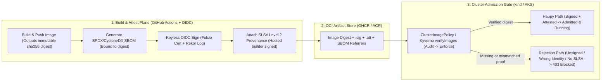
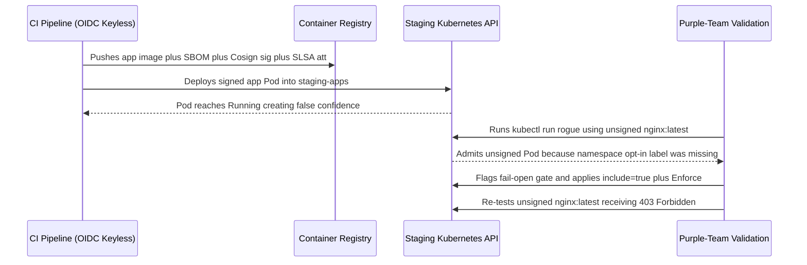

# Capstone Project: A Signed, Attested, Enforced Supply Chain

> **Prerequisites:** All Track 18 Modules (00–07), Container Builds & Registries (Track 02 / Track 07), GitHub Actions OIDC CI (Track 10), and Kubernetes Admission & Incident Response (Track 11, Modules 03–07).  
> **Estimated Reading Time:** 45 minutes (plus 2–4 hours hands-on implementation)  
> **Target Audience:** Backend Engineers, Platform Engineers, DevSecOps Engineers, Cloud Security Architects.

> [!TIP]
> **The Golden Rule of the Supply-Chain Capstone:** Never trust a security gate just because `kubectl apply` returned zero errors or a signed Pod reached `Running` — a misconfigured policy can fail open silently. Your capstone is complete only when you prove **both paths side by side**: your CI-built, digest-pinned, keyless-signed, SLSA-attested image is admitted and runs, **and** an unsigned, wrong-identity, or provenance-less image is deterministically rejected at the cluster door.

---

## Why This Matters

Every module in this track produced one artifact or one control in isolation — an SBOM, a signature, a provenance attestation, an admission policy, a triage practice, a response runbook. A real supply-chain defense is none of those alone; it's the whole chain wired together so that a proof is *generated* in CI, *travels with the image*, and is *checked at the cluster door* before anything runs — and so that the day it fails, the artifacts you produced are what let you respond. This capstone is where you prove you can assemble the entire chain end to end on real infrastructure and — the part that separates "it applied without error" from "it actually works" — demonstrate both the **happy path** (a properly signed image runs) and the **rejection path** (an unsigned image is blocked). There's no solution given and no quiz. Finishing this is what "you can secure the software supply chain end to end" means: you build the proofs, you enforce them, and you've seen the gate stop something.

---

## 1. Architectural Mental Model: End-to-End Attested Pipeline to Cluster Door

Your capstone links **CI artifact attestation** (GitHub Actions OIDC + BuildKit/Syft + Cosign + SLSA provenance) across an **immutable OCI registry** boundary (`@sha256:`) into a **cluster admission gate** (`Policy Controller` or `Kyverno`) that enforces identity, provenance, and digest binding before any Pod starts:



### The project

Take a small containerized application (reuse one from the Docker or Kubernetes tracks, or a trivial Flask/Node app) and build a complete supply-chain pipeline around it, then enforce that pipeline's guarantees at a cluster. The pipeline is a **CI workflow from track 10** (GitHub Actions) using **keyless OIDC signing** (the same `id-token: write` OIDC identity you used for secretless Azure login in track 10). You can develop and test the enforcement layer on a local **kind** cluster first (as in modules 05/07) to save cost, then optionally reproduce on your **AKS cluster** from track 07. Clean up billable resources when done.

The required chain, each piece drawing on a specific module:

1. **A CI pipeline that builds the image** (track 10) — triggered on push, building your app image and pushing it to a registry (ACR or GHCR), referenced by **digest** thereafter (module 00).
2. **SBOM generation** (module 01) — the pipeline generates an SBOM (Syft or BuildKit `--sbom`) for the exact built image, bound to its digest, and stores/attaches it — not a throwaway.
3. **Keyless signing with cosign** (module 02) — the pipeline signs the image digest via **keyless OIDC** (no stored key), so the signature is bound to the CI workflow's identity via Fulcio/Rekor.
4. **A build-provenance attestation** (module 03) — the pipeline attaches SLSA provenance (cosign `attest --type slsaprovenance`, BuildKit `--provenance=mode=max`, or the SLSA GitHub generator), targeting **SLSA Level 2** (provenance signed by the hosted builder, not forgeable off platform).
5. **A cluster-level admission policy that rejects unsigned images** (module 05) — a Sigstore `ClusterImagePolicy` or Kyverno `verifyImages` policy that admits an image *only* if it carries a valid signature from **your** workflow identity (and, for full marks, the required provenance attestation), rolled out audit-first then set to enforce.
6. **Proof of both paths** — you demonstrate that the **signed image from your pipeline is admitted and runs**, *and* that an **unsigned (or wrong-identity) image is rejected** at admission. The rejection is the proof the gate actually enforces — a good Pod running proves nothing on its own (track 11 module 04's fail-open warning).

---

## 2. Taxonomic Comparison & Capstone Specification Matrix

### End-to-End Capstone Architecture Matrix

| Chain Stage | Track Module | Tooling Options | Proof Produced | Trust Boundary / Verification Check |
|---|---|---|---|---|
| **1. Build & Digest Pin** | Track 10 + Module 00 | `docker/build-push-action` (GHCR / ACR) | Immutable `repo@sha256:...` | Downstream steps never reference floating tags |
| **2. SBOM Binding** | Module 01 | `syft` or BuildKit `--sbom=true` | SPDX / CycloneDX JSON attached to digest | `cosign download sbom` + `grype sbom:...` |
| **3. Keyless OIDC Sign** | Module 02 | `cosign sign` (`id-token: write`) | Fulcio short-lived cert + Rekor entry | `cosign verify` matching exact OIDC `issuer` + `subject` |
| **4. SLSA Provenance** | Module 03 | `slsa-github-generator` / `cosign attest` / `--provenance=mode=max` | Signed `slsaprovenance` attestation | `cosign verify-attestation --type slsaprovenance` |
| **5. Admission Policy** | Module 05 + Track 11/04 | Policy Controller (`ClusterImagePolicy`) or Kyverno (`verifyImages`) | `warn`/`Audit` blast-radius check -> `Enforce` + `mutateDigest` | Signed Pod `Running`; unsigned/wrong-identity Pod `403` |
| **6. Incident Readiness** | Modules 04, 06, 07 | Continuous SBOM rescan + Renovate + IR Runbook | 1-page compromise runbook scoped via stored SBOM | Digest denylist containment + honest SLSA rating |

### SLSA Build Level Readiness Reference

| SLSA Level | Core Requirement | Forgery Resistance | Capstone Status |
|---|---|---|---|
| **Level 0** | No provenance generated | None — anyone with registry credentials can push arbitrary bits | Insufficient |
| **Level 1** | Scripted build generates unsigned provenance | Proves build steps existed, but metadata can be forged off-platform | Baseline minimum |
| **Level 2** | **Hosted CI builder generates signed provenance** (`id-token: write` / SLSA generator) | Cannot be forged by developers outside the hosted runner service | **Capstone Target** |
| **Level 3** | Hardened, isolated, ephemeral build platform preventing cross-step tampering | Resistant even against compromised build-script neighbors | Next step beyond capstone |

### Acceptance checklist

Work isn't done until you can demonstrate every one of these:

- [ ] A CI workflow (track 10) builds the app image on push and references it by **digest** (`@sha256:...`), not a floating tag, downstream.
- [ ] The pipeline generates an **SBOM** for the built image (Syft or `--sbom=true`), bound to the image digest, and the SBOM is stored or attached — you can retrieve it and it accurately lists the app's dependencies (no stale-SBOM drift, module 01).
- [ ] The pipeline **signs the image keyless** via OIDC (`cosign sign` with `id-token: write`, **no stored key/secret**); `cosign tree` shows the signature attached in the registry.
- [ ] The pipeline attaches a **SLSA provenance attestation** signed by the hosted builder (targeting **Level 2**); `cosign verify-attestation --type slsaprovenance` succeeds against your workflow identity.
- [ ] `cosign verify` with the correct `--certificate-identity` (your workflow + ref) and `--certificate-oidc-issuer` (`https://token.actions.githubusercontent.com`) **succeeds** for the pipeline-built image.
- [ ] A `ClusterImagePolicy`/Kyverno `verifyImages` policy is installed, was rolled out **audit/warn first**, and is now **enforcing**, scoped to your registry/namespace (infra images not intercepted).
- [ ] **Happy path proven:** a Pod using the **signed** pipeline image is **admitted and reaches `Running`** under the enforcing policy.
- [ ] **Rejection path proven:** a Pod using an **unsigned** image (or one signed by a different/wrong identity) is **rejected** at admission with a verification error — you can show the rejection message.
- [ ] The admission policy pins the **correct identity/issuer** — you can explain why a wrong-identity pin would reject your own valid image (modules 02/05) and confirm yours matches the real signer.
- [ ] (Full marks) The policy also **requires the provenance attestation**, and a signed-but-provenance-less image is **rejected** — proving the gate checks *how it was built*, not just that it's signed.
- [ ] (Full marks) You can state your honest **SLSA level** for the pipeline and the one change that would raise it (module 00), and you have a one-page **incident runbook** (module 07) for "a dependency in this signed image is disclosed as compromised" — scoping via the SBOM you generated.
- [ ] All billable resources (ACR/AKS if used) are cleaned up or accounted for.

### Hints (not a solution)

- **Sequence it the way the track was ordered.** Get the app building in CI first, then add SBOM, then signing, then provenance, then stand up the admission policy last — each step builds on a working previous one, exactly how the modules were laid out. Don't try to write the whole workflow at once.
- **Keyless needs `id-token: write`.** The GitHub Actions job must request the OIDC token permission (the same one track 10 used for secretless Azure login). With it, `cosign sign` and `cosign attest` need **no** `--key` and **no** secret — the workflow identity is the signer (module 02).
- **Sign and attest the digest the build just produced**, not a tag — capture the `@sha256:` from the build/push step and pass it to `cosign` (modules 00/02), so the proofs bind to exactly what shipped.
- **Roll the policy out audit-first, then flip to enforce** — modules 05 and track 11 module 04. Measure what it would block (is anything in your target namespace unsigned?) before it blocks for real, so you don't wedge your own cluster.
- **Test the bad path deliberately.** Push a plain `nginx`/unsigned image and confirm admission **rejects** it. If you can't produce a rejection, your policy isn't actually enforcing (fail-open, track 11 module 04) — fix that before you call the gate done.
- **If your own signed image is rejected, suspect the identity pin, not the signature** (modules 02/05). Check that the policy's authorized `subject`/`issuer` matches your real workflow identity and ref (`main` vs `master`, GitHub's issuer vs anything else) before assuming the signature is broken.
- **Resolve to the verified digest at admission** (`mutateDigest`/digest resolution, module 05) so what runs equals what was verified — closing the tag-moved gap.
- **Don't gold-plate.** One app, one clean pipeline that genuinely signs and attests, one enforcing policy, and *both paths demonstrably proven* beats a sprawling setup where nothing is verified end to end. Depth on the acceptance items — especially the rejection path — is the goal.

---

## 3. Production War Story Post-Mortem: The "Green Pipeline" Fail-Open Gate (`INC-2026-0921`)

- **Incident ID / Severity:** `INC-2026-0921` — **SEV-2** (Silently non-enforcing cluster admission gate exposed during purple-team validation)
- **Detection Time:** 6 weeks post-deployment (purple-team exercise ran `kubectl run rogue --image=nginx:latest`)
- **Time to Mitigate:** 35 minutes
- **Impact:** Zero customer outage, but 4 developer-pushed unsigned debug containers ran in `staging-apps` undetected for 6 weeks despite passing CI signature checks.

### What Happened

A platform squad completed their supply-chain rollout: GitHub Actions built containers, generated Syft SBOMs, signed images keyless with OIDC, attached SLSA Level 2 provenance, and deployed via Argo CD. Because every deployment reached `Running`, the team marked the project complete. Six weeks later, an internal purple-team engineer tested a known-bad unsigned `nginx:latest` Pod in `staging-apps` — and it started immediately. Policy Controller had been installed, and the `ClusterImagePolicy` existed, yet `staging-apps` lacked the `policy.sigstore.dev/include=true` opt-in label (and a parallel Kyverno policy had remained in `Audit` mode).



### Root Cause Analysis

1. **Happy-path-only verification:** The rollout checklist validated only that the signed app ran, violating Track 11 Module 04's cardinal rule: *always test a known-bad object to prove rejection*.
2. **Silent fail-open configuration:** Without `policy.sigstore.dev/include=true` on the target namespace (or `validationFailureAction: Enforce` in Kyverno), the webhook never blocked unverified manifests.

### The Fix & Architectural Hardening

1. **Automated Negative Admission Assertion:** Every cluster bootstrap and CD run executes `kubectl run smoke-fail --image=nginx:latest --dry-run=server` inside protected namespaces and fails the pipeline if admission does *not* return `Forbidden`.
2. **Unified Policy Drift Monitoring:** Added Prometheus alerts firing whenever any `ClusterPolicy` remains in `Audit` mode beyond its 72-hour staging window or any application namespace lacks the `policy.sigstore.dev/include=true` label.

---

## 4. Production Implementation: Capstone End-to-End SLSA & OIDC Gatekeeper

Below is a four-language production implementation modeling the capstone's unified verification logic — evaluating an image candidate across every required link in the chain: immutable `@sha256:` digest, bound SBOM attachment, keyless Fulcio/Rekor OIDC `issuer` + `subject` pin, and SLSA Level 2 provenance `builder.id` + `sourceRepository` predicate.

````carousel
```go
package main

import (
	"fmt"
	"strings"
)

type ImageBundle struct {
	Reference        string
	HasAttachedSBOM  bool
	OidcIssuer       string
	OidcSubject      string
	RekorLogged      bool
	SLSABuilderID    string
	SLSASourceRepo   string
}

type CapstoneGatePolicy struct {
	ExpectedIssuer      string
	ExpectedSubject     string
	ExpectedBuilderID   string
	ExpectedSourceRepo  string
}

type GateVerdict struct {
	Admitted bool
	Failures []string
}

func EvaluateCapstoneGate(img ImageBundle, pol CapstoneGatePolicy) GateVerdict {
	var failures []string

	if !strings.Contains(img.Reference, "@sha256:") {
		failures = append(failures, "image reference must be pinned by @sha256: digest")
	}
	if !img.HasAttachedSBOM {
		failures = append(failures, "missing digest-bound SBOM artifact")
	}
	if !img.RekorLogged || img.OidcIssuer != pol.ExpectedIssuer || img.OidcSubject != pol.ExpectedSubject {
		failures = append(failures, fmt.Sprintf("keyless OIDC signature mismatch (got issuer=%s subject=%s)", img.OidcIssuer, img.OidcSubject))
	}
	if img.SLSABuilderID != pol.ExpectedBuilderID || img.SLSASourceRepo != pol.ExpectedSourceRepo {
		failures = append(failures, fmt.Sprintf("SLSA Level 2 provenance mismatch (builder=%s repo=%s)", img.SLSABuilderID, img.SLSASourceRepo))
	}

	return GateVerdict{Admitted: len(failures) == 0, Failures: failures}
}
```
<!-- slide -->
```typescript
export interface CapstoneArtifactBundle {
  imageRef: string;
  sbomDigestBound: boolean;
  oidcIssuer: string;
  oidcSubject: string;
  rekorEntryPresent: boolean;
  slsaBuilderId: string;
  slsaSourceRepository: string;
}

export interface CapstonePolicy {
  trustedIssuer: "https://token.actions.githubusercontent.com";
  trustedSubjectRegex: RegExp;
  trustedBuilderId: string;
  trustedSourceRepo: string;
}

export interface GateDecision {
  admitted: boolean;
  slsaLevel: 0 | 1 | 2;
  rejectionReasons: string[];
}

export function evaluateCapstoneGate(
  bundle: CapstoneArtifactBundle,
  policy: CapstonePolicy
): GateDecision {
  const reasons: string[] = [];

  if (!/@sha256:[a-f0-9]{64}$/.test(bundle.imageRef)) {
    reasons.push("Image reference must use an immutable @sha256:<64-hex> digest.");
  }
  if (!bundle.sbomDigestBound) {
    reasons.push("Missing SBOM bound to the built image digest.");
  }
  if (
    !bundle.rekorEntryPresent ||
    bundle.oidcIssuer !== policy.trustedIssuer ||
    !policy.trustedSubjectRegex.test(bundle.oidcSubject)
  ) {
    reasons.push("Keyless OIDC signature or Rekor transparency entry failed verification.");
  }

  const provenanceValid =
    bundle.slsaBuilderId === policy.trustedBuilderId &&
    bundle.slsaSourceRepository === policy.trustedSourceRepo;

  if (!provenanceValid) {
    reasons.push("SLSA Level 2 provenance builder/source repository check failed.");
  }

  const slsaLevel: 0 | 1 | 2 = provenanceValid ? 2 : bundle.sbomDigestBound ? 1 : 0;
  return { admitted: reasons.length === 0, slsaLevel, rejectionReasons: reasons };
}
```
<!-- slide -->
```python
from dataclasses import dataclass, field
import re
from typing import List


GITHUB_ISSUER = "https://token.actions.githubusercontent.com"


@dataclass(frozen=True)
class CapstoneBundle:
    image_ref: str
    sbom_bound: bool
    oidc_issuer: str
    oidc_subject: str
    rekor_logged: bool
    slsa_builder_id: str
    slsa_source_repo: str


@dataclass(frozen=True)
class GatePolicy:
    subject_pattern: str
    builder_id: str
    source_repo: str
    oidc_issuer: str = GITHUB_ISSUER


@dataclass
class GateResult:
    admitted: bool
    slsa_level: int
    rejections: List[str] = field(default_factory=list)


def verify_capstone_chain(bundle: CapstoneBundle, pol: GatePolicy) -> GateResult:
    rejections: List[str] = []

    if not re.search(r"@sha256:[a-f0-9]{64}$", bundle.image_ref):
        rejections.append("Floating tag detected; digest pinning (@sha256:) required.")
    if not bundle.sbom_bound:
        rejections.append("Digest-bound SBOM missing.")
    if (
        not bundle.rekor_logged
        or bundle.oidc_issuer != pol.oidc_issuer
        or not re.fullmatch(pol.subject_pattern, bundle.oidc_subject)
    ):
        rejections.append("Keyless cosign OIDC verification failed.")

    slsa_ok = (
        bundle.slsa_builder_id == pol.builder_id
        and bundle.slsa_source_repo == pol.source_repo
    )
    if not slsa_ok:
        rejections.append("SLSA Level 2 provenance predicate mismatch.")

    return GateResult(
        admitted=len(rejections) == 0,
        slsa_level=2 if slsa_ok else 0,
        rejections=rejections,
    )
```
<!-- slide -->
```csharp
using System;
using System.Collections.Generic;
using System.Text.RegularExpressions;

public sealed record CapstoneBundle(
    string ImageRef,
    bool HasBoundSbom,
    string OidcIssuer,
    string OidcSubject,
    bool InRekor,
    string SlsaBuilderId,
    string SlsaSourceRepo);

public sealed record CapstoneGateConfig(
    string ExpectedIssuer,
    string ExpectedSubjectPrefix,
    string ExpectedBuilderId,
    string ExpectedSourceRepo);

public sealed record CapstoneGateVerdict(bool Admitted, int SlsaLevel, IReadOnlyList<string> Errors);

public static partial class CapstoneSupplyChainGate
{
    [GeneratedRegex("@sha256:[a-f0-9]{64}$")]
    private static partial Regex DigestSuffix();

    public static CapstoneGateVerdict Verify(CapstoneBundle bundle, CapstoneGateConfig cfg)
    {
        var errors = new List<string>();

        if (!DigestSuffix().IsMatch(bundle.ImageRef))
            errors.Add("Image must be pinned to an immutable @sha256 digest.");
        if (!bundle.HasBoundSbom)
            errors.Add("Missing digest-bound SBOM.");
        if (!bundle.InRekor ||
            !bundle.OidcIssuer.Equals(cfg.ExpectedIssuer, StringComparison.Ordinal) ||
            !bundle.OidcSubject.StartsWith(cfg.ExpectedSubjectPrefix, StringComparison.Ordinal))
        {
            errors.Add("Cosign keyless OIDC identity or Rekor proof invalid.");
        }

        var slsaValid =
            bundle.SlsaBuilderId.Equals(cfg.ExpectedBuilderId, StringComparison.Ordinal) &&
            bundle.SlsaSourceRepo.Equals(cfg.ExpectedSourceRepo, StringComparison.Ordinal);

        if (!slsaValid)
            errors.Add("SLSA Level 2 provenance builder/source mismatch.");

        return new CapstoneGateVerdict(errors.Count == 0, slsaValid ? 2 : 0, errors);
    }
}
```
````

---

## 5. Practical Hands-On Verification CLI Workflows

Use these verification commands (against your own published GHCR or ACR image digest `IMG_DIGEST="ghcr.io/<org>/<app>@sha256:..."` and local `kind` or `AKS` cluster) to gather objective proof for every item in the Acceptance Checklist without bypassing the build:

1. **Verify immutable digest resolution & attached OCI artifacts (`cosign tree`).**
   ```bash
   export IMG_DIGEST="ghcr.io/YOURORG/YOURAPP@sha256:REPLACE_WITH_CI_DIGEST"
   crane manifest "$IMG_DIGEST" >/dev/null && echo "Immutable digest resolved"
   cosign tree "$IMG_DIGEST"
   ```
   **Expected Output:**
   ```text
   Immutable digest resolved
   📦 Supply Chain Security Related artifacts for an image: ghcr.io/YOURORG/YOURAPP@sha256:...
   ├── 💾 Attestations for an image tag: ghcr.io/YOURORG/YOURAPP:sha256-....att
   │   └── 🍒 sha256:...
   └── 💾 Signatures for an image tag: ghcr.io/YOURORG/YOURAPP:sha256-....sig
       └── 🍒 sha256:...
   ```

2. **Retrieve the digest-bound SBOM and verify dependencies match the running app.**
   ```bash
   cosign download sbom "$IMG_DIGEST" > capstone-sbom.json 2>/dev/null || syft "$IMG_DIGEST" -o spdx-json=capstone-sbom.json
   grype sbom:capstone-sbom.json --only-fixed
   ```
   **Expected Output:**
   ```text
   No vulnerabilities found (or only triaged/accepted findings with VEX entries)
   ```

3. **Verify the keyless OIDC signature against your exact workflow identity and GitHub's issuer.**
   ```bash
   cosign verify \
     --certificate-identity "https://github.com/YOURORG/YOURREPO/.github/workflows/supply-chain.yml@refs/heads/main" \
     --certificate-oidc-issuer "https://token.actions.githubusercontent.com" \
     "$IMG_DIGEST"
   ```
   **Expected Output:**
   ```text
   Verification for ghcr.io/YOURORG/YOURAPP@sha256:... --
   The following checks were performed on each of these signatures:
     - The cosign claims were validated
     - Existence of the claims in the transparency log was verified offline
     - The code-signing certificate was verified using trusted certificate authority certificates
   ```

4. **Verify the SLSA Level 2 provenance attestation predicate.**
   ```bash
   cosign verify-attestation \
     --type slsaprovenance \
     --certificate-identity-regexp "^https://github\.com/YOURORG/YOURREPO/\.github/workflows/.*@refs/heads/main$" \
     --certificate-oidc-issuer "https://token.actions.githubusercontent.com" \
     "$IMG_DIGEST" | jq -r '.payload' | base64 -d | jq '{builder: .predicate.builder.id, repo: .predicate.invocation.configSource.uri}'
   ```
   **Expected Output:**
   ```json
   {
     "builder": "https://github.com/slsa-framework/slsa-github-generator/.github/workflows/generator_container_slsa3.yml@refs/tags/v2.0.0",
     "repo": "git+https://github.com/YOURORG/YOURREPO@refs/heads/main"
   }
   ```

5. **Prove BOTH admission paths (happy path admitted + unsigned/wrong-identity rejected).**
   ```bash
   # Ensure namespace is opted in and policy is Enforcing (after Audit check)
   kubectl get clusterimagepolicy,clusterpolicy
   kubectl run capstone-happy --image="$IMG_DIGEST" -n signed-apps
   kubectl get pod capstone-happy -n signed-apps

   # Negative rejection test (MUST fail with admission webhook denial!)
   kubectl run capstone-unsigned --image=nginx:latest -n signed-apps; echo "rejection exit: $?"
   ```
   **Expected Output:**
   ```text
   pod/capstone-happy created
   NAME             READY   STATUS    RESTARTS   AGE
   capstone-happy   1/1     Running   0          10s
   Error from server (BadRequest): admission webhook ... denied the request: ... no matching signatures
   rejection exit: 1
   ```

6. **Clean up local and billable cloud resources when finished.**
   ```bash
   kubectl delete pod capstone-happy -n signed-apps 2>/dev/null; true
   rm -f capstone-sbom.json
   # If using kind locally: kind delete cluster --name supply-chain-capstone
   # If using Azure ACR/AKS from Track 07: delete temporary resource groups to stop billing
   ```

---

## 6. Common Mistakes & Troubleshooting

- **Signing a floating tag instead of the build-pushed `@sha256:` digest.** If CI tags `:v1.0` and signs `:v1.0` separately, a concurrent push can misbind the signature. Always capture `steps.build.outputs.digest` and pass `${{ env.IMAGE }}@${{ steps.build.outputs.digest }}` to `cosign sign` and `cosign attest`.
- **Missing `id-token: write` in GitHub Actions workflow permissions.** Keyless signing fails with `getting OIDC token: ... permission denied` unless `permissions: id-token: write` (plus `packages: write` for GHCR) is explicitly granted on the signing job.
- **Pinning the wrong Git ref in admission policy.** Signing on `refs/tags/v1.0.0` while the policy pins `@refs/heads/main` rejects your own valid release. Inspect the Fulcio SAN via `cosign verify` first and align `subjectRegExp`.
- **Shipping `Enforce` without testing `warn`/`Audit` or testing only the happy path.** A missing `policy.sigstore.dev/include=true` namespace label leaves the gate fail-open; always prove `nginx:latest` fails admission.
- **Leaving billable ACR/AKS clusters running after validation.** Tear down temporary test AKS clusters or unused registries once all acceptance proofs and screenshots/logs are captured.

---

## 7. Operational Validation Checkpoints

<details>
<summary><strong>Checkpoint 1: Keyless Signature Passes CLI Verification Yet Fails Cluster Admission</strong></summary>

**Scenario:** Your manual `cosign verify` command succeeds locally against `ghcr.io/org/app@sha256:...`, yet `kubectl run` in `signed-apps` is rejected with `none of the expected identities matched`.

**Validation & Fix:** Compare the exact `subject` and `issuer` in your `ClusterImagePolicy` or Kyverno `ClusterPolicy` against the Fulcio certificate SAN emitted by `cosign verify`. Common culprits include `master` vs. `main`, workflow filename typos (`.yml` vs. `.yaml`), or missing `subjectRegExp` when signing tag builds (`refs/tags/*`).

</details>

<details>
<summary><strong>Checkpoint 2: Signed Pod Runs, But `nginx:latest` Also Starts Without Error</strong></summary>

**Scenario:** You deploy your CI-signed Pod and watch it reach `Running`, then test `kubectl run bad --image=nginx:latest -n signed-apps` — and `nginx` also reaches `Running`.

**Validation & Fix:** Your admission gate is **failing open** (not enforcing). Check three places: (1) target namespace lacks `policy.sigstore.dev/include=true` (Policy Controller), (2) policy is still in `spec.mode: warn` or `validationFailureAction: Audit`, or (3) `imageReferences` / `glob` omits `docker.io/*` / `nginx` while the namespace lacks a default-deny posture. Fix and re-run the negative test until `exit 1` (`403 Forbidden`) is returned.

</details>

<details>
<summary><strong>Checkpoint 3: Signed Image Without SLSA Provenance Admitted on Full-Marks Gate</strong></summary>

**Scenario:** You manually push and `cosign sign` an image from your laptop using your personal OIDC token (or omit `cosign attest`), and the cluster admits it even though you targeted the "full-marks" provenance requirement.

**Validation & Fix:** Your admission policy checks only the image signature authority and lacks a mandatory `attestations` block requiring `predicateType: slsaprovenance` (Policy Controller) or a Kyverno `attestations` rule asserting `.builder.id` matches the hosted GitHub runner. Add the attestation predicate rule so signed-but-provenance-less images are rejected.

</details>

---

## Next

**Before you move on:** if any acceptance item is checked only because "it applied without error," go back and prove it the hard way — retrieve and read the SBOM, run `cosign verify` yourself with the exact identity pins, and above all **watch the admission policy reject an unsigned image**. A supply-chain gate you haven't seen *block something* is a gate you haven't verified — the entire point of this track is that unsigned, unverified, un-attested images *cannot run*, and you only know that's true when you've seen the rejection with your own eyes. When every box is genuinely ticked and your billable resources are cleaned up, you've finished the track: you can generate SBOMs, sign and attest images keyless in CI, and enforce all of it at the cluster door, end to end.

This track secured the *artifacts and the pipeline* — what runs, and the proof it's authentic. The next track moves up to the *front door of your services*: [19-api-management](../../19-api-management/README.md) — fronting real APIs with Azure API Management (gateways, versioning, rate limiting, auth). Where this track made sure only trusted images run, the next makes sure only trusted, shaped, governed traffic reaches the APIs those images serve. You now have the secure supply chain those APIs are built and deployed through.

[Back to the track index](../README.md) · [Back to main curriculum](../../README.md)
