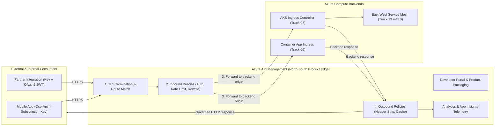
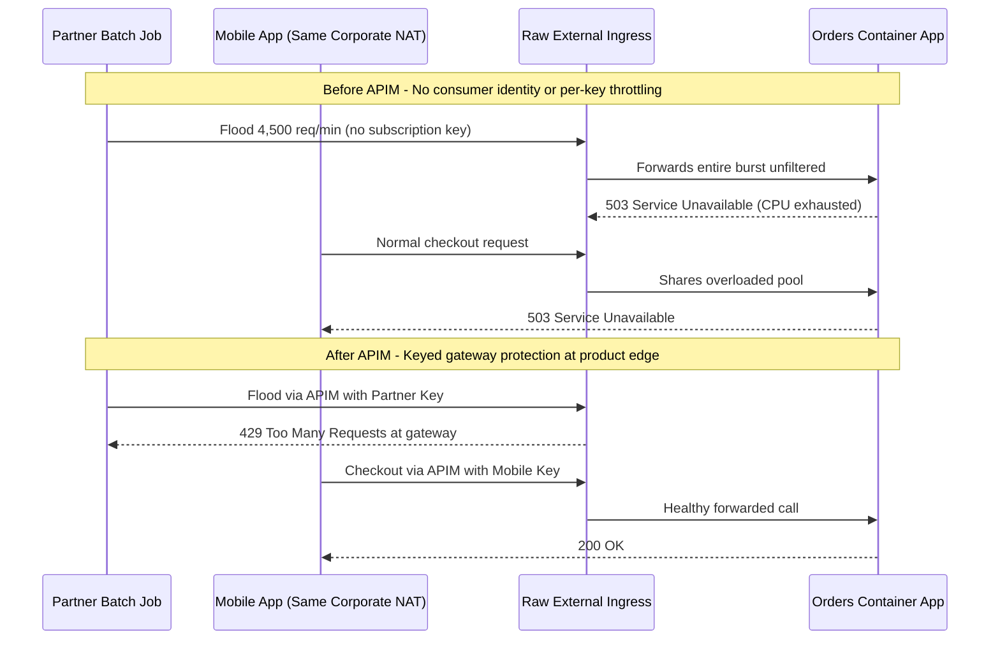

# API Gateway Concepts & Where APIM Fits

> **Prerequisites:** Container Apps external ingress (Track 06), AKS Ingress controllers (Track 07), and HTTP gateway patterns ([API Gateways and Backend-for-Frontend](../../../backend/11-advanced-api-paradigms/09-api-gateways-and-bff/README.md)).  
> **Estimated Reading Time:** 25 minutes  
> **Target Audience:** Backend Engineers, Platform Engineers, Cloud Architects.

> [!TIP]
> **The Golden Rule of API Gateways:** A bare Container App or AKS Ingress FQDN only routes bytes to a container; place **Azure API Management (APIM) at the north-south product edge** in front of your Ingress or Container App so consumer identity, rate limits, versioning, and analytics are enforced once at the door while backends stay decoupled.

---

## Why This Matters

You already know how to give a backend a URL — external ingress on a Container App (track 06), or an Ingress controller in front of an AKS Service (track 07). But a URL is plumbing, not a product: it has no way to identify who's calling, throttle abuse, version safely, or show you per-consumer usage. An **API gateway** is the layer that turns raw endpoints into governed, measurable API products, and Azure API Management (APIM) is Azure's managed version of that layer. This module builds the mental model before you provision anything, so every later command has a place to hang.

---

## 1. Architectural Mental Model: North-South Product Edge vs. Cluster & Mesh Traffic

APIM operates at the north-south boundary between external/partner consumers and your internal compute planes. Incoming consumer traffic terminates TLS at APIM, executes inbound policies (key validation, JWT verification, throttling), forwards to an underlying backend (Container App or AKS Ingress), runs outbound policies, and emits analytics out-of-band:



### A raw endpoint is not a managed API

In track 06 you ran `az containerapp ingress enable --type external` and got an FQDN that returned `200` from the internet. In track 07 you pointed an Ingress controller at a Service and did the same. Both are real, working HTTP endpoints — and that's *all* they are. There's no notion of "who is allowed to call this," "how often," "which version of the contract they're using," or "how many calls did customer X make last month." The endpoint's job ends at *routing bytes to a container*. Everything that makes an endpoint a **product** — identity of the caller, limits, packaging, analytics, a contract you can publish — has to be added on top. That's the gap an API gateway fills.

### The gateway pattern, in brief

The generic pattern — a reverse proxy at the edge that owns the concerns every request shares (auth termination, rate limiting, routing, TLS, logging), how it differs from an Ingress controller and a service mesh, and when a gateway earns its complexity — is taught in full in [API Gateways and Backend-for-Frontend](../../../backend/11-advanced-api-paradigms/09-api-gateways-and-bff/README.md). The short version for this track: an **API gateway** is one front door for many backends, the same "traffic enters at one controlled edge" idea as the **Ingress controller** in track 07 and the **Envoy-based ingress** fronting Container Apps in track 06, generalized so the edge also authenticates, rate-limits, meters, versions and reshapes — once, instead of in every backend.

### Where APIM sits relative to Ingress and a service mesh

The three edge technologies you'll meet on Azure answer different questions. The **Ingress controller** (track 07) asks "which pod?" — L7 routing *into* a cluster. A **service mesh** (track 13) asks "can service A call service B, securely?" — *east-west* traffic between services. **APIM**, as the API gateway, asks "is this *consumer* allowed to use this *API product*, within their quota, on this version?" — *north-south* traffic at the product edge, between your organization's APIs and their consumers (partners, mobile apps, other teams). APIM sits *in front of* an Ingress or Container App, not instead of it.

### What APIM adds on top of the endpoint

Concretely, APIM layers five things onto a backend you already have:

- **Policies** — a per-API/per-operation pipeline (`inbound` → `backend` → `outbound` → `on-error`) where you enforce rate limits, quotas, IP filtering, JWT validation, and request/response rewriting. This is the heart of the product (module 03).
- **Subscription keys** — a simple issued credential (`Ocp-Apim-Subscription-Key` header) that identifies *which consumer* is calling, so you can meter and throttle per consumer (module 04/06).
- **Products** — a package that groups one or more APIs with a policy and a subscription model, so "the Partner API bundle, 1000 calls/day" is a first-class thing consumers subscribe to (module 06).
- **Developer portal** — an auto-generated, brandable website where consumers read your API docs, get keys, and try calls (module 06).
- **Analytics** — built-in per-API/per-consumer usage, latency, and error reporting, integrable with Application Insights (module 07).

The backend doesn't change. APIM wraps it.

### Where APIM sits in a request's life

Follow one call. A partner's app sends `GET https://<your-apim>.azure-api.net/orders/42` with a subscription key header. APIM terminates TLS, matches the request to an **API** and **operation**, runs the **inbound policies** (validate the key, check the rate limit, validate a JWT, maybe rewrite the path), then forwards to the configured **backend** — which is your Container App's internal FQDN or your AKS Ingress. The backend responds; APIM runs **outbound policies** (strip an internal header, cache the response), and returns it to the caller. Along the way it records the call for analytics. The consumer never sees the backend URL, never holds a backend credential, and is subject to your rules — that's the product boundary the rest of this track builds out.

---

## 2. Taxonomic Comparison & Command Reference

### Edge Technologies Compared: Ingress vs. Service Mesh vs. APIM

| Dimension | AKS Ingress Controller (Track 07) | Service Mesh (Track 13) | Azure API Management (Track 19) |
| :--- | :--- | :--- | :--- |
| **Traffic Direction** | North-south (into cluster) | East-west (service-to-service) | North-south (consumer-to-API product) |
| **Primary Question** | "Which Service/pod handles this host and path?" | "Can Service A call Service B over mTLS?" | "Is this consumer authorized within quota on this version?" |
| **Consumer Identity** | None built-in (network/TLS only) | Workload SPIFFE/mTLS identity | Subscription keys (`Ocp-Apim-Subscription-Key`) + OAuth2/JWT |
| **Product Packaging & Portal** | None | None | Products, tiers, quotas, Developer Portal, analytics |
| **Relationship to APIM** | Sits *behind* APIM | Sits *inside* cluster behind Ingress | Sits *in front of* Container App / AKS Ingress |

### Raw Backend Endpoint vs. APIM-Managed Product

| Capability | Raw Container App / AKS FQDN | APIM Gateway Layer |
| :--- | :--- | :--- |
| **Caller Identification** | Anonymous or app-specific custom auth | Issued subscription keys + centralized `validate-jwt` |
| **Abuse Protection** | Global/IP limits defeated by shared NATs | Per-consumer `rate-limit-by-key` and monthly `quota-by-key` |
| **Contract Evolution** | Manual URL hacks or duplicated deployments | Version sets (`v1`/`v2`), non-breaking revisions, `Sunset` headers |
| **Usage Attribution** | Aggregated HTTP access logs only | Per-subscription, per-API, per-operation analytics |

### Command Reference

This module is conceptual — the only commands are read-only orientation ones you run against resources you *already* have from tracks 06/07, plus checking that the APIM CLI extension is present. Real provisioning starts in module 01.

| Command | What it does | Example |
|---|---|---|
| `az extension add --name apim` | Ensure the APIM CLI extension is installed | `az extension add --name apim` |
| `az apim -h` | List the APIM command groups (orientation) | `az apim -h` |
| `az containerapp show` (ingress) | Read a Container App's FQDN — a candidate backend | `az containerapp show --name web --resource-group rg-aca --query properties.configuration.ingress.fqdn -o tsv` |
| `az provider show` | Confirm the APIM resource provider is registered | `az provider show --namespace Microsoft.ApiManagement --query registrationState -o tsv` |

Flag-by-flag breakdowns:

`az apim show --name <instance> --resource-group <rg> --query "{gateway:gatewayUrl, portal:developerPortalUrl, sku:sku.name}" -o jsonc`
- `--query "{...}"` — a JMESPath projection pulling just the three fields that matter for orientation: the **gateway URL** (where consumers call), the **developer portal URL** (module 06), and the **SKU/tier** (the cost lever from the track intro). You'll run this for real once an instance exists in module 01.
- `-o jsonc` — colorized JSON so the shape is readable.

`az provider show --namespace Microsoft.ApiManagement --query registrationState -o tsv`
- `--namespace Microsoft.ApiManagement` — the Azure resource provider that must be `Registered` on your subscription before you can create an APIM instance.
- `-o tsv` — bare value, easy to test in a script. If it prints `NotRegistered`, run `az provider register --namespace Microsoft.ApiManagement` (module 01 covers this).

---

## 3. Production War Story Post-Mortem: Unthrottled Raw Ingress & Shared-NAT Collateral Outage

| Field | Incident Details |
| :--- | :--- |
| **Severity** | **SEV-1** (Checkout API Latency >12s & 42% Mobile Failures) |
| **Detection / Resolution Time** | Detected in 6 minutes via 503 alert / Mitigated in 35 minutes |
| **Impact** | Unthrottled partner retry loop exhausted backend Container App replicas and blocked valid enterprise callers |

### What Happened

A platform team exposed their `orders` Container App directly via external ingress without an API gateway in front. When an external partner shipped a buggy batch-sync job, it flooded the endpoint with 4,500 requests/minute. Because the backend had no consumer credentials (`Ocp-Apim-Subscription-Key`), every request looked identical. An emergency IP block at the ingress layer cut off a shared corporate egress NAT, knocking out legitimate enterprise traffic alongside the rogue partner, and provisioning an emergency APIM instance initially failed because `Microsoft.ApiManagement` had never been registered on the subscription.



### Root Cause Analysis

1. **Missing consumer identity at the edge**: Exposing a raw Container App FQDN meant backend telemetry and ingress rules could only see source IP addresses, not *which consumer* owned the traffic.
2. **Conflating L7 routing with API governance**: Relying solely on cluster/container ingress provided TLS and routing, but lacked per-consumer quotas, burst controls, and analytics attribution.
3. **Unregistered resource provider**: Skipping `az provider register --namespace Microsoft.ApiManagement` during subscription bootstrap added 10 minutes of avoidable delay during incident response.

### The Fix & Architectural Hardening

- Registered `Microsoft.ApiManagement`, placed APIM in front of the `orders` Container App, and issued separate products and subscription keys for Mobile vs. Partner callers.
- Enforced per-consumer burst protection at the gateway so rogue partner loops fail fast at APIM with `429` before touching backend compute.

---

## 4. Multi-Language Production Implementation: Gateway Consumer Client & Rate-Limit Backoff

Because backend consumers interact with APIM as a product boundary rather than a raw backend URL, production callers must consistently supply `Ocp-Apim-Subscription-Key`, correlate requests (`X-Correlation-ID`), distinguish gateway errors (`401`/`429`) from backend failures (`503`), and honor `Retry-After` headers.

````carousel
```go
package apimclient

import (
	"context"
	"errors"
	"fmt"
	"io"
	"net/http"
	"strconv"
	"time"
)

type GatewayClient struct {
	BaseURL         string
	SubscriptionKey string
	HTTPClient      *http.Client
}

func NewGatewayClient(baseURL, subKey string) *GatewayClient {
	return &GatewayClient{
		BaseURL:         baseURL,
		SubscriptionKey: subKey,
		HTTPClient:      &http.Client{Timeout: 10 * time.Second},
	}
}

func (c *GatewayClient) GetOrder(ctx context.Context, orderID, correlationID string) ([]byte, error) {
	endpoint := fmt.Sprintf("%s/orders/%s", c.BaseURL, orderID)

	for attempt := 0; attempt < 3; attempt++ {
		req, err := http.NewRequestWithContext(ctx, http.MethodGet, endpoint, nil)
		if err != nil {
			return nil, err
		}
		req.Header.Set("Ocp-Apim-Subscription-Key", c.SubscriptionKey)
		req.Header.Set("X-Correlation-ID", correlationID)

		resp, err := c.HTTPClient.Do(req)
		if err != nil {
			return nil, err
		}
		body, readErr := io.ReadAll(resp.Body)
		resp.Body.Close()
		if readErr != nil {
			return nil, readErr
		}

		switch resp.StatusCode {
		case http.StatusOK:
			return body, nil
		case http.StatusUnauthorized:
			return nil, errors.New("gateway 401: invalid or missing Ocp-Apim-Subscription-Key")
		case http.StatusTooManyRequests:
			waitSec, _ := strconv.Atoi(resp.Header.Get("Retry-After"))
			if waitSec <= 0 {
				waitSec = 2
			}
			select {
			case <-ctx.Done():
				return nil, ctx.Err()
			case <-time.After(time.Duration(waitSec) * time.Second):
				continue
			}
		default:
			return nil, fmt.Errorf("gateway/backend returned HTTP %d: %s", resp.StatusCode, string(body))
		}
	}
	return nil, errors.New("exhausted retries after APIM 429 throttling")
}
```
<!-- slide -->
```typescript
export interface GatewayClientConfig {
  gatewayUrl: string;
  subscriptionKey: string;
  timeoutMs?: number;
}

export async function fetchOrderViaApim(
  config: GatewayClientConfig,
  orderId: string,
  correlationId: string
): Promise<string> {
  const url = `${config.gatewayUrl.replace(/\/$/, "")}/orders/${encodeURIComponent(orderId)}`;
  const timeoutMs = config.timeoutMs ?? 10_000;

  for (let attempt = 1; attempt <= 3; attempt++) {
    const controller = new AbortController();
    const timer = setTimeout(() => controller.abort(), timeoutMs);

    try {
      const response = await fetch(url, {
        method: "GET",
        headers: {
          "Ocp-Apim-Subscription-Key": config.subscriptionKey,
          "X-Correlation-ID": correlationId,
        },
        signal: controller.signal,
      });

      if (response.ok) {
        return await response.text();
      }
      if (response.status === 401) {
        throw new Error("APIM gateway rejected subscription key (401 Access Denied)");
      }
      if (response.status === 429 && attempt < 3) {
        const retryAfter = Number(response.headers.get("Retry-After") ?? "2");
        await new Promise((res) => setTimeout(res, Math.max(retryAfter, 1) * 1000));
        continue;
      }
      throw new Error(`Unexpected status ${response.status} from gateway or backend`);
    } finally {
      clearTimeout(timer);
    }
  }
  throw new Error("APIM rate-limit retry budget exhausted");
}
```
<!-- slide -->
```python
import time
import urllib.error
import urllib.request


def get_order_via_apim(
    gateway_url: str,
    subscription_key: str,
    order_id: str,
    correlation_id: str,
    timeout_sec: float = 10.0,
) -> str:
    url = f"{gateway_url.rstrip('/')}/orders/{order_id}"
    headers = {
        "Ocp-Apim-Subscription-Key": subscription_key,
        "X-Correlation-ID": correlation_id,
    }

    for attempt in range(3):
        req = urllib.request.Request(url, headers=headers, method="GET")
        try:
            with urllib.request.urlopen(req, timeout=timeout_sec) as resp:
                return resp.read().decode("utf-8")
        except urllib.error.HTTPError as err:
            if err.code == 401:
                raise PermissionError("Gateway 401: verify Ocp-Apim-Subscription-Key") from err
            if err.code == 429 and attempt < 2:
                retry_after = int(err.headers.get("Retry-After", "2"))
                time.sleep(max(retry_after, 1))
                continue
            raise RuntimeError(f"APIM/backend error HTTP {err.code}") from err

    raise RuntimeError("APIM rate-limit retries exhausted")
```
<!-- slide -->
```csharp
using System.Net;

public sealed class ApimGatewayClient(HttpClient httpClient, string gatewayUrl, string subscriptionKey)
{
    public async Task<string> GetOrderAsync(
        string orderId,
        string correlationId,
        CancellationToken cancellationToken = default)
    {
        var uri = $"{gatewayUrl.TrimEnd('/')}/orders/{Uri.EscapeDataString(orderId)}";

        for (int attempt = 0; attempt < 3; attempt++)
        {
            using var request = new HttpRequestMessage(HttpMethod.Get, uri);
            request.Headers.Add("Ocp-Apim-Subscription-Key", subscriptionKey);
            request.Headers.Add("X-Correlation-ID", correlationId);

            using var response = await httpClient.SendAsync(request, cancellationToken);
            if (response.IsSuccessStatusCode)
            {
                return await response.Content.ReadAsStringAsync(cancellationToken);
            }

            if (response.StatusCode == HttpStatusCode.Unauthorized)
            {
                throw new UnauthorizedAccessException("Gateway 401: missing or invalid subscription key.");
            }

            if (response.StatusCode == HttpStatusCode.TooManyRequests && attempt < 2)
            {
                var delay = response.Headers.RetryAfter?.Delta ?? TimeSpan.FromSeconds(2);
                await Task.Delay(delay, cancellationToken);
                continue;
            }

            throw new HttpRequestException($"Gateway/backend returned {(int)response.StatusCode}.");
        }

        throw new HttpRequestException("APIM rate-limit retry budget exhausted.");
    }
}
```
````

---

## 5. Practical Hands-On Verification CLI Workflows

No APIM instance is created here — nothing bills. These exercises cement the mental model against resources you can stand up cheaply or already have.

### 1. Confirm your tooling and provider
Install the extension and check the provider:
```powershell
az extension add --name apim
az provider show --namespace Microsoft.ApiManagement --query registrationState -o tsv
```

**Expected Output:**
```text
Registered
```
> Verify: if it prints anything other than `Registered`, run `az provider register --namespace Microsoft.ApiManagement` and re-check in a few minutes. (Registration is a one-time, free, per-subscription step.)

### 2. Stand up a cheap backend to think about
Reuse the track-06 pattern — deploy a public Container App you'll conceptually front later:
```powershell
az group create --name rg-apim-m00 --location eastus
az containerapp env create --name env-m00 --resource-group rg-apim-m00 --location eastus
az containerapp create --name orders --resource-group rg-apim-m00 --environment env-m00 `
  --image mcr.microsoft.com/k8se/quickstart:latest --target-port 80 --ingress external
$fqdn = az containerapp show --name orders --resource-group rg-apim-m00 --query properties.configuration.ingress.fqdn -o tsv
curl -i "https://$fqdn"
```

**Expected Output:**
```text
HTTP/1.1 200 OK
content-type: text/html; charset=utf-8
...
```
> Verify: you get a `200`. **Write down** everything this endpoint does *not* give you from the "what APIM adds" list (identity of caller, rate limit, versioning, metering, portal).

### 3. Prove the endpoint has no consumer identity
From two different machines or two shells, `curl` the FQDN. Note that the backend cannot tell the two callers apart — there's no key, no per-consumer anything. This is the concrete thing subscription keys will fix.

### 4. List the properties an API product would need
On paper, sketch what "Orders API, Free tier: 100 calls/day" would require: a credential to identify the consumer, a counter, a limit, a rejection response, and a usage report. Map each to the APIM feature that provides it (subscription key, rate-limit policy, quota policy, `429` response, analytics).

### 5. Draw the request path
For a hypothetical `GET https://<apim>.azure-api.net/orders/42`, write the ordered stages: TLS terminate → match API/operation → inbound policies → backend forward → outbound policies → response → analytics. For each stage, name one thing that could go wrong (wrong key, over quota, backend 503, header not stripped).

### 6. Contrast the three edge technologies
In a small table, fill in Ingress (track 07) vs. service mesh (track 13) vs. API gateway (this track) across three columns: *primary traffic direction* (north-south vs east-west), *primary question it answers*, and *does APIM replace it or sit in front of it*. Confirm your answers against the "where APIM sits relative to Ingress and a service mesh" concept.

### 7. Diagnose (paper) a misplaced responsibility
A teammate says "we don't need APIM, we already have rate limiting in the Ingress controller's nginx config." List two things they still can't do that APIM provides (per-consumer metering/quotas tied to an issued key; a self-service developer portal), and one reason centralizing at the gateway beats per-backend config (one place to enforce, consistent across many backends/teams).

### 8. Cleanup
```powershell
az group delete --name rg-apim-m00 --yes --no-wait
```

**Expected Output:**
```text
(Command exits immediately with code 0; deletion runs asynchronously in Azure)
```
> Verify: this module created only a Container App and Environment — cheap, but delete them anyway so nothing lingers before module 01.

### Independent Challenge

Without provisioning APIM, produce a one-page written "API product proposal" for the `orders` Container App you deployed in the exercises. It must name: the consumers (e.g. an internal mobile team and an external partner), how each will be identified at the gateway, at least two limits you'd enforce and why, the versioning approach you anticipate needing, and what analytics you'd want to report monthly. Draw explicitly on **track 06** (which ingress mode the backend uses today and how that changes once APIM fronts it) and **track 07** (how this gateway relates to an Ingress controller you already understand). The goal is to be able to defend *why each APIM feature exists* before you touch a single `az apim` command. Tear down any leftover Container App resources when done.

<details><summary>Stuck? One hint</summary>

Anchor the proposal on the "what APIM adds" list (policies, subscription keys, products, developer portal, analytics) and, for each item, write one sentence: "the raw Container App FQDN can't do X, so APIM's Y provides it." If you can write that sentence honestly for all five, you've understood where APIM fits — and you've also written the requirements for your own capstone.

</details>

---

## 6. Common Mistakes & Troubleshooting

- **Thinking APIM replaces your Ingress/Container App.** It doesn't — it sits in front. The backend keeps its ingress; APIM becomes the public front door and the backend ideally becomes internal-only later (module 05).
- **Confusing a gateway with a mesh.** A mesh governs service-to-service (east-west) traffic *inside* the platform; a gateway governs consumer-to-API (north-south) traffic at the product edge. They coexist; APIM is the latter.
- **Assuming "it has a URL, so it's an API."** A URL routes bytes. A managed API adds identity, limits, versioning, packaging, and analytics — none of which a bare FQDN provides.
- **Cost pitfall (get ahead of it now).** The moment you create a non-Consumption APIM instance in later modules, it bills continuously. Nothing in *this* module creates one — but internalize the rule before module 01: classic tiers bill whether or not traffic flows; delete them the same day.
- **Skipping provider registration.** If `Microsoft.ApiManagement` isn't `Registered`, your first `az apim create` fails with a provider error, not a helpful message. Register it once, up front.

---

## 7. Operational Validation Checkpoints & Checkpoint Quiz

### Operational Validation Checkpoints

<details><summary><strong>Checkpoint 1: Reviewing Ingress vs. Service Mesh vs. APIM Boundaries</strong></summary>

In an architecture review where an AKS cluster already runs an nginx Ingress controller and Linkerd mTLS, APIM is positioned **in front of** the Ingress controller at the north-south product boundary. Ingress handles L7 routing to Kubernetes pods, the service mesh secures east-west service-to-service traffic inside the cluster, and APIM handles consumer-level subscription keys, OAuth2 edge validation, quotas, and developer onboarding before forwarding traffic to the Ingress.

</details>

<details><summary><strong>Checkpoint 2: Why Ingress IP Rate Limiting Breaks Shared Corporate Consumers</strong></summary>

Ingress nginx rate limiting keys primarily on source IP or connection attributes. When multiple enterprise customers sit behind the same corporate egress NAT IP, an IP-based nginx throttle either allows one abusive partner to exhaust everyone's budget or blocks the shared IP for all customers. APIM solves this by issuing distinct `Ocp-Apim-Subscription-Key` credentials per consumer and enforcing quotas per key.

</details>

<details><summary><strong>Checkpoint 3: Pre-Flight Resource Provider Verification</strong></summary>

Before running `az apim create` or Terraform `azurerm_api_management`, verify `az provider show --namespace Microsoft.ApiManagement --query registrationState -o tsv` returns `Registered`. If it outputs `NotRegistered`, execute `az provider register --namespace Microsoft.ApiManagement` and poll until `Registered` so automated provisioning scripts do not fail with cryptic subscription-registration errors.

</details>

### Checkpoint Quiz

Write down your answer to each question before expanding it — checking without attempting first is the single easiest way to fool yourself into thinking you've learned this.

1. Give three capabilities a managed API product has that a bare Container App external FQDN does not.
2. In one sentence each, distinguish an Ingress controller, a service mesh, and an API gateway by the primary question each answers.
3. Does APIM replace your AKS Ingress controller or sit in front of it? Why?
4. List, in order, the stages a request passes through inside APIM from TLS termination to analytics.
5. What is a subscription key for, and what problem from exercise 3 does it solve?
6. Name the five things this module said APIM layers on top of a backend.
7. Why is centralizing rate limiting at the gateway often better than configuring it per-backend (e.g. in each nginx Ingress)?

<details><summary>Show answers</summary>

1. Any three of: identifies the calling consumer (subscription keys); enforces per-consumer rate limits/quotas; versioning of the contract; a self-service developer portal; per-consumer/per-API analytics; centralized auth (JWT validation) at the edge.
2. Ingress: "which Service/pod does this host/path route to?" Mesh: "can service A call service B, securely (mTLS/authz), east-west?" Gateway: "is this *consumer* allowed to use this *API product*, within quota, on this version, north-south?"
3. It sits **in front of** it. APIM is the public product edge; the Ingress controller keeps routing inside the cluster. Ideally the backend becomes internal-only once APIM fronts it.
4. TLS terminate → match API/operation → inbound policies → forward to backend → outbound policies → return response → record analytics.
5. It's an issued credential (`Ocp-Apim-Subscription-Key`) that identifies which consumer is calling, so APIM can meter and throttle per consumer — solving the "the backend can't tell two callers apart" problem.
6. Policies, subscription keys, products, developer portal, analytics.
7. One place to enforce a consistent rule across many backends and teams (no per-backend reinvention), plus the gateway can tie the limit to an *issued consumer identity* (the subscription key), which a backend's generic nginx limit can't.

</details>

---

## 8. Next

[01-provisioning-apim-and-importing-a-first-api](../01-provisioning-apim-and-importing-a-first-api/README.md) — choose a tier (including the cheap Consumption tier), provision an instance (this is the slow one — 30-45 min for classic tiers), and import an OpenAPI spec that fronts one of your Container Apps / AKS backends.
