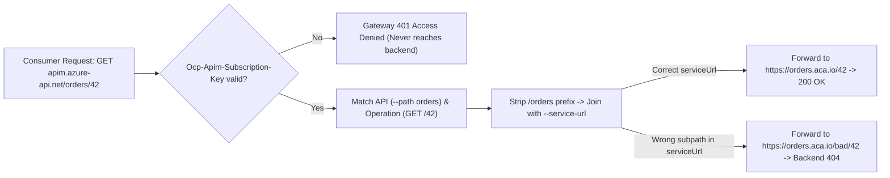
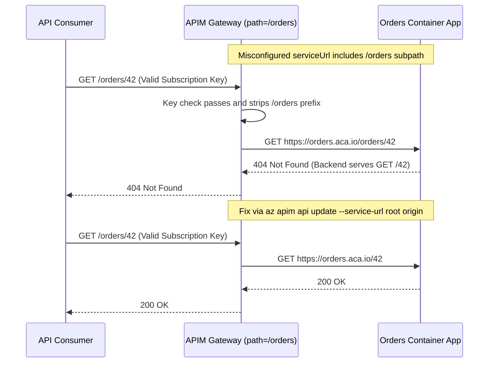

# Provisioning APIM & Importing a First API

> **Prerequisites:** API Gateway mental model and `Microsoft.ApiManagement` provider registration (Module 00), Container Apps external ingress (Track 06), or AKS Ingress (Track 07).  
> **Estimated Reading Time:** 35 minutes  
> **Target Audience:** Backend Engineers, Platform Engineers, Cloud Architects.

> [!TIP]
> **The Golden Rule of Provisioning & Importing APIM:** Use the **Consumption** tier by default for learning and spiky workloads (delete any Developer/classic tier the same day), onboard routes via **OpenAPI** so operations match your backend contract, and keep **`--path` (consumer suffix)** strictly separate from **`--service-url` (backend origin)** so gateway `401`s and backend `404`s never get confused.

---

## Why This Matters

This is where APIM stops being a diagram and becomes a real resource with a gateway URL. The two decisions you make here — **which tier** and **how you import the API** — set both your bill and your workflow for the rest of the track. Tier choice is the single biggest cost lever in APIM (classic tiers bill continuously; Consumption is pay-per-call), and importing an OpenAPI spec is how a backend you built in track 06/07 becomes a set of real operations you can govern. Get comfortable here and every later module is "add one more thing to an instance that already exists."

---

## 1. Architectural Mental Model: Gateway Path Stripping, Tier Billing & OpenAPI Mapping

When a consumer calls your APIM gateway URL, APIM extracts the API's consumer-facing `--path` suffix, matches the operation template imported from OpenAPI (or defined manually), enforces the subscription key, and appends only the remaining operation path onto the backend `--service-url`:



### APIM tiers, and why Consumption is the learner's default

APIM comes in tiers ("SKUs") that differ in capacity model, features, and billing shape:

- **Consumption** — serverless, **pay per call**, scales to effectively zero when idle. No fixed hourly charge. Fastest to provision (minutes). Missing some features (no built-in dev portal on older configs, no VNet injection, no built-in cache), but perfect for learning and for genuinely spiky/low-volume APIs. **This is what most of this track uses.**
- **Developer** — a full-featured *non-production* instance (has the developer portal, VNet integration, caching) but **no SLA** and **bills continuously**. Slow to provision (**30-45 min**). Use it only when you specifically need a feature Consumption lacks (module 05's VNet integration, module 06's portal), and **delete it the same day**.
- **Basic / Standard / Premium** — production tiers with SLAs, increasing scale ("units"), and — in Premium — multi-region and VNet *injection*. All bill continuously. You won't need these to learn; know they exist and that they're the expensive end.

The mental model: **Consumption is a function-app-shaped bill (per execution); the classic tiers are a VM-shaped bill (per hour the thing exists).** You met exactly this trade-off in track 06 (Container Apps scale-to-zero vs. an AKS node pool that bills while idle in track 07). Same instinct applies.

### Provisioning is slow — plan for it

Creating an APIM instance is one of the slower operations in Azure. A Consumption instance takes a few minutes; a Developer/classic instance commonly takes **30 to 45 minutes** because Azure provisions dedicated gateway infrastructure and a publisher/portal stack behind it. This is normal and not a hung command. Use `--no-wait` and poll `provisioningState`, or kick it off and go do something else. Deleting a classic instance is also slow. Build this into your expectations so you don't cancel a create that's working fine.

### API, operation, backend — the three objects you're creating

Importing gives you three related things. An **API** in APIM is a named facade with a **path** (the URL suffix consumers use, e.g. `/orders`) and a **backend** (where APIM forwards, e.g. your Container App FQDN). Each API has **operations** — individual method+URL-template entries (`GET /orders/{id}`, `POST /orders`) that map to backend routes and are the unit you attach per-operation policies to. When you import an **OpenAPI (Swagger) spec**, APIM reads the spec and creates the API plus one operation per documented path/method automatically — this is the fastest, most faithful way to onboard an API, and it's why teams keep an OpenAPI document as the contract. You can also create an API by hand or as a "pass-through" that forwards everything under a path.

### The API URL suffix and the backend URL are different things

A constant source of confusion: the URL a consumer calls and the URL APIM forwards to are unrelated strings. Consumers call `https://<instance>.azure-api.net/<api-path>/<operation>`; APIM strips the gateway host + API path and forwards the rest to the **backend URL** (a.k.a. "web service URL" / `serviceUrl`) you configured — your Container App FQDN or AKS Ingress. So `--path orders` + backend `https://orders.<env>.azurecontainerapps.io` means `GET .../orders/42` reaches `https://orders.<env>.azurecontainerapps.io/42`. Getting the path/backend split wrong is the number-one cause of a first import returning 404s from the backend, and you'll deliberately break and fix exactly that in the exercises.

### Fronting a track-06/07 backend

The backend can be any HTTP endpoint APIM can reach. For now, the simplest is a Container App with **external** ingress (track 06) — its public FQDN is directly reachable, so APIM forwards to it with no networking setup. An AKS Service behind an **Ingress controller** (track 07) works identically: point the backend at the Ingress's public address (and set the `Host` header if the Ingress routes by host). This module keeps the backend **public** for simplicity; making it **internal-only** and reaching it privately over VNet integration is module 05's job — the more secure end state, but one thing at a time.

---

## 2. Taxonomic Comparison & Command Reference

### APIM Tiers (SKUs) Comparison

| Dimension | Consumption | Developer | Basic / Standard / Premium |
| :--- | :--- | :--- | :--- |
| **Billing Shape** | Pay-per-call (idles ~zero) | Continuous fixed hourly rate | Continuous fixed hourly rate (per unit) |
| **Provisioning Time** | Minutes | 30–45 minutes | 30–45+ minutes |
| **SLA** | 99.95% | None (non-production only) | 99.95%–99.99% (multi-region in Premium) |
| **VNet / Built-in Cache / Portal** | No internal cache; no VNet injection | Full feature set (VNet + Portal + Cache) | Full (VNet injection in Developer/Premium) |
| **Track Guidance** | **Default for learning & spiky APIs** | Only for Modules 05–06; **delete same day** | Production workloads only |

### Gateway vs. Backend Failure Isolation

| Observation | Likely Plane | Root Cause | Verification Step |
| :--- | :--- | :--- | :--- |
| **`401 Access Denied`** | **APIM Gateway** | Missing or invalid `Ocp-Apim-Subscription-Key` | Check header name and key via `az apim subscription show` |
| **`404 Not Found` (key passed)** | **Backend / Path Mapping** | Mismatch between `--path`, operation `url-template`, and `--service-url` | Compare `serviceUrl` + operation suffix against backend routes |
| **`502 Bad Gateway`** | **Transport / Origin** | Backend unreachable, TLS mismatch, or bad `serviceUrl` hostname | `curl "$backend"` directly to verify backend health |

### Command Reference

| Command | What it does | Example |
|---|---|---|
| `az apim create` | Provision an APIM instance | see below |
| `az apim show` | Read instance state / URLs / SKU | `az apim show --name <inst> --resource-group rg-apim-m01 --query "{state:provisioningState, gw:gatewayUrl, sku:sku.name}" -o jsonc` |
| `az apim api import` | Create an API from an OpenAPI spec | see below |
| `az apim api create` | Create an API by hand (no spec) | `az apim api create --resource-group rg-apim-m01 --service-name <inst> --api-id orders --path orders --display-name "Orders" --service-url https://orders...azurecontainerapps.io` |
| `az apim api list` | List APIs on an instance | `az apim api list --resource-group rg-apim-m01 --service-name <inst> -o table` |
| `az apim api operation list` | List operations of an API | `az apim api operation list --resource-group rg-apim-m01 --service-name <inst> --api-id orders -o table` |
| `az apim api update` | Change an API's path/backend | `az apim api update --resource-group rg-apim-m01 --service-name <inst> --api-id orders --service-url https://correct-backend...` |

Flag-by-flag breakdowns:

`az apim create --name apim-m01-<unique> --resource-group rg-apim-m01 --location eastus --publisher-name "You" --publisher-email you@example.com --sku-name Consumption`
- `--name apim-m01-<unique>` — becomes the gateway host `<name>.azure-api.net`, so it must be **globally unique**. Append random digits.
- `--publisher-name` / `--publisher-email` — the API publisher shown in the developer portal and used for notification emails. Required even on Consumption.
- `--sku-name Consumption` — the tier. **Consumption = pay-per-call, provisions in minutes, idles free.** Swap to `Developer` only when you need a feature it lacks (and expect a 30-45 min create + a continuous bill).

`az apim api import --resource-group rg-apim-m01 --service-name apim-m01-<unique> --api-id petstore --path petstore --specification-format OpenApi --specification-url https://raw.githubusercontent.com/OAI/OpenAPI-Specification/main/examples/v3.0/petstore.yaml`
- `--api-id petstore` — the internal identifier for the API resource (used in later CLI calls and policy scoping).
- `--path petstore` — the **URL suffix** consumers use: `<gateway>/petstore/...`.
- `--specification-format OpenApi` — the spec dialect (also `Swagger` for 2.0, `Wadl`, etc.).
- `--specification-url` — where to fetch the spec; use `--specification-path` for a local file. APIM creates one operation per path/method in the spec.

`az apim api create --resource-group rg-apim-m01 --service-name <inst> --api-id orders --path orders --display-name "Orders API" --service-url https://orders.<env>.azurecontainerapps.io --protocols https`
- `--service-url` — the **backend URL** APIM forwards to (your Container App / AKS Ingress). Distinct from `--path`, which is the consumer-facing suffix.
- `--protocols https` — which schemes the gateway accepts for this API.

---

## 3. Production War Story Post-Mortem: Double-Suffix `serviceUrl` `404` & Runaway Classic Instance

| Field | Incident Details |
| :--- | :--- |
| **Severity** | **SEV-2** (Cutover Outage + \$1,400/mo Orphaned Classic Billing) |
| **Detection / Resolution Time** | Routing fixed in 14 minutes / Orphaned Developer instance discovered after 18 days |
| **Impact** | 100% of `/orders/*` traffic failed with backend `404` during cutover; an abandoned Developer instance billed continuously |

### What Happened

During onboarding of an `orders` microservice, an engineer launched `az apim create` on the `Developer` tier without `--no-wait`. Thinking the terminal froze after 20 minutes, they aborted with Ctrl-C and ran a second `az apim create` with a different name—leaving the first Developer instance provisioning in the background and billing around the clock. When the second instance finished, they configured `--path orders` AND set `--service-url` to `https://orders.env.azurecontainerapps.io/orders`, even though the Container App served routes from `/`. Every request through APIM passed key validation and hit the backend at `/orders/42` instead of `/42`, triggering backend `404`s.



### Root Cause Analysis

1. **Conflating `--path` and `--service-url`**: Appending the API suffix onto `serviceUrl` doubled or shifted the backend path segment after APIM stripped `--path`.
2. **Aborting a synchronous ARM create**: Canceling `az apim create` locally does not cancel the server-side ARM deployment, creating a silent billing ghost.
3. **Wrong SKU for validation**: Using `Developer` instead of `Consumption` for an initial routing check incurred continuous hourly charges without need.

### The Fix & Architectural Hardening

- Corrected `serviceUrl` via `az apim api update` to the bare Container App origin, verified OpenAPI import alignment, and deleted the ghost Developer instance.
- Adopted `--sku-name Consumption` for non-portal/non-VNet dev instances and standardized `--no-wait` + `az apim show` polling loops in deployment scripts.

---

## 4. Multi-Language Production Implementation: Path-Mapping Simulator & Gateway Smoke Tester

Before cutting traffic over to a newly imported API, platform smoke tests must compute the effective forwarded URL (`serviceUrl` + operation path after stripping `--path`) and verify both unauthenticated rejection (`401`) and authenticated backend reachability (`200` vs `404`/`502`).

````carousel
```go
package apimsmoke

import (
	"context"
	"fmt"
	"net/http"
	"strings"
	"time"
)

type RouteSpec struct {
	GatewayBase string
	APIPath     string
	ServiceURL  string
	Operation   string
	SubKey      string
}

// EffectiveBackendURL mirrors APIM's strip-prefix-and-join behavior.
func EffectiveBackendURL(serviceURL, operationPath string) string {
	return strings.TrimRight(serviceURL, "/") + "/" + strings.TrimLeft(operationPath, "/")
}

func VerifyGatewayImport(ctx context.Context, spec RouteSpec) error {
	client := &http.Client{Timeout: 8 * time.Second}
	gatewayTarget := fmt.Sprintf("%s/%s/%s",
		strings.TrimRight(spec.GatewayBase, "/"),
		strings.Trim(spec.APIPath, "/"),
		strings.TrimLeft(spec.Operation, "/"),
	)

	// 1. Probe without subscription key: gateway must reject with 401
	noKeyReq, err := http.NewRequestWithContext(ctx, http.MethodGet, gatewayTarget, nil)
	if err != nil {
		return err
	}
	noKeyResp, err := client.Do(noKeyReq)
	if err != nil {
		return fmt.Errorf("gateway unreachable: %w", err)
	}
	noKeyResp.Body.Close()
	if noKeyResp.StatusCode != http.StatusUnauthorized {
		return fmt.Errorf("expected 401 without key, got %d", noKeyResp.StatusCode)
	}

	// 2. Probe with subscription key: distinguish gateway auth from backend 404/502
	authReq, err := http.NewRequestWithContext(ctx, http.MethodGet, gatewayTarget, nil)
	if err != nil {
		return err
	}
	authReq.Header.Set("Ocp-Apim-Subscription-Key", spec.SubKey)
	authResp, err := client.Do(authReq)
	if err != nil {
		return fmt.Errorf("authenticated gateway call failed: %w", err)
	}
	authResp.Body.Close()

	if authResp.StatusCode == http.StatusNotFound || authResp.StatusCode == http.StatusBadGateway {
		return fmt.Errorf("key passed but backend returned %d for forwarded URL %s",
			authResp.StatusCode, EffectiveBackendURL(spec.ServiceURL, spec.Operation))
	}
	if authResp.StatusCode != http.StatusOK {
		return fmt.Errorf("unexpected HTTP %d on authenticated route", authResp.StatusCode)
	}
	return nil
}
```
<!-- slide -->
```typescript
export interface ApimRouteConfig {
  gatewayUrl: string;
  apiPath: string;
  serviceUrl: string;
  operationPath: string;
  subscriptionKey: string;
}

export function computeForwardedBackendUrl(serviceUrl: string, operationPath: string): string {
  const base = serviceUrl.replace(/\/+$/, "");
  const suffix = operationPath.replace(/^\/+/, "");
  return `${base}/${suffix}`;
}

export async function verifyApiOnboarding(cfg: ApimRouteConfig): Promise<void> {
  const target = `${cfg.gatewayUrl.replace(/\/+$/, "")}/${cfg.apiPath.replace(/^\/+|\/+$/g, "")}/${cfg.operationPath.replace(/^\/+/, "")}`;

  // 1. Ensure gateway enforces subscription key
  const unauthResp = await fetch(target, { signal: AbortSignal.timeout(8000) });
  if (unauthResp.status !== 401) {
    throw new Error(`Expected gateway 401 without subscription key, got ${unauthResp.status}`);
  }

  // 2. Verify end-to-end forwarding with subscription key
  const authResp = await fetch(target, {
    headers: { "Ocp-Apim-Subscription-Key": cfg.subscriptionKey },
    signal: AbortSignal.timeout(8000),
  });

  if (authResp.status === 404 || authResp.status === 502) {
    const forwarded = computeForwardedBackendUrl(cfg.serviceUrl, cfg.operationPath);
    throw new Error(`Key accepted, but backend mapping failed (${authResp.status}) at ${forwarded}`);
  }
  if (!authResp.ok) {
    throw new Error(`Unexpected status ${authResp.status} for ${target}`);
  }
}
```
<!-- slide -->
```python
import urllib.error
import urllib.request


def effective_backend_url(service_url: str, operation_path: str) -> str:
    return f"{service_url.rstrip('/')}/{operation_path.lstrip('/')}"


def verify_api_import(
    gateway_url: str,
    api_path: str,
    service_url: str,
    operation_path: str,
    subscription_key: str,
) -> None:
    target = f"{gateway_url.rstrip('/')}/{api_path.strip('/')}/{operation_path.lstrip('/')}"

    # 1. Confirm unauthenticated request fails at gateway with 401
    try:
        with urllib.request.urlopen(target, timeout=8) as resp:
            raise AssertionError(f"Expected 401 without key, got {resp.status}")
    except urllib.error.HTTPError as err:
        if err.code != 401:
            raise AssertionError(f"Expected 401 without key, got {err.code}") from err

    # 2. Confirm valid key passes gateway and resolves on backend
    req = urllib.request.Request(target, headers={"Ocp-Apim-Subscription-Key": subscription_key})
    try:
        with urllib.request.urlopen(req, timeout=8) as resp:
            if resp.status != 200:
                raise RuntimeError(f"Unexpected status {resp.status}")
    except urllib.error.HTTPError as err:
        if err.code in (404, 502):
            forwarded = effective_backend_url(service_url, operation_path)
            raise RuntimeError(
                f"Gateway key passed, backend returned {err.code} for forwarded URL {forwarded}"
            ) from err
        raise
```
<!-- slide -->
```csharp
using System.Net;

public static class ApimImportSmokeTester
{
    public static string ComputeForwardedUrl(string serviceUrl, string operationPath) =>
        $"{serviceUrl.TrimEnd('/')}/{operationPath.TrimStart('/')}";

    public static async Task VerifyRouteAsync(
        HttpClient client,
        string gatewayUrl,
        string apiPath,
        string serviceUrl,
        string operationPath,
        string subscriptionKey,
        CancellationToken ct = default)
    {
        var target = $"{gatewayUrl.TrimEnd('/')}/{apiPath.Trim('/')}/{operationPath.TrimStart('/')}";

        using var unauthResp = await client.GetAsync(target, ct);
        if (unauthResp.StatusCode != HttpStatusCode.Unauthorized)
        {
            throw new InvalidOperationException($"Expected 401 without key, got {(int)unauthResp.StatusCode}.");
        }

        using var authReq = new HttpRequestMessage(HttpMethod.Get, target);
        authReq.Headers.Add("Ocp-Apim-Subscription-Key", subscriptionKey);
        using var authResp = await client.SendAsync(authReq, ct);

        if (authResp.StatusCode is HttpStatusCode.NotFound or HttpStatusCode.BadGateway)
        {
            var forwarded = ComputeForwardedUrl(serviceUrl, operationPath);
            throw new InvalidOperationException(
                $"Subscription key passed, but backend returned {(int)authResp.StatusCode} for {forwarded}.");
        }

        authResp.EnsureSuccessStatusCode();
    }
}
```
````

---

## 5. Practical Hands-On Verification CLI Workflows

> **Heads-up on time:** exercise 1 with `--sku-name Consumption` completes in a few minutes. If you (optionally) try a Developer-tier instance, expect **30-45 minutes** — that's normal, not a hang. Poll `provisioningState`.

### 1. Provision a Consumption instance
```powershell
az group create --name rg-apim-m01 --location eastus
$apim = "apimm01$((Get-Random -Max 99999))"
az apim create --name $apim --resource-group rg-apim-m01 --location eastus `
  --publisher-name "You" --publisher-email you@example.com --sku-name Consumption
az apim show --name $apim --resource-group rg-apim-m01 --query "{state:provisioningState, gw:gatewayUrl, sku:sku.name}" -o jsonc
```

**Expected Output:**
```json
{
  "gw": "https://apimm0112345.azure-api.net",
  "sku": "Consumption",
  "state": "Succeeded"
}
```
> Verify: wait for `provisioningState` to read `Succeeded`. Record the `gatewayUrl`.

### 2. Deploy the backend (reuse track 06)
```powershell
az containerapp env create --name env-m01 --resource-group rg-apim-m01 --location eastus
az containerapp create --name orders --resource-group rg-apim-m01 --environment env-m01 `
  --image mcr.microsoft.com/k8se/quickstart:latest --target-port 80 --ingress external
$backend = "https://" + (az containerapp show --name orders --resource-group rg-apim-m01 --query properties.configuration.ingress.fqdn -o tsv)
curl -i "$backend"
```

**Expected Output:**
```text
HTTP/1.1 200 OK
...
```
> Verify: confirm a `200` directly from the backend before putting APIM in front of it.

### 3. Import a public OpenAPI spec (fast win)
```powershell
az apim api import --resource-group rg-apim-m01 --service-name $apim --api-id petstore --path petstore `
  --specification-format OpenApi `
  --specification-url https://raw.githubusercontent.com/OAI/OpenAPI-Specification/main/examples/v3.0/petstore.yaml
az apim api operation list --resource-group rg-apim-m01 --service-name $apim --api-id petstore -o table
```

**Expected Output:**
```text
Method    Name           UrlTemplate
--------  -------------  ---------------
GET       listPets       /pets
POST      createPets     /pets
GET       showPetById    /pets/{petId}
```
> Verify: multiple operations were created automatically from the spec's paths.

### 4. Create an API that fronts your own backend
```powershell
az apim api create --resource-group rg-apim-m01 --service-name $apim --api-id orders --path orders `
  --display-name "Orders API" --service-url $backend --protocols https
az apim api operation create --resource-group rg-apim-m01 --service-name $apim --api-id orders `
  --url-template "/" --method GET --display-name "Get root" --operation-id get-root
```

### 5. Call through the gateway
Consumption APIs still require a subscription key by default. Get the built-in "all-access" subscription key, then call:
```powershell
$key = az apim subscription show --resource-group rg-apim-m01 --service-name $apim --sid master --query primaryKey -o tsv
$gw = az apim show --name $apim --resource-group rg-apim-m01 --query gatewayUrl -o tsv
curl -i -H "Ocp-Apim-Subscription-Key: $key" "$gw/orders/"
```

**Expected Output:**
```text
HTTP/1.1 200 OK
...
```
> Verify: a `200` that matches the backend's response proves the full path: consumer → gateway → backend → back.

### 6. Prove the key is enforced
Repeat the call **without** the header:
```powershell
curl -i "$gw/orders/"
```

**Expected Output:**
```text
HTTP/1.1 401 Access Denied
{"statusCode":401,"message":"Access denied due to missing subscription key. Make sure to include subscription key when making requests to an API."}
```
> Verify: expect `401 Access Denied` with a message about a missing subscription key. This is the first thing APIM added that the raw FQDN never had.

### 7. Diagnose and fix: wrong path/backend split → 404 from backend
Break it deliberately by pointing the backend at a wrong sub-path:
```powershell
az apim api update --resource-group rg-apim-m01 --service-name $apim --api-id orders `
  --service-url "$backend/does-not-exist"
curl -i -H "Ocp-Apim-Subscription-Key: $key" "$gw/orders/"
```

**Expected Output:**
```text
HTTP/1.1 404 Not Found
...
```
You now get a **404 or 502 that originates from the backend**, not from APIM — the tell is that the key check passed (no 401) but the path doesn't exist on the backend. **Diagnose** by comparing the effective forwarded URL (`serviceUrl` + remainder after the API path) to what the backend actually serves. **Fix** by restoring the correct backend:
```powershell
az apim api update --resource-group rg-apim-m01 --service-name $apim --api-id orders --service-url $backend
curl -i -H "Ocp-Apim-Subscription-Key: $key" "$gw/orders/"
```
> Verify: confirm the `200` returns. Lesson: `401` = gateway auth; `404`/`5xx` after a passing key = look at the path/backend mapping, not the key.

### 8. Inspect the API as data
Dump the API definition and locate the fields you set:
```powershell
az apim api show --resource-group rg-apim-m01 --service-name $apim --api-id orders -o jsonc
```

**Expected Output:**
```json
{
  "name": "orders",
  "path": "orders",
  "serviceUrl": "https://orders.<env>.azurecontainerapps.io",
  "subscriptionRequired": true
}
```
> Verify: locate `path`, `serviceUrl`, and `subscriptionRequired`. These three fields are the skeleton of every API you'll build.

### 9. Cleanup
```powershell
az group delete --name rg-apim-m01 --yes --no-wait
```
> Verify: the Consumption instance idles cheap, but delete it anyway. **If you created a Developer-tier instance to experiment, deleting it is essential** — that one bills continuously.

### Independent Challenge

Provision a fresh Consumption APIM instance and, without using the CLI's `import` shortcut this time, hand-build an API that fronts a **new** Container App you deploy (external ingress, track 06) — create the API, add at least two operations with proper `url-template` and methods, wire the backend URL, and prove an authenticated call reaches the backend while an unauthenticated one is rejected. Then export/inspect the resulting API definition and compare its shape to the auto-generated Petstore API from the exercises: note what importing an OpenAPI spec gave you "for free" that you had to specify by hand. This draws on **module 00** (the request-path model) and **track 06** (deploying the backend). Delete the resource group — and, critically, the APIM instance — when finished.

<details><summary>Stuck? One hint</summary>

The two failure modes to distinguish are (a) a **401 from APIM** (missing/invalid subscription key — a gateway-side auth problem) and (b) a **404/5xx from the backend** (the request got past the gateway but the forwarded path doesn't exist on the backend — a `path`/`serviceUrl` mapping problem). Reproduce each on purpose so you can tell them apart instantly; that single skill saves you the most time in every later module.

</details>

---

## 6. Common Mistakes & Troubleshooting

- **Cancelling a slow create.** A Developer/classic `az apim create` legitimately takes 30-45 minutes. Poll `provisioningState`; don't assume it hung and retry (you'll just start a second slow create).
- **Non-unique instance name.** `--name` becomes the global `azure-api.net` hostname; a name collision fails the create. Append random digits.
- **Path vs. backend-URL confusion.** `--path` is the consumer-facing suffix; `--service-url` is where APIM forwards. Mixing them up yields 404s from the backend even though the gateway/key are fine.
- **Forgetting the subscription key.** By default APIs require a key; calling without `Ocp-Apim-Subscription-Key` returns 401. That's not a bug — it's the gateway doing its job (you can disable it per-API with `subscriptionRequired`, but usually you don't want to).
- **Cost pitfall — spinning up Developer/Standard "just to try it."** Those bill continuously and are slow to both create and delete. Use **Consumption** for every exercise that doesn't specifically require a classic-only feature, and when you must use Developer, **delete it the same day**. A forgotten classic instance is the most common surprise APIM bill.
- **Region availability.** Consumption isn't offered in every region. If `--sku-name Consumption` errors, pick a supported region (e.g. `eastus`, `westeurope`) rather than switching tiers.

---

## 7. Operational Validation Checkpoints & Checkpoint Quiz

### Operational Validation Checkpoints

<details><summary><strong>Checkpoint 1: Handling Long-Running Classic APIM Provisioning</strong></summary>

A Developer, Basic, Standard, or Premium APIM deployment legitimately runs for 30–45 minutes while Azure allocates dedicated gateway infrastructure. Rather than canceling or re-running `az apim create`, check `az apim show --query provisioningState -o tsv` (`Creating` vs `Succeeded`)—canceling locally leaves the server-side ARM deployment running and billing.

</details>

<details><summary><strong>Checkpoint 2: Isolating Gateway `401` vs. Backend `404` After API Import</strong></summary>

If a request returns `401 Access Denied`, the gateway rejected the missing or invalid `Ocp-Apim-Subscription-Key` header before forwarding anything. If a request passes with a valid key and returns `404`, inspect `path` + operation `url-template` vs. `serviceUrl` via `az apim api show`—an extraneous subpath on `serviceUrl` is the most common cause.

</details>

<details><summary><strong>Checkpoint 3: Enforcing Consumption SKU Discipline</strong></summary>

Only provision Developer or Standard/Premium tiers when explicitly validating VNet integration (Module 05), the Developer Portal (Module 06), or built-in response caching. Default every other environment to `--sku-name Consumption` so idle gateways cost zero fixed hourly compute, and schedule same-day deletion for any temporary Developer instance.

</details>

### Checkpoint Quiz

Write down your answer to each question before expanding it — checking without attempting first is the single easiest way to fool yourself into thinking you've learned this.

1. Contrast the billing shape of the Consumption tier vs. the Developer/classic tiers, and which prior-track trade-off it mirrors.
2. Roughly how long does a Developer/classic APIM instance take to provision, and why does that matter operationally?
3. What three objects does importing an OpenAPI spec create, and what does one operation correspond to?
4. Distinguish an API's `--path` from its `--service-url` with a concrete example of the resulting forwarded request.
5. You call through the gateway and get a `401 Access Denied`. What's almost certainly missing, and is that a gateway problem or a backend problem?
6. You call through the gateway, the key is accepted, but you get a `404` — where do you look?
7. Why is Consumption the recommended tier for this track, and when would you deliberately switch to Developer?

<details><summary>Show answers</summary>

1. Consumption is **pay-per-call** and idles at ~zero (function-app-shaped bill); Developer/classic **bill continuously** for the provisioned capacity (VM-shaped bill). Mirrors Container Apps scale-to-zero (track 06) vs. an AKS node pool that bills while idle (track 07).
2. Roughly **30-45 minutes**. It matters because you must not assume the command hung and cancel/retry it — you'll just start another slow create.
3. An **API** (with a path + backend), its **operations**, and the backend linkage. One operation = one method + URL-template entry (e.g. `GET /pets/{id}`).
4. `--path orders` is the consumer suffix (`<gw>/orders/...`); `--service-url https://orders.<env>...` is the backend. So `GET <gw>/orders/42` forwards to `https://orders.<env>.../42`.
5. The `Ocp-Apim-Subscription-Key` header (a valid subscription key). It's a **gateway** problem — the request never reached the backend.
6. At the **path/backend mapping** (`--path` vs `--service-url`) — the key passed, so the request reached the backend but hit a path that doesn't exist there.
7. It's pay-per-call, idles free, and provisions in minutes — cheap and fast for learning. Switch to Developer only when you need a feature Consumption lacks: VNet integration (module 05) or the developer portal (module 06).

</details>

---

## 8. Next

[02-api-versioning-and-revisions](../02-api-versioning-and-revisions/README.md) — now that an API exists, learn to evolve it safely: version sets and versioning schemes for breaking changes, revisions for non-breaking iteration, and a deprecation strategy.
