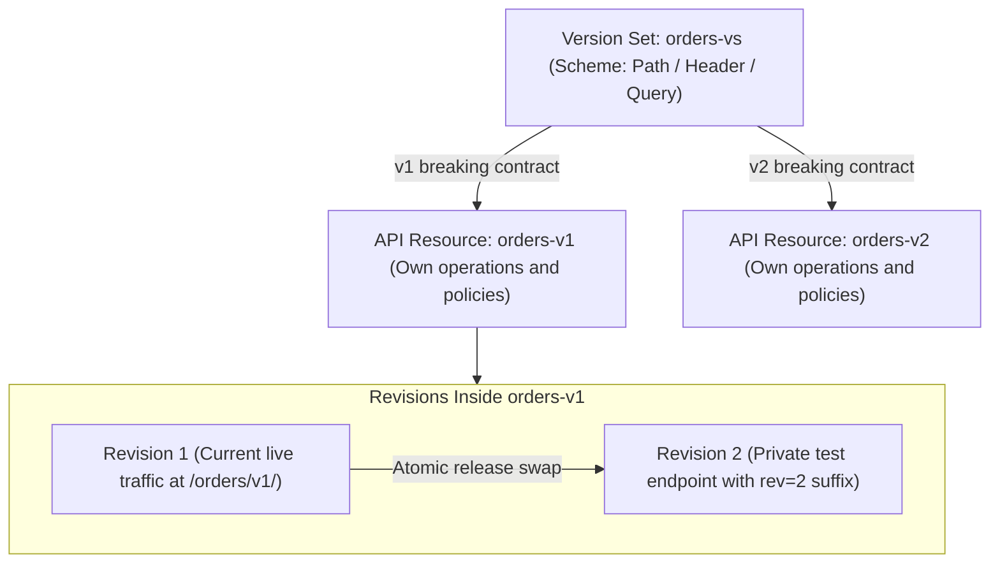
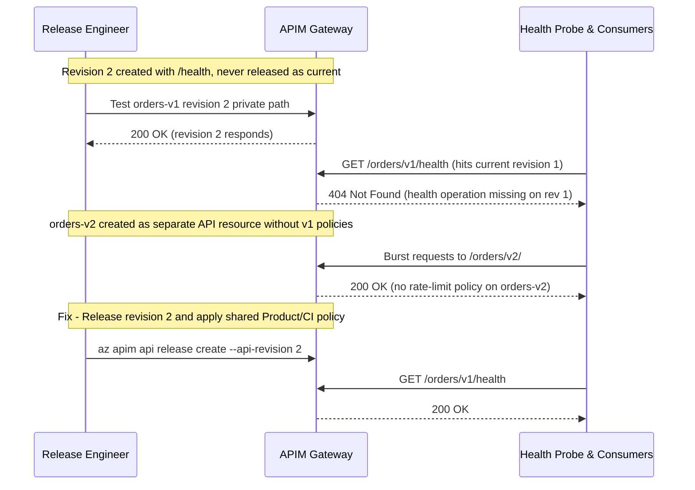

# API Versioning & Revisions

> **Prerequisites:** Provisioned APIM instance, APIs, operations, and `--path`/`--service-url` separation (Module 01), Container Apps revisions mental model (Track 06).  
> **Estimated Reading Time:** 35 minutes  
> **Target Audience:** Backend Engineers, Platform Engineers, Cloud Architects.

> [!TIP]
> **The Golden Rule of Versions & Revisions:** Create a **new version** (inside a version set) only for **breaking contract changes** that callers must opt into; create a **new revision** for **non-breaking changes** you stage privately via its revision URL and promote atomically with zero client URL changes—and remember every version and revision is an isolated policy and operation scope.

---

## Why This Matters

APIs change, but consumers can't all upgrade at once — so you need a way to ship a *breaking* change without breaking existing callers, and a way to iterate *non-breaking* changes safely before they go live. APIM gives you two distinct tools that beginners constantly conflate: **versions** (a deliberate, visible `v1`/`v2` split consumers choose) and **revisions** (behind-the-scenes drafts of a single version you test and then promote). Using the wrong one turns a routine change into an outage. This module makes the distinction reflexive.

---

## 1. Architectural Mental Model: Version Sets vs. Revision Promotion & Scope Isolation

A **version set** groups separate API resources (`orders-v1`, `orders-v2`) under one selection scheme (`Path`, `Header`, or `Query`), while **revisions** fork a single version internally so you can validate changes on a non-current revision before atomically switching the live `current` pointer:



### Versions vs. revisions: the one distinction that matters

A **version** is a *consumer-visible*, *intentional* variant of an API — `v1` and `v2` are different contracts, and a caller explicitly picks one (via URL path, header, or query string). You create a new version when you make a **breaking change**: removing a field, changing a response shape, renaming an operation. A **revision** is an *internal*, *non-breaking* iteration of a single version — you clone the current API into a new revision, edit it, test it privately, and then make it "current." Callers don't choose a revision; only one revision is *current* (live) at a time, and switching current is instant. Rule of thumb: **breaking change → new version; safe change you want to stage → new revision.** This is the same instinct as track 06's revisions/traffic-splitting for Container Apps — an internal, promotable iteration vs. a deliberate externally-chosen variant.

### Version sets and versioning schemes

To have versions, an API belongs to a **version set** — a grouping that ties `v1`, `v2`, … together and declares *how* the version is selected. The three **versioning schemes**:

- **Path** — the version lives in the URL: `<gw>/orders/v1/42` vs `<gw>/orders/v2/42`. Most explicit and cache-friendly; easiest for consumers to reason about.
- **Header** — a request header names the version: `Api-Version: v2`. Keeps URLs clean but hides the version from logs/caches unless you look.
- **Query string** — `?api-version=v2`. Simple but pollutes URLs and is easy to forget.

You pick one scheme per version set and stick with it. Path is the common default and what the exercises use.

### Revisions: safe iteration on one version

Within a version you create a **revision** by cloning the current API. The new revision has its own operations/policies you can change freely, reachable via a **revision URL** (`;rev=2` suffix) for private testing, while consumers keep hitting the current revision unchanged. When you're satisfied, you **set the new revision as current** — an atomic switch — optionally attaching a **change note** that shows up in the revision history and (if you expose it) the developer portal. If the new current misbehaves, you switch current back to the old revision instantly. This is your safe blast-radius-zero iteration loop for changes that *don't* warrant a whole new version.

### Deprecation strategy

Adding `v2` is only half the lifecycle; retiring `v1` is the other half. Deprecation is a *process*, not a delete: announce the timeline, mark `v1` as deprecated in the portal, optionally inject a **`Sunset`/`Deprecation` response header** (via an outbound policy — module 03) so callers see it programmatically, watch analytics (module 07) until `v1` traffic drops to near zero, then remove it. The gateway makes this graceful because both versions run side by side for as long as you need. The mistake is deleting `v1` on a schedule without checking whether anyone still calls it — analytics exist precisely so you don't have to guess.

### Where policies attach in a versioned/revised world

Policies (module 03) can attach at several scopes: **all APIs**, a **single API**, a **single operation**, or a **product**. Crucially, a **version** is its own API resource, and a **revision** is a variant of that resource — so a policy you set on `v1` does **not** automatically apply to `v2`, and a policy edited on a non-current revision only goes live when that revision becomes current. This trips people up constantly: "I added a rate limit but it's not working" often means "I added it to the wrong version/revision." Keep the scope explicit in your head; module 03 leans on this heavily.

---

## 2. Taxonomic Comparison & Command Reference

### Versions vs. Revisions Decision Matrix

| Dimension | API Version (`orders-v1` / `orders-v2`) | API Revision (`rev=1` / `rev=2`) |
| :--- | :--- | :--- |
| **When to Use** | Breaking contract changes (removed field, renamed endpoint) | Non-breaking iteration (bug fix, additive optional field, policy tweak) |
| **Consumer Visibility** | Explicit opt-in via Path, Header, or Query scheme | Transparent — callers use the same base URL |
| **Concurrent Live States** | Multiple versions run live side-by-side simultaneously | Exactly **one** revision is current (live) at a time |
| **Testing & Promotion** | Provision new API resource in version set and publish | Test non-current via `;rev=N` suffix, then release atomically |
| **Policy Inheritance** | Independent API resource — `v1` policies do **not** apply to `v2` | Isolated to revision until released as current |

### Versioning Schemes Compared

| Scheme | Example Request | Strengths | Trade-offs |
| :--- | :--- | :--- | :--- |
| **Path** | `GET /orders/v2/42` | Explicit in URLs, CDN/browser cache-friendly, visible in logs | Verbose URL paths |
| **Header** | `GET /orders/42` + `Api-Version: v2` | Clean URLs without version segments | Invisible in access URLs and standard path logs |
| **Query** | `GET /orders/42?api-version=v2` | Easy for manual browser testing | Pollutes query parameters and easily omitted by callers |

### Command Reference

| Command | What it does | Example |
|---|---|---|
| `az apim api versionset create` | Create a version set (grouping + scheme) | see below |
| `az apim api create` (`--api-version`) | Create/attach an API as a version in a set | see below |
| `az apim api release create` | Release a revision (make it current, with a note) | `az apim api release create --resource-group rg --service-name <inst> --api-id orders --release-id r2 --api-revision 2 --notes "add field"` |
| `az apim api revision create` | Create a new revision of an API | `az apim api revision create --resource-group rg --service-name <inst> --api-id orders --api-revision 2 --api-revision-description "test change"` |
| `az apim api revision list` | List revisions and which is current | `az apim api revision list --resource-group rg --service-name <inst> --api-id orders -o table` |
| `az apim api list` | See versioned APIs (each version is its own API) | `az apim api list --resource-group rg --service-name <inst> -o table` |

Flag-by-flag breakdowns:

`az apim api versionset create --resource-group rg-apim-m02 --service-name <inst> --version-set-id orders-vs --display-name "Orders" --versioning-scheme Path`
- `--version-set-id orders-vs` — the ID that ties all versions of Orders together.
- `--versioning-scheme Path` — how consumers select a version (`Path`, `Header`, or `Query`). With `Header`/`Query` you also pass `--version-header-name` or `--version-query-name`.

`az apim api create --resource-group rg-apim-m02 --service-name <inst> --api-id orders-v1 --path orders --display-name "Orders" --service-url <backend> --api-version v1 --api-version-set-id orders-vs`
- `--api-id orders-v1` — each version is a **separate API resource**; give it a version-specific id.
- `--api-version v1` — the version label used in the URL/header/query per the set's scheme.
- `--api-version-set-id orders-vs` — attach this API to the version set so `v1` and `v2` are grouped and selectable.

`az apim api revision create --resource-group rg-apim-m02 --service-name <inst> --api-id orders-v1 --api-revision 2 --api-revision-description "stage a safe change"`
- `--api-revision 2` — the new revision number (clone of current). Reachable at `<gw>/orders/...;rev=2` for private testing before release.
- `--api-revision-description` — a note stored in revision history.

`az apim api release create --resource-group rg-apim-m02 --service-name <inst> --api-id orders-v1 --release-id rel2 --api-revision 2 --notes "promote rev 2 to current"`
- `--api-revision 2` — the revision to make **current** (go live). The switch is atomic; roll back by releasing the previous revision.
- `--notes` — change note surfaced in history (and portal, if exposed).

---

## 3. Production War Story Post-Mortem: Unreleased Revision `404` & Unprotected `v2` Launch

| Field | Incident Details |
| :--- | :--- |
| **Severity** | **SEV-2** (Failed Health Probe Restarts + Unthrottled `v2` Exposure) |
| **Detection / Resolution Time** | Detected in 11 minutes during release verification / Resolved in 16 minutes |
| **Impact** | Live `/orders/v1/health` checks returned `404`, and newly published `orders-v2` bypassed API rate limits |

### What Happened

During a release window, an engineer staged a non-breaking `/health` operation inside `orders-v1` revision 2, verified it privately using the revision-2 test suffix, and closed the deployment ticket—never running `az apim api release create` to promote revision 2 to current. Simultaneously, another engineer launched `orders-v2` inside the same version set and assumed the rate-limit policy configured on `orders-v1` would automatically protect `v2`. Live health probes hit `404` on revision 1 while load-test scripts hammered `v2` completely unthrottled.



### Root Cause Analysis

1. **Stopping at `revision create`**: Creating a revision only clones a draft; until `release create` switches the current pointer, production traffic stays on revision 1.
2. **Assuming policies cascade across versions**: Because `orders-v1` and `orders-v2` are separate API resources inside the version set, API-scoped policies on `v1` never propagate to `v2`.
3. **Manual scope verification**: Smoke tests checked the private revision URL instead of verifying the live `/orders/v1/health` endpoint and `v2` throttling headers.

### The Fix & Architectural Hardening

- Released `orders-v1` revision 2 to current via `az apim api release create` and applied the shared throttling policy at Product scope (plus CI policy templates across all versioned APIs).
- Added `Sunset` / `Deprecation` outbound headers to `orders-v1` while tracking traffic migration in APIM analytics.

---

## 4. Multi-Language Production Implementation: Version-Scheme Client & `Sunset` Telemetry

Clients consuming versioned APIM APIs must explicitly inject the configured version scheme (`Path`, `Header`, or `Query`), optionally target `;rev=N` during pre-release verification, and surface RFC 8594 `Sunset` / `Deprecation` headers emitted during `v1` retirement.

````carousel
```go
package apimversion

import (
	"context"
	"fmt"
	"io"
	"net/http"
	"net/url"
	"strings"
	"time"
)

type VersionScheme string

const (
	SchemePath   VersionScheme = "Path"
	SchemeHeader VersionScheme = "Header"
	SchemeQuery  VersionScheme = "Query"
)

type VersionedCall struct {
	GatewayURL      string
	APIPath         string
	Version         string
	Scheme          VersionScheme
	Operation       string
	RevisionTest    int // >0 targets non-current ;rev=N for private verification
	SubscriptionKey string
	OnDeprecation   func(sunset, deprecation string)
}

func ExecuteVersionedRequest(ctx context.Context, cfg VersionedCall) ([]byte, error) {
	base := strings.TrimRight(cfg.GatewayURL, "/")
	apiSeg := strings.Trim(cfg.APIPath, "/")
	op := strings.TrimLeft(cfg.Operation, "/")

	if cfg.RevisionTest > 0 && cfg.Scheme == SchemePath {
		apiSeg = fmt.Sprintf("%s/%s;rev=%d", apiSeg, cfg.Version, cfg.RevisionTest)
	} else if cfg.Scheme == SchemePath {
		apiSeg = fmt.Sprintf("%s/%s", apiSeg, cfg.Version)
	}

	rawURL := fmt.Sprintf("%s/%s/%s", base, apiSeg, op)
	parsed, err := url.Parse(rawURL)
	if err != nil {
		return nil, err
	}
	if cfg.Scheme == SchemeQuery {
		q := parsed.Query()
		q.Set("api-version", cfg.Version)
		parsed.RawQuery = q.Encode()
	}

	req, err := http.NewRequestWithContext(ctx, http.MethodGet, parsed.String(), nil)
	if err != nil {
		return nil, err
	}
	req.Header.Set("Ocp-Apim-Subscription-Key", cfg.SubscriptionKey)
	if cfg.Scheme == SchemeHeader {
		req.Header.Set("Api-Version", cfg.Version)
	}

	client := &http.Client{Timeout: 8 * time.Second}
	resp, err := client.Do(req)
	if err != nil {
		return nil, err
	}
	defer resp.Body.Close()

	if sunset, dep := resp.Header.Get("Sunset"), resp.Header.Get("Deprecation"); sunset != "" || dep != "" {
		if cfg.OnDeprecation != nil {
			cfg.OnDeprecation(sunset, dep)
		}
	}

	body, err := io.ReadAll(resp.Body)
	if err != nil {
		return nil, err
	}
	if resp.StatusCode >= 400 {
		return nil, fmt.Errorf("HTTP %d from %s: %s", resp.StatusCode, parsed.String(), string(body))
	}
	return body, nil
}
```
<!-- slide -->
```typescript
export type VersioningScheme = "Path" | "Header" | "Query";

export interface VersionedRequestOptions {
  gatewayUrl: string;
  apiPath: string;
  version: string;
  scheme: VersioningScheme;
  operationPath: string;
  subscriptionKey: string;
  revision?: number;
}

export async function callVersionedApi(opts: VersionedRequestOptions): Promise<{
  body: string;
  sunsetHeader: string | null;
}> {
  const base = opts.gatewayUrl.replace(/\/+$/, "");
  const cleanApi = opts.apiPath.replace(/^\/+|\/+$/g, "");
  const cleanOp = opts.operationPath.replace(/^\/+/, "");

  const revSuffix = opts.revision ? `;rev=${opts.revision}` : "";
  const headers: Record<string, string> = {
    "Ocp-Apim-Subscription-Key": opts.subscriptionKey,
  };

  let targetUrl: string;
  if (opts.scheme === "Path") {
    targetUrl = `${base}/${cleanApi}/${opts.version}${revSuffix}/${cleanOp}`;
  } else if (opts.scheme === "Header") {
    targetUrl = `${base}/${cleanApi}${revSuffix}/${cleanOp}`;
    headers["Api-Version"] = opts.version;
  } else {
    const u = new URL(`${base}/${cleanApi}${revSuffix}/${cleanOp}`);
    u.searchParams.set("api-version", opts.version);
    targetUrl = u.toString();
  }

  const resp = await fetch(targetUrl, { headers, signal: AbortSignal.timeout(8000) });
  const sunsetHeader = resp.headers.get("Sunset");
  if (sunsetHeader) {
    console.warn(`API ${cleanApi} ${opts.version} deprecation Sunset=${sunsetHeader}`);
  }
  if (!resp.ok) {
    throw new Error(`Request to ${targetUrl} failed with HTTP ${resp.status}`);
  }
  return { body: await resp.text(), sunsetHeader };
}
```
<!-- slide -->
```python
import logging
import urllib.parse
import urllib.request
from typing import Literal, Optional


def call_versioned_apim(
    gateway_url: str,
    api_path: str,
    version: str,
    scheme: Literal["Path", "Header", "Query"],
    operation_path: str,
    subscription_key: str,
    revision: Optional[int] = None,
) -> str:
    base = gateway_url.rstrip("/")
    clean_api = api_path.strip("/")
    clean_op = operation_path.lstrip("/")
    rev_suffix = f";rev={revision}" if revision else ""
    headers = {"Ocp-Apim-Subscription-Key": subscription_key}

    if scheme == "Path":
        target = f"{base}/{clean_api}/{version}{rev_suffix}/{clean_op}"
    elif scheme == "Header":
        target = f"{base}/{clean_api}{rev_suffix}/{clean_op}"
        headers["Api-Version"] = version
    else:
        query = urllib.parse.urlencode({"api-version": version})
        target = f"{base}/{clean_api}{rev_suffix}/{clean_op}?{query}"

    req = urllib.request.Request(target, headers=headers)
    with urllib.request.urlopen(req, timeout=8) as resp:
        sunset = resp.headers.get("Sunset")
        deprecation = resp.headers.get("Deprecation")
        if sunset or deprecation:
            logging.warning("Deprecated API %s (%s): Sunset=%s Deprecation=%s", clean_api, version, sunset, deprecation)
        return resp.read().decode("utf-8")
```
<!-- slide -->
```csharp
public enum VersioningScheme { Path, Header, Query }

public static class VersionedApimClient
{
    public static async Task<string> GetAsync(
        HttpClient client,
        string gatewayUrl,
        string apiPath,
        string version,
        VersioningScheme scheme,
        string operationPath,
        string subscriptionKey,
        int? revision = null,
        Action<string>? onSunsetWarning = null,
        CancellationToken ct = default)
    {
        var baseUri = gatewayUrl.TrimEnd('/');
        var cleanApi = apiPath.Trim('/');
        var cleanOp = operationPath.TrimStart('/');
        var rev = revision.HasValue ? $";rev={revision.Value}" : string.Empty;

        string target = scheme switch
        {
            VersioningScheme.Path => $"{baseUri}/{cleanApi}/{version}{rev}/{cleanOp}",
            VersioningScheme.Header => $"{baseUri}/{cleanApi}{rev}/{cleanOp}",
            VersioningScheme.Query => $"{baseUri}/{cleanApi}{rev}/{cleanOp}?api-version={Uri.EscapeDataString(version)}",
            _ => throw new ArgumentOutOfRangeException(nameof(scheme))
        };

        using var req = new HttpRequestMessage(HttpMethod.Get, target);
        req.Headers.Add("Ocp-Apim-Subscription-Key", subscriptionKey);
        if (scheme == VersioningScheme.Header)
        {
            req.Headers.Add("Api-Version", version);
        }

        using var resp = await client.SendAsync(req, ct);
        if (resp.Headers.TryGetValues("Sunset", out var sunsetValues))
        {
            onSunsetWarning?.Invoke($"API {cleanApi} {version} Sunset: {string.Join(", ", sunsetValues)}");
        }

        resp.EnsureSuccessStatusCode();
        return await resp.Content.ReadAsStringAsync(ct);
    }
}
```
````

---

## 5. Practical Hands-On Verification CLI Workflows

> **Time note:** reuse the Consumption instance from module 01's pattern (fast). If you deleted it, re-provision a Consumption instance first (a few minutes); don't spin up a classic tier for this — nothing here needs it.

### 1. Provision instance + backend + a base API
```powershell
az group create --name rg-apim-m02 --location eastus
$apim = "apimm02$((Get-Random -Max 99999))"
az apim create --name $apim --resource-group rg-apim-m02 --location eastus `
  --publisher-name "You" --publisher-email you@example.com --sku-name Consumption
az containerapp env create --name env-m02 --resource-group rg-apim-m02 --location eastus
az containerapp create --name orders --resource-group rg-apim-m02 --environment env-m02 `
  --image mcr.microsoft.com/k8se/quickstart:latest --target-port 80 --ingress external
$backend = "https://" + (az containerapp show --name orders --resource-group rg-apim-m02 --query properties.configuration.ingress.fqdn -o tsv)
```

### 2. Create a version set (Path scheme)
```powershell
az apim api versionset create --resource-group rg-apim-m02 --service-name $apim `
  --version-set-id orders-vs --display-name "Orders" --versioning-scheme Path
```

### 3. Create `v1` in the set and call it
```powershell
az apim api create --resource-group rg-apim-m02 --service-name $apim --api-id orders-v1 `
  --path orders --display-name "Orders" --service-url $backend --protocols https `
  --api-version v1 --api-version-set-id orders-vs
az apim api operation create --resource-group rg-apim-m02 --service-name $apim --api-id orders-v1 `
  --url-template "/" --method GET --display-name "root" --operation-id root
$key = az apim subscription show --resource-group rg-apim-m02 --service-name $apim --sid master --query primaryKey -o tsv
$gw = az apim show --name $apim --resource-group rg-apim-m02 --query gatewayUrl -o tsv
curl -i -H "Ocp-Apim-Subscription-Key: $key" "$gw/orders/v1/"
```

**Expected Output:**
```text
HTTP/1.1 200 OK
...
```
> Verify: the version now appears in the path (`/orders/v1/`).

### 4. Add `v2` as a deliberate breaking change
```powershell
az apim api create --resource-group rg-apim-m02 --service-name $apim --api-id orders-v2 `
  --path orders --display-name "Orders" --service-url $backend --protocols https `
  --api-version v2 --api-version-set-id orders-vs
az apim api operation create --resource-group rg-apim-m02 --service-name $apim --api-id orders-v2 `
  --url-template "/" --method GET --display-name "root" --operation-id root
curl -i -H "Ocp-Apim-Subscription-Key: $key" "$gw/orders/v2/"
az apim api list --resource-group rg-apim-m02 --service-name $apim -o table
```

**Expected Output:**
```text
Name       Path    ApiVersion
---------  ------  ------------
orders-v1  orders  v1
orders-v2  orders  v2
```
> Verify: both `/orders/v1/` and `/orders/v2/` work simultaneously. `az apim api list ... -o table` shows two API resources — proof each version is its own API.

### 5. Create a revision of `v1` and test it privately
```powershell
az apim api revision create --resource-group rg-apim-m02 --service-name $apim `
  --api-id orders-v1 --api-revision 2 --api-revision-description "safe iteration"
az apim api revision list --resource-group rg-apim-m02 --service-name $apim --api-id orders-v1 -o table
curl -i -H "Ocp-Apim-Subscription-Key: $key" "$gw/orders/v1/;rev=2/"
```

**Expected Output:**
```text
ApiId      ApiRevision    IsCurrent    Description
---------  -------------  -----------  --------------
orders-v1  1              True         Initial version
orders-v1  2              False        safe iteration
```
> Verify: the `;rev=2` URL hits the non-current revision without affecting live callers, who still get revision 1.

### 6. Promote the revision to current
```powershell
az apim api release create --resource-group rg-apim-m02 --service-name $apim `
  --api-id orders-v1 --release-id rel2 --api-revision 2 --notes "promote rev 2"
az apim api revision list --resource-group rg-apim-m02 --service-name $apim --api-id orders-v1 -o table
```

**Expected Output:**
```text
ApiId      ApiRevision    IsCurrent    Description
---------  -------------  -----------  --------------
orders-v1  1              False        Initial version
orders-v1  2              True         safe iteration
```
> Verify: revision 2 now shows as `IsCurrent: True`. The plain `/orders/v1/` URL now serves revision 2 — the switch was atomic, no consumer URL changed.

### 7. Roll back a revision
Release revision 1 again and confirm current flips back:
```powershell
az apim api release create --resource-group rg-apim-m02 --service-name $apim `
  --api-id orders-v1 --release-id rel1 --api-revision 1 --notes "rollback"
az apim api revision list --resource-group rg-apim-m02 --service-name $apim --api-id orders-v1 -o table
```
> Verify: this instant rollback is the whole point of revisions — no redeploy, no new version.

### 8. Diagnose and fix: "my change isn't live" (wrong scope)
Add an operation to the **non-current** revision, then wonder why callers don't see it:
```powershell
az apim api operation create --resource-group rg-apim-m02 --service-name $apim `
  --api-id "orders-v1;rev=2" --url-template "/health" --method GET --display-name "health" --operation-id health
curl -i -H "Ocp-Apim-Subscription-Key: $key" "$gw/orders/v1/health"
```

**Expected Output:**
```text
HTTP/1.1 404 Resource Not Found
{"statusCode":404,"message":"Resource not found"}
```
If revision 1 is current, the new `/health` operation isn't live and you get a `404` for a resource that "exists." **Diagnose:** `revision list` shows which revision is current, and you edited a *different* one. **Fix:** release revision 2 as current (exercise 6), then re-`curl` — `/health` now resolves (`200`). Lesson: edits apply to the revision/version you targeted, not automatically to what's live.

### 9. Cleanup
```powershell
az group delete --name rg-apim-m02 --yes --no-wait
```

### Independent Challenge

Model a realistic lifecycle: stand up a versioned API with `v1` and `v2` in one version set (Path scheme), where `v2` represents a genuinely breaking change (in notes, describe the removed/renamed field). Use a **revision** on `v2` to stage a *non-breaking* fix and promote it, then design (in writing, no policy yet — you haven't done module 03) a **deprecation plan** for `v1`: what signal from analytics (module 07, forward-reference) would tell you it's safe to retire, and what header you'd eventually inject to warn callers. Explicitly reason about why a revision was correct for the fix but a new version was correct for the breaking change — connect it to track 06's revisions/traffic-splitting model. Tear down the resource group (and the APIM instance) when done.

<details><summary>Stuck? One hint</summary>

The decision tree is: *does this change break an existing caller's contract?* If yes → new **version** (consumer-visible, they opt in). If no → new **revision** (internal, you promote it under the same version). Your `v2` breaking field change is the first branch; your staged fix is the second. If you find yourself about to bump the version for a bug fix that doesn't change the contract, stop — that's a revision.

</details>

---

## 6. Common Mistakes & Troubleshooting

- **Using a version when you meant a revision (and vice versa).** A new version for a non-breaking fix forces consumers to migrate needlessly; a revision for a breaking change silently breaks live callers when you promote it.
- **Editing the wrong revision/version.** Policies and operations attach to a *specific* revision/version. "My change isn't live" almost always means you edited a non-current revision or the other version. Check `revision list`.
- **Forgetting to release a revision.** Creating revision 2 doesn't make it live; you must **release** it as current. Until then it's only reachable via `;rev=2`.
- **Deleting a version on a hard schedule.** Retire `v1` based on *observed* traffic (analytics), not a calendar. Both versions can run side by side indefinitely — use that.
- **Mismatched versioning scheme expectations.** If the set uses `Header`, a consumer calling the plain path without the version header may hit a default or fail. Pick one scheme and document it.
- **Cost pitfall.** Versions and revisions are free *features*, but every extra API still runs on the same instance — the cost is the **instance tier**, not the number of versions. Don't provision a second (classic) instance "for v2"; add a version to the one you have, and keep using Consumption for learning.

---

## 7. Operational Validation Checkpoints, Checkpoint Quiz & Cumulative Review

### Operational Validation Checkpoints

<details><summary><strong>Checkpoint 1: Choosing a Version vs. a Revision for Schema Changes</strong></summary>

Removing a required JSON property or altering field types breaks existing deserializers, so it belongs in a new **version** (`v2`) inside the version set where consumers opt in deliberately. Adding a non-breaking `/health` probe, updating backend URLs, or fixing a header typo belongs in a **revision** tested via `;rev=N` and released atomically.

</details>

<details><summary><strong>Checkpoint 2: Diagnosing a Missing Newly Added Operation (`404`)</strong></summary>

When a newly added operation works on `;rev=2` but returns `404` on the live version path, run `az apim api revision list -o table` to verify `IsCurrent`. If revision 1 is still `IsCurrent: True`, promote revision 2 with `az apim api release create --api-revision 2`.

</details>

<details><summary><strong>Checkpoint 3: Data-Driven `v1` Sunset Verification</strong></summary>

Before deleting `orders-v1`, mark it deprecated in the Developer Portal, emit RFC `Sunset` and `Deprecation` response headers via an outbound policy, and monitor per-API usage in APIM analytics until `v1` call volume drops to near zero—never delete purely on an unverified calendar date.

</details>

### Checkpoint Quiz

Write down your answer to each question before expanding it — checking without attempting first is the single easiest way to fool yourself into thinking you've learned this.

1. State the rule for choosing a version vs. a revision in one sentence each.
2. What is a version set, and what does the versioning *scheme* control?
3. Name the three versioning schemes and one trade-off of each.
4. How do you test a new revision without affecting live callers, and how do you then make it live?
5. You released revision 2 and it's misbehaving. How do you roll back, and how fast is it?
6. You added an operation but callers get a 404 for it. Give the most likely scope mistake.
7. Outline a graceful deprecation of `v1` — what signal tells you it's safe to remove?

<details><summary>Show answers</summary>

1. **Version:** make a new one for a *breaking* change consumers must opt into. **Revision:** make a new one for a *non-breaking* change you stage and promote under the same version.
2. A version set groups all versions of an API and declares how a version is selected; the **scheme** controls *where* the version is specified (URL path, header, or query string).
3. **Path** (`/v2/`) — explicit, cache-friendly, verbose URLs. **Header** (`Api-Version: v2`) — clean URLs, hidden from logs/caches. **Query** (`?api-version=v2`) — simple, pollutes URLs, easy to forget.
4. Create a revision and call its `;rev=N` URL privately; make it live by **releasing** it as current (an atomic switch).
5. Release the previous revision as current — instant, no redeploy.
6. You edited a **non-current revision** (or the other version); the operation isn't live until that revision is released as current.
7. Announce a timeline, mark `v1` deprecated, optionally inject a `Sunset`/`Deprecation` header, and watch **analytics** until `v1` traffic drops to near zero — that near-zero traffic is the safe-to-remove signal.

</details>

### Cumulative Review

Closed-book. Don't reopen modules 00-02 while attempting these — mix across everything so far in this track and the tracks it builds on.

1. Walk one authenticated request from a partner all the way through APIM to a Container App backend and back, naming every stage from module 00's request-path model and, at each stage, one thing that could fail.
2. A consumer calls `<gw>/orders/` and gets `401 Access Denied`; a different consumer calls `<gw>/orders/` with a valid key and gets `404`. Diagnose each separately — which is a gateway problem and which is a backend/path problem (modules 00-01)?
3. Explain why APIM "sits in front of" the track-06 external ingress rather than replacing it, and what changes about the backend's exposure once APIM is the front door (module 00, forward-looking to module 05).
4. You need to ship a response-shape change that removes a field *and* a separate internal bug fix that changes nothing observable. Which is a version and which is a revision, and why (module 02)?
5. Contrast the Consumption tier's bill with a Developer-tier instance's bill, tie it to the Container Apps (track 06) vs. AKS node-pool (track 07) trade-off, and state the same-day rule for classic tiers (module 01).
6. Given a version set using the **Header** scheme, a caller sends no version header. What happens, and how does that differ from the **Path** scheme (module 02)?
7. You added a rate-limit-shaped operation change to `orders-v1;rev=3` but live traffic is unaffected. Give the two-step fix and the general lesson about scope (module 02).
8. Why is deleting `v1` on a fixed calendar date risky, and which later module's capability makes the decision data-driven instead (modules 00/02, forward to 07)?
9. A teammate wants a *second* APIM instance "so v2 has its own gateway." Explain why that's the wrong instinct on cost grounds and what to do instead (modules 01-02).

<details><summary>Show answers</summary>

1. Client → TLS terminate at gateway → match API/operation → **inbound policies** (validate key; a bad key fails here as 401) → forward to **backend** (Container App FQDN; a wrong `serviceUrl`/path fails as 404/5xx) → **outbound policies** → response to client → **analytics** recorded. Each named stage has a matching failure.
2. The 401 is a **gateway** problem — missing/invalid subscription key, request never reached the backend. The 404-with-valid-key is a **backend/path** problem — the key passed but the forwarded path (`--path` vs `--service-url`) doesn't exist on the backend.
3. APIM is the *product edge*; the ingress still routes bytes to the container. APIM becomes the public front door, and the backend can (and ideally should, module 05) become **internal-only** so it's reachable only via the gateway.
4. Removing a field is **breaking** → new **version** (`v2`). The invisible bug fix is **non-breaking** → a **revision** promoted under the same version.
5. Consumption bills **per call** and idles ~free; Developer **bills continuously** for provisioned capacity. Same as Container Apps scale-to-zero vs. an AKS node pool billing while idle. Rule: if you must use a classic tier, **delete it the same day**.
6. With **Header** scheme and no version header, the caller doesn't select a version and may hit a default or be rejected — the version is invisible in the URL. With **Path**, the version is in the URL (`/v2/`) so it's explicit and can't be omitted silently.
7. Two steps: **release** revision 3 as current, then re-test. Lesson: edits apply to the specific revision/version you targeted, not automatically to what's live.
8. Someone may still depend on `v1`; deleting by calendar can break them. APIM **analytics** (module 07) show real per-version traffic, making retirement a data-driven decision.
9. Cost is driven by the **instance tier**, not the number of APIs/versions — a second (classic) instance doubles a continuous bill for no benefit. Instead, add `v2` as another version on the *same* instance and keep using Consumption for learning.

</details>

---

## 8. Next

[03-policies-in-depth](../03-policies-in-depth/README.md) — the heart of APIM: the policy XML pipeline (inbound/backend/outbound/on-error), the expression language, and the workhorse policies — rate limiting, quotas, IP filtering, and request/response transformation.
