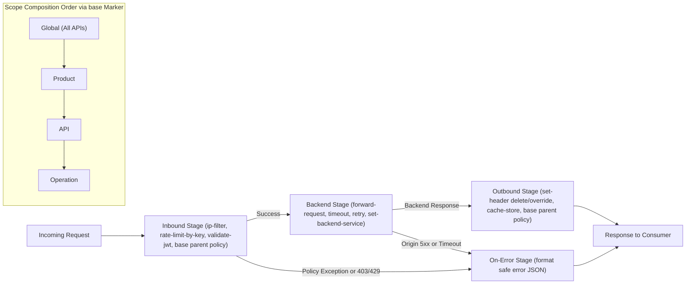
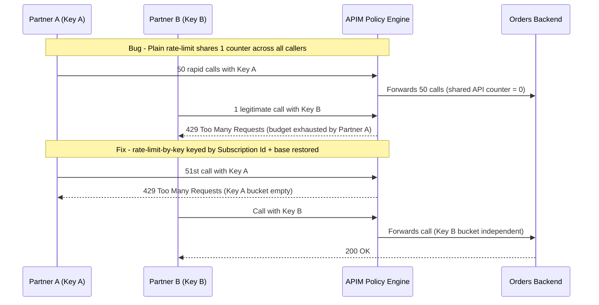

# Policies in Depth

> **Prerequisites:** APIM APIs, version sets, and revision scopes (Modules 01–02), basic HTTP headers and CIDR IP ranges.  
> **Estimated Reading Time:** 40 minutes  
> **Target Audience:** Backend Engineers, Platform Engineers, Cloud Architects.

> [!TIP]
> **The Golden Rule of APIM Policies:** Every request executes **inbound -> backend -> outbound** (jumping to **on-error** on exception), **`<base />`** explicitly positions inherited Global/Product/API policies relative to narrower scopes, and per-consumer throttling **always** requires **`rate-limit-by-key`** or **`quota-by-key`** keyed by `@(context.Subscription.Id)` rather than plain pooled limits.

---

## Why This Matters

Policies are what make APIM more than a reverse proxy. Everything you'd otherwise scatter across backend code or nginx configs — rate limiting, quotas, IP filtering, header rewriting, response shaping — lives in one declarative XML pipeline the gateway runs on every request. This is the single most important module in the track: modules 04 (JWT validation) and 05 (backend routing) are *specific policies*, and the capstone is mostly "write the right policies at the right scope." Learn the pipeline shape here and the rest is vocabulary.

---

## 1. Architectural Mental Model: Four-Stage Policy Pipeline & `<base />` Scope Composition

APIM composes policies outside-in across four scopes (**All APIs -> Product -> API -> Operation**), using the `<base />` element inside each section to dictate whether parent policies run before or after local rules across the four execution stages:



### The four-section policy pipeline

Every policy document has the same skeleton, and order is everything:

```xml
<policies>
  <inbound>   <!-- runs on the request, before the backend --> </inbound>
  <backend>   <!-- controls the call to the backend itself --> </backend>
  <outbound>  <!-- runs on the response, after the backend --> </outbound>
  <on-error>  <!-- runs only if something above threw --> </on-error>
</policies>
```

A request flows **inbound → backend → outbound**; if any section throws, control jumps to **on-error**. `<inbound>` is where you authenticate, throttle, and rewrite the *request* (this is where rate-limit and `validate-jwt` go). `<backend>` wraps the actual forward call (`<forward-request>`) and is where you set timeouts/retries and choose among backends (module 05). `<outbound>` rewrites the *response* — strip internal headers, add a `Sunset` header, transform a body. `<on-error>` shapes what the consumer sees when things fail. The magic string **`<base />`** in each section means "run the inherited policy from the parent scope here" — that's how scopes compose (next concept).

### Scopes and `<base />` inheritance

Policies attach at four **scopes**, from broad to narrow: **All APIs (global)** → **Product** → **API** → **Operation**. At request time APIM evaluates them outside-in, and each narrower scope's `<base />` element marks where the enclosing scope's policy runs. So an operation policy of `<inbound><base /><rate-limit .../></inbound>` means "run everything inherited from API/product/global first (`<base />`), then my rate limit." Move `<base />` after your policy and yours runs first. This is the same "narrower scope inherits and can extend/override broader scope" idea you saw with Kubernetes namespaces vs. cluster scope, and with policy inheritance in track 06's Container Apps config — here it's explicit via `<base />`. Getting `<base />` placement wrong (or omitting it) is a top source of "why did my policy not run / run in the wrong order."

### The policy expression language

Beyond static XML, policy values can be **C#-based expressions** in `@(...)` (a single expression) or `@{ ... }` (a statement block returning a value). They read from a `context` object exposing the request, response, user, subscription, and variables — e.g. `@(context.Request.IpAddress)`, `@(context.Subscription.Id)`, `@(context.Request.Headers.GetValueOrDefault("Authorization",""))`. You use expressions to make policies dynamic: rate-limit *keyed by the caller's subscription or IP*, set a header from a claim, or branch with `<choose>`. You don't need deep C# — you need `context.Request`, `context.Response`, `context.Subscription`, `context.User`, and `context.Variables`. The exercises use only a handful.

### Rate limiting vs. quota (and the scope trap)

Two throttling policies that people constantly confuse:

- **`rate-limit`** — a **short-window burst** control: "N calls per `renewal-period` seconds," e.g. 10 calls / 60 s. Protects the backend from spikes. Resets every window.
- **`quota`** — a **long-window volume** cap: "N calls per day/week/month," e.g. 10000 calls / month. Enforces a *plan*. Resets on the long period.

Both come in two forms: plain (`rate-limit`, `quota`) which count **per the scope they're attached to**, and **`-by-key`** (`rate-limit-by-key`, `quota-by-key`) which count **per a key expression you supply** — typically the subscription id or caller IP. The classic bug (you'll fix it below) is attaching a plain `rate-limit` at a scope that lumps *all* consumers into one shared counter, so a handful of legitimate callers collectively trip a limit meant to be *per consumer*. The fix is `rate-limit-by-key` keyed by `@(context.Subscription.Id)`.

### The workhorse transformation & filtering policies

A handful of policies cover most real needs:

- **`ip-filter`** (inbound) — allow/deny by client IP/CIDR; the gateway-level analogue of the L7 access restriction you set on a Container App in track 06.
- **`set-header`** / **`set-body`** — add/modify/remove request or response headers and bodies (e.g. strip an internal `Server` header outbound, inject a correlation id inbound).
- **`rewrite-uri`** — remap the incoming path to a different backend path.
- **`choose`** (if/else) — branch on an expression (e.g. apply a policy only for a specific product or when a header is present).
- **`cache-lookup`/`cache-store`** — response caching (not on Consumption's internal cache; needs an external cache there).

These are the building blocks; module 04 adds `validate-jwt` and module 05 adds `set-backend-service`/load balancing.

---

## 2. Taxonomic Comparison & Command Reference

### Policy Pipeline Sections & Scopes

| Section | Execution Timing | Typical Workhorse Policies | Result If `<base />` Is Omitted |
| :--- | :--- | :--- | :--- |
| **`<inbound>`** | Pre-backend on incoming request | `ip-filter`, `rate-limit-by-key`, `quota-by-key`, `validate-jwt`, `rewrite-uri`, `choose` | Silently drops inherited Global/Product/API inbound auth and limits |
| **`<backend>`** | Wraps forwarding to origin | `forward-request`, `retry`, `set-backend-service` | Request may not forward to backend unless explicit `forward-request` is present |
| **`<outbound>`** | Post-backend on response | `set-header` (delete `Server`, add `Sunset`), `set-body`, `cache-store` | Parent outbound header stripping and caching policies do not run |
| **`<on-error>`** | Only when a prior section throws | `set-status`, `set-body` (sanitized error JSON) | Falls back to default gateway error handling without parent error handlers |

### Throttling & Filtering Policy Matrix

| Policy | Window Type | Counter Isolation | Typical Status Code | Primary Pitfall |
| :--- | :--- | :--- | :--- | :--- |
| **`rate-limit`** | Short burst (seconds) | Shared across attached scope (all consumers) | `429` | Pools unrelated callers at API/Global scope |
| **`rate-limit-by-key`** | Short burst (seconds) | Isolated per `counter-key` expression | `429` | Using static string instead of `@(context.Subscription.Id)` |
| **`quota`** | Long plan (days/months) | Shared across attached scope | `403` / Quota exceeded | Confused with short-window burst protection |
| **`quota-by-key`** | Long plan (days/months) | Isolated per `counter-key` expression | `403` / Quota exceeded | Expecting instant recovery without waiting for period reset |
| **`ip-filter`** | Stateless per-request | Evaluated against client IP/CIDR | `403` | `action="allow"` locks out callers if your own egress IP is missing |

### Command Reference

Policies are XML applied to a scope. The CLI applies a policy file to an API or operation; the XML itself is the real "command," so the breakdowns below explain the XML.

| Command | What it does | Example |
|---|---|---|
| `az apim api policy create` | Apply a policy XML file to an API scope | `az apim api policy create --resource-group rg --service-name <inst> --api-id orders --policy-format xml --value "@policy.xml"` |
| `az apim api policy show` | Show the current API-scope policy | `az apim api policy show --resource-group rg --service-name <inst> --api-id orders` |
| `az apim api operation policy create` | Apply a policy to a single operation | `az apim api operation policy create --resource-group rg --service-name <inst> --api-id orders --operation-id root --policy-format xml --value "@op.xml"` |
| `az apim product policy create` | Apply a policy at product scope | `az apim product policy create --resource-group rg --service-name <inst> --product-id starter --policy-format xml --value "@prod.xml"` |
| `az apim api policy delete` | Remove an API-scope policy | `az apim api policy delete --resource-group rg --service-name <inst> --api-id orders` |

XML snippets explained:

Rate limit **per consumer** (the correct, keyed form):
```xml
<inbound>
  <base />
  <rate-limit-by-key calls="10" renewal-period="60"
    counter-key="@(context.Subscription.Id)" />
</inbound>
```
- `calls="10"` / `renewal-period="60"` — allow 10 calls per 60-second window.
- `counter-key="@(context.Subscription.Id)"` — the counter is **per subscription**, so each consumer gets their own budget (not a shared pool). Use `@(context.Request.IpAddress)` to key by client IP instead.
- `<base />` first — inherited (product/global) policies run before this.

Monthly quota per consumer:
```xml
<quota-by-key calls="10000" renewal-period="2592000"
  counter-key="@(context.Subscription.Id)" />
```
- `renewal-period="2592000"` — 30 days in seconds; a long-window **volume** cap (a plan limit), distinct from the short-window burst limit above.

IP allow-list (gateway analogue of track 06's access restriction):
```xml
<ip-filter action="allow">
  <address>203.0.113.10</address>
  <address-range from="198.51.100.0" to="198.51.100.255" />
</ip-filter>
```
- `action="allow"` — only listed IPs/ranges pass; everything else is denied (use `action="forbid"` for a deny-list).

Outbound header hygiene + a deprecation signal:
```xml
<outbound>
  <base />
  <set-header name="Server" exists-action="delete" />
  <set-header name="Sunset" exists-action="override">
    <value>Sat, 31 Jan 2026 23:59:59 GMT</value>
  </set-header>
</outbound>
```
- `exists-action="delete"` — strip the backend's `Server` header from the response (don't leak backend detail).
- `exists-action="override"` — set/replace `Sunset` — the deprecation header from module 02's deprecation strategy.

---

## 3. Production War Story Post-Mortem: Pooled `rate-limit` Collateral Outage & Missing `<base />` Bypass

| Field | Incident Details |
| :--- | :--- |
| **Severity** | **SEV-1** (Multi-Tenant `429` Outage + Unprotected Export Endpoint) |
| **Detection / Resolution Time** | Detected in 4 minutes via global `429` alert / Mitigated in 22 minutes |
| **Impact** | Healthy enterprise customers suffered `429 Too Many Requests` whenever one partner ran batch polling, while a new operation bypassed Product IP restrictions |

### What Happened

An engineer configured `<rate-limit calls="50" renewal-period="60" />` at the `orders` API scope, expecting each consumer to receive 50 requests/minute. Because plain `rate-limit` uses a single counter for the entire attached API scope, one partner's retry loop consumed all 50 slots in 3 seconds, starving every other tenant for the next 57 seconds. Meanwhile, a separate operation policy on `POST /orders/export` omitted `<base />` in `<inbound>`, silently bypassing the Product-level IP allow-list.



### Root Cause Analysis

1. **Unkeyed throttle policy**: Plain `rate-limit` at API scope counts all subscriptions together rather than isolating budgets per consumer.
2. **Omitted `<base />` element**: Leaving `<base />` out of the operation's `<inbound>` block prevented inherited Product and Global policies from executing.
3. **Single-key smoke testing**: Integration tests only verified behavior using one subscription key, hiding cross-tenant counter contention.

### The Fix & Architectural Hardening

- Replaced plain `rate-limit` with `<rate-limit-by-key counter-key="@(context.Subscription.Id)" ... />` and `<quota-by-key ... />`.
- Restored `<base />` in every operation policy and added a CI XML schema check rejecting any policy section lacking `<base />`.

---

## 4. Multi-Language Production Implementation: Keyed Rate-Limiter & Outbound Header Pipeline

To test and mirror APIM's keyed policy behavior locally before deploying XML policies, services and gateway simulators isolate sliding-window counters per `SubscriptionId` (mirroring `rate-limit-by-key`), enforce IP allow-lists, and scrub internal `Server` headers outbound while injecting `Sunset`.

````carousel
```go
package policyengine

import (
	"net/http"
	"sync"
	"time"
)

type KeyedBucket struct {
	mu      sync.Mutex
	counts  map[string][]time.Time
	limit   int
	window  time.Duration
}

func NewKeyedBucket(limit int, window time.Duration) *KeyedBucket {
	return &KeyedBucket{
		counts: make(map[string][]time.Time),
		limit:  limit,
		window: window,
	}
}

// Allow mirrors APIM rate-limit-by-key keyed by context.Subscription.Id.
func (kb *KeyedBucket) Allow(subscriptionID string, now time.Time) (bool, int) {
	kb.mu.Lock()
	defer kb.mu.Unlock()

	cutoff := now.Add(-kb.window)
	valid := kb.counts[subscriptionID][:0]
	for _, ts := range kb.counts[subscriptionID] {
		if ts.After(cutoff) {
			valid = append(valid, ts)
		}
	}
	if len(valid) >= kb.limit {
		kb.counts[subscriptionID] = valid
		return false, int(kb.window.Seconds())
	}
	kb.counts[subscriptionID] = append(valid, now)
	return true, 0
}

// ApplyOutboundPolicies mirrors <set-header exists-action="delete|override" />.
func ApplyOutboundPolicies(h http.Header, sunsetRFC1123 string) {
	h.Del("Server")
	h.Del("X-Powered-By")
	if sunsetRFC1123 != "" {
		h.Set("Sunset", sunsetRFC1123)
	}
}
```
<!-- slide -->
```typescript
export class KeyedRateLimiter {
  private readonly windows = new Map<string, number[]>();

  constructor(
    private readonly maxCalls: number,
    private readonly renewalPeriodSec: number
  ) {}

  // Mirrors <rate-limit-by-key counter-key="@(context.Subscription.Id)" />
  evaluate(counterKey: string, nowMs = Date.now()): { allowed: boolean; retryAfterSec: number } {
    const cutoff = nowMs - this.renewalPeriodSec * 1000;
    const timestamps = (this.windows.get(counterKey) ?? []).filter((t) => t > cutoff);

    if (timestamps.length >= this.maxCalls) {
      this.windows.set(counterKey, timestamps);
      const retryAfterSec = Math.max(1, Math.ceil((timestamps[0] + this.renewalPeriodSec * 1000 - nowMs) / 1000));
      return { allowed: false, retryAfterSec };
    }

    timestamps.push(nowMs);
    this.windows.set(counterKey, timestamps);
    return { allowed: true, retryAfterSec: 0 };
  }
}

export function applyOutboundHeaders(headers: Headers, sunsetValue?: string): void {
  headers.delete("Server");
  if (sunsetValue) {
    headers.set("Sunset", sunsetValue);
  }
}
```
<!-- slide -->
```python
from collections import defaultdict
from threading import Lock
import time


class KeyedRateLimiter:
    """Mirrors APIM rate-limit-by-key isolated per Subscription ID or IP."""

    def __init__(self, calls: int, renewal_period_sec: int) -> None:
        self.calls = calls
        self.renewal_period_sec = renewal_period_sec
        self._buckets: dict[str, list[float]] = defaultdict(list)
        self._lock = Lock()

    def allow(self, counter_key: str) -> tuple[bool, int]:
        now = time.monotonic()
        cutoff = now - self.renewal_period_sec
        with self._lock:
            recent = [ts for ts in self._buckets[counter_key] if ts > cutoff]
            if len(recent) >= self.calls:
                self._buckets[counter_key] = recent
                retry_after = max(1, int(recent[0] + self.renewal_period_sec - now))
                return False, retry_after
            recent.append(now)
            self._buckets[counter_key] = recent
            return True, 0


def apply_outbound_headers(headers: dict[str, str], sunset: str | None = None) -> dict[str, str]:
    cleaned = {k: v for k, v in headers.items() if k.lower() != "server"}
    if sunset:
        cleaned["Sunset"] = sunset
    return cleaned
```
<!-- slide -->
```csharp
using System.Collections.Concurrent;

public sealed class KeyedRateLimiter(int calls, TimeSpan renewalPeriod)
{
    private readonly ConcurrentDictionary<string, Queue<DateTimeOffset>> _buckets = new();

    public (bool Allowed, int RetryAfterSeconds) Evaluate(string counterKey)
    {
        var now = DateTimeOffset.UtcNow;
        var cutoff = now - renewalPeriod;
        var queue = _buckets.GetOrAdd(counterKey, _ => new Queue<DateTimeOffset>());

        lock (queue)
        {
            while (queue.Count > 0 && queue.Peek() <= cutoff)
            {
                queue.Dequeue();
            }

            if (queue.Count >= calls)
            {
                var retryAfter = Math.Max(1, (int)Math.Ceiling((queue.Peek() + renewalPeriod - now).TotalSeconds));
                return (false, retryAfter);
            }

            queue.Enqueue(now);
            return (true, 0);
        }
    }

    public static void ApplyOutboundPolicies(IDictionary<string, string> headers, string? sunsetHeader = null)
    {
        headers.Remove("Server");
        if (!string.IsNullOrWhiteSpace(sunsetHeader))
        {
            headers["Sunset"] = sunsetHeader;
        }
    }
}
```
````

---

## 5. Practical Hands-On Verification CLI Workflows

> **Time note:** reuse a Consumption instance (fast). Nothing here needs a classic tier. Save each XML snippet to a local file and apply it with the CLI.

### 1. Instance + backend + API
Stand up the same base as module 02 (Consumption APIM, a Container App `orders`, an `orders` API with a `GET /` operation, grab `$key` and `$gw`). Confirm `curl -H "Ocp-Apim-Subscription-Key: $key" "$gw/orders/"` returns `200` before adding policies.

### 2. Apply a per-consumer rate limit (correct form)
Save as `ratelimit.xml`:
```xml
<policies>
  <inbound>
    <base />
    <rate-limit-by-key calls="5" renewal-period="60" counter-key="@(context.Subscription.Id)" />
  </inbound>
  <backend><base /></backend>
  <outbound><base /></outbound>
  <on-error><base /></on-error>
</policies>
```
```powershell
az apim api policy create --resource-group rg-apim-m03 --service-name $apim --api-id orders `
  --policy-format xml --value "@ratelimit.xml"
1..8 | ForEach-Object { curl -s -o /dev/null -w "%{http_code}\n" -H "Ocp-Apim-Subscription-Key: $key" "$gw/orders/" }
```

**Expected Output:**
```text
200
200
200
200
200
429
429
429
```
> Verify: fire 8 quick calls; the 6th within the window returns **`429 Too Many Requests`**. That's the burst limit working per consumer.

### 3. Add a monthly quota
Extend the inbound section with a `quota-by-key` (10000/30 days) and re-apply. Confirm normal calls still succeed — the quota only bites at high volume, so you're verifying it doesn't break anything, not that you can hit 10000 calls.

### 4. Strip an internal header outbound
Add to `<outbound>`: `<set-header name="Server" exists-action="delete" />`, re-apply, and `curl -i` the endpoint. Confirm the backend's `Server` header no longer appears in the response — outbound transformation in action.

### 5. IP allow-list, then deliberately lock yourself out
Add an inbound `ip-filter action="allow"` listing a **bogus** IP (not yours), re-apply, and `curl -i`.

**Expected Output:**
```text
HTTP/1.1 403 Forbidden
{"statusCode":403,"message":"Caller IP address is not allowed."}
```
> Verify: expect **`403`** — you're not on the list. This sets up the diagnose-and-fix in exercise 9, but first observe the raw block.

### 6. Branch with `<choose>`
Add an inbound rule that injects a header only when a query param is present:
```xml
<choose>
  <when condition="@(context.Request.Url.Query.GetValueOrDefault("debug","") == "1")">
    <set-header name="X-Debug" exists-action="override"><value>on</value></set-header>
  </when>
</choose>
```
Re-apply, then call with and without `?debug=1` and confirm the header only appears when the condition matches. This is the expression language driving control flow.

### 7. Operation-scope vs API-scope + `<base />` order
Put a *stricter* rate limit (`2/60`) at the **operation** scope with `<base />` **after** it, so the operation limit runs before the inherited API limit. Observe which limit trips first and why. Move `<base />` before it and observe the order change. This makes `<base />` placement concrete.

### 8. Diagnose and fix: a rate-limit policy blocking legitimate traffic (wrong scope/key)
This is the classic. Replace the keyed limit with a **plain** `rate-limit` at API scope:
```xml
<inbound>
  <base />
  <rate-limit calls="5" renewal-period="60" />
</inbound>
```
Now have **two** different consumers call (use two subscription keys — create a second subscription, or reuse `master` plus a product key from module 06's pattern). Notice that their calls share **one** counter, so a handful of legitimate callers collectively trip the 5-call limit and get `429`s even though none individually is abusive. **Diagnose:** plain `rate-limit` counts *per the attached scope*, pooling all consumers. **Fix:** switch back to `rate-limit-by-key` keyed by `@(context.Subscription.Id)` so each consumer has an independent budget. Re-test with both consumers and confirm neither is throttled by the other's traffic. Lesson: throttling scope/key is the thing to check when *legitimate* traffic is being blocked.

### 9. Diagnose and fix: locked out by your own IP filter (from exercise 5)
Your `curl` returns `403` because the allow-list doesn't include your IP. **Diagnose** by reading the applied policy and comparing the listed addresses to your real egress IP:
```powershell
az apim api policy show --resource-group rg-apim-m03 --service-name $apim --api-id orders
curl https://api.ipify.org
```
**Fix** by adding your IP to the allow-list (or removing the filter). Confirm `200` returns. Lesson: `ip-filter action="allow"` is deny-by-default for everyone not listed.

### 10. Cleanup
```powershell
az group delete --name rg-apim-m03 --yes --no-wait
```

### Independent Challenge

Compose a single API-scope policy document that does all of the following at the correct scope and in the correct order: rejects any caller outside an IP range you choose, enforces a **per-consumer** burst limit and a **per-consumer** monthly quota, strips a backend header on the way out, and injects a `Sunset` header to foreshadow deprecation of this version (tie back to **module 02**'s deprecation strategy). Then break it on purpose in the specific way that throttles legitimate traffic (wrong throttle scope/key) and fix it, writing down the exact symptom and the one-line change. Use only policies from this module — no `validate-jwt` yet (that's module 04). Draw on **module 00**'s pipeline model to justify why each policy sits in inbound vs. outbound. Delete the resource group (and the APIM instance) when done.

<details><summary>Stuck? One hint</summary>

Put request-side controls (`ip-filter`, `rate-limit-by-key`, `quota-by-key`) in `<inbound>` and response-side changes (`set-header` delete/override) in `<outbound>`, each right after `<base />`. The throttle bug is always the same: plain `rate-limit`/`quota` share one counter across all consumers at that scope, so replace them with the `-by-key` variants keyed by `@(context.Subscription.Id)` to give each consumer its own budget.

</details>

---

## 6. Common Mistakes & Troubleshooting

- **Missing or misplaced `<base />`.** Omit it and you silently drop inherited policies (auth, product limits); misplace it and your policy runs in the wrong order. Almost every "my policy didn't run right" traces here.
- **Plain `rate-limit`/`quota` where you meant per-consumer.** The plain form pools all callers at the attached scope, throttling legitimate traffic. Use the `-by-key` variant keyed by subscription id or IP for per-consumer limits.
- **Confusing rate-limit with quota.** Rate-limit = short-window burst (calls per seconds); quota = long-window volume (calls per day/month). You usually want both, for different reasons.
- **`ip-filter action="allow"` locks everyone out.** Allow-lists are deny-by-default; forgetting your own egress IP returns 403 to *you*. Verify your IP with `api.ipify.org`.
- **Applying a policy to the wrong version/revision.** As in module 02, a policy on `v1` doesn't apply to `v2`, and one on a non-current revision isn't live.
- **Expression errors fail the policy.** A malformed `@(...)` can 500 the request via `on-error`. Test expressions incrementally; keep them simple.
- **Cost pitfall.** Policies themselves are free, but response **caching** (`cache-store`) needs an external Redis cache on Consumption — adding one is a real, billable resource. Don't provision a cache you don't need for these exercises, and if you do, delete it with the group.

---

## 7. Operational Validation Checkpoints & Checkpoint Quiz

### Operational Validation Checkpoints

<details><summary><strong>Checkpoint 1: Recovering Silently Dropped Product Policies (`<base />`)</strong></summary>

When adding an operation-level `<inbound>` policy causes a Product-level rate limit or IP filter to stop running for that operation, check whether `<base />` was omitted from the operation's `<inbound>` block. Placing `<base />` at the top of `<inbound>` restores outside-in inheritance from Global, Product, and API scopes.

</details>

<details><summary><strong>Checkpoint 2: Isolating Tenant `429` Contention Under Load</strong></summary>

If Partner B receives `429 Too Many Requests` immediately after Partner A spikes traffic despite Partner B sending only 1 request, inspect the policy XML for plain `<rate-limit>` or a static `counter-key`. Replace it with `<rate-limit-by-key counter-key="@(context.Subscription.Id)" />` so every consumer receives an independent token bucket.

</details>

<details><summary><strong>Checkpoint 3: Resolving Self-Inflicted `403` IP Lockouts</strong></summary>

Because `<ip-filter action="allow">` denies any address not explicitly listed, corporate VPNs, home dynamic IPs, or GitHub Actions runners will fail with `403`. Query `az apim api policy show` alongside your live egress address via `curl https://api.ipify.org` and add the exact IP or CIDR range.

</details>

### Checkpoint Quiz

Write down your answer to each question before expanding it — checking without attempting first is the single easiest way to fool yourself into thinking you've learned this.

1. Name the four policy sections in execution order and what each is for.
2. What does `<base />` do, and what breaks if you omit it in a narrower scope?
3. List the four policy scopes from broadest to narrowest.
4. Distinguish `rate-limit` from `quota`, and the plain form from the `-by-key` form.
5. Legitimate consumers are getting 429s even though none is abusive. What's the likely cause and the fix?
6. Where would you put a policy that strips a backend `Server` header, and where would you put JWT validation (previewing module 04)?
7. Write the counter-key expression that makes a rate limit per-consumer.
8. Your `ip-filter action="allow"` returns 403 to you. Why, and how do you confirm it?

<details><summary>Show answers</summary>

1. **inbound** (request, pre-backend: auth, throttle, rewrite) → **backend** (the forward call: timeouts, backend selection) → **outbound** (response rewrite) → **on-error** (runs only if something threw).
2. `<base />` runs the inherited policy from the parent scope at that point. Omit it and inherited policies (e.g. product/global auth and limits) are dropped for that section.
3. All APIs (global) → Product → API → Operation.
4. `rate-limit` = short-window burst (calls per seconds); `quota` = long-window volume (calls per day/month). Plain forms count per the attached scope (shared across consumers); `-by-key` forms count per your key expression (per consumer/IP).
5. A **plain** `rate-limit` at a scope that pools all consumers into one counter. Fix: use `rate-limit-by-key` keyed by `@(context.Subscription.Id)` so each consumer gets an independent budget.
6. `Server`-header strip goes in **`<outbound>`** (`set-header exists-action="delete"`); JWT validation goes in **`<inbound>`** (`validate-jwt`), before the backend call.
7. `counter-key="@(context.Subscription.Id)"` (or `@(context.Request.IpAddress)` to key by IP).
8. `ip-filter action="allow"` is deny-by-default; your egress IP isn't on the list. Confirm by comparing the policy's addresses to `curl https://api.ipify.org`.

</details>

---

## 8. Next

[04-authentication-and-authorization-at-the-gateway](../04-authentication-and-authorization-at-the-gateway/README.md) — move from "who has a key" to real identity: subscription keys vs. OAuth2/JWT, validating an Entra ID token with `validate-jwt` (ties into track 16), and client certificate authentication.
