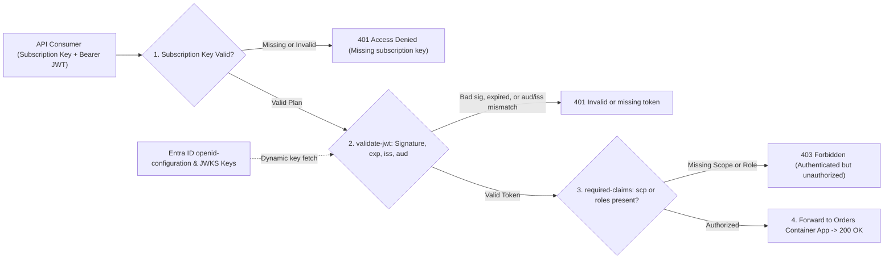
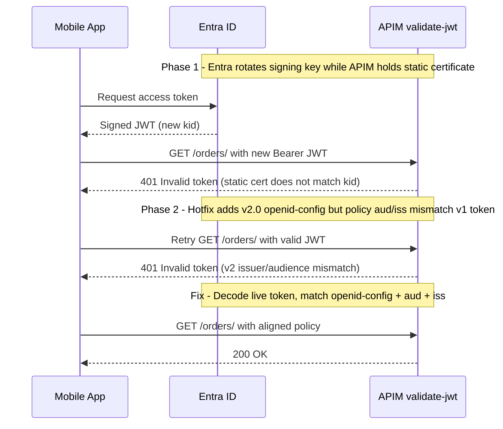

# Authentication & Authorization at the Gateway

> **Prerequisites:** APIM Policy XML pipeline (Module 03), Entra ID app registrations, audiences, scopes, and JWT claims (Track 16).  
> **Estimated Reading Time:** 40 minutes  
> **Target Audience:** Backend Engineers, Platform Engineers, Security & Cloud Architects.

> [!TIP]
> **The Golden Rule of Gateway Auth:** Separate **identification** (`Ocp-Apim-Subscription-Key` for metering/plans) from **authentication & authorization** (`validate-jwt` in inbound policies for user/app identity and scopes), always discover signing keys dynamically via **`openid-config`** rather than hardcoding certificates, and when a valid Entra token returns **`401`**, decode it immediately to verify **`aud`** and **`iss`** against your policy before blaming the token.

---

## Why This Matters

A subscription key answers "which consumer is this?" but not "is this a real, authenticated user/app allowed to do this?" For that you validate a **token** — and doing it at the gateway means every backend behind APIM is protected without each one reimplementing auth. This is where the identity work from track 16 pays off directly: the same Entra ID token you learned to reason about (issuer, audience, scopes, signature) gets validated by a single APIM policy before any request touches your Container App. Get the audience/issuer right and the gateway is your auth chokepoint; get them wrong and you either reject valid callers or wave through invalid ones.

---

## 1. Architectural Mental Model: Dual-Layer Gateway Chokepoint (`Subscription Key` + `validate-jwt`)

APIM evaluates consumer metering and cryptographic identity in sequence inside the inbound pipeline, fetching live Entra signing keys (JWKS) from the tenant's OpenID Connect metadata endpoint so bad tokens short-circuit with `401` or `403` before reaching your backend:



### Two different questions: identification vs. authentication

Keep these apart. A **subscription key** *identifies* a consumer for metering and throttling — it's a shared secret tied to a subscription, not proof of a user's identity, and it's fine for "which plan is this call on." **Token authentication** (OAuth2/JWT) *proves* the caller is a specific authenticated user or application, with **scopes/roles** describing what they're allowed to do. Mature APIs use **both**: the key for the product/metering layer, the token for identity/authorization. A common design is subscription key optional-or-off for first-party callers who present a strong Entra ID token, and required for partners on a metered plan. Decide per API which layers apply.

### Anatomy of the token you're validating (recap from track 16)

The token is a **JWT** — three base64url parts (`header.payload.signature`). The parts that matter to a gateway policy:

- **`iss` (issuer)** — who minted the token, e.g. `https://login.microsoftonline.com/<tenant-id>/v2.0`. Must match the tenant you trust.
- **`aud` (audience)** — who the token is *for*: your API's app ID URI or client id. **This is the field people get wrong most often** — a token minted for a different audience is a valid token but not for *you*.
- **`exp`/`nbf`** — expiry / not-before; the policy rejects expired or not-yet-valid tokens automatically.
- **scopes (`scp`) / roles (`roles`)** — what the caller may do; you assert required ones in the policy.
- **signature** — signed with Entra's keys; APIM fetches the tenant's public keys from the **OpenID configuration / JWKS endpoint** to verify it. This is the same token shape and the same Entra ID issuer you learned to dissect in **track 16** — the gateway just checks it mechanically on every request.

### The `validate-jwt` policy

`validate-jwt` is an **inbound** policy (module 03's pipeline) that verifies the token before the backend is called. You give it: where to find the token (`Authorization: Bearer` header, by default), the **OpenID metadata URL** (so it can fetch signing keys and the issuer), the **audiences** you accept, the **issuers** you trust, and optionally **required claims** (scopes/roles). If any check fails, the policy short-circuits with **401** (missing/invalid token) or **403** (valid token, insufficient claims) — and the request never reaches your Container App. Because it runs at the gateway, your backend can trust that anything it receives already passed token validation (defense in depth still applies, but the edge is covered).

### The two failure modes: 401 vs. 403, and the audience/issuer trap

Distinguish crisply:

- **401 Unauthorized** — no token, malformed token, bad signature, expired, or **audience/issuer mismatch**. The token isn't acceptable *at all* for this API.
- **403 Forbidden** — token is valid and for you, but it lacks a **required scope/role** you asserted. Authenticated but not authorized.

The single most common real bug: you configure `<audience>` with the wrong value (e.g. the client id instead of the app ID URI, or a `v1` vs `v2` audience mismatch), and **every valid token is rejected with 401** even though nothing is actually wrong with the tokens. You'll reproduce and fix exactly this — it's the gateway analogue of track 16's "the token is fine, the *relying party config* is wrong."

### Client certificate authentication (mutual TLS)

For machine-to-machine callers where you'd rather not manage tokens, APIM supports **client certificate (mTLS)** auth: the caller presents a client cert during the TLS handshake, and a `validate-client-certificate` policy (or context checks on `context.Request.Certificate`) verifies its thumbprint, issuer, or subject against values you trust. This is the same "prove identity with a certificate rather than a bearer secret" idea behind mesh mTLS (track 13), but here it's *north-south* at the product edge rather than *east-west* between services. It's common for partner integrations and is a survey-level topic here — know it exists, know when you'd reach for it (long-lived B2B callers, no user context), and know it's configured at the gateway, not the backend.

---

## 2. Taxonomic Comparison & Command Reference

### Gateway Authentication & Identification Mechanisms

| Mechanism | What It Proves | Wire Transport | Credential Lifecycle | Best Fit |
| :--- | :--- | :--- | :--- | :--- |
| **Subscription Key** | Which consumer subscription/plan is calling | `Ocp-Apim-Subscription-Key` header | Manual key rotation (primary/secondary) | Metering, product tiering, rate limits |
| **OAuth2 / Entra JWT** | Verified user/app identity + `scp`/`roles` claims | `Authorization: Bearer <jwt>` | Short-lived signed tokens; JWKS auto-rotated | User apps, fine-grained RBAC/scopes |
| **Client Cert (mTLS)** | Machine identity via X.509 thumbprint/CA | TLS handshake (`validate-client-certificate`) | Certificate issuance & renewal | Long-lived B2B M2M partner links |

### `validate-jwt` Failure Diagnostics: `401` vs. `403`

| HTTP Code | Validation Stage | Common Root Cause | Immediate Remediation |
| :--- | :--- | :--- | :--- |
| **`401`** | Token structure / signature / `aud` / `iss` / `exp` | Wrong `<audience>` (`clientId` vs `api://<app-id>`), `v1` vs `v2` issuer mismatch, expired token, or hardcoded stale signing key | Decode token at jwt.ms; align `<audiences>`, `<issuers>`, and use `<openid-config>` |
| **`403`** | `<required-claims>` (`scp` or `roles`) | Token is valid and meant for this API, but caller lacks `Orders.Read` or app role | Grant required delegated permission/app role in Entra ID and mint fresh token |

### Command Reference

Auth is mostly policy XML plus an Entra ID app registration. The registration uses `az ad` (from track 16); the validation uses a `validate-jwt` inbound policy.

| Command | What it does | Example |
|---|---|---|
| `az ad app create` | Register an Entra ID app (the API's identity/audience) | `az ad app create --display-name "orders-api"` |
| `az account get-access-token` | Get a real Entra ID token to test with | `az account get-access-token --resource api://<app-id> --query accessToken -o tsv` |
| `az apim api policy create` | Apply the `validate-jwt` policy to the API | `az apim api policy create --resource-group rg --service-name <inst> --api-id orders --policy-format xml --value "@jwt.xml"` |
| `az apim api update` (`--subscription-required`) | Turn the subscription-key requirement on/off | `az apim api update --resource-group rg --service-name <inst> --api-id orders --subscription-required false` |

`validate-jwt` policy explained:
```xml
<inbound>
  <base />
  <validate-jwt header-name="Authorization" failed-validation-httpcode="401"
                failed-validation-error-message="Invalid or missing token">
    <openid-config url="https://login.microsoftonline.com/<tenant-id>/v2.0/.well-known/openid-configuration" />
    <audiences>
      <audience>api://<app-id></audience>
    </audiences>
    <issuers>
      <issuer>https://login.microsoftonline.com/<tenant-id>/v2.0</issuer>
    </issuers>
    <required-claims>
      <claim name="scp" match="any">
        <value>Orders.Read</value>
      </claim>
    </required-claims>
  </validate-jwt>
</inbound>
```
- `header-name="Authorization"` — where the bearer token is read from (default).
- `<openid-config url="...">` — the tenant's OpenID metadata; APIM uses it to fetch signing keys (JWKS) and validate the signature and issuer. Using this is better than hardcoding keys, which rotate.
- `<audiences><audience>` — the **`aud`** value(s) you accept; **must match** what the token was minted for. The #1 misconfiguration.
- `<issuers><issuer>` — the trusted `iss`; the Entra tenant's v2 issuer URL.
- `<required-claims>` with `<claim name="scp" match="any">` — assert the caller has at least one of the listed scopes; failing this yields **403**, not 401.
- `failed-validation-httpcode="401"` — the status returned when validation fails.

`az account get-access-token --resource api://<app-id> --query accessToken -o tsv`
- `--resource api://<app-id>` — request a token whose **audience** is your API's app ID URI. Point this at the *wrong* resource and you'll get a token that fails the audience check — exactly the diagnose-and-fix below.

---

## 3. Production War Story Post-Mortem: Hardcoded JWKS Keys & `v1`/`v2` Audience Outage

| Field | Incident Details |
| :--- | :--- |
| **Severity** | **SEV-1** (100% API Authentication Failure Across Mobile & Partner Callers) |
| **Detection / Resolution Time** | Detected in 3 minutes via `401` spike alert / Resolved in 19 minutes |
| **Impact** | Every authenticated API call failed with `401 Invalid or missing token` during Entra ID signing-key rotation |

### What Happened

Months before the incident, a developer pasted a static Entra ID certificate into `<issuer-signing-keys>` inside `validate-jwt` instead of referencing `<openid-config>`. When Entra rotated its signing keys, every newly issued token carried a new `kid` header and failed signature validation with `401`. During the rushed hotfix, the team switched to the `v2.0` `<openid-config>` URL and set `<issuer>` to `login.microsoftonline.com/<tenant>/v2.0`, while the Entra app registration was still configured to issue `v1` tokens (`sts.windows.net` issuer and bare `<app-id>` audience instead of `api://<app-id>`). Calls continued failing `401` until an engineer decoded a live token and aligned `<audience>` and `<issuer>`.



### Root Cause Analysis

1. **Static signing keys**: Copying public certs into policy XML breaks automatically on routine Entra ID key rotation; `<openid-config>` handles dynamic JWKS refresh automatically.
2. **Policy vs. token claim drift**: Writing `<audiences>` and `<issuers>` from memory instead of decoding an actual token (`aud`/`iss`) left a `v1` vs `v2` mismatch during recovery.
3. **Treating `401` as a client issue**: Operators assumed client apps were sending bad tokens instead of comparing decoded claims against APIM policy XML.

### The Fix & Architectural Hardening

- Removed all static `<issuer-signing-keys>` entries and mandated `<openid-config>` across every environment.
- Decoded live tokens from both user and service-principal flows, explicitly matching `<audience>` and `<issuer>`, and added automated `401`/`403` synthetic probes to CI.

---

## 4. Multi-Language Production Implementation: Gateway-Style JWT Claim & Scope Validator

While APIM enforces `validate-jwt` at the gateway edge, defense-in-depth backends and local policy simulators verify the exact same claim pipeline: parse `Authorization: Bearer`, validate signature/expiry/issuer/audience (`401`), and enforce required `scp` or `roles` (`403`).

````carousel
```go
package gatewayauth

import (
	"errors"
	"net/http"
	"slices"
	"strings"
	"time"
)

var (
	ErrUnauthorized = errors.New("401: missing, expired, or invalid aud/iss token")
	ErrForbidden    = errors.New("403: token lacks required scope")
)

type TokenClaims struct {
	Issuer   string
	Audience string
	Expires  time.Time
	Scopes   []string
}

type ValidateJWTConfig struct {
	TrustedIssuer    string
	ExpectedAudience string
	RequiredScopes   []string
}

// ValidateClaims mirrors APIM <validate-jwt> 401 vs 403 separation.
func ValidateClaims(authHeader string, verifyAndDecode func(rawJWT string) (TokenClaims, error), cfg ValidateJWTConfig) (int, error) {
	if !strings.HasPrefix(authHeader, "Bearer ") {
		return http.StatusUnauthorized, ErrUnauthorized
	}
	raw := strings.TrimSpace(strings.TrimPrefix(authHeader, "Bearer "))
	if raw == "" {
		return http.StatusUnauthorized, ErrUnauthorized
	}

	claims, err := verifyAndDecode(raw)
	if err != nil || time.Now().UTC().After(claims.Expires) {
		return http.StatusUnauthorized, ErrUnauthorized
	}
	if claims.Issuer != cfg.TrustedIssuer || claims.Audience != cfg.ExpectedAudience {
		return http.StatusUnauthorized, ErrUnauthorized
	}

	for _, reqScope := range cfg.RequiredScopes {
		if slices.Contains(claims.Scopes, reqScope) {
			return http.StatusOK, nil
		}
	}
	return http.StatusForbidden, ErrForbidden
}
```
<!-- slide -->
```typescript
export interface JwtValidationPolicy {
  trustedIssuer: string;
  expectedAudience: string;
  requiredScopes: string[];
}

export interface DecodedClaims {
  iss: string;
  aud: string;
  exp: number;
  scp?: string;
}

export class GatewayAuthError extends Error {
  constructor(public readonly statusCode: 401 | 403, message: string) {
    super(message);
  }
}

export async function validateGatewayJwt(
  authorizationHeader: string | undefined,
  verifySignatureWithJwks: (token: string) => Promise<DecodedClaims>,
  policy: JwtValidationPolicy
): Promise<DecodedClaims> {
  if (!authorizationHeader?.startsWith("Bearer ")) {
    throw new GatewayAuthError(401, "Invalid or missing token");
  }
  const token = authorizationHeader.slice("Bearer ".length).trim();

  let claims: DecodedClaims;
  try {
    claims = await verifySignatureWithJwks(token);
  } catch {
    throw new GatewayAuthError(401, "JWT signature verification failed");
  }

  const nowSec = Math.floor(Date.now() / 1000);
  if (claims.exp <= nowSec || claims.iss !== policy.trustedIssuer || claims.aud !== policy.expectedAudience) {
    throw new GatewayAuthError(401, "Token expired or issuer/audience mismatch");
  }

  const tokenScopes = (claims.scp ?? "").split(/\s+/).filter(Boolean);
  const hasRequiredScope = policy.requiredScopes.some((s) => tokenScopes.includes(s));
  if (policy.requiredScopes.length > 0 && !hasRequiredScope) {
    throw new GatewayAuthError(403, "Caller authenticated but lacks required scope");
  }
  return claims;
}
```
<!-- slide -->
```python
from dataclasses import dataclass
import time
from typing import Callable


@dataclass(frozen=True)
class ValidateJwtConfig:
    trusted_issuer: str
    expected_audience: str
    required_scopes: tuple[str, ...]


def evaluate_validate_jwt(
    auth_header: str | None,
    jwks_verify_and_decode: Callable[[str], dict],
    config: ValidateJwtConfig,
) -> tuple[int, str]:
    """Mirrors APIM validate-jwt: returns 401 on aud/iss/sig/exp failure, 403 on missing scope."""
    if not auth_header or not auth_header.startswith("Bearer "):
        return 401, "Invalid or missing token"

    token = auth_header.removeprefix("Bearer ").strip()
    try:
        claims = jwks_verify_and_decode(token)
    except Exception:
        return 401, "Token signature or format invalid"

    if claims.get("exp", 0) <= time.time():
        return 401, "Token expired"
    if claims.get("iss") != config.trusted_issuer or claims.get("aud") != config.expected_audience:
        return 401, "Issuer or audience mismatch"

    granted_scopes = set(str(claims.get("scp", "")).split())
    if config.required_scopes and not any(s in granted_scopes for s in config.required_scopes):
        return 403, "Forbidden: missing required scope"

    return 200, "Authorized"
```
<!-- slide -->
```csharp
public sealed record ValidateJwtPolicy(string TrustedIssuer, string ExpectedAudience, string[] RequiredScopes);
public sealed record VerifiedClaims(string Issuer, string Audience, DateTimeOffset ExpiresAt, string[] Scopes);

public static class GatewayJwtValidator
{
    public static (int StatusCode, string Message) Evaluate(
        string? authorizationHeader,
        Func<string, VerifiedClaims?> verifyWithOpenIdJwks,
        ValidateJwtPolicy policy)
    {
        if (string.IsNullOrWhiteSpace(authorizationHeader) ||
            !authorizationHeader.StartsWith("Bearer ", StringComparison.OrdinalIgnoreCase))
        {
            return (401, "Invalid or missing token");
        }

        var token = authorizationHeader["Bearer ".Length..].Trim();
        var claims = verifyWithOpenIdJwks(token);
        if (claims is null || claims.ExpiresAt <= DateTimeOffset.UtcNow)
        {
            return (401, "Invalid or expired token");
        }

        if (!string.Equals(claims.Issuer, policy.TrustedIssuer, StringComparison.Ordinal) ||
            !string.Equals(claims.Audience, policy.ExpectedAudience, StringComparison.Ordinal))
        {
            return (401, "Audience or issuer mismatch");
        }

        if (policy.RequiredScopes.Length > 0 &&
            !policy.RequiredScopes.Any(req => claims.Scopes.Contains(req, StringComparer.Ordinal)))
        {
            return (403, "Missing required scope claim");
        }

        return (200, "OK");
    }
}
```
````

---

## 5. Practical Hands-On Verification CLI Workflows

> **Time note:** Consumption tier is fine and fast. The slow part here is Entra ID propagation (app registrations and token audiences can take a minute). If track 16 isn't built yet, the `az ad app create` / `az account get-access-token` steps below stand alone — you don't need track 16's modules to run them.

### 1. Instance + backend + API
Same base as before: Consumption APIM, a Container App `orders`, an `orders` API with a `GET /` operation, `$key`, `$gw`.

### 2. Register an Entra ID app to represent the API
```powershell
$app = az ad app create --display-name "orders-api-m04" --query appId -o tsv
$tenant = az account show --query tenantId -o tsv
# set an Application ID URI so tokens can target it as audience:
az ad app update --id $app --identifier-uris "api://$app"
```
> Verify: record `$app` (client/app id) and `$tenant`. The audience will be `api://$app`.

### 3. Get a real token for the right audience
```powershell
$token = az account get-access-token --resource "api://$app" --query accessToken -o tsv
```
Paste the token into <https://jwt.ms> (or decode locally) and **read the `aud` and `iss` claims** — confirm `aud` is `api://$app` and `iss` is the v2 issuer for `$tenant`. This is the track-16 token you're about to validate.

### 4. Apply a `validate-jwt` policy
Save `jwt.xml` using the template from the command reference, substituting `$tenant` and `$app` (drop the `<required-claims>` block for now to isolate audience/issuer):
```powershell
az apim api policy create --resource-group rg-apim-m04 --service-name $apim --api-id orders `
  --policy-format xml --value "@jwt.xml"
```

### 5. Call with a valid token → 200
```powershell
curl -i -H "Ocp-Apim-Subscription-Key: $key" -H "Authorization: Bearer $token" "$gw/orders/"
```

**Expected Output:**
```text
HTTP/1.1 200 OK
...
```
> Verify: expect `200` — the gateway validated the signature, issuer, audience, and expiry before forwarding.

### 6. Call with no token → 401
```powershell
curl -i -H "Ocp-Apim-Subscription-Key: $key" "$gw/orders/"
```

**Expected Output:**
```text
HTTP/1.1 401 Unauthorized
{"statusCode":401,"message":"Invalid or missing token"}
```
> Verify: expect **`401`** with your `failed-validation-error-message`. The subscription key alone is no longer enough — identity is now required.

### 7. Require a scope and observe 403 vs 401
Add the `<required-claims>` block asserting a scope the token *doesn't* have, re-apply, and call with the valid token.

**Expected Output:**
```text
HTTP/1.1 403 Forbidden
{"statusCode":403,"message":"Invalid or missing token"}
```
> Verify: expect **`403`** (authenticated but missing the required scope) — a different failure from the `401` of no token. Remove the claim to restore `200`.

### 8. Diagnose and fix: valid token rejected due to wrong audience
This is the canonical bug. Edit `jwt.xml` so `<audience>` is a **wrong** value (e.g. `api://00000000-0000-0000-0000-000000000000`), re-apply, and call with your still-valid token:
```powershell
curl -i -H "Ocp-Apim-Subscription-Key: $key" -H "Authorization: Bearer $token" "$gw/orders/"
```

**Expected Output:**
```text
HTTP/1.1 401 Unauthorized
{"statusCode":401,"message":"Invalid or missing token"}
```
You get **401 Invalid token** even though the token is genuinely valid. **Diagnose:** decode the token (jwt.ms), read its real `aud`, and compare to the `<audience>` in the policy — they don't match. **Fix:** set `<audience>` back to `api://$app`, re-apply, and confirm `200` returns. Lesson: `401` on a token you *know* is valid almost always means an **audience or issuer mismatch in the policy**, not a bad token — the exact gateway version of track 16's relying-party-config bug.

### 9. Bonus — wrong-resource token
Request a token for a *different* resource (`--resource https://graph.microsoft.com`) and call with the correct policy. Confirm `401`: the token is real but its `aud` is Graph, not your API. This shows the failure from the *token* side rather than the *policy* side.

### 10. Cleanup
```powershell
az group delete --name rg-apim-m04 --yes --no-wait
az ad app delete --id $app
```
> Verify: delete the app registration too — it's free but leaving orphaned app regs around is untidy and a minor security-hygiene issue from track 16.

### Independent Challenge

Protect an API with **both** layers: a subscription key *and* a `validate-jwt` policy that accepts only Entra ID tokens for your API's audience and issuer, and requires a specific scope. Prove all four outcomes with real `curl` calls: (a) valid key + valid token + right scope → 200; (b) valid key, no token → 401; (c) valid key + valid token missing the scope → 403; (d) valid key + a token minted for the *wrong audience* → 401. Then, drawing on **track 16**'s token model, write a short note explaining for each 401/403 which specific claim or check failed and where you'd look first. Finish by reproducing the wrong-audience bug once more and fixing it from memory. Delete the resource group and the app registration afterward.

<details><summary>Stuck? One hint</summary>

Decode every token at jwt.ms before you blame the policy. Line up three things: the token's `aud`/`iss`/`scp` claims, the `<audiences>`/`<issuers>`/`<required-claims>` in your policy, and the HTTP status you got. A 401 means `aud`/`iss`/signature/expiry didn't line up (usually **audience**); a 403 means they did but a **required scope** was absent. The bug is almost never a "bad token" — it's a mismatch between what the token says and what the policy demands.

</details>

---

## 6. Common Mistakes & Troubleshooting

- **Audience mismatch → 401 on valid tokens.** The most common APIM auth bug. The `<audience>` in the policy must equal the token's `aud`. Decode the token and compare; don't guess.
- **Issuer version mismatch (`v1` vs `v2`).** Entra can issue v1 (`sts.windows.net/<tenant>/`) or v2 (`login.microsoftonline.com/<tenant>/v2.0`) issuers/audiences depending on the app config. Match the policy to the token you actually receive.
- **Confusing 401 and 403.** 401 = token unacceptable (missing/invalid/wrong audience/expired). 403 = valid token, missing required scope/role. They point at different fixes.
- **Relying on the subscription key for identity.** The key identifies a plan, not a user/app. Use a token for real authentication; keep the key for metering/throttling.
- **Hardcoding signing keys.** Use `<openid-config>` so APIM fetches current JWKS; Entra rotates keys and a hardcoded key breaks silently later.
- **Forgetting Entra propagation.** A new app registration or identifier URI can take a minute to be usable; a token request right after creating the app may fail transiently. Wait and retry.
- **Cost pitfall.** App registrations and `validate-jwt` are free, but this is a place people leave a **Developer-tier instance** running while fiddling with Entra config over hours. If you're on a classic tier for any reason, watch the clock and delete same-day; prefer Consumption, which idles free.

---

## 7. Operational Validation Checkpoints & Checkpoint Quiz

### Operational Validation Checkpoints

<details><summary><strong>Checkpoint 1: Rapid `401` vs. `403` Triage on Valid Entra Tokens</strong></summary>

When a caller presents a freshly minted Entra token and APIM returns `401`, decode the token at jwt.ms and inspect `aud` and `iss` first—policy-side `<audience>` mismatches (`api://<app-id>` vs `<app-id>`) or `v1`/`v2` issuer differences cause nearly all valid-token `401` rejections. If APIM returns `403`, signature, `aud`, and `iss` succeeded, so inspect `scp` or `roles` against `<required-claims>`.

</details>

<details><summary><strong>Checkpoint 2: Eliminating Silent JWKS Key-Rotation Outages</strong></summary>

Never embed static public certificates in `<issuer-signing-keys>` for Entra ID. Configuring `<openid-config url="https://login.microsoftonline.com/<tenant-id>/v2.0/.well-known/openid-configuration" />` allows APIM to cache and refresh Entra's active JWKS keys automatically whenever Microsoft rotates signing keys.

</details>

<details><summary><strong>Checkpoint 3: Combining Subscription Keys with JWT Validation</strong></summary>

Keep subscription keys enabled (`--subscription-required true`) alongside `validate-jwt` when billing, metering, or tiered throttling per external partner is needed; disable subscription keys (`--subscription-required false`) only for first-party apps where OAuth2 identity alone governs access.

</details>

### Checkpoint Quiz

Write down your answer to each question before expanding it — checking without attempting first is the single easiest way to fool yourself into thinking you've learned this.

1. What does a subscription key prove vs. what does a JWT prove? Why use both?
2. Which JWT claim is the audience, and why is it the most common source of a valid-token-rejected bug?
3. In `validate-jwt`, what is `<openid-config>` for, and why is it better than listing signing keys?
4. Distinguish the conditions that yield 401 vs. 403 from `validate-jwt`.
5. You have a token you *know* is valid but APIM returns 401. What's the first thing to check?
6. Where in the policy pipeline does `validate-jwt` run, and what does that mean for the backend?
7. When would you reach for client-certificate auth instead of JWT, and which prior track is it conceptually related to?
8. How do you get a real Entra ID token targeting your API's audience from the CLI, and how do you inspect its claims?

<details><summary>Show answers</summary>

1. A subscription key proves *which consumer/plan* is calling (metering/throttling); a JWT proves the *authenticated identity* of a user/app and, via scopes/roles, what they may do. Use both to separate the product/metering layer from the identity/authorization layer.
2. **`aud`**. A token minted for a different audience is otherwise valid but not for your API; if the policy's `<audience>` doesn't match the token's `aud`, every valid token is rejected with 401.
3. It points at the tenant's OpenID metadata so APIM fetches current signing keys (JWKS) and the issuer. Better than hardcoded keys because Entra rotates keys — hardcoded ones break silently.
4. **401**: missing/malformed/expired token, bad signature, or audience/issuer mismatch. **403**: valid token but missing a required scope/role.
5. The **audience** (and issuer) in the policy vs. the token's actual `aud`/`iss` — decode the token (jwt.ms) and compare. It's almost always a policy/config mismatch, not a bad token.
6. In **`<inbound>`**, before the backend call. The backend can therefore trust that anything it receives already passed token validation at the edge.
7. For machine-to-machine/partner callers with no user context where you'd rather present a certificate than manage bearer tokens. Conceptually related to **track 13**'s mesh mTLS (proving identity with a cert), but north-south at the product edge.
8. `az account get-access-token --resource api://<app-id> --query accessToken -o tsv`; inspect it by decoding at jwt.ms (or any JWT decoder) and reading `aud`, `iss`, `scp`, `exp`.

</details>

---

## 8. Next

[05-backend-integration-patterns](../05-backend-integration-patterns/README.md) — stop pointing at public FQDNs: reach a private Container App over VNet integration, define named backends, load-balance across multiple backends, and meet backend pools and circuit breakers (the gateway cousin of track 13's mesh resilience).
