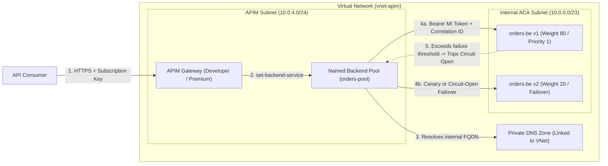
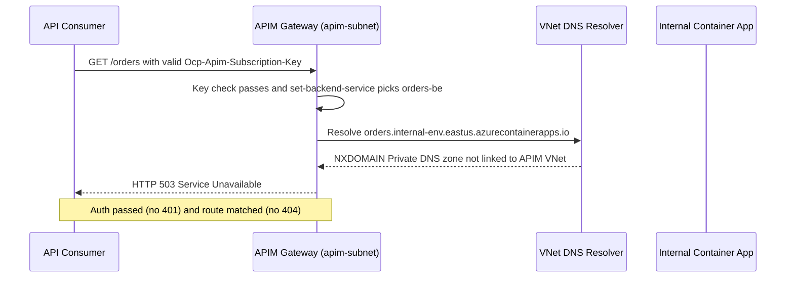

# Backend Integration Patterns

> **Prerequisites:** Azure APIM basics, Policies & Rate Limiting (Modules 00–04), Internal Container Apps Environments & Private DNS (`06/04`), Managed Identity (`06/06`, `16/02`), and Service Mesh Resilience (`13`).  
> **Estimated Reading Time:** 35 minutes  
> **Target Audience:** Backend Engineers, Platform Engineers, Cloud Architects.

> [!TIP]
> **The Golden Rule of Backend Integration:** Never leave an APIM-fronted backend exposed on a public FQDN—host it in an **internal-only VNet**, route via a **named backend** (never an inline `serviceUrl`) so you can attach pools, circuit breakers, and managed-identity auth, and treat a **`503` after a passing subscription key** as a **Private DNS or subnet routing** failure rather than an auth bug.

---

## Why This Matters

Until now your backend has been a *public* Container App FQDN — convenient, but it means anyone who discovers that FQDN can bypass the gateway entirely, defeating the point of putting APIM in front. The secure end state is a **private** backend that *only* APIM can reach, over VNet integration — using the exact internal Container Apps Environment and private DNS concepts from track 06. This module also covers routing to *multiple* backends: named backends, load balancing, and backend pools with circuit-breaker behavior — the gateway-edge cousin of the resilience patterns you met in the service mesh (track 13).

---

## 1. Architectural Mental Model: Private VNet Integration, Named Backends & Pool Resilience

APIM terminates incoming client TLS at the edge, evaluates auth and throttling policies, resolves the target via a **named backend** or **backend pool**, looks up the private IP through a **VNet-linked Private DNS Zone**, and opens a fresh authenticated connection across the VNet to your internal backend:



### Named backends: backends as first-class, reusable objects

So far you've set a backend by stuffing a URL into `--service-url` on the API. A **named backend** promotes that URL into its own reusable resource with an id, credentials, TLS settings, and (later) health/circuit-breaker config. Instead of repeating a URL across APIs, you define backend `orders-be` once and reference it from a policy with `set-backend-service backend-id="orders-be"`. This matters because everything richer — load balancing, pools, per-backend auth, circuit breakers — hangs off named backends, not off the inline `serviceUrl` string. Think of it as the difference between hardcoding an IP and defining a Service in Kubernetes: the named object is what you attach behavior to.

### VNet integration: reaching a private backend

To reach an **internal** backend, APIM has to be *on the network*. Two models, mirroring what you learned about Container Apps environments in track 06:

- **VNet injection** (Developer/Premium tiers) — the whole APIM gateway is deployed *into* a subnet in your VNet, so it can route to private IPs directly. Powerful, but only on classic tiers and it's the more involved setup.
- **Private/VNet connectivity via internal mode / private endpoints** — depending on tier, APIM connects to backends over private networking so traffic never traverses the public internet.

The target this module fronts is an **internal-only Container Apps Environment** (track 06 module 04): its apps resolve to a **private IP** via a **private DNS zone** linked to the VNet. For APIM to reach it, APIM must be in (or peered to) that VNet *and* able to resolve that private DNS zone — the same private-DNS-linked-to-VNet requirement from track 06. When it can't resolve or route, you get **503s** at the gateway, which is the diagnose-and-fix below.

### Load balancing across multiple backends (backend pools)

A **backend pool** is a named backend that fronts *several* real backends and distributes requests across them — for scale, for blue/green, or for multi-region. APIM supports weighted distribution (send 90% to A, 10% to B for a canary) and priority groups (prefer group 1; fall to group 2 if all are down). This is the gateway doing L7 load balancing at the product edge — conceptually the same "spread traffic across replicas/versions" you saw with Kubernetes Services and with track 06 revision traffic-splitting, but decided by APIM per request rather than by a Service's kube-proxy.

### Circuit breaker and health: failing fast (cousin of track 13)

A named backend can carry a **circuit breaker**: rules that **trip** the backend "open" (stop sending traffic to it) after a threshold of failures in a window, then probe and **reset** it when it recovers. While open, requests to that backend fail fast (or route to a healthy pool member) instead of piling onto a struggling service. If that sounds familiar, it's because it's the **same resilience idea as the service mesh** in track 13 (outlier detection / circuit breaking between services) — just applied *north-south* at the gateway rather than *east-west* in the mesh. The mental model transfers directly: don't hammer a sick backend; shed load and let it recover.

### Backend authentication and header handling

A private backend still needs to trust the caller. APIM can present credentials to the backend per named backend — a **managed identity** token (the same system/user-assigned identity model from track 06 module 06), a client certificate, or a static header/key. And because APIM terminates the client's TLS and opens a *new* connection to the backend, you control which headers pass through: forward a correlation id, inject an identity token for the backend, strip the client's `Authorization` if the backend shouldn't see it. This is the "APIM opens a fresh backend connection" consequence of the module-00 request path — the backend leg is a separate request you shape.

---

## 2. Taxonomic Comparison & Command Reference

### Inline `serviceUrl` vs. Named Backend vs. Backend Pool

| Capability | Inline `serviceUrl` | Single Named Backend (`Single`) | Backend Pool (`Pool`) |
| :--- | :--- | :--- | :--- |
| **Reusability Across APIs** | Duplicated per API string | Defined once, referenced via `backend-id` | Defined once, groups N named backends |
| **Weighted / Canary Split** | No | No | Yes (`weight`, e.g., 80/20 or 90/10) |
| **Priority Failover Groups** | No | No | Yes (`priority` groups, primary -> backup) |
| **Circuit Breaker Rules** | No | Yes (fail fast when threshold trips) | Yes (skips tripped pool members automatically) |
| **Per-Backend Credentials** | Limited | Yes (Managed Identity, client cert, header) | Inherits each member's credential config |

### Gateway Error Triage Matrix

| HTTP Status | Failing Layer | Typical Cause | First Diagnostic Command |
| :--- | :--- | :--- | :--- |
| **401** | Auth / Key / JWT | Missing/wrong subscription key or `aud`/`iss` mismatch | Check `Ocp-Apim-Subscription-Key` and decode JWT claims |
| **403** | Scope / Authorization | Valid JWT missing required `scp` or role | Inspect `<required-claims>` vs. token `scp` |
| **404** | Path / Route Mapping | API `--path` suffix or backend URL path mismatch | Compare `az apim api show` path vs. backend route |
| **429** | Rate Limit / Quota | Consumer exhausted `rate-limit-by-key` budget | Check `Retry-After` and `counter-key` expression |
| **503** | Backend Reachability | Unlinked Private DNS zone, NSG/subnet block, or backend down | Check `az network private-dns link vnet list` and APIM VNet |

### Command Reference

| Command | What it does | Example |
|---------|--------------|---------|
| `az apim backend create` | Define a named backend | `az apim backend create --resource-group rg --service-name <inst> --backend-id orders-be --url https://orders.internal... --protocol http` |
| `az apim backend show` | Inspect a named backend | `az apim backend show --resource-group rg --service-name <inst> --backend-id orders-be -o jsonc` |
| `az apim api policy create` | Attach `set-backend-service` / LB policy | `az apim api policy create --resource-group rg --service-name <inst> --api-id orders --policy-format xml --value "@backend.xml"` |
| `az network vnet create` | Create the VNet APIM/backend share (track 06/2) | `az network vnet create --name vnet-apim --resource-group rg --address-prefix 10.0.0.0/16 --subnet-name apim --subnet-prefix 10.0.1.0/24` |
| `az containerapp env create` (internal) | Internal-only backend Environment (track 06) | `... --infrastructure-subnet-resource-id <id> --internal-only true` |

Flag-by-flag and XML breakdowns:

`az apim backend create --resource-group rg-apim-m05 --service-name <inst> --backend-id orders-be --url https://orders.<internal-env>.azurecontainerapps.io --protocol http`
- `--backend-id orders-be` — the reusable id you reference from policies.
- `--url` — the backend's address (a **private** FQDN once you go internal).
- `--protocol http` — how APIM speaks to it (`http`/`soap`).

Route to a named backend and inject a Managed Identity token (inbound policy):
```xml
<inbound>
  <base />
  <authentication-managed-identity resource="api://orders-internal-backend" />
  <set-backend-service backend-id="orders-be" />
</inbound>
```
- `set-backend-service backend-id="orders-be"` — overrides the API's default backend for this request, routing to the named backend (and thus its pool/circuit-breaker config).
- `authentication-managed-identity` — fetches an Entra ID token using APIM's managed identity and attaches it as the backend `Authorization: Bearer ...` header without storing a secret.

Weighted load balancing across a pool (concept; pool defined as a backend of type `Pool` referencing members with `weight`/`priority`):
- `weight` — relative share of traffic (90/10 for a canary).
- `priority` — failover order; higher-priority group is used until all its members are down, then the next group takes over (the "prefer A, fall back to B" pattern).

Circuit-breaker rule (on a named backend): a rule with a **failure threshold**, a **window**, and a **trip duration** — e.g. "trip if >50% of calls fail over 1 minute; stay open 30s before probing." While open, the backend is skipped/fails fast, mirroring track 13's outlier detection.

---

## 3. Production War Story Post-Mortem: Unlinked Private DNS Zone Causing Total Gateway `503` Outage

| Field | Incident Details |
| :--- | :--- |
| **Severity** | **SEV-1** (Complete Production Orders API Outage) |
| **Detection / Resolution Time** | Detected in 3 minutes via Azure Monitor 5xx alert / Resolved in 22 minutes |
| **Impact** | 100% of `/orders` API traffic returned `503 Service Unavailable` immediately after cutting the backend over to an internal-only Container Apps Environment |

### What Happened

A platform team migrated the Orders microservice from a public Container Apps Environment to an `--internal-only true` environment to eliminate gateway bypass. All subscription keys and JWT checks passed, yet every call through APIM failed immediately with `503 Service Unavailable`.



### Root Cause Analysis

1. **Missing Private DNS VNet link**: Azure auto-created the Private DNS zone inside the Container Apps managed infrastructure resource group, but linked it only to a spoke test VNet—not to `vnet-apim` where APIM's subnet lived.
2. **False validation from a developer jumpbox**: Engineers had tested `curl` from a jumpbox wired to a custom corporate DNS forwarder, masking the missing VNet link on APIM's subnet.
3. **Inline `serviceUrl` blocked multi-region fallback**: Because the API used an inline `serviceUrl` rather than a named backend pool with priority failover, APIM had no secondary healthy endpoint to fail over to during the outage.

### The Fix & Architectural Hardening

- Linked the Container Apps Environment's Private DNS zone (`*.internal-env...`) directly to `vnet-apim` via `az network private-dns link vnet create`.
- Migrated the API off inline `serviceUrl` onto a **named backend pool** (`orders-pool`) with priority failover and a 30-second circuit-breaker rule, paired with `<authentication-managed-identity />` on the backend leg.
- Added a post-deploy smoke test calling the gateway URL directly (`$gw/orders/health`) that treats `503` with passing auth as an automatic rollback trigger.

---

## 4. Multi-Language Production Implementation: Named Backend Pool Router with Circuit Breaker & Managed Identity Auth

These four implementations model the gateway-to-backend integration pattern directly: selecting across a **priority + weighted named backend pool**, tracking sliding-window errors for a **circuit breaker** (`Closed` -> `Open` -> `Half-Open`), stripping inbound caller auth, and injecting a fresh **Managed Identity token** plus correlation ID on the backend leg.

````carousel
```go
package backendpool

import (
	"context"
	"errors"
	"fmt"
	"math/rand"
	"net/http"
	"sync"
	"time"
)

type CircuitState int

const (
	Closed CircuitState = iota
	Open
	HalfOpen
)

type NamedBackend struct {
	ID           string
	URL          string
	Priority     int
	Weight       int
	mu           sync.Mutex
	state        CircuitState
	failures     int
	requests     int
	openedAt     time.Time
	tripDuration time.Duration
}

func (b *NamedBackend) Allow() bool {
	b.mu.Lock()
	defer b.mu.Unlock()
	if b.state == Open {
		if time.Since(b.openedAt) >= b.tripDuration {
			b.state = HalfOpen
			return true
		}
		return false
	}
	return true
}

func (b *NamedBackend) Record(statusCode int) {
	b.mu.Lock()
	defer b.mu.Unlock()
	b.requests++
	if statusCode >= 500 || statusCode == 0 {
		b.failures++
		if b.state == HalfOpen || (b.requests >= 4 && float64(b.failures)/float64(b.requests) > 0.5) {
			b.state = Open
			b.openedAt = time.Now()
		}
		return
	}
	if b.state == HalfOpen {
		b.state = Closed
		b.failures = 0
		b.requests = 0
	}
}

func SelectBackend(pool []*NamedBackend) (*NamedBackend, error) {
	bestPriority := 1<<31 - 1
	var candidates []*NamedBackend
	totalWeight := 0
	for _, b := range pool {
		if !b.Allow() {
			continue
		}
		if b.Priority < bestPriority {
			bestPriority = b.Priority
			candidates = []*NamedBackend{b}
			totalWeight = b.Weight
		} else if b.Priority == bestPriority {
			candidates = append(candidates, b)
			totalWeight += b.Weight
		}
	}
	if len(candidates) == 0 {
		return nil, errors.New("503 all named backends tripped open")
	}
	pick := rand.Intn(totalWeight)
	for _, c := range candidates {
		pick -= c.Weight
		if pick < 0 {
			return c, nil
		}
	}
	return candidates[0], nil
}

func ForwardToBackend(ctx context.Context, client *http.Client, pool []*NamedBackend, path, miToken, corrID string) (*http.Response, error) {
	be, err := SelectBackend(pool)
	if err != nil {
		return nil, err
	}
	req, err := http.NewRequestWithContext(ctx, http.MethodGet, be.URL+path, nil)
	if err != nil {
		return nil, err
	}
	// Fresh backend leg: replace caller auth with APIM Managed Identity token
	req.Header.Set("Authorization", "Bearer "+miToken)
	req.Header.Set("X-Correlation-Id", corrID)
	resp, err := client.Do(req)
	if err != nil {
		be.Record(0)
		return nil, fmt.Errorf("503 backend %s unreachable: %w", be.ID, err)
	}
	be.Record(resp.StatusCode)
	return resp, nil
}
```
<!-- slide -->
```typescript
export type CircuitState = "closed" | "open" | "half-open";

export class NamedBackend {
  private state: CircuitState = "closed";
  private requests = 0;
  private failures = 0;
  private openedAt = 0;

  constructor(
    public readonly id: string,
    public readonly url: string,
    public readonly priority: number,
    public readonly weight: number,
    private readonly tripDurationMs = 30_000
  ) {}

  allow(now = Date.now()): boolean {
    if (this.state === "open") {
      if (now - this.openedAt >= this.tripDurationMs) {
        this.state = "half-open";
        return true;
      }
      return false;
    }
    return true;
  }

  record(statusCode: number, now = Date.now()): void {
    this.requests += 1;
    if (statusCode === 0 || statusCode >= 500) {
      this.failures += 1;
      const failureRatio = this.failures / this.requests;
      if (this.state === "half-open" || (this.requests >= 4 && failureRatio > 0.5)) {
        this.state = "open";
        this.openedAt = now;
      }
      return;
    }
    if (this.state === "half-open") {
      this.state = "closed";
      this.requests = 0;
      this.failures = 0;
    }
  }
}

export function selectBackend(pool: NamedBackend[]): NamedBackend {
  const eligible = pool.filter((b) => b.allow());
  if (eligible.length === 0) {
    throw new Error("HTTP 503: all named backends in pool are circuit-open");
  }
  const topPriority = Math.min(...eligible.map((b) => b.priority));
  const tier = eligible.filter((b) => b.priority === topPriority);
  const totalWeight = tier.reduce((sum, b) => sum + b.weight, 0);
  let cursor = Math.random() * totalWeight;
  for (const member of tier) {
    cursor -= member.weight;
    if (cursor <= 0) return member;
  }
  return tier[0];
}

export async function forwardWithManagedIdentity(
  pool: NamedBackend[],
  path: string,
  miToken: string,
  correlationId: string
): Promise<Response> {
  const backend = selectBackend(pool);
  try {
    const resp = await fetch(`${backend.url}${path}`, {
      headers: {
        Authorization: `Bearer ${miToken}`,
        "X-Correlation-Id": correlationId,
      },
      signal: AbortSignal.timeout(5000),
    });
    backend.record(resp.status);
    return resp;
  } catch (err) {
    backend.record(0);
    throw new Error(`HTTP 503 reaching ${backend.id}: ${String(err)}`);
  }
}
```
<!-- slide -->
```python
from dataclasses import dataclass, field
import random
import time
from typing import Sequence
import urllib.request
import urllib.error


@dataclass
class NamedBackend:
    backend_id: str
    url: str
    priority: int = 1
    weight: int = 100
    trip_duration_sec: float = 30.0
    state: str = field(default="closed", init=False)
    requests: int = field(default=0, init=False)
    failures: int = field(default=0, init=False)
    opened_at: float = field(default=0.0, init=False)

    def allow(self) -> bool:
        if self.state == "open":
            if time.monotonic() - self.opened_at >= self.trip_duration_sec:
                self.state = "half-open"
                return True
            return False
        return True

    def record(self, status_code: int) -> None:
        self.requests += 1
        if status_code == 0 or status_code >= 500:
            self.failures += 1
            if self.state == "half-open" or (
                self.requests >= 4 and (self.failures / self.requests) > 0.5
            ):
                self.state = "open"
                self.opened_at = time.monotonic()
            return
        if self.state == "half-open":
            self.state = "closed"
            self.requests = 0
            self.failures = 0


def select_backend(pool: Sequence[NamedBackend]) -> NamedBackend:
    eligible = [b for b in pool if b.allow()]
    if not eligible:
        raise RuntimeError("HTTP 503: no healthy backends available in pool")
    min_priority = min(b.priority for b in eligible)
    tier = [b for b in eligible if b.priority == min_priority]
    weights = [b.weight for b in tier]
    return random.choices(tier, weights=weights, k=1)[0]


def forward_to_private_backend(
    pool: Sequence[NamedBackend], path: str, mi_token: str, correlation_id: str
) -> tuple[int, bytes]:
    backend = select_backend(pool)
    req = urllib.request.Request(
        f"{backend.url}{path}",
        headers={
            "Authorization": f"Bearer {mi_token}",
            "X-Correlation-Id": correlation_id,
        },
    )
    try:
        with urllib.request.urlopen(req, timeout=5) as resp:
            backend.record(resp.status)
            return resp.status, resp.read()
    except urllib.error.HTTPError as exc:
        backend.record(exc.code)
        return exc.code, exc.read()
    except urllib.error.URLError as exc:
        backend.record(0)
        raise ConnectionError(f"HTTP 503: DNS/VNet failure for {backend.backend_id}: {exc}") from exc
```
<!-- slide -->
```csharp
using System.Net;
using System.Net.Http.Headers;

public enum CircuitState { Closed, Open, HalfOpen }

public sealed class NamedBackend(string id, Uri baseUri, int priority, int weight, TimeSpan? tripDuration = null)
{
    private readonly object _gate = new();
    private readonly TimeSpan _tripDuration = tripDuration ?? TimeSpan.FromSeconds(30);
    private CircuitState _state = CircuitState.Closed;
    private int _requests;
    private int _failures;
    private DateTimeOffset _openedAt;

    public string Id { get; } = id;
    public Uri BaseUri { get; } = baseUri;
    public int Priority { get; } = priority;
    public int Weight { get; } = weight;

    public bool Allow()
    {
        lock (_gate)
        {
            if (_state != CircuitState.Open) return true;
            if (DateTimeOffset.UtcNow - _openedAt >= _tripDuration)
            {
                _state = CircuitState.HalfOpen;
                return true;
            }
            return false;
        }
    }

    public void Record(int statusCode)
    {
        lock (_gate)
        {
            _requests++;
            if (statusCode == 0 || statusCode >= 500)
            {
                _failures++;
                if (_state == CircuitState.HalfOpen || (_requests >= 4 && (double)_failures / _requests > 0.5))
                {
                    _state = CircuitState.Open;
                    _openedAt = DateTimeOffset.UtcNow;
                }
                return;
            }
            if (_state == CircuitState.HalfOpen)
            {
                _state = CircuitState.Closed;
                _requests = 0;
                _failures = 0;
            }
        }
    }
}

public static class BackendPoolRouter
{
    public static async Task<HttpResponseMessage> ForwardAsync(
        HttpClient client,
        IReadOnlyList<NamedBackend> pool,
        string relativePath,
        string managedIdentityToken,
        string correlationId,
        CancellationToken ct = default)
    {
        var eligible = pool.Where(b => b.Allow()).ToList();
        if (eligible.Count == 0)
            throw new HttpRequestException("All named backends in pool are circuit-open", null, HttpStatusCode.ServiceUnavailable);

        int topPriority = eligible.Min(b => b.Priority);
        var tier = eligible.Where(b => b.Priority == topPriority).ToList();
        int totalWeight = tier.Sum(b => b.Weight);
        int pick = Random.Shared.Next(totalWeight);
        var selected = tier[0];
        foreach (var candidate in tier)
        {
            pick -= candidate.Weight;
            if (pick < 0) { selected = candidate; break; }
        }

        using var req = new HttpRequestMessage(HttpMethod.Get, new Uri(selected.BaseUri, relativePath));
        req.Headers.Authorization = new AuthenticationHeaderValue("Bearer", managedIdentityToken);
        req.Headers.TryAddWithoutValidation("X-Correlation-Id", correlationId);

        try
        {
            var resp = await client.SendAsync(req, ct);
            selected.Record((int)resp.StatusCode);
            return resp;
        }
        catch (HttpRequestException ex)
        {
            selected.Record(0);
            throw new HttpRequestException($"HTTP 503 reaching {selected.Id}: {ex.Message}", ex, HttpStatusCode.ServiceUnavailable);
        }
    }
}
```
````

---

## 5. Practical Hands-On Verification CLI Workflows

> **Time note:** this module needs **VNet integration**, which requires a **Developer-tier** (classic) instance — Consumption cannot join a VNet. That means a **30-45 minute** provisioning wait *and* a continuously-billing instance. Kick off the `az apim create` first, do the networking setup while it provisions, and **delete the instance the same day** (final cleanup step). If you want to avoid the classic-tier cost entirely, do exercises 1-4 (named backends, load balancing, circuit-breaker config) on **Consumption** with a public backend, and treat the VNet steps (5-8) as read-and-reason.

### 1. Kick off the (slow) Developer instance, then build the network while it provisions
```powershell
az group create --name rg-apim-m05 --location eastus
$apim = "apimm05$((Get-Random -Max 99999))"
az apim create --name $apim --resource-group rg-apim-m05 --location eastus `
  --publisher-name "You" --publisher-email you@example.com --sku-name Developer --no-wait
# ^ returns immediately; provisioning continues ~30-45 min. Build the network now:
az network vnet create --name vnet-apim --resource-group rg-apim-m05 `
  --address-prefix 10.0.0.0/16 --subnet-name aca-infra --subnet-prefix 10.0.0.0/23
az network vnet subnet create --resource-group rg-apim-m05 --vnet-name vnet-apim `
  --name apim-subnet --address-prefix 10.0.4.0/24
```

### 2. Create an internal-only Container Apps Environment (track 06 module 04)
```powershell
$subnet = az network vnet subnet show --resource-group rg-apim-m05 --vnet-name vnet-apim --name aca-infra --query id -o tsv
az containerapp env create --name env-m05i --resource-group rg-apim-m05 --location eastus `
  --infrastructure-subnet-resource-id $subnet --internal-only true
az containerapp create --name orders --resource-group rg-apim-m05 --environment env-m05i `
  --image mcr.microsoft.com/k8se/quickstart:latest --target-port 80 --ingress external
$ifqdn = az containerapp show --name orders --resource-group rg-apim-m05 --query properties.configuration.ingress.fqdn -o tsv
$ifqdn
```

**Expected Output:**
```text
orders.internal.<unique-id>.eastus.azurecontainerapps.io
```
`$ifqdn` resolves to a **private** IP — unreachable from your laptop by design (track 06 module 04). That's the point.

### 3. Define a named backend (public case first, to learn the object)
While the classic instance may still be provisioning, practice the concept against a throwaway Consumption instance or wait — then:
```powershell
az apim backend create --resource-group rg-apim-m05 --service-name $apim `
  --backend-id orders-be --url "https://$ifqdn" --protocol http
az apim backend show --resource-group rg-apim-m05 --service-name $apim --backend-id orders-be -o jsonc
```

**Expected Output:**
```json
{
  "name": "orders-be",
  "protocol": "http",
  "url": "https://orders.internal.<unique-id>.eastus.azurecontainerapps.io"
}
```

### 4. Point an API at the named backend
Create an `orders` API and attach an inbound policy `<set-backend-service backend-id="orders-be" />` (save as `backend.xml`, apply with `az apim api policy create ...`). This routes the API through the named backend rather than an inline `serviceUrl`.

### 5. Integrate APIM into the VNet
Once the Developer instance shows `provisioningState=Succeeded`, place it in the `apim-subnet` (via `az apim update`/portal VNet configuration for the classic tier). Ensure the subnet and the internal env's **private DNS zone** are linked so APIM can resolve `$ifqdn`. (This mirrors track 06 module 04's private-DNS-linked-to-VNet requirement exactly.)

```powershell
az network private-dns zone list --resource-group "MC_env-m05i_..." -o table
az network private-dns link vnet list --resource-group "MC_env-m05i_..." --zone-name "<private-dns-zone>" -o table
```

**Expected Output:**
```text
Name              RegistrationEnabled    VirtualNetworkLinkState    ProvisioningState
----------------  ---------------------  -------------------------  -------------------
link-vnet-apim    False                  Completed                  Succeeded
```

### 6. Call through the gateway to the private backend
```powershell
$key = az apim subscription show --resource-group rg-apim-m05 --service-name $apim --sid master --query primaryKey -o tsv
$gw = az apim show --name $apim --resource-group rg-apim-m05 --query gatewayUrl -o tsv
curl -i -H "Ocp-Apim-Subscription-Key: $key" "$gw/orders/"
```

**Expected Output:**
```http
HTTP/1.1 200 OK
Content-Type: text/html; charset=utf-8
```
A 200 proves APIM reached a backend your laptop *cannot* reach directly — the secure topology: public only at the gateway, private everywhere behind it.

### 7. Diagnose and fix: 503s from a backend VNet misconfiguration
Deliberately break resolution/routing: unlink the internal env's private DNS zone from the APIM subnet's VNet (or point the named backend at the private FQDN *before* linking DNS). Call the gateway:
```powershell
curl -i -H "Ocp-Apim-Subscription-Key: $key" "$gw/orders/"
```

**Expected Output:**
```http
HTTP/1.1 503 Service Unavailable
Content-Type: application/json
```
Expect **503 Service Unavailable** (or a backend-connection error) — the key passed (no 401), the API matched, but APIM **can't reach/resolve the private backend**.
- **Diagnose:** confirm APIM is in the VNet, the private DNS zone for the env's domain is **linked** to that VNet, and the subnet can route to the env's subnet.
- **Fix:** (re)link the private DNS zone to APIM's VNet so `$ifqdn` resolves to the private IP, and confirm routing; re-`curl` for 200. Lesson: a 503 *after* a passing key is a **backend reachability** problem — DNS/routing — not an auth or path problem (contrast module 01's 404 and module 04's 401).

### 8. Load-balancing / circuit-breaker reasoning
Define a second backend (`orders-be-2`) and (conceptually, or via a Pool backend) describe an 80/20 weighted split and a circuit-breaker rule that trips `orders-be` after >50% failures in 1 minute. Write down: which track-06 pattern the weighted split resembles (revision traffic-splitting) and which track-13 pattern the circuit breaker resembles (outlier detection / circuit breaking). You don't need to simulate real failures — the goal is to map the config to concepts you know.

### 9. Cleanup — do this the same day (Developer tier bills continuously)
```powershell
az group delete --name rg-apim-m05 --yes --no-wait
az apim list -o table
```
Verify nothing lingers: `az apim list -o table` should not show the instance once deletion completes (classic-tier deletes are also slow).

### Independent Challenge

Build the secure topology end to end: an **internal-only** Container Apps Environment hosting a backend that is unreachable from your laptop, a **Developer-tier** APIM integrated into the same VNet, a **named backend** (not an inline `serviceUrl`) pointing at the private FQDN, and a successful authenticated call through the gateway to that private backend. Then reproduce the **503 VNet misconfiguration** (break DNS linkage or routing), capture the exact symptom, and fix it — narrating why a 503-after-passing-key is categorically different from module 01's 404 and module 04's 401. This draws on **track 06 module 04** (internal environments, private DNS) and **module 04** here (the auth layer still applies in front of the private backend). Because this uses a classic tier, **tear the resource group down the same day** and confirm the APIM instance is gone.

<details><summary>Stuck? One hint</summary>

The private backend only works if APIM can *resolve* its FQDN to the private IP *and* route to it. That resolution is the same track-06-module-04 mechanism: a **private DNS zone** named after the environment's domain, **linked to the VNet APIM sits in**. List zones with `az network private-dns zone list` and their VNet links with `az network private-dns link vnet list`. A 503 with a passing key is almost always "APIM can't resolve or reach the backend" — start at DNS linkage.

</details>

---

## 6. Common Mistakes & Troubleshooting

- **Leaving the backend public.** If the backend keeps external ingress, callers can bypass APIM entirely. The secure pattern is internal-only backend + APIM as the only public entry.
- **Using Consumption for VNet integration.** Consumption can't join a VNet — VNet integration needs Developer/Premium. Trying it on Consumption fails; that's a tier limitation, not a bug.
- **Unlinked private DNS zone → 503.** The classic track-06 mistake resurfaces: APIM can't resolve the internal FQDN unless the env's private DNS zone is linked to APIM's VNet. Symptom is 503/connection errors after a passing key.
- **Inline `serviceUrl` where you needed a named backend.** Load balancing, pools, circuit breakers, and per-backend credentials all require a **named backend**; they can't hang off an inline URL.
- **Misreading the status code.** 401 = auth (module 04); 404 = path/backend mapping (module 01); **503 = backend reachability** (this module). Each points at a different layer.
- **Cost pitfall — the classic-tier trap.** This is the module most likely to leave a **Developer-tier instance running** because it's slow to create and you step away. It bills continuously. Set a reminder and delete the resource group the same day; verify with `az apim list -o table`.

---

## 7. Operational Validation Checkpoints & Cumulative Review

### Operational Validation Checkpoints

<details><summary><strong>Checkpoint 1: Diagnosing 503 after a passing subscription key vs. 401 and 404</strong></summary>

When a request passes its subscription key check (`no 401`) and matches an APIM route (`no 404`), returning `503 Service Unavailable` isolates the problem strictly to the **backend reachability leg**. Verify in order: (1) APIM is injected into or integrated with the VNet, (2) the internal Container Apps Environment's Private DNS zone has a completed link to APIM's VNet, and (3) no NSG or UDR blocks traffic from `apim-subnet` to `aca-infra`.

</details>

<details><summary><strong>Checkpoint 2: Choosing Developer/Premium vs. Consumption for private backends</strong></summary>

Consumption-tier APIM is a serverless multi-tenant gateway with no VNet injection capability, so it cannot resolve private DNS zones or route to internal Container Apps IPs. Whenever the security requirement dictates **zero public internet exposure** on the backend, you must use Developer (dev/test) or Premium/VNet-integrated tiers and enforce same-day teardown in non-prod labs.

</details>

<details><summary><strong>Checkpoint 3: Canary split + automatic failover with a Backend Pool</strong></summary>

Define two named backends (`orders-be-v1` and `orders-be-v2`) with circuit-breaker rules (e.g., trip open if >50% 5xx over 60 seconds for 30 seconds), then wrap them in a `Pool` named backend with `priority: 1` (`weight: 90` on `v1`, `weight: 10` on `v2`) and an emergency static/backup backend at `priority: 2`. APIM handles canary shifting and automatic fail-fast degradation at the product edge.

</details>

### Checkpoint quiz

Write down your answer to each question before expanding it — checking without attempting first is the single easiest way to fool yourself into thinking you've learned this.

1. Why is a public backend behind APIM a security problem, and what's the secure alternative?
2. What is a named backend, and what capabilities require one rather than an inline `serviceUrl`?
3. Why can't you use the Consumption tier for VNet integration, and which tiers can?
4. What track-06 mechanism must be in place for APIM to reach an internal Container Apps backend by its FQDN?
5. You call the gateway, the key is accepted, and you get a 503. Which layer is the problem, and what do you check first?
6. What is a backend pool, and give one use for weighted distribution.
7. Which track-13 pattern is APIM's circuit breaker the north-south cousin of, and what does "tripping open" do?
8. How can APIM authenticate *to* a private backend without a stored secret?

<details><summary>Show answers</summary>

1. A public backend can be called directly, bypassing the gateway's auth/limits/metering. The secure alternative is an **internal-only** backend reachable only by APIM, with APIM as the sole public entry point.
2. A reusable backend resource with an id, credentials, TLS, and health/circuit config. **Load balancing, backend pools, circuit breakers, and per-backend credentials** all require a named backend.
3. Consumption can't join a VNet — it's a serverless multi-tenant tier. **VNet integration/injection requires Developer or Premium.**
4. A **private DNS zone** named after the environment's domain, **linked to the VNet APIM is in**, so the internal FQDN resolves to the private IP (plus subnet routing) — the same track-06-module-04 requirement.
5. The **backend reachability** layer. Check that APIM is in the VNet, the env's private DNS zone is linked to APIM's VNet (so the FQDN resolves), and routing between subnets works.
6. A named backend fronting several real backends with distribution across them. Weighted distribution enables canary/blue-green (e.g. 90/10) or spreading load.
7. The service mesh's **outlier detection / circuit breaking** (track 13). Tripping open stops sending traffic to a failing backend so requests fail fast (or route to healthy members) until it recovers.
8. With a **managed identity** (system/user-assigned, track 06 module 06) whose token APIM presents to the backend — no stored secret — or a client certificate.

</details>

### Cumulative review

Closed-book. Don't reopen modules 03-05 while attempting these — mix across the whole track so far and the tracks it builds on.

1. For one request, place these in the exact pipeline order and say which fails with which status: subscription-key check, `validate-jwt`, `rate-limit-by-key`, `set-backend-service` to a private backend (modules 03-05).
2. Match each status to its layer and a one-line fix: **401**, **403**, **404**, **429**, **503** (modules 01, 03, 04, 05).
3. A per-consumer rate limit is throttling legitimate users. Give the wrong-scope cause, the `-by-key` fix, and the `counter-key` expression (module 03).
4. A token you decoded and confirmed valid is rejected 401 at the gateway. Name the single most likely policy misconfiguration and how you'd confirm it against the token (module 04, track 16).
5. Explain why the same "circuit breaker" idea appears in both this track and the service mesh (track 13), and what differs about *where* it's applied.
6. You moved the backend to an internal-only Container Apps Environment and now get 503s. List, in order, the track-06/module-05 things you'd verify to restore reachability.
7. Justify, on cost grounds, using Consumption for modules 03-04 but Developer for module 05 — and state the same-day rule that follows from it (modules 01, 05).
8. You need `v2` of an API to route 10% of traffic to a new backend while `v1` stays stable. Combine a **module-02** concept and a **module-05** concept to describe the setup.
9. Where does each of these belong — inbound, backend, outbound, or on-error: strip a `Server` header, `validate-jwt`, `set-backend-service`, return a friendly error body on failure (modules 03-05)?
10. A teammate points the API's inline `serviceUrl` at the private FQDN and expects load balancing "later." Explain what they'll have to change and why (module 05).

<details><summary>Show answers</summary>

1. Order: subscription-key check → `rate-limit-by-key` → `validate-jwt` → `set-backend-service` → forward. Key fails **401**; rate limit fails **429**; JWT fails **401** (or **403** if a scope is missing); an unreachable private backend fails **503**.
2. **401** = auth/token (fix: valid key or matching audience/issuer). **403** = valid token missing scope (fix: grant/require correct scope). **404** = path/backend mapping (fix: `--path` vs `--service-url`). **429** = throttled (fix: per-consumer `-by-key` limits / raise limit). **503** = backend unreachable (fix: VNet/private-DNS/routing).
3. Cause: a **plain** `rate-limit` pooling all consumers at one scope. Fix: use `rate-limit-by-key` with `counter-key="@(context.Subscription.Id)"`.
4. An **audience (`aud`) mismatch** in `validate-jwt` (or issuer/version). Confirm by decoding the token (jwt.ms) and comparing its `aud`/`iss` to the policy's `<audiences>`/`<issuers>`.
5. Both prevent hammering a failing dependency by shedding load and letting it recover. The mesh applies it **east-west** between services (track 13); APIM applies it **north-south** at the product edge on a named backend.
6. Verify: APIM is in the VNet; the env's **private DNS zone** is **linked** to APIM's VNet (FQDN resolves to private IP); subnet routing allows APIM→env; then re-test — a passing key + 503 means reachability, not auth.
7. Modules 03-04 need no VNet, so **Consumption** (pay-per-call, idles free) is cheapest; module 05 needs VNet integration, which **only classic tiers** support, so **Developer** — which **bills continuously**, hence **delete it the same day**.
8. Use a **version set** (module 02) so `v2` is its own API, and a **backend pool with weighted distribution** (module 05) on `v2`'s backend sending ~10% to the new member and 90% to the stable one.
9. Strip `Server` → **outbound**. `validate-jwt` → **inbound**. `set-backend-service` → **inbound** (or backend). Friendly error body → **on-error**.
10. Inline `serviceUrl` can't carry load balancing, pools, or circuit breakers — they require a **named backend**. They'll have to define a named backend (or a Pool backend) and route to it via `set-backend-service`.

</details>

---

## 8. Next

[06-developer-portal-and-api-products](../06-developer-portal-and-api-products/README.md) — package APIs into **products** with subscription models, enable self-service sign-up, add terms of use, and publish the auto-generated developer portal (survey level — this is the platform-ops view, not full API-product management).
