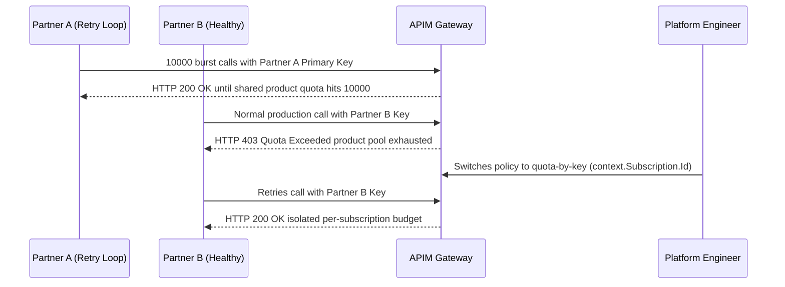

# Developer Portal & API Products

> **Prerequisites:** Azure APIM basics, Policy Scopes, JWT Authentication, and Backend Integration (Modules 00–05).  
> **Estimated Reading Time:** 25 minutes  
> **Target Audience:** Backend Engineers, Platform Engineers, API Product Owners.

> [!TIP]
> **The Golden Rule of API Products:** Attach **plans, terms of use, approval gates, and shared quotas** to the **Product**—never to a raw API; remember that **subscription keys are scoped to a product** (returning `401` on any unattached API), **primary and secondary keys** exist for zero-downtime rotation, and the managed **Developer Portal** requires a classic tier (Developer+) plus an explicit **Publish** action.

---

## Why This Matters

You've built the machinery — a fronted, versioned, policy-protected, privately integrated API. But nobody *consumes* an API by reading your `az` history. A **product** packages one or more APIs with a subscription model and limits, and the **developer portal** is the self-service storefront where consumers discover the API, read docs, accept terms, get a subscription key, and try calls — all without you provisioning anything by hand. This is the packaging-and-distribution layer. It's covered survey-level here: enough to publish a working product and portal, since this is a platform-ops track, not a full API-product-management one.

---

## 1. Architectural Mental Model: Product Packaging, Subscription Scopes & Self-Service Storefront

Products sit between consumers and your APIs. A developer discovers published products in the **Developer Portal**, accepts legal terms, passes optional approval, receives a **product-scoped subscription** with two rotating keys, and sends runtime calls through APIM's nested policy pipeline (`Global → Product → API → Operation`):

```mermaid
flowchart LR
    Dev["API Consumer"] -->|1. Sign up & Accept Terms| Portal["Managed Developer Portal (Classic Tier Published)"]
    Portal -->|2a. approvalRequired false| Instant["Instant Active Subscription"]
    Portal -->|2b. approvalRequired true| Pending["Pending Admin Approval"]
    Pending -->|Publisher Approves| Instant

    Instant -->|Issues Primary + Secondary Key| KeyScope["Subscription Scope (/products/free or /products/partner)"]

    subgraph Runtime["Gateway Policy Evaluation Pipeline"]
        Global["Global Policy"] --> ProdPol["Product Policy (quota-by-key / rate-limit)"]
        ProdPol --> APIPol["API Policy (validate-jwt)"]
        APIPol --> OpPol["Operation Policy"]
        OpPol --> BE["Backend Service"]
    end

    KeyScope -->|3. Runtime Call + Ocp-Apim-Subscription-Key| Global
```



### Products: packaging APIs for consumers

A **product** is a named bundle of one or more APIs plus a policy and a subscription model — think "Starter plan" or "Partner tier." Products are how you say "these three APIs, together, at 1000 calls/day, are a thing partners can subscribe to." A product has: the APIs it contains, a **product-scope policy** (module 03's broadest-but-one scope — a great place to put a shared quota that applies across every API in the bundle), a published/unpublished state, and whether it requires a **subscription** and/or **approval**. The same API can live in multiple products at different limits (a Free product at 100/day and a Pro product at 100000/day, both fronting the same backend) — the product, not the API, carries the plan.

### Subscriptions and subscription keys, properly

A **subscription** is the relationship between a consumer and a product: it's what issues the **subscription key** you've been using since module 01. When a developer subscribes to a product (self-service in the portal, or created by you via CLI), APIM mints a subscription with a primary and secondary key. The **two keys** exist for zero-downtime rotation — rotate one while the other keeps working, then swap. A subscription is scoped to a product (so the key is only valid for that product's APIs), which is exactly what makes per-consumer metering and quotas meaningful: the key *is* the consumer identity for the product layer (distinct from the JWT identity layer in module 04).

### Approval and terms of use

Products can gate subscriptions two ways. **Approval required** means a developer's subscription request sits pending until a publisher approves it — appropriate for partner/paid tiers where you vet consumers. **Terms of use** is text a developer must accept before subscribing — your acceptable-use policy, rate expectations, data handling. For an open Free tier you might require neither; for a partner product you'd require both. These are product settings, not code, and they're the difference between "anyone can self-serve instantly" and "consumers onboard through a controlled gate."

### The developer portal: the self-service storefront

The **developer portal** is an auto-generated, brandable website APIM hosts for you. Out of the box it lists published products and their APIs, renders the OpenAPI-derived docs, provides an interactive **"Try it"** console (which calls through the real gateway with the developer's key), and lets developers sign up, subscribe, and manage their keys. You publish it once; it stays in sync with your APIs. **Tier note:** the managed developer portal is a **classic-tier** feature (Developer and above) — the **Consumption** tier does **not** include the managed portal, so this is one of the two modules (with module 05) where you need a classic instance, with the same cost/time caveats. You can customize branding and content, but that's beyond this survey — the goal is to publish a working portal and watch a self-service subscription flow end to end.

### Where products sit relative to everything else

Tie it together with the pipeline from module 03. At request time the scopes evaluate global → **product** → API → operation. So a **product-scope quota** applies to *every* API in the product uniformly — the natural home for "this plan gets N calls/day." The subscription key identifies which product subscription the call belongs to, so `context.Subscription.Id` (your `-by-key` counter-key from module 03) is meaningful *because* products and subscriptions exist. Products aren't a separate feature bolted on; they're the layer that makes per-consumer policy and self-service distribution work.

---

## 2. Taxonomic Comparison & Command Reference

### Subscription Key Identity vs. Entra ID JWT Identity

| Dimension | APIM Subscription Key | Entra ID JWT (`validate-jwt`) |
| :--- | :--- | :--- |
| **Layer** | Product / Metering / Plan Contract | User / Workload Authorization |
| **Issued By** | APIM Subscription (or Developer Portal) | Identity Provider (Entra ID) |
| **Scope Boundary** | Product (`/products/free`), All APIs, or Single API | Audience (`aud`) and Scopes/Roles (`scp` / `roles`) |
| **Zero-Downtime Rotation** | Dual primary + secondary key swap | Signing key rollover via OIDC JWKS endpoint |
| **Policy Context Key** | `context.Subscription.Id` | `context.Request.Headers.GetValueOrDefault("Authorization")` claims |

### Product Onboarding & Tier Capabilities

| Product Posture | `--subscription-required` | `--approval-required` | `--state` | Typical Use Case |
| :--- | :--- | :--- | :--- | :--- |
| **Free / Self-Serve** | `true` | `false` | `published` | Public sandbox / instant key minting |
| **Partner / Vetted** | `true` | `true` | `published` | Paid/B2B APIs requiring manual review |
| **Draft / Internal Staging** | `true` | `true` | `notPublished` | Hidden from portal during pre-launch setup |

*Note on Consumption vs. Classic Tiers:* You can create products, attach APIs, apply product policies, and mint CLI subscriptions on **Consumption**, but the **managed Developer Portal** requires a classic tier (Developer or above).

### Command Reference

| Command | What it does | Example |
|---------|--------------|---------|
| `az apim product create` | Create a product (plan) | see below |
| `az apim product api add` | Add an API to a product | `az apim product api add --resource-group rg --service-name <inst> --product-id starter --api-id orders` |
| `az apim product policy create` | Apply a product-scope policy (e.g. shared quota) | `az apim product policy create --resource-group rg --service-name <inst> --product-id starter --policy-format xml --value "@prod.xml"` |
| `az apim product show` | Inspect a product's settings | `az apim product show --resource-group rg --service-name <inst> --product-id starter -o jsonc` |
| `az apim subscription list` | List subscriptions (and their keys) | `az apim subscription list --resource-group rg --service-name <inst> -o table` |

Flag-by-flag breakdowns:

`az apim product create --resource-group rg-apim-m06 --service-name <inst> --product-id starter --product-name "Starter" --subscription-required true --approval-required false --state published --legal-terms "Fair use only."`
- `--product-id starter` — the id you reference when adding APIs / scoping policy.
- `--subscription-required true` — consumers need a subscription (and thus a key) to call the product's APIs.
- `--approval-required false` — subscriptions are granted instantly (self-serve). Set `true` for a vetted/partner product where you approve each request.
- `--state published` — makes the product visible in the developer portal. `notPublished` hides it while you set it up.
- `--legal-terms "..."` — the **terms of use** a developer must accept before subscribing.

`az apim product policy create --resource-group rg-apim-m06 --service-name <inst> --product-id starter --policy-format xml --value "@prod.xml"` where `prod.xml`:
```xml
<policies>
  <inbound>
    <base />
    <quota calls="1000" renewal-period="86400" />
  </inbound>
  <backend><base /></backend>
  <outbound><base /></outbound>
  <on-error><base /></on-error>
</policies>
```
- A **product-scope** quota of 1000 calls/day applied uniformly across every API in the Starter product — the plan's volume cap. (Counts per the product scope; use `quota-by-key` keyed by `context.Subscription.Id` if you want it per subscription rather than per product total.)

---

## 3. Production War Story Post-Mortem: Shared Product Quota Exhaustion & Botched Key Rotation

| Field | Incident Details |
| :--- | :--- |
| **Severity** | **SEV-2** (All Partner Integrations Throttled & Secondary Key Broken) |
| **Detection / Resolution Time** | Detected in 11 minutes via partner support escalation / Resolved in 35 minutes |
| **Impact** | One misbehaving partner script consumed the entire `partner` product's daily quota, blocking every other partner with `403 Quota Exceeded`; an uncoordinated primary key regeneration during triage caused a second outage |

### What Happened

A platform team configured a `Partner` product with `<quota calls="10000" renewal-period="86400" />` intending to give *each* partner 10,000 calls/day. When Partner A entered a retry loop, Partner B and Partner C were immediately locked out. Worse, an operator regenerated Partner A's primary key directly instead of rotating via the secondary key first.



### Root Cause Analysis

1. **Product-wide `<quota>` vs. per-subscriber `<quota-by-key>`**: `<quota>` counts *total calls across the entire product scope*, allowing one noisy tenant to starve all others.
2. **Skipping dual-key rotation workflow**: Regenerating `primaryKey` immediately invalidated Partner A's live app before Partner A switched to `secondaryKey`.
3. **Unattached new API**: When a new `invoices` API was deployed, engineers forgot `az apim product api add --product-id partner --api-id invoices`, triggering `401` errors for legitimate partner keys.

### The Fix & Architectural Hardening

- Replaced `<quota>` with `<quota-by-key calls="10000" renewal-period="86400" counter-key="@(context.Subscription.Id)" />` at product scope so every subscription owns an isolated daily counter.
- Standardized a zero-downtime key rotation runbook: (1) consumer switches to `secondaryKey`, (2) ops regenerates `primaryKey`, (3) consumer switches back or keeps `secondaryKey` until next cycle.
- Enforced automated CI checks verifying every API is attached to its target products and every classic Developer Portal change ends with an explicit **Publish** step.

---

## 4. Multi-Language Production Implementation: Dual-Key Subscription Verifier, Zero-Downtime Rotation & Product-Scope Quota

These four implementations model APIM's product-layer contract: verifying a subscription key against both **primary and secondary keys** (supporting zero-downtime key rotation), validating that the requested **API is included in the subscription's product scope** (returning `401` otherwise), and enforcing an isolated per-subscription **`quota-by-key`** counter.

````carousel
```go
package apiproducts

import (
	"crypto/rand"
	"crypto/subtle"
	"encoding/hex"
	"errors"
	"sync"
)

type Product struct {
	ID         string
	APIs       map[string]bool
	DailyQuota int
}

type Subscription struct {
	ID           string
	ProductID    string
	PrimaryKey   string
	SecondaryKey string
	Active       bool
	UsedToday    int
}

type ProductCatalog struct {
	mu            sync.Mutex
	products      map[string]*Product
	subscriptions map[string]*Subscription
}

func (c *ProductCatalog) Authorize(presentedKey, apiID string) (int, string, error) {
	c.mu.Lock()
	defer c.mu.Unlock()

	var matched *Subscription
	for _, sub := range c.subscriptions {
		if !sub.Active {
			continue
		}
		pMatch := subtle.ConstantTimeCompare([]byte(presentedKey), []byte(sub.PrimaryKey)) == 1
		sMatch := subtle.ConstantTimeCompare([]byte(presentedKey), []byte(sub.SecondaryKey)) == 1
		if pMatch || sMatch {
			matched = sub
			break
		}
	}
	if matched == nil {
		return 401, "", errors.New("missing or invalid subscription key")
	}

	prod := c.products[matched.ProductID]
	if prod == nil || !prod.APIs[apiID] {
		// Key exists, but target API is not packaged inside this product
		return 401, "", errors.New("subscription key not valid for this API product scope")
	}
	if matched.UsedToday >= prod.DailyQuota {
		return 429, matched.ID, errors.New("per-subscription daily quota exceeded")
	}
	matched.UsedToday++
	return 200, matched.ID, nil
}

// RotatePrimaryZeroDowntime regenerates PrimaryKey only after consumers adopt SecondaryKey.
func (c *ProductCatalog) RotatePrimaryZeroDowntime(subID string) (string, error) {
	c.mu.Lock()
	defer c.mu.Unlock()
	sub, ok := c.subscriptions[subID]
	if !ok {
		return "", errors.New("subscription not found")
	}
	buf := make([]byte, 16)
	if _, err := rand.Read(buf); err != nil {
		return "", err
	}
	sub.PrimaryKey = hex.EncodeToString(buf)
	return sub.PrimaryKey, nil
}
```
<!-- slide -->
```typescript
import { randomBytes, timingSafeEqual } from "node:crypto";

export interface Product {
  id: string;
  apiIds: Set<string>;
  dailyQuotaPerSubscription: number;
}

export interface Subscription {
  id: string;
  productId: string;
  primaryKey: string;
  secondaryKey: string;
  state: "active" | "submitted" | "suspended";
  usedToday: number;
}

function keysEqual(a: string, b: string): boolean {
  const ab = Buffer.from(a);
  const bb = Buffer.from(b);
  return ab.length === bb.length && timingSafeEqual(ab, bb);
}

export class ProductGate {
  constructor(
    private readonly products: Map<string, Product>,
    private readonly subscriptions: Subscription[]
  ) {}

  verifyCall(presentedKey: string, apiId: string): { status: number; subId?: string; reason: string } {
    const sub = this.subscriptions.find(
      (s) =>
        s.state === "active" &&
        (keysEqual(presentedKey, s.primaryKey) || keysEqual(presentedKey, s.secondaryKey))
    );
    if (!sub) {
      return { status: 401, reason: "Invalid or inactive subscription key" };
    }
    const product = this.products.get(sub.productId);
    if (!product || !product.apiIds.has(apiId)) {
      return { status: 401, reason: `Subscription scoped to ${sub.productId}, not ${apiId}` };
    }
    if (sub.usedToday >= product.dailyQuotaPerSubscription) {
      return { status: 429, subId: sub.id, reason: "Per-subscription quota-by-key exhausted" };
    }
    sub.usedToday += 1;
    return { status: 200, subId: sub.id, reason: "Allowed" };
  }

  rotateSecondaryKey(subId: string): string {
    const sub = this.subscriptions.find((s) => s.id === subId);
    if (!sub) throw new Error(`Unknown subscription ${subId}`);
    // Primary continues working seamlessly while consumers adopt the new secondary key
    sub.secondaryKey = randomBytes(16).toString("hex");
    return sub.secondaryKey;
  }
}
```
<!-- slide -->
```python
from dataclasses import dataclass, field
import hmac
import secrets
from typing import Literal


@dataclass
class Product:
    product_id: str
    api_ids: set[str]
    daily_quota_per_subscription: int


@dataclass
class Subscription:
    sub_id: str
    product_id: str
    primary_key: str
    secondary_key: str
    state: Literal["active", "submitted", "suspended"] = "active"
    used_today: int = field(default=0)


class ProductGatewayPolicy:
    def __init__(self, products: dict[str, Product], subscriptions: list[Subscription]) -> None:
        self._products = products
        self._subscriptions = subscriptions

    def evaluate(self, presented_key: str, api_id: str) -> tuple[int, str]:
        matched = next(
            (
                sub
                for sub in self._subscriptions
                if sub.state == "active"
                and (
                    hmac.compare_digest(presented_key, sub.primary_key)
                    or hmac.compare_digest(presented_key, sub.secondary_key)
                )
            ),
            None,
        )
        if matched is None:
            return 401, "Subscription key missing, pending approval, or invalid"

        product = self._products.get(matched.product_id)
        if product is None or api_id not in product.api_ids:
            return 401, f"Key scoped to /products/{matched.product_id}; {api_id} is excluded"

        if matched.used_today >= product.daily_quota_per_subscription:
            return 429, f"Quota-by-key exhausted for {matched.sub_id}"

        matched.used_today += 1
        return 200, f"Authorized under {matched.sub_id}"

    def rotate_primary_after_secondary_cutover(self, sub_id: str) -> str:
        sub = next((s for s in self._subscriptions if s.sub_id == sub_id), None)
        if sub is None:
            raise KeyError(f"Unknown subscription {sub_id}")
        sub.primary_key = secrets.token_hex(16)
        return sub.primary_key
```
<!-- slide -->
```csharp
using System.Security.Cryptography;
using System.Text;

public sealed record Product(string ProductId, HashSet<string> ApiIds, int DailyQuotaPerSubscription);

public sealed class Subscription(string subId, string productId, string primaryKey, string secondaryKey)
{
    public string SubId { get; } = subId;
    public string ProductId { get; } = productId;
    public string PrimaryKey { get; set; } = primaryKey;
    public string SecondaryKey { get; set; } = secondaryKey;
    public bool IsActive { get; set; } = true;
    public int UsedToday { get; set; }
}

public sealed class ProductPolicyEvaluator(
    IReadOnlyDictionary<string, Product> products,
    IReadOnlyList<Subscription> subscriptions)
{
    private static bool KeysEqual(string a, string b) =>
        CryptographicOperations.FixedTimeEquals(Encoding.UTF8.GetBytes(a), Encoding.UTF8.GetBytes(b));

    public (int StatusCode, string Message) Authorize(string presentedKey, string apiId)
    {
        var sub = subscriptions.FirstOrDefault(s =>
            s.IsActive && (KeysEqual(presentedKey, s.PrimaryKey) || KeysEqual(presentedKey, s.SecondaryKey)));

        if (sub is null)
            return (401, "Invalid, inactive, or pending subscription key");

        if (!products.TryGetValue(sub.ProductId, out var product) || !product.ApiIds.Contains(apiId))
            return (401, $"Subscription scope /products/{sub.ProductId} does not include {apiId}");

        if (sub.UsedToday >= product.DailyQuotaPerSubscription)
            return (429, $"Per-subscription quota exceeded for {sub.SubId}");

        sub.UsedToday++;
        return (200, $"Allowed via {sub.SubId}");
    }

    public string RotateSecondaryKeyZeroDowntime(string subId)
    {
        var sub = subscriptions.FirstOrDefault(s => s.SubId == subId)
            ?? throw new KeyNotFoundException($"Subscription {subId} not found");
        sub.SecondaryKey = Convert.ToHexString(RandomNumberGenerator.GetBytes(16)).ToLowerInvariant();
        return sub.SecondaryKey;
    }
}
```
````

---

## 5. Practical Hands-On Verification CLI Workflows

> **Time note:** the managed **developer portal** needs a **classic tier** (Developer+), so this module provisions a Developer instance — expect the **30-45 minute** create and the **continuous bill**, and **delete it the same day**. Exercises 1-5 (products, subscriptions, product policy) also work on **Consumption**; only the portal steps (6-7) require the classic tier. If you want to avoid the classic-tier cost, do 1-5 on Consumption and read 6-7.

### 1. Provision and import a base API
Stand up an instance (Developer if you'll do the portal steps; else Consumption), a backend Container App, and an `orders` API — the now-familiar base. Kick off a Developer create with `--no-wait` and continue while it provisions.

### 2. Create two products at different limits over the same API
```powershell
az apim product create --resource-group rg-apim-m06 --service-name $apim --product-id free `
  --product-name "Free" --subscription-required true --approval-required false --state published --legal-terms "Fair use only."
az apim product create --resource-group rg-apim-m06 --service-name $apim --product-id partner `
  --product-name "Partner" --subscription-required true --approval-required true --state published --legal-terms "Partner agreement applies."
az apim product api add --resource-group rg-apim-m06 --service-name $apim --product-id free --api-id orders
az apim product api add --resource-group rg-apim-m06 --service-name $apim --product-id partner --api-id orders
az apim product show --resource-group rg-apim-m06 --service-name $apim --product-id partner -o jsonc
```

**Expected Output:**
```json
{
  "approvalRequired": true,
  "displayName": "Partner",
  "name": "partner",
  "state": "published",
  "subscriptionRequired": true,
  "terms": "Partner agreement applies."
}
```
Same backend API, two plans — one open/self-serve, one vetted/approval-gated.

### 3. Attach a product-scope quota to Free
Save `prod.xml` (1000 calls/day from the command reference) and apply it to `free`. Confirm the quota is at **product** scope (`az apim product policy show ...`) — it now governs every API in the Free product uniformly.

### 4. Create a subscription and call with its key
```powershell
az apim subscription create --resource-group rg-apim-m06 --service-name $apim `
  --name free-sub-1 --display-name "Free consumer 1" --scope "/products/free"
$subkey = az apim subscription show --resource-group rg-apim-m06 --service-name $apim --sid free-sub-1 --query primaryKey -o tsv
$gw = az apim show --name $apim --resource-group rg-apim-m06 --query gatewayUrl -o tsv
curl -i -H "Ocp-Apim-Subscription-Key: $subkey" "$gw/orders/"
```

**Expected Output:**
```http
HTTP/1.1 200 OK
```
A 200 with a **product-scoped** key (not the master key) — this is the real per-consumer credential the portal would hand out.

### 5. Prove product scoping
Try the Free subscription key against an API that is **not** in the Free product (add a second API to the instance but only to `partner`):
```powershell
curl -i -H "Ocp-Apim-Subscription-Key: $subkey" "$gw/partner-only/"
```

**Expected Output:**
```http
HTTP/1.1 401 Unauthorized
Content-Type: application/json

{ "statusCode": 401, "message": "Access denied due to invalid subscription key. Make sure to provide a valid key for an active subscription." }
```
Expect **401** — the key is only valid for its product's APIs. This is what makes per-product metering meaningful.

### 6. Publish and open the developer portal (classic tier)
Once the Developer instance is `Succeeded`, publish the portal:
```powershell
$portal = az apim show --name $apim --resource-group rg-apim-m06 --query "portalUrl" -o tsv
$portal
```

**Expected Output:**
```text
https://<apim-name>.developer.azure-api.net
```
In the Azure Portal, open the APIM instance → **Developer portal** → **Publish** (the managed portal must be published once before it's live). Browse to the portal URL and confirm the Free and Partner products appear, with the Orders API docs rendered from the OpenAPI import.

### 7. Walk the self-service flow
In the developer portal, **sign up** as a developer, **subscribe** to the **Free** product (instant, no approval), copy the issued key, and use the portal's **"Try it"** console to call `GET /orders/` — watch it succeed through the real gateway. Then request a subscription to **Partner** and observe it sits **pending approval** (because `--approval-required true`); approve it from the Azure Portal and see it activate. You've now watched a consumer onboard with zero manual key-minting on your side.

### 8. Diagnose and fix: consumer can't call despite "having a key" (wrong product scope)
A developer subscribed to **Free** tries to call an API that's only in **Partner** and gets 401 — and assumes their key is broken.
- **Diagnose:** `az apim subscription show --sid <sid> --query scope` reveals the key is scoped to `/products/free`, and the target API isn't in Free.
- **Fix:** either add the API to the Free product (if it belongs in that plan) or have the consumer subscribe to the product that contains it. Lesson: a subscription key is **product-scoped**; "my key doesn't work" is often "wrong product," not "bad key."

### 9. Cleanup — same day for the Developer tier
```powershell
az group delete --name rg-apim-m06 --yes --no-wait
az apim list -o table
```
Verify with `az apim list -o table` once deletion finishes.

### Independent Challenge

Design and publish a two-tier product offering over a single backend API: a self-service **Free** product (no approval, terms of use required, a modest product-scope daily quota) and an approval-gated **Partner** product (higher quota, terms accepted). Then act as a consumer end to end through the developer portal: sign up, subscribe to Free instantly, call the API from the "Try it" console, and request Partner access so you can watch the approval gate work. Reproduce the "wrong product scope → 401" confusion and resolve it. Explain how the **product-scope quota** relates to module 03's policy scopes and how the **subscription key** relates to module 04's identity layer (key = product/metering identity; JWT = authenticated user/app identity). Because the portal needs a classic tier, **tear it all down the same day** and confirm the instance is gone.

<details><summary>Stuck? One hint</summary>

Two knobs define the onboarding experience per product: `--approval-required` (instant self-serve vs. a pending gate you approve) and `--legal-terms` (text the developer must accept). Set Free to `false`/short-terms and Partner to `true`/real-terms, publish both, and the portal renders the two flows for you. For the 401 confusion, always check `subscription show --query scope` — the key is only valid for the product it was issued against.

</details>

---

## 6. Common Mistakes & Troubleshooting

- **Expecting the developer portal on Consumption.** The managed portal is a classic-tier feature. On Consumption you can create products/subscriptions via CLI but there's no managed portal to publish.
- **Forgetting to publish the portal.** The managed portal must be **published** once (a distinct action) before it's live and reflects your APIs; an unpublished portal shows nothing or a default.
- **Product not published → invisible.** A product in `notPublished` state won't appear in the portal even though it exists. Set `--state published`.
- **Wrong-product-scoped key → 401.** Subscription keys are valid only for their product's APIs. "My key doesn't work" is frequently a product-scope mismatch, not a bad key — check `subscription show --query scope`.
- **Putting a per-consumer limit at product scope by accident.** A plain product `quota` counts the product's *total* traffic; for per-subscriber limits use `quota-by-key`/`rate-limit-by-key` keyed by `context.Subscription.Id` (module 03).
- **Cost pitfall.** This module (like module 05) requires a **classic tier** for the portal — it bills continuously and is slow to create/delete. Don't stand it up "to look around" and walk away; delete the resource group the same day and verify with `az apim list -o table`.

---

## 7. Operational Validation Checkpoints & Cumulative Review

### Operational Validation Checkpoints

<details><summary><strong>Checkpoint 1: Diagnosing 401 when a valid subscription key calls a newly onboarded API</strong></summary>

Run `az apim subscription show --sid <sid> --query scope -o tsv`. If the scope returns `/products/free` (not `/apis/...` or `/`), verify whether the new API was added to `free` using `az apim product api list --product-id free -o table`. A subscription key is strictly scoped to its product's API list, so omitting `az apim product api add` causes `401` even with an active key.

</details>

<details><summary><strong>Checkpoint 2: Executing zero-downtime key rotation with primary and secondary keys</strong></summary>

Never regenerate `primaryKey` while clients are actively calling with it. Instead: (1) instruct the partner to switch configuration to `secondaryKey` (which is already valid), (2) regenerate `primaryKey` in APIM, (3) optionally let the partner switch back to the new `primaryKey` and rotate `secondaryKey` afterward. At no point are zero valid keys active.

</details>

<details><summary><strong>Checkpoint 3: Preventing noisy-neighbor quota starvation inside a shared product</strong></summary>

Using `<quota calls="1000" renewal-period="86400" />` inside a product policy enforces one global counter shared across *every* subscriber to that product. To give each subscriber their own 1,000 calls/day isolation, replace it with `<quota-by-key calls="1000" renewal-period="86400" counter-key="@(context.Subscription.Id)" />`.

</details>

### Checkpoint quiz

Write down your answer to each question before expanding it — checking without attempting first is the single easiest way to fool yourself into thinking you've learned this.

1. What is a product, and what does it carry that an individual API does not?
2. What is the relationship between a subscription, a subscription key, and a product? Why are there two keys?
3. How do `--approval-required` and `--legal-terms` change the consumer onboarding experience?
4. Which tier is required for the managed developer portal, and what's the extra step after provisioning before it's live?
5. A consumer with a valid Free-product key gets 401 calling a certain API. What's the likely cause and how do you confirm it?
6. Where does a product-scope quota sit in module 03's scope order, and what does it govern?
7. Contrast the identity a subscription key provides with the identity a JWT (module 04) provides.
8. You want the same backend API offered at 100/day and 100000/day. How do you model that?

<details><summary>Show answers</summary>

1. A product is a named bundle of one or more APIs plus a subscription model and a product-scope policy. It carries the **plan** — subscription/approval requirements, terms, and shared limits — which an individual API doesn't.
2. A subscription is a consumer's relationship to a product; it issues the subscription key(s). The key is valid only for that product's APIs. **Two keys** (primary/secondary) allow zero-downtime rotation.
3. `--approval-required true` makes subscriptions pending until a publisher approves (vetted onboarding); `--legal-terms` requires the developer to accept your terms before subscribing. Together they turn instant self-serve into a controlled gate.
4. A **classic tier** (Developer or above). After provisioning you must **publish** the managed portal once before it's live and reflects your APIs.
5. The key is **scoped to a different product** than the API being called. Confirm with `az apim subscription show --sid <sid> --query scope` and check whether the API is in that product.
6. It's the **product** scope, evaluated after global and before API/operation. It governs every API in the product uniformly.
7. The subscription key identifies **which product subscription/consumer** is calling (metering/throttling layer); the JWT identifies the **authenticated user/app** and their scopes (authorization layer). Different layers, often used together.
8. Create **two products** (e.g. Free and Pro) both containing the **same API**, each with its own product-scope quota (100/day and 100000/day). The product, not the API, carries the plan.

</details>

---

## 8. Next

[07-observability-for-apis](../07-observability-for-apis/README.md) — see what's actually flowing: built-in analytics, Azure Monitor metrics and diagnostic logs, and Application Insights integration to correlate APIM with the backend traces from track 12.
