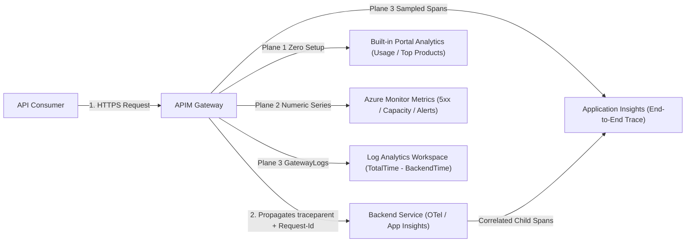
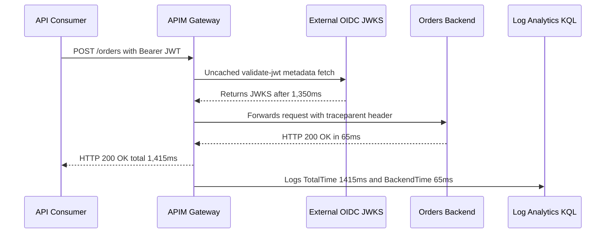

# Observability for APIs

> **Prerequisites:** Azure APIM basics, Policies, Backends & Products (Modules 00–06), Log Analytics, Azure Monitor, and Distributed Tracing / OpenTelemetry (`12`).  
> **Estimated Reading Time:** 30 minutes  
> **Target Audience:** Backend Engineers, SREs, Platform Engineers.

> [!TIP]
> **The Golden Rule of API Observability:** Never argue blindly over whether the gateway or the backend is slow—always query `ApiManagementGatewayLogs` for **`GatewayTime = TotalTime - BackendTime`**, propagate W3C **`traceparent` / `Request-Id`** into Application Insights to stitch gateway and backend spans into one trace, and keep **bodies disabled with modest sampling** in production to prevent runaway ingestion bills and PII/token leaks.

---

## Why This Matters

You can't run an API product you can't see. APIM answers questions raw ingress never could: which consumer is calling how often, what's the p95 latency per operation, which API is throwing 5xx, and — crucially — is a failure *the gateway's* fault or the *backend's*? This module wires APIM into the same observability world you built in track 12 (Application Insights / Azure Monitor) so an APIM request and its backend's trace are two ends of **one** correlated story. And the analytics you light up here are exactly what the next track (SRE) turns into SLOs.

---

## 1. Architectural Mental Model: Three Telemetry Planes, Duration Split & Trace Correlation

APIM emits telemetry across three complementary planes while propagating W3C correlation headers (`traceparent` / `Request-Id`) so gateway spans and backend spans stitch into a single distributed trace:



### Three layers of APIM observability

APIM gives you telemetry at three levels, from coarse to fine:

- **Built-in analytics** — dashboards in the Azure Portal (and via the API) showing calls, data, latency, top APIs/products/operations, and per-consumer usage over time. Zero setup; great for "who's using what, how much."
- **Azure Monitor metrics** — numeric time series (Requests, Capacity, backend duration, etc.) you can chart and **alert** on — the same Azure Monitor metrics/alerts model from track 06 (Container Apps monitoring) and track 07 (Container Insights).
- **Diagnostic logs + Application Insights** — per-request **traces** (one record per call, with policy timing, backend time, status, and the ability to correlate to the backend's own telemetry). This is the rich layer and the one that ties into track 12's distributed tracing.

You choose the layer by the question: usage → analytics; alerting on a trend → metrics; debugging a single request end to end → App Insights.

### Gateway time vs. backend time: whose fault is the latency?

The most valuable thing APIM logging tells you that a backend log can't: it splits total latency into **gateway/policy time** and **backend time**. Every APIM request record carries the **total duration** and the **backend duration**; subtract and you get the time spent *inside APIM* (policy evaluation, including a slow `validate-jwt` JWKS fetch or an expensive transformation). So when p95 spikes you can immediately say "the backend got slow" vs. "our policy pipeline got slow" — a distinction you'd otherwise argue about. This is the API-edge version of the "where did the time go" question distributed tracing answers in track 12.

### Correlating APIM with the backend (track 12 tie-in)

Integrate APIM with **Application Insights** and each gateway request becomes a telemetry item with an **operation/correlation id**. If your backend Container App is *also* instrumented with App Insights / OpenTelemetry (track 12), APIM **propagates the correlation headers** (e.g. `Request-Id`/`traceparent`) to the backend, so the gateway span and the backend spans join into **one distributed trace**. You click a slow APIM request and follow it straight into the backend's work — the exact end-to-end trace track 12 taught you to read, now starting one hop earlier at the gateway. Without this, APIM logs and backend logs are two disconnected islands and you correlate by eyeballing timestamps.

### Sampling, verbosity, and cost

App Insights ingestion is billed by data volume, and a busy gateway generates a lot. Two levers keep it sane: **sampling** (log a percentage of requests — e.g. 100% while debugging, a few percent in steady state) and **verbosity** (how much of each request/response — headers, body bytes — you capture). Logging full request/response bodies at 100% is both a **cost** and a **privacy** problem (you'll capture tokens, PII). The default posture: modest sampling, headers not bodies, raise verbosity temporarily when investigating. This is the same "observability isn't free — sample deliberately" lesson from track 12, applied to the gateway.

### Metrics worth alerting on

A few APIM signals are worth wiring to alerts (Azure Monitor, as in tracks 06/07): the **5xx rate** (backend or gateway failures), **overall latency** (p95/p99), **unauthorized/failed-auth rate** (a spike can mean a broken `validate-jwt` config *or* an attack), and **capacity** on classic tiers (approaching the tier's limit — also a cost/scale signal). These are the raw materials the SRE track (20) turns into SLIs and error budgets — "99.9% of requests succeed under 300ms" is defined directly on these metrics. Building the alerts here is you pre-assembling the inputs to that.

---

## 2. Taxonomic Comparison & Command Reference

### Three Layers of APIM Observability

| Layer | Setup Required | Question Best Answered | Granularity | Cost / Privacy Posture |
| :--- | :--- | :--- | :--- | :--- |
| **Built-in Analytics** | Zero setup | "Which consumer/product calls which API most?" | Aggregated dashboards | Included with APIM tier |
| **Azure Monitor Metrics** | Alert rules only | "Did 5xx rate, p95 latency, or Capacity cross an SLO threshold?" | 1-minute numeric time series | Low (metrics + alert rules) |
| **Diagnostic Logs (`GatewayLogs`) + App Insights** | Diagnostic setting + AI logger | "Was this request slow in APIM policies or the backend, and what spans ran?" | Per-request traces & KQL rows | Volume-billed (sample modestly, bodies off) |

### Latency & Trace Triage Matrix

| Observed Pattern | Probable Fault Domain | Immediate Next Action |
| :--- | :--- | :--- |
| **High `TotalTime`, Flat `BackendTime`** | Inside APIM policy pipeline | Inspect `GatewayTime = TotalTime - BackendTime`; check `validate-jwt` JWKS or transformations |
| **High `TotalTime`, High `BackendTime`** | Downstream backend or VNet leg | Follow `traceparent` / `Request-Id` into backend App Insights spans / SQL dependencies |
| **Gateway trace present, zero backend spans** | Missing backend OTel/AI instrumentation | Enable OpenTelemetry / App Insights SDK on the Container App to continue the trace |
| **No rows in `ApiManagementGatewayLogs`** | Unwired diagnostic setting | Create diagnostic setting sending `GatewayLogs` to your Log Analytics workspace |

### Command Reference

| Command | What it does | Example |
|---------|--------------|---------|
| `az monitor app-insights component create` | Create an App Insights resource | `az monitor app-insights component create --app apim-ai --location eastus --resource-group rg --application-type web` |
| `az monitor diagnostic-settings create` | Send APIM logs/metrics to a workspace/AI | see below |
| `az apim api update` (App Insights logger) | Attach App Insights logging to an API | via `az apim api diagnostic` / portal (see below) |
| `az monitor metrics list` | Read APIM metrics from the CLI | `az monitor metrics list --resource <apim-id> --metric Requests --interval PT1M` |
| `az monitor metrics alert create` | Alert on an APIM metric | `az monitor metrics alert create --name apim-5xx --resource-group rg --scopes <apim-id> --condition "count Requests where ..." ...` |

Flag-by-flag breakdowns:

`az monitor diagnostic-settings create --name apim-diag --resource <apim-id> --workspace <law-id> --logs '[{"category":"GatewayLogs","enabled":true}]' --metrics '[{"category":"AllMetrics","enabled":true}]'`
- `--resource <apim-id>` — the APIM instance to emit telemetry from.
- `--workspace <law-id>` — the **Log Analytics workspace** (same construct from tracks 06/07/12) that receives the logs for KQL querying.
- `--logs '[{"category":"GatewayLogs",...}]'` — `GatewayLogs` is the per-request log category; this is what carries total vs. backend duration and status.
- `--metrics '[{"category":"AllMetrics",...}]'` — ship the numeric metrics too.

`az monitor app-insights component create --app apim-ai --location eastus --resource-group rg-apim-m07 --application-type web`
- `--application-type web` — the AI resource kind. Grab its **instrumentation key/connection string** to wire into the APIM App Insights logger (done in the portal or via `az apim api diagnostic`), which is what enables per-request traces and correlation.

APIM API diagnostic (sampling/verbosity) — set on the API's App Insights diagnostic:
- **sampling percentage** — fraction of requests logged to AI (e.g. 100 while debugging, 5 in steady state).
- **verbosity / headers-and-body** — whether to capture request/response headers and how many body bytes (keep bodies off by default — cost + PII).

---

## 3. Production War Story Post-Mortem: Uncached JWKS Fetch Blamed on Backend DB + \$14,000 Body-Logging Surprise

| Field | Incident Details |
| :--- | :--- |
| **Severity** | **SEV-2** (P95 Latency Regression & Log Ingestion Billing Spike) |
| **Detection / Resolution Time** | Detected in 14 minutes via latency alert / Resolved in 40 minutes |
| **Impact** | `POST /orders` p95 jumped from 85ms to 1,450ms; backend DB team lost 20 minutes tuning healthy queries while 100% body-logging in App Insights ingested 1.8 TB of PII and bearer tokens |

### What Happened

During peak traffic, p95 latency on `POST /orders` surged past 1.4 seconds. Assuming the Orders database was locked, engineers enabled 100% sampling with 8,192-byte request/response body capture in App Insights and started scaling SQL. Only after running the KQL duration split did they see `BackendTime` holding steady at 65ms while `GatewayTime` consumed 1,350ms on every request.



### Root Cause Analysis

1. **Missing duration-split triage**: Without checking `GatewayTime = DurationMs - BackendTime` first, responders misattributed policy latency to the backend database.
2. **Uncached `openid-config` URL in `validate-jwt`**: A policy update pointed `validate-jwt` at a custom metadata wrapper returning `Cache-Control: no-store`, forcing APIM to fetch keys on every call.
3. **Unbounded debug verbosity left active**: Turning on 100% sampling + 8 KB request/response bodies logged sensitive customer addresses and JWT headers while generating roughly \$14,000 in excess ingestion volume.

### The Fix & Architectural Hardening

- Pointed `validate-jwt` back to the cacheable Entra ID `openid-configuration` endpoint, dropping `GatewayTime` from 1,350ms to under 8ms.
- Saved a shared KQL triage query (`TotalTime`, `BackendTime`, `GatewayTime`) pinned directly to the on-call dashboard.
- Reverted App Insights diagnostics to **5% steady-state sampling**, **0 body bytes**, and **redacted headers**, keeping `alwaysLog: allErrors` for 5xx visibility.

---

## 4. Multi-Language Production Implementation: W3C `traceparent` Correlation, Duration Breakdown & PII-Safe Sampled Logger

These four implementations model APIM's observability pipeline cleanly: extracting or minting W3C **`traceparent`** / **`Request-Id`** headers for end-to-end correlation, computing **`TotalTime`**, **`BackendTime`**, and **`GatewayTime`**, redacting sensitive headers (`Authorization`, `Ocp-Apim-Subscription-Key`), omitting raw bodies, and applying **deliberate sampling** (100% on 5xx errors, configurable fraction on steady-state 2xx traffic).

````carousel
```go
package apimobs

import (
	"crypto/rand"
	"encoding/hex"
	"encoding/json"
	"log"
	"math/rand/v2"
	"net/http"
	"strings"
	"time"
)

type GatewayTraceRecord struct {
	TraceParent       string  `json:"traceparent"`
	ApiID             string  `json:"apiId"`
	StatusCode        int     `json:"statusCode"`
	TotalDurationMs   float64 `json:"totalDurationMs"`
	BackendDurationMs float64 `json:"backendDurationMs"`
	GatewayDurationMs float64 `json:"gatewayDurationMs"`
	SafeHeaders       map[string]string `json:"headers"`
}

func NewTraceParent() string {
	traceID := make([]byte, 16)
	spanID := make([]byte, 8)
	_, _ = rand.Read(traceID)
	_, _ = rand.Read(spanID)
	return "00-" + hex.EncodeToString(traceID) + "-" + hex.EncodeToString(spanID) + "-01"
}

func RedactHeaders(h http.Header) map[string]string {
	out := make(map[string]string)
	for k, vals := range h {
		lk := strings.ToLower(k)
		if lk == "authorization" || lk == "ocp-apim-subscription-key" || lk == "cookie" {
			out[k] = "[REDACTED]"
			continue
		}
		out[k] = strings.Join(vals, ",")
	}
	return out
}

func ObservabilityMiddleware(apiID string, sampleRate float64, callBackend func(*http.Request) (int, error)) http.HandlerFunc {
	return func(w http.ResponseWriter, r *http.Request) {
		totalStart := time.Now()
		tp := r.Header.Get("traceparent")
		if tp == "" {
			tp = NewTraceParent()
			r.Header.Set("traceparent", tp)
		}

		// Simulate inbound policy evaluation before backend leg
		beStart := time.Now()
		status, err := callBackend(r)
		if err != nil {
			status = 502
		}
		backendMs := float64(time.Since(beStart).Microseconds()) / 1000.0
		totalMs := float64(time.Since(totalStart).Microseconds()) / 1000.0
		gatewayMs := totalMs - backendMs

		if status >= 500 || rand.Float64() < sampleRate {
			rec := GatewayTraceRecord{
				TraceParent:       tp,
				ApiID:             apiID,
				StatusCode:        status,
				TotalDurationMs:   totalMs,
				BackendDurationMs: backendMs,
				GatewayDurationMs: gatewayMs,
				SafeHeaders:       RedactHeaders(r.Header), // Never capture raw body in steady state
			}
			b, _ := json.Marshal(rec)
			log.Println(string(b))
		}
		w.Header().Set("traceparent", tp)
		w.WriteHeader(status)
	}
}
```
<!-- slide -->
```typescript
import { randomBytes } from "node:crypto";

export interface GatewayTelemetry {
  traceparent: string;
  apiId: string;
  statusCode: number;
  totalDurationMs: number;
  backendDurationMs: number;
  gatewayDurationMs: number;
  headers: Record<string, string>;
}

const SENSITIVE_HEADERS = new Set(["authorization", "ocp-apim-subscription-key", "cookie"]);

export function ensureTraceParent(existing?: string): string {
  if (existing && /^00-[0-9a-f]{32}-[0-9a-f]{16}-[0-9a-f]{2}$/.test(existing)) {
    return existing;
  }
  return `00-${randomBytes(16).toString("hex")}-${randomBytes(8).toString("hex")}-01`;
}

export function sanitizeHeaders(headers: Record<string, string>): Record<string, string> {
  const safe: Record<string, string> = {};
  for (const [k, v] of Object.entries(headers)) {
    safe[k] = SENSITIVE_HEADERS.has(k.toLowerCase()) ? "[REDACTED]" : v;
  }
  return safe;
}

export async function traceGatewayCall(
  apiId: string,
  incomingHeaders: Record<string, string>,
  sampleRate: number,
  forwardToBackend: (traceparent: string) => Promise<number>
): Promise<GatewayTelemetry | null> {
  const totalStart = performance.now();
  const traceparent = ensureTraceParent(incomingHeaders["traceparent"]);

  const backendStart = performance.now();
  const statusCode = await forwardToBackend(traceparent);
  const backendDurationMs = +(performance.now() - backendStart).toFixed(2);
  const totalDurationMs = +(performance.now() - totalStart).toFixed(2);
  const gatewayDurationMs = +(totalDurationMs - backendDurationMs).toFixed(2);

  // Always capture 5xx errors; sample healthy calls deliberately to control ingestion cost
  if (statusCode >= 500 || Math.random() < sampleRate) {
    return {
      traceparent,
      apiId,
      statusCode,
      totalDurationMs,
      backendDurationMs,
      gatewayDurationMs,
      headers: sanitizeHeaders(incomingHeaders),
    };
  }
  return null;
}
```
<!-- slide -->
```python
from dataclasses import dataclass
import random
import secrets
import time
from typing import Callable


SENSITIVE_HEADERS = {"authorization", "ocp-apim-subscription-key", "cookie"}


@dataclass(frozen=True)
class GatewayTelemetryRecord:
    traceparent: str
    api_id: str
    status_code: int
    total_ms: float
    backend_ms: float
    gateway_ms: float
    headers: dict[str, str]


def ensure_traceparent(existing: str | None) -> str:
    if existing and existing.startswith("00-") and len(existing) == 55:
        return existing
    return f"00-{secrets.token_hex(16)}-{secrets.token_hex(8)}-01"


def redact_headers(headers: dict[str, str]) -> dict[str, str]:
    return {
        k: "[REDACTED]" if k.lower() in SENSITIVE_HEADERS else v
        for k, v in headers.items()
    }


def observe_gateway_request(
    api_id: str,
    headers: dict[str, str],
    sample_rate: float,
    invoke_backend: Callable[[str], int],
) -> GatewayTelemetryRecord | None:
    total_start = time.perf_counter()
    traceparent = ensure_traceparent(headers.get("traceparent"))

    backend_start = time.perf_counter()
    status_code = invoke_backend(traceparent)
    backend_ms = round((time.perf_counter() - backend_start) * 1000, 2)
    total_ms = round((time.perf_counter() - total_start) * 1000, 2)
    gateway_ms = round(total_ms - backend_ms, 2)

    if status_code >= 500 or random.random() < sample_rate:
        return GatewayTelemetryRecord(
            traceparent=traceparent,
            api_id=api_id,
            status_code=status_code,
            total_ms=total_ms,
            backend_ms=backend_ms,
            gateway_ms=gateway_ms,
            headers=redact_headers(headers),
        )
    return None
```
<!-- slide -->
```csharp
using System.Diagnostics;
using System.Security.Cryptography;

public sealed record GatewayTelemetryRecord(
    string TraceParent,
    string ApiId,
    int StatusCode,
    double TotalDurationMs,
    double BackendDurationMs,
    double GatewayDurationMs,
    IReadOnlyDictionary<string, string> SafeHeaders);

public static class GatewayObservability
{
    private static readonly HashSet<string> SensitiveHeaders = new(StringComparer.OrdinalIgnoreCase)
    {
        "Authorization", "Ocp-Apim-Subscription-Key", "Cookie"
    };

    public static string EnsureTraceParent(string? incoming) =>
        !string.IsNullOrWhiteSpace(incoming) && incoming.StartsWith("00-") && incoming.Length == 55
            ? incoming
            : $"00-{Convert.ToHexString(RandomNumberGenerator.GetBytes(16)).ToLowerInvariant()}-{Convert.ToHexString(RandomNumberGenerator.GetBytes(8)).ToLowerInvariant()}-01";

    public static async Task<GatewayTelemetryRecord?> ExecuteObservedAsync(
        string apiId,
        IReadOnlyDictionary<string, string> headers,
        double sampleRate,
        Func<string, Task<int>> invokeBackendAsync)
    {
        var totalSw = Stopwatch.StartNew();
        var traceParent = EnsureTraceParent(headers.GetValueOrDefault("traceparent"));

        var backendSw = Stopwatch.StartNew();
        int status = await invokeBackendAsync(traceParent);
        backendSw.Stop();
        totalSw.Stop();

        double totalMs = Math.Round(totalSw.Elapsed.TotalMilliseconds, 2);
        double backendMs = Math.Round(backendSw.Elapsed.TotalMilliseconds, 2);
        double gatewayMs = Math.Round(totalMs - backendMs, 2);

        if (status >= 500 || Random.Shared.NextDouble() < sampleRate)
        {
            var redacted = headers.ToDictionary(
                kv => kv.Key,
                kv => SensitiveHeaders.Contains(kv.Key) ? "[REDACTED]" : kv.Value);
            return new GatewayTelemetryRecord(traceParent, apiId, status, totalMs, backendMs, gatewayMs, redacted);
        }
        return null;
    }
}
```
````

---

## 5. Practical Hands-On Verification CLI Workflows

> **Time note:** analytics and Azure Monitor metrics work on **Consumption** (fast and free-idling) — use it for exercises 1-7. Only reach for a classic tier if you specifically want a feature it gates; nothing here requires one.

### 1. Instance + backend + API with real traffic to observe
Stand up a Consumption instance, a Container App backend, and an `orders` API. Generate traffic so there's something to see:
```powershell
$key = az apim subscription show --resource-group rg-apim-m07 --service-name $apim --sid master --query primaryKey -o tsv
$gw = az apim show --name $apim --resource-group rg-apim-m07 --query gatewayUrl -o tsv
1..50 | ForEach-Object { curl -s -o /dev/null -H "Ocp-Apim-Subscription-Key: $key" "$gw/orders/" }
```

### 2. Read built-in analytics
In the Azure Portal, open the APIM instance → **Analytics** (or **Insights**). Confirm you see your ~50 calls, the Orders API/operation, and per-time-window counts. This is the zero-setup usage view.

### 3. Wire diagnostic settings to Log Analytics
```powershell
az monitor log-analytics workspace create --resource-group rg-apim-m07 --workspace-name law-apim-m07
$law = az monitor log-analytics workspace show --resource-group rg-apim-m07 --workspace-name law-apim-m07 --query id -o tsv
$apimId = az apim show --name $apim --resource-group rg-apim-m07 --query id -o tsv
az monitor diagnostic-settings create --name apim-diag --resource $apimId --workspace $law `
  --logs '[{\"category\":\"GatewayLogs\",\"enabled\":true}]' `
  --metrics '[{\"category\":\"AllMetrics\",\"enabled\":true}]'
```
Generate more traffic, wait a few minutes for ingestion, then run a KQL query in the workspace (Logs blade): `ApiManagementGatewayLogs | take 50`. Confirm per-request rows with status and durations appear.

### 4. Split gateway time vs. backend time
In KQL, project the durations:
```kusto
ApiManagementGatewayLogs
| project TimeGenerated, ApiId, ResponseCode, TotalTime = DurationMs, BackendTime = BackendTime
| extend GatewayTime = TotalTime - BackendTime
| order by TimeGenerated desc
```

**Expected Output:**
```text
TimeGenerated         ApiId    ResponseCode  TotalTime  BackendTime  GatewayTime
--------------------  -------  ------------  ---------  -----------  -----------
2026-11-11T04:15:10Z  orders   200           48.2       41.7         6.5
2026-11-11T04:15:09Z  orders   200           52.9       46.1         6.8
```
Confirm you can see, per request, how much time was spent *in the backend* vs. *in APIM's pipeline*. This is the "whose fault is the latency" answer.

### 5. Create an App Insights resource and enable per-request tracing
```powershell
az monitor app-insights component create --app apim-ai-m07 --location eastus `
  --resource-group rg-apim-m07 --application-type web
```

**Expected Output:**
```json
{
  "appId": "11111111-2222-3333-4444-555555555555",
  "connectionString": "InstrumentationKey=...;IngestionEndpoint=https://eastus-8.in.applicationinsights.azure.com/",
  "name": "apim-ai-m07"
}
```
In the Azure Portal, attach it to the API's diagnostics (APIM → your API → Settings → Application Insights) with **sampling 100%**, headers on, bodies off. Generate traffic and confirm requests appear in App Insights → **Transaction search**.

### 6. Correlate to the backend (track 12 tie-in)
If your backend is App Insights/OTel-instrumented (track 12), open one APIM request in App Insights and follow its **end-to-end transaction** into the backend spans — one trace spanning gateway + backend via the propagated correlation id. If the backend isn't instrumented, reason through where the trace would continue and which header (`Request-Id`/`traceparent`) carries the correlation.

### 7. Alert on the 5xx rate
Create a metric alert so a spike in failures pages you:
```powershell
az monitor metrics alert create --name apim-5xx-m07 --resource-group rg-apim-m07 `
  --scopes $apimId --description "APIM 5xx spike" `
  --condition "total Requests where ResponseCode >= 500 > 5" --window-size 5m --evaluation-frequency 1m
```
(Exact dimension syntax varies by CLI version; adjust with `az monitor metrics alert create --help`.) This is a raw SLI for track 20.

### 8. Diagnose with the split: gateway-caused latency
Add an intentionally expensive inbound policy (e.g. a `validate-jwt` pointing at a slow/wrong `openid-config` URL, or a heavy transformation), generate traffic, and look at the KQL split from exercise 4. Confirm **GatewayTime** rises while **BackendTime** stays flat — proving the slowdown is *in APIM*, not the backend. **Fix** by removing/correcting the policy and watch GatewayTime drop. Lesson: the duration split turns "the API is slow" arguments into a decisive answer.

### 9. Cleanup
```powershell
az group delete --name rg-apim-m07 --yes --no-wait
```
(Deletes the workspace and App Insights too. Note App Insights/Log Analytics ingestion is billable by volume — another reason to sample and to delete.)

### Independent Challenge

Instrument an APIM API end to end: ship `GatewayLogs` to a Log Analytics workspace, enable App Insights per-request tracing with *deliberate* sampling and bodies-off, and build one KQL query that reports, per operation, request count, p95 total latency, and the **gateway-vs-backend split**. Then create a metric alert on the 5xx rate. Finally, drawing on **track 12**, write a short note on how you'd follow a single slow request from the APIM trace into the backend's spans, naming the correlation mechanism — and how these signals become the SLIs the SRE track (20) will define SLOs on. Keep sampling modest to control ingestion cost, and delete the resource group (including the workspace and App Insights) when done.

<details><summary>Stuck? One hint</summary>

The whole game is the **duration split**. `ApiManagementGatewayLogs` carries both total and backend time per request; `GatewayTime = TotalTime - BackendTime` tells you whether a latency problem lives in your policy pipeline or the backend. For correlation, the gateway propagates a correlation header (`Request-Id`/`traceparent`) so App Insights joins the APIM request and the backend spans into one end-to-end transaction — exactly track 12's distributed trace, one hop earlier.

</details>

---

## 6. Common Mistakes & Troubleshooting

- **Logging everything at 100% with bodies on.** Great for a demo, expensive and a privacy risk in reality (you capture tokens/PII). Sample modestly; headers not bodies; raise verbosity only while investigating.
- **Confusing analytics, metrics, and logs.** Analytics = built-in usage dashboards; metrics = numeric series you alert on; logs/App Insights = per-request traces for debugging. Reach for the layer that matches the question.
- **Blaming the backend for gateway latency (or vice versa).** Without the duration split you'll guess wrong. Always subtract BackendTime from TotalTime.
- **No correlation because the backend isn't instrumented.** APIM propagates the correlation id, but the trace only *continues* if the backend also emits telemetry (track 12). One-sided instrumentation gives you a truncated trace.
- **Diagnostic settings never wired.** Built-in analytics exist with zero setup, but KQL/per-request logs require a **diagnostic setting** to a workspace and an App Insights logger — forgetting these leaves you with only the coarse view.
- **Cost pitfall.** App Insights and Log Analytics bill by **ingestion volume**; a chatty gateway at high verbosity runs up cost independent of the APIM tier. Sample deliberately, keep bodies off, and delete the workspace/AI resources with the group — they don't disappear just because the APIM instance is gone.

---

## 7. Operational Validation Checkpoints & Cumulative Review

### Operational Validation Checkpoints

<details><summary><strong>Checkpoint 1: Pinpointing gateway vs. backend latency regressions with KQL</strong></summary>

Query `ApiManagementGatewayLogs` and compute `GatewayTime = DurationMs - BackendTime`. If `GatewayTime` jumps from 6ms to 900ms while `BackendTime` stays constant, your backend is healthy and the delay sits inside an APIM policy (such as an uncached `validate-jwt` JWKS call or `<send-request>` callout).

</details>

<details><summary><strong>Checkpoint 2: Why distributed traces stop at the gateway</strong></summary>

APIM automatically injects W3C `traceparent` / `Request-Id` headers when its Application Insights logger is enabled, but child spans only appear in the end-to-end transaction map if the downstream Container App also runs OpenTelemetry / Application Insights middleware targeting the same or linked telemetry pipeline.

</details>

<details><summary><strong>Checkpoint 3: Controlling ingestion spend and PII leakage in production</strong></summary>

Never leave 100% sampling with body capture enabled in production: you will pay per ingested gigabyte and record plaintext bearer tokens, cookies, and PII inside logs. Set sampling to 5% (or adaptive sampling), capture only safe headers, disable body logging (`0 bytes`), and bump verbosity temporarily only during active incident triage.

</details>

### Checkpoint quiz

Write down your answer to each question before expanding it — checking without attempting first is the single easiest way to fool yourself into thinking you've learned this.

1. Name APIM's three observability layers and the question each best answers.
2. What can APIM's per-request log tell you about latency that a backend log alone cannot, and how do you compute it?
3. What makes an APIM request and its backend's trace join into a single distributed trace, and which prior track does that build on?
4. What two levers control App Insights logging cost/volume, and what's the sensible default posture?
5. Which APIM metrics are worth alerting on, and how do they relate to the next track (20 SRE)?
6. p95 latency spikes but BackendTime is flat. Where's the problem and what might cause it?
7. Why is logging full request/response bodies at 100% sampling a bad default on two counts?
8. You wired an App Insights logger but see no per-request traces in KQL. What did you likely skip?

<details><summary>Show answers</summary>

1. **Built-in analytics** (usage: who calls what, how much); **Azure Monitor metrics** (numeric series to chart/alert on trends); **diagnostic logs / App Insights** (per-request traces for end-to-end debugging).
2. It splits **total** vs. **backend** duration; `GatewayTime = TotalTime - BackendTime` reveals whether latency is in APIM's policy pipeline or the backend.
3. APIM's App Insights integration propagates a **correlation id** (`Request-Id`/`traceparent`) to an instrumented backend, joining gateway and backend spans — building on track 12's distributed tracing.
4. **Sampling** (percentage of requests logged) and **verbosity** (headers/body captured). Default: modest sampling, headers not bodies, raise temporarily when investigating.
5. 5xx rate, overall latency (p95/p99), failed-auth rate, and (classic) capacity. They're the raw **SLIs** the SRE track turns into SLOs and error budgets.
6. The problem is **inside APIM** (policy pipeline) — e.g. a slow/misconfigured `validate-jwt` JWKS fetch or an expensive transformation. Backend is fine.
7. **Cost** (App Insights bills by ingestion volume) and **privacy/security** (you capture tokens and PII in the bodies).
8. Likely the **diagnostic setting / App Insights logger** wasn't attached to the API (or you're querying `ApiManagementGatewayLogs` without a diagnostic setting to the workspace). Built-in analytics work with no setup, but per-request logs require the logger/diagnostic wiring.

</details>

---

## 8. Next

[08-kong-and-traefik-oss-gateways](../08-kong-and-traefik-oss-gateways/README.md) — everything so far has been Azure APIM specifically. This module runs the same API-gateway concepts (auth, rate limiting) on an open-source gateway you operate yourself, so you can tell the concept from the vendor.
