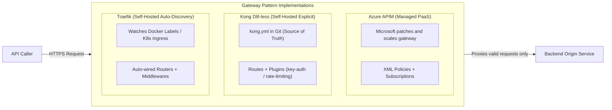
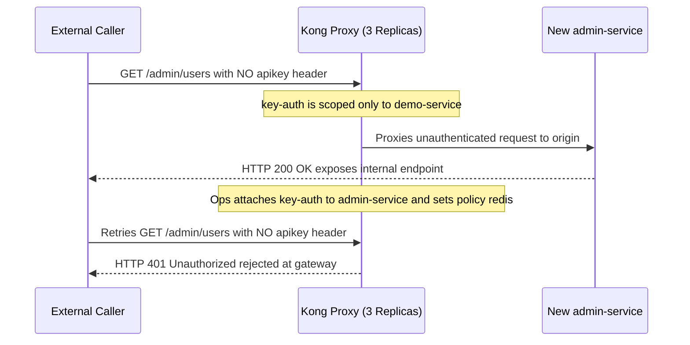

# Kong and Traefik: Open-Source API Gateways

> **Prerequisites:** API Gateway fundamentals, Policies & Rate Limiting (Modules 00–04), Docker Compose (`02` / `03`), and Kubernetes Ingress concepts (`07` / `08`).  
> **Estimated Reading Time:** 30 minutes  
> **Target Audience:** Backend Engineers, Platform Engineers, Infrastructure Architects.

> [!TIP]
> **The Golden Rule of Open-Source Gateways:** Treat the API gateway as a **portable architectural pattern, not a vendor feature**—in Kong DB-less mode, your `kong.yml` **is** the single source of truth, plugins like `key-auth` and `rate-limiting` **never apply automatically to newly added services** unless explicitly attached or declared global, and self-hosting trades managed PaaS simplicity for full team ownership of **availability, scaling, and patching**.

---

## Why This Matters

Every module so far in this track has been Azure APIM specifically — and that's deliberate; APIM is a real, common, production-grade choice. But APIM's features (auth at the gateway, rate limiting, request/response policies) aren't Azure-specific ideas — they're the **API gateway pattern**, and APIM is one implementation of it. This module runs the same pattern on **Kong**, an open-source gateway you deploy and operate yourself (in a container, in Kubernetes, anywhere) instead of consuming as an Azure PaaS service. Seeing the same concepts — reject unauthorized requests before they reach your backend, cap request rate per client — implemented on a completely different platform is what proves you learned the *pattern* module 00 introduced, not just one vendor's specific configuration screens.

---

## 1. Architectural Mental Model: Managed PaaS vs. Self-Hosted OSS Gateways

All three gateways enforce the exact same edge pattern—front door routing, auth rejection before touching origins, and rate limiting—but differ sharply in who operates the runtime and how configuration is discovered or declared:



### Same gateway pattern, different operating model

Module 00 established the API gateway's job: one front door for many backend services, handling auth, rate limiting, and routing so individual services don't each reimplement them. APIM gives you that as a managed Azure service — Microsoft runs the actual gateway process, patches it, scales it. Kong gives you the same *capability* as software you run yourself — a container (or a Kubernetes deployment) you deploy, configure, and operate, trading Azure's operational backing for portability (runs anywhere Docker/Kubernetes runs) and, often, a different cost model.

### Kong's model: services, routes, plugins

Kong's configuration vocabulary maps directly onto concepts you already know from module 00 and module 03 (policies):

- A **service** is a backend you're fronting — analogous to an APIM backend/API.
- A **route** maps an incoming path to a service — analogous to an APIM operation's URL template.
- A **plugin** attaches behavior (auth, rate limiting, transformation) to a service or route — the direct equivalent of an APIM **policy** (module 03), just packaged as an installable plugin instead of an inline XML-like policy snippet.

```yaml
services:
  - name: demo-service
    url: http://origin:8000
    routes:
      - name: demo-route
        paths:
          - /api

plugins:
  - name: key-auth              # <- equivalent to APIM's subscription-key check
    service: demo-service
  - name: rate-limiting         # <- equivalent to APIM's rate-limit policy
    service: demo-service
    config:
      minute: 3
```

### DB-less mode: gateway config as a version-controlled file

Kong can run backed by a real database, or in **DB-less (declarative) mode**, where its entire configuration is one YAML file loaded at startup — no database to run, no admin API calls needed to configure it, just a file you can commit to git and diff like any other config. This module's exercises use DB-less mode specifically because it makes the gateway's configuration as inspectable and reproducible as any other piece of infrastructure-as-code you've used elsewhere in this curriculum — a real, common way to run Kong in practice, not a simplification invented for teaching.

### Consumers and credentials: who is allowed through

A Kong **consumer** represents a caller (an app, a partner, a client) — directly analogous to an APIM **subscription**. Attaching a credential (an API key, for the `key-auth` plugin) to a consumer is what lets that specific caller pass the gateway's auth check; a request with no key, or the wrong key, never reaches the backend at all — the gateway rejects it at the edge, exactly APIM's subscription-key behavior, exactly the "reject before it costs your backend anything" principle from earlier tracks (the nginx and edge-computing modules made the same point at different layers).

### Traefik: the other common open-source gateway, briefly

**Traefik** solves the same problem with a different default philosophy: where Kong is configured explicitly (a declarative file, or an admin API), Traefik is built around **automatic service discovery** — point it at Docker, Kubernetes, or another orchestrator, and it discovers services from labels/annotations and reconfigures itself live as containers come and go, with no separate "register this route" step. Both are legitimate, widely-used choices; Kong's plugin ecosystem and explicit configuration model tend to suit teams that want the gateway's behavior fully specified and version-controlled (this module's focus), while Traefik's auto-discovery tends to suit teams whose services already carry rich container/Kubernetes metadata and want the gateway to track that automatically with minimal separate configuration.

---

## 2. Taxonomic Comparison & Command Reference

### Azure APIM vs. Kong Gateway vs. Traefik

| Dimension | Azure APIM | Kong Gateway (DB-less) | Traefik |
| :--- | :--- | :--- | :--- |
| **Operating Model** | Fully managed Azure PaaS | Self-hosted container / Kubernetes | Self-hosted container / Kubernetes |
| **Configuration Philosophy** | ARM / Terraform / XML policies | Explicit declarative `kong.yml` (or Admin API) | Orchestrator auto-discovery (Docker labels / K8s) |
| **Portability** | Azure only | Any cloud, bare metal, or laptop | Any cloud, bare metal, or laptop |
| **Edge Auth / Throttling** | Subscription keys + `validate-jwt` + policies | `key-auth` / `jwt` + `rate-limiting` plugins | ForwardAuth / RateLimit middlewares |
| **Team Ops Burden** | Low (Azure manages runtime/patching) | High (you own HA, Redis counters, upgrades) | Moderate-High (you own runtime & upgrades) |

### Cross-Platform Gateway Concept Mapping

| Gateway Concept | Azure APIM | Kong (DB-less) | Traefik |
| :--- | :--- | :--- | :--- |
| **Upstream Target** | Named Backend / `serviceUrl` | `services[].url` | Service + LoadBalancer servers |
| **Path Matching** | API `--path` + Operation template | `routes[].paths` | Router `Rule` (`PathPrefix`) |
| **Edge Behavior** | Policy (`inbound` / `outbound`) | `plugins` scoped to service/route | `middlewares` attached to router |
| **Caller Identity** | Product Subscription Key | `consumers` + `keyauth_credentials` | Auth middleware / ForwardAuth header |

### Command Reference

| Concern | Kong (DB-less mode) |
|---|---|
| Define config | a `kong.yml` declarative file, mounted into the container |
| Enable it | `KONG_DATABASE=off`, `KONG_DECLARATIVE_CONFIG=/path/to/kong.yml` |
| Add auth to a service | a `key-auth` plugin entry scoped to that service |
| Add rate limiting | a `rate-limiting` plugin entry with `config.minute: N` |
| Register a caller | a `consumers` entry with `keyauth_credentials` |
| Inspect live config | `curl http://localhost:8001/services` (the Admin API) |
| Send a request through the gateway | `curl http://localhost:8000/<route-path>` (the Proxy port) |

Key runtime environment variables & plugin flags:
- `KONG_DATABASE: "off"` — runs Kong in stateless DB-less declarative mode (no PostgreSQL cluster required).
- `KONG_DECLARATIVE_CONFIG` — container path to the read-only mounted `kong.yml` file loaded at startup.
- `KONG_PROXY_LISTEN` / `KONG_ADMIN_LISTEN` — binds proxy traffic (`8000`) separately from the management Admin API (`8001`—never expose `8001` publicly in production).
- `policy: local` vs `policy: redis` — `local` tracks rate-limit counters in each single Kong node's memory; multi-replica Kubernetes/Compose deployments must switch to `redis` so limits apply globally across replicas.

---

## 3. Production War Story Post-Mortem: Unprotected `/admin` Route & Local-Counter Rate Limit Drift

| Field | Incident Details |
| :--- | :--- |
| **Severity** | **SEV-1** (Unauthenticated Admin API Exposure & 3x Rate-Limit Bypass) |
| **Detection / Resolution Time** | Detected in 18 minutes via security audit log / Resolved in 25 minutes |
| **Impact** | A newly added `admin-service` route in `kong.yml` bypassed authentication entirely, while scaling Kong to 3 pods with `policy: local` allowed scraping clients 3x the intended per-minute quota |

### What Happened

An engineer added a new `admin-service` block to `kong.yml` assuming `key-auth` declared on `demo-service` applied gateway-wide. Requests to `/admin/users` without an `apikey` header passed directly to the origin. Meanwhile, during a traffic spike, ops scaled Kong from 1 to 3 replicas without changing `rate-limiting` from `policy: local`, silently tripling allowed bursts.



### Root Cause Analysis

1. **Per-service plugin scoping mistaken for global inheritance**: Kong plugins apply *only* to the specific `service` or `route` referenced unless declared without a target (global plugin).
2. **`policy: local` in a multi-replica deployment**: Local in-memory counters aren't shared across Kong worker pods, so 3 replicas enforced 3 individual `minute: N` buckets instead of 1 cluster-wide limit.
3. **Public Admin API port exposure risk**: Keeping `KONG_ADMIN_LISTEN: 0.0.0.0:8001` outside localhost/private admin subnets risks unauthenticated runtime inspection or tampering.

### The Fix & Architectural Hardening

- Explicitly attached `key-auth` (or used a global auth policy with opt-out rules) to every service in `kong.yml` and added a CI YAML check verifying zero unauthenticated routes.
- Migrated production `rate-limiting` plugins from `policy: local` to `policy: redis` backed by a managed Redis cluster.
- Bound `KONG_ADMIN_LISTEN` to `127.0.0.1:8001` (or mTLS-protected internal network) in production manifests.

---

## 4. Multi-Language Production Implementation: Edge `key-auth` & Per-Consumer Rate-Limiting Middleware

These four implementations model the exact edge middleware pipeline Kong executes before touching an origin service: authenticating the `apikey` header against registered consumer credentials (returning `401` on missing/wrong keys), enforcing a per-consumer fixed-window rate limit with `X-RateLimit-Limit-Minute` / `X-RateLimit-Remaining-Minute` headers (returning `429` when exhausted), and forwarding `X-Consumer-Username` upstream.

````carousel
```go
package ossgateway

import (
	"crypto/subtle"
	"net/http"
	"strconv"
	"sync"
	"time"
)

type Consumer struct {
	Username string
	APIKey   string
}

type bucket struct {
	windowStart time.Time
	count       int
}

type KongStyleGateway struct {
	consumers   []Consumer
	limitPerMin int
	mu          sync.Mutex
	buckets     map[string]*bucket
	next        http.Handler
}

func NewKongStyleGateway(consumers []Consumer, limitPerMin int, next http.Handler) *KongStyleGateway {
	return &KongStyleGateway{
		consumers:   consumers,
		limitPerMin: limitPerMin,
		buckets:     make(map[string]*bucket),
		next:        next,
	}
}

func (g *KongStyleGateway) ServeHTTP(w http.ResponseWriter, r *http.Request) {
	presented := r.Header.Get("apikey")
	var matched *Consumer
	for i := range g.consumers {
		if subtle.ConstantTimeCompare([]byte(presented), []byte(g.consumers[i].APIKey)) == 1 {
			matched = &g.consumers[i]
			break
		}
	}
	if matched == nil {
		w.WriteHeader(http.StatusUnauthorized)
		_, _ = w.Write([]byte(`{"message":"No API key found in request or invalid key"}`))
		return
	}

	g.mu.Lock()
	now := time.Now().Truncate(time.Minute)
	b, ok := g.buckets[matched.Username]
	if !ok || !b.windowStart.Equal(now) {
		b = &bucket{windowStart: now, count: 0}
		g.buckets[matched.Username] = b
	}
	remaining := g.limitPerMin - b.count - 1
	exceeded := b.count >= g.limitPerMin
	if !exceeded {
		b.count++
	}
	g.mu.Unlock()

	w.Header().Set("X-RateLimit-Limit-Minute", strconv.Itoa(g.limitPerMin))
	if exceeded {
		w.Header().Set("X-RateLimit-Remaining-Minute", "0")
		w.WriteHeader(http.StatusTooManyRequests)
		_, _ = w.Write([]byte(`{"message":"API rate limit exceeded"}`))
		return
	}
	w.Header().Set("X-RateLimit-Remaining-Minute", strconv.Itoa(remaining))
	r.Header.Set("X-Consumer-Username", matched.Username)
	g.next.ServeHTTP(w, r)
}
```
<!-- slide -->
```typescript
import { timingSafeEqual } from "node:crypto";

export interface Consumer {
  username: string;
  apiKey: string;
}

export interface GatewayResponse {
  status: number;
  headers: Record<string, string>;
  body: Record<string, unknown>;
}

export class EdgeGatewayPipeline {
  private readonly counters = new Map<string, { minuteEpoch: number; count: number }>();

  constructor(
    private readonly consumers: Consumer[],
    private readonly minuteLimit: number,
    private readonly forwardToOrigin: (consumerUsername: string) => Promise<Record<string, unknown>>
  ) {}

  private constantEquals(a: string, b: string): boolean {
    const ab = Buffer.from(a);
    const bb = Buffer.from(b);
    return ab.length === bb.length && timingSafeEqual(ab, bb);
  }

  async handle(apiKeyHeader?: string, nowMs = Date.now()): Promise<GatewayResponse> {
    const consumer = apiKeyHeader
      ? this.consumers.find((c) => this.constantEquals(apiKeyHeader, c.apiKey))
      : undefined;

    if (!consumer) {
      return {
        status: 401,
        headers: {},
        body: { message: "Unauthorized: invalid or missing apikey" },
      };
    }

    const minuteEpoch = Math.floor(nowMs / 60_000);
    const current = this.counters.get(consumer.username);
    const entry =
      current && current.minuteEpoch === minuteEpoch ? current : { minuteEpoch, count: 0 };

    if (entry.count >= this.minuteLimit) {
      return {
        status: 429,
        headers: {
          "X-RateLimit-Limit-Minute": String(this.minuteLimit),
          "X-RateLimit-Remaining-Minute": "0",
        },
        body: { message: "API rate limit exceeded" },
      };
    }

    entry.count += 1;
    this.counters.set(consumer.username, entry);
    const remaining = this.minuteLimit - entry.count;
    const originBody = await this.forwardToOrigin(consumer.username);

    return {
      status: 200,
      headers: {
        "X-RateLimit-Limit-Minute": String(this.minuteLimit),
        "X-RateLimit-Remaining-Minute": String(remaining),
      },
      body: originBody,
    };
  }
}
```
<!-- slide -->
```python
from dataclasses import dataclass
import hmac
import time
from typing import Callable


@dataclass(frozen=True)
class Consumer:
    username: str
    api_key: str


class KongStyleMiddleware:
    def __init__(self, consumers: list[Consumer], minute_limit: int) -> None:
        self._consumers = consumers
        self._minute_limit = minute_limit
        self._buckets: dict[str, tuple[int, int]] = {}

    def process(
        self,
        api_key_header: str | None,
        call_origin: Callable[[str], dict],
    ) -> tuple[int, dict[str, str], dict]:
        consumer = next(
            (
                c
                for c in self._consumers
                if api_key_header and hmac.compare_digest(api_key_header, c.api_key)
            ),
            None,
        )
        if consumer is None:
            return 401, {}, {"message": "Unauthorized: missing or invalid apikey"}

        current_minute = int(time.time() // 60)
        bucket_min, count = self._buckets.get(consumer.username, (current_minute, 0))
        if bucket_min != current_minute:
            count = 0

        if count >= self._minute_limit:
            headers = {
                "X-RateLimit-Limit-Minute": str(self._minute_limit),
                "X-RateLimit-Remaining-Minute": "0",
            }
            return 429, headers, {"message": "API rate limit exceeded"}

        count += 1
        self._buckets[consumer.username] = (current_minute, count)
        remaining = self._minute_limit - count
        headers = {
            "X-RateLimit-Limit-Minute": str(self._minute_limit),
            "X-RateLimit-Remaining-Minute": str(remaining),
        }
        return 200, headers, call_origin(consumer.username)
```
<!-- slide -->
```csharp
using System.Collections.Concurrent;
using System.Security.Cryptography;
using System.Text;

public sealed record Consumer(string Username, string ApiKey);

public sealed record GatewayResult(int StatusCode, Dictionary<string, string> Headers, string Body);

public sealed class KongStyleGatewayPipeline(IEnumerable<Consumer> consumers, int minuteLimit)
{
    private readonly List<Consumer> _consumers = consumers.ToList();
    private readonly ConcurrentDictionary<string, (long MinuteEpoch, int Count)> _buckets = new();

    private static bool ConstantEquals(string a, string b) =>
        CryptographicOperations.FixedTimeEquals(Encoding.UTF8.GetBytes(a), Encoding.UTF8.GetBytes(b));

    public async Task<GatewayResult> ExecuteAsync(string? apiKeyHeader, Func<string, Task<string>> invokeOriginAsync)
    {
        var consumer = string.IsNullOrEmpty(apiKeyHeader)
            ? null
            : _consumers.FirstOrDefault(c => ConstantEquals(apiKeyHeader, c.ApiKey));

        if (consumer is null)
            return new GatewayResult(401, [], """{"message":"Unauthorized"}""");

        long minuteEpoch = DateTimeOffset.UtcNow.ToUnixTimeSeconds() / 60;
        var updated = _buckets.AddOrUpdate(
            consumer.Username,
            _ => (minuteEpoch, 1),
            (_, existing) => existing.MinuteEpoch == minuteEpoch
                ? (minuteEpoch, existing.Count + 1)
                : (minuteEpoch, 1));

        if (updated.Count > minuteLimit)
        {
            return new GatewayResult(
                429,
                new Dictionary<string, string>
                {
                    ["X-RateLimit-Limit-Minute"] = minuteLimit.ToString(),
                    ["X-RateLimit-Remaining-Minute"] = "0"
                },
                """{"message":"API rate limit exceeded"}""");
        }

        int remaining = minuteLimit - updated.Count;
        string originBody = await invokeOriginAsync(consumer.Username);
        return new GatewayResult(
            200,
            new Dictionary<string, string>
            {
                ["X-RateLimit-Limit-Minute"] = minuteLimit.ToString(),
                ["X-RateLimit-Remaining-Minute"] = remaining.ToString()
            },
            originBody);
    }
}
```
````

---

## 5. Practical Hands-On Verification CLI Workflows

Everything runs locally via Docker Compose — no cloud account needed, unlike this track's APIM modules.

### 1. Build an origin service and a Kong config fronting it

```bash
mkdir kong-lab && cd kong-lab

cat > origin_app.py << 'EOF'
from fastapi import FastAPI
app = FastAPI()

@app.get("/get")
def get():
    return {"message": "hello from origin"}
EOF

cat > Dockerfile.origin << 'EOF'
FROM python:3.12-slim
WORKDIR /code
RUN pip install --no-cache-dir fastapi uvicorn
COPY origin_app.py .
CMD ["uvicorn", "origin_app:app", "--host", "0.0.0.0", "--port", "8000"]
EOF

cat > kong.yml << 'EOF'
_format_version: "3.0"

services:
  - name: demo-service
    url: http://origin:8000
    routes:
      - name: demo-route
        paths:
          - /api

plugins:
  - name: key-auth
    service: demo-service
  - name: rate-limiting
    service: demo-service
    config:
      minute: 3
      policy: local

consumers:
  - username: demo-user
    keyauth_credentials:
      - key: demo-api-key-123
EOF

cat > compose.yaml << 'EOF'
services:
  origin:
    build:
      context: .
      dockerfile: Dockerfile.origin
  kong:
    image: kong:3.7
    environment:
      KONG_DATABASE: "off"
      KONG_DECLARATIVE_CONFIG: /kong/declarative/kong.yml
      KONG_PROXY_LISTEN: "0.0.0.0:8000"
      KONG_ADMIN_LISTEN: "0.0.0.0:8001"
    volumes:
      - ./kong.yml:/kong/declarative/kong.yml:ro
    ports:
      - "8010:8000"
      - "8011:8001"
    depends_on:
      - origin
EOF

docker compose up -d --build
```

### 2. Confirm the gateway rejects an unauthenticated request

```bash
curl -s -i http://localhost:8010/api/get | head -3
```

**Expected Output:**
```http
HTTP/1.1 401 Unauthorized
Content-Type: application/json; charset=utf-8
```
Expected: `HTTP/1.1 401 Unauthorized` — the request never reached the origin service at all; Kong's `key-auth` plugin rejected it at the gateway, exactly APIM's subscription-key enforcement.

### 3. Confirm a valid key passes through

```bash
curl -s -i http://localhost:8010/api/get -H "apikey: demo-api-key-123"
```

**Expected Output:**
```http
HTTP/1.1 200 OK
X-RateLimit-Limit-Minute: 3
X-RateLimit-Remaining-Minute: 2

{"message":"hello from origin"}
```
Expected: `HTTP/1.1 200 OK` with the origin's JSON body, plus `X-RateLimit-Limit-Minute`/`X-RateLimit-Remaining-Minute` headers Kong added automatically — the rate-limiting plugin is already tracking this consumer's usage on every request, whether or not the limit is close to being hit.

### 4. Exhaust the rate limit and watch it actually trigger

```bash
curl -s -i http://localhost:8010/api/get -H "apikey: demo-api-key-123" | grep -E "HTTP|RateLimit-Remaining"
curl -s -i http://localhost:8010/api/get -H "apikey: demo-api-key-123" | grep -E "HTTP|RateLimit-Remaining"
curl -s -i http://localhost:8010/api/get -H "apikey: demo-api-key-123" | grep -E "HTTP"
```

**Expected Output:**
```text
HTTP/1.1 200 OK
X-RateLimit-Remaining-Minute: 1
HTTP/1.1 200 OK
X-RateLimit-Remaining-Minute: 0
HTTP/1.1 429 Too Many Requests
```
Expected: `RateLimit-Remaining` counts down (2, 1, 0) across your first three requests (including the one from exercise 3), and the fourth request in any one-minute window returns `HTTP/1.1 429 Too Many Requests` — the `minute: 3` limit from `kong.yml` enforced for real, not just declared.

### 5. Confirm a wrong key is rejected the same way as no key

```bash
curl -s -i http://localhost:8010/api/get -H "apikey: wrong-key" | head -3
```

**Expected Output:**
```http
HTTP/1.1 401 Unauthorized
Content-Type: application/json; charset=utf-8
```
Expected: `401 Unauthorized` — Kong validates the key against the `keyauth_credentials` actually registered for a consumer, not merely "is some `apikey` header present."

### 6. Inspect the running configuration via the Admin API

```bash
curl -s http://localhost:8011/services | python3 -m json.tool
```

**Expected Output:**
```json
{
    "data": [
        {
            "host": "origin",
            "name": "demo-service",
            "port": 8000,
            "protocol": "http"
        }
    ]
}
```
Expected: a JSON document describing `demo-service` exactly as declared in `kong.yml` — Kong loaded the declarative file at startup and this is the live, running configuration derived from it, inspectable the same way you'd inspect any running infrastructure.

### 7. Diagnose and fix: a plugin that isn't applying

Add a second service in `kong.yml` for a hypothetical `/admin` path, but forget to add a `key-auth` plugin entry scoped to it. Reload (`docker compose restart kong`) and request the new path with no key.

Expected: the request **succeeds** with no auth check — plugins in Kong are scoped explicitly per service/route (or globally, if you configure one that way); forgetting to attach a plugin to a *new* service doesn't inherit protection from other services in the same file. Fix it by adding the missing `key-auth` plugin entry scoped to the new service, and confirm the endpoint now rejects unauthenticated requests too.

### 8. Clean up

```bash
docker compose down
cd .. && rm -rf kong-lab
```

### Independent Challenge

No code given. You're evaluating whether to keep an existing service behind Azure APIM or migrate it to a self-hosted Kong deployment. List the concrete tradeoffs specific to your organization's context: who currently operates/patches APIM (nobody — it's managed) versus who would operate Kong (your team, on whatever compute you choose); what happens to the existing APIM policies (rate limiting, JWT validation) if migrated — would each map cleanly to a Kong plugin, or would some need custom logic; and what portability benefit, if any, self-hosting actually buys this specific service (does it genuinely need to run outside Azure, or is that a hypothetical future need). Conclude with a recommendation and defend it against the "just because it's possible to self-host doesn't mean you should" counter-argument.

<details>
<summary>Stuck? One hint</summary>

Frame it as a direct extension of the build-vs-buy judgment this whole `learn/` curriculum has applied elsewhere (self-hosted RabbitMQ/Kafka vs. Azure Service Bus, self-hosted Vault vs. Key Vault): self-hosting buys portability and avoids vendor lock-in, but costs your team ongoing operational ownership (patching, scaling, availability) that a managed service currently absorbs for free. Most APIM policies (rate limiting, key/JWT auth) map to a well-known Kong plugin directly; anything relying on deep Azure-specific integration (Entra ID JWT validation wired to your specific tenant, module 04) would need to be re-implemented against Kong's auth plugins rather than assumed to port automatically.

</details>

---

## 6. Common Mistakes & Troubleshooting

- **Assuming a plugin declared once applies gateway-wide.** As exercise 7 showed, Kong plugins are scoped explicitly to the service/route they're attached to (unless you deliberately configure a global plugin) — a new service gets zero protection by default, not whatever protection other services happen to have.
- **Treating DB-less mode's file as optional documentation instead of the actual source of truth.** In DB-less mode, `kong.yml` **is** the configuration — there's no separate database state to drift from it, which is a feature (this is why it's inspectable and diffable like code) but means an error in the file is an error in production, not just in documentation.
- **Confusing "the gateway returned 401" with "my backend has a bug."** A rejected request at the gateway (wrong/missing key) never reaches your service at all — check the gateway's auth configuration and consumer credentials before debugging application code for an issue that's actually happening one layer earlier.
- **Picking Kong or Traefik by familiarity/hype rather than fit.** Kong's explicit, file-based configuration suits teams that want gateway behavior fully specified and version-controlled; Traefik's automatic service discovery suits teams whose services already carry rich container/orchestrator metadata. Neither is universally better — the same "let the workload decide" judgment module 00 taught for API paradigms applies here too.
- **Underestimating the operational cost of self-hosting a gateway.** Exactly like Vault vs. Key Vault, self-hosting buys portability and control at the cost of *your team* now owning availability, scaling, and patching — a real trade-off to weigh deliberately, not a strictly free upgrade over a managed service.

---

## 7. Operational Validation Checkpoints & Cumulative Review

### Operational Validation Checkpoints

<details><summary><strong>Checkpoint 1: Auditing kong.yml before deploying a new service</strong></summary>

Because Kong plugins attach explicitly to a `service` or `route` (unless declared as global plugins), adding a new service entry to `kong.yml` creates an unauthenticated public route by default. Always require either a `key-auth` / `jwt` plugin attached to every declared service or a CI policy test rejecting any service without explicit auth configuration.

</details>

<details><summary><strong>Checkpoint 2: Scaling Kong horizontally without breaking rate limits</strong></summary>

Using `policy: local` stores rate-limit counters in each Kong container's memory, so scaling from 1 to N replicas multiplies the effective per-minute quota by N. In production multi-replica deployments, switch `rate-limiting` to `policy: redis` pointed at a shared Redis cluster so counters remain consistent across all gateway nodes.

</details>

<details><summary><strong>Checkpoint 3: Locking down the Kong Admin API (:8001)</strong></summary>

Exposing `KONG_ADMIN_LISTEN=0.0.0.0:8001` on a public load balancer lets anyone read routes, consumers, and credentials—or mutate live routing if DB mode is enabled. Bind the Admin API to `127.0.0.1:8001` (or an internal mTLS/VPN subnet) in production; in DB-less mode, prefer Git-reviewed `kong.yml` reloads over ad-hoc Admin API calls.

</details>

### Checkpoint quiz

Write down your answer to each question before expanding it — checking without attempting first is the single easiest way to fool yourself into thinking you've learned this.

1. What's the conceptual relationship between an APIM policy and a Kong plugin?
2. What does DB-less mode mean for how Kong's configuration is stored and changed, and why does that matter for treating it like infrastructure-as-code?
3. In exercise 7, why did the new `/admin` service have no auth protection even though `key-auth` was already configured elsewhere in the same `kong.yml`?
4. What's the core philosophical difference between how Kong and Traefik are typically configured?
5. Name one concrete operational cost of choosing a self-hosted gateway (Kong) over a managed one (APIM).

<details>
<summary>Answers</summary>

1. They're the same idea under different names — a chunk of gateway behavior (auth check, rate limit, request/response transformation) attached to a specific API/service/route. APIM expresses it as an inline policy definition; Kong expresses it as an installable plugin scoped to a service or route — same job, different packaging.
2. The entire gateway configuration lives in one declarative file loaded at startup, with no separate database holding config state — the file *is* the source of truth. That matters for infrastructure-as-code treatment because the config can be committed to git, code-reviewed, and diffed exactly like any other config file, with no risk of database state silently drifting from what the file says.
3. Because Kong plugins are scoped explicitly to the service or route they're attached to (unless configured as a global plugin) — adding a new service doesn't automatically inherit protection configured for a different, unrelated service in the same file. Each service's protection must be declared for that service specifically.
4. Kong is typically configured explicitly — a declarative file or admin API calls that fully specify services, routes, and plugins. Traefik is built around automatic service discovery — it watches an orchestrator (Docker, Kubernetes) and reconfigures itself live based on labels/annotations, with no separate manual registration step.
5. Your team now owns the gateway's availability, scaling, and patching — work a managed service like APIM absorbs for you. (Any of: operating the container/cluster it runs on, upgrading Kong versions, monitoring its own health, or handling its failure modes are also acceptable answers.)

</details>

---

## 8. Further Reading & Next

### Further reading & sources

- [Kong Gateway documentation](https://docs.konghq.com/gateway/latest/) - the official reference for services, routes, plugins, and DB-less mode used throughout this module.
- [Kong: key-auth plugin](https://docs.konghq.com/hub/kong-inc/key-auth/) - the exact plugin configuration used in this module's exercises.
- [Kong: rate-limiting plugin](https://docs.konghq.com/hub/kong-inc/rate-limiting/) - the full configuration reference, including the `policy` option touched on in exercise 1's config.
- [Traefik documentation: Providers](https://doc.traefik.io/traefik/providers/overview/) - Traefik's automatic-discovery model, contrasted with Kong's explicit configuration in this module's Concepts section.
- [CNCF: API gateway landscape comparison](https://landscape.cncf.io/guide#app-definition-and-development--api-gateway) - a broader survey of open-source and managed API gateways beyond just Kong and Traefik.

### Next

Return to [00-api-gateway-concepts-and-where-apim-fits](../00-api-gateway-concepts-and-where-apim-fits/README.md) to revisit the decision framework with this module's hands-on self-hosted experience in mind — or continue to [09-capstone-project](../09-capstone-project/README.md), which stays focused on Azure APIM specifically to bring the whole track together.
