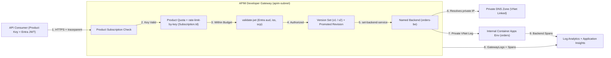
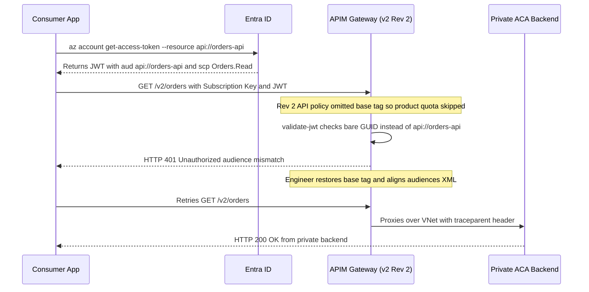

# Capstone Project

> **Prerequisites:** Azure APIM Core, Versioning, Policies, JWT Validation, Backend Integration, Products, and Observability (Modules 00–07), Internal Container Apps (`06/04`), and Entra ID App Registrations (`16/01`).  
> **Estimated Reading Time:** 90 minutes (build, validation, and teardown)  
> **Target Audience:** Backend Engineers, Platform Engineers, Cloud Architects.

*(This module remains focused on Azure APIM specifically — the previous module's Kong/Traefik content is a deliberate contrast, not a prerequisite for this capstone.)*

> [!TIP]
> **The Golden Rule of the APIM Capstone:** **Provision the Developer-tier APIM instance first (`--no-wait`)** while you create the VNet, internal Container Apps Environment, Entra ID app registration, and Log Analytics workspace; verify one authenticated `200` to your private named backend *before* layering versioning, `rate-limit-by-key`, `validate-jwt`, and product scopes—and **delete both the resource group and the Entra app registration the exact same day**.

---

## Why This Matters

This is the last module of the API Management track. There's no new concept section, no command reference, and no quiz — the goal is to combine everything from modules 00-07 into one real, working API product: a private backend fronted by APIM over VNet integration, versioned, rate-limited, protected by real Entra ID token validation, packaged as a product with a self-service subscription key, and observable with live analytics. Treat it as a project, not a checklist of isolated exercises — the pieces depend on each other in the order you'd actually build them, and being able to explain *why each layer exists* is the real test of this track.

---

## 1. Architectural Mental Model & Project Blueprint

Every module from 00–07 fits into one cohesive request pipeline—where edge metering (`Product` + `rate-limit-by-key`), workload authorization (`validate-jwt`), versioned routing (`v1` / `v2` + revisions), private VNet backend resolution (`set-backend-service` + Private DNS), and correlated observability (`GatewayLogs` + `traceparent`) work together:



### The Project (Build Order)

Take the backend patterns from track 06 and put a complete, governed API product in front of them. Build, in roughly this order:

1. **A private backend.** Deploy a Container App into an **internal-only** Container Apps Environment (track 06 module 04 / module 05 here) so the backend is unreachable from the public internet — only APIM will reach it.
2. **APIM integrated into the VNet.** Provision a **Developer-tier** instance (needed for VNet integration and the developer portal) into the same VNet, with the environment's **private DNS zone linked** so APIM can resolve the backend's private FQDN. (Expect the 30-45 min provisioning; kick it off early.)
3. **A named backend** pointing at the private FQDN, routed via `set-backend-service` — not an inline `serviceUrl`.
4. **A versioned API** with at least **two versions** in a version set (Path scheme), where v2 represents a deliberate change; use a **revision** to stage a safe iteration on one version and promote it.
5. **A rate-limiting policy** — a **per-consumer** `rate-limit-by-key` (keyed by `context.Subscription.Id`) and a product-scope quota.
6. **JWT validation** — a `validate-jwt` inbound policy accepting only Entra ID tokens for your API's audience and issuer, requiring a specific scope (real token from `az account get-access-token`, track 16 / module 04).
7. **A product with a subscription key** — package the API into a published product (subscription required), create a subscription, and prove calls work with the product-scoped key and fail without it.
8. **Analytics showing real traffic** — wire diagnostic logs / App Insights, generate load, and produce evidence (analytics view or KQL) of real request data, including the gateway-vs-backend latency split.

---

## 2. Taxonomic Synthesis & Acceptance Criteria

### Layer-by-Layer Architecture & Failure Diagnostics Matrix

| Layer | Module Origin | Key Policy / Resource | Expected Failure on Misconfig | Verification Proof |
| :--- | :--- | :--- | :--- | :--- |
| **Private Backend + VNet** | Module 05 / Track 06-04 | Internal ACA Env + Private DNS Link | `503` after passing key | Laptop `curl` times out; APIM returns `200` |
| **Named Backend Routing** | Module 05 | `az apim backend` + `set-backend-service` | `404` or `503` on route | `az apim backend show` points to internal FQDN |
| **Versioning & Revisions** | Module 02 | Path Version Set (`v1`, `v2`) + Revision | `404` on wrong path segment | Both `/v1/orders` and `/v2/orders` respond `200` |
| **Per-Consumer Throttling** | Module 03 | `rate-limit-by-key` (`context.Subscription.Id`) | `429` isolated per caller | Consumer A throttled (`429`) while Consumer B gets `200` |
| **Entra ID Authorization** | Module 04 / Track 16 | `validate-jwt` (`aud`, `iss`, `scp`) | `401` (no/bad `aud`), `403` (missing `scp`) | Valid token returns `200`; jwt.ms matches claims |
| **Product Packaging** | Module 06 | Published Product + Product-Scoped Key | `401` without key or wrong product | Product key succeeds; unattached API returns `401` |
| **Observability** | Module 07 / Track 12 | `GatewayLogs` + App Insights (`traceparent`) | Empty KQL table if unwired | KQL computes `GatewayTime = TotalTime - BackendTime` |

### Acceptance Criteria

Work through these in order; each depends on the previous ones actually working, not just existing.

- [ ] A resource group contains an **internal-only** Container Apps Environment and a backend Container App whose FQDN resolves to a **private IP** and is **not reachable from your laptop** (curl from your machine fails/ times out).
- [ ] A **Developer-tier** APIM instance is integrated into the same VNet, and the environment's **private DNS zone is linked** to APIM's VNet (`az network private-dns link vnet list` shows the link).
- [ ] A **named backend** (not an inline `serviceUrl`) points at the private FQDN, and an API routes to it via `set-backend-service`; an authenticated call through the gateway returns **200** from the backend your laptop can't reach.
- [ ] The API exists in a **version set** with **at least two versions** (both callable at their versioned paths), and you used a **revision** to stage and promote a change on one version (revision history shows the release note).
- [ ] A **per-consumer** `rate-limit-by-key` (keyed by `context.Subscription.Id`) is in effect: two different subscription keys each get their **own** budget, and exceeding it returns **429** for that consumer only — not the other.
- [ ] A `validate-jwt` policy rejects a call with **no token (401)**, rejects a valid token **missing the required scope (403)**, rejects a token minted for the **wrong audience (401)**, and accepts a valid, correctly-scoped Entra ID token **(200)** — and you can show the token's `aud`/`iss`/`scp` decoded.
- [ ] The API is packaged into a **published product** requiring a subscription; a **product-scoped subscription key** succeeds, the **master key removed from the call** (or a wrong-product key) fails with 401, and the product carries a **quota**.
- [ ] **Analytics show real traffic**: the built-in analytics view (or a KQL query over `ApiManagementGatewayLogs`) displays your generated requests, and you can produce the **gateway-time vs. backend-time split** for at least one operation.
- [ ] You can explain, for every layer above, **what it adds that the raw track-06 external ingress could not** — if you can't explain a layer, that's a sign to revisit its module rather than having copy-pasted a policy that worked.

---

## 3. Production War Story Post-Mortem: Capstone Go-Live Blocked by Missing `<base />` & Audience URI Mismatch

| Field | Incident Details |
| :--- | :--- |
| **Severity** | **SEV-2** (Pre-Launch Acceptance Failure & Silent Quota Bypass) |
| **Detection / Resolution Time** | Detected in 6 minutes during acceptance verification / Resolved in 32 minutes |
| **Impact** | Promoting Revision 2 of `v2` dropped the product quota policy due to a missing `<base />` tag, while valid Entra tokens returned `401` because `validate-jwt` checked a bare GUID instead of the `api://` audience claim |

### What Happened

During final capstone integration testing, an engineer promoted Revision 2 of `/v2/orders` with an updated inbound `validate-jwt` policy. Immediately, valid Entra tokens failed with `401 Unauthorized`, and load tests showed the product-scope quota had silently stopped counting.



### Root Cause Analysis

1. **Omitted `<base />` tag inside Revision 2 inbound policy**: Removing `<base />` from the API-level `<inbound>` block prevented APIM from executing the inherited Product-scope quota and Global policies.
2. **`aud` format mismatch (`api://<appId>` vs `<appId>`)**: `az account get-access-token` emitted an `aud` claim prefixed with `api://`, while `<audiences>` inside `validate-jwt` listed only the raw application GUID.
3. **Orphaned Entra app registration left outside RG teardown**: Early cleanup runs deleted the Azure resource group (`az group delete`) while forgetting that Entra app registrations live at the tenant level outside any resource group.

### The Fix & Architectural Hardening

- Restored `<base />` as the first element of `<inbound>`, `<backend>`, `<outbound>`, and `<on-error>` across every API version and revision.
- Decoded the issued JWT first to align `<audiences>`, `<issuers>`, and `<required-claims>` (`scp: Orders.Read`) verbatim.
- Automated a 5-status smoke test (`200`, `401`, `403`, `429`, `503`) and paired `az group delete` with `az ad app delete` in the teardown script.

---

## 4. Multi-Language Production Implementation: End-to-End Capstone Verification Harness

These four implementations model a production **governed API verification client**: sending an authenticated call through APIM with `Ocp-Apim-Subscription-Key`, an Entra ID `Authorization: Bearer` token, and a W3C **`traceparent`** header; inspecting rate-limit headers (`Retry-After` / remaining quota); and classifying every gateway contract failure (`401` auth/audience, `403` missing scope, `404` version/path, `429` consumer throttle, `503` VNet/Private DNS failure) cleanly.

````carousel
```go
package capstoneverify

import (
	"context"
	"crypto/rand"
	"encoding/hex"
	"fmt"
	"net/http"
	"time"
)

type ProbeResult struct {
	StatusCode  int
	Layer       string
	TraceParent string
	LatencyMs   int64
}

func newTraceParent() string {
	t := make([]byte, 16)
	s := make([]byte, 8)
	_, _ = rand.Read(t)
	_, _ = rand.Read(s)
	return "00-" + hex.EncodeToString(t) + "-" + hex.EncodeToString(s) + "-01"
}

func ClassifyStatus(code int) string {
	switch code {
	case 200:
		return "Healthy End-to-End Private Backend"
	case 401:
		return "Auth Layer (Missing/Wrong Product Key or JWT aud/iss mismatch)"
	case 403:
		return "Authorization Layer (Valid JWT missing required scp claim)"
	case 404:
		return "Routing Layer (API Version Set path or backend mapping mismatch)"
	case 429:
		return "Throttling Layer (rate-limit-by-key / product quota exhausted)"
	case 503:
		return "Backend Reachability Layer (VNet routing or Private DNS zone unlinked)"
	default:
		return fmt.Sprintf("Unexpected Status %d", code)
	}
}

func ProbeGovernedAPI(ctx context.Context, gatewayURL, versionPath, subKey, jwt string) (*ProbeResult, error) {
	tp := newTraceParent()
	req, err := http.NewRequestWithContext(ctx, http.MethodGet, gatewayURL+versionPath, nil)
	if err != nil {
		return nil, err
	}
	req.Header.Set("Ocp-Apim-Subscription-Key", subKey)
	if jwt != "" {
		req.Header.Set("Authorization", "Bearer "+jwt)
	}
	req.Header.Set("traceparent", tp)

	start := time.Now()
	client := &http.Client{Timeout: 10 * time.Second}
	resp, err := client.Do(req)
	if err != nil {
		return nil, fmt.Errorf("gateway request failed (traceparent=%s): %w", tp, err)
	}
	defer resp.Body.Close()

	return &ProbeResult{
		StatusCode:  resp.StatusCode,
		Layer:       ClassifyStatus(resp.StatusCode),
		TraceParent: tp,
		LatencyMs:   time.Since(start).Milliseconds(),
	}, nil
}
```
<!-- slide -->
```typescript
import { randomBytes } from "node:crypto";

export interface CapstoneProbeReport {
  status: number;
  layerDiagnosis: string;
  traceparent: string;
  durationMs: number;
  retryAfter?: string | null;
}

export function diagnoseGatewayStatus(status: number): string {
  const map: Record<number, string> = {
    200: "Healthy end-to-end (Subscription + JWT + VNet Private Backend)",
    401: "Auth failure (invalid/wrong-product key or validate-jwt aud/iss mismatch)",
    403: "Scope failure (valid Entra JWT missing required scp claim)",
    404: "Mapping failure (check Version Set path or named backend route)",
    429: "Throttle failure (per-consumer rate-limit-by-key or product quota hit)",
    503: "Backend reachability failure (check Private DNS VNet link or subnet NSG)",
  };
  return map[status] ?? `Unhandled gateway status ${status}`;
}

export async function verifyCapstoneEndpoint(
  gatewayBaseUrl: string,
  versionedPath: string,
  subscriptionKey: string,
  bearerJwt?: string
): Promise<CapstoneProbeReport> {
  const traceparent = `00-${randomBytes(16).toString("hex")}-${randomBytes(8).toString("hex")}-01`;
  const headers: Record<string, string> = {
    "Ocp-Apim-Subscription-Key": subscriptionKey,
    traceparent,
  };
  if (bearerJwt) {
    headers.Authorization = `Bearer ${bearerJwt}`;
  }

  const started = performance.now();
  const res = await fetch(`${gatewayBaseUrl}${versionedPath}`, {
    headers,
    signal: AbortSignal.timeout(10_000),
  });

  return {
    status: res.status,
    layerDiagnosis: diagnoseGatewayStatus(res.status),
    traceparent,
    durationMs: Math.round(performance.now() - started),
    retryAfter: res.headers.get("Retry-After"),
  };
}
```
<!-- slide -->
```python
from dataclasses import dataclass
import secrets
import time
import urllib.error
import urllib.request


STATUS_LAYER_MAP = {
    200: "Healthy end-to-end (Subscription + JWT + VNet Private Backend)",
    401: "Auth layer (missing/wrong-product key or JWT aud/iss mismatch)",
    403: "Authorization layer (valid JWT missing required scp claim)",
    404: "Routing layer (API version path or backend URL mismatch)",
    429: "Throttling layer (rate-limit-by-key or product quota exhausted)",
    503: "Backend reachability layer (Private DNS VNet link or routing issue)",
}


@dataclass(frozen=True)
class ProbeReport:
    status_code: int
    layer_diagnosis: str
    traceparent: str
    latency_ms: float


def verify_capstone_call(
    gateway_url: str,
    versioned_path: str,
    subscription_key: str,
    bearer_jwt: str | None = None,
) -> ProbeReport:
    traceparent = f"00-{secrets.token_hex(16)}-{secrets.token_hex(8)}-01"
    headers = {
        "Ocp-Apim-Subscription-Key": subscription_key,
        "traceparent": traceparent,
    }
    if bearer_jwt:
        headers["Authorization"] = f"Bearer {bearer_jwt}"

    req = urllib.request.Request(f"{gateway_url}{versioned_path}", headers=headers)
    started = time.perf_counter()
    try:
        with urllib.request.urlopen(req, timeout=10) as resp:
            code = resp.status
    except urllib.error.HTTPError as exc:
        code = exc.code

    elapsed_ms = round((time.perf_counter() - started) * 1000, 2)
    return ProbeReport(
        status_code=code,
        layer_diagnosis=STATUS_LAYER_MAP.get(code, f"Unexpected HTTP {code}"),
        traceparent=traceparent,
        latency_ms=elapsed_ms,
    )
```
<!-- slide -->
```csharp
using System.Diagnostics;
using System.Net.Http.Headers;
using System.Security.Cryptography;

public sealed record CapstoneProbeResult(int StatusCode, string LayerDiagnosis, string TraceParent, long ElapsedMs);

public static class CapstoneVerifier
{
    public static string Diagnose(int statusCode) => statusCode switch
    {
        200 => "Healthy end-to-end (Product Key + Entra JWT + Private Backend)",
        401 => "Auth layer (invalid/wrong-product subscription key or JWT aud/iss mismatch)",
        403 => "Scope layer (valid Entra token missing required scp claim)",
        404 => "Routing layer (Version Set path or named backend mapping error)",
        429 => "Throttling layer (per-consumer rate-limit-by-key or product quota hit)",
        503 => "Reachability layer (Private DNS zone not linked to APIM VNet)",
        _ => $"Unexpected HTTP {statusCode}"
    };

    public static async Task<CapstoneProbeResult> ProbeAsync(
        HttpClient client,
        Uri gatewayEndpoint,
        string subscriptionKey,
        string? bearerJwt,
        CancellationToken ct = default)
    {
        string traceParent =
            $"00-{Convert.ToHexString(RandomNumberGenerator.GetBytes(16)).ToLowerInvariant()}-{Convert.ToHexString(RandomNumberGenerator.GetBytes(8)).ToLowerInvariant()}-01";

        using var req = new HttpRequestMessage(HttpMethod.Get, gatewayEndpoint);
        req.Headers.TryAddWithoutValidation("Ocp-Apim-Subscription-Key", subscriptionKey);
        req.Headers.TryAddWithoutValidation("traceparent", traceParent);
        if (!string.IsNullOrWhiteSpace(bearerJwt))
            req.Headers.Authorization = new AuthenticationHeaderValue("Bearer", bearerJwt);

        var sw = Stopwatch.StartNew();
        using var resp = await client.SendAsync(req, ct);
        sw.Stop();

        int status = (int)resp.StatusCode;
        return new CapstoneProbeResult(status, Diagnose(status), traceParent, sw.ElapsedMilliseconds);
    }
}
```
````

---

## 5. Practical Hands-On Verification CLI Workflows

### 1. Provision Developer APIM (`--no-wait`) and build VNet + Internal Backend
```powershell
$rg = "rg-apim-capstone"
az group create --name $rg --location eastus
$apim = "apimcap$((Get-Random -Max 99999))"
az apim create --name $apim --resource-group $rg --location eastus `
  --publisher-name "PlatformOps" --publisher-email ops@example.com --sku-name Developer --no-wait

az network vnet create --name vnet-cap --resource-group $rg `
  --address-prefix 10.0.0.0/16 --subnet-name aca-infra --subnet-prefix 10.0.0.0/23
az network vnet subnet create --resource-group $rg --vnet-name vnet-cap `
  --name apim-subnet --address-prefix 10.0.4.0/24
```

### 2. Verify Private DNS link & confirm laptop cannot reach the private backend directly
```powershell
az network private-dns link vnet list --resource-group "<mc-aca-rg>" --zone-name "<internal-zone>" -o table
curl -m 5 "https://$ifqdn/"
```

**Expected Output:**
```text
Name              RegistrationEnabled    VirtualNetworkLinkState    ProvisioningState
----------------  ---------------------  -------------------------  -------------------
link-vnet-cap     False                  Completed                  Succeeded

curl: (28) Connection timed out after 5001 milliseconds
```

### 3. Verify JWT enforcement (`401` / `403` / `200`) and per-consumer `rate-limit-by-key` (`429`)
```powershell
# No token -> 401
curl -s -o /dev/null -w "%{http_code}\n" -H "Ocp-Apim-Subscription-Key: $subKeyA" "$gw/v2/orders/"
# Valid token with required scope -> 200
$token = az account get-access-token --resource "api://$appId" --query accessToken -o tsv
curl -s -o /dev/null -w "%{http_code}\n" -H "Ocp-Apim-Subscription-Key: $subKeyA" -H "Authorization: Bearer $token" "$gw/v2/orders/"
# Exhaust Consumer A's rate-limit-by-key -> 429 for A, 200 for Consumer B
1..6 | ForEach-Object { curl -s -o /dev/null -w "%{http_code} " -H "Ocp-Apim-Subscription-Key: $subKeyA" -H "Authorization: Bearer $token" "$gw/v2/orders/" }
curl -s -o /dev/null -w "\nConsumer B: %{http_code}\n" -H "Ocp-Apim-Subscription-Key: $subKeyB" -H "Authorization: Bearer $token" "$gw/v2/orders/"
```

**Expected Output:**
```text
401
200
200 200 200 200 200 429
Consumer B: 200
```

### 4. Produce the KQL Gateway-vs-Backend latency split
```kusto
ApiManagementGatewayLogs
| where OperationId != ""
| project TimeGenerated, ApiId, OperationId, ResponseCode, TotalTime = DurationMs, BackendTime = BackendTime
| extend GatewayTime = TotalTime - BackendTime
| order by TimeGenerated desc
| take 10
```

**Expected Output:**
```text
TimeGenerated         ApiId      ResponseCode  TotalTime  BackendTime  GatewayTime
--------------------  ---------  ------------  ---------  -----------  -----------
2026-11-11T04:42:11Z  orders-v2  200           61.4       52.1         9.3
2026-11-11T04:42:08Z  orders-v2  429           2.8        0.0          2.8
```

### Hints

- **Provision APIM first, build everything else while it cooks.** The Developer instance takes 30-45 minutes. Kick off `az apim create ... --no-wait`, then do the VNet, internal environment, backend, and app registration during the wait so you're not idle.
- **Get one authenticated call to the private backend working before adding policies.** Prove the hard part (VNet + private DNS + named backend) end to end first; layering versioning, rate limits, and JWT on top of a *working* base is far easier than debugging all of it at once.
- **Reproduce each failure code deliberately so you can read them instantly:** 401 = auth/token (module 04), 404 = path/backend mapping (module 01), 429 = throttled (module 03), 503 = backend unreachable / DNS-routing (module 05). If a code surprises you, you've found the layer to debug.
- **Decode every token before blaming the policy.** For the JWT criteria, line up the token's `aud`/`iss`/`scp` (jwt.ms) against your `<audiences>`/`<issuers>`/`<required-claims>`. A 401 on a token you *know* is valid is almost always an audience mismatch, not a bad token.
- **Watch `<base />` placement.** If a rate limit or JWT check "doesn't run," suspect a missing `<base />` or a policy attached to the wrong version/revision before anything else.
- **Keep analytics honest and cheap.** Use modest sampling and headers-not-bodies; you need *evidence* of real traffic and a latency split, not a full-body capture of every call.
- **Keep a running inventory** of every resource you create (APIM instance, VNet, internal environment, Container App, Log Analytics workspace, App Insights, Entra app registration) so cleanup is a checklist, not archaeology.

### Cost & cleanup

This capstone uses a **Developer-tier** APIM instance, which **bills continuously** and is slow to both create and delete — plus a Log Analytics workspace and App Insights that bill by ingestion. Do not leave any of it running overnight "to finish tomorrow."

1. Confirm what exists: `az resource list --resource-group <your-capstone-rg> -o table`.
2. Delete the resource group and everything in it: `az group delete --name <your-capstone-rg> --yes --no-wait`.
3. Delete the **Entra ID app registration** you created for JWT validation (`az ad app delete --id <app-id>`) — it lives outside the resource group.
4. Sweep for stragglers that don't die with a resource group: check `az apim list -o table` (classic-tier deletes are slow — confirm it's gone), `az monitor log-analytics workspace list -o table`, and `az monitor app-insights component show ...`. An empty APIM list is your signal the continuously-billing part is truly gone.

### Before you move on

Once everything is torn down, don't consider this finished yet. Wait a few days, then — with no notes, none of the earlier modules open, and none of the policy XML in front of you — **rebuild the core of this capstone from memory**: a private backend APIM reaches over VNet, a versioned API, a per-consumer rate limit, a `validate-jwt` policy that gives you the right 200/401/403 across a valid token, a missing-scope token, and a wrong-audience token, and a product whose subscription key gates access. Rebuilding it cold — and noticing exactly where you stall (Was it the private DNS linkage? The `counter-key` expression? The audience string? The `<base />` placement?) — is the truest retention check there is. Tear it all down again afterward and confirm the APIM instance is gone.

---

## 6. Common Mistakes & Troubleshooting

- **Debugging everything simultaneously instead of proving VNet reachability first.** Always verify one plain `200` to the internal backend via your named backend *before* adding `validate-jwt`, version sets, and product quotas.
- **Missing `<base />` in API or revision policies.** Dropping `<base />` silently disables parent product quotas or global security headers without throwing a syntax error.
- **Unaligned `aud` or `iss` claims in `validate-jwt`.** Always inspect the decoded JWT (`aud`, `iss`, `scp`) first; `api://<appId>` vs `<appId>` is the single most common `401` trap.
- **Using `<rate-limit>` or `<quota>` instead of `-by-key`.** Without `counter-key="@(context.Subscription.Id)"`, one subscriber's burst throttles every other subscriber in the product.
- **Forgetting tenant-level cleanup.** `az group delete` does not remove your Entra ID app registration—always run `az ad app delete --id <app-id>` and verify `az apim list -o table` is empty.

---

## 7. Operational Validation Checkpoints

<details><summary><strong>Checkpoint 1: Triaging 401 vs. 403 vs. 503 on your first call to /v2/orders</strong></summary>

Each status pinpoints a distinct boundary: `401` means either the `Ocp-Apim-Subscription-Key` is missing/wrong-product-scoped OR `validate-jwt` rejected `aud`/`iss`; `403` means the JWT signature and audience passed, but the token lacks the required `scp` claim (`Orders.Read`); `503` means all auth passed and the route matched, but APIM cannot resolve the Private DNS zone or route across the VNet to the internal Container App.

</details>

<details><summary><strong>Checkpoint 2: Why promoting Revision 2 made the product-scope quota vanish</strong></summary>

In APIM, policies inherit downward (`Global → Product → API → Operation`) *only* where `<base />` is present. If Revision 2's API-level `<inbound>` policy omitted `<base />`, APIM skipped the parent Product-scope `<quota-by-key>` and Global policies entirely—always keep `<base />` as the first child of every policy section.

</details>

<details><summary><strong>Checkpoint 3: Guaranteeing zero lingering spend after capstone teardown</strong></summary>

Confirm four items after running `az group delete --yes --no-wait`: (1) `az apim list -o table` returns empty (Developer APIM deletes slowly and bills continuously until gone), (2) `az monitor log-analytics workspace list -o table` shows no leftover capstone workspace, (3) `az ad app list --display-name <capstone-app>` confirms the Entra app registration was deleted separately, and (4) `az resource list -g <rg>` returns ResourceGroupNotFound.

</details>

---

## 8. Next

You've turned raw backends into a governed API product: authenticated at the edge, throttled per consumer, versioned, privately integrated, packaged, and observable. That last capability — **API-level observability** — is exactly the bridge into the next track. In [20-sre-practices](../../20-sre-practices/README.md), the 5xx-rate, latency, and failed-auth signals you just lit up on your APIs stop being dashboards and become **SLIs** you define **SLOs** and **error budgets** against — "99.9% of Orders API requests succeed under 300ms" is measured directly on the APIM metrics from module 07. You've built the thing that gets measured; track 20 is how you decide what "healthy enough" means and what to do when the budget runs out.

[Back to the track index](../README.md) · [Back to main curriculum](../../README.md)
