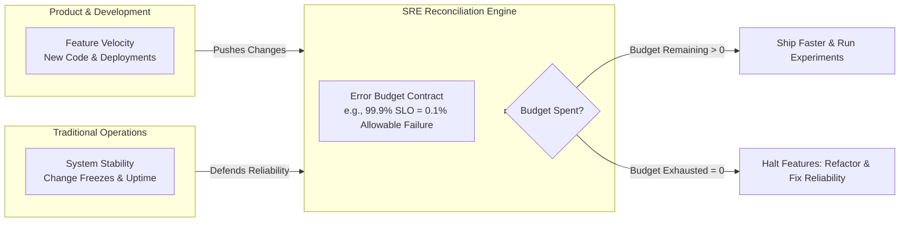
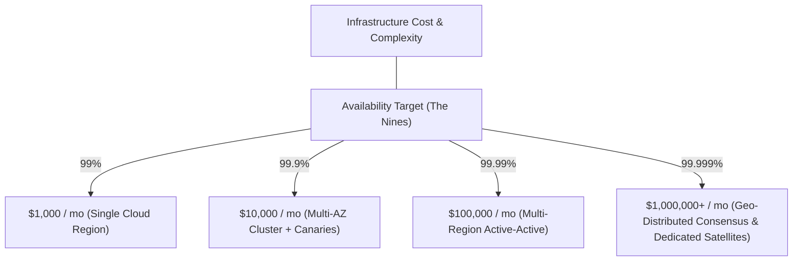
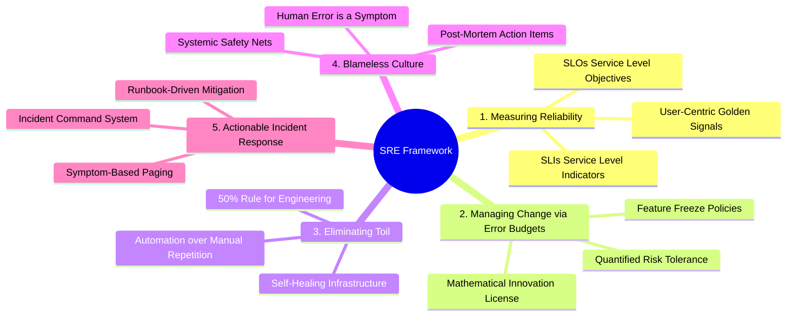
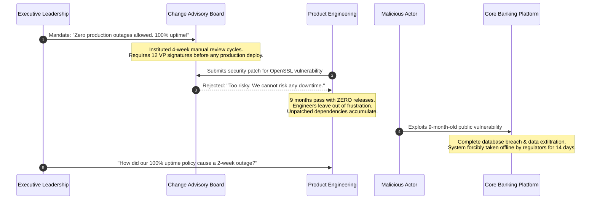

# SRE Concepts and the Reliability Mindset

> **Difficulty**: Intermediate | **Estimated Time**: 30m | **Hands-On**: Analysis & Mindset

> [!TIP]
> **The Golden Rule of Site Reliability Engineering:**
> **100% reliability is the wrong target.** Demanding 100% uptime halts engineering velocity, creates paralyzing change-approval bureaucracy, and exponentially inflates infrastructure costs for zero user-perceptible benefit (a user on a 99.5% reliable mobile network cannot perceive a 99.999% backend). Treat the remaining margin—the **Error Budget**—as an engineering asset to be deliberately spent on fast iteration, deployments, and calculated risk.

---

## 1. Visual Mental Models & The Reliability Balance

Traditional IT operations suffered from an inherent structural conflict: **Developers** were incentivized to ship features rapidly (introducing change), while **Sysadmins / Ops** were incentivized to keep systems stable (resisting change).

Site Reliability Engineering (SRE), pioneered at Google, reconciles this conflict by treating operations as a software engineering problem governed by a mathematical contract: the **Error Budget**.



### The Exponential Cost of "Nines"

Every additional nine of availability requires an order of magnitude more architectural complexity (multi-region active-active failover, automated consensus, zero-downtime database schema migrations) and yields diminishing human returns.

```
+------------+-----------------------+----------------------+------------------------------------------+
| Target SLO | Allowed Downtime/Year | Allowed Downtime/Mo  | Engineering & Architectural Requirements |
+------------+-----------------------+----------------------+------------------------------------------+
| 99.0% (2)  | 3.65 days             | 7.30 hours           | Single VM, manual failover, daily backup |
| 99.9% (3)  | 8.76 hours             | 43.8 minutes         | Multi-pod K8s, automated health checks   |
| 99.99% (4) | 52.6 minutes          | 4.38 minutes         | Multi-AZ, automated zero-downtime canary |
| 99.999% (5)| 5.26 minutes          | 26.3 seconds         | Multi-region active-active, Paxos/Raft   |
+------------+-----------------------+----------------------+------------------------------------------+
```



---

## 2. Structural Comparison: SRE vs. DevOps vs. Traditional Ops

| Dimension | Traditional IT Operations | DevOps Culture | Site Reliability Engineering (SRE) |
| :--- | :--- | :--- | :--- |
| **Organizational Model** | Siloed "Ops" team receiving code "thrown over the wall" | Shared ownership between Dev and Ops without formal role boundaries | Software engineers embedded into operations with strict programmatic rules |
| **Acceptable Downtime** | "Zero downtime" (unrealistic, leads to finger-pointing) | Unspecified; focused on continuous delivery pipelines | Explicitly quantified via **Error Budgets** (100% - SLO) |
| **Change Management** | Manual Change Advisory Boards (CABs) and multi-day approval tickets | Automated CI/CD test automation | Automated gates driven by error budget burn rates and automated canaries |
| **Operational Labor** | Manual repetitive sysadmin tasks ("toil") accepted as duty | Automation encouraged through scripts | Programmatic cap: **Max 50% Toil**, remaining 50% must be software engineering |
| **Failure Response** | Punitive; finding who broke production | Cultural blame reduction | **Blameless Post-Mortems**; systemic defense-in-depth fixes |

---

## 3. The Five Core Pillars of SRE



1. **Measuring Reliability (SLIs & SLOs)**: You cannot manage what you do not measure. Replace gut feelings with quantitative ratios of successful events over total valid events.
2. **Error Budget Contract**: Reliability is treated as a shared financial currency. When the budget is healthy, developers ship aggressively. When the budget is depleted, feature work pauses until reliability is restored.
3. **The 50% Toil Cap**: Toil is manual, repetitive, tactical work that scales linearly with service growth. SRE mandates that at least 50% of an engineer's time is spent building software tools and automation that eliminate toil permanently.
4. **Blameless Post-Mortems**: Assume engineers always act with good intent using the information available to them. Production crashes occur because the system allowed a single human mistake to cause catastrophic damage.
5. **Actionable Incident Management**: Pagers wake engineers only when an active incident is burning the error budget and requires human ingenuity. Everything else is handled by automated orchestrators.

---

## 4. Production War Story: The 100% Uptime Mirage

```
INCIDENT SUMMARY: INC-4011
SEVERITY: P1 - Organizational Paralysis & Security Vulnerability
IMPACT: Zero product releases for 9 months; 14 senior engineers resigned; catastrophic zero-day security exploit.
ROOT CAUSE: Executive mandate demanding "100% Zero-Failure Availability" without an error budget.
```

### The Incident Flow



### The Post-Mortem

- **The Fallacy**: The organization conflated "refusing to make changes" with "stability". By setting an impossible 100% target, every minor change was deemed too dangerous to deploy.
- **The Result**: Software rotted in place. Security patches were delayed by months. When an exploit inevitably hit, the lack of deployment muscle memory made rapid emergency mitigation impossible.
- **The SRE Transformation**:
  1. Abandoned the 100% goal; established an SLO of **99.95%** (21.9 minutes of allowed downtime per month).
  2. Implemented automated canary deployments and progressive rollouts.
  3. Deployed automated CI/CD security patching within the allowed error budget.

---

## 5. Practical Implementation: Error Budget Calculator

Use these multi-language scripts to calculate allowable downtime windows and remaining error budgets for any production service.

### Go (`error_budget.go`)

```go
package main

import (
	"fmt"
	"time"
)

type SLOReport struct {
	TargetSLO         float64
	WindowDuration    time.Duration
	TotalAllowedDown  time.Duration
	ActualDowntime    time.Duration
	BudgetRemainingPct float64
	BudgetBurnedPct    float64
}

func CalculateErrorBudget(targetSLO float64, windowDays int, actualDown time.Duration) SLOReport {
	windowDuration := time.Duration(windowDays) * 24 * time.Hour
	unavailabilityFraction := (100.0 - targetSLO) / 100.0
	totalAllowedDown := time.Duration(float64(windowDuration) * unavailabilityFraction)

	burnedFraction := float64(actualDown) / float64(totalAllowedDown)
	burnedPct := burnedFraction * 100.0
	remainingPct := 100.0 - burnedPct

	return SLOReport{
		TargetSLO:          targetSLO,
		WindowDuration:     windowDuration,
		TotalAllowedDown:   totalAllowedDown,
		ActualDowntime:     actualDown,
		BudgetRemainingPct: remainingPct,
		BudgetBurnedPct:    burnedPct,
	}
}

func main() {
	// Scenario: 99.9% SLO over a 30-day window with 18 minutes of incident downtime
	report := CalculateErrorBudget(99.9, 30, 18*time.Minute)

	fmt.Printf("--- SRE Error Budget Report ---\n")
	fmt.Printf("Target SLO:           %.2f%%\n", report.TargetSLO)
	fmt.Printf("Window:               %v\n", report.WindowDuration)
	fmt.Printf("Max Allowed Downtime: %v\n", report.TotalAllowedDown)
	fmt.Printf("Actual Downtime:      %v\n", report.ActualDowntime)
	fmt.Printf("Budget Burned:        %.1f%%\n", report.BudgetBurnedPct)
	fmt.Printf("Budget Remaining:     %.1f%%\n", report.BudgetRemainingPct)

	if report.BudgetRemainingPct <= 0 {
		fmt.Println("POLICY: Error budget EXHAUSTED! Enforce feature freeze.")
	} else {
		fmt.Println("POLICY: Error budget HEALTHY. Continue standard releases.")
	}
}
```

### TypeScript / Node.js (`error_budget.ts`)

```typescript
interface BudgetCalculation {
  targetSlo: number;
  windowDays: number;
  totalRequests: number;
  failedRequests: number;
  sliActual: number;
  budgetTotal: number;
  budgetRemaining: number;
  isBreached: boolean;
}

export function evaluateErrorBudget(
  targetSloPct: number,
  windowDays: number,
  totalRequests: number,
  failedRequests: number
): BudgetCalculation {
  const allowedErrorRate = (100 - targetSloPct) / 100;
  const actualErrorRate = failedRequests / totalRequests;
  const sliActual = (1 - actualErrorRate) * 100;

  const budgetTotal = Math.floor(totalRequests * allowedErrorRate);
  const budgetRemaining = budgetTotal - failedRequests;

  return {
    targetSlo: targetSloPct,
    windowDays,
    totalRequests,
    failedRequests,
    sliActual: Number(sliActual.toFixed(4)),
    budgetTotal,
    budgetRemaining,
    isBreached: budgetRemaining < 0,
  };
}

// Example: 10,000,000 requests, 99.95% target SLO, 3,200 failed requests
const report = evaluateErrorBudget(99.95, 30, 10_000_000, 3_200);
console.log(JSON.stringify(report, null, 2));
```

### Python (`error_budget.py`)

```python
from dataclasses import dataclass
from datetime import timedelta

@dataclass
class ErrorBudgetAssessment:
    target_slo: float
    window_days: int
    allowed_downtime: timedelta
    actual_downtime: timedelta
    budget_burned_pct: float
    status: str

def assess_budget(target_slo: float, window_days: int, downtime_minutes: float) -> ErrorBudgetAssessment:
    total_window_minutes = window_days * 24 * 60
    allowed_downtime_minutes = total_window_minutes * ((100.0 - target_slo) / 100.0)
    
    burned_pct = (downtime_minutes / allowed_downtime_minutes) * 100.0
    
    if burned_pct >= 100.0:
        status = "FREEZE_RELEASES"
    elif burned_pct >= 80.0:
        status = "WARNING_HIGH_BURN"
    else:
        status = "HEALTHY"

    return ErrorBudgetAssessment(
        target_slo=target_slo,
        window_days=window_days,
        allowed_downtime=timedelta(minutes=allowed_downtime_minutes),
        actual_downtime=timedelta(minutes=downtime_minutes),
        budget_burned_pct=round(burned_pct, 2),
        status=status
    )

if __name__ == "__main__":
    result = assess_budget(target_slo=99.9, window_days=30, downtime_minutes=25)
    print(f"SLO: {result.target_slo}% | Allowed Down: {result.allowed_downtime}")
    print(f"Burned: {result.budget_burned_pct}% | Policy Action: {result.status}")
```

---

## 6. Practical CLI Workflows

Verify how Prometheus calculates actual availability against an SLO target from raw telemetry.

### Step 1: Query Rolling 30-Day Availability via PromQL

Execute a curl against Prometheus to evaluate your application's current 30-day SLI:

```bash
curl -s -G "http://localhost:9090/api/v1/query" \
  --data-urlencode 'query=sum(rate(http_requests_total{status!~"5.."}[30d])) / sum(rate(http_requests_total[30d])) * 100'
```

**Expected Output:**
```json
{
  "status": "success",
  "data": {
    "resultType": "vector",
    "result": [
      {
        "metric": {},
        "value": [1712498200.123, "99.93821948291"]
      }
    ]
  }
}
```

The system is delivering **99.938%** availability over the past 30 days!

### Step 2: Query Remaining Error Budget Percentage

Calculate the remaining error budget fraction directly in PromQL for a target SLO of `99.9%` (allowed error rate: `0.001`):

```bash
curl -s -G "http://localhost:9090/api/v1/query" \
  --data-urlencode 'query=(1 - (sum(rate(http_requests_total{status=~"5.."}[30d])) / sum(rate(http_requests_total[30d])))) / (1 - 0.999)'
```

**Expected Output:**
```json
{
  "status": "success",
  "data": {
    "resultType": "vector",
    "result": [
      {
        "metric": {},
        "value": [1712498200.123, "0.3821"]
      }
    ]
  }
}
```

A value of `0.3821` indicates that **38.2% of the monthly error budget remains**. Releases may proceed safely!

---

## 7. Operational Validation Checkpoints

Test your grasp of foundational SRE principles with these practical scenarios.

<details>
<summary><b>Checkpoint 1: Why is an SLO of 99.999% almost always an anti-pattern for a consumer mobile API?</b></summary>

**Analysis:**
1. **The Client Bottleneck:** Typical cellular and Wi-Fi connections experience packet loss and disconnections resulting in 99.0% to 99.5% client-side availability. If the mobile phone network drops 1 in every 200 requests, increasing backend availability from 99.9% (1 in 1,000 fails) to 99.999% (1 in 100,000 fails) delivers zero perceptible difference to the end user.
2. **Economic Waste:** Achieving five nines requires multi-region active-active database consensus, distributed locking, and redundant cold standby infrastructure, increasing infrastructure costs by 10x-50x without creating any customer value.
</details>

<details>
<summary><b>Checkpoint 2: How does an Error Budget resolve political disputes between Product and Infrastructure teams?</b></summary>

**Mechanism:**
1. **Pre-Agreed Policy:** Before incidents occur, Product and SRE executive leadership sign an **Error Budget Policy**.
2. **Deterministic Rules:** When the 30-day error budget has >20% remaining, developers have the authority to push experimental features, refactor code, and deploy multiple times per day.
3. **Automatic Circuit Breaker:** When unexpected incidents deplete 100% of the error budget, the policy automatically suspends non-critical feature deployments. Product engineering resources are programmatically redirected to technical debt remediation, automated testing, and reliability hardening until the error budget recovers.
</details>

<details>
<summary><b>Checkpoint 3: Why is "Human Error" rejected as a valid root cause in SRE post-mortems?</b></summary>

**The SRE Perspective:**
Humans are biologically fallible; they will inevitably misread a terminal flag, make a typo, or deploy at an inopportune time. Treating human error as the root cause leads to ineffective remedies (such as "tell engineers to be more careful").
In SRE, **human error is the starting point of the investigation, not the conclusion**. The systemic questions are:
- Why did the CLI allow a command to execute without confirmation?
- Why did the CI pipeline not catch the invalid configuration syntax?
- Why did the deployment system lack automated rollback upon health check failure?
The system must be engineered to make catastrophic failure safe and difficult to achieve.
</details>

---

## Next

Continue to **[01-slis-and-slos](../01-slis-and-slos/README.md)** to master the mathematics and architecture of Service Level Indicators and Service Level Objectives.
