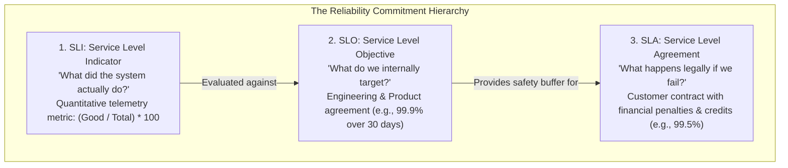
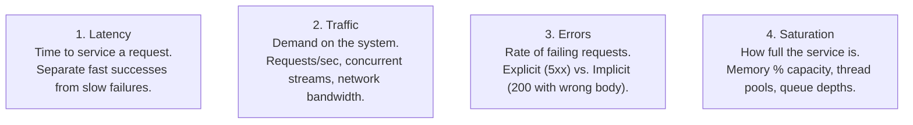
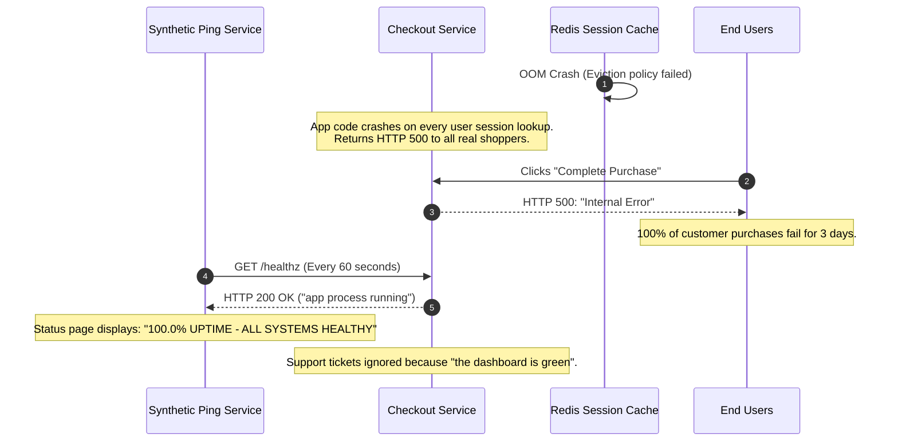

# Service Level Indicators (SLIs) and Objectives (SLOs)

> **Difficulty**: Intermediate | **Estimated Time**: 35m | **Hands-On**: Mandatory

> [!TIP]
> **The Golden Rule of SLI & SLO Design:**
> **Measure what users experience, not what servers consume.** An API with 95% CPU utilization that returns accurate responses in 40ms is a healthy service; an API with 5% CPU utilization whose database queries time out is broken. Define SLIs exclusively around user-visible outcomes (Availability and Latency) using the canonical formula: $\frac{\text{Good Events}}{\text{Total Valid Events}} \times 100$.

---

## 1. Visual Mental Models: The SLI $\to$ SLO $\to$ SLA Hierarchy

A common organizational flaw is confusing internal metrics with external legal promises. SRE strictly partitions reliability commitments into three distinct tiers:



### The Safety Margin: Why SLO $\neq$ SLA

Your internal engineering **SLO must always be stricter than your contractual SLA**. This buffer gives your team time to detect, page, and remediate degradation *before* breach of contract penalties occur.

```
+-------------------------------------------------------------------------+
|  Actual System Performance (SLI): 99.95%                                |
|  ---------------------------------------------------------------------  |
|  Internal Target (SLO):            99.90%  <-- Alert & Freeze Features  |
|  ---------------------------------------------------------------------  |
|  Legal Contract (SLA):             99.50%  <-- Financial Refund Penalty |
+-------------------------------------------------------------------------+
```

---

## 2. The Canonical SLI Formulation & The Four Golden Signals

Every production SLI must be expressed as a ratio between 0% and 100%:

$$\text{SLI} = \frac{\sum \text{Good Events}}{\sum \text{Total Valid Events}} \times 100$$

### The Four Golden Signals (Google SRE)



### Anatomy of Good vs. Bad SLIs

| Dimension | Bad SLI (Server-Centric Anti-Pattern) | Good SLI (User-Centric Best Practice) |
| :--- | :--- | :--- |
| **Availability** | Server CPU load is below 80%. | Proportion of HTTP requests returning status `2xx` or `3xx` over total valid requests (excluding client `4xx` errors). |
| **Latency** | Average API response time is under 200ms. | Proportion of valid HTTP requests served in under `350ms` (measured at the 95th or 99th percentile). |
| **Data Freshness** | Kafka consumer lag count in bytes. | Proportion of processed records whose processing timestamp is within `5 seconds` of event generation. |
| **Correctness** | Pod memory usage is stable. | Proportion of response payloads matching the declared OpenAPI JSON schema validation without errors. |

---

## 3. Production War Story: The Pingdom Synthetic Illusion

```
INCIDENT SUMMARY: INC-6102
SEVERITY: P1 - Undetected Production Outage
IMPACT: 72 hours of total checkout failure for 100,000 customers; executive dashboard showed 100% green uptime.
ROOT CAUSE: Availability was measured via a static HTTP /healthz ping rather than user transaction outcomes.
```

### Incident Timeline



### The Post-Mortem

- **The Fallacy**: The engineering team defined their availability SLI as:
  $$\text{Bad SLI} = \frac{\text{Successful Synthetic Pings to } \texttt{/healthz}}{\text{Total Synthetic Pings}}$$
  Because `/healthz` was a static route hardcoded in memory, it returned HTTP 200 even while the database and Redis connections were completely dead.
- **The Remediation**:
  1. Deprecated synthetic health pings for SLO accounting.
  2. Defined the true user-centric SLI from the API Gateway ingress log:
     $$\text{SLI}_{\text{Checkout}} = \frac{\text{HTTP } 200 \text{ responses on } \texttt{POST /checkout}}{\text{Total valid } \texttt{POST /checkout} \text{ requests}}$$
  3. Added synthetic browser journeys that actually authenticate, add to cart, and charge a test card.

---

## 4. Multi-Language Production Instrumentation for SLIs

To measure user-centric SLIs, applications must record request counts and latency distributions partitioned by exact HTTP status codes and routes.

### Go (`prometheus/client_golang`)

```go
package main

import (
	"net/http"
	"strconv"
	"time"

	"github.com/prometheus/client_golang/prometheus"
	"github.com/prometheus/client_golang/prometheus/promhttp"
)

var (
	// Total Requests Counter Vector for Availability SLI
	httpRequestsTotal = prometheus.NewCounterVec(
		prometheus.CounterOpts{
			Name: "http_requests_total",
			Help: "Total HTTP requests partitioned by status, method, and route.",
		},
		[]string{"method", "route", "status_code"},
	)

	// Request Duration Histogram for Latency SLI
	httpRequestDuration = prometheus.NewHistogramVec(
		prometheus.HistogramOpts{
			Name:    "http_request_duration_seconds",
			Help:    "HTTP request latency distributions.",
			Buckets: []float64{0.05, 0.1, 0.25, 0.5, 1.0, 2.5, 5.0},
		},
		[]string{"method", "route"},
	)
)

func init() {
	prometheus.MustRegister(httpRequestsTotal)
	prometheus.MustRegister(httpRequestDuration)
}

// SLI Middleware measuring Availability and Latency
func sliMiddleware(route string, next http.HandlerFunc) http.HandlerFunc {
	return func(w http.ResponseWriter, r *http.Request) {
		start := time.Now()
		wrappedWriter := &statusRecorder{ResponseWriter: w, statusCode: http.StatusOK}

		next(wrappedWriter, r)

		duration := time.Since(start).Seconds()
		statusStr := strconv.Itoa(wrappedWriter.statusCode)

		// Record metrics for SLI computation
		httpRequestsTotal.WithLabelValues(r.Method, route, statusStr).Inc()
		httpRequestDuration.WithLabelValues(r.Method, route).Observe(duration)
	}
}

type statusRecorder struct {
	http.ResponseWriter
	statusCode int
}

func (rec *statusRecorder) WriteHeader(code int) {
	rec.statusCode = code
	rec.ResponseWriter.WriteHeader(code)
}
```

### Node.js / TypeScript (`express` + `prom-client`)

```typescript
import express, { Request, Response, NextFunction } from 'express';
import client from 'prom-client';

const app = express();

const requestsTotal = new client.Counter({
  name: 'http_requests_total',
  help: 'Total HTTP requests for SLI availability calculation',
  labelNames: ['method', 'route', 'status_code'],
});

const latencyHistogram = new client.Histogram({
  name: 'http_request_duration_seconds',
  help: 'HTTP request latency for SLI latency calculation',
  labelNames: ['method', 'route'],
  buckets: [0.05, 0.1, 0.2, 0.5, 1.0, 2.0],
});

export function sliTrackerMiddleware(req: Request, res: Response, next: NextFunction) {
  const start = process.hrtime();

  res.on('finish', () => {
    const route = req.route ? req.route.path : req.path;
    const [seconds, nanoseconds] = process.hrtime(start);
    const duration = seconds + nanoseconds / 1e9;

    requestsTotal.inc({
      method: req.method,
      route,
      status_code: res.statusCode.toString(),
    });

    latencyHistogram.observe({ method: req.method, route }, duration);
  });

  next();
}

app.use(sliTrackerMiddleware);
```

### Python (`prometheus_client`)

```python
import time
from flask import Flask, request, g
from prometheus_client import Counter, Histogram, generate_latest, CONTENT_TYPE_LATEST

app = Flask(__name__)

REQUESTS_TOTAL = Counter(
    "http_requests_total",
    "Total HTTP requests partitioned for SLIs",
    ["method", "route", "status_code"]
)

REQUEST_DURATION = Histogram(
    "http_request_duration_seconds",
    "Request latency distributions for SLIs",
    ["method", "route"],
    buckets=[0.05, 0.1, 0.25, 0.5, 1.0, 2.5]
)

@app.before_request
def start_timer():
    g.start_time = time.time()

@app.after_request
def record_sli(response):
    if hasattr(g, "start_time"):
        duration = time.time() - g.start_time
        route = request.url_rule.rule if request.url_rule else request.path

        REQUESTS_TOTAL.labels(
            method=request.method,
            route=route,
            status_code=str(response.status_code)
        ).inc()

        REQUEST_DURATION.labels(
            method=request.method,
            route=route
        ).observe(duration)

    return response
```

---

## 5. Declarative PromQL Formulations for SLIs

These production PromQL formulas implement the exact mathematical definitions of Availability and Latency SLIs.

### Availability SLI (Rolling 30-Day Window)

Calculates the percentage of valid requests returning successful HTTP statuses (`2xx`, `3xx`, and `4xx` except server `5xx` errors):

```promql
# Availability SLI: Proportion of non-5xx requests over 30 days
(
  sum(rate(http_requests_total{job="checkout-api", status_code!~"5.."}[30d]))
  /
  sum(rate(http_requests_total{job="checkout-api"}[30d]))
) * 100
```

### Latency SLI (Rolling 30-Day Window)

Calculates the proportion of requests served in **less than or equal to 300ms** ($0.3$ seconds):

```promql
# Latency SLI: Proportion of requests served within 300ms over 30 days
(
  sum(rate(http_request_duration_seconds_bucket{job="checkout-api", le="0.3"}[30d]))
  /
  sum(rate(http_request_duration_seconds_count{job="checkout-api"}[30d]))
) * 100
```

---

## 6. Practical CLI Verification Workflows

Follow this exercise to evaluate your live service's SLI and verify whether it meets an agreed **99.9% SLO**.

### Step 1: Query Current 7-Day Availability SLI via Prometheus API

```bash
curl -s -G "http://localhost:9090/api/v1/query" \
  --data-urlencode 'query=(sum(rate(http_requests_total{status_code!~"5.."}[7d])) / sum(rate(http_requests_total[7d]))) * 100'
```

**Expected Output:**
```json
{
  "status": "success",
  "data": {
    "resultType": "vector",
    "result": [
      {
        "metric": {},
        "value": [1712498200.123, "99.94821"]
      }
    ]
  }
}
```

The measured SLI is **99.948%**, surpassing our internal 99.90% SLO target!

### Step 2: Query Latency Compliance at 500ms Threshold

Verify the percentage of requests completing within `500ms` over the past 24 hours:

```bash
curl -s -G "http://localhost:9090/api/v1/query" \
  --data-urlencode 'query=(sum(rate(http_request_duration_seconds_bucket{le="0.5"}[24h])) / sum(rate(http_request_duration_seconds_count[24h]))) * 100'
```

**Expected Output:**
```json
{
  "status": "success",
  "data": {
    "resultType": "vector",
    "result": [
      {
        "metric": {},
        "value": [1712498200.123, "98.812"]
      }
    ]
  }
}
```

---

## 7. Operational Validation Checkpoints

Confirm your ability to design robust SLIs and SLOs with these scenarios.

<details>
<summary><b>Checkpoint 1: Should HTTP 4xx client errors be counted as failures in an Availability SLI?</b></summary>

**Analysis:**
- **General Rule:** No. An HTTP 401 Unauthorized or 404 Not Found indicates that the client made an invalid or unauthorized request. The server handled the request perfectly according to HTTP specification. Counting 4xx errors as server failures allows malicious scrapers or faulty third-party clients to artificially burn your team's error budget.
- **Exceptions:** HTTP 429 Too Many Requests (Rate Limited) is borderline: if rate limiting was triggered by your own microservices due to unscaled downstream capacity, it reflects an internal engineering failure.
</details>

<details>
<summary><b>Checkpoint 2: Why is "Average Latency" an invalid metric for an SRE Latency SLI?</b></summary>

**Analysis:**
The average (arithmetic mean) hides severe tail-latency degradation. For example, if 99 requests take 10ms and 1 request takes 10,000ms (10 seconds), the average latency is:
$$\frac{99 \times 10 + 10000}{100} = \frac{10990}{100} \approx 109.9\text{ms}$$
A dashboard reporting "Average latency is 110ms" appears completely healthy, yet 1% of all customers are suffering catastrophic 10-second timeouts. A proper SLI measures the **distribution percentile** (e.g., 99% of requests complete within 350ms).
</details>

<details>
<summary><b>Checkpoint 3: How should an SLI handle asynchronous background message processing?</b></summary>

**Mechanism:**
For asynchronous event-driven architectures (Kafka / RabbitMQ / SQS consumers), request-response latency does not apply. Instead, define an **Execution Freshness SLI**:
$$\text{SLI}_{\text{Async}} = \frac{\sum \text{Messages processed within } 30 \text{ seconds of enqueue timestamp}}{\sum \text{Total valid messages processed}} \times 100$$
Measure the latency delta: $\Delta t = t_{\text{completed}} - t_{\text{enqueued}}$.
</details>

---

## Next

Continue to **[02-error-budgets](../02-error-budgets/README.md)** to translate SLO metrics into an operational financial currency: governing releases and feature velocity through Error Budget policies.
