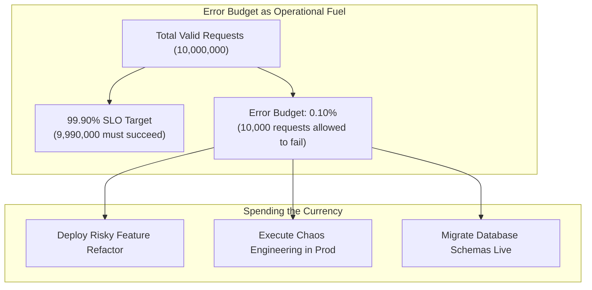
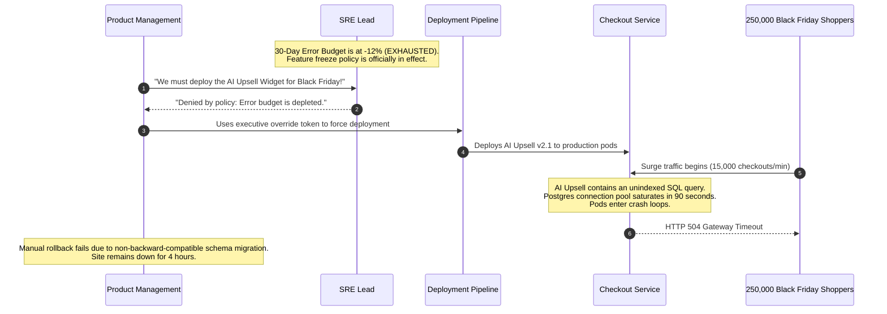

# Error Budgets and Release Policies

> **Difficulty**: Intermediate | **Estimated Time**: 35m | **Hands-On**: Mandatory

> [!TIP]
> **The Golden Rule of Error Budgets:**
> **An unspent error budget at the end of a quarter is a waste of engineering opportunity.** If your system achieves 99.99% availability against a 99.90% SLO, you did not win—you left 90% of your innovation budget unspent, meaning you shipped features too cautiously and built unnecessary architectural safeguards. Spend your budget intentionally on rapid iteration, architectural experiments, and fault-injection testing.

---

## 1. Visual Mental Models: The Innovation Currency

An **Error Budget** is the exact mathematical inverse of your Service Level Objective. It quantifies the acceptable level of system failure over a rolling evaluation window (typically 30 days or 90 days).

$$\text{Error Budget} = 100\% - \text{SLO}$$



### The Rolling 30-Day Window vs. Calendar Month Cliff

A dangerous anti-pattern is tying error budgets to **calendar months** (e.g., January 1st to 31st). On February 1st, the error budget instantly resets to 100%, encouraging development teams to push hazardous changes all at once ("The First of the Month Release Rush").

SRE enforces a **continuous rolling 30-day window**: every day, the oldest 24 hours of data drops off the calculation, ensuring release governance is smooth, fair, and continuous.

```
Calendar Month Anti-Pattern:
[---------------- Jan 31 (Depleted) --------------]-> [ Feb 1 (Instant 100% Reset! Dangerous Deploy Rush) ]

SRE Rolling 30-Day Window:
Day 1 -----------------------> Day 30  [ Window A: 30 Days ]
       Day 2 -----------------------> Day 31  [ Window B: Smooth Slide ]
```

---

## 2. The Error Budget Policy Matrix

An Error Budget is toothless without an organizational policy signed by both **Product Management** and **Engineering Leadership** *before* production incidents occur.

```mermaid
stateDiagram-v2
    [*] --> Green: Budget Remaining > 50%
    Green --> Yellow: Budget Drops to 20% - 50%
    Yellow --> Orange: Budget Drops to 0% - 20%
    Orange --> Red: Budget Exhausted (<= 0%)
    Red --> Green: Budget Recovers (Rolling window clears past outages)

    state Green {
      description: "Full Velocity - Ship features and experiments"
    }
    state Yellow {
      description: "Heightened Caution - Require canary verification"
    }
    state Orange {
      description: "Strict Gating - VP approval required for non-bugfix deploys"
    }
    state Red {
      description: "FEATURE FREEZE - 100% of sprint capacity to reliability"
    }
```

| Budget State | Remaining Margin | Development Action | Release Gate |
| :--- | :--- | :--- | :--- |
| **Healthy (Green)** | $50\% - 100\%$ | Unrestricted deployment velocity; run Chaos Engineering drills. | Standard CI/CD automated test gates. |
| **Caution (Yellow)** | $20\% - 50\%$ | Increase canary observation window from 10 minutes to 1 hour. | Review recent architectural changes for regression risk. |
| **Critical (Orange)** | $1\% - 20\%$ | Freeze non-essential batch refactoring; prioritize reliability backlog. | Tech Lead explicit sign-off required for any production deployment. |
| **Exhausted (Red)** | $\le 0\%$ | **Mandatory Feature Freeze**. All sprint capacity redirects to reliability engineering, automated rollback scripts, and test coverage. | **Blocked**. Only critical P0 security hotfixes and CVE patches may bypass. |

---

## 3. Production War Story: The Black Friday Freeze Defiance

```
INCIDENT SUMMARY: INC-5509
SEVERITY: P1 - Executive Breach & Financial Catastrophe
IMPACT: $4.2M in abandoned shopping carts; 4-hour complete checkout failure during peak Black Friday traffic.
ROOT CAUSE: Product management overrode an exhausted error budget policy to push an unvetted recommendation feature.
```

### Incident Timeline



### The Post-Mortem

- **The Breakdown**: The organization had an Error Budget Policy on paper, but leadership treated it as advisory rather than binding. When commercial pressure mounted, the policy was bypassed without architectural risk mitigation.
- **The Remediation**:
  1. The deployment pipeline was programmatically locked: deployment tokens are invalidated automatically when the Prometheus error budget gauge reaches $\le 0$.
  2. Bypassing a freeze requires the cryptographic joint authorization of both the **Chief Technology Officer** and the **Chief Product Officer**.
  3. Every deployment must support **atomic automated zero-downtime rollback**.

---

## 4. Multi-Language Error Budget Accounting Services

These implementations provide an automated policy engine that queries current telemetry and programmatically gates CI/CD pipelines.

### Go (`budget_gate.go`)

```go
package main

import (
	"encoding/json"
	"fmt"
	"net/http"
	"os"
)

type PrometheusResponse struct {
	Status string `json:"status"`
	Data   struct {
		Result []struct {
			Value []interface{} `json:"value"`
		} `json:"result"`
	} `json:"data"`
}

func checkErrorBudget(service string, sloTarget float64) (float64, error) {
	// PromQL: Computes remaining budget percentage over 30d
	query := fmt.Sprintf(
		`(1 - (sum(rate(http_requests_total{service="%s",status=~"5.."}[30d])) / sum(rate(http_requests_total{service="%s"}[30d])))) / (1 - %f) * 100`,
		service, service, sloTarget,
	)

	req, _ := http.NewRequest("GET", "http://prometheus:9090/api/v1/query", nil)
	q := req.URL.Query()
	q.Add("query", query)
	req.URL.RawQuery = q.Encode()

	resp, err := http.DefaultClient.Do(req)
	if err != nil {
		return 0, err
	}
	defer resp.Body.Close()

	var result PrometheusResponse
	if err := json.NewDecoder(resp.Body).Decode(&result); err != nil {
		return 0, err
	}

	if len(result.Data.Result) == 0 {
		return 100.0, nil // No errors recorded
	}

	var budgetPct float64
	fmt.Sscanf(result.Data.Result[0].Value[1].(string), "%f", &budgetPct)
	return budgetPct, nil
}

func main() {
	service := "checkout-service"
	budgetRemaining, err := checkErrorBudget(service, 0.999)
	if err != nil {
		fmt.Printf("Error fetching metrics: %v\n", err)
		os.Exit(1)
	}

	fmt.Printf("Service: %s | Remaining 30d Error Budget: %.2f%%\n", service, budgetRemaining)

	if budgetRemaining <= 0.0 {
		fmt.Println("DEPLOYMENT BLOCKED: Error budget exhausted! Feature freeze active.")
		os.Exit(1) // Fails CI/CD pipeline step
	} else if budgetRemaining < 20.0 {
		fmt.Println("DEPLOYMENT WARNING: Error budget low (<20%). Enforcing extended canary.")
	} else {
		fmt.Println("DEPLOYMENT APPROVED: Error budget healthy.")
	}
}
```

### TypeScript / Node.js (`budget_gate.ts`)

```typescript
import axios from 'axios';

interface PromVector {
  status: string;
  data: {
    result: Array<{
      value: [number, string];
    }>;
  };
}

export async function evaluateDeploymentGate(
  serviceName: string,
  slo: number = 0.999
): Promise<{ allowed: boolean; remainingPct: number; reason: string }> {
  const promql = `(1 - (sum(rate(http_requests_total{service="${serviceName}",status=~"5.."}[30d])) / sum(rate(http_requests_total{service="${serviceName}"}[30d])))) / (1 - ${slo}) * 100`;

  try {
    const res = await axios.get<PromVector>('http://prometheus:9090/api/v1/query', {
      params: { query: promql },
    });

    const valStr = res.data.data.result[0]?.value[1] ?? '100';
    const remainingPct = parseFloat(valStr);

    if (remainingPct <= 0) {
      return {
        allowed: false,
        remainingPct,
        reason: `Feature Freeze: 30-day error budget is depleted (${remainingPct.toFixed(1)}%).`,
      };
    }

    return {
      allowed: true,
      remainingPct,
      reason: `Healthy: ${remainingPct.toFixed(1)}% of error budget remains.`,
    };
  } catch (error: any) {
    throw new Error(`Prometheus query failed: ${error.message}`);
  }
}
```

### Python (`budget_gate.py`)

```python
import sys
import requests

def verify_release_gate(service: str, target_slo: float = 0.999) -> bool:
    query = f"""
    (1 - (sum(rate(http_requests_total{{service="{service}",status=~"5.."}}[30d])) 
         / sum(rate(http_requests_total{{service="{service}"}}[30d])))) 
    / (1 - {target_slo}) * 100
    """
    
    try:
        response = requests.get(
            "http://prometheus:9090/api/v1/query",
            params={"query": query.strip()},
            timeout=5.0
        )
        data = response.json()
        results = data.get("data", {}).get("result", [])
        
        remaining_budget = float(results[0]["value"][1]) if results else 100.0
        print(f"[{service}] Remaining 30-Day Error Budget: {remaining_budget:.2f}%")
        
        if remaining_budget <= 0.0:
            print("❌ GATE REJECTED: Error budget exhausted! Deployments suspended.", file=sys.stderr)
            return False
            
        print("✅ GATE APPROVED: Sufficient error budget available.")
        return True
    except Exception as e:
        print(f"Failed to query Prometheus: {e}", file=sys.stderr)
        return False

if __name__ == "__main__":
    if not verify_release_gate("payment-gateway", target_slo=0.999):
        sys.exit(1)
```

---

## 5. Declarative Prometheus Error Budget Recording Rules

To query error budget depletion efficiently without running heavy 30-day rate aggregations on every request, create Prometheus **Recording Rules**:

```yaml
apiVersion: monitoring.coreos.com/v1
kind: PrometheusRule
metadata:
  name: error-budget-recording-rules
  namespace: monitoring
  labels:
    role: alert-rules
    prometheus: kps-prometheus
spec:
  groups:
    - name: error_budget.rules
      interval: 5m
      rules:
        # Precompute 30-day Availability SLI
        - record: job:http_availability:ratio_rate30d
          expr: |
            sum by (service) (rate(http_requests_total{status!~"5.."}[30d]))
            /
            sum by (service) (rate(http_requests_total[30d]))

        # Precompute Remaining Error Budget Percentage (Assuming 99.9% SLO)
        - record: job:error_budget_remaining:percent30d
          expr: |
            (job:http_availability:ratio_rate30d - 0.999) / (1 - 0.999) * 100
```

---

## 6. Practical CLI Workflows

Follow this CLI verification workflow to test the deployment gate against your cluster's Prometheus endpoint.

### Step 1: Query the Precomputed Error Budget Recording Rule

```bash
curl -s -G "http://localhost:9090/api/v1/query" \
  --data-urlencode 'query=job:error_budget_remaining:percent30d{service="checkout-service"}'
```

**Expected Output:**
```json
{
  "status": "success",
  "data": {
    "resultType": "vector",
    "result": [
      {
        "metric": { "service": "checkout-service" },
        "value": [1712498200.123, "72.45"]
      }
    ]
  }
}
```

The service has **72.45% of its error budget intact**, granting full approval for experimental canary releases!

---

## 7. Operational Validation Checkpoints

Test your understanding of error budget economics and organizational policy with these scenarios.

<details>
<summary><b>Checkpoint 1: If your service experienced zero outages and has 100% of its budget left at the end of the quarter, what went wrong?</b></summary>

**Analysis:**
You over-engineered stability at the expense of velocity. The error budget is not a test grade where 100% is the goal; it is a finite resource allocated to accept calculated innovation risks. An untouched error budget means your team:
- Shipped features too slowly due to excessive manual testing.
- Over-provisioned cloud infrastructure beyond real user requirements.
- Avoided necessary architectural refactoring or database migrations out of fear.
SRE teams with 100% unspent budgets are encouraged to deploy faster, reduce manual testing gates, or run proactive chaos engineering drills in production.
</details>

<details>
<summary><b>Checkpoint 2: What happens if an error budget is depleted, but a critical remote code execution (RCE) vulnerability is discovered in production?</b></summary>

**Policy Resolution:**
The Error Budget Policy explicitly carves out exceptions for **Emergency Security Patches and CVE Remediations**.
Security vulnerabilities introduce catastrophic existential risk far exceeding transient availability downtime. Security fixes are deployed immediately under an expedited emergency review process, regardless of whether the availability error budget is negative.
</details>

<details>
<summary><b>Checkpoint 3: Why should error budgets use a continuous rolling window instead of calendar quarters?</b></summary>

**Mechanism:**
Calendar-based windows create harmful behavioral incentives:
1. **The End-of-Quarter Freeze:** If an outage occurs on day 10 of a 90-day quarter, product teams are frozen for 80 days.
2. **The New-Quarter Stampede:** On the first day of the new quarter, developers push weeks of untested accumulated code simultaneously, triggering immediate cascading failures.
A **rolling 30-day window** provides continuous, stable governance: yesterday's outage gradually ages out over 30 days, steadily restoring the budget as reliability improves.
</details>

---

## Next

Continue to **[03-slo-dashboards-and-burn-rate-alerts](../03-slo-dashboards-and-burn-rate-alerts/README.md)** to build the pinnacle of SRE alerting: Multi-Window Multi-Burn-Rate alerts that catch outages before they consume your budget.
