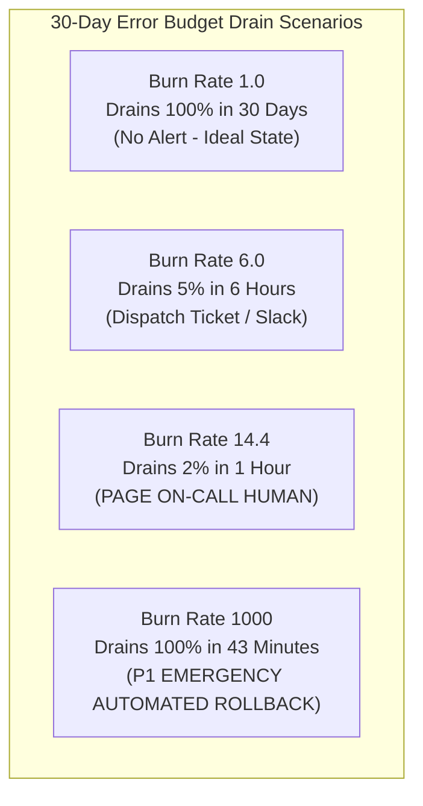
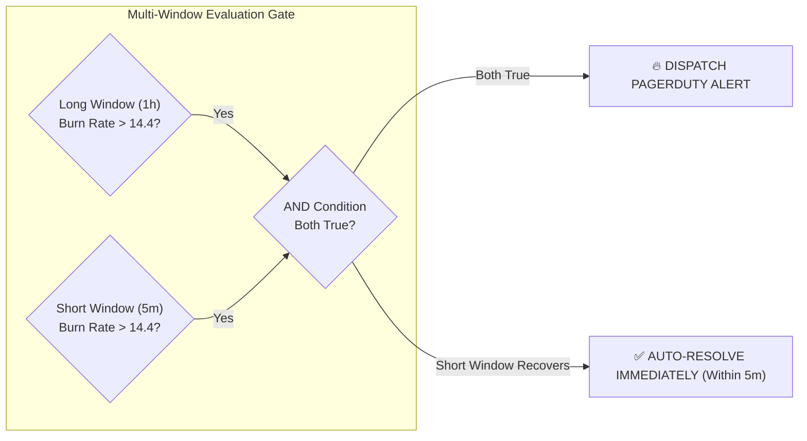
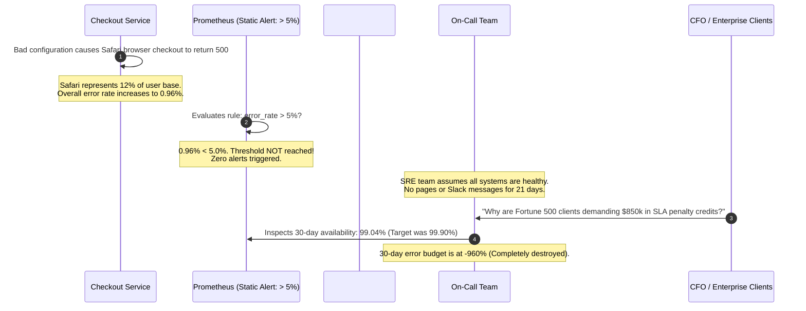

# SLO Dashboards and Multi-Burn-Rate Alerting

> **Difficulty**: Advanced | **Estimated Time**: 40m | **Hands-On**: Mandatory

> [!TIP]
> **The Golden Rule of Burn Rate Alerting:**
> **Alert on the rate of budget consumption, not static metric thresholds.** A naive alert on "Error rate > 1%" either pages you for brief, harmless 30-second spikes (alert fatigue) or remains silent while a subtle 0.2% background leak drains your entire quarterly error budget before Monday morning. Use **Multi-Window Multi-Burn-Rate alerts** to wake on-call engineers only when an active incident is burning through meaningful fractions of your budget right now.

---

## 1. Visual Mental Models: Burn Rate Mechanics

A **Burn Rate** ($B$) is the speed at which your system is consuming its error budget relative to your target SLO window.

- **Burn Rate 1 ($B=1$)**: You are consuming your error budget at exactly the rate allowed. A 30-day budget will last exactly 30 days (zero margin, zero breach).
- **Burn Rate 14.4 ($B=14.4$)**: You are burning through your budget **14.4 times faster** than allowed. You will consume **2% of your 30-day budget in 1 hour**, and 100% of your budget in under 50 hours.
- **Burn Rate 6 ($B=6$)**: You will consume **5% of your 30-day budget in 6 hours**.



### The Flaw of Single-Window Alerts & The Multi-Window Solution

If you alert on a **1-hour window**, once the incident is resolved, the alert continues to fire for another 59 minutes (false alarm reset delay).
If you alert on a **5-minute window**, a 6-minute transient network glitch triggers a full page even though only 0.01% of the budget was consumed.

The **Google SRE Multi-Window Multi-Burn-Rate pattern** solves this by requiring **two simultaneous windows**:
1. **Long Window** (e.g., 1 hour): Confirms significant budget consumption.
2. **Short Window** (e.g., 5 minutes): Confirms the incident is **still actively firing right now**.



---

## 2. Google SRE Burn Rate Alerting Matrix

This table represents the industry-standard multi-window alerting parameters for an organization targeting a **99.9% SLO over a 30-day period**:

| Severity | Target Action | Budget Consumed | Burn Rate ($B$) | Long Window | Short Window | Alert Notification Channel |
| :--- | :--- | :--- | :--- | :--- | :--- | :--- |
| **P1 - Critical** | **Page Human** | **2%** | **14.4x** | 1 hour | 5 minutes | PagerDuty (Phone / SMS) |
| **P2 - High** | **Page Human** | **5%** | **6.0x** | 6 hours | 30 minutes | PagerDuty (SMS) |
| **P3 - Warning** | **Create Ticket** | **10%** | **2.0x** | 3 days | 6 hours | Jira / Slack Notification |
| **P4 - Low** | **Daily Review** | **10%** | **1.0x** | 30 days | 3 days | SRE Weekly Standup Report |

---

## 3. Production War Story: The 3-Day Silent Drain

```
INCIDENT SUMMARY: INC-7104
SEVERITY: P1 - Silent Budget Depletion
IMPACT: 100% of the quarterly error budget burned; enterprise customers entitled to $850,000 in SLA credit refunds.
ROOT CAUSE: Alerting was configured on static "Error Rate > 5%". A subtle 0.8% background failure rate persisted unmonitored for 3 weeks.
```

### Incident Timeline



### The Post-Mortem

- **The Flaw**: Static threshold alerts assume failures are catastrophic and noisy. Subtle partial degradations (0.5% - 2%) slip under static 5% thresholds, quietly devouring the error budget over weeks.
- **The Remediation**:
  1. Deleted all arbitrary static threshold alerts (`rate > 5%`).
  2. Implemented Multi-Burn-Rate alerting rules based on the 30-day error budget.
  3. A 0.96% failure rate with an SLO of 99.9% represents a **Burn Rate of 9.6x**, which immediately triggers a P2 warning within 3 hours instead of running undetected for 3 weeks.

---

## 4. Declarative Prometheus Multi-Burn-Rate Alerting Rules

This production `PrometheusRule` manifest implements Google's 1-hour/5-minute and 6-hour/30-minute dual-window burn rate alerts:

```yaml
apiVersion: monitoring.coreos.com/v1
kind: PrometheusRule
metadata:
  name: slo-burn-rate-alerts
  namespace: monitoring
  labels:
    role: alert-rules
    prometheus: kps-prometheus
spec:
  groups:
    - name: slo_burn_rate.rules
      rules:
        # Precomputed Error Rates across required evaluation windows
        - record: job:http_error_rate:ratio_rate5m
          expr: sum by (service) (rate(http_requests_total{status=~"5.."}[5m])) / sum by (service) (rate(http_requests_total[5m]))

        - record: job:http_error_rate:ratio_rate30m
          expr: sum by (service) (rate(http_requests_total{status=~"5.."}[30m])) / sum by (service) (rate(http_requests_total[30m]))

        - record: job:http_error_rate:ratio_rate1h
          expr: sum by (service) (rate(http_requests_total{status=~"5.."}[1h])) / sum by (service) (rate(http_requests_total[1h]))

        - record: job:http_error_rate:ratio_rate6h
          expr: sum by (service) (rate(http_requests_total{status=~"5.."}[6h])) / sum by (service) (rate(http_requests_total[6h]))

        # P1 CRITICAL: 14.4x Burn Rate (Burns 2% of budget in 1 hour)
        # For a 99.9% SLO (0.001 error budget), 14.4 * 0.001 = 0.0144 (1.44% error rate)
        - alert: ErrorBudgetBurnRateFast
          expr: |
            (job:http_error_rate:ratio_rate1h{service="checkout-service"} > (14.4 * (1 - 0.999)))
            and
            (job:http_error_rate:ratio_rate5m{service="checkout-service"} > (14.4 * (1 - 0.999)))
          for: 2m
          labels:
            severity: page
            team: checkout
            tier: critical
          annotations:
            summary: "Critical SLO Error Budget Burn Rate (14.4x)"
            description: "High error budget consumption on {{ $labels.service }}. 2% of the monthly error budget will be consumed within 1 hour."
            runbook_url: "https://wiki.internal/ops/slo-burn-fast"

        # P2 HIGH: 6x Burn Rate (Burns 5% of budget in 6 hours)
        # For 99.9% SLO, 6 * 0.001 = 0.006 (0.6% error rate)
        - alert: ErrorBudgetBurnRateSlow
          expr: |
            (job:http_error_rate:ratio_rate6h{service="checkout-service"} > (6.0 * (1 - 0.999)))
            and
            (job:http_error_rate:ratio_rate30m{service="checkout-service"} > (6.0 * (1 - 0.999)))
          for: 15m
          labels:
            severity: warning
            team: checkout
            tier: high
          annotations:
            summary: "Elevated SLO Error Budget Burn Rate (6x)"
            description: "Service {{ $labels.service }} is burning budget at 6x normal rate. 5% of monthly budget will be lost in 6 hours."
            runbook_url: "https://wiki.internal/ops/slo-burn-slow"
```

---

## 5. Grafana Production SLO Dashboard Specifications

A production SRE dashboard must present three critical panels side by side:

```
+------------------------------------+------------------------------------+
|  1. Current 30-Day Availability   |  2. Remaining Error Budget (%)     |
|     [ 99.942% ] (Target: 99.90%)   |     [ 42.1% ] (State: HEALTHY)     |
+------------------------------------+------------------------------------+
|  3. Multi-Window Burn Rate Timeline                                    |
|     ----------------------- (Threshold 14.4x) -----------------------  |
|               /\                                                       |
|              /  \      (Spike: 18.2x Burn Rate during Incident)        |
|     ________/    \_________________________________________________    |
+-------------------------------------------------------------------------+
```

### Dashboard JSON Panel Query Snippets

#### Panel 1: Current 30-Day SLI Gauge
```promql
(
  sum(rate(http_requests_total{service="$service",status!~"5.."}[30d]))
  /
  sum(rate(http_requests_total{service="$service"}[30d]))
) * 100
```
- **Thresholds**: `< 99.90` (Red), `99.90 - 99.95` (Yellow), `> 99.95` (Green).

#### Panel 2: Remaining Error Budget Gauge
```promql
clamp_min(
  (
    (sum(rate(http_requests_total{service="$service",status!~"5.."}[30d])) / sum(rate(http_requests_total{service="$service"}[30d])))
    - 0.999
  ) / (1 - 0.999) * 100,
  0
)
```

#### Panel 3: Multi-Burn-Rate Graph
- **Series A (1h Burn Rate)**:
  `job:http_error_rate:ratio_rate1h{service="$service"} / (1 - 0.999)`
- **Series B (6h Burn Rate)**:
  `job:http_error_rate:ratio_rate6h{service="$service"} / (1 - 0.999)`
- **Horizontal Annotation Line**: `y = 14.4` (Critical Page Threshold).

---

## 6. Practical CLI Workflows

Follow this CLI verification workflow to calculate the current burn rate against Prometheus.

### Step 1: Query Current 1-Hour Burn Rate via Prometheus API

```bash
curl -s -G "http://localhost:9090/api/v1/query" \
  --data-urlencode 'query=(sum(rate(http_requests_total{status=~"5.."}[1h])) / sum(rate(http_requests_total[1h]))) / (1 - 0.999)'
```

**Expected Output:**
```json
{
  "status": "success",
  "data": {
    "resultType": "vector",
    "result": [
      {
        "metric": {},
        "value": [1712498200.123, "1.24"]
      }
    ]
  }
}
```

A value of `1.24` indicates the system is burning through its budget at **1.24x the baseline rate**—well below the 14.4x paging threshold!

### Step 2: Test Dual-Window Condition Evaluation

Evaluate whether both the 1-hour and 5-minute windows exceed 14.4x simultaneously:

```bash
curl -s -G "http://localhost:9090/api/v1/query" \
  --data-urlencode 'query=((sum(rate(http_requests_total{status=~"5.."}[1h])) / sum(rate(http_requests_total[1h]))) / 0.001 > 14.4) and ((sum(rate(http_requests_total{status=~"5.."}[5m])) / sum(rate(http_requests_total[5m]))) / 0.001 > 14.4)'
```

If this returns an empty result `[]`, the condition is false and the on-call engineer sleeps peacefully.

---

## 7. Operational Validation Checkpoints

Confirm your mastery of burn rate alerting and SLO dashboarding with these scenarios.

<details>
<summary><b>Checkpoint 1: Why is an alert rule with ONLY a 1-hour window problematic when an incident is fixed?</b></summary>

**Analysis:**
If you alert only on a 1-hour window (`error_rate[1h] > threshold`), the moving window retains the past errors for 60 minutes.
- **Example:** An outage begins at 10:00 and engineers fix it at 10:05.
- Because the 1-hour rolling window includes the heavy failures from 10:00 to 10:05, the average error rate over the last 1 hour remains above the threshold until 11:05.
- The on-call engineer receives repeated alert pages for 55 minutes *after* production has already fully recovered!
- Adding the **short 5-minute window** (`and error_rate[5m] > threshold`) ensures that as soon as the service recovers at 10:05, the 5-minute window drops below the threshold, and the alert **auto-resolves at 10:10**.
</details>

<details>
<summary><b>Checkpoint 2: Calculate the error rate threshold for a 99.95% SLO with a 14.4x burn rate.</b></summary>

**Calculation:**
1. **Target SLO:** $99.95\%$ ($0.9995$).
2. **Error Budget Fraction:** $1 - 0.9995 = 0.0005$ ($0.05\%$).
3. **Burn Rate ($B$):** $14.4$.
4. **Instantaneous Error Rate Threshold:**
   $$\text{Threshold} = B \times (1 - \text{SLO}) = 14.4 \times 0.0005 = 0.0072 = 0.72\%$$
An active error rate of **0.72%** (less than 1 failure per 100 requests) will trigger the P1 critical page!
</details>

<details>
<summary><b>Checkpoint 3: How should an SLO dashboard handle scheduled maintenance downtime?</b></summary>

**Production Solution:**
1. **Metric Tagging:** When maintenance begins, automation tags the service or routes with an operational flag or maintenance label.
2. **Alertmanager Silences:** Active Alertmanager silences mute pager dispatches during approved maintenance windows.
3. **SLI Query Exclusion:** The PromQL SLI formula filters out traffic routed during maintenance using label exclusions:
   `http_requests_total{maintenance!="true"}`.
</details>

---

## Next

Continue to **[04-on-call-in-depth](../04-on-call-in-depth/README.md)** to explore sustainable on-call rotation design, cognitive fatigue mitigation, and runbook engineering.
