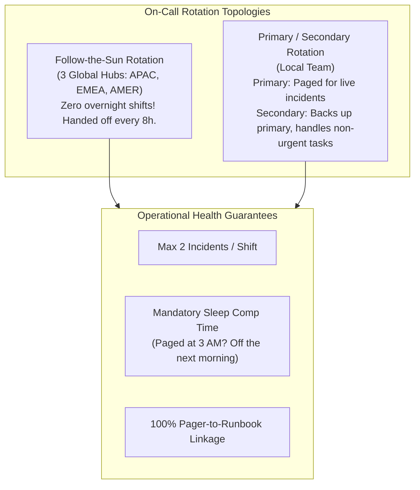
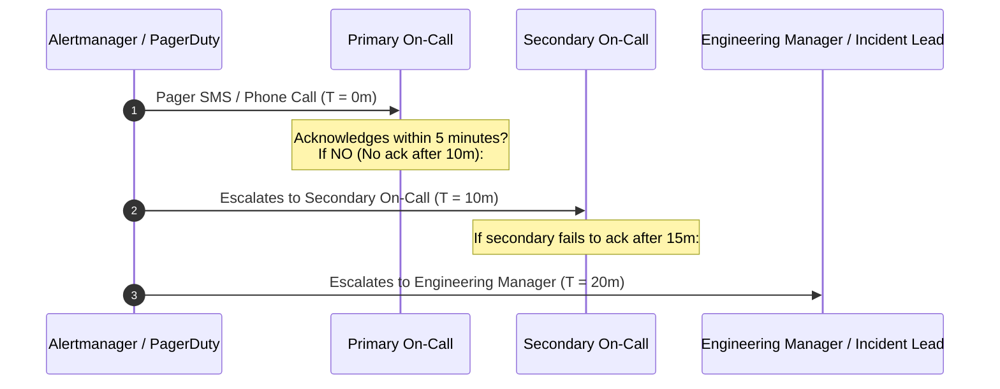
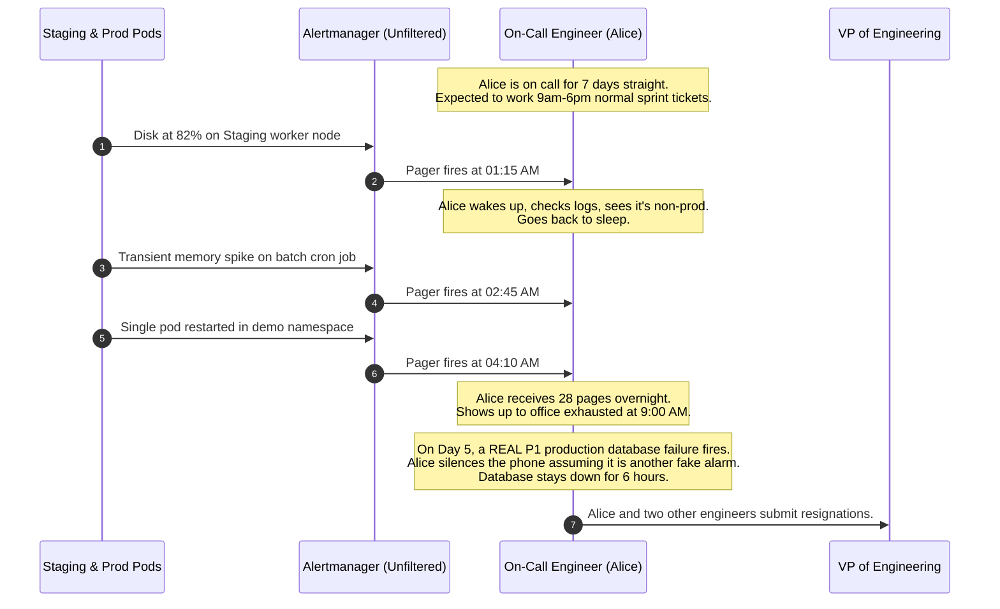

# On-Call Engineering in Depth

> **Difficulty**: Intermediate | **Estimated Time**: 35m | **Hands-On**: Operations & Process

> [!TIP]
> **The Golden Rule of Sustainable On-Call:**
> **If an on-call engineer is paged more than twice per shift, the system is broken, not the engineer.** Frequent pages cause cognitive fatigue, sleep deprivation, and operational burnout. SRE enforces an upper bound of **maximum 2 actionable incidents per 12-hour shift**. If an application exceeds this noise threshold, SRE has the contractual authority to hand the pager directly back to the feature development team until stability is restored.

---

## 1. Visual Mental Models: Sustainable On-Call Architecture

On-call is the operational bridge between software and real-world execution. Poorly architected on-call systems lead to burnout and engineer resignations; well-architected on-call systems provide rapid, calm incident mitigation.



### The Escalation Path



---

## 2. Anatomy of a Production-Grade Runbook

Every firing alert in Prometheus/Alertmanager **must include a direct link to a verified runbook**. Expecting an engineer awakened from sleep at 3:30 AM to invent debugging commands from memory is an operational hazard.

```
+-------------------------------------------------------------------------+
| RUNBOOK: APIHighErrorRate                                               |
+-------------------------------------------------------------------------+
| 1. ALERT METADATA                                                       |
|    - Severity: P1 Critical (Pages Phone)                                |
|    - Service: checkout-api                                              |
|    - SLO Impact: Error budget burning at >14.4x rate                    |
+-------------------------------------------------------------------------+
| 2. USER SYMPTOMS & BLAST RADIUS                                         |
|    - Shoppers receive HTTP 500 when clicking "Pay Now".                 |
|    - Est. revenue loss: $12,000 / minute.                               |
+-------------------------------------------------------------------------+
| 3. RAPID VERIFICATION (< 2 MINUTES)                                     |
|    $ kubectl get pods -n production -l app=checkout-api                 |
|    $ curl -s http://localhost:9090/api/v1/query?query=...               |
+-------------------------------------------------------------------------+
| 4. IMMEDIATE MITIGATION STEPS (STOP THE BLEEDING)                       |
|    Option A: Roll back latest deployment (if deploy < 30m ago)          |
|      $ kubectl rollout undo deployment/checkout-api -n production       |
|    Option B: Activate payment provider circuit breaker                 |
|      $ curl -X POST http://admin.internal/feature-flags/mock-payment    |
+-------------------------------------------------------------------------+
| 5. ESCALATION & INCIDENT CHANNELS                                       |
|    - Slack War Room: #incident-2026-checkout                            |
|    - Incident Commander: @oncall-sre-lead                               |
|    - Database DBA On-Call: +1-555-0199                                  |
+-------------------------------------------------------------------------+
```

---

## 3. Production War Story: The Burnout Cascade

```
INCIDENT SUMMARY: INC-3301
SEVERITY: P1 - Organizational Collapse
IMPACT: 3 senior engineers resigned within 6 weeks; critical database corruption went unaddressed due to alert fatigue.
ROOT CAUSE: A legacy cluster emitted 35 non-actionable alerts per night; no sleep compensation policy existed.
```

### Incident Timeline



### The Post-Mortem

- **The Breakdown**:
  1. Alerts were set on internal causes (`disk > 80%`, `staging pod restarted`) rather than customer SLO impact.
  2. The team had no sleep compensation policy: engineers were expected to work full days after being paged all night.
  3. No limit existed on alert volume per shift.
- **The Remediation**:
  1. **The Pager Handback Rule**: If a service pages an SRE >2 times per night without human-actionable bugs, the pager rotates directly to the development team that wrote the code.
  2. **Mandatory Sleep Policy**: Any engineer paged between 10:00 PM and 6:00 AM is prohibited from working before 1:00 PM the following day.
  3. Demoted 85% of alerts to Jira tickets or asynchronous Slack summaries.

---

## 4. Production Shift Handoff Document Template

High-performing SRE teams conduct formal, written shift handoffs between the outgoing and incoming on-call engineers.

```markdown
# SRE On-Call Shift Handoff Report
- **Date**: 2026-11-10
- **Outgoing Engineer**: @alice
- **Incoming Engineer**: @bob
- **Rotation Type**: Primary EMEA (08:00 - 20:00 UTC)

## 1. Incidents During Shift
| Incident ID | Severity | Service | Root Cause | Status |
| :--- | :--- | :--- | :--- | :--- |
| INC-9041 | P2 | checkout-api | Redis timeout | Mitigated (Rolled back to v1.4.1) |
| INC-9048 | P3 | billing-worker | Memory leak | In Progress (Jira #OPS-412) |

## 2. Active Alertmanager Silences
- `alertname=NodeMemoryHigh` on node `worker-prod-08` (Expires: 2026-11-10T22:00:00Z)
  - *Reason*: Upgrading kernel; silence will auto-expire.

## 3. In-Flight Deployments & Planned Changes
- Database schema migration for `order-db` scheduled for 22:00 UTC by @db-team.
- Feature flag `enable-new-search` is at 10% canary.

## 4. Flaky Alerts to Investigate
- `KafkaConsumerLagWarning` fired twice for 45 seconds and cleared automatically. Needs threshold review.
```

---

## 5. Practical Implementation: On-Call Health Audit Script

Use this script to analyze your organization's PagerDuty alert history and identify noisy services violating the SRE 2-incident limit.

### Python (`oncall_audit.py`)

```python
import sys
from datetime import datetime, timedelta, timezone
from collections import Counter

# Simulated PagerDuty Incident Log Extract
INCIDENT_LOGS = [
    {"service": "checkout-api", "timestamp": "2026-11-10T02:15:00Z", "actionable": True},
    {"service": "staging-worker", "timestamp": "2026-11-10T03:20:00Z", "actionable": False},
    {"service": "staging-worker", "timestamp": "2026-11-10T04:10:00Z", "actionable": False},
    {"service": "staging-worker", "timestamp": "2026-11-10T05:00:00Z", "actionable": False},
    {"service": "payment-gateway", "timestamp": "2026-11-10T06:12:00Z", "actionable": True},
    {"service": "staging-worker", "timestamp": "2026-11-10T07:15:00Z", "actionable": False},
]

def audit_shift_health(incidents, shift_hours=12):
    total_pages = len(incidents)
    actionable_pages = sum(1 for inc in incidents if inc["actionable"])
    unactionable_pages = total_pages - actionable_pages
    service_counts = Counter(inc["service"] for inc in incidents)

    print("=== SRE ON-CALL HEALTH AUDIT ===")
    print(f"Total Pages in Shift:        {total_pages}")
    print(f"Actionable Incidents:        {actionable_pages}")
    print(f"Unactionable Noise / Flaps:  {unactionable_pages}")
    print(f"Signal-to-Noise Ratio:       {(actionable_pages / total_pages * 100):.1f}%\n")

    print("Alert Frequency by Service:")
    for svc, count in service_counts.most_common():
        print(f"  - {svc:<20} {count} pages")

    print("\nPolicy Assessment:")
    if total_pages > 2:
        print("❌ SRE VIOLATION: Shift exceeded maximum 2 incidents/shift!")
    if unactionable_pages > 0:
        worst_offender = service_counts.most_common(1)[0][0]
        print(f"⚠️ PAGER HANDBACK RECOMMENDED: Hand pager for '{worst_offender}' back to dev team!")
    else:
        print("✅ Shift met all SRE sustainability criteria.")

if __name__ == "__main__":
    audit_shift_health(INCIDENT_LOGS)
```

---

## 6. Practical CLI Workflows

Follow this CLI workflow to verify Alertmanager notification routing and validate runbook annotations.

### Step 1: Verify Firing Alerts Include Working Runbook URLs

Query Alertmanager to ensure all active alerts provide a valid `runbook_url`:

```bash
curl -s http://localhost:9093/api/v2/alerts | jq '
  .[] | {
    alertname: .labels.alertname,
    service: .labels.service,
    severity: .labels.severity,
    runbook: .annotations.runbook_url
  }'
```

**Expected Output:**
```json
{
  "alertname": "APIP99LatencyBreach",
  "service": "checkout-service",
  "severity": "page",
  "runbook": "https://wiki.internal/ops/runbooks/api-high-latency"
}
```

If the `runbook` field is null or missing, the alert fails SRE production readiness review.

---

## 7. Operational Validation Checkpoints

Confirm your on-call leadership and operational design skills with these scenarios.

<details>
<summary><b>Checkpoint 1: An engineer is paged at 3:15 AM and finishes incident mitigation at 4:30 AM. What is the mandatory next step?</b></summary>

**Operational Policy:**
1. **Activate Secondary Cover:** The secondary on-call engineer takes over the primary pager for the remainder of the night.
2. **Mandatory Sleep Compensation:** The paged engineer does NOT report for normal sprint duties at 9:00 AM. Company SRE policy guarantees a mandatory rest window (e.g., minimum 8 hours of uninterrupted rest), meaning the engineer is excused from all meetings and work until at least 1:00 PM.
3. **Shift Handoff Log:** The engineer logs a brief handoff note in the incident Slack channel before sleeping.
</details>

<details>
<summary><b>Checkpoint 2: Under what conditions should an SRE team hand the pager back to the developers?</b></summary>

**Criteria for Pager Handback:**
1. **Excessive Paging Frequency:** The service averages more than 2 pages per 12-hour shift over a 14-day evaluation window.
2. **Low Signal-to-Noise Ratio:** More than 50% of pages are determined to be non-actionable (flapping alerts, transient batch spikes, or unaddressed technical debt).
3. **Unresolved Runbooks:** Alerts repeatedly fire without documented mitigation steps or architectural fixes.
SRE hands the pager to the feature team until the team resolves root causes and passes a formal SRE Production Readiness Review.
</details>

<details>
<summary><b>Checkpoint 3: What is the purpose of having both a Primary and a Secondary on-call engineer?</b></summary>

**Roles & Division of Labor:**
- **Primary On-Call:** Dedicated to active production incidents. Carries the high-priority phone pager, acknowledges pages within 5 minutes, coordinates immediate mitigation, and leads incident triage. Protected from all sprint tickets and interruptive meetings.
- **Secondary On-Call:** Acts as the immediate backup if the primary's phone dies or fails to acknowledge. Shadows complex incidents for training, handles low-severity non-paging tickets (P3/P4), and conducts routine operational maintenance (patching, cert renewals).
</details>

---

## Next

Continue to **[05-incident-response-process](../05-incident-response-process/README.md)** to master the Incident Command System (ICS): leading high-severity production outages with structured coordination and calm discipline.
