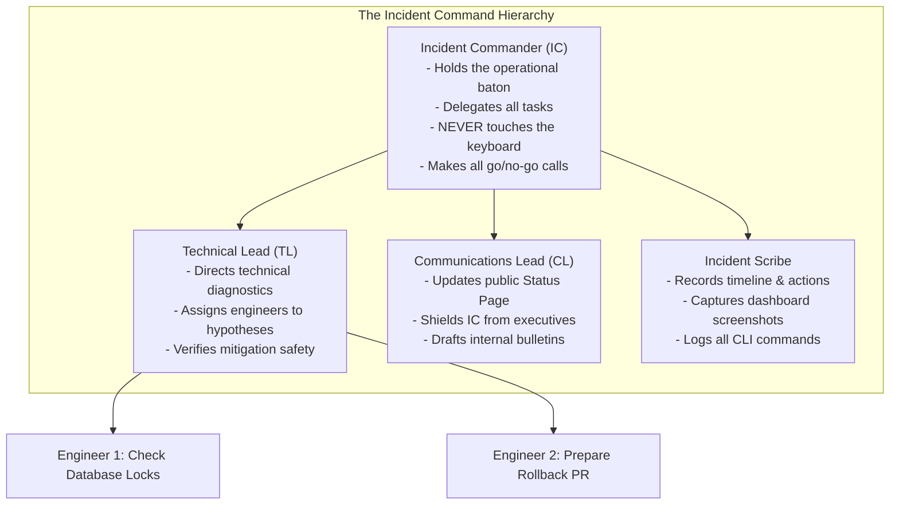
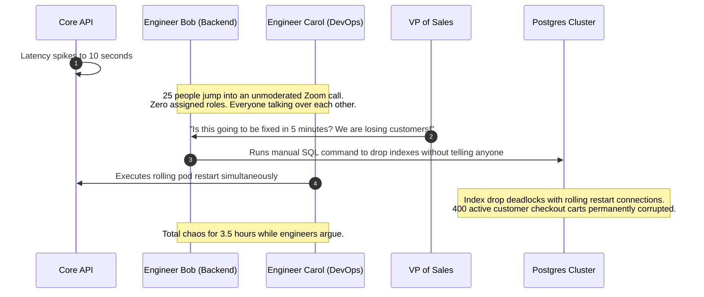
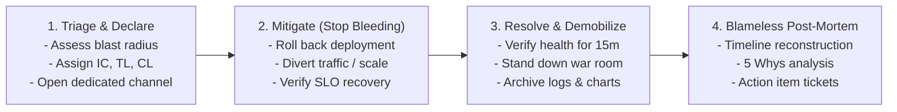

# The Incident Response Process and Command System

> **Difficulty**: Intermediate | **Estimated Time**: 35m | **Hands-On**: Operations & Process

> [!TIP]
> **The First Law of Incident Management:**
> **Mitigate first, debug later.** When your production system is down, your job is not to diagnose why the code failed; your sole objective is to **restore service to users as quickly as possible** (roll back the deployment, scale replicas, divert traffic, or activate feature flag circuit breakers). Deep root-cause investigation is deferred entirely to the blameless post-mortem.

---

## 1. Visual Mental Models: The Incident Command System (ICS)

In unstructured outages, 20 engineers enter a conference call, debate theories simultaneously, execute contradictory terminal commands, and get interrupted every 3 minutes by executives asking for ETAs.

SRE resolves this chaos using the **Incident Command System (ICS)**, an organizational framework adapted from emergency services and firefighting:



### Separation of Concerns: The IC Must Not Type

The most common failure mode is an Incident Commander who opens a terminal and starts debugging code.
The moment the IC begins debugging, **they lose situational awareness**:
- They stop listening to team updates.
- They fail to notice that another engineer just executed a contradictory command.
- They fail to manage the clock.

**Rule**: The IC directs traffic, asks questions, makes decisions, and protects the team. The Tech Lead and investigation engineers execute commands.

---

## 2. Severity Classification Matrix

Categorize outages immediately upon declaration to establish communication cadence and paging requirements:

| Severity | Customer Impact | Paging Scope | Executive Update Cadence | Public Status Page |
| :--- | :--- | :--- | :--- | :--- |
| **SEV-1 (Critical)** | Core business functionality down for all or a large percentage of users (e.g., checkout broken, data loss risk). | PagerDuty pages IC, TL, CL, and team on-calls immediately. | Every **15 minutes**. | Updated immediately (`Major Outage`). |
| **SEV-2 (High)** | Major feature degraded, or significant subset of users impacted (e.g., search broken, but checkout works). | Primary on-call paged; secondary on standby. | Every **30 minutes**. | Updated if customer-visible (`Degraded Performance`). |
| **SEV-3 (Moderate)** | Non-critical bug or internal tool failure; business operational with workaround. | Normal business hours; Jira ticket or Slack message. | At incident close. | None. |

---

## 3. Production War Story: The 20-Person War Room Panic

```
INCIDENT SUMMARY: INC-4921
SEVERITY: P1 - Operational Disorganization
IMPACT: Outage lasted 3 hours 45 minutes; an uncoordinated manual database command corrupted 400 user records.
ROOT CAUSE: Lack of an Incident Commander resulted in two engineers executing contradictory recovery steps simultaneously.
```

### Incident Timeline



### The Post-Mortem

- **What Failed**: No Incident Commander was appointed. Without an IC, nobody owned the decision-making authority, no task delegation occurred, and engineers executed conflicting interventions in the live production database.
- **The Remediation**:
  1. Mandated that every SEV-1 incident must have an explicitly declared Incident Commander before any terminal command is run.
  2. Adopted standard incident response Slack commands: `/incident declare`, `/incident role @bob IC`.
  3. Established the strict protocol: **"All production changes during an active SEV-1 require explicit verbal approval from the IC."**

---

## 4. The 4-Phase Incident Lifecycle



### Phase 1: Triage and Declaration (< 5 Minutes)
1. Declare the incident in Slack: `/incident declare "Checkout Latency Spike" --sev 1`.
2. Dedicated war room channel automatically created: `#incident-2026-checkout`.
3. IC establishes authority: *"I am taking Incident Commander. @alice you are Tech Lead; @carol you are Communications Lead. All status updates in this channel only."*

### Phase 2: Mitigation (Rapid Service Restoration)
1. **Rule of Recent Changes**: Did a deployment, feature flag, or infrastructure change happen in the last 60 minutes?
   - **If yes**: Immediately roll back. Do not attempt to "fix forward" in production.
2. **Traffic Shedding**: Trip circuit breakers to gracefully degrade non-essential features (e.g., disable recommendations to preserve checkout).

### Phase 3: Resolution & Stand-Down
1. Verify system metrics remain within acceptable SLO thresholds for at least **15 consecutive minutes**.
2. Communications Lead posts final resolution message to internal channels and public Status Page.
3. IC demobilizes the war room: *"The incident is mitigated. All responders are stood down. Post-mortem scheduled for tomorrow at 14:00 UTC."*

---

## 5. Practical Implementation: Incident Slack Bot Automation

Use this service to automate channel creation, role assignment, and broadcast communication during outages.

### TypeScript / Node.js (`incident_bot.ts`)

```typescript
import { WebClient } from '@slack/web-api';

const slack = new WebClient(process.env.SLACK_BOT_TOKEN);

interface IncidentDeclaration {
  title: string;
  severity: 'SEV-1' | 'SEV-2' | 'SEV-3';
  commanderId: string;
}

export async function declareIncident({ title, severity, commanderId }: IncidentDeclaration) {
  const timestamp = new Date().toISOString().replace(/[:.]/g, '-').slice(0, 16);
  const channelName = `inc-${severity.toLowerCase()}-${timestamp}`;

  // 1. Create dedicated incident war room channel
  const channel = await slack.conversations.create({ name: channelName, is_private: false });
  const channelId = channel.channel?.id!;

  // 2. Post Incident Command briefing
  await slack.chat.postMessage({
    channel: channelId,
    text: `🚨 *INCIDENT DECLARED: ${severity} - ${title}*`,
    blocks: [
      {
        type: 'header',
        text: { type: 'plain_text', text: `🚨 ${severity}: ${title}` },
      },
      {
        type: 'section',
        text: {
          type: 'mrkdwn',
          text: `*Incident Commander:* <@${commanderId}>\n*First Priority:* MITIGATE FIRST, DEBUG LATER.\n*Status:* Triage & Diagnostic Investigation`,
        },
      },
      {
        type: 'actions',
        elements: [
          {
            type: 'button',
            text: { type: 'plain_text', text: 'Open War Room Zoom' },
            url: 'https://zoom.internal/war-room-1',
            style: 'primary',
          },
          {
            type: 'button',
            text: { type: 'plain_text', text: 'View SLO Dashboard' },
            url: 'http://grafana.internal/d/slo-overview',
          },
        ],
      },
    ],
  });

  // 3. Broadcast to executive announcements channel
  await slack.chat.postMessage({
    channel: '#ops-incidents-broadcast',
    text: `⚠️ *${severity} Outage Declared*: ${title}. Incident Commander: <@${commanderId}>. War room: <#${channelId}>`,
  });

  return { channelId, channelName };
}
```

---

## 6. Practical CLI Workflows for Rapid Mitigation

When a SEV-1 occurs, memorizing fast mitigation commands saves precious error budget minutes.

### Fast Emergency Rollback (Kubernetes)

```bash
# 1. Inspect recent deployment history
kubectl rollout history deployment/checkout-service -n production

# 2. Undo immediately to the previous known good revision
kubectl rollout undo deployment/checkout-service -n production

# 3. Monitor rollback rollout status in real time
kubectl rollout status deployment/checkout-service -n production --timeout=60s
```

### Emergency Horizontal Scale-Out (Handling Unexpected Load Spikes)

```bash
# Immediately scale replicas from 5 to 30 to alleviate CPU/Memory saturation
kubectl scale deployment/checkout-service -n production --replicas=30
```

---

## 7. Operational Validation Checkpoints

Confirm your incident command and triage readiness with these scenarios.

<details>
<summary><b>Checkpoint 1: An engineer suggests spending 20 minutes attaching a debugger to find the root cause during a live SEV-1. What does the IC say?</b></summary>

**Incident Commander Directive:**
*"Denied. The First Law of Incident Management is: Mitigate first, debug later. Our error budget is currently burning at 18x. We are not debugging the code in production. Prepare an immediate rollback to revision 41. Once the rollback restores service to users, you will have unlimited time to debug the faulty build in the staging environment."*
</details>

<details>
<summary><b>Checkpoint 2: The VP of Sales joins the incident war room voice call and asks, "When will this be fixed?" How should this be handled?</b></summary>

**Protocol:**
1. The **Communications Lead (CL)** immediately steps in: *"Hi VP, I am Communications Lead for this incident. The team is currently executing a mitigation. Please join me in the text channel `#ops-incidents-broadcast` where I provide updates every 15 minutes, so we can keep the audio channel clear for the technical responders."*
2. Under no circumstances does the Incident Commander or Technical Lead pause their investigation to field executive status questions.
</details>

<details>
<summary><b>Checkpoint 3: What criteria must be satisfied before an incident is officially declared "Resolved"?</b></summary>

**Resolution Criteria:**
1. **Telemetry Stability:** Primary SLIs (error rate and latency) have returned to baseline within acceptable SLO thresholds for at least **15 consecutive minutes**.
2. **Mitigation Durability:** The temporary fix is verified to not cause secondary failures or downstream cache stampedes.
3. **No Active Pages:** All related firing Alertmanager alerts have transitioned to state `resolved`.
4. **Post-Mortem Scheduled:** A post-mortem owner is assigned and a blameless post-mortem retrospective meeting is booked on the calendar.
</details>

---

## Next

Continue to **[06-blameless-postmortems](../06-blameless-postmortems/README.md)** to transform painful outages into enduring organizational resilience through blameless post-mortem analysis.
