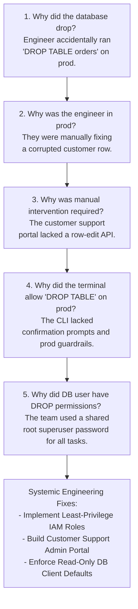
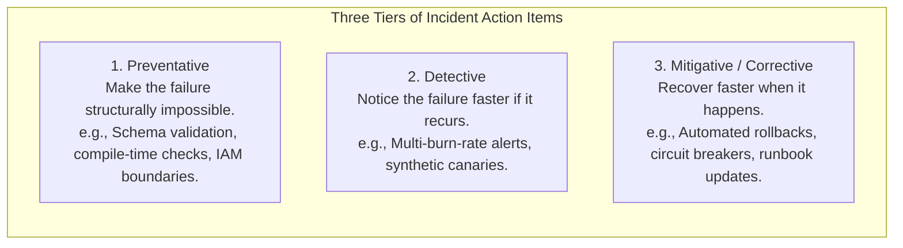
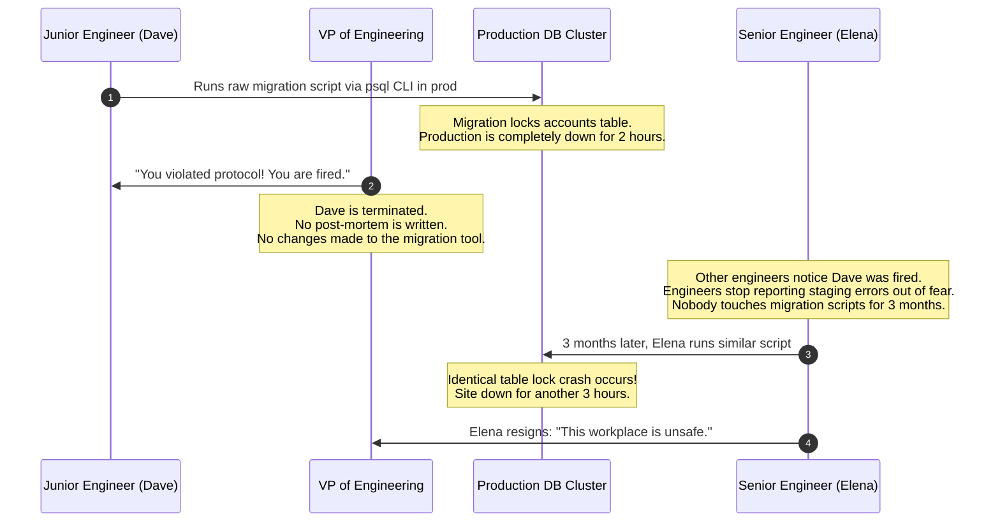

# Blameless Post-Mortems and Incident Retrospectives

> **Difficulty**: Intermediate | **Estimated Time**: 35m | **Hands-On**: Process & Analysis

> [!TIP]
> **The Golden Rule of Blameless Post-Mortems:**
> **You cannot fire your way to reliability.** Punishing or shaming engineers who cause outages creates a culture of fear where employees hide mistakes, delay incident declarations, and resist taking ownership. Assume engineers always make reasonable decisions given the information, tools, and context they had at the time. If a system allows a single human typo to take down production, **the system is flawed, not the human.**

---

## 1. Visual Mental Models: The 5 Whys Root-Cause Excavation

A superficial post-mortem stops at the proximate human trigger: *"Bob ran the wrong command."*
A blameless SRE post-mortem uses the **5 Whys technique** to drill through human actions until it uncovers the structural, procedural, and tooling vulnerabilities that made the failure inevitable.



---

## 2. Anatomy of Action Items: Preventative, Detective & Corrective

Post-mortems are useless unless they generate prioritized, actionable engineering tickets. SRE categorizes post-mortem action items into three distinct defense tiers:



| Action Item Type | Purpose | Production Example |
| :--- | :--- | :--- |
| **Preventative** | Prevents this class of bug from ever reaching production again. | Add pre-commit JSON schema validation and CI linter to block malformed configuration files before merging. |
| **Detective** | Reduces Mean Time to Detect (MTTD). | Write a Prometheus alerting rule that triggers if queue depth increases monotonically for > 3 minutes. |
| **Mitigative** | Reduces Mean Time to Mitigate (MTTM). | Implement an automated rollback trigger in ArgoCD if canary error rate exceeds 1% during deployment. |

---

## 3. Production War Story: The Finger-Pointing Disaster

```
INCIDENT SUMMARY: INC-1092
SEVERITY: P1 - Cultural & Operational Catastrophe
IMPACT: The same database outage recurred 3 months later; 2 senior engineers resigned; catastrophic customer data loss.
ROOT CAUSE: Management fired a junior engineer for running a faulty migration instead of fixing the dangerous deployment pipeline.
```

### Incident Timeline



### The Post-Mortem

- **The Fallacy**: Leadership believed that punishing the individual would deter future mistakes.
- **The Reality**: Firing Dave did nothing to fix the vulnerable database script runner. It created a culture of paranoia where engineers were terrified to touch production, hid emerging bugs, and ultimately suffered the exact same outage 90 days later.
- **The SRE Transformation**:
  1. Guaranteed a 100% blameless post-mortem environment.
  2. Banned all direct production database terminal access.
  3. Replaced manual scripts with declarative, version-controlled migration tools (`golang-migrate` / `Flyway`) managed through automated CI/CD canaries.

---

## 4. The Standard SRE Post-Mortem Document Template

High-performing engineering teams publish their post-mortems internally for the entire company to read.

```markdown
# Incident Post-Mortem: [INC-8491] Payment Gateway Timeout Outage

| Metadata | Details |
| :--- | :--- |
| **Date** | 2026-11-10 |
| **Authors** | @alice (Tech Lead), @bob (Incident Commander) |
| **Status** | Completed / Action Items In Progress |
| **Severity** | SEV-1 (Critical) |
| **Impact** | 12,400 checkout attempts failed (18% of global traffic) |
| **Duration** | 42 minutes (14:15 UTC - 14:57 UTC) |

---

## 1. Executive Summary
On 2026-11-10 at 14:15 UTC, our primary payment gateway began returning HTTP 504 Gateway Timeouts.
The incident was triggered by a configuration deployment that misconfigured the connection timeout 
to our upstream payment provider. Service was fully restored at 14:57 UTC by executing an automated 
Kubernetes rollback to revision 82.

---

## 2. Impact & SLO Assessment
- **Availability SLI:** Dropped from 99.98% to 98.12% during the 42-minute window.
- **Error Budget Impact:** Consumed 14.2% of our rolling 30-day error budget.
- **Financial Blast Radius:** ~$38,000 in delayed transactions (all recovered upon retry).

---

## 3. Incident Timeline (All times UTC)
- **14:10** — PR #1421 merged (Updated payment client timeout configurations).
- **14:14** — Deployment completed to production pods.
- **14:15** — Alert fires: `ErrorBudgetBurnRateFast` (14.4x burn rate detected).
- **14:17** — @bob acknowledges page, declares SEV-1, and establishes Incident Command.
- **14:22** — @alice inspects distributed traces in Tempo; identifies downstream payment client timeout set to 50ms instead of 5000ms.
- **14:25** — IC approves immediate rollback.
- **14:28** — `kubectl rollout undo deployment/payment-api` executed.
- **14:35** — Rollback pods healthy; error rate drops back to baseline (0.01%).
- **14:50** — Telemetry monitored for 15 minutes of stability; IC declares incident RESOLVED.

---

## 4. What Went Well / What Went Poorly / Where We Got Lucky
- **What Went Well:** The multi-burn-rate alert paged on-call within 60 seconds of deployment; Tempo distributed traces pinpointed the exact timeout parameter immediately.
- **What Went Poorly:** The configuration change was not validated by any unit test in CI; the staging environment did not simulate real network latency.
- **Where We Got Lucky:** The incident occurred mid-day on Tuesday when all senior SREs were online and available in the war room.

---

## 5. 5 Whys Root-Cause Analysis
1. *Why did checkout fail?* The payment service timed out waiting for upstream bank responses.
2. *Why did it time out?* The client timeout was set to 50ms, but banks require up to 800ms.
3. *Why was it 50ms?* A developer intended to set `5000ms`, but omitted two zeros in `config.yaml`.
4. *Why was the typo not caught?* The configuration parser did not enforce minimum threshold validation bounds.
5. *Why was there no bounds checking?* The configuration library used raw unmarshaling without struct validation tags.

---

## 6. Action Items & Remediation Tickets

| Action Item | Type | Owner | Ticket ID | Priority |
| :--- | :--- | :--- | :--- | :--- |
| Add validator tags ensuring `timeout >= 1000ms` | Preventative | @alice | JIRA-4011 | P0 |
| Deploy automated canary rollback if error rate > 1% | Mitigative | @bob | JIRA-4012 | P1 |
| Add synthetic payment probe to staging pipeline | Detective | @carol | JIRA-4013 | P2 |
```

---

## 7. Operational Validation Checkpoints

Confirm your mastery of post-mortem leadership with these scenarios.

<details>
<summary><b>Checkpoint 1: An executive asks in a post-mortem review, "Whose fault was this, and what disciplinary action was taken?" How do you respond?</b></summary>

**SRE Leadership Response:**
*"In accordance with our engineering blameless post-mortem policy, we do not attribute outages to individual engineers. Our engineers acted in good faith with the tools available to them.
The failure was systemic: our CI pipeline allowed an invalid configuration parameter to deploy without automated validation, and our deployment process lacked automated canary rollbacks. Disciplinary action will not prevent the next engineer from making a similar typo. Instead, we have prioritized three concrete engineering safeguards (JIRA-4011, JIRA-4012) that make this class of error technically impossible for anyone to repeat."*
</details>

<details>
<summary><b>Checkpoint 2: What is the single most common reason that post-mortem action items never get implemented, and how do you prevent it?</b></summary>

**The Pitfall & Solution:**
- **The Pitfall:** Action items are written in a Google Doc or wiki page, celebrated in the meeting, and then forgotten as developers return to their normal sprint feature backlog.
- **The Solution:**
  1. Every action item must have an **assigned individual owner** and a **dedicated Jira/issue ticket** created *before* the post-mortem document is closed.
  2. SRE policy mandates that **P0 and P1 post-mortem action items take automatic precedence over feature work** in the next immediate engineering sprint.
</details>

<details>
<summary><b>Checkpoint 3: Explain the difference between a "Trigger" and a "Root Cause".</b></summary>

**Distinction:**
- **The Trigger (Proximate Event):** The immediate catalyst that exposed the flaw (e.g., an engineer deploying a config change, a traffic surge from an influencer tweet, or an AWS power outage).
- **The Root Cause (Systemic Vulnerability):** The latent design, architecture, or procedural defect that allowed the trigger to cause catastrophic failure (e.g., lack of input validation, absence of rate limiting, or lack of multi-AZ redundancy).
Eliminating the trigger does nothing; eliminating the root cause permanently hardens the system.
</details>

---

## Next

Continue to **[07-capacity-planning-and-toil-reduction](../07-capacity-planning-and-toil-reduction/README.md)** to eliminate repetitive operational toil and engineer predictive capacity into your microservice architecture.
