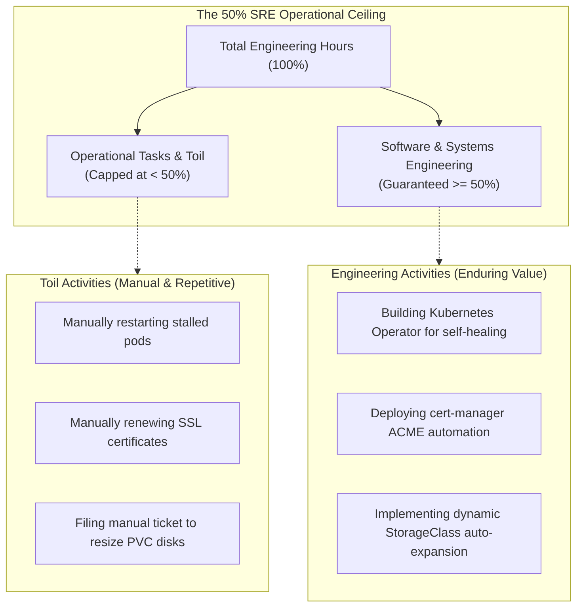
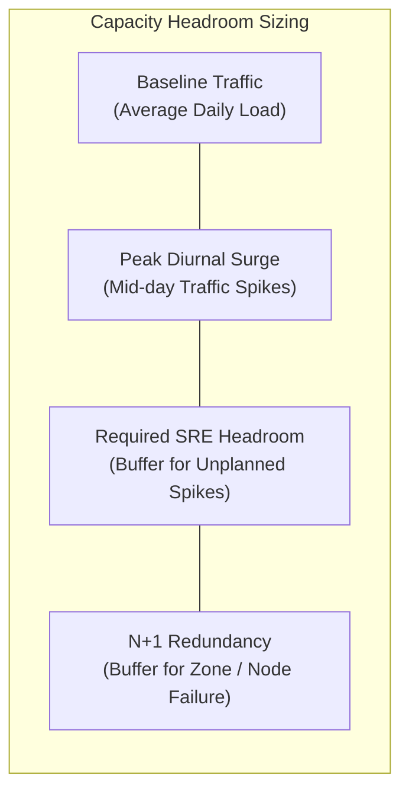
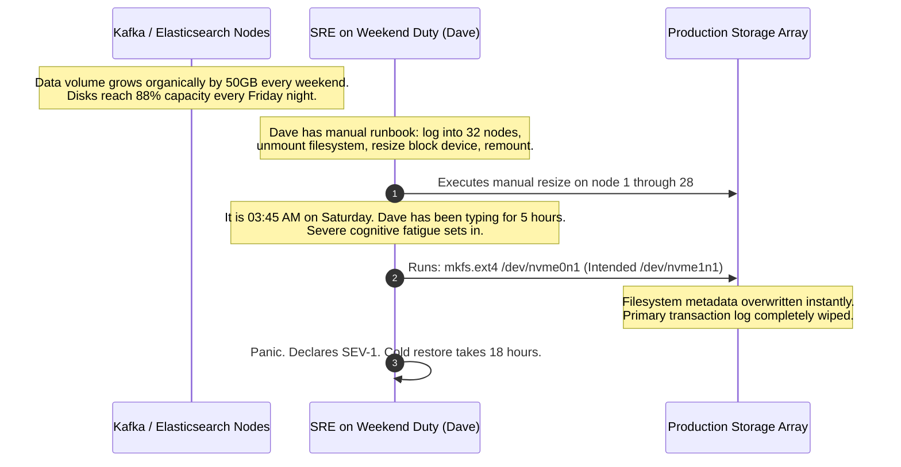

# Capacity Planning and Toil Reduction

> **Difficulty**: Intermediate | **Estimated Time**: 35m | **Hands-On**: Mandatory

> [!TIP]
> **The Golden Rule of SRE Toil Reduction:**
> **Toil is the enemy of engineering scale.** If a task is manual, repetitive, automatable, tactical, lacks enduring value, and scales linearly with service traffic, it is **Toil**. Google SRE mandates that **at least 50% of an SRE's time must be dedicated to pure software engineering** (building automation, architectural safeguards, and tools). If operational toil exceeds 50%, the team is drowning and must programmatically automate or eliminate the tasks.

---

## 1. Visual Mental Models: Toil vs. Engineering Work

In traditional IT operations, as a company grows from 10 microservices to 1,000 microservices, operational headcount must scale linearly to match the ticket load. SRE breaks this linear scaling trap by replacing repetitive manual tasks with software.



### The Taxonomy of Toil

Toil is not simply "work I dislike." A task must meet all or most of the six Google SRE criteria to be classified as toil:

```
[ Manual ] --------> Carried out by human keystrokes rather than automated scripts.
[ Repetitive ] ----> Performed multiple times with minimal intellectual variation.
[ Automatable ] ---> A deterministic machine could execute it with the same or better accuracy.
[ Tactical ] ------> Reactive and short-term (putting out fires) rather than strategic.
[ No Enduring Value] Once finished, the service is in the exact same state as before.
[ Linear Scaling ] -> Grows directly in proportion to user traffic or server fleet size.
```

---

## 2. Capacity Planning: Headroom, Saturation & Redundancy

Capacity planning is the practice of ensuring your infrastructure can absorb both **organic traffic growth** (steady monthly user acquisition) and **inorganic surge events** (Black Friday, marketing push, celebrity mentions) without violating SLOs.



### The Redundancy Formulas: $N+1$ and $N+2$
- **$N$**: The minimum number of compute instances required to handle peak load under normal conditions.
- **$N+1$**: Sized so that if any single server, node, or availability zone fails, the remaining capacity can absorb 100% of peak traffic with zero degradation.
- **$N+2$**: Sized so that during an active cluster upgrade (1 node down for maintenance), a sudden second hardware failure will still not cause service degradation.

$$\text{Required Pods} = \left\lceil \frac{\text{Peak Traffic QPS}}{\text{Max Safe QPS per Pod}} \right\rceil + 1 \quad (\text{For } N+1)$$

---

## 3. Production War Story: The 30-Hour Weekend Toil Trap

```
INCIDENT SUMMARY: INC-8119
SEVERITY: P1 - Operational Exhaustion & Catastrophic Data Loss
IMPACT: Complete database storage pool deleted; 18 hours of emergency disaster recovery from cold backups.
ROOT CAUSE: A team spent 30 hours per month manually expanding disk partitions; an exhausted engineer executed a typo on a live production block device.
```

### Incident Timeline



### The Post-Mortem

- **The Fallacy**: The organization considered manual disk resizing to be "cheap sysadmin work" not worth engineering time to automate.
- **The Reality**: The repetitive manual toil drained 30 hours of engineering capacity every month and eventually led to catastrophic human error under sleep deprivation.
- **The Remediation**:
  1. Configured Kubernetes dynamic PVC expansion via StorageClass: `allowVolumeExpansion: true`.
  2. Deployed an automated storage controller that monitors disk watermarks and expands volumes automatically when utilization exceeds 75%.
  3. Eliminated 100% of manual disk expansion tickets forever.

---

## 4. Multi-Language Capacity Forecasting Tools

Use these implementations to calculate saturation headroom and project future cluster requirements based on organic growth models.

### Go (`capacity_planner.go`)

```go
package main

import (
	"fmt"
	"math"
)

type CapacityProjection struct {
	CurrentPeakQPS      float64
	GrowthRateMonthly   float64
	MonthsAhead         int
	MaxQPSPerReplica    float64
	ProjectedPeakQPS    float64
	RequiredN1Replicas int
}

func CalculateCapacity(currentPeak float64, monthlyGrowthPct float64, months int, safeQPSPerPod float64) CapacityProjection {
	// Compound growth formula: Peak * (1 + rate)^months
	projected := currentPeak * math.Pow(1.0+(monthlyGrowthPct/100.0), float64(months))
	
	// N+1 calculation: ceil(Projected / SafeCapacity) + 1
	n := math.Ceil(projected / safeQPSPerPod)
	nPlus1 := int(n) + 1

	return CapacityProjection{
		CurrentPeakQPS:      currentPeak,
		GrowthRateMonthly:   monthlyGrowthPct,
		MonthsAhead:         months,
		MaxQPSPerReplica:    safeQPSPerPod,
		ProjectedPeakQPS:    projected,
		RequiredN1Replicas: nPlus1,
	}
}

func main() {
	// 5,000 peak QPS growing at 8% per month; safe capacity is 400 QPS per pod; forecast 6 months out
	plan := CalculateCapacity(5000, 8.0, 6, 400)

	fmt.Printf("=== SRE CAPACITY FORECAST (6 MONTHS) ===\n")
	fmt.Printf("Current Peak Load:      %.0f QPS\n", plan.CurrentPeakQPS)
	fmt.Printf("Monthly Growth Rate:    %.1f%%\n", plan.GrowthRateMonthly)
	fmt.Printf("Projected Peak Load:    %.0f QPS\n", plan.ProjectedPeakQPS)
	fmt.Printf("Safe Capacity per Pod:  %.0f QPS\n", plan.MaxQPSPerReplica)
	fmt.Printf("Target Replicas (N+1):  %d pods\n", plan.RequiredN1Replicas)
}
```

### TypeScript / Node.js (`capacity_planner.ts`)

```typescript
export interface HeadroomAssessment {
  currentUtilizationPct: number;
  maxSafeUtilizationPct: number;
  availableHeadroomPct: number;
  isNPlus1Compliant: boolean;
  recommendedAction: string;
}

export function evaluateHeadroom(
  activeNodes: number,
  averageNodeCpuPercent: number,
  maxSafeLimit: number = 75
): HeadroomAssessment {
  // If 1 node fails, remaining nodes absorb its load: TotalLoad / (Nodes - 1)
  const totalLoad = activeNodes * averageNodeCpuPercent;
  const postFailureUtilization = activeNodes > 1 ? totalLoad / (activeNodes - 1) : 100;

  const isCompliant = postFailureUtilization <= maxSafeLimit;
  const headroom = maxSafeLimit - averageNodeCpuPercent;

  let action = 'Capacity healthy';
  if (!isCompliant) {
    action = `VIOLATION: Loss of 1 node will spike utilization to ${postFailureUtilization.toFixed(1)}%! Add at least 1 node immediately.`;
  } else if (headroom < 15) {
    action = 'WARNING: Available headroom < 15%. Schedule node scaling.';
  }

  return {
    currentUtilizationPct: averageNodeCpuPercent,
    maxSafeUtilizationPct: maxSafeLimit,
    availableHeadroomPct: Number(headroom.toFixed(1)),
    isNPlus1Compliant: isCompliant,
    recommendedAction: action,
  };
}

// Example: 5 nodes at 65% average CPU
console.log(evaluateHeadroom(5, 65, 75));
```

### Python (`capacity_planner.py`)

```python
import math

def calculate_database_headroom(
    current_storage_gb: float,
    daily_growth_gb: float,
    max_disk_gb: float,
    warning_watermark_pct: float = 80.0
) -> dict:
    warning_threshold_gb = max_disk_gb * (warning_watermark_pct / 100.0)
    remaining_safe_gb = warning_threshold_gb - current_storage_gb
    days_until_warning = remaining_safe_gb / daily_growth_gb if daily_growth_gb > 0 else float("inf")

    return {
        "current_storage_gb": current_storage_gb,
        "daily_growth_gb": daily_growth_gb,
        "days_until_warning": max(0, math.floor(days_until_warning)),
        "is_urgent": days_until_warning <= 7,
    }

if __name__ == "__main__":
    report = calculate_database_headroom(
        current_storage_gb=720,
        daily_growth_gb=18,
        max_disk_gb=1000,
        warning_watermark_pct=80.0
    )
    print(f"Days until 80% watermark: {report['days_until_warning']} days")
    if report["is_urgent"]:
        print("ACTION REQUIRED: Trigger automated StorageClass disk expansion!")
```

---

## 5. Declarative Kubernetes Automated Capacity Scaling

Automate capacity management using Kubernetes Horizontal Pod Autoscaler (HPA) and declarative StorageClass configurations.

### Declarative Storage Auto-Expansion (`storageclass.yaml`)

```yaml
apiVersion: storage.k8s.io/v1
kind: StorageClass
metadata:
  name: dynamic-nvme-sc
provisioner: ebs.csi.aws.com
volumeBindingMode: WaitForFirstConsumer
allowVolumeExpansion: true # Enables programmatic disk resize with zero downtime!
parameters:
  type: gp3
  iops: "3000"
  throughput: "125"
```

### Traffic-Driven Horizontal Pod Autoscaler (`hpa.yaml`)

```yaml
apiVersion: autoscaling/v2
kind: HorizontalPodAutoscaler
metadata:
  name: checkout-hpa
  namespace: production
spec:
  scaleTargetRef:
    apiVersion: apps/v1
    kind: Deployment
    name: checkout-service
  minReplicas: 4
  maxReplicas: 30
  metrics:
    # Target 1: CPU Saturation Buffer
    - type: Resource
      resource:
        name: cpu
        target:
          type: Utilization
          averageUtilization: 65
    # Target 2: Request Rate per Replica (Traffic-driven)
    - type: Pods
      pods:
        metric:
          name: http_requests_per_second
        target:
          type: AverageValue
          averageValue: 350
```

---

## 6. Practical CLI Workflows

Follow this CLI verification workflow to calculate cluster headroom and verify autoscaler behavior.

### Step 1: Query Kubernetes Cluster CPU Headroom via PromQL

Calculate the overall cluster CPU headroom buffer:

```bash
curl -s -G "http://localhost:9090/api/v1/query" \
  --data-urlencode 'query=100 - (sum(rate(node_cpu_seconds_total{mode!="idle"}[5m])) / sum(machine_cpu_cores) * 100)'
```

**Expected Output:**
```json
{
  "status": "success",
  "data": {
    "resultType": "vector",
    "result": [
      {
        "metric": {},
        "value": [1712498200.123, "38.41"]
      }
    ]
  }
}
```

The cluster has **38.41% idle compute headroom**, safely exceeding the 25% minimum SRE safety margin!

---

## 7. Operational Validation Checkpoints

Confirm your capacity planning and toil-reduction mastery with these scenarios.

<details>
<summary><b>Checkpoint 1: An engineer writes a Bash script to restart failed pods and runs it via cron. Is this toil reduction?</b></summary>

**Analysis:**
- **Why it is an improvement:** It replaces manual keystrokes with a scheduled job.
- **Why it is NOT true SRE toil elimination:** Writing a blind cron job that restarts pods masks the underlying defect (e.g., memory leak, unhandled panic). True SRE toil elimination resolves the systemic cause:
  1. Fix the application memory leak in code.
  2. Configure Kubernetes native `livenessProbe` with automated restart backoff.
  3. Emit an alert on container restarts so the development team resolves the bug permanently.
</details>

<details>
<summary><b>Checkpoint 2: Under what conditions does an SRE team enforce the "50% Toil Cap"?</b></summary>

**Mechanism:**
If sprint tracking reveals that an SRE team spends **>50% of their working hours** responding to routine tickets, manual deployments, and alerts:
1. SRE leadership institutes an operational intervention.
2. Routine ticket queues are routed directly back to the software engineering teams responsible for the underlying services.
3. Feature work is paused to allow SREs to build the required automation, operators, and self-healing infrastructure to permanently drive toil back below 50%.
</details>

<details>
<summary><b>Checkpoint 3: What is the difference between organic capacity growth and inorganic surge events?</b></summary>

**Distinction:**
- **Organic Growth:** Predictable, continuous user adoption over months. Managed via statistical trend forecasting, automated cluster autoscalers, and monthly capacity reviews.
- **Inorganic Surge Events:** Abrupt, step-function traffic spikes (e.g., Super Bowl commercial, Black Friday sale, viral social media mention). Cannot rely on reactive autoscaling alone due to cloud VM boot delays (2-5 minutes). Requires proactive load testing, pre-warming server fleets, and pre-scaling databases to $N+1$ capacity 24 hours prior to the event.
</details>

---

## Next

Continue to **[08-capstone-project](../08-capstone-project/README.md)** to synthesize the entire SRE curriculum into a comprehensive production capstone: defining SLIs, engineering multi-burn-rate alerts, conducting an incident response drill, and executing a blameless post-mortem.
