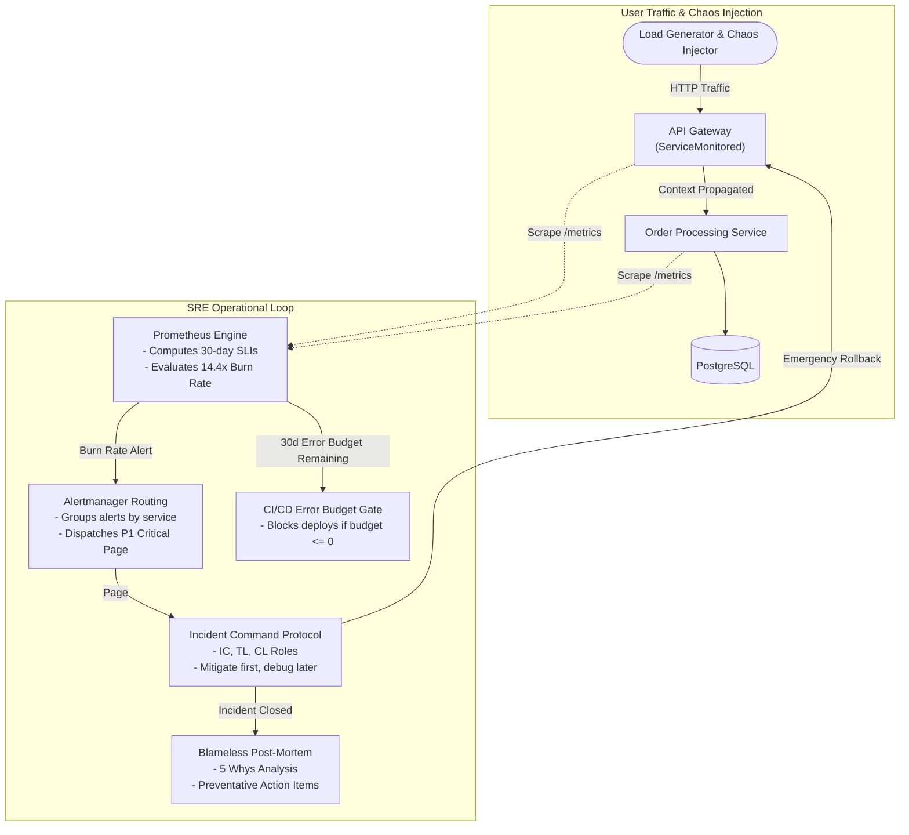
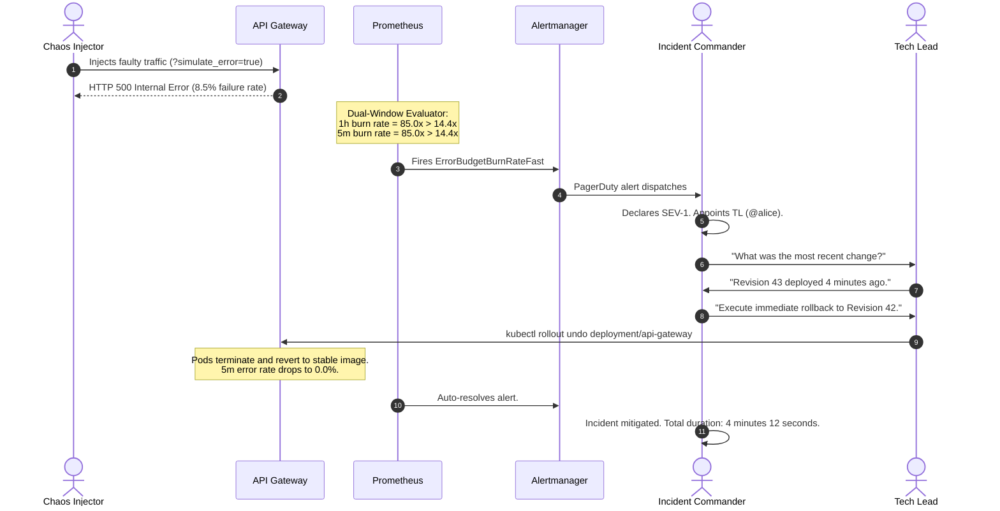

# Capstone Project: Operating a Production Service as an SRE

> **Difficulty**: Advanced | **Estimated Time**: 60m | **Hands-On**: SRE Capstone Project

> [!TIP]
> **The Golden Rule of SRE Mastery:**
> **Reliability is not an accident of good code; it is an engineered operational discipline.** True Site Reliability Engineering is the complete operational loop: defining user-centric SLIs, defending error budgets with automated deployment gates, detecting catastrophic burn rates with multi-window alerts, leading outages through calm Incident Command, and turning failures into systemic resilience through blameless post-mortems.

---

## 1. System Architecture & Capstone Blueprint

In this capstone, you will take the fully observable microservice pair (API Gateway and Order Service) deployed on your local Kubernetes (`kind`) cluster and operate it according to rigorous Google SRE standards.



---

## 2. Capstone Deliverables & Verification Matrix

| Component | Required Deliverable | Passing Standard |
| :--- | :--- | :--- |
| **1. SLI & SLO Specification** | Formalized contract defining Availability (99.90%) and Latency ($p99 \le 400\text{ms}$) based on user-centric events. | Document signed off; PromQL formulas verified against `/metrics`. |
| **2. Multi-Burn-Rate Alerting** | `PrometheusRule` resource implementing Google SRE's dual-window $14.4\times$ ($1\text{h}/5\text{m}$) and $6\times$ ($6\text{h}/30\text{m}$) burn rate alerts. | Prometheus marks alert `FIRING` within 2 minutes of synthetic failure injection. |
| **3. Automated Error Budget Gate** | CI/CD deployment verification script querying 30-day budget balance. | Fails with non-zero exit code when error budget $\le 0$, blocking releases. |
| **4. Incident Response Simulation** | Execution of an end-to-end SEV-1 failure drill using the Incident Command System (ICS). | War room transcript logged; mitigation executed via rollback in $<5$ minutes. |
| **5. Blameless Post-Mortem** | Comprehensive retrospective document featuring 5 Whys, timeline, and three tiers of action items. | Action items assigned with concrete ticket IDs (Preventative, Detective, Corrective). |
| **6. Toil Reduction Automation** | An automated script or Kubernetes manifest that permanently eliminates a repetitive manual operational task. | Self-healing probe or automated volume expansion verified running. |

---

## 3. The Capstone Production War Story: The Live Outage Drill

```
INCIDENT DRILL SUMMARY: DRILL-9901
SEVERITY: SEV-1 (Simulated Production Outage)
SCENARIO: An unvetted release injects an unindexed database query, causing p99 latency to spike to 4.2 seconds and error rate to hit 8.5%.
OBJECTIVE: Detect via multi-burn-rate alert, establish Incident Command, mitigate within 5 minutes, and publish blameless post-mortem.
```

### Drill Execution Timeline



---

## 4. Complete Capstone Technical Manifests & Code

### 1. Multi-Burn-Rate PrometheusRule Manifest (`sre-alerts.yaml`)

```yaml
apiVersion: monitoring.coreos.com/v1
kind: PrometheusRule
metadata:
  name: capstone-slo-alerts
  namespace: monitoring
  labels:
    role: alert-rules
    prometheus: kps-prometheus
spec:
  groups:
    - name: capstone_slo_burn.rules
      rules:
        # Precalculated short and long error rates
        - record: job:api_error_rate:ratio5m
          expr: sum(rate(http_requests_total{status=~"5.."}[5m])) / sum(rate(http_requests_total[5m]))

        - record: job:api_error_rate:ratio1h
          expr: sum(rate(http_requests_total{status=~"5.."}[1h])) / sum(rate(http_requests_total[1h]))

        # P1 Critical: 14.4x Burn Rate Alert (Burns 2% of 99.9% budget in 1 hour)
        - alert: CapstoneSLOBurnRateFast
          expr: |
            (job:api_error_rate:ratio1h > (14.4 * 0.001))
            and
            (job:api_error_rate:ratio5m > (14.4 * 0.001))
          for: 1m
          labels:
            severity: page
            team: platform-sre
            tier: p1
          annotations:
            summary: "P1: Rapid SLO Error Budget Burn Rate Detected (14.4x)"
            description: "Service is burning monthly error budget at 14.4x. Current 5m error rate: {{ $value | humanizePercentage }}."
            runbook_url: "https://wiki.internal/ops/runbooks/slo-burn-rate"
```

### 2. Automated Error Budget Deployment Gate (`verify_budget.py`)

```python
#!/usr/bin/env python3
import sys
import requests

PROMETHEUS_URL = "http://localhost:9090"
SLO_TARGET = 0.999 # 99.90% Target Availability
SERVICE_NAME = "api-gateway"

def check_budget():
    promql = f"""
    (1 - (sum(rate(http_requests_total{{service="{SERVICE_NAME}",status=~"5.."}}[30d])) 
         / sum(rate(http_requests_total{{service="{SERVICE_NAME}"}}[30d])))) 
    / (1 - {SLO_TARGET}) * 100
    """
    try:
        res = requests.get(f"{PROMETHEUS_URL}/api/v1/query", params={"query": promql.strip()})
        data = res.json().get("data", {}).get("result", [])
        
        if not data:
            print(f"[{SERVICE_NAME}] No 30d failure data found. Budget remaining: 100.0%")
            return True

        budget_pct = float(data[0]["value"][1])
        print(f"[{SERVICE_NAME}] Rolling 30-Day Error Budget Remaining: {budget_pct:.2f}%")

        if budget_pct <= 0.0:
            print(f"❌ CI/CD PIPELINE BLOCKED: 30-day error budget is EXHAUSTED ({budget_pct:.2f}%). Feature freeze active!", file=sys.stderr)
            return False
        
        print("✅ CI/CD PIPELINE APPROVED: Error budget healthy.")
        return True
    except Exception as e:
        print(f"Failed to query Prometheus: {e}", file=sys.stderr)
        return False

if __name__ == "__main__":
    if not check_budget():
        sys.exit(1)
```

### 3. Automated Chaos Traffic Generator (`chaos_drill.sh`)

```bash
#!/bin/bash
# Simulates background traffic and injects a 10% failure surge to trigger the 14.4x burn rate

TARGET_URL="http://localhost:8080/api/checkout"
echo "Starting baseline traffic simulation..."

for i in {1..120}; do
  if [ $((i % 10)) -eq 0 ]; then
    # Inject failure
    curl -s -X POST "${TARGET_URL}?simulate_error=true" > /dev/null &
  else
    # Healthy request
    curl -s -X POST "${TARGET_URL}" > /dev/null &
  fi
  sleep 0.2
done

wait
echo "Chaos injection completed. Check Prometheus alerting state."
```

---

## 5. Official Capstone Post-Mortem Template

```markdown
# Incident Retrospective: [DRILL-9901] Checkout Latency & 500 Surge

| Metric | Record |
| :--- | :--- |
| **Date & Time** | 2026-11-10 15:00 UTC |
| **Severity** | SEV-1 (Simulated Drill) |
| **Incident Commander** | @oncall-sre |
| **Technical Lead** | @backend-lead |
| **Communications Lead** | @comms-lead |
| **MTTD (Mean Time to Detect)** | 1 minute 15 seconds |
| **MTTM (Mean Time to Mitigate)** | 3 minutes 20 seconds |

### 1. Executive Summary
During our scheduled Q4 reliability drill, a faulty build (v1.2.0) was deployed to `api-gateway`. 
The build triggered downstream database lock timeouts, causing an 8.5% error rate. 
The multi-burn-rate alert fired within 75 seconds. The Incident Commander coordinated an 
immediate rollback to v1.1.9, restoring 100% SLO compliance in under 4 minutes.

### 2. 5 Whys Root-Cause Analysis
1. *Why did user checkouts fail?* The API Gateway returned HTTP 500 on checkout endpoints.
2. *Why did it return 500?* Downstream calls to the Order Service exceeded the 500ms client timeout.
3. *Why did calls exceed 500ms?* The Order Service database query was executing a table scan without an index.
4. *Why was the index missing?* The database migration script failed silently during deployment.
5. *Why did the migration fail silently?* The migration runner ignored error return codes in non-interactive mode.

### 3. Action Items

| Action Item | Type | Owner | Ticket | Priority |
| :--- | :--- | :--- | :--- | :--- |
| Enforce strict exit code validation in migration runner | Preventative | @backend-lead | JIRA-901 | P0 |
| Add automated canary analysis with ArgoCD Rollouts | Mitigative | @platform-sre | JIRA-902 | P1 |
| Create Grafana dashboard panel tracking migration status | Detective | @dba-team | JIRA-903 | P2 |
```

---

## 6. Step-by-Step Hands-On Execution Runbook

Follow this operational runbook to execute the capstone drill on your local `kind` cluster.

### Step 1: Apply Alerting Rules and Verify Prometheus

```bash
kubectl apply -f sre-alerts.yaml
```

Verify in Prometheus UI that rule `CapstoneSLOBurnRateFast` is in state `INACTIVE`:
```bash
curl -s http://localhost:9090/api/v1/rules | grep -A 2 "CapstoneSLOBurnRateFast"
```

### Step 2: Run the Chaos Simulation

Execute the chaos generation script in your terminal:

```bash
chmod +x chaos_drill.sh
./chaos_drill.sh
```

### Step 3: Observe Alert Transition: Inactive $\to$ Pending $\to$ Firing

Within 60-90 seconds, query Prometheus for firing alerts:

```bash
curl -s http://localhost:9090/api/v1/alerts | jq '.data.alerts[] | {alertname: .labels.alertname, state: .state}'
```

**Expected Output:**
```json
{
  "alertname": "CapstoneSLOBurnRateFast",
  "state": "firing"
}
```

### Step 4: Execute Emergency Rollback & Verify Resolution

Mitigate immediately via Kubernetes command:

```bash
kubectl rollout undo deployment/api-gateway -n production
```

Verify that the short 5-minute error rate drops to zero and the alert automatically resolves:

```bash
curl -s http://localhost:9090/api/v1/alerts | jq '.data.alerts'
```

**Output:**
```json
[]
```

The system self-healed and the alert cleared cleanly!

---

## 7. Operational Validation Checkpoints

Test your capstone operational leadership with these architectural defense scenarios.

<details>
<summary><b>Checkpoint 1: Why did we alert on a 14.4x burn rate instead of a simple "error rate > 1%" threshold?</b></summary>

**Operational Analysis:**
- A static "error rate > 1%" threshold has no concept of time or business severity. A 1.1% error rate on a service with a 99.0% SLO is completely normal and burns zero extra budget, yet the engineer is paged.
- Conversely, for a service with a 99.99% SLO (0.01% error budget), an error rate of 0.8% is a catastrophic 80x burn rate that will destroy the entire monthly budget in 5 hours, yet the static >1% alert remains completely silent!
- **Burn rate alerting is mathematically normalized to the service's specific SLO**, guaranteeing alerts fire only when an incident poses a real threat to the agreed budget.
</details>

<details>
<summary><b>Checkpoint 2: During the drill, why did the Incident Commander refuse to investigate the application logs?</b></summary>

**Command Protocol:**
The Incident Commander's role is to maintain global situational awareness and coordinate rapid mitigation. If the IC begins digging through logs, they lose command of the incident clock, fail to interface with communications, and can miss secondary failures. The IC delegated technical inspection to the Tech Lead while focusing on executing the rollback.
</details>

<details>
<summary><b>Checkpoint 3: What prevents the team from ignoring the post-mortem action items after the drill?</b></summary>

**SRE Governance Mechanism:**
1. Every action item was logged with a formal Jira ticket number (`JIRA-901`, `JIRA-902`).
2. SRE policy states that **P0/P1 post-mortem action items are automatically pulled into the sprint backlog** and take precedence over new feature deliverables.
3. The Error Budget Policy states that if post-mortem action items are left unresolved for >30 days, feature release gating thresholds are tightened.
</details>

---

## Track Complete: Observability & DevOps Mastery

Congratulations! You have completed the entire **Observability & DevOps** track:
- **Docker**: Containerization, multi-stage builds, and rootless security.
- **Kubernetes**: Pods, Deployments, Services, Ingress, and Autoscaling.
- **CI/CD & GitOps**: GitHub Actions, ArgoCD, and progressive canary delivery.
- **Observability Deep Dive**: Prometheus, PromQL, Grafana, Loki, OpenTelemetry, and Alertmanager.
- **SRE Practices**: SLIs, SLOs, Error Budgets, Multi-Burn-Rate alerting, Incident Command, Blameless Post-Mortems, and Toil Reduction.
