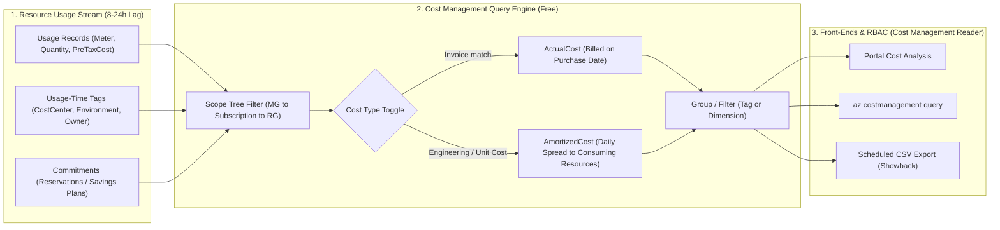
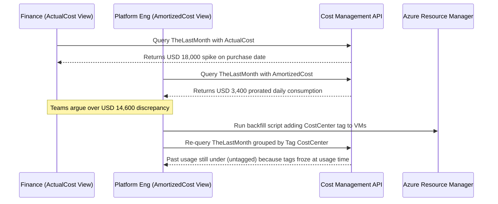

# Azure Cost Management Fundamentals

> **Prerequisites:** FinOps phases & unit economics (Module 00), Tagging taxonomy & create-time Azure Policy enforcement (`17-governance/06`), RBAC fundamentals (`16-identity-deep-dive`).  
> **Estimated Reading Time:** 30 minutes  
> **Target Audience:** Backend Engineers, Platform Engineers, FinOps Practitioners, Cloud Architects.

> [!TIP]
> **The Golden Rule of Azure Cost Management:** Always declare your **cost type** (**Amortized** for engineering allocation, rightsizing, and unit economics; **Actual** for invoice reconciliation), always benchmark against **complete periods** (`TheLastMonth`) rather than lagging partial-day slices, and enforce tags **at create time** because Cost Analysis freezes usage tags at the moment money is spent.

---

## Why This Matters

The Inform phase from module 00 says "you can't manage what you can't see" — this module is where you actually learn to see. Azure Cost Management is the built-in, free tool that turns the raw usage records you glimpsed last module into queryable, groupable, allocatable views. But it has two traps that mislead almost everyone the first time: the **amortized-vs-actual** cost distinction (which makes the same month look like two different bills) and the fact that grouping by tag only works if the tags were there *at the time of usage* — the exact create-time enforcement lesson from track 17 module 06. Get these right and every later module (budgets, showback, unit economics) rests on solid data.

---

## 1. Architectural Mental Model: Cost Query Pipeline, Usage-Time Tag Binding & Amortization

Azure Cost Management works like a pivot engine layered over usage records emitted by resource providers. Two immutable properties govern every query: resource tags are snapshotted onto each usage line **at the time of consumption**, and prepaid commitments are reshaped dynamically depending on whether you select `ActualCost` or `AmortizedCost`:



### Cost Analysis is a pivot table over your usage records

**Cost Analysis** is the primary view in Azure Cost Management. Mentally, it's a **pivot table over the usage records** you saw in module 00: every line of usage has a cost, a date, a resource, a resource group, a subscription, a service (meter), a location, and — crucially — the resource's **tags**. Cost Analysis lets you pick a **scope** (subscription, resource group, or management group — the same hierarchy from track 17), a **time range** (this month, last month, a custom range, or billing period), a **granularity** (daily/monthly), and then **group by** and **filter by** any of those dimensions. That's the whole model: scope → time → group/filter. The portal's charts and the `az costmanagement query` CLI are two front-ends over the exact same query engine, so anything you can see in the portal you can pull from the CLI (and script into a report — the basis of module 06's showback). The mental shift from module 00's raw `az consumption usage list` is that you're no longer reading individual records — you're **aggregating** them along a dimension that answers a question.

### Grouping by tag: allocation in action (track 17 module 06)

The single most valuable grouping is **by tag** — and this is the direct payoff of the taxonomy you built in track 17 module 06. Grouping cost by `CostCenter` answers "which team/budget does this spend belong to?"; grouping by `Environment` answers "how much is dev costing vs prod?"; grouping by `Owner` answers "who do I talk to about this line?". This is **cost allocation**: taking one undifferentiated subscription invoice and splitting it along the dimensions your org cares about, *without* needing a subscription per team. But there's a hard limit you must internalize now: **Cost Analysis groups a usage record by the tags that record carried at the time of usage.** A resource that was untagged when it ran shows up under "**(untagged)**" forever — backfilling the tag today does *not* re-allocate last month's cost. This is the same point track 17 module 06 made about *why the create-time `Deny` matters*, now seen from the cost side: your allocation is only as complete as your tagging was *when the money was spent*. The size of the "(untagged)" bucket is your allocation gap, and shrinking it is a prerequisite for trustworthy showback (module 06) and unit economics (module 00).

> **Caveat — not every resource type tags into cost the same way.** Some costs (e.g. certain shared/marketplace/bandwidth meters) don't inherit resource tags onto their usage records, so even a perfectly tagged estate has *some* unallocatable cost. The job is to shrink "(untagged)" to the irreducible minimum, not to obsess over reaching zero.

### Amortized vs. actual cost — the same month, two numbers

This is the distinction that makes people think Cost Management is broken. **Actual cost** shows charges **on the day they were billed**. **Amortized cost** takes any **upfront or recurring commitment purchase** — most importantly a **reservation** or **savings plan** (module 05) — and **spreads its cost evenly across the period it covers**, attributing the daily slices to the resources that actually consumed the benefit. A concrete example: you buy a 1-year Reserved Instance for \$8,760 up front on July 1.

- **Actual cost** shows an **\$8,760 spike on July 1** and then **\$0** for that VM's compute for the next 365 days (it's "already paid for").
- **Amortized cost** shows **~\$24/day every day** for a year, attributed to the VM that used the reservation — and **nothing** on July 1 for the purchase itself.

Neither is wrong; they answer different questions. **Actual** matches your bank statement / invoice (finance cares about cash flow and when money left the account). **Amortized** matches *usage* and is what you want for **rightsizing, allocation, and unit economics** — because it tells you what a resource *truly costs to run per day*, not the accident of when you prepaid. **Rule of thumb: use amortized for engineering decisions and showback, actual for reconciling the invoice.** If two people compare "the cost of prod last month" and get different numbers, this toggle is almost always why.

### Scope, and why it mirrors the governance hierarchy

Every cost query has a **scope**, and the scopes are the same tree you built in track 17: **management group** → **subscription** → **resource group** → individual resource. Scope determines both what's *included* and who's *allowed* to see it (Cost Management respects RBAC and adds cost-specific roles like **Cost Management Reader**). Choosing scope well is half the skill: a **management-group scope** rolls up every subscription under it into one view (how a platform team sees total org spend and does cross-subscription allocation), while a **resource-group scope** narrows to one app or environment. This is why track 17's structure wasn't just governance hygiene — a clean MG/subscription/RG hierarchy *is* your cost-allocation hierarchy. When a budget (module 02) or a showback report (module 06) is scoped wrong, it's almost always because someone picked the wrong node in this tree — a mistake you'll deliberately reproduce and fix next module.

### Cost Management is free, near-real-time-ish, and lags a bit

Two operational facts that shape every exercise in this track. First, **Cost Management itself is free** — analyzing, grouping, budgeting, and exporting cost data costs nothing (you only pay for the resources being measured). Second, **cost data lags**: usage typically takes **8-24 hours** to appear, and the current day/period is always an **incomplete, moving estimate**. This is why "today's cost is low" means nothing, why budgets (module 02) evaluate on a schedule rather than instantly, and why several exercises say "check back tomorrow." **Forecasts** — Cost Management's projection of where the current period will land — are built on this lagging data plus historical trend, which is why a forecast can swing early in a period and why forecast-based budget alerts (module 02) behave differently from actual-based ones. Internalize the lag now so you don't misread a chart later.

---

## 2. Taxonomic Comparison & Command Reference

### Actual Cost vs. Amortized Cost Comparison

| Dimension | `ActualCost` | `AmortizedCost` |
| :--- | :--- | :--- |
| **Commitment Purchase Day (e.g., 1-yr RI)** | Shows full upfront spike (e.g., \$8,760 on July 1) | Shows \$0 purchase spike; spreads daily rate (~\$24/day) |
| **Consuming Resource Daily Compute Line** | Shows \$0 for covered compute | Attributed daily slice to the exact consuming VM/node |
| **Primary Consumer** | Finance & Accounting (cash flow & invoice tie-out) | Engineering, Platform & Product (showback, rightsizing, unit cost) |
| **Without Any RIs or Savings Plans** | Identical to AmortizedCost | Identical to ActualCost |
| **Failure Mode If Misapplied** | Tricks engineers into thinking covered VMs are "free" | Won't match cash-basis vendor invoice on upfront purchase month |

### Cost Scope Hierarchy & Pivot Axes

| Scope / Pivot Dimension | Example Value | What It Isolates | RBAC & Operational Note |
| :--- | :--- | :--- | :--- |
| **Management Group** | `/providers/Microsoft.Management/managementGroups/mg-org` | All child subscriptions rolled into one org view | Requires `Cost Management Reader` at MG level |
| **Subscription** | `/subscriptions/<sub-id>` | Single billing boundary across all RGs | Default scope for most CLI scripts |
| **Resource Group** | `/subscriptions/<sub-id>/resourceGroups/rg-prod` | Single app or environment boundary | Cleanest isolation for dedicated app teams |
| **Tag Grouping** | `type=Tag name=CostCenter` | Cross-RG/cross-sub team or app spend | Frozen at usage time; missing tags land in `(untagged)` |
| **Built-in Dimension** | `type=Dimension name=ServiceName` / `ResourceGroup` | Underlying Azure meter or container grouping | Always populated even on untagged resources |

### Command Reference

The portal's Cost Analysis is the friendliest front-end, but the CLI is what you script into reports. `az costmanagement query` is the workhorse; it's free and read-only.

| Command | What it does | Example |
|---|---|---|
| `az costmanagement query` | Runs an aggregated cost query (the CLI behind Cost Analysis) | see breakdowns below |
| `az costmanagement export create` | Schedules a recurring CSV export of cost data to storage (module 06 showback) | covered in module 06 |
| `az consumption usage list` | Raw, unaggregated usage records (module 00) | `az consumption usage list --top 20 -o table` |
| `az account management-group show` | Confirms the MG scope you can roll cost up to (track 17) | `az account management-group show -n mg-org` |
| `az role assignment create --role "Cost Management Reader"` | Grants read-only cost visibility without other access | `az role assignment create --assignee <id> --role "Cost Management Reader" --scope <scope>` |

Flag breakdown — group month-to-date cost by the `CostCenter` tag (the track-17 allocation query):

```bash
az costmanagement query \
  --type AmortizedCost \
  --scope "/subscriptions/$(az account show --query id -o tsv)" \
  --timeframe MonthToDate \
  --dataset-grouping type=Tag name=CostCenter \
  --dataset-aggregation '{"totalCost":{"name":"PreTaxCost","function":"Sum"}}' \
  -o json
```

- `--type AmortizedCost` — use **amortized** (spread commitments) rather than `ActualCost`; this is the toggle from the concept above, and amortized is the right default for allocation. Switch to `ActualCost` to match the invoice.
- `--scope "/subscriptions/<id>"` — the node in the governance tree to analyze; swap for `/providers/Microsoft.Management/managementGroups/<mg>` to roll up the whole org, or a resource-group id to narrow to one app.
- `--timeframe MonthToDate` — the time range; other common values are `TheLastMonth`, `BillingMonthToDate`, or `Custom` with `--time-period`.
- `--dataset-grouping type=Tag name=CostCenter` — **the allocation pivot**: group by the `CostCenter` tag from track 17 module 06. Use `type=Dimension name=ResourceGroup` (or `ServiceName`, `ResourceLocation`) to group by a built-in dimension instead.
- `--dataset-aggregation '{"totalCost":{...}}'` — what to sum; `PreTaxCost` summed is the standard "how much did it cost" measure.

Flag breakdown — group last month's cost by resource group, sorted, for a quick waste scan:

```bash
az costmanagement query \
  --type ActualCost \
  --scope "/subscriptions/$(az account show --query id -o tsv)" \
  --timeframe TheLastMonth \
  --dataset-grouping type=Dimension name=ResourceGroup \
  --dataset-aggregation '{"totalCost":{"name":"PreTaxCost","function":"Sum"}}' \
  -o table
```

- `--type ActualCost` — here we *want* actual, because we're eyeballing which RGs billed the most last month, not doing per-resource allocation.
- `--timeframe TheLastMonth` — a *complete* period, so no lag/incompleteness distorts the ranking (unlike `MonthToDate`).
- `--dataset-grouping type=Dimension name=ResourceGroup` — group by the built-in ResourceGroup dimension; the biggest RGs are where module 03/04 optimization will pay off most.

---

## 3. Production War Story Post-Mortem: The "Missing \$14,000" Executive Audit & Backfill Fallacy

| Field | Incident Details |
| :--- | :--- |
| **Severity** | **SEV-2** (Financial Showback Discrepancy & Unallocatable Cloud Spend) |
| **Detection / Resolution Time** | Detected during Q3 financial close / Reconciled in 45 minutes; policy fixed in 1 sprint |
| **Impact** | Engineering and Finance reported monthly prod totals differing by \$14,600, while 38% of Kubernetes compute remained stuck in `(untagged)` despite a retrospective tagging script |

### What Happened

In July, the platform team purchased a 1-year Azure Reserved Instance (RI) for \$18,000 upfront to discount production AKS nodes. At month-end, Finance checked `ActualCost` and escalated an \$18,000 July cost spike, while Engineering looked at `AmortizedCost` showing ~\$3,400 for July's prorated daily usage — concluding Cost Management was broken. Meanwhile, an engineer backfilled `CostCenter=CC-2001` onto running AKS nodes via `az tag create` and couldn't understand why last month's showback report still showed 38% `(untagged)`.



### Root Cause Analysis

1. **Unlabeled cost view comparisons**: Neither team documented whether figures came from `ActualCost` or `AmortizedCost`, creating false alarm over normal commitment amortization.
2. **Retrospective tag fallacy**: Backfilling tags in ARM updates the *current* resource metadata for *future* hourly usage records; historical usage lines retain the tags present when consumption occurred.

### The Fix & Architectural Hardening

- Standardized reporting contracts: every engineering showback report and CLI script explicitly specifies `--type AmortizedCost` and `--timeframe TheLastMonth`, while Finance invoice reconciliation uses `ActualCost`.
- Deployed create-time Azure Policy `Deny` (track 17 module 06) requiring `CostCenter`, `Environment`, and `Owner` on all new resource groups and resources, driving `(untagged)` spend from 38% down to `<4%` irreducible shared meters.

---

## 4. Multi-Language Production Implementation: Cost Management Query Client & Allocation Gap Calculator

These four implementations authenticate via `DefaultAzureCredential`, invoke the Azure Cost Management Query REST API (`2023-11-01`) with `AmortizedCost` over `TheLastMonth` grouped by the `CostCenter` tag, and compute total spend plus the `(untagged)` allocation gap percentage.

````carousel
```go
package costmgmt

import (
	"bytes"
	"context"
	"encoding/json"
	"fmt"
	"net/http"
	"time"

	"github.com/Azure/azure-sdk-for-go/sdk/azcore/policy"
	"github.com/Azure/azure-sdk-for-go/sdk/azidentity"
)

type queryPayload struct {
	Type      string       `json:"type"`
	Timeframe string       `json:"timeframe"`
	Dataset   queryDataset `json:"dataset"`
}

type queryDataset struct {
	Granularity string                   `json:"granularity"`
	Aggregation map[string]aggSpec       `json:"aggregation"`
	Grouping    []groupingSpec           `json:"grouping"`
}

type aggSpec struct {
	Name     string `json:"name"`
	Function string `json:"function"`
}

type groupingSpec struct {
	Type string `json:"type"`
	Name string `json:"name"`
}

type queryResponse struct {
	Properties struct {
		Rows [][]any `json:"rows"`
	} `json:"properties"`
}

// QueryAmortizedByTag executes an AmortizedCost pivot over TheLastMonth grouped by tagName.
func QueryAmortizedByTag(ctx context.Context, scope, tagName string) (map[string]float64, float64, error) {
	cred, err := azidentity.NewDefaultAzureCredential(nil)
	if err != nil {
		return nil, 0, err
	}
	tok, err := cred.GetToken(ctx, policy.TokenRequestOptions{Scopes: []string{"https://management.azure.com/.default"}})
	if err != nil {
		return nil, 0, err
	}

	payload := queryPayload{
		Type:      "AmortizedCost",
		Timeframe: "TheLastMonth",
		Dataset: queryDataset{
			Granularity: "None",
			Aggregation: map[string]aggSpec{"totalCost": {Name: "PreTaxCost", Function: "Sum"}},
			Grouping:    []groupingSpec{{Type: "TagKey", Name: tagName}},
		},
	}
	body, _ := json.Marshal(payload)

	endpoint := fmt.Sprintf("https://management.azure.com%s/providers/Microsoft.CostManagement/query?api-version=2023-11-01", scope)
	req, err := http.NewRequestWithContext(ctx, http.MethodPost, endpoint, bytes.NewReader(body))
	if err != nil {
		return nil, 0, err
	}
	req.Header.Set("Authorization", "Bearer "+tok.Token)
	req.Header.Set("Content-Type", "application/json")

	resp, err := (&http.Client{Timeout: 15 * time.Second}).Do(req)
	if err != nil {
		return nil, 0, err
	}
	defer resp.Body.Close()

	if resp.StatusCode != http.StatusOK {
		return nil, 0, fmt.Errorf("cost query failed with HTTP %d", resp.StatusCode)
	}

	var parsed queryResponse
	if err := json.NewDecoder(resp.Body).Decode(&parsed); err != nil {
		return nil, 0, err
	}

	byTag := make(map[string]float64)
	var total, untagged float64
	for _, row := range parsed.Properties.Rows {
		cost, _ := row[0].(float64)
		tagVal, _ := row[1].(string)
		if tagVal == "" {
			tagVal = "(untagged)"
			untagged += cost
		}
		byTag[tagVal] += cost
		total += cost
	}
	gapPct := 0.0
	if total > 0 {
		gapPct = (untagged / total) * 100.0
	}
	return byTag, gapPct, nil
}
```
<!-- slide -->
```typescript
import { DefaultAzureCredential } from "@azure/identity";

export interface TagAllocationSummary {
  totalCost: number;
  untaggedCost: number;
  untaggedPercent: number;
  byTagValue: Record<string, number>;
}

export async function queryAmortizedCostByTag(
  scope: string,
  tagName = "CostCenter"
): Promise<TagAllocationSummary> {
  const credential = new DefaultAzureCredential();
  const { token } = await credential.getToken("https://management.azure.com/.default");

  const url = `https://management.azure.com${scope}/providers/Microsoft.CostManagement/query?api-version=2023-11-01`;
  const response = await fetch(url, {
    method: "POST",
    headers: {
      Authorization: `Bearer ${token}`,
      "Content-Type": "application/json",
    },
    body: JSON.stringify({
      type: "AmortizedCost",
      timeframe: "TheLastMonth",
      dataset: {
        granularity: "None",
        aggregation: { totalCost: { name: "PreTaxCost", function: "Sum" } },
        grouping: [{ type: "TagKey", name: tagName }],
      },
    }),
  });

  if (!response.ok) {
    throw new Error(`Cost Management API error: ${response.status} ${await response.text()}`);
  }

  const data = (await response.json()) as { properties?: { rows?: Array<[number, string, string]> } };
  const byTagValue: Record<string, number> = {};
  let totalCost = 0;
  let untaggedCost = 0;

  for (const row of data.properties?.rows ?? []) {
    const cost = Number(row[0] ?? 0);
    const key = row[1]?.trim() || "(untagged)";
    byTagValue[key] = (byTagValue[key] ?? 0) + cost;
    totalCost += cost;
    if (key === "(untagged)") untaggedCost += cost;
  }

  const untaggedPercent = totalCost > 0 ? (untaggedCost / totalCost) * 100 : 0;
  return { totalCost, untaggedCost, untaggedPercent, byTagValue };
}
```
<!-- slide -->
```python
import requests
from azure.identity import DefaultAzureCredential


def query_amortized_by_tag(scope: str, tag_name: str = "CostCenter") -> dict:
    """Query complete-period AmortizedCost grouped by tag and return allocation gap %."""
    token = DefaultAzureCredential().get_token("https://management.azure.com/.default").token
    url = (
        f"https://management.azure.com{scope}"
        "/providers/Microsoft.CostManagement/query?api-version=2023-11-01"
    )
    payload = {
        "type": "AmortizedCost",
        "timeframe": "TheLastMonth",
        "dataset": {
            "granularity": "None",
            "aggregation": {"totalCost": {"name": "PreTaxCost", "function": "Sum"}},
            "grouping": [{"type": "TagKey", "name": tag_name}],
        },
    }

    resp = requests.post(
        url,
        json=payload,
        headers={"Authorization": f"Bearer {token}", "Content-Type": "application/json"},
        timeout=20,
    )
    resp.raise_for_status()

    rows = resp.json().get("properties", {}).get("rows", [])
    totals: dict[str, float] = {}
    total_cost = 0.0
    untagged_cost = 0.0

    for row in rows:
        cost = float(row[0])
        tag_val = str(row[1]).strip() if row[1] else "(untagged)"
        totals[tag_val] = totals.get(tag_val, 0.0) + cost
        total_cost += cost
        if tag_val == "(untagged)":
            untagged_cost += cost

    gap_pct = (untagged_cost / total_cost * 100.0) if total_cost > 0 else 0.0
    return {
        "total_cost": round(total_cost, 2),
        "untagged_cost": round(untagged_cost, 2),
        "allocation_gap_pct": round(gap_pct, 2),
        "breakdown": totals,
    }
```
<!-- slide -->
```csharp
using System;
using System.Collections.Generic;
using System.Net.Http;
using System.Net.Http.Headers;
using System.Text;
using System.Text.Json;
using Azure.Core;
using Azure.Identity;

public static class CostAnalysisClient
{
    private static readonly HttpClient Http = new() { Timeout = TimeSpan.FromSeconds(20) };

    public static async Task<(decimal TotalCost, decimal UntaggedPct, Dictionary<string, decimal> Breakdown)>
        QueryAmortizedByTagAsync(string scope, string tagName = "CostCenter", CancellationToken ct = default)
    {
        var token = await new DefaultAzureCredential().GetTokenAsync(
            new TokenRequestContext(["https://management.azure.com/.default"]), ct);

        var body = JsonSerializer.Serialize(new
        {
            type = "AmortizedCost",
            timeframe = "TheLastMonth",
            dataset = new
            {
                granularity = "None",
                aggregation = new { totalCost = new { name = "PreTaxCost", function = "Sum" } },
                grouping = new[] { new { type = "TagKey", name = tagName } }
            }
        });

        var url = $"https://management.azure.com{scope}/providers/Microsoft.CostManagement/query?api-version=2023-11-01";
        using var req = new HttpRequestMessage(HttpMethod.Post, url)
        {
            Content = new StringContent(body, Encoding.UTF8, "application/json")
        };
        req.Headers.Authorization = new AuthenticationHeaderValue("Bearer", token.Token);

        using var resp = await Http.SendAsync(req, ct);
        resp.EnsureSuccessStatusCode();

        using var doc = JsonDocument.Parse(await resp.Content.ReadAsStringAsync(ct));
        var breakdown = new Dictionary<string, decimal>();
        decimal total = 0m, untagged = 0m;

        foreach (var row in doc.RootElement.GetProperty("properties").GetProperty("rows").EnumerateArray())
        {
            decimal cost = row[0].GetDecimal();
            string? tag = row[1].GetString();
            string key = string.IsNullOrWhiteSpace(tag) ? "(untagged)" : tag;
            breakdown[key] = breakdown.GetValueOrDefault(key) + cost;
            total += cost;
            if (key == "(untagged)") untagged += cost;
        }

        decimal untaggedPct = total > 0m ? Math.Round((untagged / total) * 100m, 2) : 0m;
        return (total, untaggedPct, breakdown);
    }
}
```
````

---

## 5. Practical Hands-On Verification CLI Workflows

All read-only and free. Work against your real subscription; the messier its history, the more instructive. Cost data lags 8-24h, so don't expect *today* to look complete.

1. **Open Cost Analysis and set scope + time.** In the portal (Cost Management → Cost analysis) or via CLI, look at **this month to date** for your subscription. Note the total and mentally flag that today's slice is incomplete. This is your baseline view.

2. **Group by service, then by resource group.** Change the grouping to **Service** (which meters cost the most), then to **Resource group**. Same money, two different stories. Run the CLI equivalent:
   ```bash
   SUB=$(az account show --query id -o tsv)
   az costmanagement query --type ActualCost --scope "/subscriptions/$SUB" \
     --timeframe MonthToDate \
     --dataset-grouping type=Dimension name=ServiceName \
     --dataset-aggregation '{"totalCost":{"name":"PreTaxCost","function":"Sum"}}' -o table
   ```

   **Expected Output:**
   ```text
   PreTaxCost    ServiceName                Currency
   ------------  -------------------------  ----------
   142.85        Virtual Machines           USD
   38.40         Azure Kubernetes Service   USD
   19.12         Storage                    USD
   11.04         Log Analytics              USD
   ```
   > Verify: Write down your top three services by cost — that's where your money actually goes, and it's often surprising.

3. **Group by the `CostCenter` tag (allocation in action).** Run the `--dataset-grouping type=Tag name=CostCenter` query from the command reference:
   ```bash
   az costmanagement query \
     --type AmortizedCost \
     --scope "/subscriptions/$(az account show --query id -o tsv)" \
     --timeframe MonthToDate \
     --dataset-grouping type=Tag name=CostCenter \
     --dataset-aggregation '{"totalCost":{"name":"PreTaxCost","function":"Sum"}}' \
     -o table
   ```

   **Expected Output:**
   ```text
   PreTaxCost    CostCenter    Currency
   ------------  ------------  ----------
   120.50        CC-1001       USD
   54.20         CC-2004       USD
   36.71                       USD
   ```
   > Verify: Observe how much cost lands under a real cost centre vs. under **(untagged)** (blank tag value). The untagged bucket is your allocation gap.

4. **Measure your allocation gap as a percentage.** Group by `Environment` (or `CostCenter`) and compute what fraction of total spend is untagged. Write it down. This single number is the health metric for your Inform phase — module 06's showback is only as trustworthy as this is small.

5. **Toggle amortized vs. actual and explain the difference.** Run the `CostCenter` query twice, once with `--type ActualCost` and once with `--type AmortizedCost`, over `TheLastMonth`:
   ```bash
   SUB=$(az account show --query id -o tsv)
   az costmanagement query --type ActualCost --scope "/subscriptions/$SUB" --timeframe TheLastMonth \
     --dataset-grouping type=Tag name=CostCenter \
     --dataset-aggregation '{"totalCost":{"name":"PreTaxCost","function":"Sum"}}' -o table
   az costmanagement query --type AmortizedCost --scope "/subscriptions/$SUB" --timeframe TheLastMonth \
     --dataset-grouping type=Tag name=CostCenter \
     --dataset-aggregation '{"totalCost":{"name":"PreTaxCost","function":"Sum"}}' -o table
   ```

   **Expected Output:**
   ```text
   # With no reservations/savings plans, both views return identical totals:
   PreTaxCost    CostCenter    Currency
   ------------  ------------  ----------
   210.40        CC-1001       USD
   45.10                       USD
   ```
   > Verify: If you have **no** reservations or savings plans, the totals will match — and understanding *why they match* (no commitments to spread) is as important as seeing them differ. Write down which you'd use for showback and which for reconciling the invoice.

6. **Read a forecast.** In the portal, extend the time range to include the rest of the current month and note the **forecast** line. Come back tomorrow and see whether the forecast moved. This lag-and-projection behavior is exactly what forecast-based budget alerts (module 02) react to.

7. **Filter to one environment.** Add a **filter** `Environment = prod` (or whatever value you use). You've now isolated prod's spend from a shared subscription — the poor-org's version of "a subscription per environment," made possible purely by tags. Note how a large "(untagged)" bucket undermines this filter's accuracy.

8. **Diagnose and fix: "the numbers changed and I didn't touch anything."** A very common real confusion. Reproduce it: look at last month's total in **actual** cost, note it, then look at the *same* month in **amortized** cost — if you have any reservation/savings plan, the totals and daily shape differ, and a teammate comparing the two "proves" the bill is wrong. **Diagnose:** nothing is wrong — one view spreads a commitment purchase across usage days and the other shows it on the purchase day. **Fix:** agree on a convention — this team uses **amortized for engineering/allocation, actual for invoice reconciliation** — and always state which view a number came from. (If you have no commitments, write down *how* the two would diverge once you buy a reservation in module 05, so the trap doesn't ambush you later.)

9. **Grant scoped cost visibility (governance tie-in).** Without giving anyone broader access, you can grant **Cost Management Reader** at a scope so a team lead sees only their spend. Inspect the role:
   ```bash
   az role definition list --name "Cost Management Reader" --query "[].{name:roleName, desc:description}" -o table
   ```

   **Expected Output:**
   ```text
   Name                    Desc
   ----------------------  -----------------------------------------------------------------
   Cost Management Reader  Can view cost data and configurations without modifying resources
   ```
   > Verify: Note that cost visibility is its *own* RBAC concern (track 16) — you can let finance read cost without letting them touch resources. (Don't assign it to a real person unless you mean to; just understand the role exists.)

### Independent challenge

No commands given. Drawing on this module (scope, grouping, amortized-vs-actual) and the tagging taxonomy from **track 17 module 06**, produce a **one-page cost allocation snapshot** of your real subscription for **last month** (a complete period). It must: pick and justify **amortized vs. actual**; break spend down **by `CostCenter`** *and* **by `Environment`**, each with an explicit **(untagged) figure and percentage**; identify your **top three services** and top three **resource groups** by cost; and end with two or three sentences on what your **(untagged) percentage** implies for the trustworthiness of a showback report (module 06) and a unit-cost metric (module 00). Draw the scope from track 17's hierarchy. The deliverable is the written snapshot plus the exact CLI queries you used, so it's reproducible next month.

<details>
<summary>Stuck? One hint</summary>

Do it over `TheLastMonth`, not `MonthToDate` — you want a *complete* period so the lag and the moving current-day estimate don't distort the ranking. Use `--type AmortizedCost` for the allocation breakdowns (it reflects true daily run-cost) and mention that you'd use `ActualCost` only to tie back to the invoice. Run the same `az costmanagement query` twice, once with `--dataset-grouping type=Tag name=CostCenter` and once with `name=Environment`; the row whose tag value is empty/`null` is your **(untagged)** bucket — divide it by the total for the percentage. For the service/RG top-three, switch to `type=Dimension name=ServiceName` and `name=ResourceGroup`.

</details>

---

## 6. Common Mistakes & Troubleshooting

- **Comparing an amortized number to an actual number.** They'll differ whenever a reservation/savings plan exists — one spreads the purchase across usage, the other bills it on the purchase day. Always state which view a figure came from.
- **Expecting a backfilled tag to fix past cost.** Cost Analysis groups by the tag a record had *at the time of usage*. Tagging a resource today does nothing for last month's allocation — enforce tags at create time (track 17 module 06).
- **Reading today's incomplete cost as real.** The current day/period lags 8-24h and is a moving estimate. Draw conclusions from *complete* periods (`TheLastMonth`), not from the current day's partial slice.
- **Ignoring the "(untagged)" bucket.** A big untagged fraction quietly makes every filter and allocation wrong. Measure it as a percentage and treat shrinking it as real work, not cleanup you'll get to eventually.
- **Analyzing the wrong scope.** Subscription vs. resource group vs. management group changes both what's included and what you're allowed to see. Confirm the scope node in the track-17 tree before trusting a total.
- **Assuming perfect tags mean zero unallocatable cost.** Some meters (bandwidth, certain shared/marketplace items) don't carry resource tags onto usage. Aim to minimize "(untagged)", not to reach a mythical zero.

---

## 7. Operational Validation Checkpoints & Checkpoint Quiz

### Operational Validation Checkpoints

<details><summary><strong>Checkpoint 1: Choosing Cost Type for Showback vs. Monthly Invoice Close</strong></summary>

Use **`AmortizedCost`** when generating engineering showback reports, rightsizing comparisons, or unit-cost denominators because it distributes upfront Reserved Instance and Savings Plan purchases evenly across the resources consuming the benefit. Use **`ActualCost`** exclusively when Finance reconciles cash outflows against the monthly Azure invoice.

</details>

<details><summary><strong>Checkpoint 2: Why Yesterday's Tag Remediation Script Didn't Shrink Last Month's `(untagged)` Bucket</strong></summary>

Azure Cost Management captures resource tags onto usage records **at the time of consumption**. Retrospectively applying `CostCenter` tags updates future billing periods starting from the change timestamp, but historical usage stays `(untagged)` permanently — proving why create-time `Deny` Azure Policy enforcement (track 17 module 06) is mandatory.

</details>

<details><summary><strong>Checkpoint 3: Interpreting a Drop in Today's Spend Graph</strong></summary>

Usage telemetry has an **8–24 hour ingestion lag**, so the current day and current `MonthToDate` edge are always partial estimates. Never declare a cost optimization successful or investigate an apparent drop using same-day numbers; wait for at least 48 hours of stabilized daily data or evaluate over `TheLastMonth`.

</details>

### Checkpoint quiz

Write down your answer to each question before expanding it — checking without attempting first is the single easiest way to fool yourself into thinking you've learned this.

<details>
<summary>Show questions</summary>

1. Describe Cost Analysis as a data model in one sentence — what are you pivoting, and along which axes (scope/time/grouping)?
2. What does "grouping by tag" give you, and what's the hard limit on tag-based allocation that ties directly back to track 17 module 06's create-time `Deny`?
3. Explain amortized vs. actual cost using a reservation bought up front. Which view shows a spike-then-zero, and which shows a flat daily amount?
4. Which cost view should you use for rightsizing/allocation/unit-economics, and which for reconciling the invoice — and why?
5. Why does the cost scope hierarchy (MG → subscription → RG → resource) mirror track 17's governance hierarchy, and why does that matter for allocation?
6. Two facts about Cost Management's timing/pricing: is the tool itself free, and how long does usage typically take to appear? What does that imply about reading "today's" cost?
7. Your "(untagged)" bucket is 40% of spend. What does that number tell you about the trustworthiness of a per-team showback report, and what's the *only* real fix going forward?

</details>

<details>
<summary>Show answers</summary>

1. It's a **pivot table over your usage records**: you pick a **scope** (MG/sub/RG), a **time range** and granularity, then **group by / filter by** any dimension (service, resource group, location, or **tag**) to aggregate cost along the axis that answers your question.
2. Grouping by tag gives **cost allocation** — splitting one subscription invoice by `CostCenter`/`Environment`/`Owner` without a subscription per team. The hard limit: records are grouped by the tags they had **at the time of usage**, so a resource untagged when it ran is stuck under **(untagged)** forever — backfilling doesn't re-allocate the past, which is exactly why track 17's create-time `Deny` matters.
3. Actual cost shows the reservation's full price as a **spike on the purchase day**, then **\$0** for that compute for the term. Amortized **spreads** the purchase evenly (a flat **daily** amount) across the term, attributed to the consuming resource, and shows nothing on the purchase day.
4. **Amortized** for engineering decisions/allocation/unit-economics, because it reflects what a resource *truly costs to run per day* independent of when you prepaid. **Actual** for invoice reconciliation, because it matches when money left the account.
5. Because cost queries are **scoped to that same tree**, and scope controls both inclusion and RBAC visibility. A clean MG/subscription/RG hierarchy from track 17 *is* your cost-allocation hierarchy — you roll up at the MG and narrow at the RG using the structure governance already gave you.
6. The tool is **free** (you pay only for the measured resources). Usage takes **~8-24 hours** to appear and the current period is an incomplete moving estimate — so "today's cost is low" is meaningless; draw conclusions from complete periods.
7. A 40% untagged bucket means any per-team showback is missing nearly half the spend and can't be trusted. The only real fix is **enforcing tags at create time** going forward (track 17 module 06's `Deny`) — you can't retroactively allocate past untagged usage, so you shrink the gap from today onward.

</details>

---

## 8. Next

Continue to [02-budgets-and-alerts](../02-budgets-and-alerts/README.md) — you can now see and allocate spend; next you'll put guardrails on it. Budgets turn "we noticed the bill was high at month-end" into "we got alerted at 80% of plan," including the forecast-based alerts that warn you *before* the money is spent — and the scoping trap that makes a budget silently never fire.
